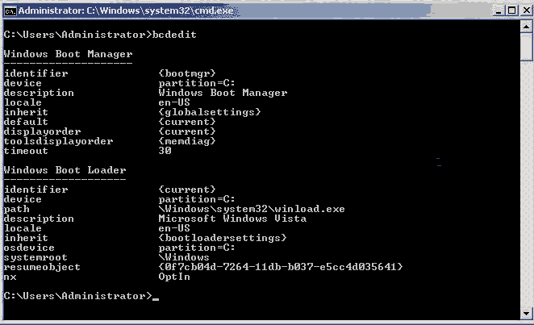
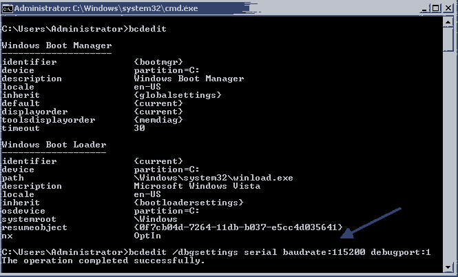
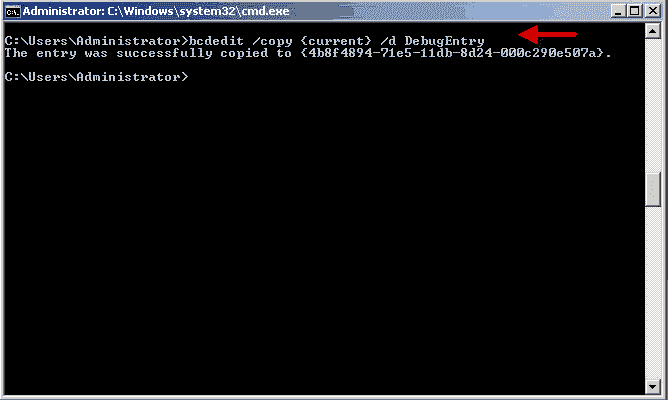
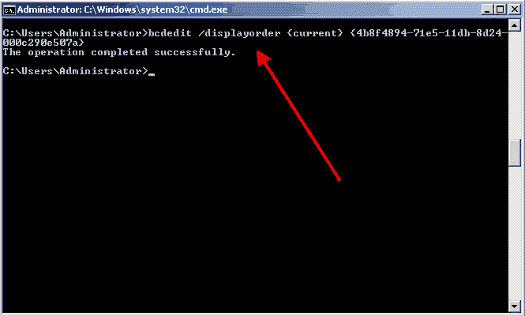
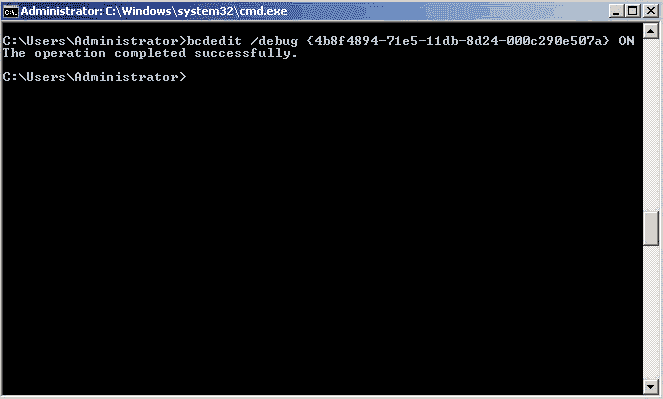

# WinDBG 双机调试之 Vista Boot Config 设置,高手勿进.

> 原文：[`www.pediy.com/kssd/pediy08/pediy8-484.htm`](https://www.pediy.com/kssd/pediy08/pediy8-484.htm)

声明:我是菜鸟，还请大侠多多指教.  
vista 没有和 win2k/xp 一样的 boot.ini 文件,必须用 bcdedit 来设置启动信息.  
在默认的用户下是没有权限改变 Boot Config 的,必须把现在的用户删除,激活  
管理员帐号,重启电脑,系统会自动以管理员的身份登录.  
  
第一步.我们先查看一下当前的用户设置:  
命令为:  
bcdedit  
   
  
第二步.然后我们设置端口,COM1 ,每秒位数:115200,也可以用 1394 或者 USB,  
这里以 COM1 为例:  
命令为:  
bcdedit /dbgsettings {serial \[baudrate:value\]\[debugport:value\] |  
1394 \[channel:value\] | usb }  
   
  
第三步. 复制一个开机选项  
命令为:  
bcdedit /copy {current} /d DebugEntry  
DebugEntry 为选项名称, 可以自行命名. 然后将结果的 GUID 值复制一份.   
   
  
第四步.增加一个新的选项到引导菜单  
命令为:  
bcdedit /displayorder {current} {ID}  
这里的{ID}的 GUID 值是第三步的 GUID 值.  
   
  
第五步.激活 DEBUG  
命令为:  
bcdedit /debug {ID} ON  
这里的{ID} 的 GUID 值是第三步的 GUID 值.  
   
  
命令执行成功后,重新启动.  
  
选择 DebugEntry 登录,开启 Windbg  
Microsoft (R) Windows Debugger  Version 6.6.0007.5  
Copyright (c) Microsoft Corporation. All rights reserved.  
  
Opened \\\\.\\pipe\\com\_1  
Waiting to reconnect...  
Connected to Windows Vista 6000 x86 compatible target, ptr64 FALSE  
Kernel Debugger connection established.  
Symbol search path is: symsrv\*symsrv.dll\*F:\\symbols\*http://msdl.microsoft.com/download/symbols  
Executable search path is:   
Windows Vista Kernel Version 6000 MP (1 procs) Free x86 compatible  
Built by: 6000.16386.x86fre.vista\_rtm.061101-2205  
Kernel base = 0x81800000 PsLoadedModuleList = 0x81911db0  
System Uptime: not available  
Break instruction exception - code 80000003 (first chance)  
\*\*\*\*\*\*\*\*\*\*\*\*\*\*\*\*\*\*\*\*\*\*\*\*\*\*\*\*\*\*\*\*\*\*\*\*\*\*\*\*\*\*\*\*\*\*\*\*\*\*\*\*\*\*\*\*\*\*\*\*\*\*\*\*\*\*\*\*\*\*\*\*\*\*\*\*\*\*\*  
\*                                                                             \*  
\*   You are seeing this message because you pressed either                    \*  
\*       CTRL+C (if you run kd.exe) or,                                        \*  
\*       CTRL+BREAK (if you run WinDBG),                                       \*  
\*   on your debugger machine's keyboard.                                      \*  
\*                                                                             \*  
\*                   THIS IS NOT A BUG OR A SYSTEM CRASH                       \*  
\*                                                                             \*  
\* If you did not intend to break into the debugger, press the "g" key, then   \*  
\* press the "Enter" key now.  This message might immediately reappear.  If it \*  
\* does, press "g" and "Enter" again.                                          \*  
\*                                                                             \*  
\*\*\*\*\*\*\*\*\*\*\*\*\*\*\*\*\*\*\*\*\*\*\*\*\*\*\*\*\*\*\*\*\*\*\*\*\*\*\*\*\*\*\*\*\*\*\*\*\*\*\*\*\*\*\*\*\*\*\*\*\*\*\*\*\*\*\*\*\*\*\*\*\*\*\*\*\*\*\*  
nt!RtlpBreakWithStatusInstruction:  
81881760 cc              int     3  
关于 Windbg 设置部分和虚拟机设置部分可以参考:  
http://silverstr.ufies.org/lotr0/windbg-vmware.html  
http://www.vmware.com/support/ws3/doc/ws32\_devices3.html  
http://www.wintoolspro.com/?p=6 

 4dd466d0e1e0cc123afbe504da2462ca