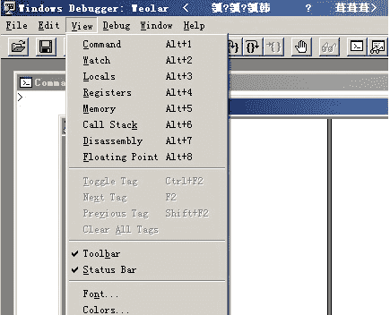
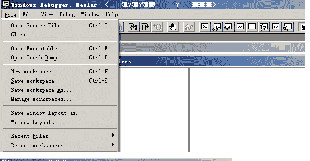
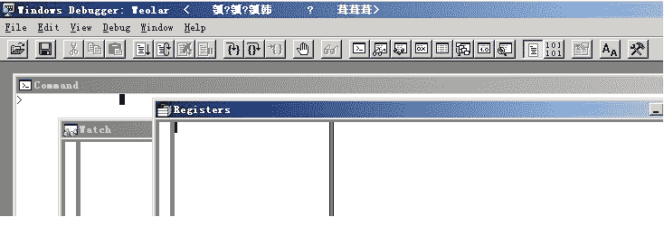
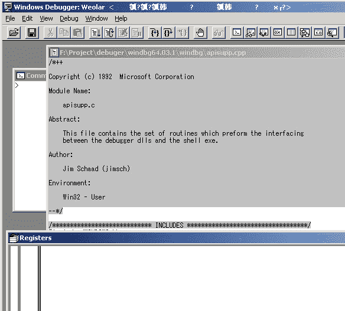
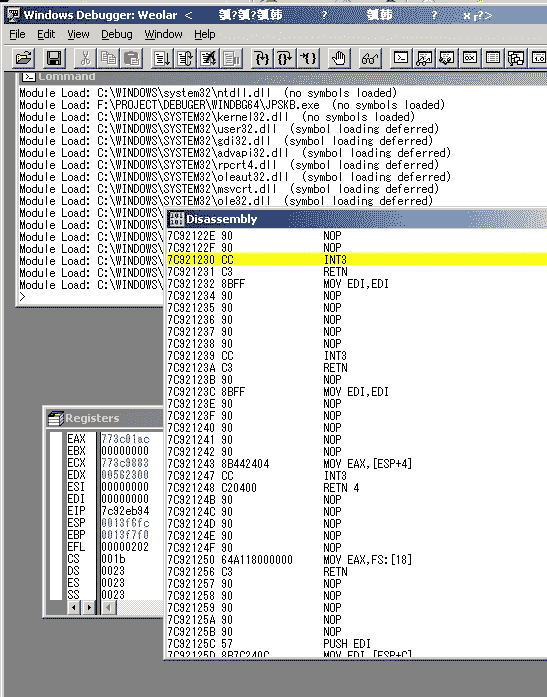

# 再发几个好东西，windbg 可编译源码

> 原文：[`www.pediy.com/kssd/pediy12/137731.html`](https://www.pediy.com/kssd/pediy12/137731.html)

MyBlog : [`hi.baidu.com/weolar/blog/item...1d0c86ae7.html`](http://hi.baidu.com/weolar/blog/item/13f3374ea66126c1d0c86ae7.html)  
  
这是去年过年的时候无聊倒腾的东西。最近整理硬盘的时候，发现不少东西在自己的机子上静静的躺了  
N 个年头，而一直没空去打理，故干脆放出来，希望有缘人能继续整理。。。  
  
很久以前别人问我要，但我没给，是因为里面嵌了个私人版的反编译引擎（不是反汇编引擎）。现在我把它去掉了，嘿嘿。。  
  
这个版本的 windbg 是从 win2k 源码里扣出来的。和扣 ie5 一样，花费了我大量的精力。但实用性不佳……比较是很早的版本了。当初编译的时候着实费了很多精力，在这个版本中，反汇编引擎缺失，也缺了很多头文件和实现，我从 reactos 里扣了些，然后从 vc6 里也扣了很多。当初微软设计整套架构的时候，还是很牛逼的。windbg 和 vc 共用一套调试接口，而且还支持 64 位（那时候可是 95 年……）其中的 dm.dll 是 debugger module ，封装了访问和管理被调试程序的一系列函数，包括写内存、设置和读取线程上下文。这个 dll 是用户态调试的，还有个 dmkd.dll 是内核态调试。  
  
Eecxxx86.dll 是 exoression evaluator of plus plus 的缩写，因此这个是评估和处理 c++语法的各种表达式。  
emx86.dll 执行模型模块。用来启动调试会话和控制被调试程序的各种函数，如附加进程等。  
tlloc.dll，传输层模块，transport layer local 的缩写，负责与本地的 dm 模块通信。发送请求数据包。  
shcv.dll，符号处理器（symbol handler）的缩写。用来处理 codeview 格式的调试符号。  
上图是王道：  
  
  
  
  

上传的附件
|  || windbg64.part01.rar  
 |
|  || windbg64.part02.rar  
 |
|  || windbg64.part03.rar  
 |