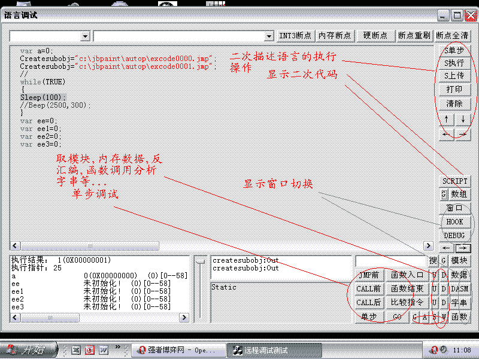
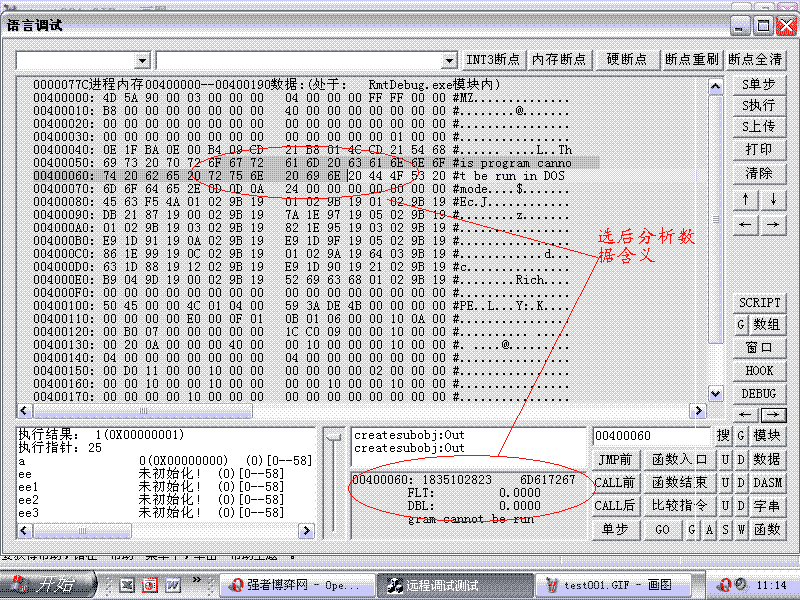
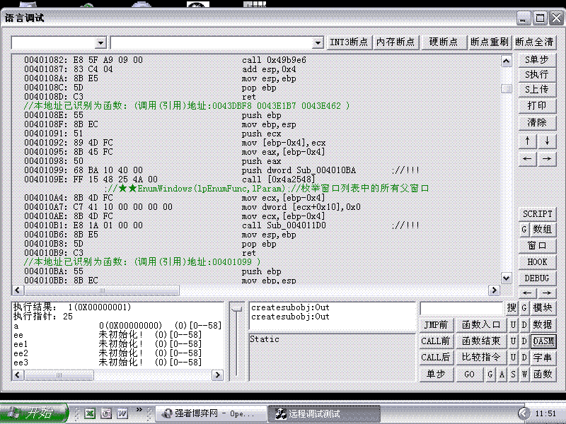
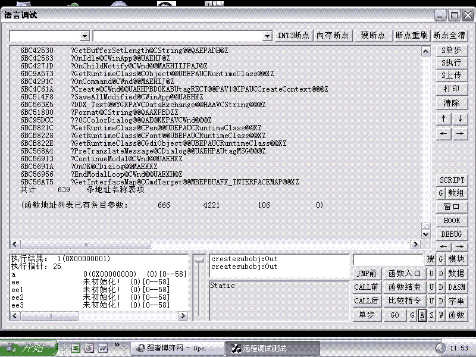

# 51 大奉献:调试工具已经上线.

> 原文：[`www.pediy.com/kssd/pediy11/112252.html`](https://www.pediy.com/kssd/pediy11/112252.html)

51 大奉献:调试工具已经上线.  
  
几年来一直想搞个 HOOK 型分析调试工具,最近一个月发狠,终于搞得差不多了.  
  
这次修改为第一次修正.(20100506),这次修正应为第一次完本.没什么遗憾了  
  
主要修改有:  
  
1.修改了线程隔离 BUG,原来把调试线程隔离的代码有毛病.  
  
2.增加进程内存写入函数,asm 简易汇编函数  
例子:支持已经调入的符号  
var m\_user\_address=m\_hook\_code\_user;//10K 用户可编代码空间  
var pasmwr=m\_user\_address;  
pasmwr+=Win\_Asm(pasmwr,"mov eax,0x99");  
pasmwr+=Win\_Asm(pasmwr,"call ★★Sleep☆☆");  
  
3.在断点重刷或断点全清的按钮中,增加当前所有线程的 context 内容.以便于从头开始时,寻找入口  
\*\*\*\*\*\*\*\*\*\*\*\*\*\*\*\*\*\*\*\*\*\*\*\*\*\*\*\*\*\*\*\*\*\*\*\*\*\*\*\*\*\*  
无任何断点  
线程    8064   Context:  
Eax:  00000004  Edx:  0143FA60  Ecx:  00000004  Esi:  00000000  Edi:  0143FC60  
Eip:  7C92EB94  Ebp:  0143FC88  Esp:  0143FC30  Ebx:  00515948  
线程    9064   Context:  
Eax:  001652B0  Edx:  00000017  Ecx:  0153FD64  Esi:  7FFFFFFF  Edi:  FFFFFFFF  
Eip:  7C92EB94  Ebp:  0153F89C  Esp:  0153F860  Ebx:  00161C68  
线程    9852   Context:  
Eax:  00000000  Edx:  7C92EB94  Ecx:  01638424  Esi:  00000000  Edi:  01638454  
Eip:  7C92EB94  Ebp:  0163847C  Esp:  01638424  Ebx:  00000144  
  
\*\*\*\*\*\*\*\*\*\*\*\*\*\*\*\*\*\*\*\*\*\*\*\*\*\*\*\*\*\*\*\*\*\*\*\*\*\*\*\*  
  
  
4.增加注释和断点在反汇编中的显示  
  
在反汇编代码后面用;后加注释,然后点注释按钮就完成添加  
  
本软件主要功能有:  
  
1.属于 HOOK 式调试方式,以线程插入,通过网络接口来取得调试信息.程序本身有解断点自锁机制,所以,无论是做为调试分析,还是作为应用程序调入,本软件都是很有用处的  
  
  
2.支持多线程类 C 二次描述语言编程(可以同时开 16 个线程来运行二次代码,时间片是 ms 级别),已经支持反汇编,在线调试,所以根本上拓展了调试功能  
二次描述语言可以获取断点时的寄存器信息,并可修改寄存器内容  
  
3.支持 windows 窗口的管理和一些界面操作.  
  
本程序在编程时使用了看雪大能--红尘岁月--发的<<给 ollydbg 自动添加注释的插件>>  
中的帮助头文件,另外使用了 SoftSnoop2010 中有关 mfc 动态连接库出口函数文本文件.  
  
在此一并表示万分感谢,因为本软件定位为自用,所以使用者不可用于商业目的,  
  
不可用于干非法勾当.  
  
  
程序下载地址为:  
  
http://www.myautotrade.cn/down/rmtdebug.rar  
  
mfc 动态连接库出口函数文本文件下载地址为:(释放到 autop 子目录)  
http://www.myautotrade.cn/down/mfc\_xx.rar 

论坛下载  
  
两个文件都不大

上传的附件
|  || mfc\_xx.rar  
 |
|  || rmtdebug\_setup.part2.rar  
 |
|  || rmtdebug\_setup.part1.rar  
 |

介绍图片.  
  
主要功能要靠自己摸索.我最近没时间作帮助文件.以后再说吧  
  

本软件的调试信息是多窗口并显,要通过按钮来完成切换.  
  
有时需要点击按钮来完成对应功能  
  
比如你要反汇编,你可以在上部窗口,点击任何 8 位长地址,  
  
然后点击 dasm 按钮前面的 U/P 按钮,就能进行定位反汇编.  
  
debug 窗口有最高优先级,一有断点信息,就会自动切进 

