# 献给新手(一)--不用脱壳就能调试加壳软件(SoftICE 还旧之旅)

> 原文：[`www.pediy.com/kssd/pediy12/127562.html`](https://www.pediy.com/kssd/pediy12/127562.html)

**【原创】献给新手(一)--不用脱壳就能调试加壳软件(SoftICE 还旧之旅)**  
  
於版,我己不能在新人交流投稿发贴,但贴是要新手入看的,因是自己加入论坛,搞不清楚,所以就先到了『求助问答区』,但因不是真的悬赏贴,所以发得心理怕怕的,在发  
『伴你成长』园地,就快把之前的贴移到,不是要灌水重发贴,先前不懂版的地方,版主及各位雪友多多原!!  
  
【作者】ninymay  
【说明】我是,了一篇於 OCX 控件的破解文章  
([`bbs.pediy.com/showthread.php?p=905878#post905878`](http://bbs.pediy.com/showthread.php?p=905878#post905878))  
  
除了得版主了邀请码外,也勾起大家的,坐光机回到 SoftICE 的年代,雪友 whypro 希望我再多篇,所以我就抱著回大家的心了,我水平不高,的不好多多包涵  
  
老,OllyDBG 真的太好用了,不用安,什作系都能 Run,界面又漂亮,插件多到翻...不用它真是笨蛋咧  
但如果你是初软件调试的新手,恐怕 OllyDBG 的美好光很快就去了,因它有很多事情不是您想的那美好,在扒一下文就知道,新手的汇编能力不好,遇到加壳软件,如果有脱壳机或脱壳插件、脱壳本...,那程序入跟不了多久、看不了多少机就放了,即使不放也是白做工,去不知道要做什？所以老得破解入，调试软件真不是人的...  
  
如果新人先 SoftICE 下手就不一了,它然不美,而且很挑作系,最重要是得一步一步去安...然,但起,上都有明:  
[`www.pediy.com/tools/Debuggers...CE/SoftICE.htm`](http://www.pediy.com/tools/Debuggers/SoftICE/SoftICE.htm)  
[`bbs.pediy.com/showthread.php?t=85389`](http://bbs.pediy.com/showthread.php?t=85389)  
  
如果有,我也把我的安心得再上...  
一旦起,了,您就了:  
  
您不用先去付的 PE 格式、IAT 表格、不用去管什演算法、加解密法，您可以先比人性的 Windows API 下手,配合常用的机,就能有小成就,什呢？因:  
  
『SoftICE 可以加壳软件直接下 Windows API』(比如框出用的 MessageBox...),不用先脱壳,就能在要害的地方,段乎有程式可以『完全』不用 Windows API,只要用 API, SoftICE 就能您下,而且不管再害的壳它是得行,一旦行起,它自己得先脱壳,您就等著它自投就好了  
  
接下您就可以好好分析了,才有趣,才不把新手跑嘛>\_<,而且又回,如果用 SoftICE 中在的地方都法往下分析,那就算完壳你,不是一看不懂,所以尤其是您要付的是『有壳的意程序』,重是要分析意程序,而不是壳,  
如果可以不壳就分析,就不用多一道手了不  
  
好了,不多,才是真的,先好了,是新手入的,大牛千挑毛病啊!!有 OllyDBG 有不好,OllyDBG 的死忠者,千不要找我,我只是希望借 SoftICE 的方便,  
更多的新手入之  
  
  
【破解等】入  
【使用工具】SoftICE(Driver Studio V3.2)  
【破解平台】VM6.04/XP SP2  
【软件名称】RenameRegKey UPX.exe MyReg1.reg  
【下载地址】RenameRegKey.rar  
【软件简介】非常的程序,供用,有 Anti-Debug,不是否在 VM 下行...  
【软件特性】Windows 登(Registry)做修改的作  
【软件大小】184KB(解後)  
【保护方式】UPX 2.92b--最的壳,丈高平地起,一步一步慢慢  
【破解目的】用 SoftICE 在未壳的情下就可以分析程序是如何修改登加以阻止,  
                  以此了解存取登的相 API  
【破解声明】本例程式如果您用壳机壳後,可以再用任何加壳方式加壳回去,都可以再用本篇  
                  介的方式在未壳的情下成功下喔  
【破解内容】  
  
因是教程，所以也大家摸索了，更不必去放在沙盒中或什捕境中，我先告大家程式要嘛？  
  
大家先用事本把 MyReg1.reg 打看看，  
  
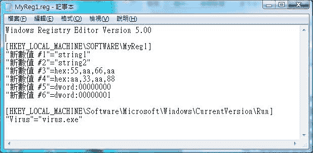  
  
它在  
HKEY\_LOCAL\_MACHINE\\SOFTWARE\\  
新增一机名字叫做 MyReg1  
且在 HKEY\_LOCAL\_MACHINE\\Software\\Microsoft\\Windows\\CurrentVersion\\Run  
新增一机叫做 “Virus” 机值 “Virus.exe”  
我把事本，用滑鼠 MyReg1.reg，不要理系的警告，按下 “定” 机入登，如果您有安防毒程式  
也它通，否後面法。  
  
在打登程式(RegEdit.EXE)到 HKEY\_LOCAL\_MACHINE\\SOFTWARE\\  
看到左方新增了一名叫 MyReg1 的机  
  
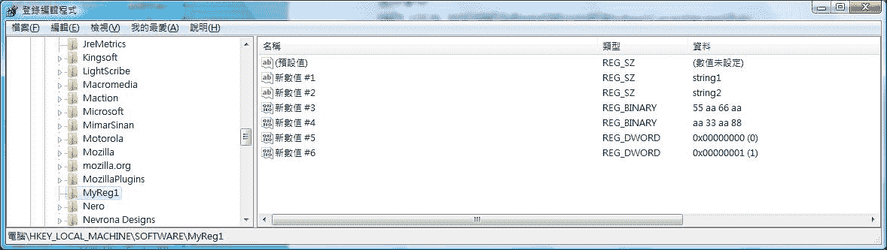  
  
再到 HKEY\_LOCAL\_MACHINE\\Software\\Microsoft\\Windows\\CurrentVersion\\Run  
看到右方多了一行 Virus  REG\_SZ   Virus.exe  
放在位置的程序是每次 Windows 机都行的,所以是意程式兵家必之地！  
  
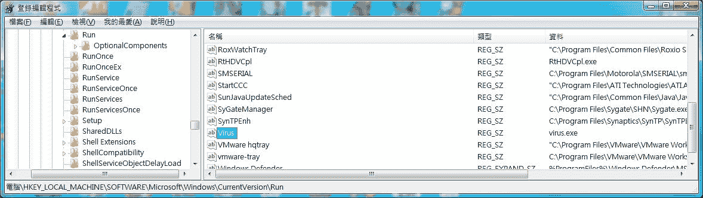  
  
※我例程序是示用的,所以很友善,真的意程式就去除(不是改名而已)你重要的机,且在增加(而不是除)一机,以便下次 Windows 可以入它的意程序!!!!!  
但透例,就可以了解登的 API 操作手法,日後可以通用  
  
一切就就先行 RenameRegKey UPX.exe 程式  
  
  
  
我看到主面有大 Button 如果按下 Button1 看到一框告你 MyReg1 成 MyReg2 了  
  
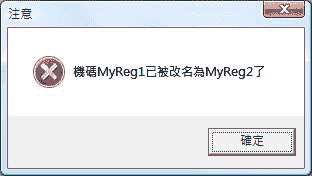  
  
再到登程式，按一下 F5 它重新整理，在再去看看 HKEY\_LOCAL\_MACHINE\\SOFTWARE\\下的 MyReg1 不了成 MyReg2  
  
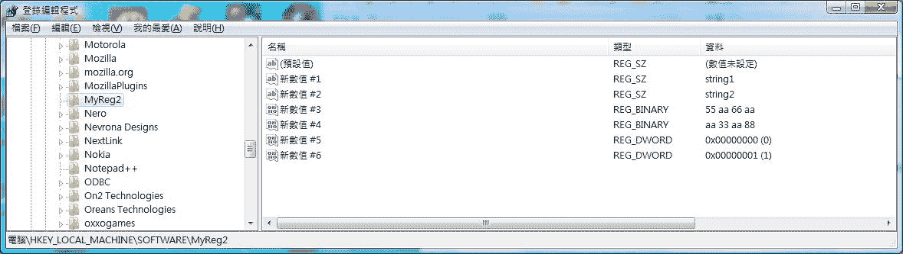  
  
而按下 Button2 出值己清除完成的框，  
  
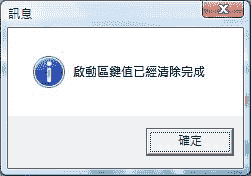  
  
再到 HKEY\_LOCAL\_MACHINE\\Software\\Microsoft\\Windows\\CurrentVersion\\Run  
Virus 那一行值己不了不？  
好了，在假你是初者不壳，但要付程序或是分析它的程序在哪要怎做呢？  
  
如果你叫出 OllyDBG 假是全新的壳或是壳有插件可以忙壳，那入 RenameRegKey UPX.exe 程式就出警告息  
  
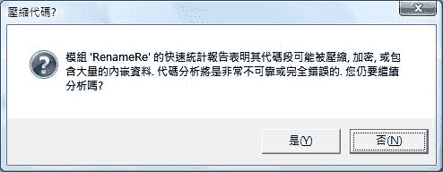  
  
不理它入，由於我已知道它是在登做手，所以我可以下 RegOpenKeyA 做中，在 Windows 要存取登都必需要靠 API 登,如果手有 MSDN,可以查一下它的原型宣告:  
  
LONG RegOpenKey(  
  HKEY hKey,        // handle to open key 在本教程中用 HKEY\_LOCAL\_MACHINE  
  LPCTSTR lpSubKey, // name of subkey to open  
  PHKEY phkResult   // handle to open key  
);  
  
中有 RegOpenKeyA, RegOpenKeyW, RegOpenKeyExA, RegOpenKeyExW 四 A 是 For ANSI, W 是 For Unicode 版本  
在本教程中用的是 RegOpenKeyA  
  
在我在下方的 Command 入 BPX RegOpenKeyA  
  
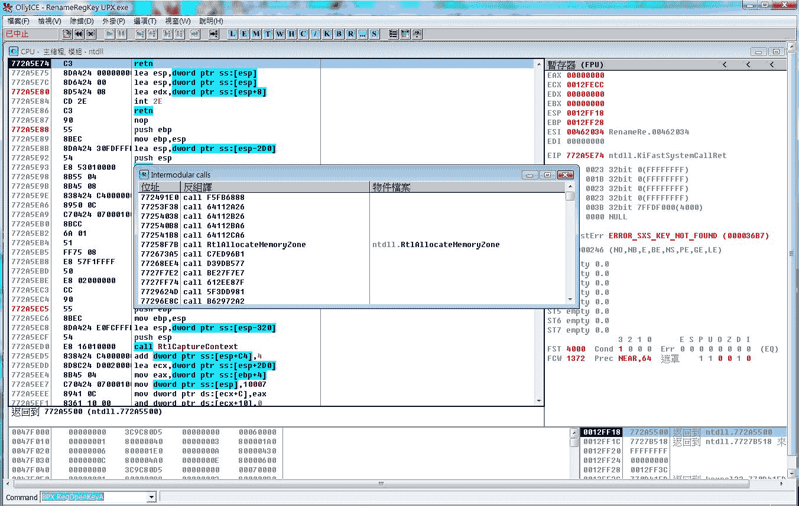  
  
出的框怪怪的？！不像是有效的中，因若是有效的中是出的框才  
  
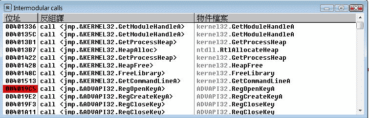  
  
才算是承 RegOpenKeyA 是有效的中，但在先不管那多了，全速行下去看不得到就知道了！在 OllyDBG 全速行後，主面出了，按一下 Button1 果告你 MyReg1 成 MyReg2 的框出了，在壳的情下，OllyDBG 什也到？？  
  
如果到的面是才啦！  
  
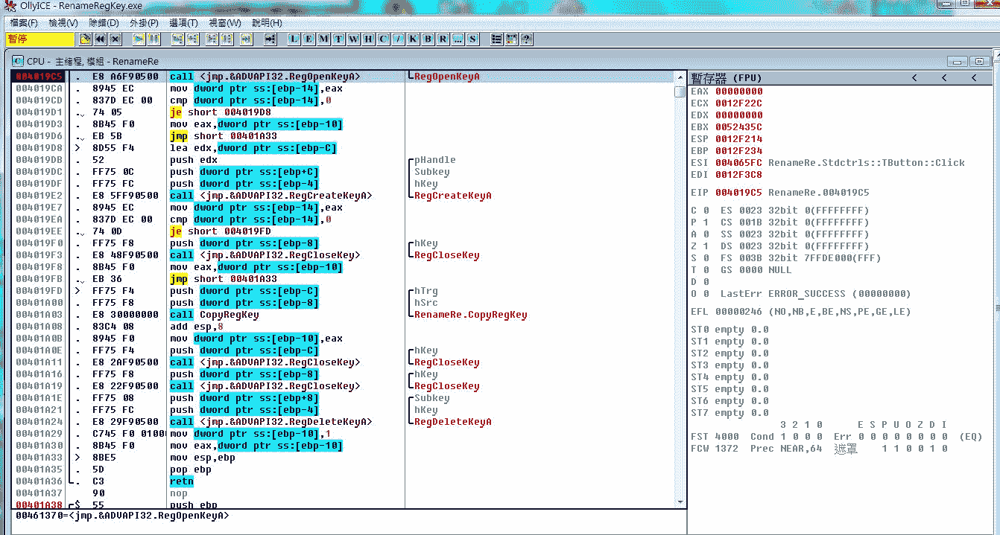  
  
如果不想慢慢的起,您可以有另外一  
在 SoftICE 上了，先把 VMware 打，先 SoftICE，先到始程式集 Compuware DriverStudioSettings 叫出 SoftICE 的定程式在左 SoftICE Initialzation 中的 Exports 右方是不是有 C:\\WINDOWS\\system32\\advapi32.dll 字，如果有要自己按下右的 “Add…”自行加入，才能使 SoftICERegOpenKeyAAPI 等一下才能正入做中。  
  
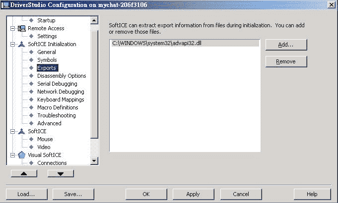  
  
在可以 SoftICE 了，因 SoftICE 是 Ring 0 的除工具，了避免等一下做任何作都 SoftICE 我最好先行 RenameRegKey UPX.exe 之後才去按 Ctrl+D 叫出 SoftICE 然後入 BPX RegOpenKeyA 了保起可以入 BL 指令已被接受  
  
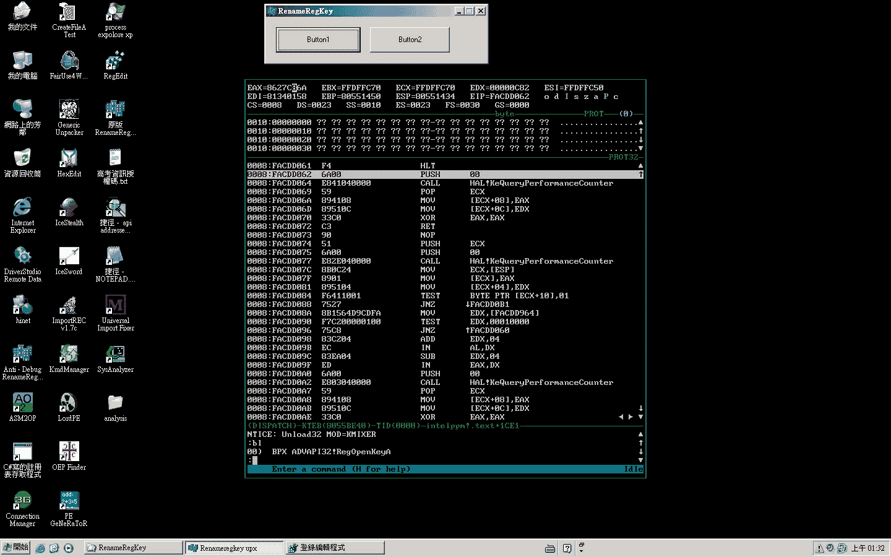  
  
各位可以在截中看到 RenameRegKey.exe 已了，在按 F5SoftICE 先消失，之後就可以按下 RenameRegKey.exe 中的 Button1 了一下子 SoftICE 就跳起，它已到 RenameRegKey UPX.exe 登表的作了，  
  
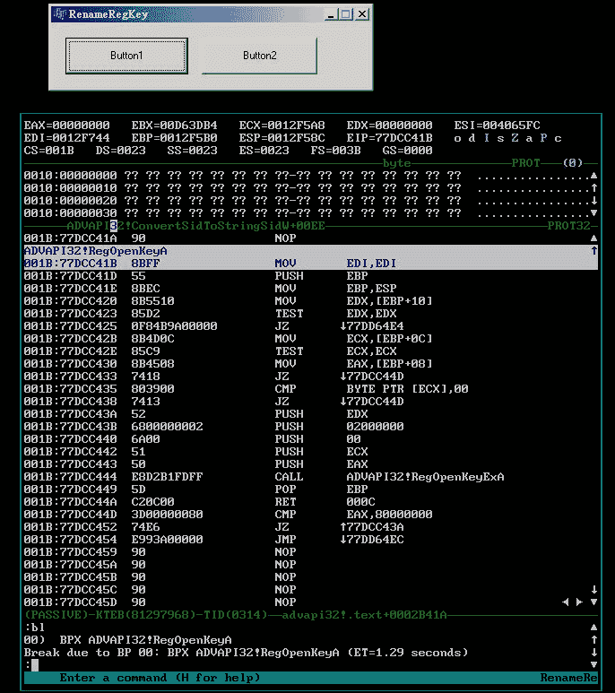  
  
只是在在 Advapi32.dll 的空上，我可以中下方色那行字:  
advapi32!.text+0002B41A 的字得知,  
在我要按一下 F12 它可以回到  
RenameRegKey UPX.exe 的空  
  
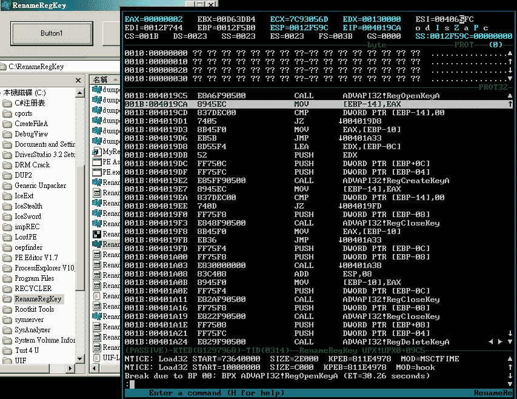  
  
在回到 RenameRegKey UPX.exe 的空，往下看就可以知道程式是怎去更改登表或是除登表的：原登表不像案管那可以直接下 Rename 的指令去修改案或目名，至少有 RegRenameKeyAPI 嘛！它必需先重新造一新的名，然後把原的容一份到新的中，最後再把原的掉。  
  
考到新手可能械的不是熟，在是稍微一下追的程好了。我程式步行(F10)下去，要特注意分岐的地方，像第一分岐是 4019D1 的地方(以我的截，因不同的器上跑程式地址可能有所不同！)，JZ 4019D8，SoftICE 告我件  
成立所以程序跳到 4019D8(SoftICE 有一往下的小箭提示)，在做了最重要的一件是就是呼叫 RegCreateKeyA，建立一名 MyReg2 的，之後到了第二分岐 4019EE    JZ  4019FD，SoftICE 同告我件成立，所以跳到 4019FD，到了 4019FD 就去呼叫 401A38  
  
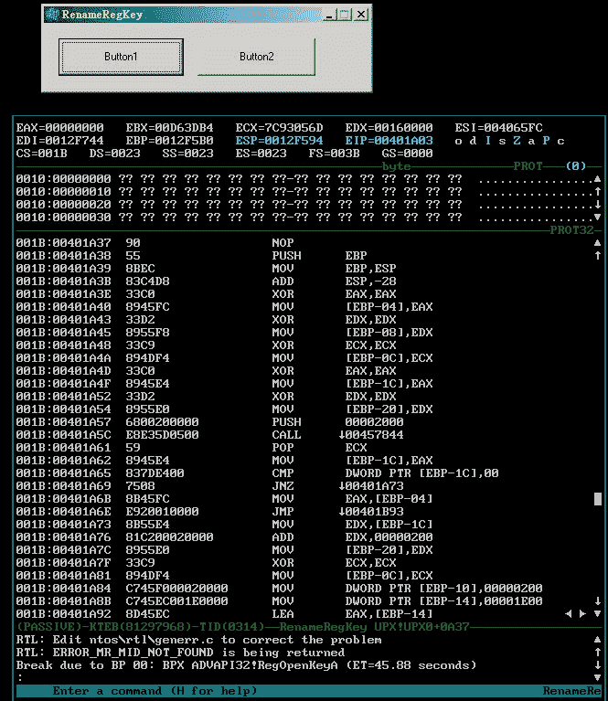  
  
是 RegCreateKey 的原型宣告  
LONG RegCreateKey(  
  HKEY hKey,        // handle to an open key  
  LPCTSTR lpSubKey, // subkey name  
  PHKEY phkResult   // buffer for key handle  
);  
  
  
我按 F8 跟看看，一始看不到什 API，如果有趣可以自己分析看看，一直走到 401A69   JNZ 401A73，SoftICE 告我要跳，接下情就明朗了，程式先叫用了 RegEnumValueA 去列原 MyReg1 面的值，然後到 401AB8  JNZ 401ADE SoftICE 回不跳，不跳就了，下面才是重：  
  
先叫用 RegSetValueExA 入和 MyReg1 列出一的值到 MyReg2 面，再呼叫  
RegDeleteValueA 去掉 MyReg1 面的值，在 401AE2 的地方查 MyReg1 的机值都列完了？如果有就回跳到 401A84 重上面的作直到整 MyReg1 的西都到  
MyReg2 面止。  
  
是 RegEnumKey 的原型宣告  
LONG RegEnumKey(  
  HKEY hKey,      // handle to key to query  
  DWORD dwIndex,  // index of subkey to query  
  LPTSTR lpName,  // buffer for subkey name  
  DWORD cchName   // size of subkey name buffer  
);  
  
是 RegSetValueEx 的原型宣告  
LONG RegSetValueEx(  
  HKEY hKey,           // handle to key  
  LPCTSTR lpValueName, // value name  
  DWORD Reserved,      // reserved  
  DWORD dwType,        // value type  
  CONST BYTE \*lpData,  // value data  
  DWORD cbData         // size of value data  
);  
  
是 RegDeleteValue 的原型宣告  
LONG RegDeleteValue(  
  HKEY hKey,            // handle to key  
  LPCTSTR lpValueName   // value name  
);  
  
  
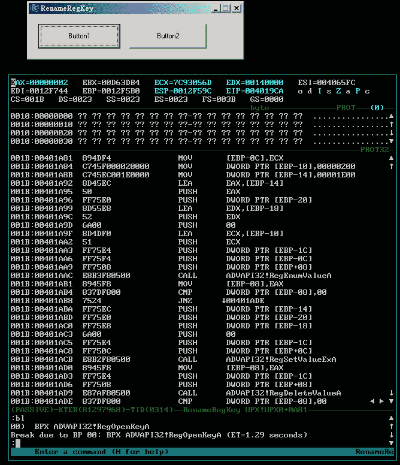  
  
在您是不是恍然大悟，Windows 成的 API 真的很重要不？熟悉了之後要分析意程式真的很方便，配合 SoftICE 就算不壳也可以截下  
且把它分析得清清楚楚啊！  
  
如果不放心，可以把在看到械便抄下然後去 HexEdit 或是 UltraEdit 把 RenameRegKey UPX.exe 入後搜看看，是不是根本找不到些械？所以可以明程序案仍是未壳的,但一旦行起被 SoftICE 下的是已壳乾的，如果有用保的，也保一定被原成 x86 的械了啦^^  
  
如同一始的候的,本例程式如果您用壳机壳後,可以再用任何加壳方式加壳回去,都可以再用本篇介的方式在未壳的情下成功下分析喔!各位不妨  
  
而再害的客不管怎小心，都很完全不用 Windows API 出一像的意程式，多是用冷的、低的 API(例如 zwOpenkey...以後有的文介)，且去 Hide 一些知名的追，再不就是 Hook 住 APIAPI 先做自己想做的事情，做完了再去做原本 API 做的事情，而些都很逃 SoftICE 的法眼，上面的明和示相信者可以知道 SoftICE 的的有它到的地方是 OllyDBG 所不及的，在入可以新手一些助。  
  
  
【後】  
挑剔的者也到如果不壳，那在找到性的程式要修改，但是到了案中找又找不到，那又如何能修改呢？心，不壳不但可以分析也可以修改，才是完美的破解方案，期待下一篇:新手(二)--不用脱壳就能修改加壳软件(SoftICE 之旅)。  
  
看完

**【原创】献新手(二)--不用脱壳就能修改加壳软件(SoftICE 还旧之旅)**  
  
抱歉各位久等了,新年期,路不太,看雪的老不太起,所以至今日才第二篇,大家  
  
在始第二篇的正:  
挑剔的者也到如果不壳，那在找到性的程式要修改，但是到了案中找又找不到，那又如何能修改呢？心，不壳不但可以分析也可以修改，才是完美的破解方案。  
  
，我回到上一篇:献给新手(一)--不用脱壳就能调试加壳软件(SoftICE 还旧之旅)  
[`bbs.pediy.com/showthread.php?t=127562`](http://bbs.pediy.com/showthread.php?t=127562)  
RegOpenKeyA 被中下的地方，但在下去之前忘了把才被程式改的 MyReg2 自己在登程式中改回 MyReg1  
  
4019C5  E8A6F90500    CALL  ADVAPI32!RegOpenKeyA  
4019CA  8945EC        MOV  \[EBP-14\],EAX  <--程式在  
4019CD  837DEC00      CMP  DWORT PTR \[EBP-14\],00  
4019D1  7405          JZ 004019D8  <--注意行  
…       …            …  
…       …            …  
  
正常行到 SoftICE 回要跳(JUMP)  
各位可以看把 4019D1 的 7405 改成 7505(用 E EIP 指令下去改)  
SoftICE 就回不跳(NO JUMP)  
  
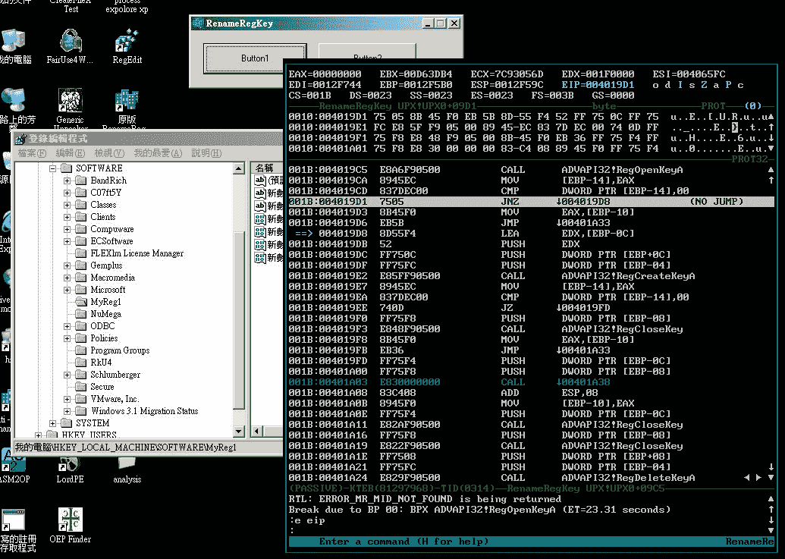  
  
在按 F5SoftICE 全速行，然程式是提示 MyReg1 已改成 MyReg2 了，但是在登程式中按下 F5 重新整理後 MyReg1 是 MyReg1 有被改名才！！  
  
因一旦在 4019D1 有跳，往下行到了 4019D6 的械是跳 JMP  401A33，下副程式全束了，根本有去行 RegCreateKeyA  
更遑後面的 RegSetValueExA 和 RegDeleteValueA，等於程式就失去作用了！  
  
但是如果抄下 83 7D EC 00 74 05 些械要去 RenameRegKey UPX.exe 中用 HexEdit 或 UltraEdit 中去找又找不到，那程序怎改呢？  
  
心您可以使用 d UP 2  
dup2.beta.rar  
我用的是 V2.19 Beta9,如果要最新版本可以考:  
[`bbs.pediy.com/showthread.php?p=909414#post909414`](http://bbs.pediy.com/showthread.php?p=909414#post909414)  
生一 Loader 案，什叫 Loader 而不叫 Patch 呢？因程序被加了壳，在有行前有法修改，所以 Patch 用武之地，就要先用 Loader 程式入有壳的那程序，全程加以控，直到我要修改的料出加以修改止，就可以不壳也能到修改程序的目的了^^  
  
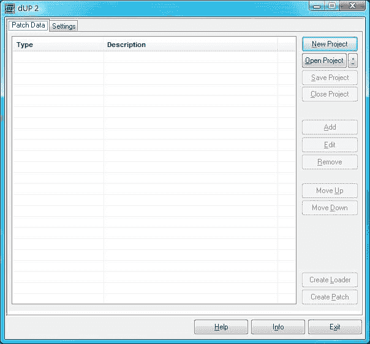  
  
我要 “New Project”在出的表中意填上些料，接著 “Add”  
  
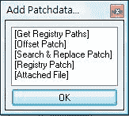  
  
在出的中 “\[Search & Replace Patch\]”  
  
回到主中多了一\[Search & Replace Patch\]我用滑鼠它之後再按右的 “Edit”，  
  
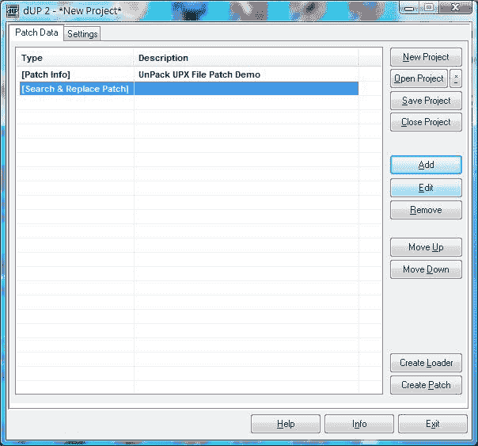  
在右上方的 “…”按下後我才追的 RenameRegKey UPX.exe  
另外在中央的空白域按下滑鼠右  
  
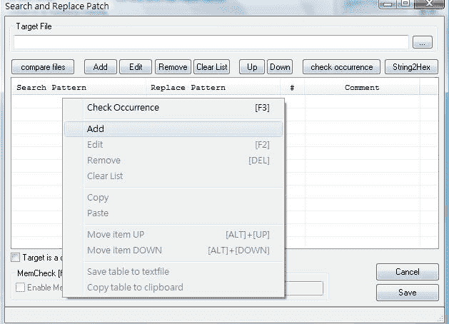  
  
出一副在 “Add”  
  
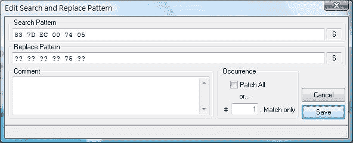  
  
接著出一 Edit Search and Replace Pattern 的框，我在 Search Pattern 中入才想要入 HexEdit 中找的十六位字串　83 7D EC 00 74 05(每字和要有空格)Replace Pattern 入 83 7D EC 00 75 05 由於只有 74 改 75 所以就成面上看到的?? ?? ?? ?? 75 ?? 按下 “Save”  
  
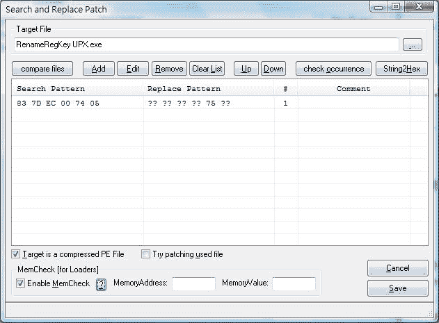  
  
回到 Search and Replace Patch 面我得要在下方的 Target is a compressed PE File 前面打勾，之後按下　“Save”。  
  
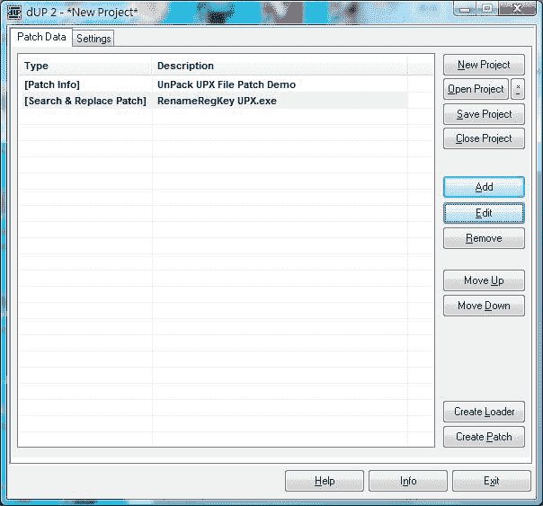  
  
在最後回到主，按下右的 “Create Loader” “simple loader”　按下 “OK”　即可生一 Loader。  
  
前得按一下 “Save Project” 整流程存下。  
由於我不得程式在 d UP2 的掌握下行的位址，所以第一次行 d UP2 先把我它的料搜一遍。  
  
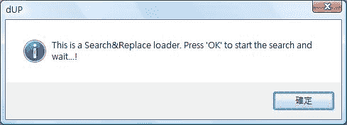  
  
如果找到了就有一框告我  
  
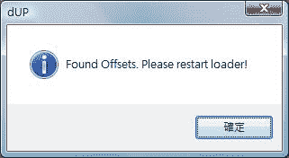  
  
且在目下生一 snr\_offsets.ldr，但由於第一次行只是去搜有做即的 Patch 工作，所以如果你用登程式按 F5 更新後去看，MyReg1 是被改成 MyReg2 的，我先手把它改回，在再行一次 Loader 就不有那框出了，且 MyReg1 也不被改成 MyReg2 了，至此我真的有脱壳就完成了分析和破解意程式的任了。  
  
是成品以及本:  
Loader.rar  
  
是不是使用 SoftICE 不壳就能分析或破解程序比有信心了,下一篇我用低核心程序(.sys)示 SoftICE,OllyDBG 它也是不能直接分析,用了 OllyDBG 的人,只能再去加 WinDBG 或其他支援 Ring0 的件,但如果你一始碰的就是 SoftICE,那就不用再一工具了,既可以分析 EXE 也可以分析 SYS 喔  
  
是那句老,本篇是完全新手看的,不是指加入看雪院的新手,而是完全接 OllyDBG 或 SoftICE 的新手,所以容很,用 SoftICE 可以新手不太需要看的机,他一始就可以生趣,不久久都入不了,有 OllyDBG 不好的意思,不要才好

**【原创】献给新手(三)--Windows 还有更低阶的 API--(SoftICE 怀旧之旅)**  
  
  
    前面帖所介绍的全部都是属于 User 端(Ring 3)层级的 API，但是如果您对付的是恶意程式  
(病毒、木马及后门程式等…)那么这些骇客级的玩家就不会用这么高阶的 API 了，  
他们会去用非常低阶非常冷门的 API，也就是 Ring 0 层级的 API，对于没写过程序的读者，根本不会听过这些 API 的名字，而对于只是用 VC、BCB 或是 VB、Delphi 写应用程序的  
读者也不会用到这样的 API，只有写低阶核心程序或是驱动程序的读者才会‘稍微’去涉猎这些 API，为什么说是稍微呢？因为这些底层的 API 实在太多了，而且是层层呼叫的，  
举例来说吧！我们之前用 Ring 3 层级的 RegOpenKeyA 这个 API 可以开启 Windows 的档(Registry)，但是有心的读者可以在 SoftICE 中继续往下 Trace 看看，就会发现它会去呼叫  
NtOpenKey 最后实际去执行的则是 ZwOpenKey 这个 API，如果您只知道 RegOpenKeyA 这个 API 那么您永远也拦不到用 ZwOpenKey 写的恶意程序。  
  
此外,有些软件狗(KeyPro)例如早期的彩虹狗(Rainbow Sentinel SuperPro)--后来公司被并购现在叫赛孚耐(SafeNet)狗,也是用低阶核心驱动来做保护的,了解驱动可以帮我们  
对付更多的保护手法喔  
  
各位读者您可以在 SoftICE 中输入 NTCALL 指令，您就会看到一堆 Nt 开头的 API 名称，当然还有其他字样的低阶 API 名称，这下总算见识到了，为什么别人能成为黑客而我们不能，  
或是别人能解开的软件而我们不能,秘密就在这里…  
  
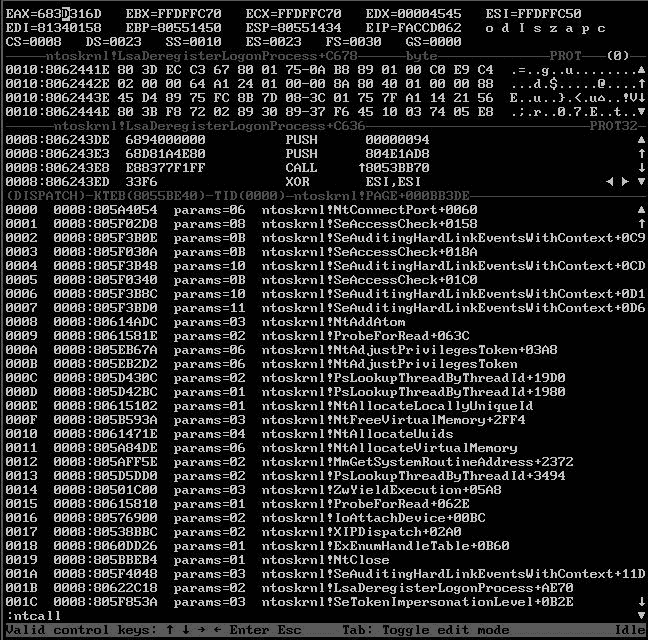  
  
但是因为 NtOpenKey 是未公开的 API 所以并没有导出，因此您可能看了半天却找不到 NtOpenKey 这个 API，各位可以上网找一下冰刃(IceSword)这个软体  
[`www.antirootkit.com/software/IceSword.htm`](http://www.antirootkit.com/software/IceSword.htm)  
安装后按左边长条状的功能键再按 SSDT 就可以看到完整导出的低阶 API 名称  
  
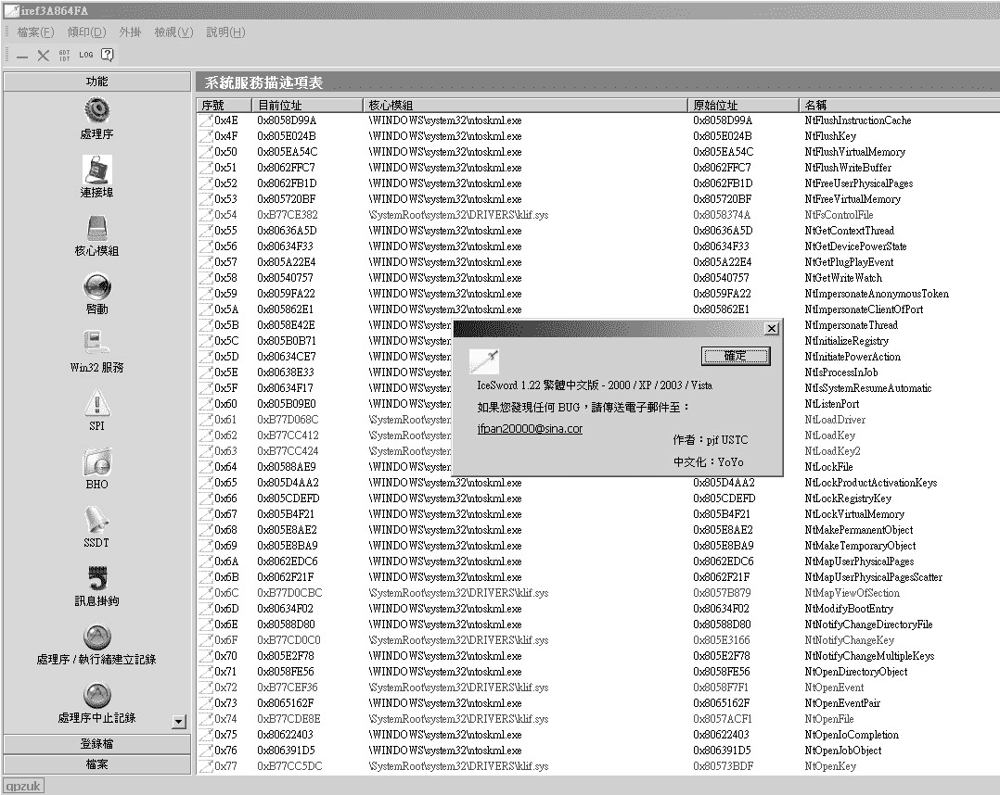  
  
在右边名称栏位最下方就可以看到 NtOpenKey 这个 API 的名称。  
但是还是看不到 ZwOpenKey 这个 API 名称，而且也无从得知 NtOpenKey 的用法，  
这时您需要安装微软的 Windows Driver Kit(WDK)  
[`www.microsoft.com/taiwan/whd...dk/WDKpkg.mspx`](https://www.microsoft.com/taiwan/whdc/devtools/wdk/WDKpkg.mspx)  
  
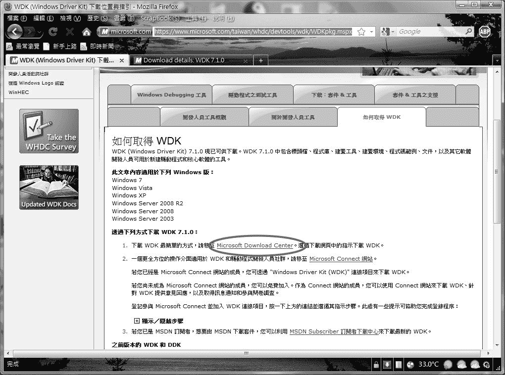  
  
在这个网页中点选中间的 “Microsoft Download Center” 就会进入真正的下载页面：  
  
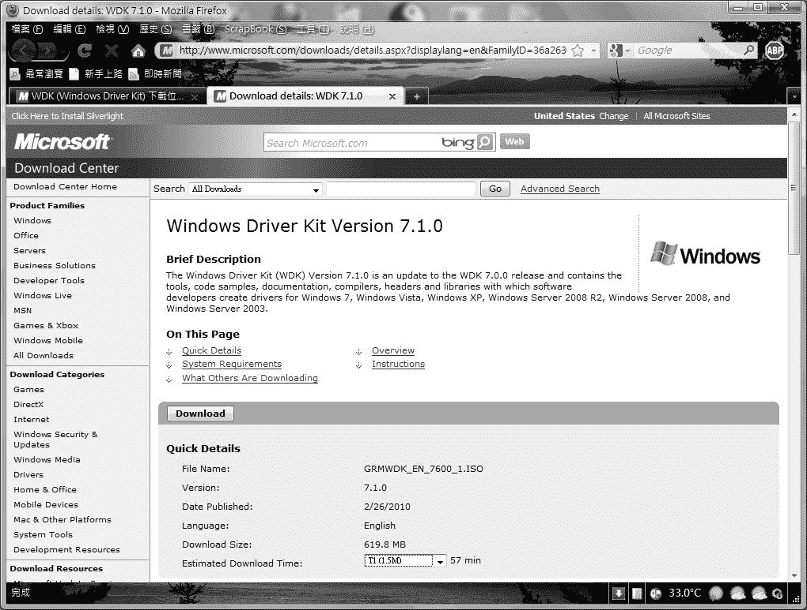  
  
下载后可以执行 KitSetup.exe 进行安装，  
安装时千万注意不要选 Device Simulation Framework(DSF)选项，否则安装完成后 Windows 将会无法重启，  
系统会出现 system32\\drivers\\dsfksvcs.sys 损坏的错误讯息！！  
  
重开机成功之后，您可以在 Windows Driver Kits-->Help-->WDK Documentation 中找到所有有关低阶 API 的使用讯息，  
  
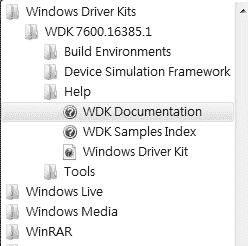  
  
例如我们打入 NtOpenKey 就会告诉我门微软不主张我们在写程式时叫用这个 API  
  
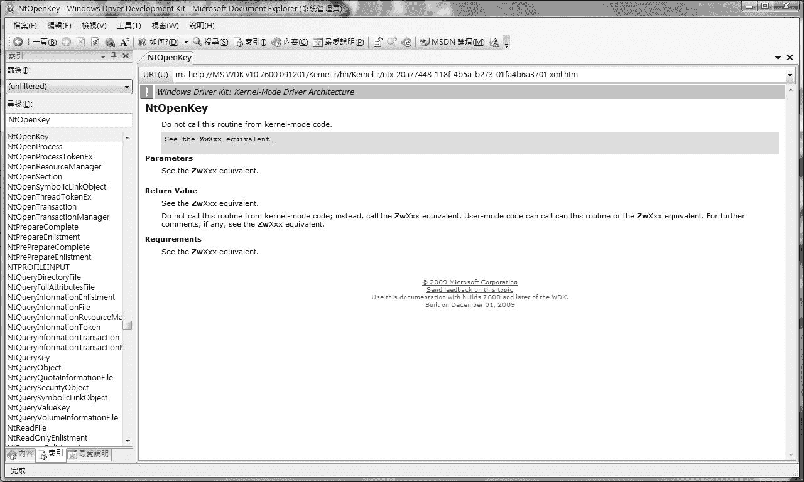  
  
那我改键入 ZwOpenKey  
  
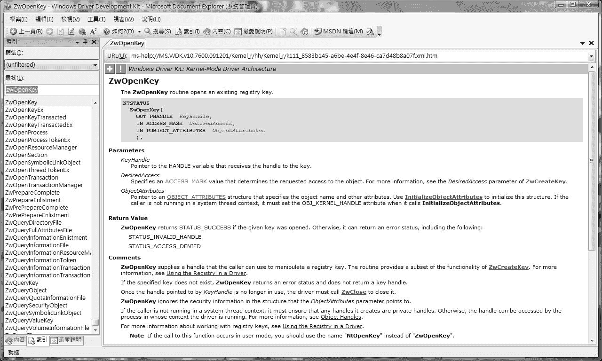  
  
这时就会有完整的呼叫方式和回传的介绍出现了。  
  
现在我们来实作看看，在我上传的附件 Ring0 API Test.rar  
面有一个 KmdManager.exe(Kernel-Mode Driver Manager)执行这个程序按右上方的  
 “…” 按键载入 zwdemo first.sys  
  
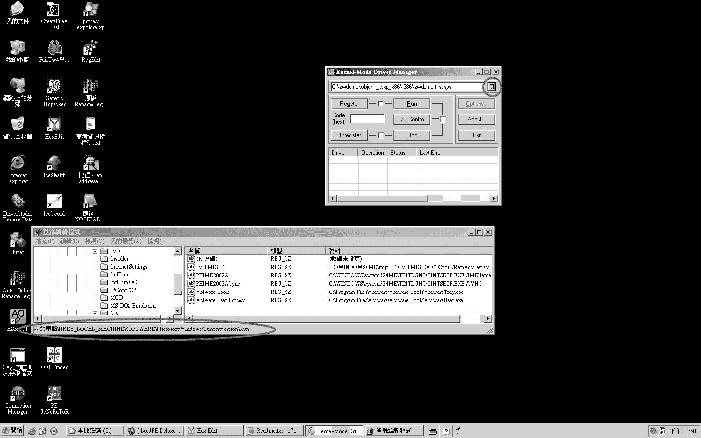  
  
这就是低阶核心程序以.sys 的型态出现，各位可以叫出 OllyDBG 试试看无论您用开启档案或是附加档案的方式都不支援这种类型的，但我们用 SoftICE 却很容易来分析和破解它！  
  
KmdManager 是一个可以模拟低阶核心程式执行的小程式，因为一般这种类型的程式都是被放入 Windows Registry 区中的  
HKEY\_LOCAL\_MACHINE\\SYSTEM\\CurrentControlSet\\Services 以及  
HKEY\_LOCAL\_MACHINE\\SYSTEM\\ControlSet001\\Services  
HKEY\_LOCAL\_MACHINE\\SYSTEM\\ControlSet002\\Services  
… … …  
这几个机码之中，在 Windows 启动的时候就会被执行,不是只有之前介的  
HKEY\_LOCAL\_MACHINE\\SOFTWARE\\Microsoft\\Windows\\CurrentVersion\\Run 而已  
  
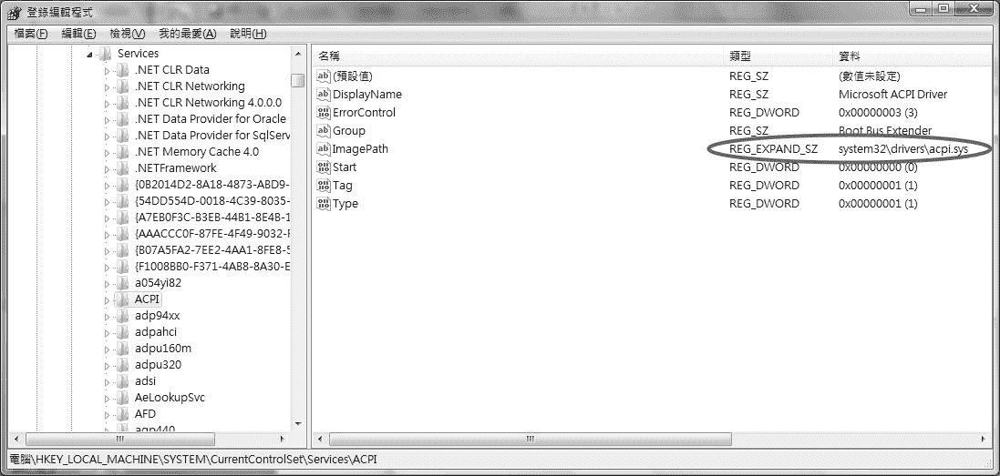  
这个是 CurrentControlSet 中会在开机时被执行的 sys  
  
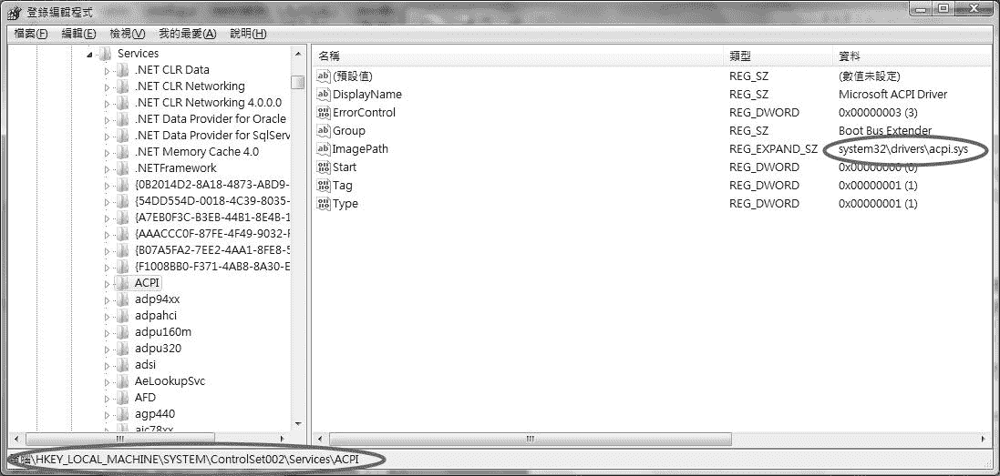  
这个是 ControlSet002 中的 sys  
  
而平常的时候是不会主动被执行的，这就是这种类型程序的可怕之处，一般程度的人很难发现它的存在，也很难去分析它到底做了什么事？  
所以是最常被骇客们拿来写恶意程式的管道！而有了 KmdManager.exe 就可以把.sys 程式当成.exe 程式来执行和分析。  
  
我们把 Windows 中的 RegEdit.exe(登录编辑程式)打开并且让它显示  
HKEY\_LOCAL\_MACHINE\\SOFTWARE\\Microsoft\\Windows\\CurrentVersion\\Run  
这个机码区域，这个区域里的所有程式也是 Windows 启动时会全部被载入执行程式！！所以也是兵家必争之地，这个地方被植入程式的名称也就保证  
以后这个作业统每次重新启动时都一定会被执行。  
  
我们先按一下 KmdManager.exe 中的 Register 按键，再按 Run 按键，经过上述的动作之后，就等于 zwdemo first.sys 这个低阶核心程式在开机时被完整执行了，  
现在我们到下方的注册表编辑器，我们按一下 检视-->重新整理 键或是直接按下 F5 键，这时您会看到在 Run 的机码区中多了一行名称为 Test 资料为 C:\\A.txt 的机码在上面，  
因为我们只是拿来做教学用，否则就可以放入一个真正的 exe 档，那么以后这台电脑的这个操作系统每次开机时这个程式都会被执行。  
  
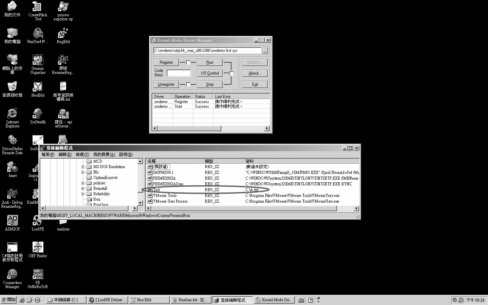  
  
知道了 zwdemo first.sys 的执行模式后，我们先把 Test 这一行的键值先删掉，  
并且在 KmdManager.exe 中按下 Stop  
现在叫出 SoftICE 键入 BPX ZwOpenKey 没有任何讯息回应就表示 SoftICE 接受了这个指令，如果不放心可以再输入 BL   
SoftICE 会回应 BPX ntoskrnl!ZwOpenKey  
表示确实在 ZwOpenKey 设下了中断点，而这个 ZwOpenKey 是属于 ntoskrnl.exe 这个 NT 系统核心程式中的一个 API。  
  
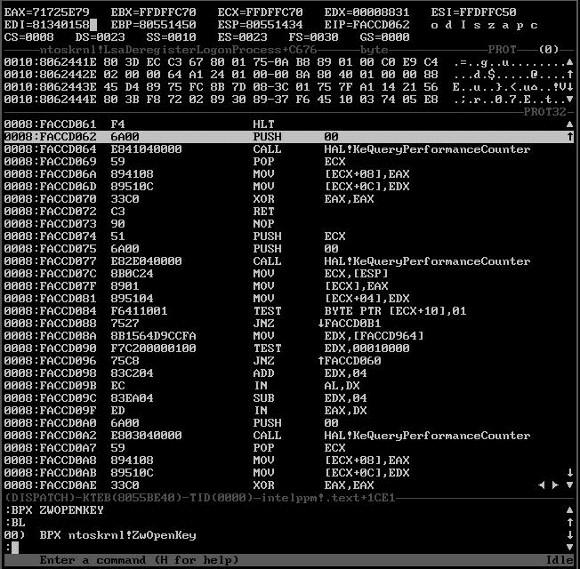  
  
现在回到 Windows 桌面再按 KmdManager.exe 中的 Run 让 zwdemo first.sys 再执行一次，马上您就会发现 SoftICE 跳出来了，在程式执行到 ZwOpenKey 的时候就被中断了  
  
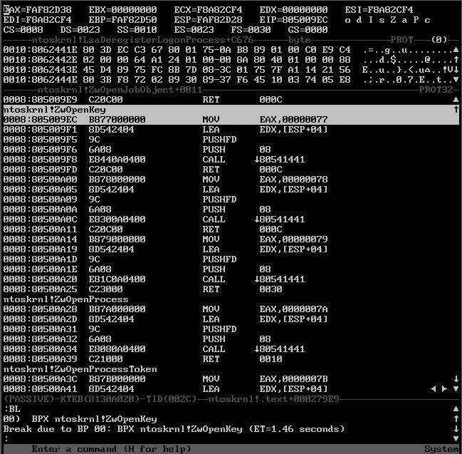  
  
大约按 32 下 F12 就可以回到 zwdemo first.sys 的领空(注意：不可以先下 bd 指令否则无去回到 zwdemo first.sys 的领空)  
  
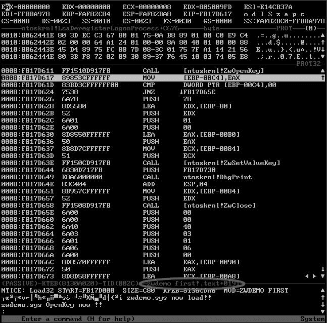  
  
现在您可以看到主程式用 ZwOpenKey 开启档之后在下方不远处我们可以看到程式又叫用了 ZwSetValueKey 来写入关键的机码，最后叫用 ZwClose 来关闭，  
如果不想按那么多下 F12 就可以迅速来到程式的关键区，那么在 SoftICE 中下  
BPX ZwSetValueKey 会比较快！而读者也要养成习惯赶快用 WDK 中的 Help 文件查一下 ZwSetValueKey 的用法，这样对低阶 API 才会愈来愈了解。  
  
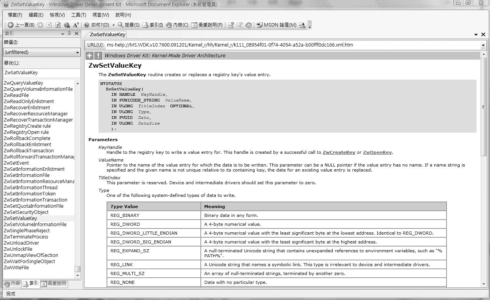  
  
如果只是想要了解程式的内容，那么断点下在 ZwSetValueKey 是很好的地方，但是如果想要破解这个程式想要让这个程式没有作用那么下在 ZwOpenKey 会是比较好的决定，  
因为接下来有一个 CMP 比较的指令，接着是 JNZ 指令，  
  
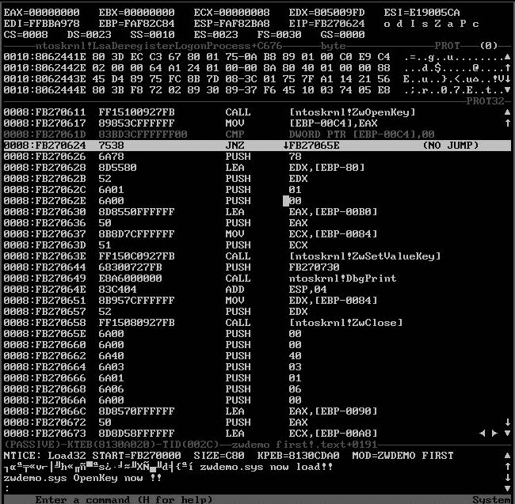  
  
让程式执行到这里您会发现程式不会跳开，会继续往下执行，所以只要在这个地方让程式跳开不会执行到 ZwSetValueKey 这个 API 自然也就不会写东西到 Run 的位置了。  
  
经由 SoftICE 的帮助我们是不是很容易就可以找出 .SYS 类型的恶意程序攻击的内容？SoftICE 只是一个工具，重点是您要对低阶核心的 API 要熟练，  
除了 Nt 和 Zw 开头的低阶核心 API，还有以 Ex、Rtl、Ke、Ps、Io、Ndis、Wdf 有心要深入的读者可以在 WDK 的 Help 文件中多多查阅自然就会认识愈来愈多的低阶核心 API 了。  
  
好消息是市面上的任何加壳工具,对.sys 档都不能工作,----也就是说.SYS 档都不会是有壳的\----  
顶多是让你在重点程序码的地方做片断的保护:  
(因为有许多雪友会误会说市面上很多软件都可以给.SYS 加壳,比如说 VMP...,我特别加以说明,  
 不然我这个版一定会被塞爆)  
  
对 EXE 档的加壳,是可以把 "整个" EXE 档重新包装,改变了 PE 档头,  
因此对使用 OD 的入门者,如果没有脱壳工具或脚本,就必需从头一行一行追起...  
但对 SYS 档,只能利用标记在机码上做段落记号,VMP 再对那个 "部份" 做打乱的动作,  
不是把整个 SYS 加壳!!---->**不是你用 VMP 把 SYS 档载入,按个按键就可以把 SYS 档整个加壳的**  
也因为这样,PE 档头就没被破坏,就可以观察输入表中到底叫用了哪些低阶 API 了  
  
这个对 IDA Pro 的静分析比较能防,对 SoftICE 来说,尤其是我现在发上来的例子,  
除非你整个写入登录档的过程都不用任何 API,否则你用 VMP 在所谓"关键段落"  
打得再乱再多虚拟码也没有用,最后你一定要解码为正确的 x86 机码(注)并且和 Windows  
底层 API 打交道,这时难逃 SoftICE 的监督,在写入机码的相关位置,一定会被拦下做分析的  
  
注:接受网友的指正,为避免让雪友误会,特更正如下,被 vmp 加壳后的 sys,用 SoftICE 下  
低阶 API 断点,仍可成功拦下,这时你看到的是 x86 机码没错,但如果按 F12 想要回去程序领空,  
对不起,就没有 x86 机码了,只有 vmp 的虚拟码,因此只能分析,无法做更改...  
(想要对付 vmp,看雪有许多牛人的帖子,但我想这不是刚入门的新手该碰的啦!!)  
  
我这里有一个把 zwOpenKey 关键呼叫加上 vmp 保护的例子,  
zwdemo first.vmp.rar  
有经验的老手,用 IDA Pro 分析就知道现在在 105BF 处,已经看不到 zwOpenKey 的 call 了,  
**可是因为 vmp 不像 exe 的加壳法把整个 exe 档都加壳,所 PE 档头并没被破坏,我们用 LordPE  
仍可以看见输入表中有叫用 zwOpenKey 这个 API,**  
  
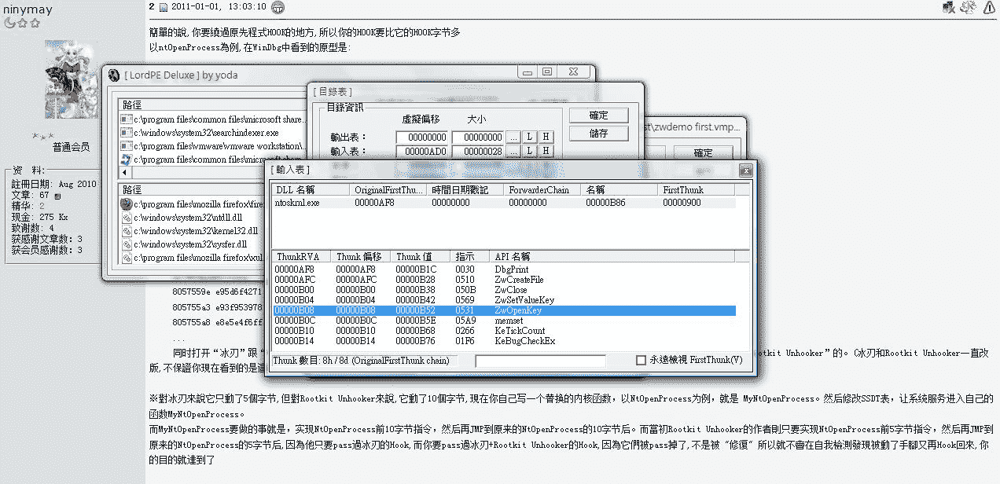  
  
当然就可以在 SoftICE 中下这个断点,  
因此我们可以用 zwOpenKey 断下,对以观察 API 为主的初学者来说,我说.SYS 是没有被加壳的,  
原因在此,却没想到引来一堆前辈指正,希望现在你们都了解我在说什么了才好  
  
断下后,记得要取消断点(BD \*),然后一路按 F12,可以看到我丢出的  
DebugView 的字串,可以一路看到叫用的 zw API 群,对分析这个恶意程序仍是有帮助的  
  
但由于我们这帖是给新人看的,不用讲的那么深入,也没有要还原 vmp 保护后的代码,希望前辈们  
不要再在这个地方多作文章了,我知道你们是为我好,怕我不知道有可以对 sys 加壳的软件,也  
怕我不知道 vmp 打乱后会变成进入虚拟机器中执行的虚拟码,谢谢你们的关心和教导  
我也会努力加强我的简中表达能力的喔  
  
**所以如果你是初学者,不先学 Windows API,一味的学脱壳,你只能对  
付 EXE 档,对 SYS 的世界你将一无所知,这就是我这几帖的目的,如果你是完完全全的初学者,不要先去碰脱壳--即使有壳也可以用 SoftICE 先闪过,而要把重心放在 Windows API  
上,无论是 Ring 3 或 Ring 0 层级的 API,而 SoftICE 让你学一个调试工具,就可以同时一探两个层级的 API,你的入门会变得又快又有效率啦**  
最后我用这一句名言来结尾:  
  
‘加壳与脱壳’坛主 kanxue 在加密与解密 脱壳入门初级教学   
[`bbs.pediy.com/showthread.php?t=20366`](http://bbs.pediy.com/showthread.php?t=20366) 中说道:  
**不建议那些加解密刚入门，调试一个普通软件都费劲的朋友来脱壳。至少要等你有一定的调试技能再来学脱壳。**  
  
各位初学者不晓得是不是认同呢

**献给新手(四)--把 SoftICE 装在 VM 下(图解版)--SoftICE 怀旧之旅**  
  
面对 OllyDBG 的容易使用,根本不用安装,SoftICE 的安装不易,就成了现没什么人要用的最大致命伤!!如果介绍了半天 SoftICE 对新手入门的好处,但是新手怎么样都没办法把 SoftICE 安装成功,那前面的帖,不就白写了,但看雪学院的前辈有很多安装 SoftICE 的帖子,我这么写并不是说他们写的不好,也没有要灌水的意思,而是高手回头写这些给新手看的帖子时,往往图比较少(甚至于没有图!!),更不会在他们认为"简单"但新人却很可能 "搞很久都搞不定" 的事情上一步步的详解,所以会变成好像都看懂了,但实作的时候,还是差一步做不出来,...也许我比较笨,至少我做新手时,就常常拿着看雪前辈  
的帖子,看的时候很高兴,但动手做的时候问题一堆,可是又不好意思问,因为要大牛回答我们这种新手级的问题,实在很不好意思啊  
  
为了不要再让这种遗憾发生,自己稍微入门了以后,写帖子时就会比较 "嗦" ,讲的比较细, 而且会大量抓图做示范,也会常回来巡一下自己的版子,看看有没有雪友有问题要解决(反正失业在家闲着也是闲着,哈!),在台湾有同好想上看雪学院时,我也会先劝他们把基本功练好再上来,免得问一些没有营养的问题,浪费前辈们的时间啊,不过人之患在好为人师嘛!一个刚入门没多久的人就在这里长篇大论,  
典型就 "半桶水最会响" 的人啦,就怕热心有余,实力不足就是了.  
  
这帖史上最大灌水帖--SoftICE 安装篇,就是这样来的 ~~~  
  
由于电脑硬体不断的进步，而微软的作业系统也不断的更新，要想在不同的作业系统下使用 SoftICE 最好的方法就是在读者现在所使用的作业系统中安装 VMware--  
VMware Workstation ([www.vmware.com](http://www.vmware.com))   
这样微软作业系统再怎么更新,都可以用 SoftICE,  
  
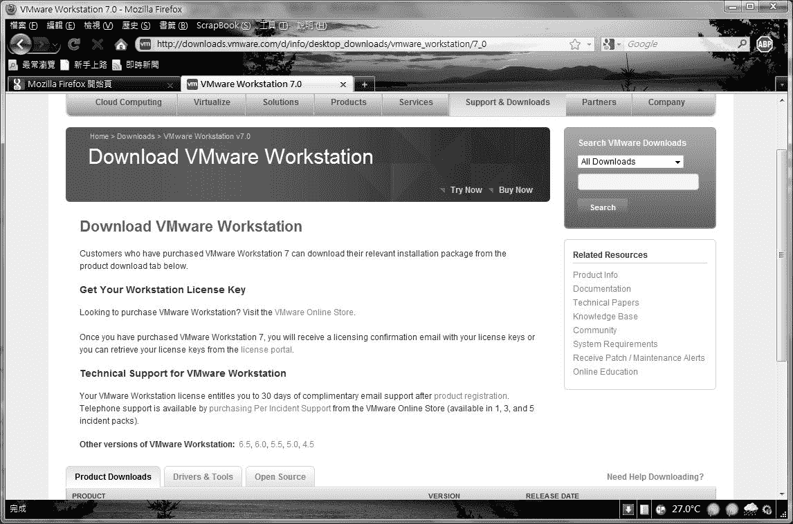  
  
建议雪友们购买 21 以上解析度可达 1920x1200 以上的荧幕，甚至于是更高的解析度(例如 DELL 的 3008WFP 是 30 机种解析度可达 2560x1600)，这样就程式执行的主画面就不会被 SoftICE 弹出的视窗遮住了，而用其他的辅助工具例如 LordPE 等程序也不会被遮住画面而要切来切去,  
另外像 SAMSUNG 的 2343BWXPLUS 解析度也有到 2048x1152 价格也不高，是可以考虑做为 VMware + SoftICE 用的荧幕喔！  
  
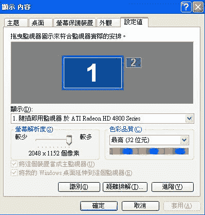  
  
请安装 VMware 6.0 以上版本，然后在 VM 里安装一个全新的 Windows XP 并且升级到 SP2，注意不要用 SP3 最重要的是把 XP 中的自动更新关掉!!安装时要记得是装在哪一个子目录,为接下来讲解方便,我们假设你把 XP SP2 装在 C:\\PureXP 里,而 VMware 的主程式是放在 C:\\Program Files\\VMware\\VMware Workstation 里  
  
现在把 Driver Studio 3.2 中的 SoftICE 安装完成(只要装 SoftICE 就好,其他的功能不必装)。  
注：Driver Studio 3.2 由于原厂已经宣布不再支援，可以到这里下载：  
[`www.pediy.com/tools/Debuggers...CE/SoftICE.htm`](http://www.pediy.com/tools/Debuggers/SoftICE/SoftICE.htm)  
另外可以一并下载 “Drierstudio3.2 for winxp,win2003 完全补丁”<== 但是先不要安装  
  
下载回来的档案名称为 DS3.2.1.ZIP，但这个档案先备而不用，如果您的系统在 VM 下的 XP SP2 使用 SoftICE 一切顺利，我发上来的的例子也都可以正常执行，那您就不用使用这个补丁，如果不能顺利执行，或是 Windows 本身自带的记事本或小算盘程式用 Symbol Loader 无法载入让程式停在入口处才要使用这个补丁！  
  
在启动 VM 中的 XP SP2 前请再做好下列的检查，首先不要使用双核心，使用单一 CPU 才可以(即 Processors 的值为 1)，记忆体(Memory)的值也不要太小在我的 VM 中存配置了 192MB 而硬(Hard Disk)也配置了 8GB  
  
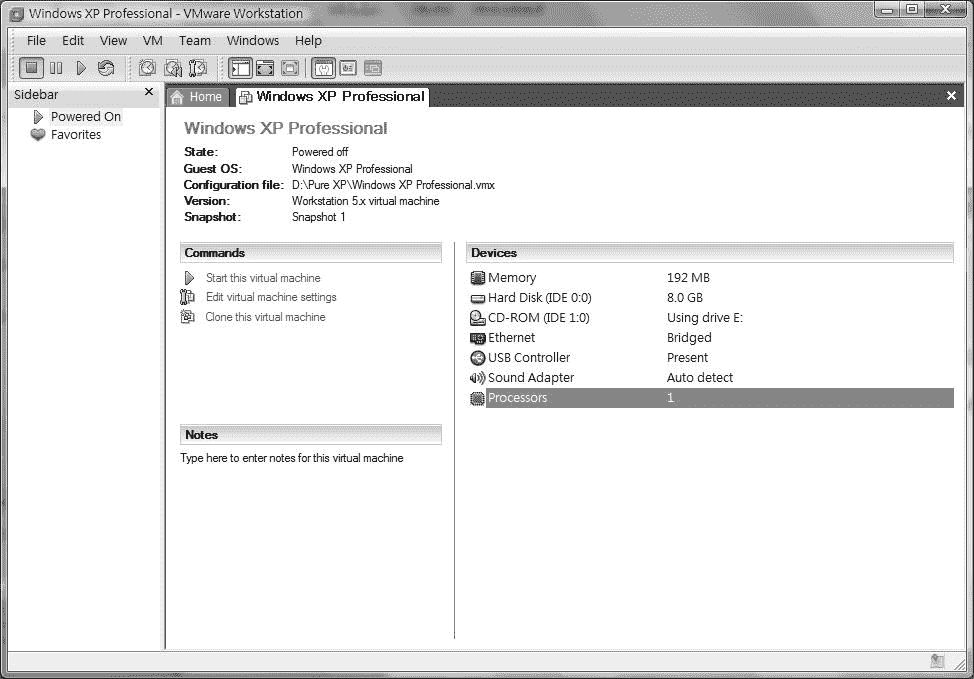  
  
另外在你安装 XP SP2 的目录里(我们这帖的例子是放在 C:\\PureXP)，打开其副档名为 vmx 的文件，  
  
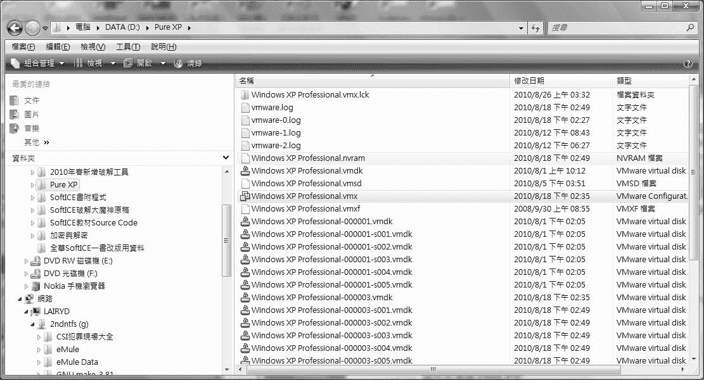  
  
在其未端添加:  
Vmmouse.present = “FALSE”  
svga.maxFullscreenRefreshTick = "5"   
  
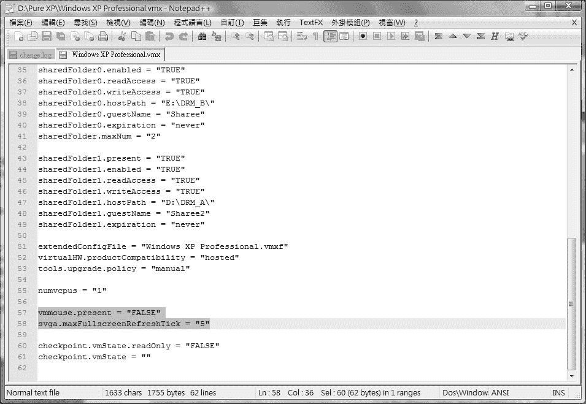  
  
Vmmouse.present = “FALSE”是为了让 SoftICE 启动后,不会出现两个滑鼠指标,一个是系统的箭头指标,一个是方型 SoftICE 的指标.  
  
svga.maxFullscreenRefreshTick = "5" 这行不加 SoftICE 用 Crtl-D 叫出来以后会看不到,以为 SoftICE 死当了,其实是有在正常工作的!!  
  
  
现在可以按下绿色的箭头(Powered On)让 VM 中的 XP SP2 启动了。  
  
但是还先别忙着进 SoftICE 先再确认下面的动作是否有确实做好：  
开始-->程式集-->Compuware DriverStudio-->Settings  
General 中的 Inilialization string:加上 LINE 45;WD 4;WC 30;SET FONT 2;FAULTS OFF;CODE ON;X;  
  
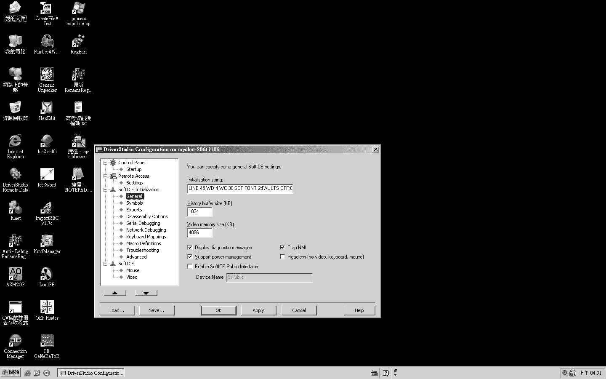  
  
Exports 要加上的 dll 整理如下:  
    advapi32.dll, comctl32.dll, comdlg32.dll,    
    msvbvm60.dll , msvcrt.dll , ole32.dll,  
    oleaut32.dll, shell32.dll, version.dll, ws2\_32.dll  
而画面中示范的 ntkrnlpa.exe 则可放可不放因为那是给双核心用的  
  
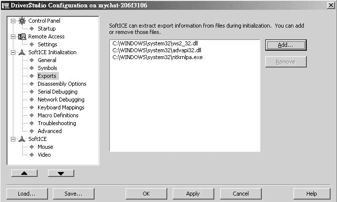  
  
现在在 VM 中使用 SoftICE 的前置作业已经全部完成，接下来就可以来练习了。  
  
  
  
注：要使用 SoftICE 的 VMware 系统内其 XP SP2 千万不要安装虚拟光装置软体，例如：酒精 120%(Alcohol 120%)、Daemon Tools 等…  
  
一切都安装好以后,先用我这个软件 Message Box.exe 试一下,  
  
Message Box.rar  
  
**测试一: 用 Symbol Loader**  
        1.先运行 开始->程式集-->Compuware->Debug-->Start SoftICE  
          正常的话会出现一个 SoftICE 的窗口,然后闪一下就消失了,这时你按下 Ctrl+D,  
          SoftICE 主画面就应该要在正中间出现才对,而滑鼠光标也会变成方型.  
          再按一次 Ctrl+D SoftICE 就会消失  
  
        2. 开始->程式集-->Compuware->Debug-->Symbol Loader  
           注意下方的灯号应为绿色,显示 SoftICE is active  
  
  
(这里要人家看灯号颜色,如果再放黑白图片,雪友会杀了我!!!)  
  
           按上方功能表 File --> Open 去载入 Message Box.exe  
           再选 Module --> Load  
           会出现 "An error occured during symbol translation/load. Load executable  
           ayway?" 对话框  
           按下 "是(Y)"  
           SoftICE 就应该会正常弹出来了,  
  
  
       
           虽然中间的机码都是 invalid,但是下方绿色字样已经出现 Message Box +0FFE 字样,表  
           示是在 Message Box.exe 程序领空上了,  
           我们再按一下 F8 键,就可以看到有意义的机码了  
  
  
  
           以上这个动作,就等于是把 Message Box.exe 这个程式从头载入分析,如果 SoftICE 弹不出来,直接你就看到 Message Box.exe 的主画面,那就表示 SoftICE 没有装好  
  
  
  
           请初学者一定要用我这每程式测试,如果随便拿一个程式来试,刚好碰到有壳的,就会断不下来,但因为变数多了,你就会不知道到底 SoftICE 安装成功没有?  
      
**测试二: 用 bpx MessageBoxA**  
        1.如果在测试一中 SoftICE 有成功跳出来,我们就输入 BPX MessageBoxA 做断点,记得按  
           下回车键,然后按下 F5 让程序全速运行.  
        2.在主程序画面中随便输入 4 位数字,并按下 OK 键,正常的话你应该会看到 SoftICE 再次跳出,  
  
  
  
          断在程序调用 MessageBoxA 这个 API 的地方,如果 SoftICE 没有跳出来,直接你就看到密码错误或是密码正确的对话框,那么这个测试就失败了  
  
  
  
以上测试如果有任可一个不能通过,就要打补丁 DS3.2.1.zip,(如果以上两个测试都通过了,就不可打补丁,切记!!):  
先将 VMware 中的 XP SP2 重启,重启后先不要运行 SoftICE  
现在将 zip 档里面的 \\Host\\ DS.EXE OSINFO.DAT OSINFOB.DAT 这三个档拷贝到 Program Files\\Compuware\\DriverStudio 内盖掉原来的档案  
再将 \\Target 内的 CptHook.sys ntice.sys osidata.sys osinfo.dat osinfob.dat 及 \\Target\\x86\\SIKSYM.SYS  
这 6 个档拷贝到 \\Windows\\system32\\drivers 内盖掉原来的档案  
  
等补丁打完,再回头做测试一及测试二,如果 OK 了,就表示这个调环境没问题了,  
现在我们最好先把可以正常运作的 VMware 环境先 “快照” 下来，  
我们可以在 VMware 上方的功能 Bar 中选取 VM-->Snapshot-->Take Snapshot…  
这样万一我们之后安装的东西有问题可以很快的回覆到之前没有改变的样子，而不需要重灌！  
  
  
  
最后整个 VM 用的 XP SP2 子目录可以备份,到别台电脑使用,注意:是备份你装在 VM 中的 XP SP2 的那个目录(本帖中讲的是 C:\\PrueXP),不是在 Program Files 里的 VMware 主程序目录喔!!  
到了一台新的电脑上使用时,也是一样先安装好 VM WorkStation,然后把先前备份好的整个 VM 用的 XP SP2, 一样拷贝到 C:\\PrueXP 中,这样就不用重新安装和设定了^^  
  
第一次在新电脑中启用 VMware 就在上方工具列选 File-->Open 点选刚才拷贝好的 C:\\PrueXP 里面的 vmx 档就可以了,这时 VMware 会问你是 copy it 或是 move it, 选 copy it 就可以了  
  
如果有雪友有装好的,也可以提供出来分享,但最好别放在论坛的空间里,因为我不知道微软在你们那儿抓得凶不凶?我们台湾这边抓得紧,微软告得凶,所以只能请在大陆的雪友帮忙了  
希望新手们都可以不被 SoftICE 的安装给吓跑了,都可以顺利安装,享受 SoftICE 在反组译和破解上带给新手的方便和快乐