# 用 Visual SoftIce 进行双机调试

> 原文：[`www.pediy.com/kssd/pediy08/pediy8-784.htm`](https://www.pediy.com/kssd/pediy08/pediy8-784.htm)

**用 Visual SoftIce 进行双机调试**

**版本:1.1  
****最后更新时间：2006-12-29**

作者: xIkUg/RCT  
xikug.xp \[at\] gmail \[dot\] com

我常去的网站：

http://debugman.wintoolspro.com  
http://www.fcgchina.com  
http://bbs.pediy.com  
http://www.unpack.cn

 

使用 Visual SoftIce 进行双机调试很爽，可以一边调试一边听上网，一边听音乐了：）  
我这里主要介绍一下双机调试的设置，因为没有两台物理机器，所以这里我使用 VMWare5.0 虚拟机系统进行讲解。  
VMWare 系统软件环境：WinXP SP2 + Driver Studio 3.2  
首先 VMWare 的网络连接选择 Bridged 模式，双击 VMWare 右下角的网卡图标就出来了，如下图：

 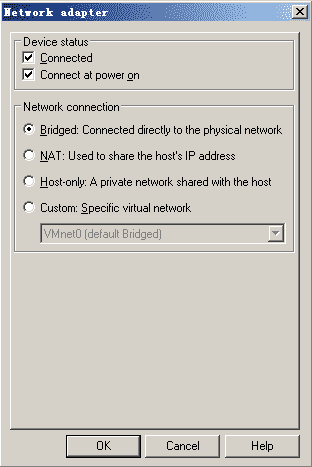

 

在虚拟机上安装 DS3.2，安装的时候选择 Target 安装模式，安装完毕后，打开 DS 的 Settings：

 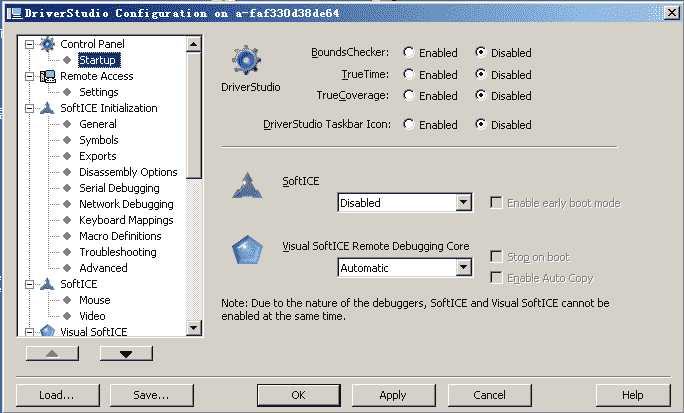

进入 Control Panel->Startup 页，把 SoftICE 设为 Disabled，把 Visual SoftICE Remote Debugging Core 设为“Automatic”，你也可以设为“Boot”，Boot 模式是在可调试系统的启动过程。我这里用不着，所以设置了 Automatic，在系统启动完成之后再自动启动远程调试核心。

 

然后进入 Remote Access->Settings 页，把里面的钩全打上：

 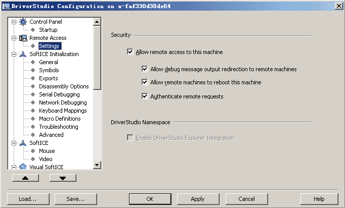

 

我这里是全选了，你可视情况而定。下面进行 Visual SoftICE 的设置：

 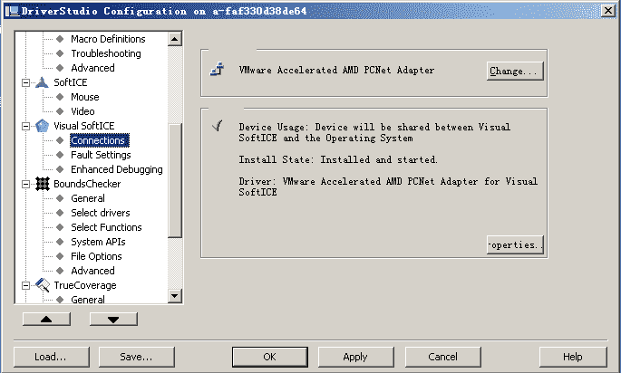

 

选择 Visual SoftICE->Connections，点 Change…按钮，进入 SoftIce 传输设置向导：

 

 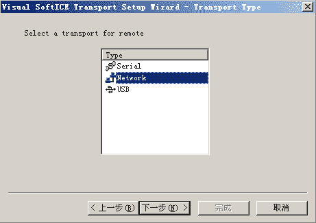

 

选择 Network，单击下一步，然后选择 VMware Accelerated AMD PCNet Adapter，完成。

 

退出向导后，再点 Connections 界面上的 Properties…按钮，进行网络属性设置：

 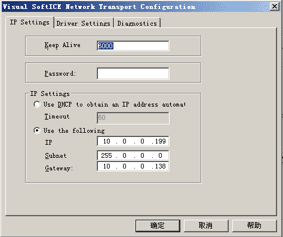

这里把 Keep Alive 默认是 60 秒，我设置得比较大，设了 6000，不然一会调试的时候隔 60 秒就要重新连接远程机器。如果你不需要远程调试密码的话可把 Password 设为空。

接着设置 IP 地址：我的主机是 10.0.0.178，所以我把虚拟机的 IP 设为跟我同一个网段：

10.0.0.199，你可以视情况而设置。接着你需要设置与系统共享这个网络设备，不然你系统的网卡设置就会消失，连接不上了，如下：

 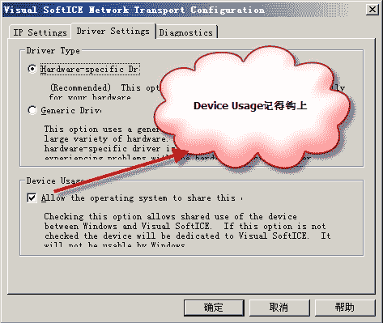

设置完成后，点确定，SoftIce 会提示你重启系统。点确定后，系统自动重启。

 

虚拟机重启后，Ping 一下 10.0.0.199，通了，此时也就算设置完成了。

 

**注意：如果你的虚拟机也是 WinXP SP2，那你应该把 Windows 自带的防火墙关掉。刚开始用时我也不知道，在外面用 Visual SoftICE 连接上后，调试不了几分钟就断了，后来发现原来就是 Windows 的防火墙在作怪，把防火墙关掉就没事了。我猜测 Windows 的防火墙应该不是系统一启动时就生效，会延时几分钟，防火墙才起作用。。。真是奇怪。。。**

下面我们在外面主系统中用 Visual SoftICE 试一下吧。。。小练一下手，首先启动 Visual SoftICE：

 

 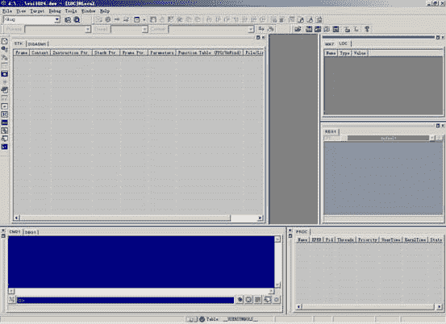

 

在左下方的 CMD 窗口中输入 Connect 10.0.0.199，等待一下，系统就会提示连接成功。Connect 命令的具体用法可查看帮助文档。或者你也可以使用 ToolBar 上的第 2 个按键

 ，就这个，一个地球加放大镜，对网络上的目标机进行选择，如下图：

 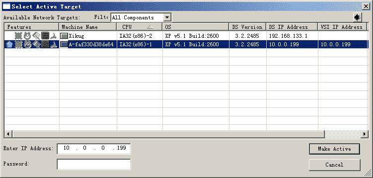

 

连接成功后，会在 CMD 窗口进行提示：

Connected to:

    Name           : A-FAF330D38DE64

    Processor      : IA32(x86)-Pentium 4

    Stepping       : 8

    Processor Count: 1

    Operating Sys. : Windows XP Ver. 5.1 Build 2600 Service Pack 2 (FRE)

    Target Service : Connected (Active)

 

在主窗口的最左边的 ToolBar 是各窗口的快捷按钮，用于打开各项窗口，和 IDA 差不多，有什么断点窗口，反汇编窗口，内存窗口等等。。。自己试一下就知道了，样子如下：

 

 

下面我们来小试一下牛刀，在虚拟机中启动一个程序，AntiInject.exe：

 

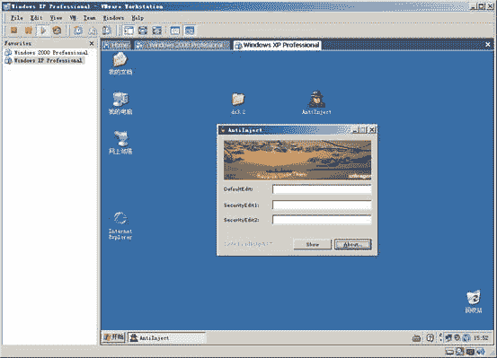

 

然后我们在外面的 Visual SoftICE 的进程列表窗口中选择 AntiInject.exe 这个进程，使 SoftICE 切换到这个进程的程序领空去：

 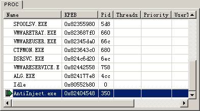

 

双击一下就可以了，接着，我们输入命令:bpx user32!MessageBoxA

系统在消息窗口中提示：

SI>bpx user32!MessageBoxA

Breakpoint \[0x1 (1)\] set.

 

打开断点窗口可以看到我们的一个断点设置成功了：

 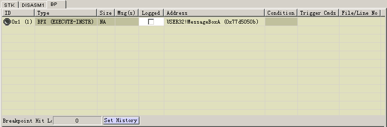

 

然后我们在虚拟机中按下我们 AntiInject 的 Show 按钮，响应这个按钮的程序中有调用 MessageBoxA，因此我们断下来了：

 

因为我没有载入符号文件，所以 Visual SoftICE 提示：

 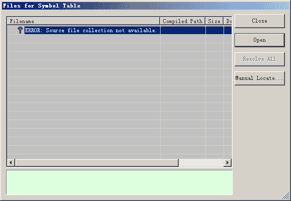

没有找到源代码，呵呵。。。如果你要进行源码进调试应该先先载入 SoftICE 的符号文件，我们这里不管它，点 Close 就行了，于是程序中断在下面的地方：

 

 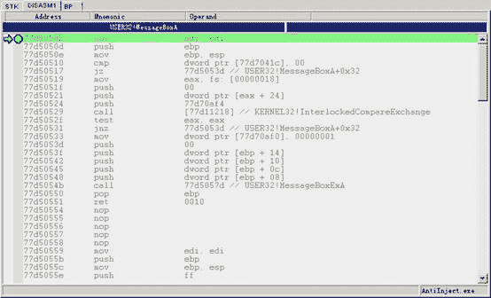

 

**注意：如果我们只进行反汇编级的调试应该把 Visual SoftICE 中的 AutoFocusOpen 设置为“Disassembly Only”或“Source or Disassembly – No Focus”，不然你每单步一次这个框框就会跳出来，设置如下：**

** 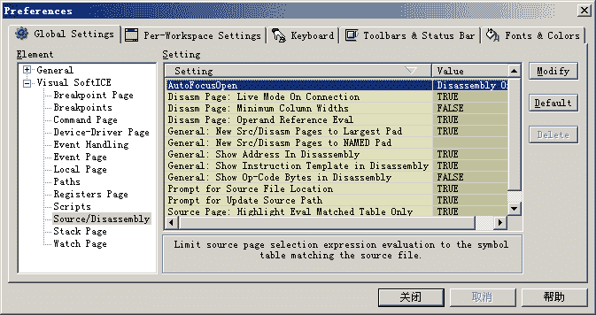**

 

 

怎么样？跟以前我们使用黑呼呼的 SoftICE 在 Crack 程序比如何？是不是爽多了，现在你可以一边上网，一边听音乐，一边调试程序了。

 

Visual SoftICE 好像是 DS3.0 以上开始提供的，以前的 DS 2.7 没有。

 

其他关于 Visual SoftICE 的命令使用跟 SoftICE 一样，如果你不太清楚可查看 Command Help。

 

好，暂时到这里，以后有机会再讲讲其他的。

   
感谢：Forever, fly, heXer, jwh51, kanxue, shoooo，南蛮妈妈，堀北真希,sucsor, cnbragon, DarkNeesOut and RCT & FCG all Members and you.  

为了不影响目标机（或虚拟机）的正常网络通讯，最好在目标机上装 2 张网卡（或在虚拟机中设置两个虚拟网卡），其中一张专门用于 VSI，关于双网卡的设置见下图所示：

 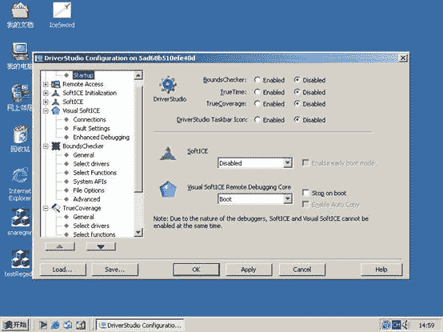

 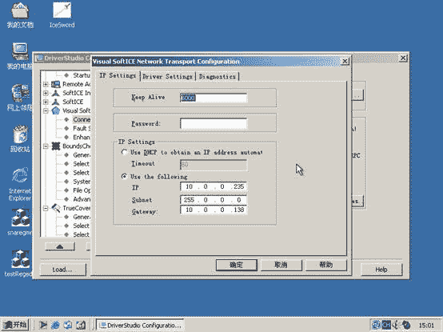

 

 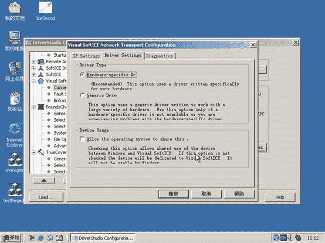

 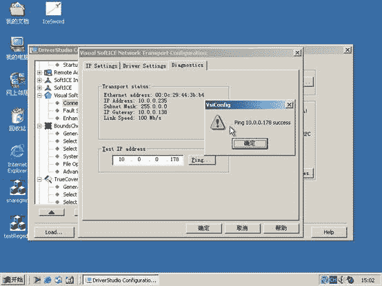

 

 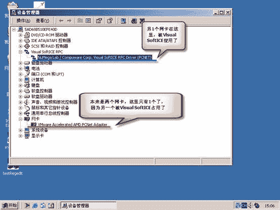

 

计算机重启后如果你看见下图就代表设置成功了：

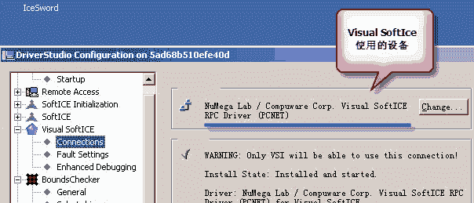

 

 4dd466d0e1e0cc123afbe504da2462ca