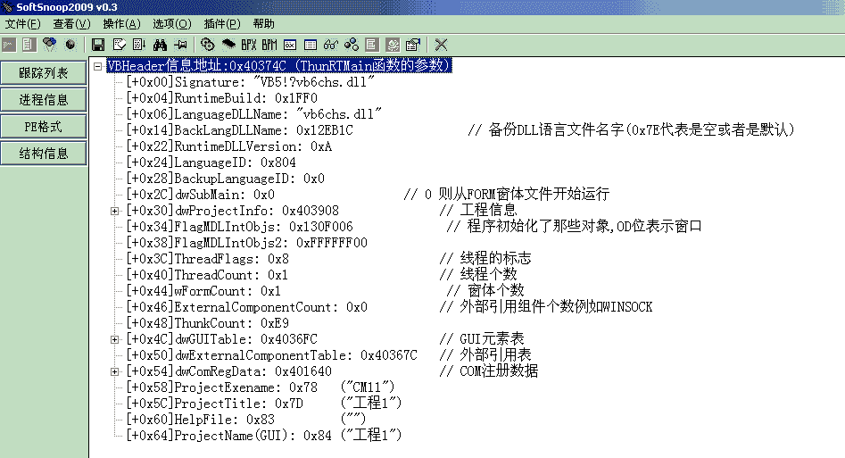
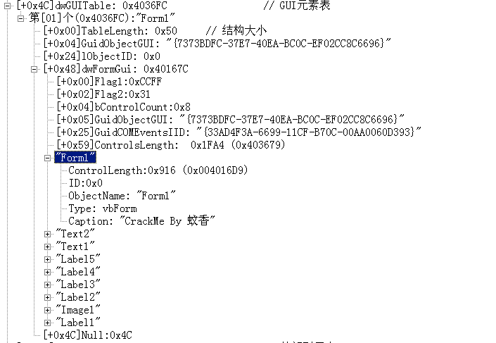
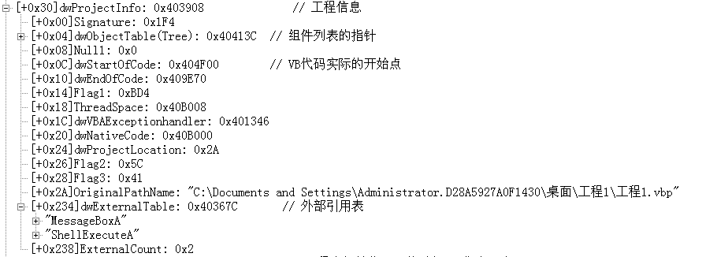
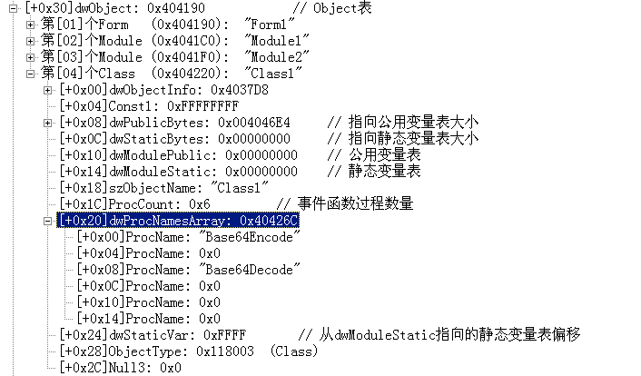

# SoftSnoop2009 应用二：详细解析 vb 头结构

> 原文：[`www.pediy.com/kssd/pediy10/101547.html`](https://www.pediy.com/kssd/pediy10/101547.html)

SoftSnoop2009 应用二：详细解析 vb 头结构  
  
没有什么好说，直接拖一个 vb 程序到 SoftSnoop 查看一下就明了。加壳的，加花的，加密的，统统都可以。  
  
被跟踪文件：蚊香 CM 再版.rar  
  
头结构：  
  
  
FormGui 列表：  
  
  
工程信息与 API 导入表：  
  
  
对象列表：  
  
  
不详细说明了。vb 解析有问题的，请在下面跟贴说明。