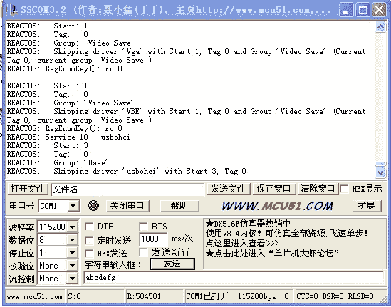
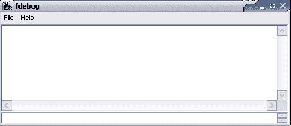
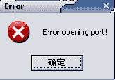
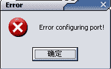
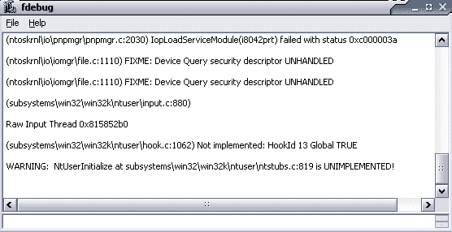
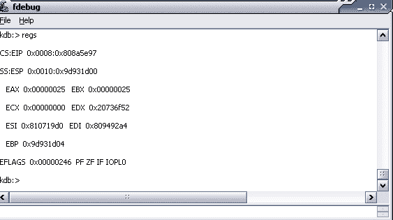

# 也来说说 ReactOS 的调试

> 原文：[`www.pediy.com/kssd/pediy10/82194.html`](https://www.pediy.com/kssd/pediy10/82194.html)

By::ProgrammeBoy  
Blog:http://hi.baidu.com/ProgrammeBoy  
  
老鸟飞过,科普类….有错的地方大家别笑,   
  
  看 ReactOS 的源码好多天了,许多 windows 下不明白的地方看看 ReactOS 的代码也就知道差不多了...写 ReactOS 的同志们可真是好人呀.想看 linux 但是还的学那一大堆命令....使用看 reactos,照样可以理解操作系统的精髓...还有就是编译 reactos 在 windows 下,方便呀...,  
  废话不多说,看了半天的 reactos 的代码,心里跃跃欲试,想为 reactos 做点贡献,但是前提是怎么调试代码呢?.. ....由于网上关于 reactos 的调试很少...reactos 的 wiki 上只有寥寥无几的几篇,也只是介绍内核调试器的使用..作为菜鸟的我只知道他是用 9 帧串口来传输数据.并不知道用什么来接收调试数据.和发送调试命令,在群里看的老蔡的使用的调试工具是:  
  
  
  
  
总觉得不好使......自己尝试着瞎整..还真找出了点路子.(鉴于是自己瞎整,错误的概率也就很大,此文的目的是为调试 reactos 提供一个方向)  
  
在 reactos 的论坛上搜"调试"的时候知道源码中有个 fDebug 是好像是用来调试的.所以我就找了先下 fDebug 的的代码.在 D:\\ReactOS\\ReactOS\_src\\boot\\freeldr\\fdebug 这个目录下.  
这里我嗦下.源代码的路径别放到目录中有空格的文件夹中,有时会导致不能编译.例如,以前我把源码放在了 D:\\Program Files\\ReactOS\_src\\boot\\freeldr\\fdebug 这个目录下,在编译时可能会发生错误.(至于为什么?我就不嗦了)  
  
  好了,回到正题.接下来就是编译 fDebug...,看了下 fDebug 的模块名(怎么看?打开 fDebug 下的 fDebug.rbuild 文件里面有个 module name=的字样,后面的就是)当时我随手打开了编译环境,输入"makex freeldr\_fdebug",可是提示,mingw32-make: \*\*\* No rule to make target \`fDebug'.  Stop.,没有次模块,打开配置文件 D:\\ReactOS\\ReactOS\_src\\boot\\freeldr\\freeldr.rbuild,发现并没有 fDebug,那我们自己填,怎么填?嗯是个问题.  
  
follow me:来到这个模块所在的主目录下也就是 D:\\Program Files\\ReactOS\_src\\boot\\freeldr\\,找到 freeldr.rebuild 文件打开添加下面的:  

代码:

```
<directory name="fdebug">
      <xi:include href="fdebug/fdebug.rbuild" />
</directory>
               

```

然后在编译环境下再次输入: makex freeldr\_fdebug.等了会,出现  
代码:

```
\[LD\]       output-i386\\boot\\freeldr\\fdebug\\fdebug.exe
\[RSYM\]     output-i386\\boot\\freeldr\\fdebug\\fdebug.exe

```

的字样 OK 编译好了,我们在运行下:  
这里有两个问题:  
1,在哪运行呀?如果在 windows 下兼容吗?  
2,文件在哪呀?  
答:(1)在 windows 下,因为我们要在 windows 下用 fDebug 和虚拟机调试,可能还会有人问兼容嘛?由于 reactos 设计的宗旨就是兼容 windows,所以,reactos 的应用程序几乎都能在 windows 下运行!,而相反就不一定了,毕竟还在开发中嘛..  
(2)文件在哪?正如编译环境给你列出来的 D:\\ReactOS\\ReactOS\_src\\ output-i386\\boot\\freeldr\\fdebug\\fdebug.exe 下就能找到  
编译好了，我们来调试吧,先嗦下,调试环境,我类似于 windbg + Vmware, 首先在虚拟机中装 ReactOS,怎么装我就不再嗦了,他的老家的论坛上有,然后打开虚拟机的设置->添加硬件-->串口使用命名管道..其余默认就行..  
呵呵,开始调试喽,打开虚拟机.以调试模式运行 Reactos(就是一进系统有好几个选项我们选第二个(即 ReactOS (Debug))),打开 fDebug,如图:  
  
  
  
唉,白呀,打开”文件””Connect”,在端口那输入” \\\\.\\pipe\\com\_1”下面默认,确定  
提示    
  
  
  
晕,怎么回事?用 windbg 就可以啦.打开源码看看,(有源代码就是好,^\_^);这个程序的代码很少.  
看到这,就知道怎么回事了(注意这段在 D:\\ReactOS\\ReactOS\_src\\boot\\freeldr\\fdebug\\rs232.c 文件中):  
代码:

```
  \_stprintf(PortName, TEXT("\\\\\\\\.\\\\%s"), CommPort);
  hPortHandle = CreateFile(PortName,
              GENERIC\_READ|GENERIC\_WRITE,
              0,
              0,
              OPEN\_EXISTING,
              0,
              0);
   

```

马上将 port 名改成 pipe\\com\_1,可是又出错了:  
  
  
  
接着看代码,这里(在同目录下的 fDebug.c 中):  
代码:

```
  \_stprintf(String, TEXT("%s,n,8,1"), strBaudRate);
  if (!Rs232ConfigurePortWin32(String))
  {
    MessageBox(hMainWnd, TEXT("Error configuring port!"), TEXT("Error"), MB\_OK|MB\_ICONSTOP);
    bConnected = FALSE;
    return;
  }

```

接着看看这个函数 Rs232ConfigurePortWin32(同目录下的 rs232.c 中):  
代码:

```
BOOL Rs232ConfigurePortWin32(TCHAR\* DeviceControlString)
{
  DCB    dcb;
  DWORD  ErrorCode;

  memset(&dcb, 0, sizeof(DCB));
  dcb.DCBlength = sizeof(dcb);
  if (!BuildCommDCB(DeviceControlString, &dcb))
  {
    ErrorCode = GetLastError();
    \_tprintf(TEXT("BuildCommDCB() failed. GetLastError() = %lu.\\n"), ErrorCode);
    return FALSE;
  }
  if (!SetCommState(hPortHandle, &dcb))
  {
    ErrorCode = GetLastError();
    \_tprintf(TEXT("SetCommState() failed. GetLastError() = %lu.\\n"), ErrorCode);
    return FALSE;
  }
  // Set the timeouts
  if (!Rs232SetCommunicationTimeoutsWin32(MAXDWORD, 0, 0, 0, 0))
  {
    return FALSE;
  }

  return TRUE;
}

```

查了下 msdn 没多大用,(有兴趣的自己看),去掉.将 fDebug.c 中的那段去掉.  
这里也说下:这个程序的作者也真够马虎的点”connect”出错后,也不知道将 disConnect 变为禁用将 connect 变为可用,害的我每次都得重新运行下程序,我们改过来:  
在连接失败的地方加上  
代码:

```
    EnableFileMenuItemByID(IDM\_FILE\_DISCONNECT, FALSE);
    EnableFileMenuItemByID(IDM\_FILE\_CONNECT, TRUE);

```

就行了  
赶紧试了下….成功了:  
如下:  
  
  
  
呵呵.接着去他老家的论坛看了看 Kernel\_Debug 的用法,wiki 上都有我就不多说了.  
在这里: http://www.reactos.org/wiki/index.php/Kdbg  
对了这里按 Tab + K 键中断进行调试,和 softice 似的,输命令的时候必须将窗口切入到 ReactOS 中再输入,虽然不是在 fDebug 中输入的加上鼠标什么的都不管事但是 ReactOS 会将命令通过串口传过来.  
我们试试查看寄存器:  
输入:regs  
显示如图:  
  
  
  
注意:调试必须是内核带调试的版本,怎么编译调试版本,WIKI 上都说了,大家可以参考  
  
  
结束语:这里仅仅是指名了个方向,具体还要大家慢慢的研究,探索…..  
老鸟飞过  
也不知道是放在编程这块呀,还是放在调试那块,想了下编程这块常来放在这吧  
  
附上改过后的 fDebug

上传的附件
|  || fdebug.rar  
 |