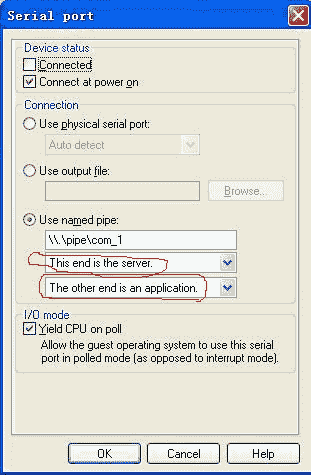
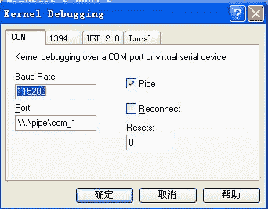
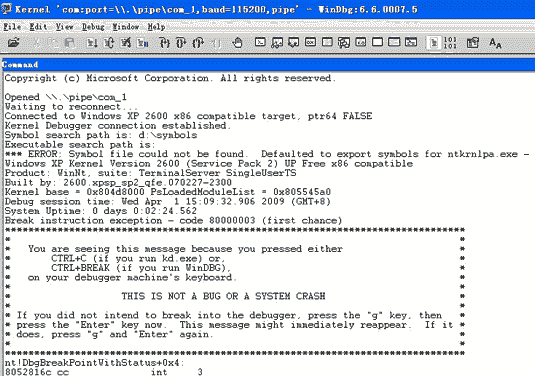

# sys 文件编译与调试环境设置的一点体会

> 原文：[`www.pediy.com/kssd/pediy10/85311.html`](https://www.pediy.com/kssd/pediy10/85311.html)

前人的文章图文并茂但看后还是要费一番功夫。原因很简单，对于一些细节之处前人往往高估了我等菜鸟的水平。为节约后人的时间，特用朴实的话语留下我的一点体会。  
  
    每个人编译调试的环境各不相同，你可以批判的吸收你想要的东西。  
驱动编译环境的简单设置：网上下载的 ddk2003 应该是这个文件 1830\_usa\_ddk.iso，默认安装在 xx:\\WINDDK\\3790.1830 目录下，你可以把 3790.1830 目录下的所有文件拷贝到 WINDDK 下，然后把 3790.1830 目录删除，这样可以减少一层目录（随你）。  
    编译驱动很简单，通常我不用开始菜单里的快捷键会出现稀奇古怪的问题。你可以在命令行窗口中进入安装目录中的 bin 目录，输入命令 xx:\\WINDDK\\bin>setenv.bat xx:\\WINDDK checked winxp 后当前目录会自动变为 xx:\\WINDD>,然后用 cd 命令来到你的驱动源文件目录，输入 build 命令即可（前提是你的源文件所在目录下的 makefile 和 sources 文件已设置好，如何设置很简单，不用教）。注意 setenv.bat 在 bin 目录下，后面跟的是三个参数，具体你想用哪种参数，打开 setenv.bat 看看就知道了，它一开始是循环依次检查参数，再相应的设置当前 cmd 窗口中的环境变量。第一个参数 xx:\\WINDDK 是你 ddk 安装的路径，最后不用加“\\”，不然会出错。如果出错你可以在当前的 dos 窗口中用 path ；将 path 变量清空，再执行一次 xx:\\WINDDK\\bin>setenv.bat xx:\\WINDDK checked winxp。然后用 path 命令检查一下。  
  
  
驱动调试环境设置关键点：  
一、虚拟机中的设置    
   1、新建虚拟机并安装 winxp 后，在 poweroff 条件下，添加一个虚拟串口  
      实现主机中 windbug 应用程序和虚拟机之间的串口连接，这样 windbg 就能捕获来自于虚拟机串口的调试信息。串口设置注意通常选择设置一端是 server（此种设置是先启动虚拟机再运行 windbg 进行连接，此时虚拟机作为服务端）,另一端是应用程序（windbg）。  
   2、进入虚拟机系统，在 C:\\boot.ini 文件（去掉只读属性）最后添加  
      multi(0)disk(0)rdisk(0)partition(1)\\WINDOWS="Microsoft Windows XP Professional" /fastdetect /debug /debugport=com1 /baudrate=115200  
     注意：添加的语句中不要有不适当的换行，这将会影响你正常启动。  
   3、重启虚拟机(启动菜单选第 2 项调试模式进入)。  
二、主机中 windbg 的设置  
   在 file->kernel debug 中中设置  
   1、port 中输入\\\\.\\pipe\\com\_1 这与虚拟机中串口的设置是一致的。  
   2、pipe 前要打钩  
   3、baud rate 为 115200 这与虚拟机里 C 盘根目录下 boot.ini 文件中设置是一致的  
三、启动主机中 WinDBG，选 File->KernelDebug 的 COM 页，按上述设置(未讲到的用默认值),点“确定”  
    窗口出现：  
    Opened \\\\.\\pipe\\com\_1  
    Waiting to reconnect...  
    此时按 Ctrl+Break  
    显示：Connected to Windows XP 2600 x86 compatible target, ptr64 FALSE  
          Kernel Debugger connection established.表示连接虚拟机成功，此时中断于虚拟机中。  
     然后在 File->Symbol File Path…中设置调试所需的 pdb 文件的路径   
     例如 SRV\*X:\\symbols\*http://msdl.microsoft.com/download/symbols  
  
注：下载你要调试的操作系统对应的 ntoskrnl.pdb 符号文件的方法：  
1、在你的硬盘新建一个文件夹如 d:\\symbols  
2、在你的 windbg 菜单中设置符号路径 SRV\*d:\\symbols\*http://msdl.microsoft.com/download/symbols，然后在 file 菜单中选择 kernel debug 选项中的 local 页，点击“确定”。  
3、此时你进入 d:\\symbols 目录将看到 windbg 已自动从符号服务器下载了 ntoskrnl.pdb，如果你电脑不能上网，将很难找到你所需的与操作系统相匹配的 ntoskrnl.pdb 符号文件。  
  
  
  
  
