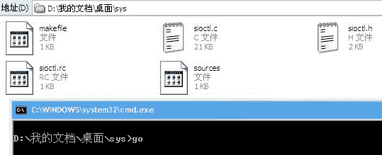
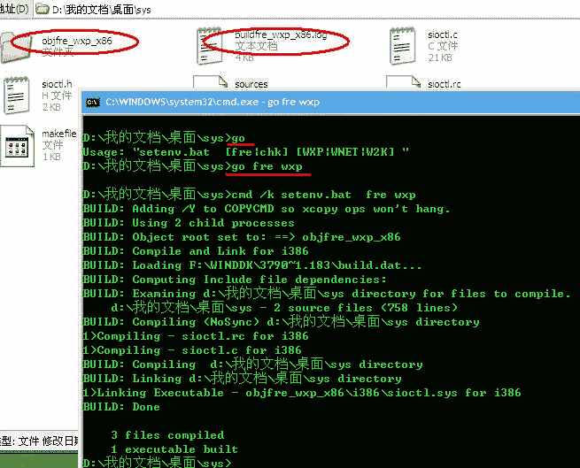

# \[原创\]快速生成 sys、pdb 文件的方法

> 原文：[`www.pediy.com/kssd/pediy10/103142.html`](https://www.pediy.com/kssd/pediy10/103142.html)

如果你想快速得到 sys 和 pdb 文件的话，不妨看一下。       
   网上下载的 ddk2003 文件 1830\_usa\_ddk.iso，我安装在 D:\\WINDDK\\3790.1830 目录下。盘符自己选，记住你的目录。以下假设安装在 D:\\WINDDK\\3790.1830 目录下。  
  
    实现方法：  
   一、修改 D:\\WINDDK\\3790~1.183\\bin 下的 setenv.bat 批处理文件，并拷贝到 C:\\windows 目录下。  
具体修改以下几处：  
1、将文件头部的 set BASEDIR=%1%删除；  
2、在 GetStarted 标号下面添加一行 set BASEDIR=D:\\WINDDK\\3790~1.183（这样 setenv.bat 后面就只需要输入 2 个可选参数\[fre|chk\]、\[WXP|WNET|W2K\]）  
3、在标号 WinNT 下的 cd /d %BASEDIR%语句前加上 rem,这句执行没有意义。  
4、最后加上一句 build.exe，即配置完驱动编译环境后立即在当前目录下编译。  
  
  
二、打开记事本输入以下内容：  
@if "%1"=="" goto usage  
cmd /k setenv.bat  %1 %2  
goto end  
:usage  
@ECHO off   
color 0A   
ECHO Usage: "setenv.bat  \[fre|chk\] \[WXP|WNET|W2K\] "  
@ECHO on  
:end  
保存为 go.bat 也放到 C:\\windows 目录下，你可以根据提示选择编译参数，只需要输入 2 个参数。  
  
三、运行 Add\_Ms\_Dos.reg，将以下内容导入注册表，这样右键文件夹选择 ms\_dos 将转到该文件夹的 dos 目录下。  
Windows Registry Editor Version 5.00  
\[HKEY\_CLASSES\_ROOT\\\*\\shell\]  
\[HKEY\_CLASSES\_ROOT\\\*\\shell\\ms-dos\]  
@="ms-dos"  
\[HKEY\_CLASSES\_ROOT\\\*\\shell\\ms-dos\\command\]  
@="cmd.exe /k cd %1"  
\[HKEY\_CLASSES\_ROOT\\Folder\\shell\\ms-dos\]  
@="ms-dos"  
\[HKEY\_CLASSES\_ROOT\\Folder\\shell\\ms-dos\\command\]  
@="cmd.exe /k cd %1"  
  
   具体用法：见图。  
  
  
  
  
  
  
  
  
  
                                     by  天易 love  09-12-15

上传的附件
|  || syspdb.rar  
 |