# 我也来谈谈消息断点一

> 原文：[`www.pediy.com/kssd/pediy10/70618.html`](https://www.pediy.com/kssd/pediy10/70618.html)

【文章标题】: 【原创】我也来谈谈消息断点一  
【文章作者】: icefisher  
【作者邮箱】: 181712814@qq.com  
【软件下载】:   
【软件名称】: echap518.exe(只是供学习的 crackme)  
【加壳方式】: 里面直接有个 unpacked.ExE，是脱过壳的见【原创】我也来谈谈消息断点二  
【保护方式】:   
【使用工具】: OllyICE  
【文章日期】: 20080813  
  
\-----------------------------------------------------------------------  
   第一篇原创希望大家支持下，首先我想和我一样菜的好多新人，一定都看过了论坛上的那个 ollydbg 教程，其中的消息断点真是让人难以理解，痛苦不堪啊，那么今天我就讲讲我自己的体会吧，希望望大家共勉。  
  
  首先，我觉得我们应该先了解消息，什么是消息，而谈到消息，就不能不说到 windows 程序设计的结构（大家放心。。。我大概讲下，不是什么重点）。  
  如下，这是一个典型 windows 程序结构，其中很多细节地方我都略去了，  
HELLOWIN.C  
/\*------------------------------------------------------------------------  
  HELLOWIN.C -- Displays "Hello, Windows 98!" in client area  
          
                 (c) Charles Petzold, 1998  
          
\-----------------------------------------------------------------------\*/  
          
#include <windows.h>  
    LRESULT CALLBACK WndProc (HWND, UINT, WPARAM, LPARAM) ;  
          
  
int WINAPI WinMain (HINSTANCE hInstance, HINSTANCE hPrevInstance,  
          
                   PSTR szCmdLine, int iCmdShow)  
          
{  
          
    static TCHAR szAppName\[\] = TEXT ("HelloWin") ;  
          
    HWND   hwnd ;  
          
MSG    msg ;  
//前面都是变量定义，不关注。  
          
    WNDCLASwndclass ;  
          
  
   wndclass.style        = CS\_HREDRAW | CS\_VREDRAW ;  
          
   wndclass.lpfnWndProc  = WndProc ;  
          
    wndclass.cbClsExtra   = 0 ;  
          
    wndclass.cbWndExtra   = 0 ;  
          
    wndclass.hInstance    = hInstance ;  
          
    wndclass.hIcon        = LoadIcon (NULL, IDI\_APPLICATION) ;  
          
  wndclass.hCursor      = LoadCursor (NULL, IDC\_ARROW) ;  
          
   wndclass.hbrBackground= (HBRUSH) GetStockObject (WHITE\_BRUSH) ;  
          
  wndclass.lpszMenuNam  = NULL ;  
          
    wndclass.lpszClassName= szAppName ;  
          
//这一连串的 wndclass 是在定义一类窗口的属性，形象地说就是在定义一个模子，然后后面可以用这个模子去建立更多的窗口，其中这个模子中我们需要注意的就是红字的  wndclass.lpfnWndProc  = WndProc ;，他指出了这个模子的消息处理函数是哪个？也就是说这个窗口内发生的一切事件，比如说点击，双击，鼠标移动，按键，按下按钮这一切都会生消息，而系统会自动调用 WndProc 去处理这些问题。  
    if (!RegisterClass (&wndclass))  
          
    {  
          
            MessageBox (  NULL, TEXT ("This program requires Windows NT!"),  
          
                                  szAppName, MB\_ICONERROR) ;  
          
            return 0 ;  
          
    }  
        //上面的是很简单的一个注册模子，你开始定义了这个模子 wndclass，那你得让系统知道啊，这部分就是这个功能，不须太关注。  
    hwnd = CreateWindow( szAppName,      // window class name  
          
                   TEXT ("The Hello Program"),   // window caption  
          
                   WS\_OVERLAPPEDWINDOW,  // window style  
          
                   CW\_USEDEFAULT,// initial x position  
          
                   CW\_USEDEFAULT,// initial y position  
          
                   CW\_USEDEFAULT,// initial x size  
          
                   CW\_USEDEFAULT,// initial y size  
          
                   NULL,                 // parent window handle  
          
               NULL,            // window menu handle  
          
               hInstance,   // program instance handle  
          
               NULL) ;      // creation parameters  
          
   //注意上面便是利用这个模子，再加上一些自己独有的特点建立了一个窗口，大家不需关注  
          
    ShowWindow (hwnd, iCmdShow) ;  
          
    UpdateWindow (hwnd) ;  
          
     
          
    while (GetMessage (&msg, NULL, 0, 0))  
          
    {  
          
            TranslateMessage (&msg) ;  
          
          DispatchMessage (&msg) ;  
          
    }  
        //上面这个需要关注，前面提到过，如果窗口产生了消息我们需要调用 WndProc 来处理，那么之前我们需要上面的哪个 while 循环先处理下，这个现在我们也不需要了解。  
    return msg.wParam ;  
          
}  
          
  
LRESULT CALLBACK WndProc (HWND hwnd, UINT message, WPARAM wParam, LPARAM lParam)\[/SIZE\]          
{  
          
    HDC                   hdc ;  
          
    PAINTSTRUCT ps ;  
          
    RECT          rect ;  
          
     
        //重点来了，大家注意当我们到了 WndProc 这个消息处理函数中时，我们会不自然地想到：那么多种的消息，系统如何分辨是那个呢，这是我们就要注意到 UINT message，他说明了消息的种类，而 WPARAM,LPARAM 都是消息具体的参数，大家这时看下面，因为 message 表示的消息不同，系统使用了 switch 来选择对应的处理程序，这里要注意 WM\_CREATE:像这些 WM\_ 开头的都是消息，而实质上都是数字，不过是头文件定义了一些等价字符串而已。  
    switch (message)  
          
    {  
          
    case WM\_CREATE:  
          
    PlaySound (TEXT ("hellowin.wav"), NULL, SND\_FILENAME | SND\_ASYNC) ;  
          
            return 0 ;  
          
  
    case   WM\_PAINT:  
          
            hdc = BeginPaint (hwnd, &ps) ;  
          
          
          
            GetClientRect (hwnd, &rect) ;  
          
          
          
            DrawText (hdc, TEXT ("Hello, Windows 98!"), -1, &rect,  
          
                   DT\_SINGLELINE | DT\_CENTER | DT\_VCENTER) ;  
          
                 EndPaint (hwnd, &ps) ;  
          
                   return 0 ;  
          
          
          
    case   WM\_DESTROY:  
          
            PostQuitMessage (0) ;  
          
            return 0 ;  
          
    }  
          
  return DefWindowProc (hwnd, message, wParam, lParam) ;  
          
}  
  
  
  
  
  
Ok，大家是不是觉得很抽象，大家只要把我的注释看下，大概了解这是干嘛就可以了，其实为了理解消息，只需要注意我红字标出的部分，wndclass.lpfnWndProc  = WndProc ;这个就是我们的重点，他指出了这类 windows 窗口的消息处理交给了那个函数。然后重点就是 CALLBACK，里面根据不同的消息转到不同的处理地方。  
  
而大家在 crackme 中广为使用的则是对话框，比窗口实现方便些，他调用  
DialogBox (  
hInstance,  
 TEXT("AboutBox"),  
hwnd,  
 AboutDlgProc  
)  
来实现，其中最后一个参数即为消息处理函数，等同于上面所说的 WndProc。  
好像太长了，我分两次写吧。第二次的在下面  
http://bbs.pediy.com/showthread.php?t=70619 

【文章标题】: 【原创】我也来谈谈消息断点二  
【文章作者】: icefisher  
【作者邮箱】: 181712814@qq.com  
【软件下载】:   
【软件名称】: echap518.exe(只是供学习的 crackme)crackme6.rar \[解压密码：pediy\]   
【加壳方式】: 里面直接有个 unpacked.ExE，是脱过壳的  
【保护方式】:   
【使用工具】: OllyICE  
【文章日期】: 20080813  
  
    大家可以看看 http://bbs.pediy.com/showthread.php?t=70618，有 Windows 编程基础的就不用看了。  
  好了当我们大概理解消息处理函数后我们就可以来看看这个例子了，首先 ollyice 载入 unpacked.exe。F8 单步运行。  
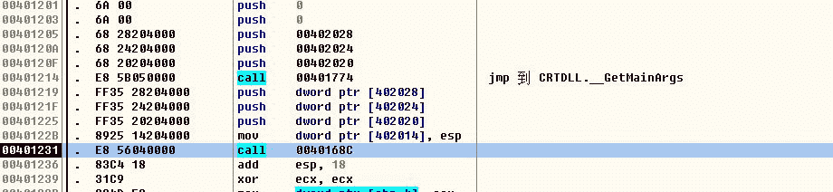  
如图地方 F7,进入后 F8,  
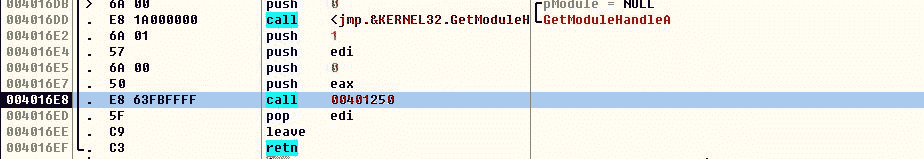  
如图地方 F7，进入后可以看到 F8 几步就可以看到  
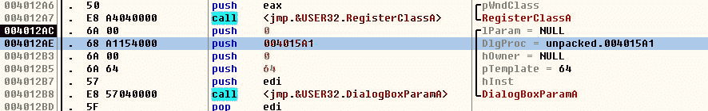  
回想起上篇我提到过的 DialogBox (  
hInstance,  
 TEXT("AboutBox"),  
hwnd,  
 AboutDlgProc  
)  
  
因为 DialogBoxParamA 比 DialogBox 最后多一个参数用来做记录，不影响我们理解，  
（当然我们也可以用 Ctrl+N 查找函数 DialogBoxParamA 来直接定位到这里  
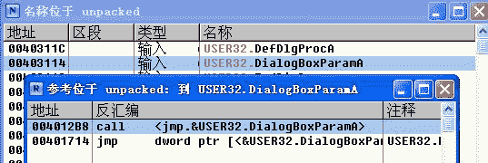  
）  
  
我们看到 DLGProc=004015A1,那么我们明显可以理解 4015A1 处是消息处理函数所在。我们 Ctrl+G 跟过去看，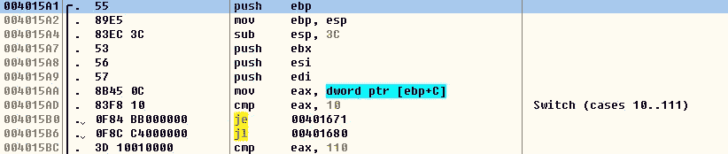  
  
我们会看到 cmp eax，110 或者 cmp eax，111 之类的比较，  
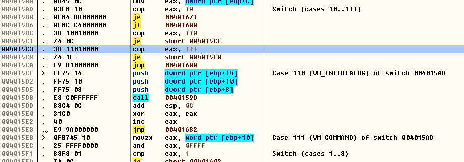  
回想起上篇，这就等同于  
switch (message)  
          
    {  
          
    case WM\_CREATE:  
          
    
  
    case   WM\_PAINT:  
          
             
          
    case   WM\_DESTROY:  
  
}  
  
而其中我们需要知道的是 WM\_COMMAD =111(用来定位按钮的消息)   
WM\_LBUTONUP =202（鼠标左键放开）  
而且我们还要注意一个地方回想上次我提到的  
WndProc (HWND hwnd, UINT message, WPARAM wParam, LPARAM lParam)  
当我们产生一个消息时，必然是调用这个函数，那么根据 windows 函数调用进栈法则，我们不难得到在消息处理函数开头如果下断点，栈结果必然如此  
{  
返回地址  
hwnd  
message  
wParam  
lParam  
}  
  
好了，基础讲完，就再看程序（因为前面 push ebp，所以后面在取 message 时，为 ebp+C，大家应该能明白吧），好了我们先 F9 运行次程序，在查看->窗口明显我们可以看到 Check 的 id 值为 1。  
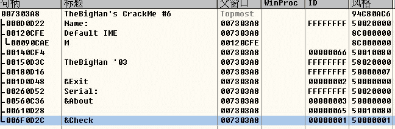  
     现在我们来仔细看看这个消息处理函数，他首先从 ebp+C 中取出了 message，存入了 eax 中，然后开始 switch 的过程，他不断比较这些以确定是哪个消息，  
     好了，我们知道按下按钮会产生 WM\_COMMAD（111） 消息，那么当我们看到 cmp eax，111，je 跳走时，我们离目标已经很近了，跟踪 je 到目的地，我们会奇怪，怎么还比较啊，这是因为按钮有很多个，每一个按下都会产生 WM\_COMMAD（111），那么这时我们需要再次判断是哪个按钮？  
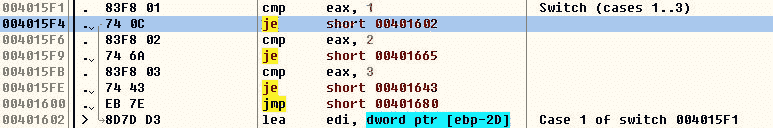  
  
我们利用的就是 wParam 的低四位，他记录了按下按钮的 ID 值，所以就有了 movz eax，  
\[ebp+10\]，好了我们已经知道了 Check 的 ID 值为 1，那么我们看到  
cmp eax，1   
je xxxxxxxx  
跟过去下断点，这时我们就完成了对 check 的断点，只要一按 check 必然会来到此处，后续的也会从这里开始，一切就会光明无比  
  
  
  
  
  
  
  
  
方法二   
当我们面对一个很庞杂的系统时我们又该如何来找那关键的消息处理函数呢？茫茫多的程序中又如何去发现  
cmp eax，111 与 cmp eax，1 呢  
回到前题，我觉得消息处理函数无论他在那里，当他被调用时，栈中的内容必然是  
{  
返回地址  
hwnd  
message  
wParam  
lParam  
}只要我们能抓住他时，我觉得我们就能抓住一切。  
  
首先当我们无法找到消息处理函数时，也许代码太多我们遗漏了，也许有别的技巧可以隐藏。但是我们可以先 F9 运行起来，在查看->窗口中，我们选择他们的共有父窗口，点击跟随 ClassProc  
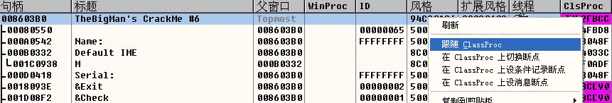  
然后我们进入了系统领空，然后在第一句上下条件断点：  
\[ESP+8\]==WM\_COMMAND&&\[ESP+c\]==1  
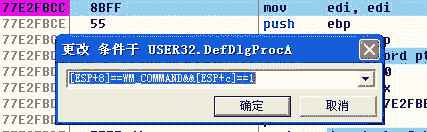  
然后我们在对话框中输入数据，点击 check，我们发现我们会中断在系统领空，并且注意观察栈  
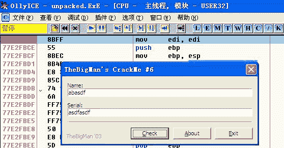  
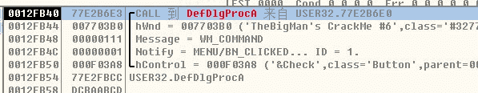  
大家都明白了吧，然后在查看->内存，代码段下内存访问断点，F9 运行下，直接到达消息处理函数  
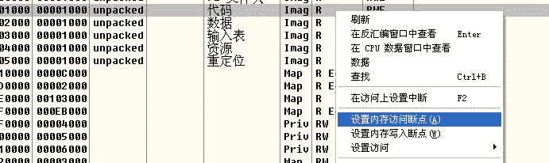  
这时我们这需要静静的 F8 一路跟踪就可以了