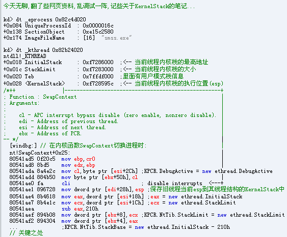
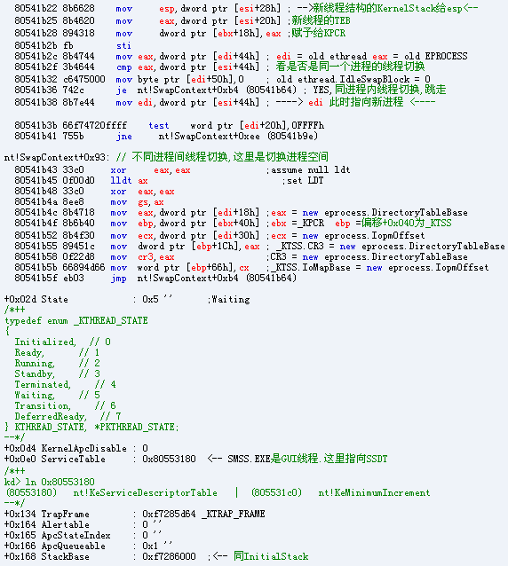
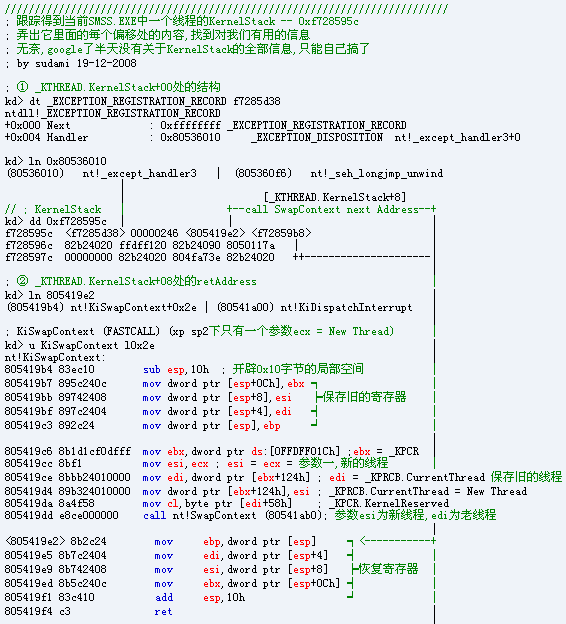
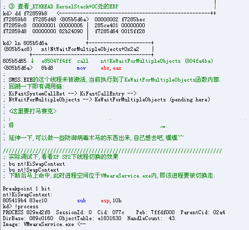
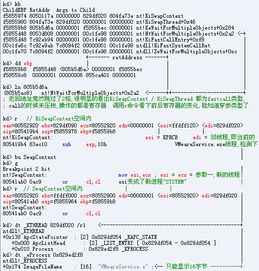
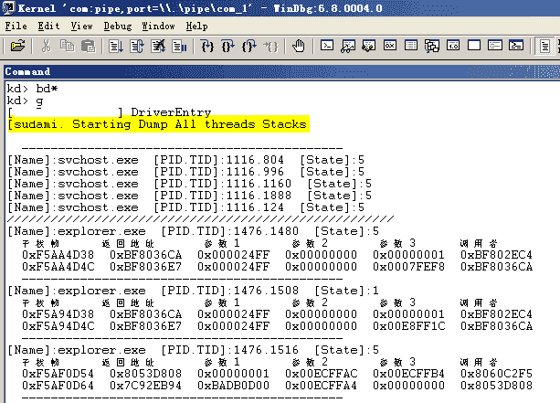

# 跟踪调试 KernelStack 笔记

> 原文：[`www.pediy.com/kssd/pediy10/79022.html`](https://www.pediy.com/kssd/pediy10/79022.html)

<网页排版老是打乱格式,索性截图吧.有兴趣的可以看看,没什么技术含量,关键是我们要在调试中提高自己; >  
  
  
  
  
  
  
  
无聊了下,简单遍历所有进程所有线程当前的状态和调用链. 很好很好,遇到某些情况,可以揪出木马,什么栈欺骗的就算了,玩玩可以 ...  
