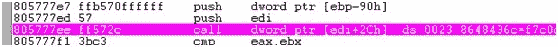
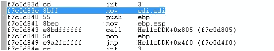
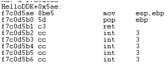
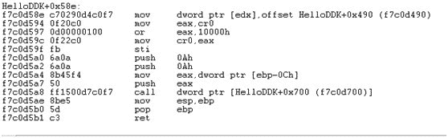
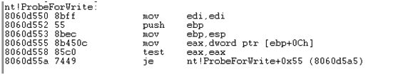
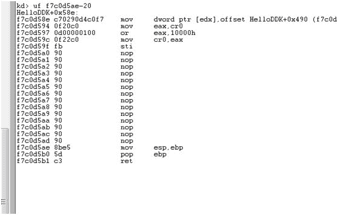

# 驱动蓝屏后调试 DUMP 文件

> 原文：[`www.pediy.com/kssd/pediy12/129630.html`](https://www.pediy.com/kssd/pediy12/129630.html)

关于分析 DUMP 文件的一些想法：  
在分析一个驱动蓝屏的时候，如果有驱动的 PDB 文件就很容易找到出错的地方，然是如果没有 PDB 文件，往往比较麻烦，只能给出个大题的东西，今天调试了一下 DUMP 文件，有点感触，先来分析一下，（ProbeForWrite(bb,10,10);bb 为 NULL 指针）  
双机调试的方法不说了，直接开始调试：加载驱动文件，直接蓝屏了，这个时候 WINDBG 给出了一下提示：  
FOLLOWUP\_IP:   
HelloDDK+5ae  
f7c455ae 8be5            mov     esp,ebp  
  
BUGCHECK\_STR:  0x7E  
  
DEFAULT\_BUCKET\_ID:  NULL\_DEREFERENCE  
  
LAST\_CONTROL\_TRANSFER:  from f7c455ae to 8060d589  
  
STACK\_TEXT:    
f7a01c54 f7c455ae 00000000 0000000a 0000000a nt!ProbeForWrite+0x39  
WARNING: Stack unwind information not available. Following frames may be wrong.  
f7a01c74 f7c45504 f7a01d4c 805777f1 864d2b10 HelloDDK+0x5ae  
f7a01c7c 805777f1 864d2b10 860cd000 00000000 HelloDDK+0x504  
f7a01d4c 80577901 800008a8 00000001 00000000 nt!IopLoadDriver+0x66d  
f7a01d74 80535c32 800008a8 00000000 865b4020 nt!IopLoadUnloadDriver+0x45  
f7a01dac 805c71e0 f7a69cf4 00000000 00000000 nt!ExpWorkerThread+0x100  
f7a01ddc 80542e12 80535b32 00000001 00000000 nt!PspSystemThreadStartup+0x34  
00000000 00000000 00000000 00000000 00000000 nt!KiThreadStartup+0x16  
  
  
SYMBOL\_STACK\_INDEX:  1  
  
SYMBOL\_NAME:  HelloDDK+5ae  
  
FOLLOWUP\_NAME:  MachineOwner  
  
MODULE\_NAME: HelloDDK  
  
IMAGE\_NAME:  HelloDDK.sys  
  
DEBUG\_FLR\_IMAGE\_TIMESTAMP:  4d60d8a6  
  
STACK\_COMMAND:  .cxr 0xfffffffff7a01880 ; kb  
  
FAILURE\_BUCKET\_ID:  0x7E\_HelloDDK+5ae  
  
BUCKET\_ID:  0x7E\_HelloDDK+5ae  
  
这里我只给出其中的一部分代码。  
其中有用的信息大家可以自己分析，今天主要想找找出错位置，看其中的一部分  
HelloDDK+5ae  
f7c455ae 8be5            mov     esp,ebp  
  
主要看 HelloDDK+5ae，也就是出错在加载地址的 5ae 偏移处。  
然后从新打开虚拟机，挂上调试，这个时候先加载驱动，（先别启动驱动，也就是别让你的驱动蓝），然后再 WINDBG 中 BREAK 一下，然后下 bp          nt!IopLoadDriver+0x66a，这个是 SP3 的（P2 的为 bp          nt!IopLoadDriver+0x669），然后再启动驱动，这个时候断下来了，如果所示：  
  
   
然后单布进入（F11）  
得到如下图：  
   
  
这个时候就能得到 HelloDDK 的基址为 f7c0d000 然后加上 5ae 得到 f7c0d5ae  
然后反汇编 f7c0d5ae 得到  
  
   
看到没有事这个地方或者上面出错了，然后咱往上面看得到  
  
   
这里就能判断出来时这个 CALL 出问题了，实际上是第三个 push 0 的问题  
在分析一下  
  
   
这里就知道是 ProbeForWrite 出了问题了，可以用 IDA 在分析一下，然后用二进制工具改，也可以直接用 WINDBG 修改  
如下 eb f7c0d5a0 90 90 90 90 90 90 90 90 90 90 90 90 90 90  
然后再反汇编看一下  
  
   
确定好后运行即可  
当然，这里是最简单的东西，实际上好多 NOP 掉了也会出错，不过嘛，往往很多只需要改成 JMP 或直接 JZ 或 JNZ 就能实现你想要的东西，希望对你有帮助。 

引用: *最初由 **无泪城**发布*  能更加详细一些吗？分析一个未知的驱动，啥都没有，就一个驱动，咋样才能快速找到蓝屏的代码及原因啊？  
1. Load symbol  
2. kp  
咋搞啊？我也感觉我那听繁琐！ 

蓝屏代码在你用 WinDbg 加载 dump 文件的时候，一般就会显示出来，每个蓝屏代码所代表的意义在 WinDbg 的 help 文件中会有所介绍。但是并不是这些蓝屏代码就能够直接给出真正的原因。像类似“Bug Check 0xC000021A: STATUS\_SYSTEM\_PROCESS\_TERMINATED”这种蓝屏代码我们一看就知道是什么原因引起的；但是类似像“Bug Check 0xC5: DRIVER\_CORRUPTED\_EXPOOL”这样的蓝屏代码，我们只能够看到蓝屏的直接原因，而为什么 memory 或者 system pool 会 corrupted，还是要具体问题具体分析，很可能这个 pool 或者 memory 早就被某个 driver 给破坏掉了，但是过了 N 久系统才 touch 到这个损坏的 pool，这种问题，基本除了排除法，没有什么好的办法能够直接找到 root cause。  
  
对于 lz 上面提到的情况，配置好系统 symbol 之后，直接 kp 命令就可以看到详细的调用堆栈信息，包括传入的参数，一目了然。  
  
代码:

```
The k\* commands display the stack frame of the given thread, together with related information..


p 
Displays all of the parameters for each function that is called in the stack trace. The parameter list includes each parameter's data type, name, and value. The p option is case sensitive. This parameter requires full symbol information. 

```

引用: *最初由 **prince**发布*  蓝屏代码在你用 WinDbg 加载 dump 文件的时候，一般就会显示出来，每个蓝屏代码所代表的意义在 WinDbg 的 help 文件中会有所介绍。但是并不是这些蓝屏代码就能够直接给出真正的原因。像类似“Bug Check 0xC000021A: STATUS\_SYSTEM\_PROCESS\_TERMINATED”... 

  
恩，我这电脑没有双机调试，回去测试一下，顺便问一个问题，蓝屏的时候给出了一系列代码，其中有一项是 STACK\_TEXT：里面罗列了蓝屏的时候堆栈调用情况，不知道用 Kp 命令得到的是不是和这个一致？例如：  
/////////////////////////  
////////////////////////  
STACK\_TEXT: //反映了错误前堆栈中函数调用情况，最下面的 0x7c801671 处函数调用 ntdll 中的 ZwDeviceIoControlFile，接着调用了 ntdll 中的 KiFastSystemCallRet，再接着调用了 nt（这里的 nt 指 Ntoskrnl）中的 KiFastCallEntry，一直到 myfault+0x403，发生异常。  
f9357734 804f880d 00000003 f9357a90 00000000 nt!RtlpBreakWithStatusInstruction  
f9357780 804f93fa 00000003 e1147008 fbe93403 nt!KiBugCheckDebugBreak+0x19  
f9357b60 80540853 0000000a e1147008 0000001c nt!KeBugCheck2+0x574  
f9357b60 fbe93403 0000000a e1147008 0000001c nt!KiTrap0E+0x233  
WARNING: Stack unwind information not available. Following frames may be wrong.  
f9357c58 805759d1 ffb5c3b0 8111f318 811d9130 myfault+0x403  
f9357d00 8056e33c 00000090 00000000 00000000 nt!IopXxxControlFile+0x5e7  
f9357d34 8053d808 00000090 00000000 00000000 nt!NtDeviceIoControlFile+0x2a  
f9357d34 7c92eb94 00000090 00000000 00000000 nt!KiFastCallEntry+0xf8  
0012f9f0 7c92d8ef 7c801671 00000090 00000000 ntdll!KiFastSystemCallRet  
0012f9f4 7c801671 00000090 00000000 00000000 ntdll!ZwDeviceIoControlFile+0xc  
0012fa54 004018c2 00000090 83360018 00000000 0x7c801671