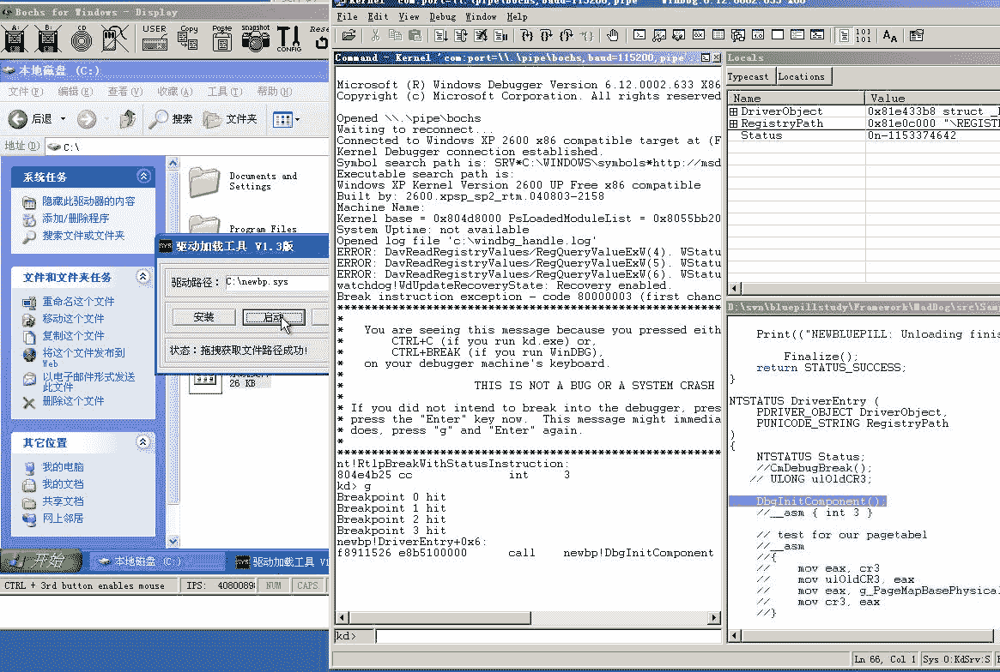
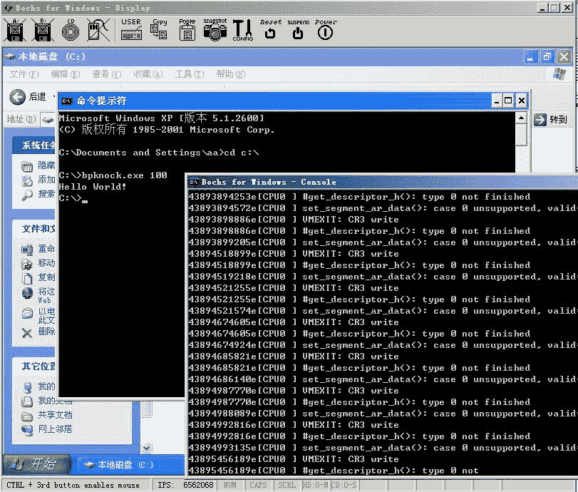
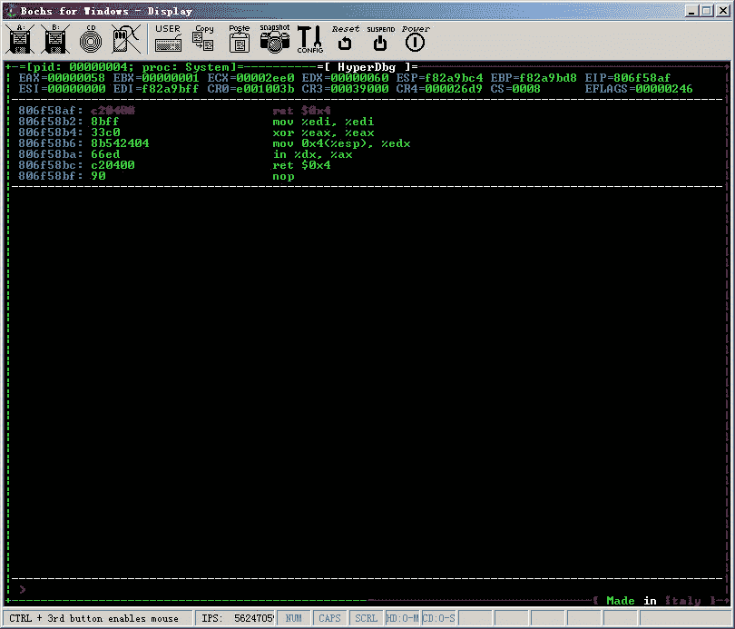

# Bochs+Windbg 调试 VT 代码

> 原文：[`www.pediy.com/kssd/pediy12/139031.html`](https://www.pediy.com/kssd/pediy12/139031.html)

准备工具:  
    Windbg 6.12  
    bochs-2.4.6-msvc-src(http://sourceforge.net/projects/bochs/files/bochs/2.4.6/)  
    vmware.  
    Securable (检查是否开启 VT 的)  
    VC 2008.  
Intel vt 技术十分诱人，但是如何调试 vt 程序却是让人头疼, 我们经常使用的 vmware 貌似不支持 cpu vt 技术的模拟,貌似只有 bochs 支持 cpu vt 技术的模拟。  
看了下 qemu 的代码发现其 feature 里有支持 VT 特性的,不过试了它提供的几个 cpu,发现只有 qemu64(cpu 名称)支持 VT.  
  
步骤:  
  
1, 修改 config.h 中的  

代码:

```
#define BX\_SUPPORT\_VMX 0

```

改成   
代码:

```
#define BX\_SUPPORT\_VMX 1 
或者 
#define BX\_SUPPORT\_VMX 2

```

2, 编译.你会发现 bx\_cpu\_c::init\_VMCS(), vmcs\_field\_offset()等 link error!  
   解决方法:  
将 cpu\\vmcs.cc 加进工程就可以了  
3, 到现在 bochs 已经编译出来了,接下来就是安装系统.bochs 太慢,使用 vmware 装把.  
具体步骤参考三寸法师的文章(http://bbs.pediy.com/showthread.php?p=964315).  
装完后用 Securable 检测下看是否支持 vt.再加上调试模式(修改 boot.ini...不多说,不知道的可以搜一下 vmware+debug 调试)  
发现绿色的 YES,好了支持了,不过还有问题,见下文.  
4, bochs 支持串口, 用 Windbg 连接 bochs 进行源码调试吧.在 bochs 的配置文件中加一句  
代码:

```
com1: enabled=1, mode=pipe\_server, dev=”\\\\.\\pipe\\bochs”

```

  然后运行虚拟机,会发现 bochs 会一直在等待,这时打开 windbg 连接\\\\.\\pipe\\bochs .嗯,bochs 开始运行了.选择调试模式,好吧.windbg 直接退了.有木有.有木有.如果是 windbg 6.09 你就发现他不会退出而是没啥反应.  
  5, 看了下 bochs 中串口的实现,是同步的(难道是因为这个退出的?),翻了下 virtualbox 的串口的代码发现确实异步,开了读写线程。好吧，看到网上有用 bochs 调试 wrk 的一篇文章<wrk 源码分析之 WinDbg+Bochs 调试>,里面给出了段代码(注:这个代码我改了下发现这段代码在想串口写数据的时候锁死了, 修改及其原版代码见附件)用这个试试.  
  将其代码加到项目文件中.然后在 serial.h 中的 bx\_serial\_t 定义中添加一变量(红色字体部分):  
代码:

```
int io\_mode;
  int tty\_id;
  SOCKET socket\_id;
  FILE \*output;
#ifdef WIN32
  HANDLE pipe;
  void\* p\_cls\_our;
#endif

#if USE\_RAW\_SERIAL
  serial\_raw\* raw;
#endif

```

然后在 serial .cc 文件中的 bx\_serial\_c::init(void)添加(红色部分) 这里我们添加了一个模式”pipe”具体设置见后面:  
代码:

```
略…  
if (server) {
  pipe = CreateNamedPipe( dev,
    PIPE\_ACCESS\_DUPLEX | FILE\_FLAG\_FIRST\_PIPE\_INSTANCE,
    PIPE\_TYPE\_BYTE | PIPE\_READMODE\_BYTE | PIPE\_WAIT,
    1, 4096, 4096, 0, NULL);
  if (pipe == INVALID\_HANDLE\_VALUE)
    BX\_PANIC(("com%d: CreateNamedPipe(%s) failed", i+1, dev));
  BX\_INFO(("com%d: waiting for client to connect to %s", i+1, dev));
  if (!ConnectNamedPipe(pipe, NULL) && GetLastError() != ERROR\_PIPE\_CONNECTED)
  {
    CloseHandle(pipe);
    pipe = INVALID\_HANDLE\_VALUE;
    BX\_PANIC(("com%d: ConnectNamedPipe(%s) failed", i+1, dev));
  }
  }
  // client mode
  else {
  
   if ( strcmp(mode, "pipe") == 0 ){
    BX\_INFO(("!!!!!!into our code!!!!!!!"));
    serial\_pipe\* our\_serial = new serial\_pipe(dev);
    BX\_SER\_THIS s\[i\].p\_cls\_our = our\_serial;
   }else{
     pipe = CreateFile( dev,
       GENERIC\_READ | GENERIC\_WRITE, 
       0, NULL, OPEN\_EXISTING, 0, NULL);

     if (pipe == INVALID\_HANDLE\_VALUE)
       BX\_INFO(("com%d: failed to open pipe %s", i+1, dev));
   }
  }
略…

```

在 serial .cc 文件中 void bx\_serial\_c::rx\_timer(void)函数添加(红色部分):  
代码:

```
略…
#ifdef WIN32
        DWORD avail = 0;
        if (BX\_SER\_THIS s\[port\].pipe &&
            PeekNamedPipe(BX\_SER\_THIS s\[port\].pipe, NULL, 0, NULL, &avail, NULL) &&
            avail > 0) {
          ReadFile(BX\_SER\_THIS s\[port\].pipe, &chbuf, 1, &avail, NULL);
          data\_ready = 1;
        }
        if (BX\_SER\_THIS s\[port\].p\_cls\_our){
            chbuf = ((serial\_pipe\*)(BX\_SER\_THIS s\[port\].p\_cls\_our))->receive();
            data\_ready = 1;
        }
#endif
略…

```

再在 serial .cc 文件中 void bx\_serial\_c::tx\_timer(void)函数添加(红色部分):  
代码:

```
略…
#ifdef WIN32
        if (BX\_SER\_THIS s\[port\].pipe) {
          DWORD written;
          WriteFile(BX\_SER\_THIS s\[port\].pipe, (bx\_ptr\_t)& BX\_SER\_THIS s\[port\].tsrbuffer, 1, &written, NULL);
        }
        
        if (BX\_SER\_THIS s\[port\].p\_cls\_our) {
            serial\_pipe\* p\_serial = (serial\_pipe\*)(BX\_SER\_THIS s\[port\].p\_cls\_our);
            p\_serial->transmit(BX\_SER\_THIS s\[port\].tsrbuffer);
        }
#endif
略…

```

再在头部添加新添文件的头文件:  
代码:

```
#if USE\_PIPE\_SERIAL
#include "serial\_pipe.h"
#endif

```

好吧还得在 config.h 中添加:  
代码:

```
#define USE\_PIPE\_SERIAL 1

```

6, 大功告成,编译.好!成功.  
7, 修改 bochs 配置文件:  
代码:

```
com1: enabled=1, mode=pipe, dev="pipe\\bochs"

```

8, 发现 windbg 连上了,并且可以源码调试了.如图:  
  
这是啥?newbluepill???  
9,到这就完了嘛?no..windbg 输入 g enter.. 草..蓝了,断在 vmx\_on 指令上..不支持?  
发现 bochs 后台输出了句: #GP: VMXON is not allowed !.抬头对天大喊一声,草!!.明明是支持的呀!  
跟了下发现是:  
!(BX\_CPU\_THIS\_PTR msr.ia32\_feature\_ctrl & BX\_IA32\_FEATURE\_CONTROL\_LOCK\_BIT)  
引起的.查找了下 BX\_IA32\_FEATURE\_CONTROL\_LOCK\_BIT 的引用.发现:  
/\* enable VMX, should be done in BIOS instead \*/  
BX\_CPU\_THIS\_PTR msr.ia32\_feature\_ctrl =  
/\*BX\_IA32\_FEATURE\_CONTROL\_LOCK\_BIT|\*/ BX\_IA32\_FEATURE\_CONTROL\_VMX\_ENABLE\_BIT;  
哦.知道了原来在 bios 里设置.可是 bochs 那丑陋的 bios 根本就不能设置,只能设置从哪启动,一不做二不休,干脆把注释去掉:  
代码:

```
/\* enable VMX, should be done in BIOS instead \*/
BX\_CPU\_THIS\_PTR msr.ia32\_feature\_ctrl =
BX\_IA32\_FEATURE\_CONTROL\_LOCK\_BIT | BX\_IA32\_FEATURE\_CONTROL\_VMX\_ENABLE\_BIT;

```

再跑 ok 了.可以运行了.如图:  
  
  
这又是啥??  
PS:bochs 的时钟频率很快,所以其串口速度也非常快.比 VirtualKD 都看.至于你你信不信,反正我是信了.  
  
修改过的代码:  
bochs-pipe-serial.rar  
doc 文档:  
Bochs 调试 VT 代码.doc