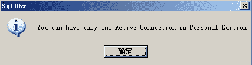
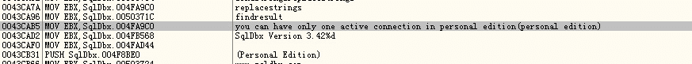
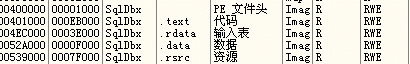
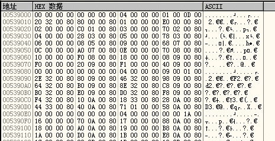
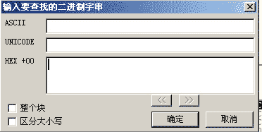
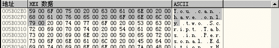

# 另辟蹊径找关键字符串

> 原文：[`www.pediy.com/kssd/pediy11/106658.html`](https://www.pediy.com/kssd/pediy11/106658.html)

找到字符串，对于我们逆向十分有帮助。  
我想谈谈字符串查找的一些个人经验。  
通常我们用右键菜单的“查找 ascii”或者“查找 unicode”但是查询结果往往不如人意。  
  
  
  
第一个文本字串=you can have only one active connection in personal edition(personal edition)  
可以找到  
但是第二个文本字串用这个方法找不到。  
  
我就想既然能显示出来，必然会在软件载入时加载到内存中，往往在.rsrc 资源段。  
下面看我这么把它给找出来，如图  
  
  
1.命令行 D 539000 在数据窗口中我们来到.rsrc 资源段  
  
  
2crtl+b 查找二进制字符串 可以在 选择在 ascii 或 Unicode 输入要查询的字符串，我试了下 Unicode 成功了，我输入的是“you can have only”  
  
  
看看我们找到了什么，就是用右键菜单的“查找 ascii”或者“查找 unicode”没办法找到的字符串。  
  
  
3 下硬件断点 hr 5b02e0 就可以断下来。  
  
后面的就一马平川了，嘿嘿  
  
  
大家有兴趣可以 try 一下  
如已有前辈说过这种方法，请管理员，把我的这个帖子格杀勿论。不过要给我发个通知。