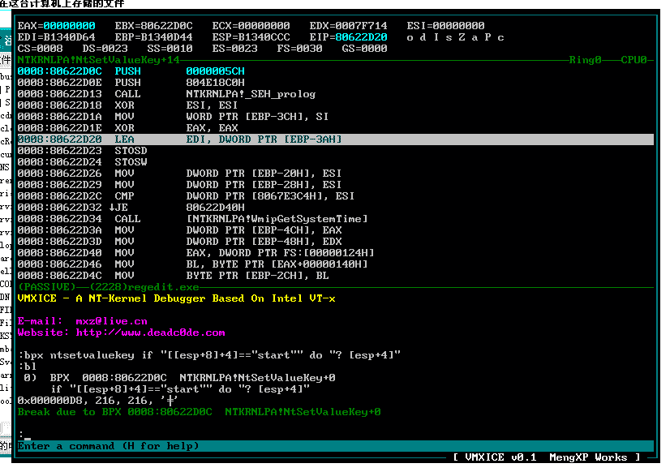

# 基于 vt 的内核调试器 vmxice ~yeeeah

> 原文：[`www.pediy.com/kssd/pediy12/140245.html`](https://www.pediy.com/kssd/pediy12/140245.html)

这是一款 32 位基于 VT 技术的内核调试器。  
  
业余作品。仅供娱乐~  
  
暂时不支持 ring3 调试(没解析符号)。  
  
CPU 必须是 intel 支持 vt 技术的 cpu，BIOS 必须 Enable VT。  
  
不支持多核，多核心请打开/NUMPROC=1 选项。否则单着单着就挂死了。很坑爹。  
不支持双显卡。据说多显卡画不出界面，我没测试条件…  
仅支持 PS2 键盘，不支持鼠标。低端了…  
支持 xp/2003/vista/win7，自动下载所需符号。  
不能和 vmware 一起开，会死很惨。  
打开 everest 会卡在获取 MSR，fxxx,why?  
  
  
几个控制键如下。  
F7 单步  
F8 单步步过  
F9 执行到返回(未完成，有 bug，慎用)  
F12 呼出调试器  
  
  
  
目前支持的命令有：  
BC  
BL  
BPIO  
BPMB  
BPMW  
BPMD  
BPX  
CPU  
DRIVER  
!DB  
!DW  
!DD  
DB  
DW  
DD  
H  
IDT  
KILL  
PAGE  
PHYS  
PROC  
STACK  
U  
?  
  
H 可以获取帮助查看详细用法。  
  
  
断点支持条件表达式，语法大概如下（我 x！上学期的编译原理课没有白学…）：  
bpx 0xxxxxxxx if "word \[\[esp+8\]+4\] == 0ffff && (\[esp+0c\] == "test" || byte \[esp+10\] & 80)"  
  
这种也是允许的  
bpx ntsetvaluekey+2  
  
if 后面的 do 暂时没啥用……毕竟支持的命令还不多……  
  
字符串判断支持宽字符串，自动适应，无视大小写。  
数值判断支持 dword word byte 3 种前缀。  
数值都是 16 进制，字母打头需要 0 前缀。例如 0ffffffff。  
  
  
没有保护 DR 寄存器。  
  
  
死机请重启…  
  
  
附无码图一张  

上传的附件
|  || vmxice\_test.rar  
 |