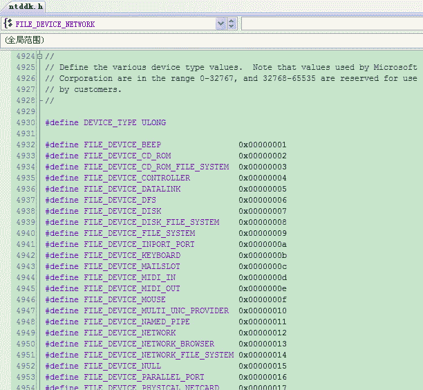

# IOCTL 解码程序

> 原文：[`www.pediy.com/kssd/pediy11/125640.html`](https://www.pediy.com/kssd/pediy11/125640.html)

大都数驱动逆向的人都会碰到 IOCTL 的 16 进制码，这时候需要将这 16 进制码解码成原生的 IOCTL\_CODE，这里参照了 OSROnline 论坛上的在线 DECODE，写下了这个小工具，希望对大伙儿有帮助（也为自己留一份，嘿嘿）。  

代码:

```
//////////////////////////////////////////////////////////////////////////
// Decode.h
//////////////////////////////////////////////////////////////////////////
#pragma once

#include <windows.h>
#include <tchar.h>
#include "resource.h"

//
// Macro definition for defining IOCTL and FSCTL function control codes.  Note
// that function codes 0-2047 are reserved for Microsoft Corporation, and
// 2048-4095 are reserved for customers.
//
//#define CTL\_CODE( DeviceType, Function, Method, Access ) (                 \\
//  ((DeviceType) << 16) | ((Access) << 14) | ((Function) << 2) | (Method) \\
//  )
//

// 设备类型字符串
LPCTSTR DeviceTypeString\[54\];

// 对话框回调函数
BOOL CALLBACK MainDlgProc(HWND hDlg, UINT uMsg, WPARAM wParam, LPARAM lParam);

// 对话框初始化
void OnInitDialog( HWND hDlg );

// CTLCODE\_VALUE 窗口处理过程
LRESULT CALLBACK CTLCODE\_EditProc( HWND hWnd, UINT uMsg, WPARAM wParam, LPARAM lParam);

void OnCommand( DWORD dwId, LPARAM lParam );

// 解码
bool Decode();

// 初始化设备类型集
void InitDeviceType();

// 清除 EDIT 存在的值
void ClearEditValue();

```

\==========================华丽的分割线===================================  
代码:

```
//////////////////////////////////////////////////////////////////////////
// Decode.cpp
//////////////////////////////////////////////////////////////////////////
#include "Decode.h"
#include <strsafe.h>


WNDPROC    g\_lpOldProcEdit = NULL;  // IOCTL\_VALUE Edit
HWND    g\_wndDlg = NULL;    // 对话框窗口句柄


// 对话框回调函数
BOOL CALLBACK MainDlgProc(HWND hDlg, UINT uMsg, WPARAM wParam, LPARAM lParam)
{
  switch ( uMsg )
  {
  case WM\_COMMAND:
    OnCommand( LOWORD(wParam), lParam );
    break;

  case WM\_CLOSE:
    EndDialog(hDlg, 0);
    break;

  case WM\_INITDIALOG:
    OnInitDialog(hDlg);
    break;

  default:
    return FALSE;
  }

  return TRUE;
}


void OnCommand( DWORD dwCtrlId, LPARAM lParam )
{
  // Decode
  if ( dwCtrlId == IDOK )
  {
    ClearEditValue();
    Decode();
  }
}


// 清除 EDIT 存在的值
void ClearEditValue()
{
  SetDlgItemText( g\_wndDlg, IDC\_EDIT\_ACCESS, \_T("") );
  SetDlgItemText( g\_wndDlg, IDC\_EDIT\_DEVICE, \_T("") );
  SetDlgItemText( g\_wndDlg, IDC\_EDIT\_FUNCTION, \_T("") );
  SetDlgItemText( g\_wndDlg, IDC\_EDIT\_METHOD, \_T("") );
}


#define WARN\_MSG(msg)  \\
  MessageBox(g\_wndDlg, msg, \_T("Warning"), MB\_OK | MB\_ICONWARNING )

// 解码
bool Decode()
{
  TCHAR szText\[MAX\_PATH\];
  int nLen = \_countof(szText);
  GetDlgItemText( g\_wndDlg, IDC\_EDIT\_IOCTLVALUE, szText, nLen - 1 );
  if (\_tcslen(szText) <= 0)
  {
    WARN\_MSG(\_T("Enter IOCTL\_VALUE."));
    return false;
  }

  unsigned long nIOCtlCode = \_tcstoul( szText, NULL, 16 );

  int nDeviceType = (nIOCtlCode >> 16) & 0xFFF;
  int nDevsCount = \_countof(DeviceTypeString);

  // 设备类型
  if ( nDeviceType <= nDevsCount && nDeviceType != 0 )
  {
    SetDlgItemText( g\_wndDlg, IDC\_EDIT\_DEVICE, DeviceTypeString\[nDeviceType - 1\] );
  }
  else
  {
    StringCchPrintf( szText, nLen, \_T("0x%X"), nDeviceType );
    SetDlgItemText( g\_wndDlg, IDC\_EDIT\_DEVICE, szText );
  }

  // Function
  int nFuncVal = (nIOCtlCode >> 2) & 0xFFF;
  StringCchPrintf( szText, nLen, \_T("0x%X"), nFuncVal );
  SetDlgItemText( g\_wndDlg, IDC\_EDIT\_FUNCTION, szText );

  // access
  int nAccess = (nIOCtlCode >> 14) & 3;
  LPCTSTR lpszAccess = \_T("");

  switch ( nAccess )
  {
  case 0:
    lpszAccess = \_T("FILE\_ANY\_ACCESS");
    break;

  case 1:
    lpszAccess = \_T("FILE\_READ\_ACCESS");
    break;

  case 2:
    lpszAccess = \_T("FILE\_WRITE\_ACCESS");
    break;

  case 3:
    lpszAccess = \_T("FILE\_WRITE\_ACCESS | FILE\_READ\_ACCESS");
    break;

  default:
    break;
  }
  SetDlgItemText( g\_wndDlg, IDC\_EDIT\_ACCESS, lpszAccess );

  // method
  int nMethod = nIOCtlCode & 3;
  LPCTSTR lpszMethod = \_T("");

  switch (nMethod)
  {
  case 0:
    lpszMethod = \_T("METHOD\_BUFFERED");
    break;

  case 1:
    lpszMethod = \_T("METHOD\_IN\_DIRECT");
    break;

  case 2:
    lpszMethod = \_T("METHOUD\_OUT\_DIRECT");
    break;

  case 3:
    lpszMethod = \_T("METHOD\_NEITHER");
    break;

  default:
    break;
  }

  SetDlgItemText( g\_wndDlg, IDC\_EDIT\_METHOD, lpszMethod );
  return true;
}


// CTLCODE\_VALUE 窗口处理过程
LRESULT CALLBACK CTLCODE\_EditProc( HWND hWnd, UINT uMsg, WPARAM wParam, LPARAM lParam)
{
  if ( uMsg == WM\_CHAR )
  {
    if ( wParam == VK\_BACK || wParam == VK\_DELETE )
      return CallWindowProc( g\_lpOldProcEdit, hWnd, uMsg, wParam, lParam );

    // 是否是进制
    if ( !\_istxdigit(wParam) )
    {
      return FALSE;
    }
  }

  return CallWindowProc( g\_lpOldProcEdit, hWnd, uMsg, wParam, lParam );
}


// 对话框初始化
void OnInitDialog( HWND hDlg )
{
  g\_wndDlg = hDlg;
  SendDlgItemMessage(hDlg, IDC\_EDIT\_IOCTLVALUE, EM\_LIMITTEXT, 8, 0);
  HWND hCodeEdit = GetDlgItem(hDlg, IDC\_EDIT\_IOCTLVALUE);

  // 更改回调函数
  g\_lpOldProcEdit = (WNDPROC)SetWindowLong(hCodeEdit, GWL\_WNDPROC, (LONG)CTLCODE\_EditProc);
  HICON hIcon = LoadIcon( NULL, MAKEINTRESOURCE(IDI\_DECODE) );
  ::SendMessage(g\_wndDlg, WM\_SETICON, TRUE, (LPARAM)hIcon);
  ::SendMessage(g\_wndDlg, WM\_SETICON, FALSE, (LPARAM)hIcon);
}


void InitDeviceType()
{
  DeviceTypeString\[0\]=\_T("BEEP");
  DeviceTypeString\[1\]=\_T("CD\_ROM");
  DeviceTypeString\[2\]=\_T("CD\_ROM\_FILE\_SYSTEM");
  DeviceTypeString\[3\]=\_T("CONTROLLER");
  DeviceTypeString\[4\]=\_T("DATALINK");
  DeviceTypeString\[5\]=\_T("DFS");
  DeviceTypeString\[6\]=\_T("DISK");
  DeviceTypeString\[7\]=\_T("DISK\_FILE\_SYSTEM");
  DeviceTypeString\[8\]=\_T("FILE\_SYSTEM");
  DeviceTypeString\[9\]=\_T("INPORT\_PORT");
  DeviceTypeString\[10\]=\_T("KEYBOARD");
  DeviceTypeString\[11\]=\_T("MAILSLOT");
  DeviceTypeString\[12\]=\_T("MIDI\_IN");
  DeviceTypeString\[13\]=\_T("MIDI\_OUT");
  DeviceTypeString\[14\]=\_T("MOUSE");
  DeviceTypeString\[15\]=\_T("MULTI\_UNC\_PROVIDER");
  DeviceTypeString\[16\]=\_T("NAMED\_PIPE");
  DeviceTypeString\[17\]=\_T("NETWORK");
  DeviceTypeString\[18\]=\_T("NETWORK\_BROWSER");
  DeviceTypeString\[19\]=\_T("NETWORK\_FILE\_SYSTEM");
  DeviceTypeString\[20\]=\_T("NULL");
  DeviceTypeString\[21\]=\_T("PARALLEL\_PORT");
  DeviceTypeString\[22\]=\_T("PHYSICAL\_NETCARD");
  DeviceTypeString\[23\]=\_T("PRINTER");
  DeviceTypeString\[24\]=\_T("SCANNER");
  DeviceTypeString\[25\]=\_T("SERIAL\_MOUSE\_PORT");
  DeviceTypeString\[26\]=\_T("SERIAL\_PORT");
  DeviceTypeString\[27\]=\_T("SCREEN");
  DeviceTypeString\[28\]=\_T("SOUND");
  DeviceTypeString\[29\]=\_T("STREAMS");
  DeviceTypeString\[30\]=\_T("TAPE");
  DeviceTypeString\[31\]=\_T("TAPE\_FILE\_SYSTEM");
  DeviceTypeString\[32\]=\_T("TRANSPORT");
  DeviceTypeString\[33\]=\_T("UNKNOWN");
  DeviceTypeString\[34\]=\_T("VIDEO");
  DeviceTypeString\[35\]=\_T("VIRTUAL\_DISK");
  DeviceTypeString\[36\]=\_T("WAVE\_IN");
  DeviceTypeString\[37\]=\_T("WAVE\_OUT");
  DeviceTypeString\[38\]=\_T("8042\_PORT");
  DeviceTypeString\[39\]=\_T("NETWORK\_REDIRECTOR");
  DeviceTypeString\[40\]=\_T("BATTERY");
  DeviceTypeString\[41\]=\_T("BUS\_EXTENDER");
  DeviceTypeString\[42\]=\_T("MODEM");
  DeviceTypeString\[43\]=\_T("VDM");
  DeviceTypeString\[44\]=\_T("MASS\_STORAGE");
  DeviceTypeString\[45\]=\_T("SMB");
  DeviceTypeString\[46\]=\_T("KS");
  DeviceTypeString\[47\]=\_T("CHANGER");
  DeviceTypeString\[48\]=\_T("SMARTCARD");
  DeviceTypeString\[49\]=\_T("ACPI");
  DeviceTypeString\[50\]=\_T("DVD");
  DeviceTypeString\[51\]=\_T("FULLSCREEN\_VIDEO");
  DeviceTypeString\[52\]=\_T("DFS\_FILE\_SYSTEM");
  DeviceTypeString\[53\]=\_T("DFS\_VOLUME");
}


int WINAPI \_tWinMain(HINSTANCE hInstance, HINSTANCE hPrevInstance, 
           LPTSTR lpCmdLine, int nCmdShow)
{
  InitDeviceType();
  return DialogBoxParam(hInstance, MAKEINTRESOURCE(IDD\_DECODE\_DLG), 
    NULL, (DLGPROC)MainDlgProc, NULL);
}

```

上传的附件
|  || IOCTL\_DECODE.rar  
 |

引用: *最初由 **陈老师**发布*  void InitDeviceType()里头的数组是怎么来的  
不太明白 

参考 WDK 的文档和 NTDDK.h 中的定义  
