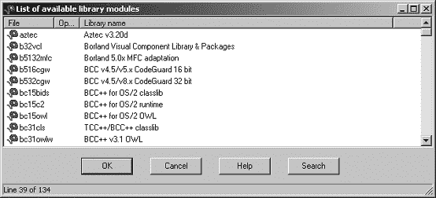
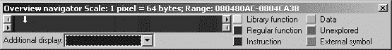
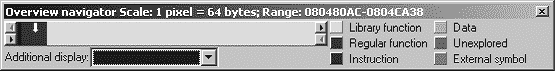
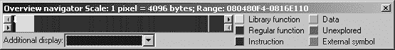
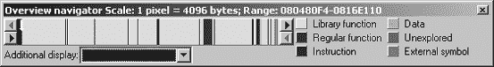

# 【翻译】（20081030 更新）The IDA Pro Book 第十二章：使用 FLIRT 签名识别库

> 原文：[`www.pediy.com/kssd/pediy10/75422.html`](https://www.pediy.com/kssd/pediy10/75422.html)

翻译得不好，有些句子实在是想不出更好的表达方式了，请见谅。网页的格式有点乱，完整的 Word 文档看附件。  
另外我想问下 arhat 版主，现在只是翻译了个初稿，如可能的话，我想请论坛上的个别朋友校正一下，这需要把英文原稿发过去，不知这是否可以？  
  
20081030：非常感谢 Aleaxander 的校正，修改过了原来有些别扭的句子，附件已被更新，请重新下载。  
另外根据 Aleaxander 的建议，还有两个问题：  
1 strip 应该翻译为“去除”还是“剥离”好呢？似乎 2 种都可以，个人感觉第 2 种更形象一些，所以在这篇文档中仍然用的是“剥离”。不知其它章是怎么译的，要改的话我可以再修改。  
2 top-level 是否翻译成“顶级”？有点别扭，但是都想不出更好的译法。  
  
  
  
12 使用 FLIRT 签名识别库（ibrary recognition using flirt signatures）  
  
  
在“The initial autoanalysis has been finished”\[1\]之后，该是到了探索 IDA 更高级功能的时候了。这一章中我们将讨论一些识别标准代码序列的技术，如包含在静态链接二进制中的库代码，或者编译器插入的标准初始化和辅助函数。  
  
当您对二进制进行逆向工程时，要做的最后一件事就是浪费时间去逆向库函数，实际上这种工作您可以通过阅读帮助文档，源代码，或者从互联网上寻找资料，就能够更简单容易地做到。静态链接二进制所带来的难题是应用程序代码和库代码的区分很模糊。在静态链接二进制中，整个库与应用程序代码互相结合，形成一个密不可分的可执行文件。不过幸运的是，有些工具可以让 IDA 识别并且标记出库代码，使我们把注意力集中在应用程序自身的代码上。  
  
  
1 当 IDA 为一个新加载的二进制完成自动化分析时，会在消息窗口中输出这条信息。  
  
  
库文件快速识别与鉴定技术（Fast Library Identification and Recognition Technology）  
  
    库文件快速识别与鉴定技术（Fast Library Identification and Recognition Technology），简称为 FLIRT\[2\]，包含了一组 IDA 用来标识库代码序列的方法。FLIRT 的核心技术是模式匹配算法，这使得 IDA 能够迅速确定一个反汇编后的函数是否匹配 IDA 中许多已知签名的一个。<IDADIR>/sig 目录包含了 IDA 附带的签名文件，在大多数情况下，这些签名与常见的 Windows 编译器生成的库相关，但少数非 Windows 的签名也包括在内。  
    签名文件使用自定义格式，其中大部分签名数据被压缩和包含在一个 IDA 指定的头文件中。多数情况下，签名文件的名称不能清楚地表明这个签名文件是由哪个库产生的，签名文件可以包含一个库名字的注释来描述其内容，这取决于它们的创建过程。如果我们从签名文件中提取 ASCII 内容，查看它们的前几行，往往就能够发现这个注释。下面的 Unix 风格命令\[3\]显示，注释一般输出在第二或第三行：  
  
# strings sigfile | head -n 3  
  
    在 IDA 中有两种办法查看相关的签名文件。第一，通过 View -> Open Subviews -> Signatures，可以查看到已经应用于二进制的签名列表；第二，通过 File -> Load File -> FLIRT Signature File，作为手动签名应用程序流程的一部分，显示出所有的签名文件列表。  
  
  
应用 FLIRT 签名(Applying FLIRT Signatures)  
    当一个二进制第一次打开时，IDA 尝试对入口点应用 startup 签名指定的相关签名文件。原来，各种不同的编译器所产生的入口点代码是相当不同的，入口点签名匹配是一种有效的技术，可以用来鉴定生成一个给定二进制的编译器类型。  
  
  
2 更多信息请访问：http://www.Hex-Rays.com/IDApro/flirt.htm。  
3 第二章中介绍了这个 strings 命令，head 命令用来查看源输入文件的开头几行（在这个例子中是 3）。  
  
MAIN VS. \_START  
    我们知道，一个程序的入口点就是将被执行的第一条指令的地址。长期以来，许多 C 程序员错误地认为这是 main 函数的地址，实际上并非如此。程序的文件类型，但不是创建这个程序的语言类型，决定了以何种方式提供命令行参数给程序。为了解决加载器传递命令行参数的方式和程序期望的接收方式之间的差异（例如，传递参数给 main），在转移控制权给 main 之前必须执行一些初始化代码。正是这段初始化代码被 IDA 指定为程序的入口点，并且定义为标签\_start。  
    这段始化代码还负责其它任何允许 main 运行前的初始化任务。在 C++程序中，该代码负责在 main 执行前保证全局定义对象的构造函数被调用。同样，为了在程序真正结束前调用全局对象的析构函数，释放代码被插入在执行 main 之后。  
    如果 IDA 确定了创建一个二进制的编译器类型，将会载入和该编译器库相对应的签名文件，并且应用到二进制的剩余部分。随 IDA 发布的签名文件趋向于某些私有的编译器，如 Microsoft Visual C ++或 Borland Delphi。背后的原因是因为与这些编译器相关的二进制库的数量有限。而开源的编译器如 GNU gcc，与它相关的二进制库数量和操作系统一样众多，比如每个版本的 FreeBSD 都有个唯一的 C 标准库版本。由于最佳模式匹配的原因，签名文件需要与每个不同版本的库相对应，考虑到要收集随每一个 Linux 发行版而发行的每一个 libc.a\[4\]的版本非常困难，是不切合实际的。从某种程度上说，这些差异是由于改变了库的源代码，因而编译后代码不一样。但是使用不同的编译选项，如优化设置和不同的编译器版本来创建库，也可能会导致巨大的差异。最终的方案是，IDA 附带了非常少的开源编译器库的签名文件。不过你将很快看到的好消息是，Hex-  
Rays 生成工具允许你从静态库中创建你自己的签名文件。  
    那么，在什么情况下需要手动应用签名到您的数据库中呢？某些情况下，IDA 正确识别出了生成二进制的编译器，但没有编译器库相关的签名文件可用，这时候，您既可以工作在没有签名的世界中，也可以去获取一份该二进制使用的静态库文件副本，然后生成你自己的签名。其他情况下，IDA 可能只是简单地表明识别编译器失败，因此无法确定哪些签名应该应用于数据库。在分析初始化函数被完全破坏以便去除编译器标识的混淆代码时，通常会发生这种情况。那么，在你还抱有希望去匹配任何库签名之前，要做的第一件事就是去充分地反混淆该二进制。我们将在第二十一章讨论处理混淆代码的技术。  
    不管何种原因，如果您想手动应用签名到一个数据库，可以通过 File -> Load File -> FLIRT Signature File，打开的签名选择对话框如图 12-1 所示。  
  
  
  
4 libc.a 是类 Unix 操作系统中静态链接版本的 C 标准库的二进制文件。  
  
   
图 12-1：选择 FLIRT 签名  
  
    IDA 的<IDADIR>/sig 目录下的每个.sig 文件都被显示在 File 栏中。注意，没有任何方法可以更改.sig 文件的存放位置。如果您曾经生成了您自己的签名，需要连同其它所有的.sig 文件一起放到<IDADIR>/sig 目录。Library name 栏显示了嵌入进每个文件的库名字注释，记住这些注释只能由签名创建者（这可能是你！）来指定。  
    当一个库模块被选择后，相应.sig 文件中包含的签名就被加载，与数据库中的每个函数作比较。一次只能应用一组签名，如果您想应用多个不同的签名到数据库，需要重复此过程。当一个与签名相匹配的函数被找到后，该函数就被标识为库函数，并且根据已匹配的签名进行自动重命名。  
      
警告：只有命名为 IDA 伪名称的函数名才可以被自动重命名。换句话说，如果您已经重命名了一个函数，之后这个函数匹配上了一个签名，那么这个函数将不会再被重命名。因此，在您的分析过程中尽可能早点应用签名是有好处的。  
      
还记得，静态链接二进制模糊了应用程序代码和库代码的区别。如果你足够幸运，有一个没有剥离符号信息的静态链接二进制，你将至少拥有有用的函数名称（与创建它的可靠程序员一样有用）来帮助您通过代码进行分类。但是，如果该二进制已被剥离符号，你将可能拥有数以百计个函数，所有这些由 IDA 生成的函数名称无法表明该函数是什么功能。在这两种情况下，都只有在签名有效时 IDA 才能够确定库函数（未被剥离符号二进制中的函数名称并不能给 IDA 提供足够的信息来最终确定一个函数是库函数）。图 12-2 显示了一个静态链接二进制的导航面板。  
  
   
图 12-2：未被签名的静态链接二进制  
  
这个图中，没有函数被识别为库函数，因此您可能会发现需要自己分析的代码比你真正需要的多得多。在应用一组正确的签名之后，导航面板转化为图 12-3。  
   

图 12-3：应用签名后的静态链接二进制  
  
    如你所看到的，导航面板提供了对于一组特定签名有效性的最好说明，有了这很大比例的相匹配签名，大量的部分代码将被标记为库代码并相应重命名。例如在图 12-3 中，集中在导航图的极左部分代码很可能就是实际应用程序的具体代码。  
    在应用签名时有两点值得记住。第一，即使一个二进制文件没有被剥离符号，签名也是有用的，这种情况下您应用签名更多的是帮助 IDA 识别库函数，而不是重命名这些函数；第二，静态链接的二进制可能由多个独立的库组成，需要应用多组签名以便完全识别所有的库函数。每增加一组签名应用，导航面板的将有部分变化以反映发现的库代码。图 12-4 显示了这样一个例子，在这个图中，你会看到一个静态链接二进制使用了 C 标准库和 OpenSSL\[5\] 加密库。  
  
   
图 12-4：多组签名中应用第一组后的静态二进制  
  
具体来说，您会看到随着应用程序使用正确的 OpenSSL 版本签名，IDA 标记了一小段（地址范围左边的高亮段）作为库代码。静态链接的二进制往往是先创建应用程序本身的代码，然后添加所需的库，最后形成可执行文件。鉴于这种情况，我们可以得出这样的结论，OpenSSL 库代码添加在内存空间的右边，而应用程序代码则最有可能在 OpenSSL 库的左边。如果我们在图 12-4 的基础上继续应用签名，最终得到如图 12-5 显示。  
  
   
图 12-5：多组签名中接着应用的静态二进制  
  
在这个例子中，我们为 libc，libcrypto，libkrb5，libresolv 等等应用了签名。某些情况中，我们基于库中字符串位置来选择签名；其他情况下，我们基于二进制中已被定位的有着密切联系的其它库来选择签名。从显示结果中继续看到，导航区右半段是个黑色带，极左边的边界处是一段更小的黑色带。二进制的剩余未知部分需要进一步的分析。这时候，我们应该知道，黑色带的右侧更广阔区域是一个未知的库，而黑色带的左边是应用程序代码。  
  
  
5 更多信息请访问：http://openssl.org/.  
  
创建 FLIRT 签名文件(Creating FLIRT Signature Files)  
   正如我们之前讨论的，IDA 为每一个存在的静态库发布签名文件是不现实的。为了给 IDA 用户提供工具和必要的信息，以便他们创建自己的签名，Hex-Rays 发布了 Fast Library　Acquisition for Identification and Recognition（FLAIR）工具集。授权用户可以通过 IDA 发行 CD 获取或者去 Hex-Rays 网站\[6\]下载。象 IDA 的其他插件一样，该工具集以 Zip 文件发布。IDA 5.2 版本的 FLAIR52.zip 包含了相关的 FLAIR 工具。Hex-Rays 不一定会为每个版本的 IDA 发布一个新版，所以你应该使用不高于你的 IDA 版本的最新版 FLAIR。  
   安装 FLAIR 工具集是个简单事情，只需解压缩相关的 Zip 文件即可，但我们强烈建议您建立专门的 FLAIR 目录来存放，因为这个 Zip 文件是没有组织的顶级目录。FLAIR 工具中你会看到几个由文本文件构成的文档，值得关注的文件包括这些：  
  
readme.txt  
　　这是一个签名创建过程的顶级概述。  
  
plb.txt  
  　这个文件描述了静态库解析器 plb.exe 的使用，在第 219 页“创建模式文件”中对库解析器有更详细的讨论。  
  
pat.txt  
  　这个文件详细描述了模式文件的格式，这是签名创建过程的第一步。模式文件的描述也在第 219 页“创建模式文件”中。  
  
sigmake.txt  
　　这个文件描述了 sigmake.exe 的使用，它用来从模式文件中生成签名文件。更多细节请参阅第 221 页“创建签名文件”。  
  
此外顶层内容中感兴趣的包括 bin 目录，它包含了 FLAIR 工具集的所有可执行文件；还有 startup 目录，包含了与各种编译器的通常初始化顺序和输出文件类型（PE，ELF，等等）相关的模式文件。FLAIR 工具集还有个很重要的一点是，尽管所有的工具都只能运行在 Windows 命令行下，但生成的签名文件可用于所有的 IDA 版本（Windows，Linux 和 OS X）。  
  
  
  
6 当前的最新版本 flair52.zip 从这里获得：http://www.Hex-Rays.com/idapro/ida/flair52.zip，下载时需要用户名和密码。  
  
创建签名概述  
创建签名文件的基本流程不是很复杂，可归结为四个简单的步骤。  
  
1. 获取一份您所要创建的签名文件的静态库文件。  
2. 利用一个 FLAIR 解析器为该库创建一个模式文件。  
3. 运行 sigmake.exe 处理由此产生的模式文件，生成一个签名文件。   
4. 复制它到<IDADIR>/sig 目录，为 IDA 中安装新的签名文件。  
  
不幸的是，现实中只有最后一个步骤和说的一样容易。在以下各节，我们来更详细地讨论前三个步骤。  
  
识别和获取静态库  
　　签名创建过程的第一步是为你想要创建的签名找到一份静态库，这可能有点挑战性，原因有很多。第一个问题就是确定哪些库是你真正需要的，如果你正在分析的二进制文件并没有被剥离符号，那么在您反汇编后可能会幸运地看到很多实际函数的名字，这种情况下，Google 将会提供一些可能有用的备选信息。被剥离了符号的二进制由于缺乏函数名，不太容易找到其起源，为了确认库有个很好的办法，就是通过 strings 来搜索足够独特的字符串，如以下：  
  
OpenSSL 0.9.8a 11 Oct 2005  
  
　　版权告示和错误字符串往往是足够独特的，可以再次使用 Google 来缩小搜索范围。如果您是从命令行运行 strings，请记住使用-a 选项来强制 strings 扫描整个二进制；否则，你可能会错过一些有用的字符串数据。  
　　在开放源代码库，你会发现源代码是现成的。不幸的是，虽然源代码可以帮助你理解二进制的行为，但您却不能用它来生成您的签名。您可以使用源代码来建立自己的静态库版本，然后用该版本来创建签名。然而，在所有可能的情况下，不同的创建过程会使生成的库与你正分析的库相差很大，导致您产生的签名文件是相当不准确的。  
　　解决这个问题的最好办法是确定这个二进制的起源，在这里我们指的是准确的操作系统，操作系统版本，和发行版本（如果有的话）。因此，创建签名时使用的库最好是从相同配置的系统中得到的。当然，这会引出下一个问题：对于一个任意的二进制，它是在什么系统上创建的？对于这个问题，一个好的开始是使用 file 程序来获得这个二进制的一些初步了解。在第二章我们看到过 file 程序的一些样例输出，某些情况下，这一输出足够提供可能的备选信息。以下是一个非常典型的 file  
  
输出例子：  
  
$ file sample\_file\_1  
sample\_file\_1: ELF 32-bit LSB executable, Intel 80386, version 1 (FreeBSD),  
for FreeBSD 5.4, statically linked, FreeBSD-style, stripped  
  
　　这种情况下，我们可以一开始就直接从 FreeBSD 5.4 系统得到 libc.a。然而，下面的例子是比较含糊的：  
  
$ file sample\_file\_2  
sample\_file\_2: ELF 32-bit LSB executable, Intel 80386, version 1 (SYSV),  
for GNU/Linux 2.6.9, statically linked, stripped  
  
　　由于可用的 Linux 发行版本也不是许多，我们可以缩小 Linux 系统的范围。借助于 strings 我们找到如下字符串：  
  
GCC: (GNU) 4.1.1 20060525 (Red Hat 4.1.1-1)  
  
　　在这里，范围已缩小到 Red Hat（或其衍生版本）附带的 gcc 4.1.1 版本。GCC 标记表明该二进制使用了常见的 gcc 编译器编译，我们很幸运地看到，这些字符串在剥离过程中幸免于难，并且对 strings 仍然可见。  
　　请记住，file 程序并不能解决所有的文件识别问题。下面的一个简单示例输出表明，file 似乎知道正在检查的文件类型，但输出是很不明确的。  
  
$ file sample\_file\_3  
sample\_file\_3: ELF 32-bit LSB executable, Intel 80386, version 1 (SYSV),  
dynamically linked (uses shared libs), stripped  
  
　　这个例子是在 Solaris 10 X86 系统中输出的。这时，使用 strings 程序可能会对查明这一事实有所帮助。  
  
创建模式文件  
　　在这时你应该有了所要创建签名的一个或多个库文件，下一步就是为每个库创创建一个模式文件。模式文件要使用正确的 FLAIR 解析器程序来创建。像可执行文件，库文件被创建为各种规范的文件格式一样，FLAIR 为多种流行的库文件格式提供了不同的解析器，详细说明见 FLAIR 的 readme.txt 文件，在 FLAIR 的 bin 目录中可以找到以下解析器：  
  
plb.exe  
　　解析 OMF 库（通常是 Borland 编译器使用）  
  
pcf.exe  
　　解析 COFF 库（通常是 Microsoft 编译器使用）　  
  
pelf.exe  
    解析 ELF 库（许多 Unix 系统使用）  
  
ppsx.exe  
    解析 Sony PlayStation PSX 库  
  
ptmobj.exe  
    解析 TriMedia 库  
pomf166.exe  
    解析 Kiel OMF 166 对象文件  
  
要为指定的库创建一个模式文件，需要指定库格式对应的解析器，要解析的库名称，以及所产生的模式文件名称。例如，对于一份 FreeBSD 6.1 系统的 libc.a，您可以使用如下命令：  
  
$ ./pelf libc.a libc\_FreeBSD61.pat  
libc.a: skipped 0, total 986  
  
　　在这里，解析器输出了被解析的文件（libc.a），跳过的函数个数（0）\[7\]，及产生的签名模式数量（986）。每个解析器接受的命令选项略有不同，只根据解析器的使用情况作相应输出。如果不带任何参数的执行一个解析器，将会显示该解析器所能接受的所有命令行选项。plb.txt 文件包含了 plb.exe 解析器支持选项的更详细信息，这文件是个不错的基本来源信息，因为其他解析器能接受的大多数选项以它为准。许多情况下，简单地指定要被解析的库名称和要产生的模式文件就足够了。  
　　模式文件是个文本文件，其中每一行代表一个被解析库的函数。前面创建的模式文件中有几行显示如下：  
  
5589E58B55108B450C8B4D0885D2EB06890183C1044A75F88B4508C9C3…...  00 0000 001D :0000 \_wmemset   
5589E58B4D1057C1E102568B7D088B750CFCC1E902F3A55E8B45085FC9C3.... 00 0000 001E :0000 \_wmemcpy  
5589E556538B751031DB39F38B4D088B550C73118B023901751183C10483C204 19 A9BE 0039 :0000 \_wmemcmp  
  
FLAIR 的 pat.txt 文件描述了一个单独模式的格式。概括地说，模式的第一部分列出了函数的初始字节序列，最多为 32 个字节，具体容量可能会由于入口位置而有所不同。每个字节使用两个点显示，当一个函数少于 32 字节时用点来填充以补满 64\[8\]个字符（如前面代码中的\_wmemset）。除了最初的 32 个字节，还有一些附加信息被记录，以便在签名匹配过程中提供更精确的信息。附加信息被编码到每个模式行，包括计算函数部分内容的 CRC16\[9\] 值，函数的长度以字节为单位，并列出被函数引用的符号名称。一般来说，引用了许多其它符号的长函数会形成更复杂的模式行。在前面生成的 libc\_FreeBSD61.pat 文件中，一些模式行的长度超过 20000 个字符。  
    有些第三方程序员开发了一些实用工具，用来从现有的 IDA 数据库中生成模式文件。例如 J.C.Roberts 编写的一个 IDA 插件：IDB\_2\_PAT\[10\]，它能够从现有的数据库中为一个或多个函数生成模式；如果你在其它的数据库中遇到相似的代码，或者正分析一个二进制，但是没有获得原来创建它的库文件，这些工具是很有用的。  
  
  
7　plb 和 pcf 解析器可能会跳过某些函数，这取决于提供给解析器的命令行选项和被解析的库结构。  
8　每个字节有两个字符，显示 32 个字节的内容需要 64 个字符。  
9　这是一个 16 位循环冗余校验值，该 CRC16 用于模式生成的执行细节见 FLAIR 工具的 crc16.cpp 文件。  
10 更多信息请访问：http://www.openrce.org/downloads/details/26/IDB\_2\_PAT.  
  
创建签名文件  
　　一旦你为某个库创建了一个模式文件，签名创建过程的下一步就是生成一个适用于 IDA 的.sig 文件。IDA 签名文件的格式与模式文件完全不同，签名文件使用了一种专有的二进制格式，被设计为尽量减少占用的空间，力求能够表达模式文件中的所有信息，以便签名文件和实际的数据库内容有效地匹配。对签名文件结构的一个高级别描述，可在 Hex-Rays\[11\] 网站上找到。  
　　FLAIR 的 sigmake.exe 程序用于从模式文件中创建签名。模式创建和签名创建分为两个不同的阶段，签名创建过程完全独立于模式创建过程，而且允许使用第三方的模式创建工具。创建签名的最简单方法是，使用 sigmake.exe 解析一个.pat 文件并创建一个.sig 文件，如下所示：  
  
$ ./sigmake libssl.pat libssl.sig  
  
如果一切顺利，会生成一个.sig 文件，并准备安装到<IDADIR>/sig。然而，这个过程很少能够顺利地进行。  
  
注意：sigmake 的说明文档 sigmake.txt 中建议，签名文件的名字最好遵守 MS-DOS 8.3 名称长度规范。这不是一个硬性的要求，但是，如果使用了长文件名，将会只有文件名称的前 8 个字符能够显示在签名选择对话框中。  
  
　　创建签名往往是个反复的过程，因为在这一阶段有冲突发生时必须处理。任何时候如果两个函数有相同的模式就会发生冲突。如果冲突不以某种方式解决，在应用签名的过程中就无法确定哪个函数是真正匹配的。因此，sigmake 必须使产生的每一个签名正好对应一个函数名。如果这个基本条件没有满足，导致一个或多个函数有着相同的签名，sigmake 就会拒绝生成签名文件，取而代之生成一个排斥文件（.exc）。第一次使用 sigmake 传递一个新的.pat 文件（或一组.pat 文件）时，更典型的输出可能如下。  
  
$ ./sigmake libc\_FreeBSD61.pat libc\_FreeBSD61.sig  
See the documentation to learn how to resolve collisions.  
: modules/leaves: 13443631/970, COLLISIONS: 911  
  
文档文件 sigmake.txt 叙述了 sigmake 的使用及解决冲突的过程。事实上，每次 sigmake 执行时，先搜索相应的排斥文件，因为该文件中包含了 sigmake 在处理已命名模式文件中可能会遇到的冲突，及怎样解决冲突的有用信息。如果没有这个排斥文件，当冲突发生时，sigmake 就会生成一个排斥文件，而不是生成一个签名文件。在前面的例子中，我们会找到一个新产生的名为 libc\_FreeBSD61.exc 的文件。当第一次被创建时，排斥文件是个文本文件，包含了 sigmake 在处理模式文件中遇到的冲突细节，排斥文件必须被修改以提供 sigmake 关于如何解决模式冲突的指示。编辑一个排斥文件的一般过程如下。  
  
  
11 更多信息请访问：http://www.Hex-Rays.com/idapro/flirt.htm.  
  
　　sigmake 生成的所有排斥文件开头几行都如下所示：  
  
;--------- (delete these lines to allow sigmake to read this file)  
; add '+' at the start of a line to select a module  
; add '-' if you are not sure about the selection  
; do nothing if you want to exclude all modules  
  
　　这几行的目的是提醒你应该怎样做，才能解决冲突以成功地生成签名。首要事情就是删除以分号开头的这四行，否则 sigmake 在随后的执行中将无法解析排斥文件。接下来的步骤是告诉 sigmake 您想要解决的冲突。从 libc\_FreeBSD61.exc 提取出来的几行示例如下：  
  
\_\_\_ntohs 00 0000 0FB744240486C4C3................................................  
\_\_\_htons 00 0000 0FB744240486C4C3................................................  
  
\_index 　00 0000 538B4424088A4C240C908A1838D974074084DB75F531C05BC3..............  
\_strchr   00 0000 538B4424088A4C240C908A1838D974074084DB75F531C05BC3..............  
  
\_rindex 00 0000 538B5424088A4C240C31C0908A1A38D9750289D04284DB75F35BC3..........  
\_strrchr 00 0000 538B5424088A4C240C31C0908A1A38D9750289D04284DB75F35BC3..........  
  
　　这几行详细区分了三个冲突。这种情况下，我们被告知函数 ntohs 和 htons 无法区分，index 和 strchr 具有相同的签名，rindex 和 strrchr 有冲突。如果您熟悉以上几个函数的话，对这种结果可能并不感到奇怪，因为这些冲突函数的功能基本上是相同的（例如，index 和 strchr 执行同样的操作）。  
　　为了让你自己控制签名，sigmake 期望你对每组适当函数相关的签字指定不超过一个函数。如果您想在数据库匹配上相应签名的任何时候都应用该名字，就在其前面添加一个字符（+）；如果你想在数据库匹配上相应签名时简单地添加一条注释，就在其前面添加一个减号字符（-）；如果你想在数据库匹配上相应签名时不应用任何名字，就不要添加任何字符。对前面所述的三个冲突，下面列出了一个可能有效的解决方式：  
  
+\_\_\_ntohs 00 0000 0FB744240486C4C3................................................  
\_\_\_htons  00 0000 0FB744240486C4C3................................................  
  
\_index   00 0000 538B4424088A4C240C908A1838D974074084DB75F531C05BC3..............  
\_strchr   00 0000 538B4424088A4C240C908A1838D974074084DB75F531C05BC3..............  
  
\_rindex  00 0000 538B5424088A4C240C31C0908A1A38D9750289D04284DB75F35BC3.......  
\-\_strrchr 00 0000 538B5424088A4C240C31C0908A1A38D9750289D04284DB75F35BC3..........  
  
  　这表示，第一个签名匹配时我们选择使用 ntohs 名字，第二个签名匹配时什么也不做，第三个签名匹配时添加 strrchr 为注释。在解决冲突时有必要记住以下几点：  
  
1. 要最简单地解决冲突，只需删除排斥文件的开头四行。  
2. 在每个冲突组中不要为一个以上的函数添加+/-。  
3. 如果发生冲突的组中只包含一个函数，不要添加+/-在其前面，只是保持原样。  
4. sigmake 再次失败后会导致注释行等数据被附加到现有的排斥文件后面。在运行 sigmake 前应该删除这些额外的，并纠正原始数据（因为如果数据是正确的，sigmake 在第二次也不会失败）。  
　　一旦对排斥文件作出了正确的更改，必须保存该文件，并使用和最初使用时相同的命令行参数重新运行 sigmake。通过第二次运行，sigmake 应该能找到并依照你的排斥文件，从而成功地生成一个.sig 文件。注意，sigmake 操作成功是指没有输出错误消息并生成了一个.sig 文件，如下所示：  
  
$ ./sigmake libc\_FreeBSD61.pat libc\_FreeBSD61.sig  
  
　　在签名文件成功生成后，就可以复制它到您的<IDADIR>/sig 目录下使它生效。然后，您就可以在 File -> Load File -> FLIRT Signature File 中使用它了。  
　　请注意，我们并没有介绍模式创建和 sigmake 的所有选项，plb.txt 和 sigmake.txt 提供了所有有效选项的列表。使用 sigmake 时我们唯一要注意的是-n 选项，这个选项让您可以插入一个描述性名称到签名文件中，这个名称被显示在签名选择过程中（见图 12-1），它有助于您对有效签名进行排序。以下命令行插入一个“FreeBSD 6.1 C standard library”名称到所产生的签名文件中：  
  
$ ./sigmake -n"FreeBSD 6.1 C standard library" libc\_FreeBSD61.pat libc\_FreeBSD61.sig  
  
　　作为一种替代办法，库名称还可以在排斥文件中被指定。然而，由于排斥文件并不是在所有创建签名的情况中都需要，所以命令行选项通常是更有用的。如需进一步详情，请参阅 sigmake.txt。  
  
Startup 签名  
　　IDA 还有一种专用签名，称为 startup 签名。startup 签名使用在当二进制被第一次加载到数据库时，试图识别用于创建二进制的编译器。如果 IDA 可以识别出用来创建二进制的编译器，那么在开始分析二进制期间，与识别出的编译器相对应的签名文件就被自动加载。  
　　由于当一个文件被第一次载入时，编译器类型最初是未知的，根据载入的二进制文件类型，startup 签名被分组选择载入。例如，当一个 Windows PE 二进制被载入时，PE 二进制相关的 startup 签名被载入，试图识别出用于创建 PE 二进制的编译器类型。  
　　为了生成 startup 签字， sigmake 处理描述了各种编译器生成的 startup 函数\[12\]的模式文件，并组合由此产生的签名到一个指定类型的单独签名文件中。FLAIR 的 startup 目录包含了 IDA 所使用的 startup 模式，startup.bat 脚本用来从这些模式文件中创建相应的 startup 签名。使用 sigmake 为指定文件格式创建 startup 签名的示例可参考 startup.bat。  
  
对于 PE 文件，你会在 startup 目录下看到有若干个 pe\_\*.pat 文件，它们描述了一些流行的 Windows 编译器所使用的 startup 模式，包括 Visual Studio 的 pe\_vc.pat 和 Cygwin/gcc 的   
  
  
12 startup 函数通常是指程序的入口点。在一个 C/C++程序中，startup 函数的作用是在传递控制权给 main 函数前对程序的环境变量进行初始化。  
  
pe\_gcc.pat。如果您想为 PE 文件添加更多的 startup 模式，需要将它们添加到一个现有的 PE 模式文件，或者以 pe\_ 前缀开头创建一个新的模式文件，以便 startup 签名创建脚本能够正确地找到您的模式，并将其合并到一个新的 PE 签名。  
　　关于 startup 模式最后一个要注意的是它的格式，不幸的是它和库函数生成的模式略有不同。事实上那个不同之处在于，即 startup 模式行拥有更多的模式签名集，如果与这个模式匹配它也被应用。除了在 startup 目录下包含 startup 模式示例外，FLAIR 没有其它任何关于 startup 模式格式的文档。  
  
总结(Summary)  
　　库代码的自动识别是一项重要功能，大大减少了分析静态链接二进制文件所需的时间。通过 FLIRT 和 FLAIR，IDA 使代码的自动识别不仅是可能的，而且可扩展为允许用户从现有的静态库中创建他们自己的库签名。熟悉签名生成过程对于需要分析静态链接二进制文件的人来说是一项重要技能。