# IDA 简易教程

> 原文：[`www.pediy.com/kssd/pediy12/ida.html`](https://www.pediy.com/kssd/pediy12/ida.html)

 

                                     作者：www.datarescue.com

                                                              mailto:winroot@126.com

2004-11-20    初步翻译完成,希望大家指正错误,谢谢!

我的鸟语太差大概翻译了一下，大家凑合着能看懂就行了:-)有些地方用自己理解的意思改写了一下！

本文的主要内容就是讲如何用 IDA 来辅助识别各种类型的数据.

版权信息:所有版权归原文作者所有，如许转载清保持文章完整性。

索引

1  第一节:C 语言的小程序  
2  第二节:基本类型的识别  
3  第三节：操作数格式  
4  第四节：字符和字符串的操作  
5  第五节：数组  
6  第六节：枚举类型  
7  第七节：Bit-fields（位域）  
8  第八节：结构体  
9  第九节：结构变量和结构数组  
10 第十节：联合体和结构体中的结构体  
11 第十一节:可变的结构体  
12 第十二节：结构体偏移  
13 第十三节：联合体偏移量  
14 第十四节：地址偏移量  
15 第十五节：最终逆向结果  
  
  
附录

　

第一节:C 语言的小程序

为了演示 IDA 的功能先写一段小程序。(代码在附录)程序在此 源代码

程序执行结果:

CUSTOMERS:  
CUSTOMER 0001: Peter (m)  
CUSTOMER 0002: John (m)  
CUSTOMER 0003: Mary (f)  
  
PRODUCTS:  
PRODUCT 0001: BOOK: IDA QuickStart Guide  
PRODUCT 0002: SOFTWARE: IDA Pro: PC; WINDOWS DOS; DISASSEMBLY  
PRODUCT 0003: SOFTWARE: PhotoRescue: PC MAC; WINDOWS OS-X; RECOVERY  
PRODUCT 0004: SOFTWARE: aCrypt: PC; WINDOWS; CRYPTOGRAPHY

                                                               TOP

\----------------------------------------------------------------------

第二节:基本类型的识别

用 IDA 分析我们前面的程序,我们会发现下图的类型

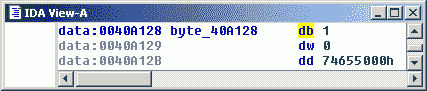

只要按"D"我们就可以任意转换这些不确定的类型.可以变成 byte,word,dword(db,dw,dd)。

当然你也可以设置更多的数据转换类型：

选择“*Options*”菜单的“*Setup data types*”命令就可以设置了

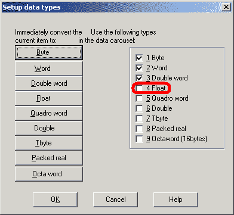

值得注意的是：你在数据转换的时候，它是依据数据自身的结构来转换的。我们按“D”的时候，

如果下一个字节已经被你转换过，你的本次转换，IDA 将会提示让你确认。

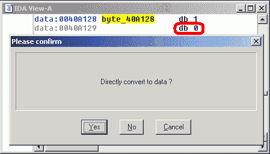

注：如果你想改变这种默认设置可以在“*Options*”菜单“*Convert already defined bytes*”命令里设置

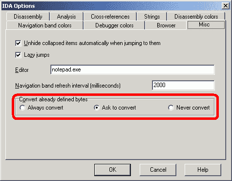

**撤销你的所有转换按“U”键。**

                                                            TOP

\-------------------------------------------------------------------------------------

第三节：操作数格式

数据类型自定义转换后，被操作过的数据（就是你按过“D”的）的进制 IDA 也是可以自定义转变的，

通过在“*Operands*”工具栏的“*Number*”命令我们可以随意转换数字的进制

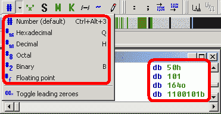

最下面的“Toggle leading point”就是填补数据前的空位为 0（就是说如果当前数据未占满数据格式的所有位高位用 0 来填补）

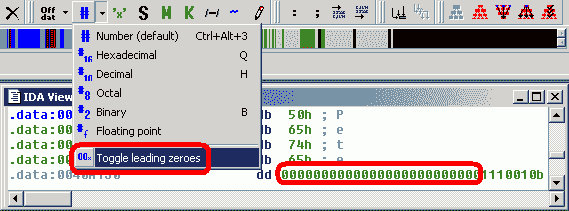

　

　

IDA 还可以转换数据的标志位（就是正负）具体操作如下图：

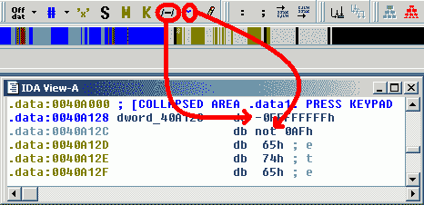

　

最后呢~~如果这些转换你还不满意（够 BT）当然你还可以自定义数据进制如图：

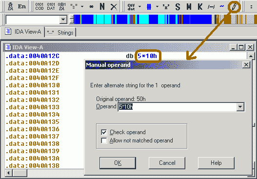

                                                                TOP

\-----------------------------------------------------------------------------------------

第四节：字符和字符串的操作

　

作者又说话了：很多程序都是包含字符串的，一些被操作过的数据（就是你按过“D”的）可以转化为

字符，使用的命令就在“*Operands*”工具栏上

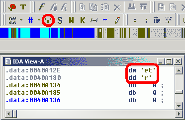

　

由于编程语言的不同造成字符串也有不同的格式，当然 IDA 就支持所有的格式了。

IDA 在转化后会在地址添加一个名字。因为我们的程序是 c 的所以就找到 c 的字符串。具体操作如图：

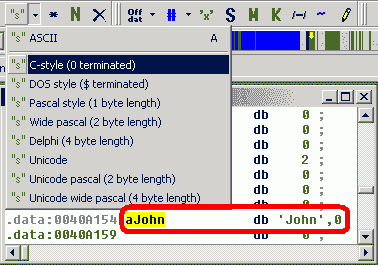

如果不是 C 写的程序怎么办呢？我们可以在“*Options*”菜单“*ASCII string style*”命令中设置。

允许你修改其它类型为默认设置，使用默认设置的快捷键是“A”，或者自定义一种类型可以使用不常用的终止字符。

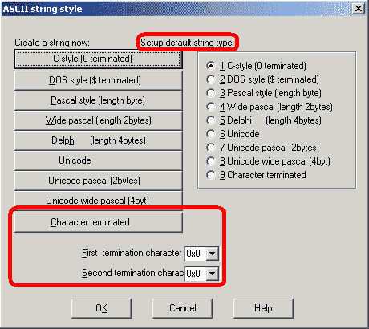

                                                                    TOP

\--------------------------------------------------------------------------

第五节：数组

在 c 中,ASCII 字符串被认为是字符数组，IDA 是如何处理数组的呢？  
我们用最常用命令来定义数组中的第一个元素，设置第一个元素类型为 byte，格式为 char，然后点击“\*”号键（或者“Edition ”工具栏的“Array”命令）来创建数组。这时弹出一个对话框，可以设置很多变量。

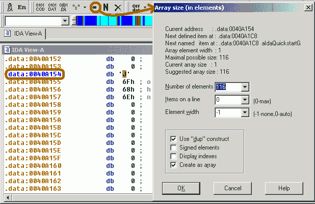

你可以定义数组一行的显示个数，还可以使用“Element width”来设置他们之间的宽度。  
使用“Use dup construct ”选项可以合并连贯的相似字节，“ Display index ”选项可以像注释一样显示数组的下标。  
  
例如我们设置一个有 64 个元素的数组，一行有 8 个元素，每个元素之间的宽度为 4，不选取“dup constructs”，选取“Display index ”，我们就可以得到下面的数组。

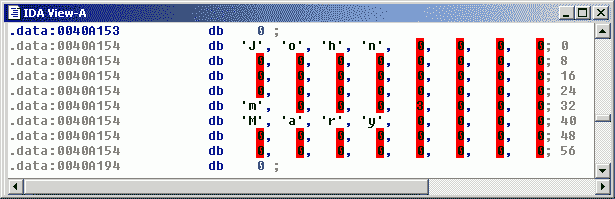

当 IDA 遇到未被识别的字节他会用红色的高亮显示。

  
当然你也可以选择一个范围来创建数组，IDA 会自适应的设定。

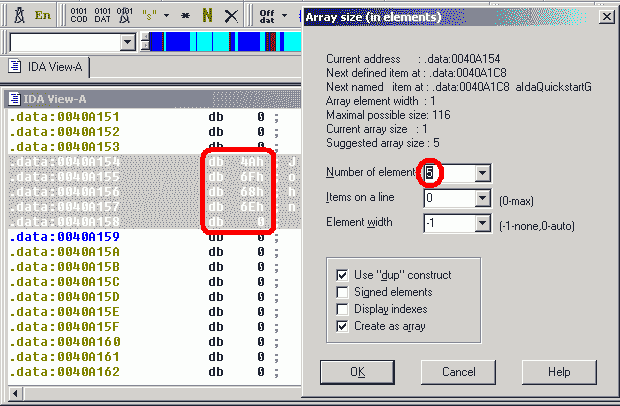

                                                                            TOP

\------------------------------------------------------------------------------------

第六节：枚举类型

还记得我们在 C 程序中定义的 product\_category\_t 类型吗？  
让我们用 IDA 的“Enumerations”来定义一下。  
  
首先，我们打开“Enumerations”窗口来创建一个新的枚举类型

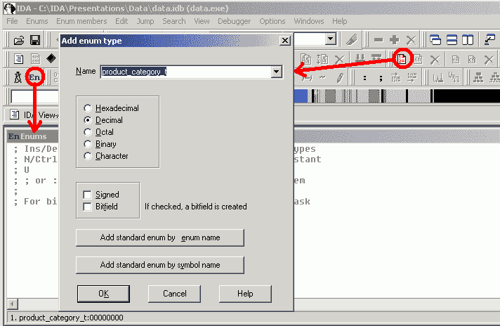

　

我们输入我们的枚举类型值

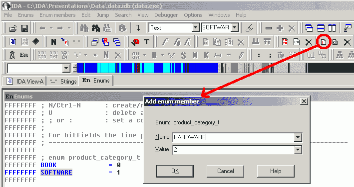

　

在 check\_product()函数，我们可以用枚举类型重新定义一些操作数。  
右键点击在数值上，就会弹出一个菜单，选择“Symbolic constant”。  
IDA 就会自动列举枚举值，用以匹配当前的数值。

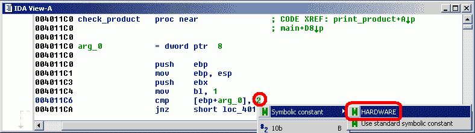

　

操作完成，我们就会得到下面的结果：


                                                                                                TOP

\-----------------------------------------------------------------------------------------------------

第七节：Bit-fields（位域）

BTW：Bit-fields，我的理解就是在结构体中的位标志。太菜！希望高手指正！

现在，我们来定义一下在 software\_info\_t 结构中的 bitfields。  
IDA 的观点就是，bitefields 是一种特殊的枚举类型。  
我们可以选择在枚举类型创造窗口中的“Bitfield”选项。

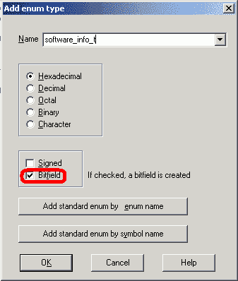

还记得我们曾经在我们的程序中建立了两种不同类型的 bitfields ，  
plateform 和 os 包含了一种隐藏的模式：用来包含组合模式（用逻辑或来操作） 。因为一种产品可以同时在几种 plateforms 和 OS 的组合。另一方面，category bitfield 中每一个数字表示一种类别：一种产品每次只能属于一种类别。  
在 IDA 中一种指定的模式，bitfield 只能包含一个值。所以在描述 plateform 和 category bitfields 时为了显示组合模式,我们必须创建一个小的 bitfields，每个值的一个 bit.

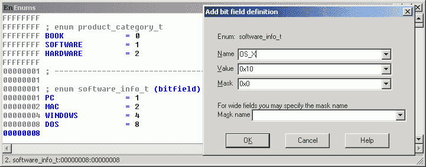

现在我们开始创建 category bitfield。mask 值为 0x3 (2 bits).我们指定一个名字、一个值、还有 bitfield mask。我们还需要定义 mask 的名字：这个我们不用 IDA 自动生成的，IDA 有一个内存助手可以帮助生成。

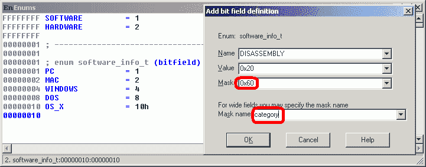

当所有的 bitfields 被输入，我们就会得到下面的结果：

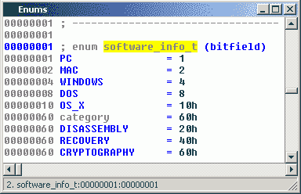

用 Operands 工具栏上的 Enum member 命令就可以定义我们程序中的 Enum member 数据

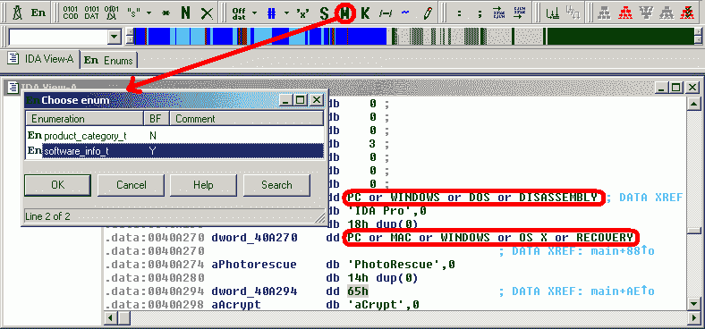

                                                                                                    TOP

\---------------------------------------------------------------------------------------------------------

第八节：结构体

我们的程序当中包含了很多结构体。现在让我们来在 IDA 中描述一下结构体，  
看看是怎么提高汇编代码的可读性。  
第一步，我们必须打开 Structures 窗口，来创建一个新的结构体类型。

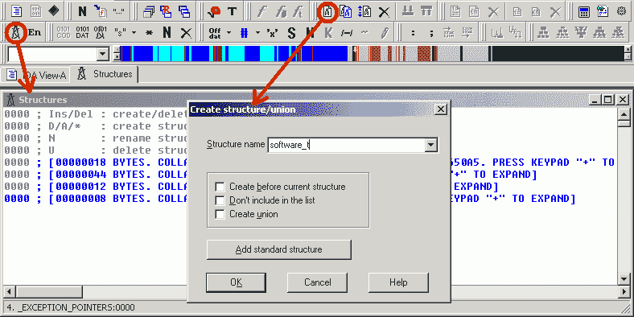

结构体的成员是一汇编的模式定义的。让我们来定义 software\_t 结构中的第一个成员。  
一直按“D”知道它变成“dd”意思就是这个成员的值为 dword 类型。  
把它的格式定义为我们以前定义好的 software\_info\_t 枚举类型，然后我们用 Rename 命令输入一个适当的名字：info

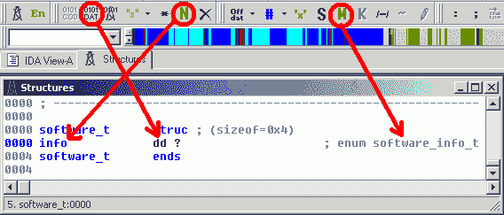

开始定义第二个成员，这次使用 ASCII 命令（按“A”），在这个环节  
IDA 会弹出一个专用对话框用来设定字符串的大小

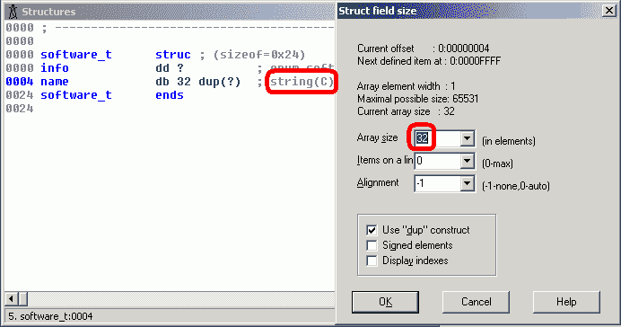

我们还可以从已经分析好的数据中来建立结构体。  
举个例子：假设我们选择了一块数据正好是和我们的 customer\_t 结构体的数据格式一样，我们就可以用 IDA 的“Create struct from data ”命令来创建结构体

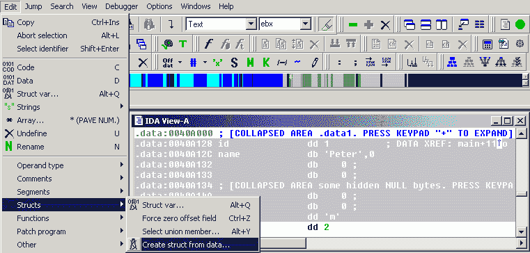

　

一旦使用了这个命令,IDA 就会在 Structures 窗口创建一个相对应的结构体  
我们使用“A”键来修改 name 成员的长度为 32bytes（和我们源代码中定义的一样），然后再给结构体一个好听的名字。  
  
  
我们拿这些结构体有什么用呢？IDA 提供给我们两种方法：  
·Apply structure types to initialized data in the program.   
·Convert operands as offsets inside structures.  
我们将在下面的教程当中来介绍这两种方法

                                                                                            TOP

\---------------------------------------------------------------------------------------------------------------------

第九节：结构变量和结构数组

现在让我们用来 customer\_t 结构体整理另外一个客户信息 John。  
把鼠标指针放在我们定义的结构体的第一个自己上面，然后使用 Struct var 命令。

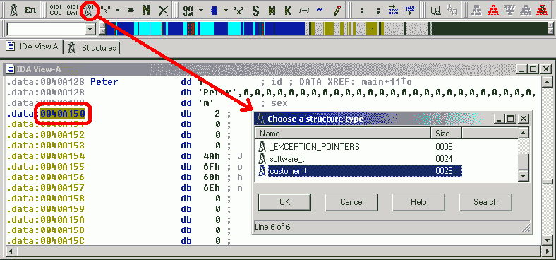

这样我们就得到了一个新的结构体变量。IDA 会自动在结构体成员的后面加上变量名的。

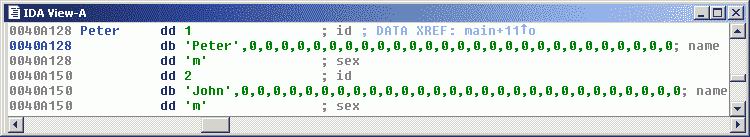

　

通过我们的源码，我们知道有一个包含个 4 元素的 customers 数组，我们先前把  
Peter 和 John 都定义为 customer\_t 结构体了。现在取消对 Join 结构变量的定义，然后在 Peter 结构上按“\*”键创建我们的 customer 数组，这样 IDA 就弹出一个数组设置框他会自动检测出来我们要创建的数组最大数是 4。

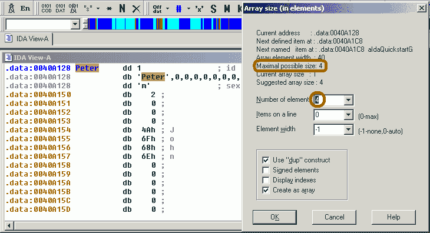

下来我们就看到创建好的数组了，剩下的就是改一下数组的名字。

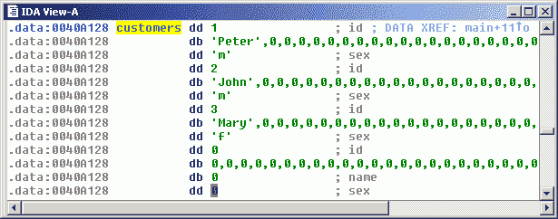

                                                                                                TOP

\-------------------------------------------------------------------------------------------------------

第十节：联合体和结构体中的结构体

IDA 中可以像定义标准结构体那样来定义联合体。  
让我们来试着定义 product\_u 这个联合体吧。  
book\_t 和 software\_t 这两个结构体我们已经定义过了。  
IDA 认为联合体就是一种特别的结构体：因此我们打开 Structures 窗口，运行 Add struct type 命令，在对话框中我们选择创建 Create union 选项。

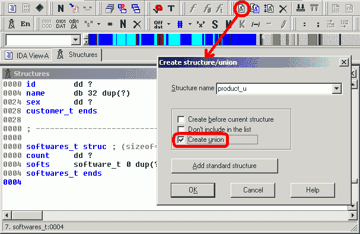

我们可以使用 IDA 常用的命令来创建联合体成员，分别添加一个 book\_t 结构体类型的 book 和一个 software\_t 结构体的 software 联合体成员

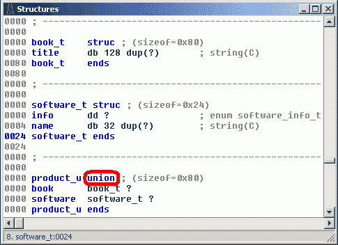

当然结构体也可以嵌套一个结构体。事实上，我们刚才做的例子就实现了。  
记住 IDA 认为联合体只不过是一种特殊的结构体

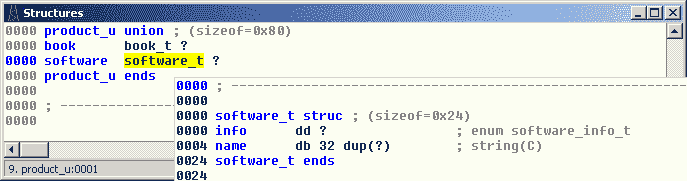

                                                                                        TOP

\----------------------------------------------------------------------------------------------

第十一节:可变的结构体

我们还记得有一个 softwares\_t 结构体。结构体 softs 的长度是不确定的。  
在汇编中，我们必须创建一个大小可变的结构体~。这种结构体创建的时候和普通的一样，仅仅最后一个元素定义的数组元素个数为 0。

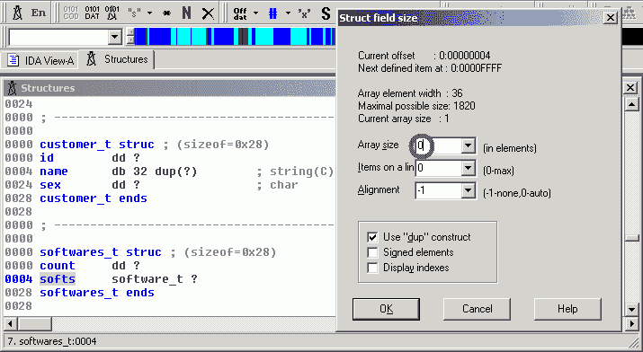

　

既然 IDA 不能计算出这种结构体的大小，我们就必须通过选择结构体的区域，来定义大小。

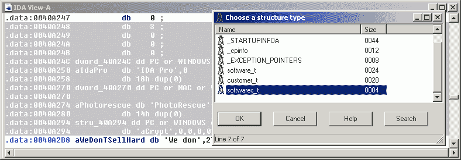

我们可以看到所有的类型 IDA 用注释模式来显示成员名称

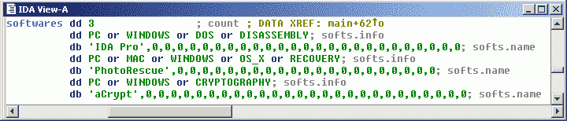

                                                                                            TOP

\----------------------------------------------------------------------------------------------------

第十二节：结构体偏移

现在我们知道如何定义联合体和结构体了。现在我们来将一些操作数指向他们原本指向的结构体。

  
在 print\_customer() 函数中，我们知道他只有一个指向 customer\_t 结构体的参数。EAX 寄存器初始化这个指针的值，使他指向 customer\_t 结构体。因此我们推断所有的\[EAX+....\]都是指向 customer\_t 结构体成员的偏移。 

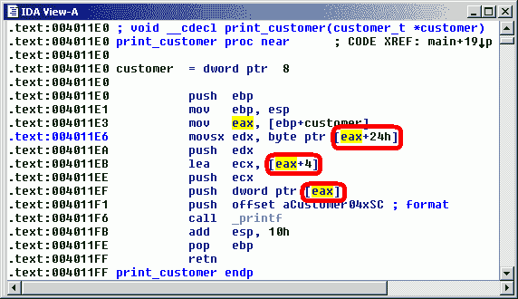

我们开始重新定义这些结构体变量的偏移，你右击在他们上面 IDA 会自动给你提供偏移的信息。

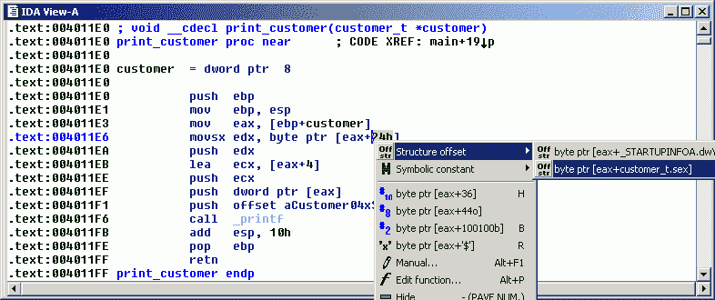

当我们把所有的偏移量都整理一下的话，汇编代码马上就变得清晰易懂了。

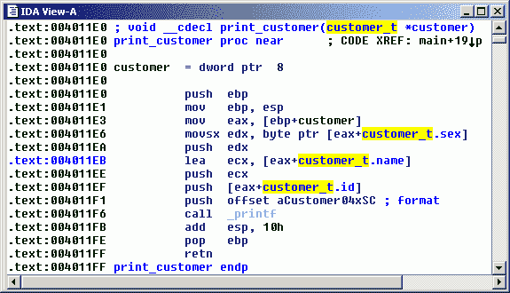

print\_software()函数呢就是另外一个例子：EBX 在初始化的时候指向了 software\_t 及构体。注意 EBX 寄存器在整个函数中都有应用（一个一个替换会累死的）。不要紧张，IDA 会使用一次操作就能替换全部。  
做法如下：  
选择整个函数的代码，然后选在 Operands 工具栏上的 Offset (struct) 命令。

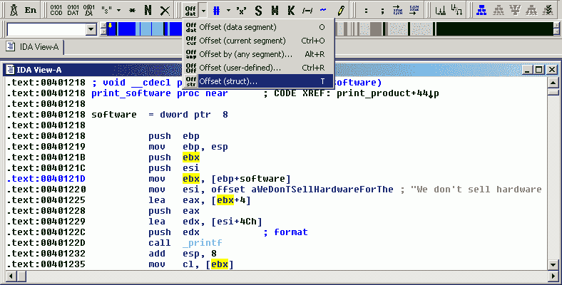

弹出 Structure offsets 窗口。然我们在列表中选择 EBX 寄存器。  
左边树形视图显示了在 IDA 中定义的所有结构。  
右边就显示与 EBX 有关系的所有操作。如果我们选择了左边的一个结构，  
IDA 就会自动改变被选择代码中与结构体有关的偏移量。  
树视图前面不同的符号表示经过计算后的状态。对号就表示完全匹配，相反就是不完全匹配。在我们的操作中正好完全匹配。

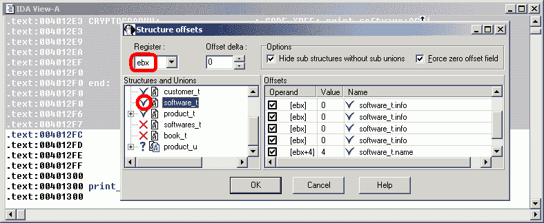

确定以后，我们就得到了下面的结果:

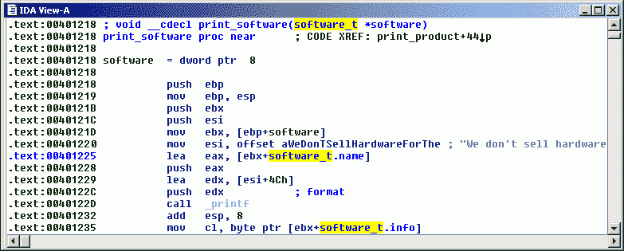

                                                                                                      TOP

\--------------------------------------------------------------------------------------------------------------

第十三节：联合体偏移量

依靠产品种类，我们可以调用适当的函数来打印产品信息。  
但是这一次的结构体偏移量跟以前不一样了，它是 product\_u 联合体中的一个成员，它是一个数，这时我们就选择 Edit struct 菜单中 Select union member 命令来处理

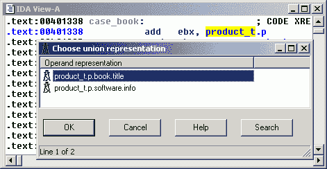

结果就是这样：

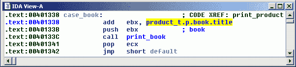

Structure offset 对话框显示如何表明一个联合体成员。在你选择的区域中打开了这个窗口，IDA 就会用“？”来显示联合体类型。

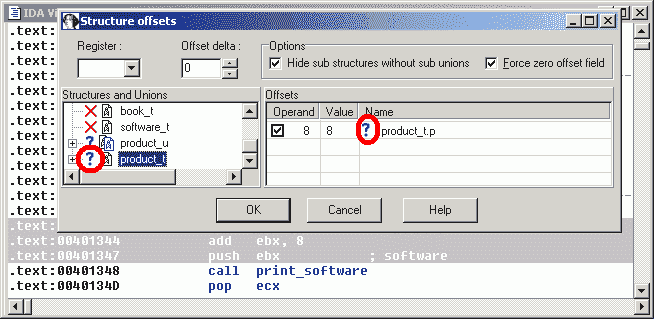

  
如果展开树视图中适当的分支，我们可以选择被描述为联合体成员的偏移量。  
一旦选中，IDA 会用在一种绿色的符号来表示偏移量指向的记录中的联合体。

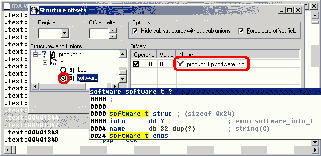

                                                                                        TOP

\--------------------------------------------------------------------------------------------------------

第十四节：地址偏移量

IDA 也可以重新定义操作数。在下面的例子中，桔黄色的部分显示一个可能存在的参考~

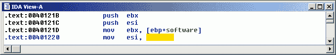

  
使用 Operands 工具栏上的 Offset 按钮就可以进行转换。

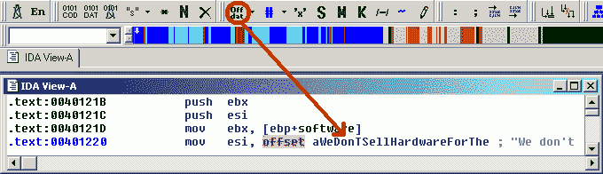

                                                                                            TOP

  
\--------------------------------------------------------------------------------------------------------------------

第十五节：最终逆向结果

| To end this tutorial, we propose you a visual comparison of the original C source code and our final interactively disassembled code. 来 look look 我们用 IDA 整理的结果把  
  

| `    struct customer_t {     long id;     char name[32];     char sex;   }`  
   
 || 

```

```

 |
| --- | --- |
| `    struct softwares_t {     long count;     software_t softs[];   };`  
   
 || 

```

```

 |
| `    struct book_t {     char title[128];   };   `   
 || 

```

```

 |
| `    struct software_t {     software_info_t info;     char name[32];   };`  
  
 || 

```

```

 |
|    
`union product_u {     book_t     book;     software_t software;   };`  
  
 || 

```

```

 |
| `    struct product_t {     long id;     product_category_t category;     product_u          p;   };   `   
 || 

```

```

 |
| `    enum product_category_t {     BOOK,     SOFTWARE,     HARDWARE   };   `  
 || 

```

```

 |
| `    struct software_info_t {     unsigned int plateform : 2;   #define PC           0x1 // 0x01   #define MAC          0x2 // 0x02     unsigned int os : 3;   #define WINDOWS      0x1 // 0x04   #define DOS          0x2 // 0x08   #define OS_X         0x4 // 0x10     unsigned int category : 2;   #define DISASSEMBLY  0x1 // 0x20   #define RECOVERY     0x2 // 0x40   #define CRYPTOGRAPHY 0x3 // 0x60   };`  
  
 || 

```

```

 |
|   
 || 

```
; +------------------------------------------------------------+
; ¦This file is generated by The Interactive Disassembler (IDA)¦
; ¦Copyright (c) 2003 by DataRescue sa/nv, <ida@datarescue.com>¦
; ¦                      Licensed to: Eric <eric@datarescue.be>¦
; +------------------------------------------------------------+
;
```

 |
| `                    int check_software(software_info_t    software_info)   {               bool valid = true;              if (software_info.plateform & PC)     {          if (! (software_info.plateform              & MAC)                  && (software_info.os & OS_X))              valid = false;     }                    else if (software_info.plateform              & MAC)     {          if (! (software_info.plateform              & PC)                  && ((software_info.os              & WINDOWS)                  || (software_info.os             & DOS)))                      valid = false;     }           else       valid = false;                       return valid;   }   `   
   
   
 || 

```

```

 |
| `                    int check_product(product_category_t    product_category)   {                 bool valid = true;     if (product_category == HARDWARE)     {       valid = false;       printf("We don't sell hardware               for the moment...\n");     }                       return valid;   }   `   
 || 

```

```

 |
| `                    void print_customer(customer_t *customer)   {                                printf("CUSTOMER %04X: %s (%c)\n",       customer->id, customer->name,       customer->sex);         }   `   
 || 

```

```

 |
| `                    void print_book(book_t *book)   {                       printf("BOOK: %s\n", book->title);            }   `   
   
   
 || 

```

```

 |
|  `                    void print_software(software_t    *software)   {                                   printf("SOFTWARE: %s:",      software->name);                 if (software->info.plateform & PC)             printf(" PC");                       if (software->info.plateform & MAC)             printf(" MAC");                    printf(";");                    if (software->info.os & WINDOWS)             printf(" WINDOWS");                          if (software->info.os & DOS)             printf(" DOS");                          if (software->info.os & OS_X)             printf(" OS-X");                    printf(";");              switch(software->info.category)     {                               case DISASSEMBLY:               printf(" DISASSEMBLY");            break;             case RECOVERY:               printf(" RECOVERY");            break;             case CRYPTOGRAPHY:               printf(" CRYPTOGRAPHY");         break;        }           printf("\n");                  }               `  
 || 

```

```

 |
| `               bool print_product(product_t *product)   {                          if (! check_product(           product->category))             return false;                          printf("PRODUCT %04X: ",      product->id);              switch(product->category) {                   case BOOK:               print_book(&product->p.book);            break;             case SOFTWARE:            print_software(          &product->p.software);         break;        }              return true;   }   `   
   
   
 || 

```

```

 |
| `                void main() {                          printf("CUSTOMERS:\n");        customer_t *customer = customers;              while (customer->id != 0)     {       print_customer(customer);          customer++;              }     product_t *products = (product_t*)       malloc(PRODUCTS_COUNT       * sizeof(product_t));        products[0].id         = 1;     products[0].category   = BOOK;     products[0].p.book     = ida_book;                 products[1].id         = 2;     products[1].category   = SOFTWARE;     products[1].p.software =      softwares.softs[0];           products[2].id         = 3;     products[2].category   = SOFTWARE;     products[2].p.software =      softwares.softs[1];           products[3].id         = 4;     products[3].category   = SOFTWARE;     products[3].p.software =      softwares.softs[2];              printf("\nPRODUCTS:\n");              for (int i = 0;      i < PRODUCTS_COUNT; i++)     {             if (! check_product(        products[i].category))       {               printf("Invalid product !!!\n");            break;       }                      if (products[i].category        == SOFTWARE)       {                  if (! check_software(           products[i].p.software.info))         {              printf("Invalid                   software !!!\n");              break;         }       }                   print_product(&products[i]);                  }           free(products);                  }   `   
   
   
 || 

```

```

 |
|   
 || 

```

```

 |
| `customer_t customers[] = {     { 1,       "Peter",       'm' },     { 2,       "John",       'm' },     { 3,       "Mary",       'f' },     { 0 }   };           `   
 || 

```

```

 |
| `book_t ida_book = { "IDA QuickStart                        Guide" };`  
   
   
 || 

```

```

 |
| `softwares_t softwares =   {     3,     { { { PC, WINDOWS|DOS,               DISASSEMBLY  },         "IDA Pro" },       { { PC|MAC, WINDOWS|OS_X,           RECOVERY     },         "PhotoRescue" },       { { PC,     WINDOWS,               CRYPTOGRAPHY },         "aCrypt" }     }   };`  
   
 || 

```

```

   |
|   
 || 

```
aWeDonTSellHardwareForThe db 'We don',27h,'t sell hardware ...
                    ; DATA XREF: check_product+Eo ...
aCustomer04xSC db 'CUSTOMER %04X: %s (%c)',0Ah,0 ; ...
aBookS db 'BOOK: %s',0Ah,0 ; DATA XREF: print_book+6o
aSoftwareS db 'SOFTWARE: %s:',0 ; DATA XREF: ...
aPc db ' PC',0      ; DATA XREF: print_software+27r
aMac db ' MAC',0    ; DATA XREF: print_software+3Br
asc_40A31B db ';',0 ; DATA XREF: print_software+45r
aWindows db ' WINDOWS',0 ; DATA XREF: ...
aDos db ' DOS',0    ; DATA XREF: print_software+72r
aOsX db ' OS-X',0   ; DATA XREF: print_software+89r
asc_40A331 db ';',0 ; DATA XREF: print_software+93r
aDisassembly db ' DISASSEMBLY',0 ; DATA XREF: ...
aRecovery db ' RECOVERY',0 ; DATA XREF: ...
aCryptography db ' CRYPTOGRAPHY',0 ; DATA XREF: ...
asc_40A358 db 0Ah,0 ; DATA XREF: print_software+D8r
aProduct04x db 'PRODUCT %04X: ',0 ; DATA XREF: ...
aCustomers db 'CUSTOMERS:',0Ah,0 ; DATA XREF: ...
aProducts db 0Ah    ; DATA XREF: main+C0o
  db 'PRODUCTS:',0Ah,0
aInvalidProduct db 'Invalid product !!!',0Ah,0 ; ...
aInvalidSoftwar db 'Invalid software !!!',0Ah,0 ; ...

```

 |

 |
| --- |

                                                                                                    TOP

　

附录

 

#include 

<stdio.h>

　

 

// our structures

// ==============

// information about our customers

 

struct

 customer\_t { // a typical structure

long id;

char name\[32\];

char sex; // 'm'ale - 'f'emale

};

　

 

// we sell books

 

struct

 book\_t {

char title\[128\]; // an ASCII string

};

 

// and we sell computer softwares

 

struct

 software\_info\_t { // a structure containing various bitfields

unsigned int plateform : 2; // 2 bits reserved for the plateform - plateforms can be combined (0x03)

 

#define 

PC 0x1 // 0x01

 

#define 

MAC 0x2 // 0x02

unsigned int os : 3; // 3 bits reserved for the OS - OS can be combined (0x1C)

 

#define 

WINDOWS 0x1 // 0x04

 

#define 

DOS 0x2 // 0x08

 

#define 

OS\_X 0x4 // 0x10

unsigned int category : 2; // 2 bits reserved for the category - categories can't be combined (0x60)

 

#define 

DISASSEMBLY 0x1 // 0x20

 

#define 

RECOVERY 0x2 // 0x40

 

#define 

CRYPTOGRAPHY 0x3 // 0x60

};

 

struct

 software\_t {

software\_info\_t info;

char name\[32\];

};

 

struct

 softwares\_t { // a variable length structure to memorize our softwares

long count;

software\_t softs\[\];

};

 

// generic products we're selling

 

enum

 product\_category\_t { // an enumerated type

BOOK,

SOFTWARE,

HARDWARE // we actually don't sell hardware

};

 

union

 product\_u { // an union to contain product information depending on its category

book\_t book;

software\_t software;

// struct hardware\_t hardware; // we actually don't sell hardware

};

 

struct

 product\_t { // a structure containing another structure

long id;

product\_category\_t category;

product\_u p;

};

　

 

// our data

// ========

// our customers

 

customer\_t

 customers\[\] = { // an initialized array to memorize our customers

{ 1, "Peter", 'm' },

{ 2, "John", 'm' },

{ 3, "Mary", 'f' },

{ 0 }

};

 

// our products

 

book\_t

 ida\_book = { "IDA QuickStart Guide" };

 

softwares\_t

 softwares = // an initialized variable length structure

{

3,

{

{ { PC, WINDOWS|DOS, DISASSEMBLY }, "IDA Pro" },

{ { PC|MAC, WINDOWS|OS\_X, RECOVERY }, "PhotoRescue" },

{ { PC, WINDOWS, CRYPTOGRAPHY }, "aCrypt" }

}

};

 

#define 

PRODUCTS\_COUNT 4

　

 

// our functions

// =============

// check software information

 

int

 check\_software(software\_info\_t software\_info)

{

bool valid = true;

if (software\_info.plateform & PC)

{

if (! (software\_info.plateform & MAC) && (software\_info.os & OS\_X))

valid = false; // OS-X isn't yet available on PC ;)

}

else if (software\_info.plateform & MAC)

{

if (! (software\_info.plateform & PC) && ((software\_info.os & WINDOWS) || (software\_info.os & DOS)))

valid = false; // Windows & DOS aren't available on Mac...

}

else

valid = false;

return valid;

}

　

 

// check product category

 

int

 check\_product(product\_category\_t product\_category)

{

bool valid = true;

if (product\_category == HARDWARE)

{

valid = false;

printf("We don't sell hardware for the moment...\\n");

}

return valid;

}

　

 

// print customer information

 

void

 print\_customer(customer\_t \*customer)

{

printf("CUSTOMER %04X: %s (%c)\\n", customer\->id, customer\->name, customer\->sex);

}

　

 

// print book information

 

void

 print\_book(book\_t \*book)

{

printf("BOOK: %s\\n", book\->title);

}

　

 

// print software information

 

void

 print\_software(software\_t \*software)

{

printf("SOFTWARE: %s:", software\->name);

// plateform

// we use 'if', as plateforms can be combined

if (software\->info.plateform & PC)

printf(" PC");

if (software\->info.plateform & MAC)

printf(" MAC");

printf(";");

// OS

// we use 'if', as os can be combined

if (software\->info.os & WINDOWS)

printf(" WINDOWS");

if (software\->info.os & DOS)

printf(" DOS");

if (software\->info.os & OS\_X)

printf(" OS-X");

printf(";");

// category

// we use 'switch', as categories can't be combined

switch(software\->info.category)

{

case DISASSEMBLY:

printf(" DISASSEMBLY");

break;

case RECOVERY:

printf(" RECOVERY");

break;

case CRYPTOGRAPHY:

printf(" CRYPTOGRAPHY");

break;

}

printf("\\n");

}

　

 

// print product information

 

bool

 print\_product(product\_t \*product)

{

if (! check\_product(product\->category))

return false;

printf("PRODUCT %04X: ", product\->id);

switch(product\->category) {

case BOOK:

print\_book(&product\->p.book);

break;

case SOFTWARE:

print\_software(&product\->p.software);

break;

}

return true;

}

　

 

// our main program

// ================

 

void

 main() {

// print customers listing

printf("CUSTOMERS:\\n");

customer\_t \*customer = customers;

while (customer\->id != 0)

{

print\_customer(customer);

customer++;

}

// allocate a small array to store our products in memory

product\_t \*products = (product\_t\*) malloc(PRODUCTS\_COUNT \* sizeof(product\_t));

// insert our products

products\[0\].id = 1;

products\[0\].category = BOOK;

products\[0\].p.book = ida\_book;

products\[1\].id = 2;

products\[1\].category = SOFTWARE;

products\[1\].p.software = softwares.softs\[0\]; // we insert softwares from our variable length structure

products\[2\].id = 3;

products\[2\].category = SOFTWARE;

products\[2\].p.software = softwares.softs\[1\];

products\[3\].id = 4;

products\[3\].category = SOFTWARE;

products\[3\].p.software = softwares.softs\[2\];

// verify and print each product

printf("\\nPRODUCTS:\\n");

for (int i = 0; i < PRODUCTS\_COUNT; i++)

{

// check validity of the product category

if (! check\_product(products\[i\].category))

{

printf("Invalid product !!!\\n");

break;

}

// check validity of softwares

if (products\[i\].category == SOFTWARE)

{

if (! check\_software(products\[i\].p.software.info))

{

printf("Invalid software !!!\\n");

break;

}

}

// and print the product

print\_product(&products\[i\]);

}

free(products);

}