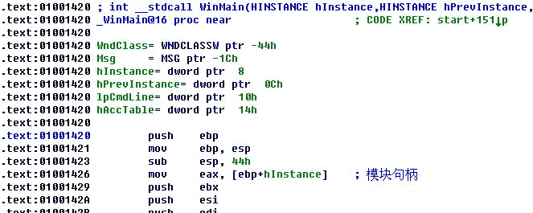
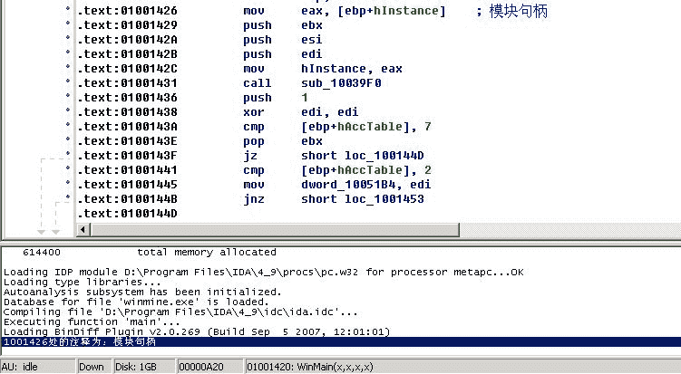

# 关于 IDA 的注释如何转移到 OD 中的问题

> 原文：[`www.pediy.com/kssd/pediy10/58726.html`](https://www.pediy.com/kssd/pediy10/58726.html)

使用 IDA 的 map 文件好像只是生成ｌａｂｅｌ可以转到 OD 中。  
那么 comment 如何转到ＯＤ中呢？  
发到新兵论坛没有响应，发到这里请高手指点下。 

个人的一些幼稚理解，供各位朋友参考讨论。  
      昨天晚上想了想，今天上午认真看了 OD 的 SDK 文档，  
和 IDA 的 SDK 接口。  
      IDA 的 bytes.hpp 头文件中的 get\_cmt 接口可以获取  
被反汇编文件中的指定地址的注释，定义如下：  
  
// Get an indented comment  
//      ea     - linear address. may point to tail byte, the function  
//               will find start of the item  
//      rptble - get repeatable comment?  
//      buf - output buffer, may be NULL  
//      bufsize - size of output buffer  
// Returns: size of comment or -1  
  
idaman ssize\_t ida\_export get\_cmt(ea\_t ea, bool rptble, char \*buf, size\_t bufsize);  
  
     然后又在 OD 的 SDK 文档中，发现一组名为 Name functions 的接口中有一个  
叫做 Insertname 的函数，定义如下：  
  
int Insertname(ulong addr,int type,char \*name);  
  
     addr 是虚拟地址，type 若设置为 NM\_COMMENT，就可在指定地址处添加自定义的  
注释，name 为注释的内容。  
  
     有了这两个接口，就简单测试了一下，先用 IDA 4.9 反汇编了 w2k 下的扫雷程序  
winmine.exe，然后在 winmine 的 WinMain 函数中，0x1001426 地址处，手动添加了“模块句柄”一行注释，  
             
如图  
  
  
  
  
  
    然后用 get\_cmt 在 IDA 插件中，获取这个地址的注释，如下：  
    /\*\*\*\*\*\*\*\*\*\*\*\*\*\*\*\*\*\*\*\*\*\*\*\*\*\*\*\*\*\*\*\*\*\*\*\*\*\*\*\*\*\*\*\*\*\*\*\*\*\*\*\*\*\*\*\*\*\*\*\*\*\*\*\*\*\*\*\*\*\*\*\*/  
    /\*                                                                      \*/    
    /\*  !注意：测试起见，addr 变量用了硬编码                                 \*/  
    /\*                                                                      \*/  
    /\*\*\*\*\*\*\*\*\*\*\*\*\*\*\*\*\*\*\*\*\*\*\*\*\*\*\*\*\*\*\*\*\*\*\*\*\*\*\*\*\*\*\*\*\*\*\*\*\*\*\*\*\*\*\*\*\*\*\*\*\*\*\*\*\*\*\*\*\*\*\*\*/   
      
    ea\_t    addr = 0x1001426;     
    char    comment\[MAXSTR\];    // 保存注释的缓冲区  
      
    // 获取指定地址的注释  
    get\_cmt(addr, false, comment, MAXSTR);  
  
    msg("%x 处的注释为：%s", addr, comment);  
  
  
     运行这段代码后，IDA 的日志窗口显示了刚才手动添加的注释，  
  
如下图：  
  
  
  
  
    接下来就是测试 OD 的添加注释接口了，我简单修改了 olly 提供的  
cmdline 插件源代码中的 ODBG\_Pluginaction 函数，在其中一个分支  
里添加如下代码，  
  
    /\*\*\*\*\*\*\*\*\*\*\*\*\*\*\*\*\*\*\*\*\*\*\*\*\*\*\*\*\*\*\*\*\*\*\*\*\*\*\*\*\*\*\*\*\*\*\*\*\*\*\*\*\*\*\*\*\*\*\*\*\*\*\*\*\*\*\*\*\*\*\*\*/  
    /\*                                                                      \*/    
    /\*  !注意：测试起见，Insertname 函数用了硬编码                           \*/  
    /\*                                                                      \*/  
    /\*\*\*\*\*\*\*\*\*\*\*\*\*\*\*\*\*\*\*\*\*\*\*\*\*\*\*\*\*\*\*\*\*\*\*\*\*\*\*\*\*\*\*\*\*\*\*\*\*\*\*\*\*\*\*\*\*\*\*\*\*\*\*\*\*\*\*\*\*\*\*\*/   
      Insertname( 0x1001426, NM\_COMMENT, "模块句柄");  
  
      这样，编译好修改后的 cmdline 插件，当祭起 OD 的时候，  
用 OD 加载 winmine，运行插件，然后就可以看到 OD 里面也自动  
添加了注释。  
      个人的一些简单想法，供 wangdell 和各位朋友参考讨论。