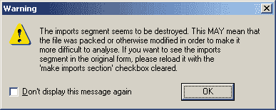
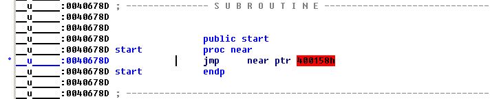
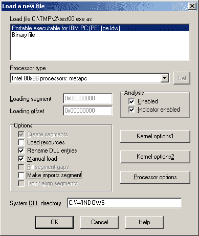
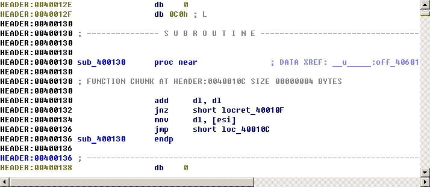
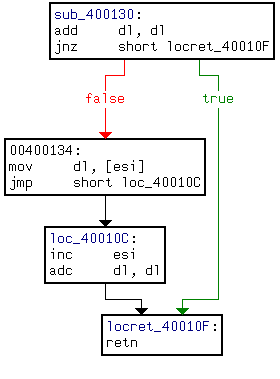
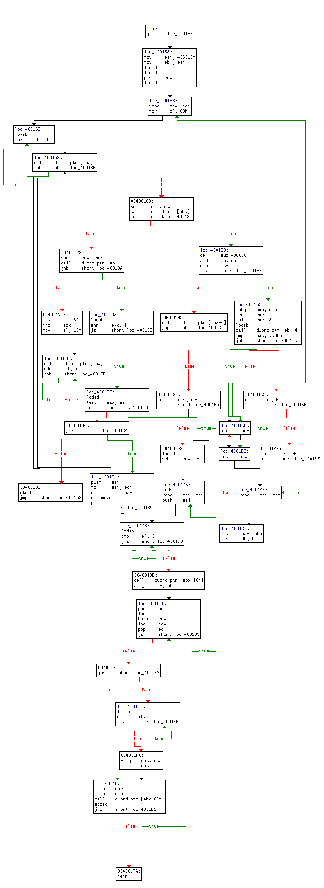
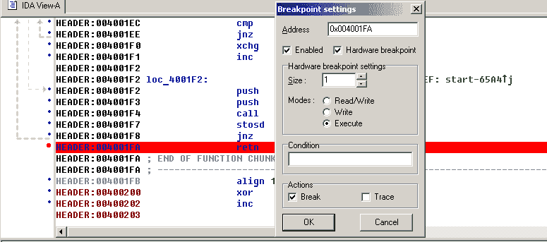
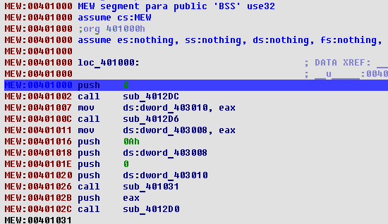
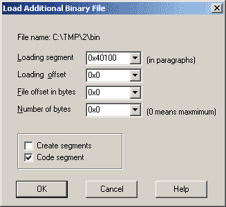
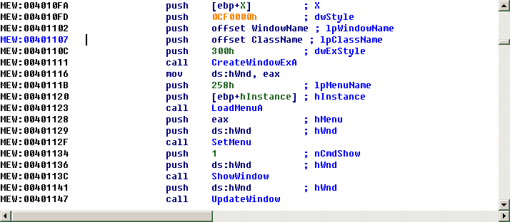

# 用 IDA 的调试器来手工脱壳（PE 格式文件）

> 原文：[`www.pediy.com/kssd/pediy07/pediy7-714.htm`](https://www.pediy.com/kssd/pediy07/pediy7-714.htm)

用 IDA 的调试器来手工脱壳（PE 格式文件）  
\[作者\]未知（感谢 linhanshi 提供资料）  
\[译者\]4nil  
\[date\]12-Jan-05  
  
几天前，一个 IDA Pro 使用者发给我们一个小程序(test00.exe)（非破坏性），无法用 IDA 调试，断点没法停下来，程序依旧自由执行，就好像调试器太慢跟不上它。当我们第一次载入的时候，提示告诉我们无法找到引入段。这种情况我们平时在破解受 保护的或者加过壳后的程序时经常碰到的。

  
   
还有一件值得注意的事就是入口点的跳转不存在。。。红色标记的地址表示 IDA 无法解决的。

  
这个文件的代码企图阻止反编译，因此，我们缺省的加载参数就不合适了。这种形式的迷惑性代码，问题的关键在于单击的过程当中。  
但是假如我们深入研究，比如用人工模式载入文件？这个模式下，用户可以指定哪个特定的段需要载入。基于安全考虑，我们加载所有的段。如下，去掉'make imports section'选框防止"missing imports"的提示.

  
   
一旦我们解决了关于段的载入问题：问题好多了。  
   
现在我们去除了无法定位的地址的问题，可以开始分析这个程序了。程序第一个指令是一个 jump，跳到程序开头: loc\_400158。一般来说程序开头不建议有代码跳转，但是这个程序用了。这个导致了程序头是只读的。这样就回答了为什么我们无法不能在那里下断的问题。  
让我们继续来看程序是怎么运行的。我们发现程序给 ESI 加载了一个指针，然后又马上拷到 EBX：  
HEADER:00400158                 mov     esi, offset off\_40601C  
HEADER:0040015D                 mov     ebx, esi  
(Ctrl-O converted the hexadecimal number in the first instruction to a label expression)   
（用 Ctrl-O 把第一个指令里的 16 进制数字转为标签形式）  
后来 EBX 的值又被用来 call 一个子程序：  
HEADER:00400169                 call    dword ptr \[ebx\]  
像这样的 Call 在列表里很多，所以我们要找出它是什么功能的。显然指向改功能的指针如下：  
\_\_u\_\_\_\_\_:0040601C off\_40601C      dd offset \_\_ImageBase+130h  
  
假如我们点击 ImageBase，我们看到一列的 dwords。IDA 展现给我们的程序头看起来不是我们想要的形式。我们 undefine 那段代码（热键 U），回到指针那里（热键 Esc）然后再次跟踪。这次我们会停在 0x400130 处，这里本应该包含一个函数。我们确信这一点是因为在 0x400169 的指令间接 calls 0x400130。我们按下 P（创建一个函数或者子程）告诉 IDA 当前地址应该有一个函数。现在函数出来了，但是我们只有一半！看起来写程序的人为了迷惑我们，将函数分割为几部分。现在 IDA 知道怎样处理这些碎片函数了，它将函数其他部分也显示在屏幕上。

  
   
但是它只是给我们一些参考地址，我们希望的的是整个的函数在一起。有一个特别的命令可以帮我们：IDA 里可以制作函数流程图的命令，热键为 F12。这个命令在对于碎片的函数就象我们这种特别有用，它将整个函数显示在一起：

  
   
显示主程序的流程会很有趣（很长，继续用你的滚轴吧）:

  
   
快速浏览发现流程图告诉我们函数只有一个出口"ret"指令(0x4001FA)。我们可以在那里下断，然后运行程序。我们在这里要重申的是，不要在电脑上运行不可信的代码。假如有一个"sandbox"机来做测试会更好，比如使用 remote debugging facilities IDA Pro offers。因此 IDA 会显示警告当一个新文件将被调试：忽略，一切自己负责。  
因为断点位于程序头，而且该程序头是系统写保护的，我们不能在这里使用平常的软件断点。我们必须使用硬件断点：首先用 F2 设断点，右击，选择"edit breakpoint"，把它变成一个硬件断点，我们用"execution"模式。

  
   
设好断点后，我们按 F9 开始调试。当我们在那里断下后，程序会被解压到'MEW'段。我们跳到那里，然后将所有的都转为代码（最快的方式是在断点的地方按 F7）。  
现在我们得到一个很不错的程序段，但是唯一不足的是它会在结束调试后消失。

  
   
原因很简单，这个程序段是一些内存内容，这样在程序终止的时候它也会消失。我们假如能够把它存成数据会更好，可以不在调试模式下分析。我们会考虑在将来的 IDA 版本中添加这个功能，但是现在我们必须手工做这个事。“手工”不代表我们要一个一个字节拷贝，当然，我们可以用 IDC 内置语言来做这个。  
我们要保存两样东西：内存内容还有输入函数名。内存内容可以用下面的 4 行语句来保存：  
auto fp, ea;  
fp = fopen("bin", "wb");  
for ( ea=0x401000; ea < 0x406000; ea++ )  
  fputc(Byte(ea), fp);  
        
当脚本执行后，我们得到一个名为"bin"的文件。它包含了"MEW"段的所有字节。你可以发现，我存的是 16 进制的地址。这个脚本可以任意使用。  
我们还要保存输入函数名，看一下 0x401002 处的 Call：  
      
MEW:00401002 call    sub\_4012DC  
假如我们要得到名字，我们只要按 Enter 键数次，最后就可以得到了：  
kernel32.dll:77E7AD86  
kernel32.dll:77E7AD86 kernel32\_GetModuleHandleA:              ; CODE XREF: sub\_4012DCj  
kernel32.dll:77E7AD86                                         ; DATA XREF: MEW:off\_402000o  
kernel32.dll:77E7AD86 cmp     dword ptr \[esp+4\], 0  
  
当我们退出调试后，kernel32.dll 的段也会消失，还有它所有的名称，指令，函数，所有的。我们必须在它消失前将它拷贝过来：  
auto ea, name;  
for (ea = 0x401270; ea<0x4012e2; ea =ea+6 )  
{  
  name = Name(Dword(Dfirst(ea)));               /\* get name \*/  
  name = substr(name, strstr(name, "\_")+1, -1); /\* drop the prefix \*/  
  MakeName(ea, name);  
}  
  
现在已经运行了这些脚本，停止调试（Ctrl+F12）。拷回数据到内存里去，我们可以这样做：

  
   
注意，我们没必要创建一个段，它已经存在（清除"create segments"标志），而且，地址同样被指定了，比如：右偏移 4。  
载入文件，0x401000 处按下 P，可以看到如下信息：

  
   
接下去的分析就很平坦了。。。你自己想怎么做吧。。  

 4dd466d0e1e0cc123afbe504da2462ca