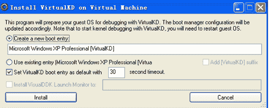
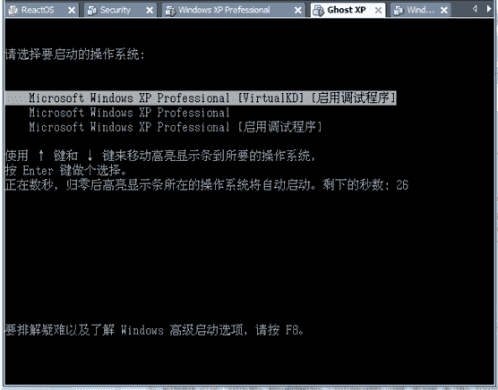
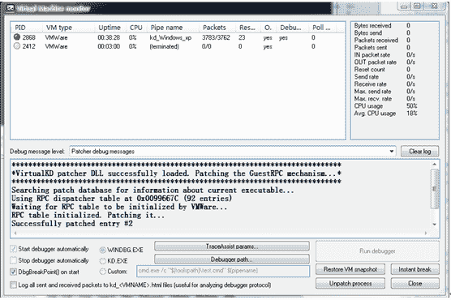
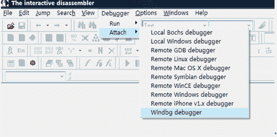
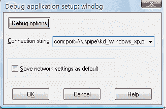
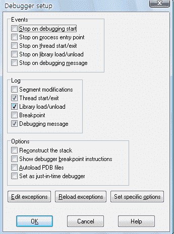
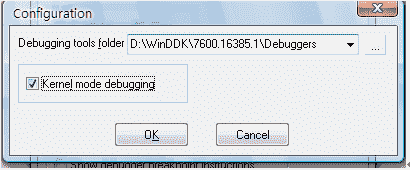
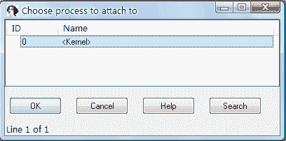
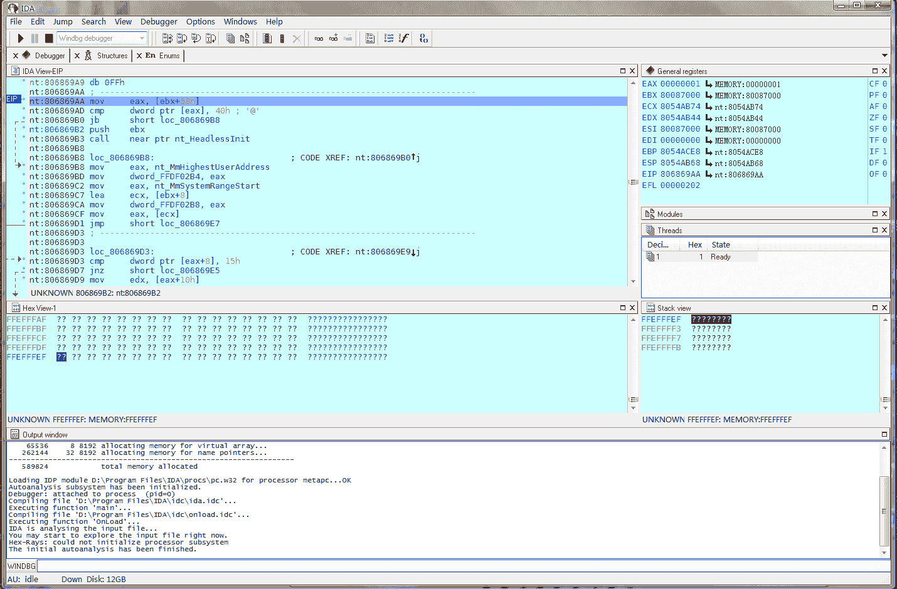

# 两种使用 IDA 进行内核调试的方法

> 原文：[`www.pediy.com/kssd/pediy12/133479.html`](https://www.pediy.com/kssd/pediy12/133479.html)

以前总想知道 IDA 是否能够实现内核调试，后来找了一段时间没什么结果就暂时放弃了。今天在国外的一个博客上偶然看到了用 IDA 实现内核调试的方法，其实现在国内也有很多文章介绍了 IDA 通过串口进行调试的文章，如果大家想看的话可以搜索下。  
这里只是参考原文把实现的方法大体的用中文表述了一下。在调试之前需要安装如下的软件：  
1.  IDA PRO 这个我想大家都应该有了；  
2.  Windbg 如果调试过驱动或者系统内核的话这个东西也应该有了；  
3.  VirtualKd 这个东西我想大家如果没有做过使用 IDA 调试内核的话这个东西应该是还没有。  
安装 VirtualKD  
首先从官方网站上下载 VirtualKd。将程序解压到任意目录下，将程序目录下的 Target 文件夹拷贝到虚拟机系统中运行（如果是 VirtualBox 则安装比较麻烦），运行之后将会出现如下的界面：  
   
点击 Install 之后将会在系统的启动菜单中创建一个新的启动项，如下图所示：  
   
如果使用设置 Windbg 调试器的方法来设置 pipe 在使用 IDA 调试的时候是无法正常连接调试器的（话说这个东西我测试了好久，）。  
另外如果不使用上面的工具进行安装设置启动项的话可以手工设置，不过过程比较繁琐：  
1）  拷贝 kdvm.dll 到你的客户机系统的 system32 目录下，在这个目录下应该可以找到 KDCOM.DLL 和 KD1394.DLL 文件；  
2）  打开并且编辑 boot.ini 文件添加一项新的启动项如下：  
multi(0)disk(0)rdisk(0)partition(1)\\WINDOWS="Microsoft Windows XP Professional" /noexecute=optin /fastdetect /DEBUG /DEBUGPORT=VM  
如果是 windows  vista 或者 win7 则需要手工执行 bcdedit 命令来激活 kdvm.dll  
bcdedit /set dbgtransport kdvm.dl  
3）  重新启动虚拟机并且运行 vmmon.exe 进行监视。（这一步与自动安装是相同的）  
Vmmon 运行界面如下所示：  
   
程序列出了当前运行中（其实有的是已经结束了）的虚拟机的状态，这里需要记住需要调试的虚拟机的 pipe name.,在这里是 kd\_Windows\_xp。  
  
设置 IDA/Windbg  
运行 IDA 不要选择任何输入数据库，执行菜单中的 Debugger/Attach/Windbg debugger，如下图所示：  
   
打开如下图所示的设置窗口：  
   
在 Connection string 中输入管道的名称 com:port=\\\\.\\pipe\\kd\_Windows\_xp,pipe，这里需要将 kd\_Windows\_xp 修改为你的虚拟机对应的名称。  
设置完成之后点击 Debug Options 打开选项窗口，如下图所示：  
  
点击 Set specific options，打开特殊选项窗口，如下所示：  
  
输入 Debugging tools folder（调试器路径），并且勾选下面的 Kernel mode debugging（内核调试模式）然后确定即可。  
关闭所有的设置窗口之后将会打开如下图所示的附加进程列表：  
  
此时只有一个进程 id 为 0 的进程，选择这个进程 ok 之后就可以进行内核的调试了。不过这个进程的附加会异常的痛苦，尤其是下载符号库的时候，并且将进程挂起的时候可能会让 ida 假死掉，因而可以多等待一会儿，直到所有的符号库下载并且识别之后就可以真正的中断在系统的 int3 断点上了（这个过程简直是一种折磨啊）。  
   
挂载之后就是上面的效果，看起来还是不错的。  
另外还有一种方法可以不使用 virtualkd 进行调试，方法可以查看下面的电子书，设置基本是一样的。  
IDA 调试内核.pdf  
IDA 调试驱动.pdf