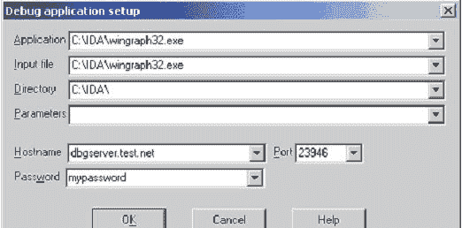
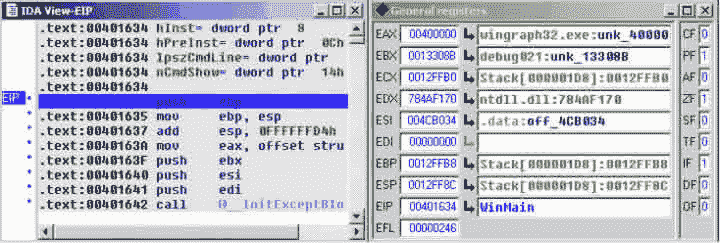
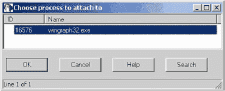
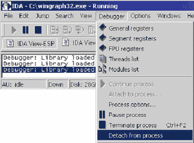

# 007 使用 IDA 专业版进行远程调试

> 原文：[`www.pediy.com/kssd/pediy08/pediy8-777.htm`](https://www.pediy.com/kssd/pediy08/pediy8-777.htm)

标题：使用 IDA 专业版进行远程调试  
来自：[`www.datarescue.com/idabase/f...s/remotedbg.pdf`](http://www.datarescue.com/idabase/freefiles/remotedbg.pdf)  
    从 4.8 版开始，IDA 专业版支持 x86/AMD Windows PE 应用程序和 Linux ELF 应用程序通过网络进行远程调试。远程调试就是在一台有网络连接的计算机上调试运行在另一台有网络连接计算机上的代码的过程。  
    \* 把运行 IDA 专业版界面的计算机称为“调试客户机”。  
    \* 把运行应用程序进行调试的计算机称为“调试服务器”。  
远程调试针对以下情形会十分有用：  
    \*     调试病毒/木马/恶意软件：用这种方式，调试客户机将尽可能与受到安全危机的计算机隔离。  
    \*    调试在一台计算机上遇到的问题与在其他计算机上并不完全相同的应用程序。  
    \*    调试分布式应用程序。  
   \*    始终通过您的主工作站调试，由此您不必从他处复制 IDA 的配置、文档和各种相关调试资源。  
    \*    将来在更多的操作系统结构上调试应用程序。  
这个小小指南将介绍如何在实践中设置和使用远程调试。  
  
  
远程 IDA 调试服务器  
为了保证 IDA 客户机通过网络连接到调试服务器上，我们必须首先开启处理所有低级语言执行和调试操作的一个小服务——带有 Windows 调试服务（win32\_remote.exe 文件）和 Linux 调试服务（linux\_server 文件）的 IDA 分配船舶。有了这些，我们可以：  
    \*    通过 IDA 视窗图形和文本形式本地调试 x86/AMD64 Windows 应用程序和动态链接库。  
    \*    通过 IDA 视窗图形和文本形式远程调试 Linux 应用程序和共享库。  
    \*    通过 IDA 文本形式本地调试 Linux 应用程序和共享库。  
    \*    通过 IDA 文本形式远程调试 x86/AMD64 Windows 应用程序和动态链接库。  
所以首先我们复制 Windows 调试服务的小文件到我们的调试服务器上。  
该服务器接受各种命令行参数：  
   C:\\> win32\_remote -?   
   IDA Windows32 remote debugger server. Version 1.0. Copyright Datarescue 2004   
    （IDA Windows32 远程调试服务器版本 1.0，版权 拯救数据 2004）  
   Error: usage: ida\_remote \[switches\]   
     -p... port number   
     （-p... 端口数）  
     -P... password   
     （-P... 密码 ）  
     -v    verbose   
     （-v    详见 ）  
我们来通过指定密码启动，避免未经授权的连接：  
   C:\\>win32\_remote -Pmypassword   
   IDA Windows32 remote debugger server. Version 1.0. Copyright Datarescue 2004   
    IDA Windows32 远程调试服务器版本 1.0，版权 拯救数据 2004  
   Listening to port #23946...   
    （侦听端口号 23946…）  
注意远程调试服务器在同一时间只能处理一个调试会话。如果您需要在同一个主机上同时调试几个应用程序，使用-p 参数在不同的网络端口上登陆几个服务器。  
  
设置调试客户机  
首先，我们从调试服务器上(Windows 或 Linux)把想要调试的可执行体复制到调试客户机上。然后我们可以像平常一样加载该文件到 IDA。要设置远程调试，我们在调试菜单里选择“进程”菜单项：  
     
  
指定应用程序、目录和输入路径。注意这些文件路径在远程调试服务器上应有效，也不要忘记输入调试服务器的主机名称或 IP 地址：只有在这些设置被指定后，远程调试方可被激活！ 最后，我们输入为远程 IDA 调试服务器选择的密码。  
  
开始远程调试  
现在调试服务器和客户机都已经准备好启动远程会话了。实际上，你现在可以在本地 Windows PE 调试器或本地 Linux 调试器上使用您将要的所有调试相关命令！例如， 我们可以运行进程通过跳转到达 EIP 申请入口点，然后按 F4 键：  
   
我们确实正确地观察到它已经接受，然后关闭网络连接：  
如果我们现在直接终止进程（按 CTRL-F2），看看 win32\_remote 的输出（在调试服务器上），  
   C:\\> win32\_remote -Pmypassword   
   IDA Windows32 remote debugger server. Version 1.0. Copyright Datarescue 2004   
    （IDA Windows32 远程调试服务器）  
   Listening to port #23946...   
    (侦听端口号 23946…)  
   Accepting incoming connection...   
    （接收引入连接）  
   Closing incoming connection...   
    （关闭引入连接）  
  
附加到一个正在运行的进程  
另一个有趣的可能是附加到一个在远程计算机上已经运行的进程。如果您从调试菜单上点击'Attach to process...' （“附加到进程”）， IDA 将会显示一个所有与您反汇编数据库文件对应的远程运行进程的列表：  
     
  
双击列表里的一个进程会自动挂起该进程，并附加到该进程，允许您不需要手动开启就可以调试它。该附加进程的工作可以从 Windows 到 Linux,从 Windows 到 Windows, 从 Linux 到 Linux 及从 Linux 到 Windows.  
  
从已经开始调试的进程附加：  
最后，如果调试服务器正在运行 Windows XP, Windows Server 2003 或 Linux，您也可以简单的使用调试菜单的'Detach from  process'（“从进程附加”）从您已经开始调试的一个进程附加：  
     
  
IDA 支持 Windows 上的 DLLs 和 Linux 上的共享库的调试， 请注意 IDA 也可以附加到正在本地或远程运行的 Windows 服务。尤其是如果你先前附加到一个 Windows 服务，'Detach from  process'（“从进程附加”）命令将会十分有用： 它会允许您停止调试而不需要终止调试服务器上的关键 Windows 服务！ 

 4dd466d0e1e0cc123afbe504da2462ca