# IDA + Bochs 调试器插件进行 PE+ 格式 DLL 脱壳

> 原文：[`www.pediy.com/kssd/pediy12/137335.html`](https://www.pediy.com/kssd/pediy12/137335.html)

IDA + Bochs 调试器插件进行 PE+ 格式 DLL 脱壳   
  
By :obaby  
  
在 IDA Pro6.1 中我们扩展了 Bochs 调试器插件，现在已经可以进行 64 位代码段的调试。在 IDA Pro 6.2 版本中将有可能实现 PE+ 可执行程序的动态调试。由于程序将会在 Bochs 系统中执行，因而在调试的过程中我们并不需要实际的 64 位操作系统，因而在实际的调试过程中可以从任何的 32 位或者 64 位的 Linux，Mac OS 或者 Windows 操作系统中使用 IDA Pro 进行 64 位可执行文件的调试。  
为了确认这一项新的功能，我们将进行 PE+格式的一个木马程序进行脱壳并且进行一个大体的分析，这个文件是由 MATCODE Software 公司的 mpress 进行压缩的。我们将会对讲解 DLL 文件脱壳，修复输入表并且最终修复数据库来进行分析。  
  
Unpacking the DLL  
我们的目标文件是一个木马的 DLL 文件，该文件被杀软识别为“Win32/Giku”。我们从使用 idaq64 载入 DLL 文件开始进行分析，载入之后按 Ctrl+S 键打开区段窗口：  
 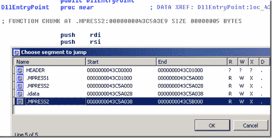  
打开区段窗口之后注意观察区段的名称和 mpress 压缩壳设置的区段的属性。  
为了进行 DLL 文件调试需要确保在启动之前已经设置调试器的选项设置（“Bochs debugger plugin”）为 PE 和 64bit emulation 模式。  
 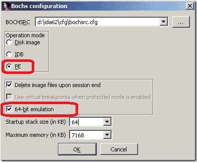  
在启动调试器之后，注意观察下面的代码段，在这段代码中调用了 unpack()函数：  
 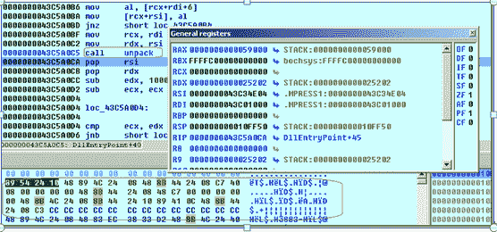  
如果我们继续单步执行到更远的地方我们将会到达修复输入表的代码处，为了实现输入表的修复程序将会循环调用 LoadLibrary()/GetModuleHandle()函数并且在这个循环中会包含另外的一个子循环调用 GetProcAddress()。Mpress 外壳通过这两层循环来实现 IAT 修复：  
 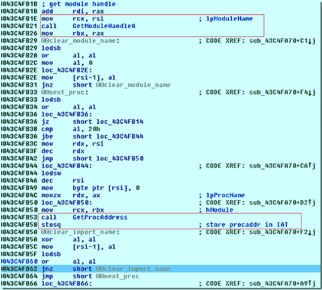  
在 stosq 执行之后我们将可以从 rdi 寄存器中得到 IAT 结构的起始地址，同样在两层循环全部结束之后我们可以从 rdi 寄存器中得到 IAT 结构的结束地址。  
在 IAT 修复之后不远的地方我们可以找到一个跳转到原始入口点的 jmp 代码：  
 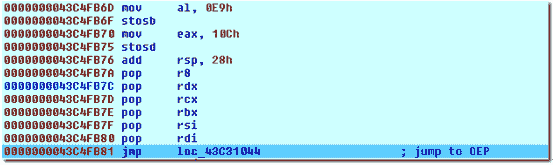  
程序的入口点代码如下所示：  
 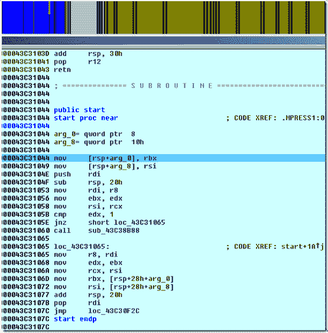  
这里就是脱壳之后的程序的真实的 DllEntryPoint()函数了。现在有了程序的 OEP 和 IAT 结构的起始/结束地址，我们就可以清空数据库并且重现脱壳之后的程序了。  
Reconstructing and cleaning the database  
到这里有许多的办法在程序脱壳之后进行清理数据库清理.通常会包含如下几步：  
1.  定位 IAT 并且创建一个额外的区段来重现程序的输入表；  
2.  删除外壳代码的入口点，并且添加脱壳之后程序的原始入口点 OEP；  
3.  重新分析代码；  
4.  重新加载 FLIRT 特征库  
5.  删除无用的外壳区段（可选）  
其中第一步到第三步可以通过 IDA 的 uunp 插件来自动完成，执行菜单中的“Edit/Plugins/Universal unpacker manual reconstruct”即运行该插件：  
 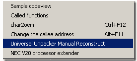  
在插件中填入通过上面的操作得到的数据即可：  
 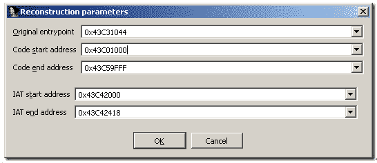  
点击确定之后一个新的区段将会被创建，并且代码段将会被重新分析，在分析完成之后脱壳之后的程序的一个内存快照将会被呈现出来。  
现在我们就可以重新引用 FLIRT 特征库了：  
 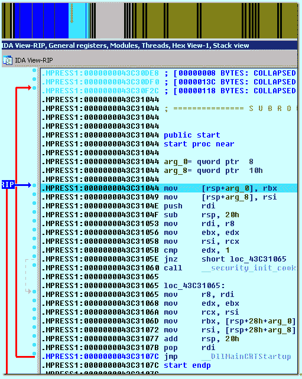  
在选择“vc64rtf”签名（shift +F5）之后我们可以看到 IDA 已经成功的识别出了库函数并且对这些库函数使用浅蓝色进行了标记，这样可以使得后续的分析工作变得更加简单。  
Analyzing the unpacked code  
在代码解压之后我们可以通过 String Window 窗口进行一个快速分析，String Window 窗口呈现了一些加密的字符串：  
 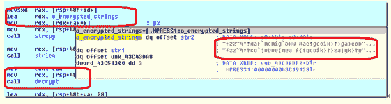  
通过交叉引用，我们可以定位到解密函数。在给函数适当的参数之后我们可以直接通过 Appcall 来解密这些字符串：  
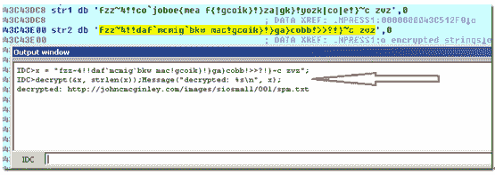  
我们得到了一个指向加密的文本文件的 URL。在深入挖掘之后我们定位到了解密文件的函数：  
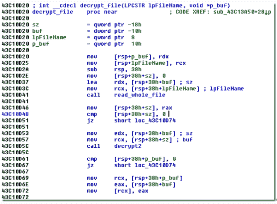  
下面是 Appcall 版本的 decrypt\_file()函数：  
 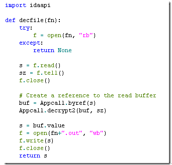  
我们使用这个函数就可以解密 spm.txt 文件了，解密之后的内容如下所示：  
 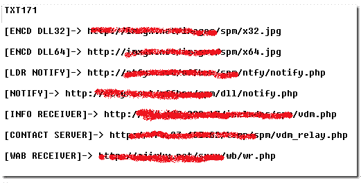  
X32.jpg 是一个 upx 压缩的 DLL 文件，x64.jpg 是一个 mpress 压缩的 PE+格式的 Dll 文件。  
  
  
好了文章到此结束，欢迎评论！  
PDF 下载：  
实战 IDA PE+ DLL 脱壳.pdf