# W32Dasm 简介

> 原文：[`www.pediy.com/kssd/tutorial/chap4-2.htm`](https://www.pediy.com/kssd/tutorial/chap4-2.htm)

**W32Dasm 简介** 

>  

　W32Dasm 是一个强大的反汇编工具，操作简单，使用方便。通常被程序员使用，当然也可被用来 Crack 软件了，很适合 Cracker 使用。我在这把与 crack 相关的功能简述如下：

1.0 开始  
2.0 保存反汇编文本文件和创建方案文件  
3.0 反汇编文本代码的基本操作  
4.0 复制汇编代码文本  
5.0 装载 32 位的汇编代码动态调试  
6.0 运行，暂停或终止程序  
7.0 单步跟踪程序  
8.0 设置激活断点  
9.0 偏移地址和虚拟地址转换 

1.0 开始

1.1 运行 W32Dasm，在这里以 windows95 自带的计算器为例：calc.exe。

1.2 从**Disassembler（反汇编）**菜单选择***Disassembler Options***（***反汇编程序选项***）选项将出现如下对话框：

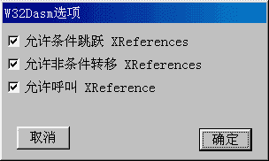

1.3 在**Disassembler（反汇编）**菜单，选择***Open File***（***打开文件***）选项***或***按工具栏按钮

1.4 选择你要打开的文件就可。  
注意：你反汇编文件后，如字符己超过屏幕外，这时你要选择合适的字体（在***Font 字体***选项中***Select Font 选择字体***），然后设为默认字体（***Save Default Font***）即可。 当然一般以默认值就可。

2.0 保存反汇编文本文件和创建方案文件(***Save The Disassembly Text and Create A Project File*** )

略。

3.0 反汇编源代码的基本操作

3.1 **转到代码开始（Goto Code Start）**

在工具栏按或从菜单的**转到(Goto)**选项选择***转到代码开始（Goto Code Start） *或**按**Ctrl S, **这样光标将来到代码的开始处，用户可通过双击鼠标或用***shift+上下光标键***改变光标的位置。

注：代码的开始处是反汇编代码列表清单汇编指令的开始，而不是代码运行的起点，程序运行的起点称为***程序入口点（Program Entry Point）***

3.2 **转到程序入口点（Goto Program Entry Point）**

在工具栏按或菜单的**转到(Goto)**选项选择 ***转到程序入口点（Goto Program Entry Point）***或按**F10**,这样光标将来到程序入口点(Entry Point),这里就是程序执行的起始点，一般动态调试时 LOAD 时也就停在此处。

3.3 **转到页（Goto Page）**

在工具栏按或菜单的**转到(Goto)**选项选择***转到页（Goto Page）*或**按**F11**,这时跳出一对话框，输入页数可跳转到相关页面去。

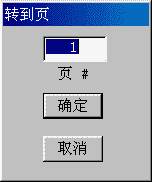

3.4 **转到代码位置（Goto Code Location）**

在工具栏按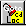或菜单的**转到(Goto)**选项选择***转到代码位置（Goto Code Location*）或**按**F12**,一个对话框将出现，充许用户输入代码偏移地址，以跳转到此位置上去。

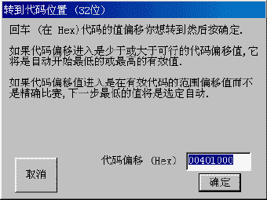

3.5 **执行文本跳转（Execute Text Jump）**

这功能是在**Execute Text（执行文本）**菜单选项里的，***执行跳跃（Execute Jump）***功能激活条件是光标在代码的跳转指令这行上（这时光条是高亮度的绿颜色）。此时工具条***Jump To***按钮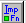也激活。如图：

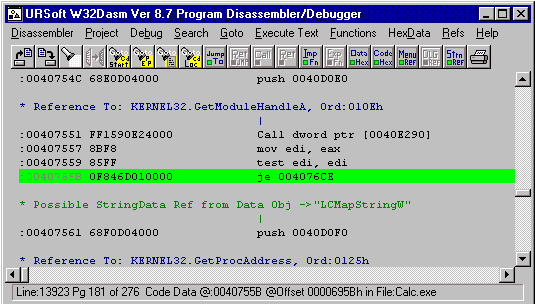

此时按或菜单选项***Execute Jump（执行跳跃）***或按***右光标键***，光条将来到跳转指令所指到的位置。在这例子里，将来到:004076CE xor eax,eax 这一行代码处：

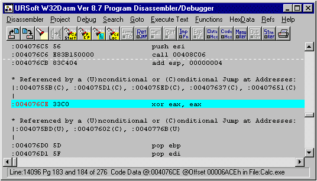

如要返回到上一次跳跃，请参考 3.6.

3.6 **返回到上一次跳跃 Return From Last Jump**

这功能是在**Execute Text（执行文本）**菜单选项里的，此指令仅仅是在 ***执行文本跳转***功能完成后才激活。当这条件成立时，按钮将激活。按或在菜单里选项***返回到上一次跳跃（Return From Last Jump******）***或按***左光标键***，光条将返回到上一次跳跃位置处。

3.7 **执行呼叫 Execute Text Call**  

这功能是在**Execute Text（执行文本）**菜单选项里的，此功能激活的条件是光条在 CALL 指令一行。在这一行时光条将发绿，按钮将激活。执行时光条将会来到 CALL 所指的地址处。  
如下图： 光条在 0040751D call 004073D4 一行。

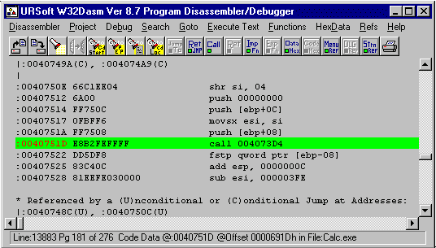

此时按或在菜单的***执行呼叫（Execute Text Call）***或按***右光标键***，光条将来到 CALL 所指的地址 004073D4 这一行。

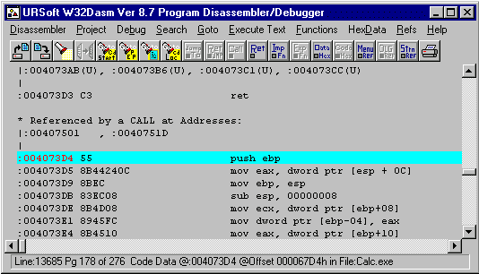

如要返回到刚才起点的 0040751D call 004073D4 一行，参考 3.8 的***返回呼叫***。

3.8 **返回呼叫(Return From Last Call)**

这功能是在**Execute Text（执行文本）**菜单选项里的，此指令仅仅是在***执行呼叫 Execute Text Call***功能完成后才激活。当这条件成立时，按钮将激活。按或在菜单里选项**返回呼叫(Return From Last Call)**或按***左光标键***，光条将返回到上一次呼叫位置处。

3.9 **导入功能（Imported）**

在菜单**功能**选项里，其作用主要是查看 import 函数。按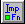或在菜单**功能**选项里的***导入（Imports）***命令，执行后将列出当前文件的 Import 函数。

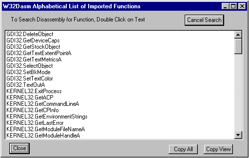

你可双击这些项目，光条将来到调用这些函数的代码处。  
注意：如果代码多处引用了这些函数，你双击这个项目函数时，光条将在调用了其的几个位置代码处循环.  
你也可用 copy all 或 copy view 复制 import 函数。

3.10 **出口功能（Exported）**

在菜单**功能**选项里，其作用主要是查看 Export 函数。按或在菜单**功能**选项里的***出口（Exports）***命令，执行后将列出当前文件的 Exports 函数。

注意：一般 EXE 文件没有 exported，DLL 文件有 exported 函数。

3.11 **裁判（References）**

在这个菜单选项里有**菜单参考（MENU）**, **对话参考（DIALOG）** or **（串式数据参考 STRING DATA）**，分别对应按钮：，或。

注意：其中**（串式数据参考 STRING DATA）**功能破解时很常用。

4.0 复制汇编代码文本

W32dasm 充许打印或复制指定行的汇编代码。首先你将鼠标移到 W32DASM 的最左边单击，将会出现一个小红点，再按住 shift 键，移到你需要的下一行，再单击鼠标一下，将选中一段，按 CTRL＋C 复制或在菜单选项**反汇编**里的***拷贝指定的行（Copy Lines of Text）***功能或按，把数据复制到剪贴板里。如：

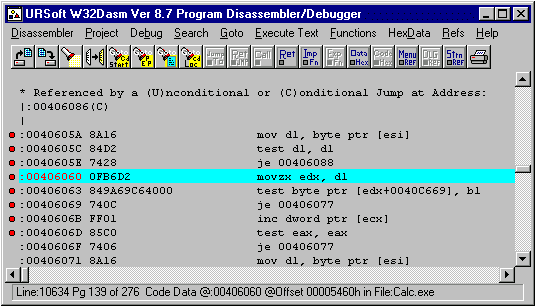

5.0 装载 32 位的汇编代码动态调试

5.1 反汇编 windows 自带的计算器程序 calc.exe.

5.2 选择菜单**调试**选项中的***加载处理(Load Process）***，或按***Ctrl＋L***.出现一个加载对话框，你可输入选项命令。现在你可按***装载（load）***按钮。

Calc.exe 现在被 W32DASM 动态调试，将出现左右两个调试窗口（如下图），在初始化 calc.exe 程序后，指令将停留在入口点（Entry Point）处。

左边的调试窗口列出各种状态器如：CPU 寄存器，CPU 控制寄存器，断点，活动的 DLL，段寄存器等等；

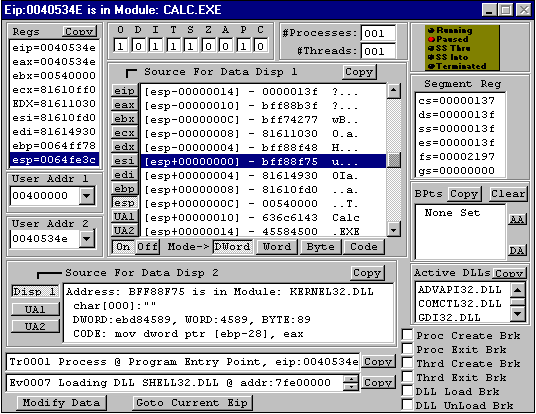（左调试窗口）

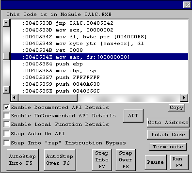（右调试窗口）

6.0 运行，暂停或终止程序

6.1 在右调试窗口，按***运行（RUN）***按钮或按***F9,***calc.exe 将运行起来。

按***暂停（PAUSE）***按钮或***空格键***，程序将暂停，这在单步跟踪时经常用到。

按***终止(TERMINAT）***按钮，程序将停止，退出动态调试环境。

7.0 单步跟踪程序

7.1 重新加载 calc.exe

7.2 在程序加载后，停留在入口点，你可按***F7***或***F8***单步调试程序，这两个键所不同的是 F7 是跟进 CALL 里，F8 是路过。

7.3 进入自动调试按 (***F5***) 和结束自动调试按 (***F6***) 。

8.0 设置激活断点

8.1 重新加载 calc.exe

8.2 在 W32DASM 的菜单**转到**选项***转到代码处(goto code)***功能，填上 403198，按确定，你将在 W32Dasm 的主窗口（此时可能最小化了，把其还原即可）来到 403198 地址一行。光条在这一行显亮绿色，按***F2***或用***鼠标左点击最左边（同时按住 CTRL）***设置断点。

这时如断点设置成功，光条最左边有一小段黄条，显示此行为断点。如下图：

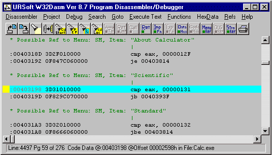

如果断点不在这里，整行光条将是黄色的。

当断点设置好后，在左调试窗口中的断点小窗口显示断点情况（右边有一\*）：

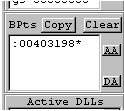

此时按***F2***或（***鼠标左键＋CTRL***），断点将取消。

8.3 此时按***F9***程序将运行到相关断点时停止。

9.0 偏移地址和虚拟地址转换

W32DASM、SOFTICE 和 Hiew（Decode 模式）显示的地址都是虚拟地址，但是在 Hiew（Decode 模式）下，F5 功能键查找的地址是偏移地址，因此必须将虚拟地址转换成偏移地址，才能找到正确的地址。常用的方法是在 W32DASM 下将绿色的光条移到某一行代码上 , 在窗口底部有一行字指示其偏移地址 , 如虚似地址：Code DaTa@0040534e 而偏移地址为：@Offset 0000474Eh. 这就是偏移地址。 

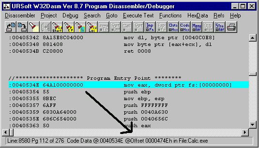

10.0 结束

（要了解更多的内容参考 W32DASM 的帮助文件）

 4dd466d0e1e0cc123afbe504da2462ca