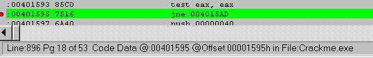

# 拆解教程

> 原文：[`www.pediy.com/kssd/tutorial/chap4-5.htm`](https://www.pediy.com/kssd/tutorial/chap4-5.htm)

**拆解教程**

实验对象：例题 Chap4-eg-1.zip ； 

破解工具：W32Dasm，Hiew；

1、思路提示：首先要试运行要破解的程序，了解其一些提示信息，如：文本/NAG 屏/按钮等等.最重要的就是出错信息 .如： "Wrong serial.."记下，因为你在后面要用到它，你需要它来找到 call 出错 messagebox 的地方.当 W32Dasm 反编译后你会看到一屏幕难懂的汇编码 .你还记得刚要你记下的那个 message 么? 此时单击在工具栏里的***串式数据参考 SDR (=String Data Reference)***.这个功能可是非常有用的. 

在***串式数据参考 SDR***中找到那个提示信息(它也许只显示了信息的一部分) ，此时双击它，来到相关代码处，再分析源代码。

2、运行 crackme，输入假的序列号，点击 CHECK,出现错误提示："Incorrect try again!! "记下。

3、将 crackmer 备份一份，用 W32DASM 反汇编它。

4、一旦完成反汇编 , 点***串式数据参考******（string data reference）***按钮 , 在列出的字符串列表中找到 : "Incorrect try again!! " 并双击它 . （注：如代码中有多处有此字串，你再次双击后，光标将出现在下一代码上）

5、关闭这个窗口回到主窗口 , 你应该能够看到下面这一行 ：

| \* Referenced by a (U)nconditional or (C)onditional Jump at Address:   
|:00401595(C)   
|   
:004015AD 6A40                    push 00000040   
  
\* Possible StringData Ref from Data Obj ->"CrackMe"//错误提示窗口的标题   
                                  |   
:004015AF 686C304000              push 0040306C   
  
\* Possible StringData Ref from Data Obj ->"Incorrect try again!!"//错误提示处，我们来到这一行   
                                  |   
:004015B4 6874304000              push 00403074   
:004015B9 8B4DE0                  mov ecx, dword ptr \[ebp-20\]  |
| --- |

6、现在你必须从这行起向上找 , 直到找到有这样的命令为止 :cmp,jne,je,test 等等 . 

CMP = 比较 (如 CMP EAX, EBX) <- 比较 EAX 和 EBX  
JE = 如果相等就跳转  
JNE = 如果不相等就跳转  
JL = 如果小于就跳转  
JLE = 如果小于等于就跳转  
JA = 如果大于就跳转  
JAE = 如果大于等于就跳转  
JMP = 无条件跳转 

7、注意这一行代码：

\* Referenced by a (U)nconditional or (C)onditional Jump at Address:   
|:00401595(C)   
|   
:004015AD 6A40                    push 00000040   

:00401595(C) 是代码位置而不是 offset，表示指令由 00401595 一行跳转到此 .此时你在利用菜单的***转到代码位置***功能或按***shift+F12***，在对话框中输入:00401595，你将来到此：   

| :00401585 8D4DE4                  lea ecx, dword ptr \[ebp-1C\]   
:00401588 51                      push ecx   
:00401589 8D55F4                  lea edx, dword ptr \[ebp-0C\]   
:0040158C 52                      push edx   
  
\* Reference To: KERNEL32.lstrcmpA, Ord:02FCh   
                                  |   
:0040158D FF1500204000            Call dword ptr \[00402000\]   
:00401593 85C0                    test eax, eax   
:00401595 7516                    jne 004015AD  |
| --- |

8、此时你借助 SOFTICE 动态调试能很快找到序列号，在这我们今天用暴力法破解，注意 :

:0040158D FF1500204000            Call dword ptr \[00402000\]//真假序列号比较核心（调用函数 lsrcmpa 比较）   
:00401593 85C0                    test eax, eax//用 eax 当旗帜，如相等，则 eax=0   
:00401595 7516                    jne 004015AD//如不跳转则注册成功 

看明白了吗？要让程序接受任何注册码就只要把 JNE (=不相等就跳)改成 JE (=相等就跳).或把改成空指令 nop(什么也不执行）,这样前一各改法要注册就只能输入错误的注册码，后者可任意注册码。

9、将绿色的光条移到 :00401595 7516 jne 004015AD 上 , 在窗口底部有一行字指示这句命令的偏移地址 , 此处为 @Offset 00001595h. 这就是应该修改的地方了 . 

10、启动 hiew, 打开 crackme.exe，按 F4 然后选择 decode mode, 按 F5 输入偏移地址 1595（@Offset 00001595h）. 你应该看到下面这几行 : 

?00401593: 85C0 test eax,eax  
?00401595: 7516 jne .0004015AD

11、这就是修改的地方了，按 F3 进入修正状态，在机器码处直接用 7416 代替 7516，按 F9 存盘。或在这一行按 F2 或回车进入小汇编修改状态，输入正确的指令。

12、第二种修改方法是用两个 NOP 指令（NOP 指令机器码是 90,是一个字节）代替机器码：7516,即改为：9090

13、运行 crackme, 随便输入几个字符试试 . 成功了 ! (当然这只是对那些简单的程序有效) 

 4dd466d0e1e0cc123afbe504da2462ca