# 逆向工程入门引导

> 原文：[`www.pediy.com/kssd/pediy12/97592.html`](https://www.pediy.com/kssd/pediy12/97592.html)

最近在准备简历忙找工作，北京有很多信息安全类的公司，对于个人发展很不错。我是南方人，由于各方面因素，还是要在珠三角工作。  
  
《加密解密》第三版写得很好，是每个新手入门必看的书籍。  
  
在此感谢 kanxue 老师的指导。  
  
这个文章，是我 07 年写的，今天把我学习逆向的经验跟大家分享下。  
  
前言  
  
1 、为什么学习逆向工程呢？  
  
（1）分析病毒  
（2）软件破解  
（3）寻找程序漏洞  
（4）分析程序工作流程  
（5）研究系统底层  
（6）开发出更好的软件  
  
2、建议  
  
学习逆向工程的朋友，一定要掌握 C/C 程序设计和汇编语言程序设计，磨刀不误砍柴功。  
  
(一)函数  
  
1、函数  
  
函数是程序设计最重要的结构单元。学习逆向工程最重要的是函数。一个函数有如下几个部分：入口参数，函数名，返回值，函数功能。     
  
    首先我们从最基本的 C 函数开始，在开始代码编写前，我想建议大家使用 VC6 来完  
  
成我们的调试和反编译过程。在开始的文档中，我们仅仅使用 VC 来进行各种逆向的说明，其后我们会使用 ollydbg 等反编译工具做进一步的冒险历程。  
  
  A:打开 VC6 编译器。  
  
  B:File->New->Projects->(选择)Win32 Console Application->(输入)Project Name->OK  
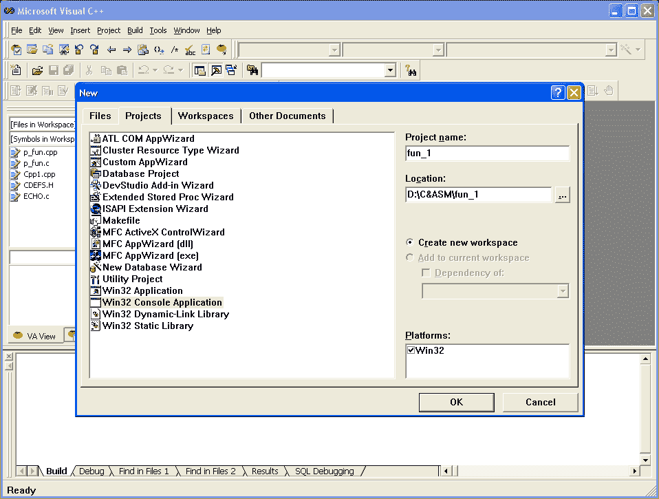  
  
  C:Project->Add To Project->New->(选择)C++ Source File->File->(输入) fun\_1.c ->OK.  
  
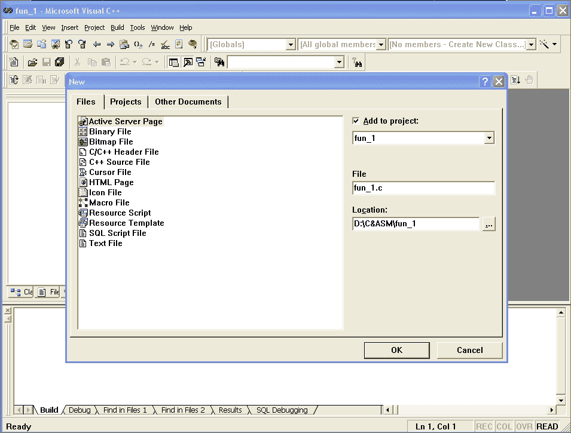  
D.在编辑器里面输入以下程序：  
  
  
#include "iostream.h"  
  
int callee (int a,int b)  
  
{  
  
    int local;  
  
    if (local==5)  
  
        return 0;  
  
    else  
  
        return 2;   
  
}  
  
   
int main(int argc,char \* argv\[\])  
  
{  
  
    int c=5;  
  
    int d=7;  
  
    int v=callee(c,d);  
  
    return 0;  
  
}  
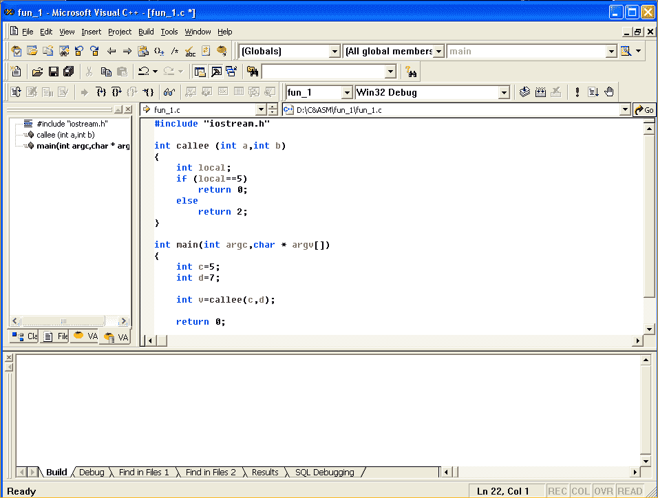  
   E:编译，连接成功后,F11 跟踪到 fun,alt+8 看反汇编代码：  
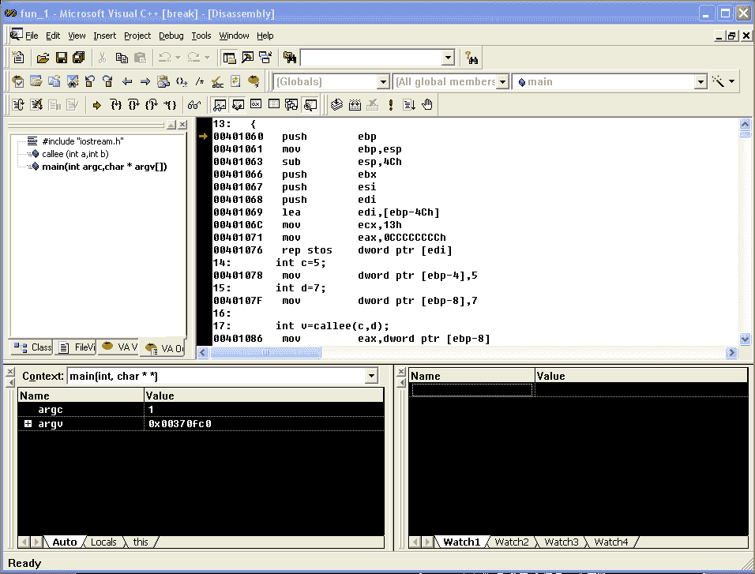  
  
\--- d:\\c&asm\\fun\_1\\fun\_1.c  --------------------------------------------------------  
  
11:  
  
12:   int main(int argc,char \* argv\[\])  
  
13:   {  
  
00401060   push        ebp                 ;保存 ebp,并把 esp 放入 ebp 中.  
00401061   mov         ebp,esp             ;此时 ebp 与 esp 同.  
00401063   sub         esp,4Ch             ;把 esp 往下移动一个范围，等于在堆栈中放出一片新的空间用来存局部变量  
00401066   push        ebx                 ;下面保存三个寄存器:ebx,esi,edi,这是 C 的规范.  
00401067   push        esi  
00401068   push        edi  
00401069   lea         edi,\[ebp-4Ch\]  
0040106C   mov         ecx,13h  
00401071   mov         eax,0CCCCCCCCh  
00401076   rep stos    dword ptr \[edi\]         ;把局部变量区域初始化成 0cccccccch。  
  
                                          ;0cccccccch 实际是 INT 3.这是一个中断指令。  
  
                                          ;因为局部变量不可能被执行，如果执行了必然  
  
                                          ;程序有错，这时发生中断来提示开发者。这是  
  
                                          ;VC 编译 DEBUG 版本的特点。  
堆栈指令操作  
  
   
  
PUSH SRC  
  
push eax  
push \[eax\]  
push 1234  
  
   
esp <- esp-4  
  
\[esp\] <- SRC  
  
  
POP DEST  
  
  
pop ebp  
pop \[ebx\]  
  
  
DEST <-\[esp\]  
esp <- ESP+4  
  
   
MOV DEST,SRC  
mov eax,ebx  
mov \[ebx\].1234  
  
DEST <- SRC  //把 SRC 复制到 DEST  
  
   
以后分析程序的时候，这部分代码一般不用看，我们看接下来的反汇编语句:  
  
  
14:       int c=5;  
00401078   mov         dword ptr \[ebp-4\],5    ;给局部变量赋值  
15:       int d=7;  
0040107F   mov         dword ptr \[ebp-8\],7  
  
   
 执行完以上这两句，由下图的 EIP 可以看到 00401086，就是下条要执行的指令。  
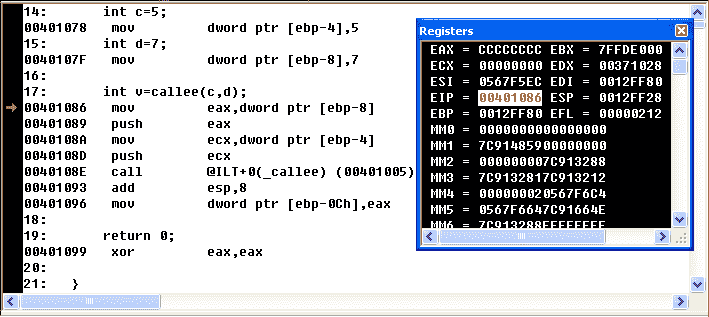  
在 Memory 窗口中可以看到内存数据 000007 和 000005 实质上是 7 和 5(intel 处理器一般都是小端存储)。  
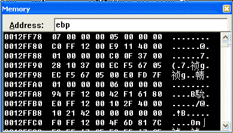  
16:  
17:       int v=callee(c,d);  
00401086   mov         eax,dword ptr \[ebp-8\]  ;参数压栈，这里遵循\_\_cdecl 调用规范，参数由右向左  
00401089   push        eax  
0040108A   mov         ecx,dword ptr \[ebp-4\]  
0040108D   push        ecx  
0040108E   call        @ILT+0(callee) (00401005)   ;函数调用,下一行地址 00401093 入栈  
00401093   add         esp,8                     ;主程序平衡堆栈  
00401096   mov         dword ptr \[ebp-0Ch\],eax  
  
   
 单步执行到 0040108A，我们看下 Memory 窗口，参数 7 被复制到 0012FF24 中。  
  
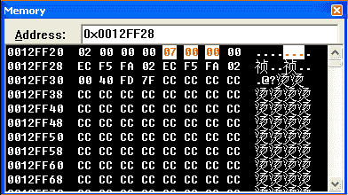  
当程序执行到 0040108E，我们看下 Memory 窗口，参数 5 被复制到 0012FF20 中。  
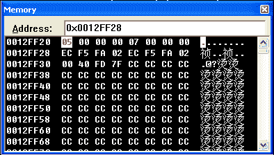  
  
从上面这两张图可以得到，堆栈在内存中是往低地址生长的。现在我们再讨论这个过程所涉及的数据结构：“栈（stack）”。  
提起“栈“，第一反应是它具有后进先出（LIFO）的特性。  
  
接下来到了我们的函数调用，这里我们按 F11 进去函数里面看看。  
  
在这之前，我们有必要解释下 call 指令的本质，它完成两个操作：  
  
push eip  ;下图保存的是 00401093,函数调用完返回执行的下一条语句  
jmp  函数入口地址  
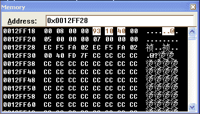  
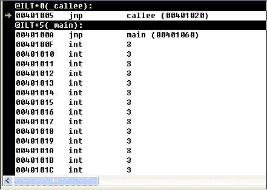  
  
进去函数  
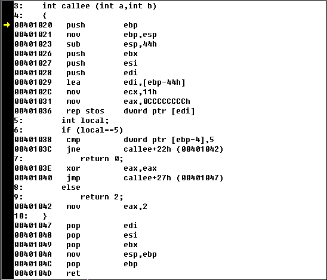  
  
整个函数的调用过程可以用以下的图来说明：  
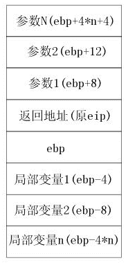  
  
1.将函数参数入栈。  
2.执行 CALL 指令，调用该函数，进入该函数代码空间。  
a.执行 CALL 指令，将 CALL 指令下一行代码的地址入栈。  
b.进入函数代码空间后，将基址指针 EBP 入栈，然后让基址指针 EBP 指向当前堆栈栈顶，并使用它访问存在堆栈中的函数输入参数及堆栈中的其他数据。  
c.堆栈指针 ESP 减少一个值，如 44H，向上移动一个距离，留出一个空间给该函数作为临时存储区。  
  
 {  
  
// 以上准备工作做好后，函数正式被执行，如下所示。  
d.将其他指针或寄存器中的值入栈，以便在函数中使用这些寄存器。  
  
e.执行代码。  
  
f.执行 return()返回执行结果，将要返回的值存入 EAX 中。  
  
g.步骤 2.d 中的指针出栈。  
  
}  
  
 h.将 EBP 的值传给堆栈指针 ESP，使 ESP 复原为 2.c 之前的值。此时进入函数时 EBP 的值在栈顶。  
 i.基址指针 EBP 出栈，复原为 2.b 之前的 EBP 的值。  
 j.执行 RET 指令，“调用函数”的地址出栈，本函数返回到 CALL 指令的下一行。  
  
 3.函数返回到 CALL 指令下一行，将堆栈指针加一个数值，以使堆栈指针恢复到以上步骤 1 执行之前的值。 该数值是上面第一步入栈参数的总长度。  
  
  
注意：  
1.堆栈指针 ESP 指向栈顶的新入栈数据的最低位。  
2.MOV 指令中偏移指针指向被“MOV”的数据的最低位。如下面指令是将 ebp+8 到 ebp+11 四个字节的内容传到 eax 寄存器中。  
00402048 mov eax,dword ptr \[ebp+8\]  
  
   
注:这段英文部分，是我以前在网上摘录的，已经忘记在那个文章的了。  
  
Problem: I program in C/C++ main()? Where is main()?  
Solution: In Windows XP (and its ancestors), programs written in  C/C++ using Microsoft Visual C++ don’t actually start executing from the main() function. Instead, after the image is loaded into memory, control is passed to the Startup()23 function located in crt0.c (or in crtexe.c for dynamic linking or in  
wincmdln.c for console applications). This function initializes the global variables argv, argc, \_osver, \_winmajor, \_winminor, \_winver, and environ; initializes the heap for the process; calls main(); and exits when main() returns.  
The important thing to remember is that the Start()function always passes some (3 or 4) arguments(argc, argv, and environ) to the main() function:  
  
#ifdef WPRFLAG  
  
            lpszCommandLine = \_wwincmdln();  
  
            mainret = wWinMain(  
  
#else  /\* WPRFLAG \*/  
  
            lpszCommandLine = \_wincmdln();  
  
            mainret = WinMain(  
  
#endif  /\* WPRFLAG \*/  
  
                               GetModuleHandleA(NULL),  
  
                               NULL,  
  
                               lpszCommandLine,  
  
                               StartupInfo.dwFlags & STARTF\_USESHOWWINDOW  
  
                                    ? StartupInfo.wShowWindow  
  
                                    : SW\_SHOWDEFAULT  
  
                             );  
  
#else  /\* \_WINMAIN\_ \*/  
  
  
#ifdef WPRFLAG  
  
            \_\_winitenv = \_wenviron;  
  
            mainret = wmain(\_\_argc, \_\_wargv, \_wenviron);  
  
#else  /\* WPRFLAG \*/  
  
   \_\_initenv = \_environ;  
  
            mainret = main(\_\_argc, \_\_argv, \_environ);  
  
#endif  /\* WPRFLAG \*/  
   
  
Looking at the disassembled start() function of Bagle, from IDA Pro:  
  
   
.text:00401120;\*\*\*\*\*\*\*\*\*\*\*\*\*\*\* SU B R O U T I N E \*\*\*\*\*\*\*\*\*\*\*\*\*\*\*\*\*\*\*\*\*\*\*\*\*\*\*\*\*\*\*\*\*\*\*\*\*\*\*  
  
.text:00401120  
  
.text:00401120 ; Attributes: library function bp-based frame  
  
.text:00401120  
  
.text:00401120                 public mainCRTStartup  
  
.text:00401120 mainCRTStartup  proc near  
  
.text:00401120  
  
.text:00401120 var\_1C          = dword ptr -1Ch  
  
.text:00401120 var\_18          = dword ptr -18h  
  
.text:00401120 var\_4           = dword ptr -4  
  
.text:00401120  
  
.text:00401120                 push    ebp  
  
.text:00401121                 mov     ebp, esp  
  
.text:00401123                 push    0FFFFFFFFh  
  
.text:00401125                 push    offset stru\_422138  
  
.text:0040112A                 push    offset \_\_except\_handler3  
  
.text:0040112F                 mov     eax, large fs:0  
  
.text:00401135                 push    eax  
  
.text:00401136                 mov     large fs:0, esp  
  
.text:0040113D                 add     esp, 0FFFFFFF0h  
  
.text:00401140                 push    ebx  
  
.text:00401141                 push    esi  
  
.text:00401142                 push    edi  
  
.text:00401143                 mov     \[ebp+var\_18\], esp  
  
.text:00401146                 call    ds:GetVersion() ; Get current version number of Windows  
.text:00401146                                         ; and information about the operating system platform  
.text:0040114C                 mov     \_osver, eax  
  
.text:00401151                 mov     eax, \_osver  
  
.text:00401156                 shr     eax, 8  
  
.text:00401159                 and     eax, 0FFh  
  
.text:0040115E                 mov     \_winminor, eax  
  
.text:00401163                 mov     ecx, \_osver  
  
.text:00401169                 and     ecx, 0FFh  
  
.text:0040116F                 mov     \_winmajor, ecx  
  
.text:00401175                 mov     edx, \_winmajor  
  
.text:0040117B                 shl     edx, 8  
  
.text:0040117E                 add     edx, \_winminor  
  
.text:00401184                 mov     \_winver, edx  
  
.text:0040118A                 mov     eax, \_osver  
  
.text:0040118F                 shr     eax, 10h  
  
.text:00401192                 and     eax, 0FFFFh  
  
.text:00401197                 mov     \_osver, eax  
  
.text:0040119C                 push    0  
  
.text:0040119E                 call    \_heap\_init  
  
.text:0040119E  
  
.text:004011A3                 add     esp, 4  
  
.text:004011A6                 test    eax, eax  
  
.text:004011A8                 jnz     short loc\_4011B4  
  
.text:004011A8  
  
.text:004011AA                 push    1Ch  
  
.text:004011AC                 call    fast\_error\_exit  
  
.text:004011AC  
  
.text:004011B1                 add     esp, 4  
  
.text:004011B1  
  
.text:004011B4  
  
.text:004011B4 loc\_4011B4:                             ; CODE XREF: mainCRTStartup+88j  
  
.text:004011B4                 mov     \[ebp+var\_4\], 0  
  
.text:004011BB                 call    \_ioinit  
  
.text:004011BB  
  
.text:004011C0                 call    ds:GetCommandLineA()  
  
.text:004011C6                 mov     \_acmdln, eax  
  
.text:004011CB                 call    \_\_crtGetEnvironmentStringsA  
  
.text:004011CB  
  
.text:004011D0                 mov     \_aenvptr, eax  
  
.text:004011D5                 call    \_setargv  
  
.text:004011D5  
  
.text:004011DA                 call    \_setenvp  
  
.text:004011DA  
  
.text:004011DF                 call    \_cinit  
  
.text:004011DF  
  
.text:004011E4                 mov     ecx, \_environ  
  
.text:004011EA                 mov     \_\_initenv, ecx  
  
.text:004011F0                 mov     edx, \_environ  
  
.text:004011F6                 push    edx             ; envp  
  
.text:004011F7                 mov     eax, \_\_argv  
  
.text:004011FC                 push    eax             ; argv  
  
.text:004011FD                 mov     ecx, \_\_argc  
  
.text:00401203                 push    ecx             ; argc  
  
.text:00401204                 call    \_main  
  
.text:00401204  
  
.text:00401209                 add     esp, 0Ch  
  
.text:0040120C                 mov     \[ebp+var\_1C\], eax  
  
.text:0040120F                 mov     edx, \[ebp+var\_1C\]  
  
.text:00401212                 push    edx  
  
.text:00401213                 call    exit  
  
.text:00401213  
  
.text:00401213 mainCRTStartup  endp  
  
.text:00401213  
  
.text:00401218  
  
.text:00401218;\*\*\*\*\*\*\*\*\*\*\*\*\*\*\* SU B R O U T I N E \*\*\*\*\*\*\*\*\*\*\*\*\*\*\*\*\*\*\*\*\*\*\*\*\*\*\*\*\*\*\*\*\*\*\*\*\*\*\*  
   
  
A quick skim through the subroutine, and we see that IDA Pro didn’t find a call to the main() function. How could this be? The answer lies with the fact that the developer can change the start up code of his compiler and set the entry-point symbol (the function called by the start-up code) manually. So this requires us to inspect the start-up code more closely.  
  
The address 00401120 is where the executaility begins to run once it’s loaded.This address can also be  found by using the dumpbin utility:  
  
dumpbin /headers hello.exe  
  
and adding RVA (Relative Virtual Address) to the base address:  
  
Microsoft (R) COFF Binary File Dumper Version 6.00.8447  
  
Copyright (C) Microsoft Corp 1992-1998. All rights reserved.  
  
   
  
Dump of file hello.exe  
  
   
  
PE signature found  
  
...  
  
OPTIONAL HEADER VALUES  
  
…  
  
            1120 RVA of entry point  
  
            1000 base of code  
            1000 base of data  
            400000 image base  
   
  
（二） 、windows 启动函数  
  
     用 ollydbg 打开附件“fun”中 debug 目录下的程序，加载后程序停在 00401100H 的代码处。  
  
 windows 程序的入口函数，主要如下有两种：  
       win32 应用程序  
int WINAPI WinMain（hInstance，hPrevInstance，lpComdLine，nCmdShow）；  
       win32 控制台  
int main（argc，argv\[\]）;  
  
 如果有不清楚的，请查看《Windows 核心编程》,里面有详细的描述。  
  
对于函数 WinMain，hInstance 将包含当前所运行的应用程序的实力句柄；lpComdLine 将传入运行此程序的命令行参数。nCmdShow 包含窗初始显示状态的参数信息。对于 main，argc 包含命令行参数的个数；argv 包含所有参数字符串的指针数组。hInstance，hPrevInstance，lpComdLine，nCmdShow，argc，argv 从哪里来？WinMain，main 之前发生了什么？是操作系统的应用程序加载器传来 hInstance，hPrevInstance，lpComdLine，nCmdShow，argc，argv 这些参数？  
  
  
下面我用 VC 调试上面这个例子，编译连接后，按 F11 单步调试，通过 debug 工具栏的 按钮打开函数调用栈，如下图  
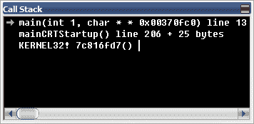  
  
在上图我们可以发现 mianCRTStartup 或 WinMainCRTStartup 函数在与 main 或 WinMain 的邻近位置，双击函数名便可看到相关的源代码，如下图：  
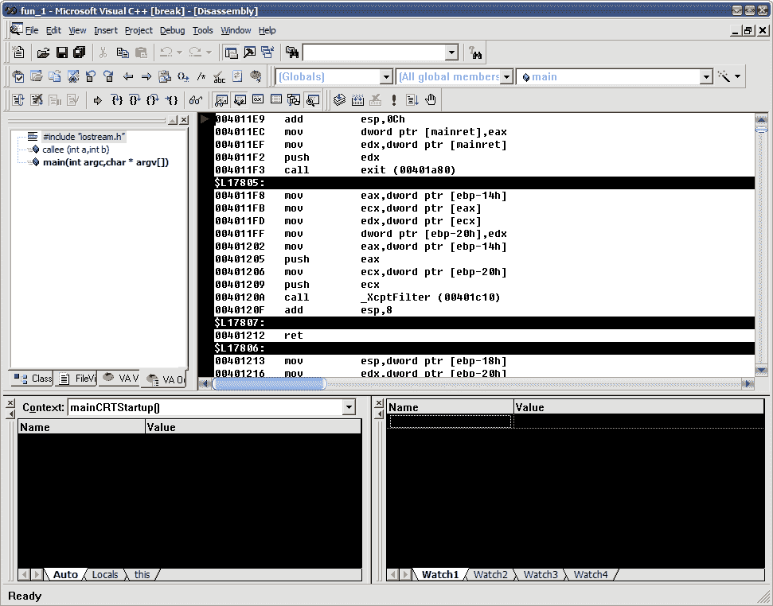  
  
   
   WinMainCRTStartup 函数传给 WinMain 函数的 4 个参数分别为：hInstance、hPrevInstance、lpCmdline、nCmdShow。  
  
事实上 mianCRTStartup 及 WinMainCRTStartup 才是应用程序的真正入口点。这两个函数的原型均为无参数.无返回值。  
  
在这两个函数里，由于完成了一些必要的初始化操作，并将 main 及 WinMain 所需要的参数传入。  
  
WinMainCRTStartup 函数传给 WinMain 函数的 4 个参数分别如下所示。  
  
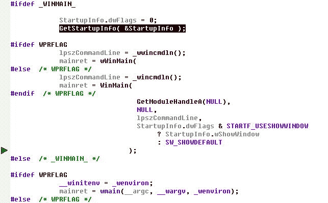  
  
HInstance 该进程所对应的应用程序当前实例的句柄。WinMainCRTStartup 函数通过调用 GetStartupInfo 函数获得该参数的值。该参数实际上是应用程序被加载到进程虚拟地址空间的地址，通常情况下，对于大多数进程，该参数总是 0X00400000。  
  
hPrevInstance 应用程序前一实例的句柄。由于 Win32 应用程序的每一个实例总是运行在自己的独立的进程地址空间中，因此，对于 Win32 应用程序，WinMainCRTStartup 函数传给该参数的值总是 NULL。如果应用程序希望知道是否有另一个实例在运行，可以通过线程同步技术，创建一个具有唯一名称的互斥量，通过检测这个互斥量是否存在可以知道是否有另一个实例在运行。  
  
lpCmdLine 命令行参数的指针。该指针指向一个以 0 结尾的字符串，该字符串不包括应用程序名。  
  
nCmdShow 指定如何显示应用程序窗口。如果该程序通过在资源管理器中双击图标运行，WinMainCRTStartup 函数传给该参数的值为 SW\_SHOWNORMAL。如果通过在另一个应用程序中调用 CreatProcess 函数运行，该参数由 CreatProcess 函数的参数 lpStartupInfo(STARTUPINFO.wShowWindow)指定。  
  
  
程序的启动代码不一定是程序中的第一行要运行的代码。  
  
Windows 可执行文件的载入过程：  
  
1、windows 为主线程创建默认的堆、栈和线程局部存储空间。  
2、windows 将可执行文件得主体和他的所有 DLL 载入虚拟存储空间。如果有必要，DLL 会被重定位。  
3、windows 解释所有的函数和数据引入符号。  
4、对所有 DLL\_PROCESS\_ATTACH 符号中带有该文件的 DLL，windows 调用其 DLLMain 函数。  
5、windows 调用 C 的运行时刻函数库中的 WinMainCRTStartup 启动代码。  
6、运行时刻函数库分解命令行，并设置环境变量。  
7、运行时刻函数库调用主程的 WinMain 函数。对于 MFC 程序，WinMain 立即调用 AfxWinMain。该函数调用 AfxWinInit  
初始化 MFC 自身，然后调用 CWinAPP::InintInstance 初始化应用程序。