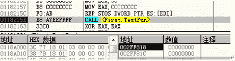
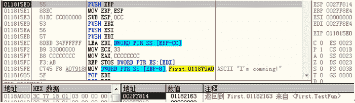
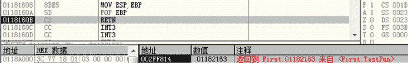
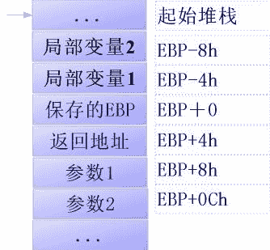

# C 语言简单的函数调用过程

> 原文：[`www.pediy.com/kssd/pediy12/135551.html`](https://www.pediy.com/kssd/pediy12/135551.html)

说明： 函数太常见了，这里只是对函数的调用过程进行的简单的描述，希望对刚接触的童鞋有点帮助，高手也望不吝指点。  
  
简单函数的过程  

代码:

```
void TestFun()
{
    printf("I'm comming!\\r\\n");
}

int \_tmain(int argc, \_TCHAR\* argv\[\])
{    
    TestFun();
    return 0;
}

```

//手动去除了调试版的一些信息，只留需要的  
代码:

```
int \_tmain(int argc, \_TCHAR\* argv\[\])
{    
//保存当前的栈信息，以便函数返回时平衡自身栈
01182140  push        ebp  
01182141  mov         ebp,esp 
    TestFun();//函数调用
0118215E  call        TestFun (118100Ah) 
    return 0;
01182163  xor         eax,eax 
}
//Debug 版这里有个跳转指令
0118100A  jmp         TestFun (11815E0h)

void TestFun()
{
011815E0  push        ebp  
011815E1  mov         ebp,esp 
    char\* lpTest = "I'm comming!";
011815FE  mov         dword ptr \[lpTest\],offset string "I'm comming!" (11879A0h) 
}
01181608  mov         esp,ebp 
0118160A  pop         ebp  
0118160B  ret   

```

**简单描述下 TestFun 函数的调用过程**  
1）当执行 TestFun 时，将其下一条指令地址压入栈中，以便函数调用结束时可以回来继续执行  
2）进入函数(Debug 会多一个 JMP)，保存当前的栈信息，以便函数出去时还原到进来时状态  
3）执行函数功能  
4）用 2 保存的栈信息还原到进来时栈状态  
5）跳转到 1 保存的下一条要执行的指令处去执行。  
实际调试看下具体情况  
执行到 TestFun 函数调用处时栈信息  
  
执行函数调用时栈，将函数的下一条指令压栈(函数执行完的返回地址，有参数时会先压参数在调函数，过程一样)  
0118100A > /E9 D1050000     JMP First.011815E0 (DEBUG 有个跳转不会影响栈)  
  
  
保存寄存器信息，执行函数功能，恢复寄存器信息  
常用的就这些指令(push< -- > pop / sub esp, xx < -- > add esp xx / mov xx, esp < -- > move sp, xx)  
准备返回 Ret  
  
  
此时在回头看下栈调用的简单描述会有多一点的理解  
调用 TestFun 栈  
Esp > Ret：1182163  
进入 TestFun 后  
Esp 值保存到 ebp 中  
Esp -- > 局部变量  
          环境信息 (各种寄存器值)  
         Ret：1182163  
函数功能完成后，清理局变量和恢复环境信息，esp  ebp,这是 esp 还是执行 Ret  
Esp -- > Ret : 1182163  
  
主要涉及的知识在下面简单介绍  
栈的结构, 老大发一篇 "逆向基础知识学习 " 很不错，有个栈的图比较亮  
这里直接 copy 过来了，哈哈  
  
栈有关的操作，这些在汇编书籍上都会有比较清晰的讲解。  
Push xx，   
抬高栈 esp = esp -4  (从低到高的排列顺序)  
Mov \[esp\] = xx  
Pop xx  
  Mov xx, \[esp\]  
  降低栈 esp = esp + 4  
Call MyFun  
NextCode:  
   Push offset NextCode  
  JMP MyFun  
补充 只要理解了，操作的实质就可以了，这里在后面有使用，补充下，push xx ret == JMP XX  
call MyFun 的其他方式  
  push offset NextCode  
   push MyFun  
   Ret  
  
Ret   
   Pop eip  
  JMP EIP  
在使用局部变量时也会通过 push， sub esp 来抬高栈留空足够使用的空间，在使用完毕后要 pop，add esp 来将使用的栈还原。  
  
有了上面的东西下面就可以简单模拟无参数函数调用过程  
代码:

```
int \_tmain(int argc, \_TCHAR\* argv\[\])
{    
    \_asm JMP Test1
MyTestFun:
    \_asm 
    {
        push ebp
        mov ebp, esp
        ;环境变量保存
    }

    //申请栈作局变量，执行具体函数功能
    printf("This is my TestFun %s\\r\\n", lpBuf);
    \_asm
    {
        ;恢复环境变量
        mov esp, ebp
        pop ebp
    }
    \_asm
    {
        ret
    }


Test1:   
    \_asm 
    {
        mov eax , MyTestFun
        call eax
    }
    
NextCode:    printf("这里是返回地址\\r\\n");
    return 0;
}

```

上面的没问题的话，就来个稍微完整一点的，每个部分都有说明。  
代码:

```
int \_tmain(int argc, \_TCHAR\* argv\[\])
{    
    char\* lpBuf = NULL;
    \_asm JMP Test1
MyTestFun: 
    //保存环境部分
    \_asm 
    {
        push ebp
        mov ebp, esp
        ;环境变量保存
    }
    //申请局部变量栈空间,此外也有 push，xx 的方式来申请少量的空间
    \_asm 
    {
        sub esp, 0x110
    }

    //局部变量的使用，通常见到的是 EBP 做标杆偏移的定位方式
    \_asm  
    {
        mov \[esp\], 'a'          ;优化才会用 esp，正常用 ebp，不过自己算晕了，
        mov \[esp+1\], 'b'
        mov \[esp+2\], '\\0'
        mov lpBuf, esp
    }

    //申请栈作局变量，执行具体函数功能
    printf("This is my TestFun %s\\r\\n", lpBuf);
    //释放申请的局变量空间
    \_asm 
    {
        add esp, 0x10
    }
    //恢复环境
    \_asm
    {
        ;恢复环境变量
        mov esp, ebp
        pop ebp
    }
    //o，要回去喽！
    \_asm
    {
        ;ret
        pop eax ; 获取返回地址并清栈，这里假设 eax 没有用到
        JMP eax
    }


Test1:   
    \_asm 
    {
        ;mov eax , MyTestFun
        ;call eax
        push Test2
        push MyTestFun
        ret 
    }
Test2:
        \_asm
    {
        push NextCode
        JMP MyTestFun
    }

NextCode:    printf("这里是返回地址\\r\\n");
    
     return 0;
}

```

声明： 个人水平比较菜，不足和错误难免，还望不吝指教。  
  
                                 五边形  
  
论坛资源：  
标 题: 【原创】学什么编程语言？汇编＋C 似乎是个不错的选择。（99％YY 篇）  
作 者: vshhw  
时 间: 2010-11-18,23:01:09  
链 接: [`bbs.pediy.com/showthread.php?t=125062`](http://bbs.pediy.com/showthread.php?t=125062)  
标 题: 【注意】逆向基础知识学习  
作 者: kanxue  
时 间: 2007-09-01,10:45  
链 接: [`bbs.pediy.com/showthread.php?t=50879`](http://bbs.pediy.com/showthread.php?t=50879)  
标 题: 献给汇编初学者－函数调用堆栈变化分析  
作 者: 堕落天才  
时 间: 2007-01-19,19:20:09  
链 接:[`bbs.pediy.com/showthread.php?t=38234`](http://bbs.pediy.com/showthread.php?t=38234)