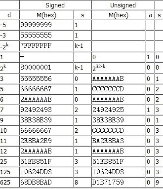

# 将除法转换为乘法的 MagicNumber

> 原文：[`www.pediy.com/kssd/pediy10/81456.html`](https://www.pediy.com/kssd/pediy10/81456.html)

将除法转换为乘法的 MagicNumber  
  
  
  
[`www.thesolver.it/Manuali/Factotum/source/062.htm`](http://www.thesolver.it/Manuali/Factotum/source/062.htm)