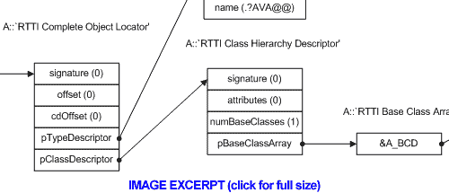
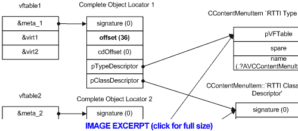
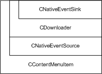

# Reversing MS VC++ Part II: Classes, Methods and RTTI

> 原文：[`www.pediy.com/kssd/pediy08/pediy8-778-2.htm`](https://www.pediy.com/kssd/pediy08/pediy8-778-2.htm)

## Reversing MS VC++ Part II: Classes, Methods and RTTI

### 摘要

       MS VC++ Win32: 平台上最广泛使用的编译器，因此熟悉它的内部工作机制对于 Win32: 逆向爱好者非常重要。能够理解编译器生成的附加（glue: ）代码有助于快速理解程序员写的实际代码。同样也有助于恢复程序的高级结构。

       : 在 Part II: 中，我将讲到 MSVC: 是如何实现 C++: 的，包括类的布局，虚函数，RTTI: 。假设你已经熟悉 C++: 基本知识和汇编语言。

### 基本的类布局

       : 为了解释下面的内容，让我们看看这个简单例子：

 

    class A

    {

      int a1;

    public:

      virtual int A\_virt1();

      virtual int A\_virt2();

      static void A\_static1();

      void A\_simple1();

    };

 

    class B

    {

      int b1;

      int b2;

    public:

      virtual int B\_virt1();

      virtual int B\_virt2();

    };

 

    class C: public A, public B

    {

      int c1;

    public:

      virtual int A\_virt2();

      virtual int B\_virt2();

};

 

       : 多数情形下，MSVC: 的类按如下格局分布：

 Ÿ           指向虚函数表的指针（\_vtable\_\_vftable\_

 Ÿ           基类。

 Ÿ           函数成员。

 

: 虚函数表由虚函数的地址组成，表中函数地址的顺序和它们第一次出现的顺序（即在类定义的顺序）一致。若有重载的函数，则替换掉基类函数的地址。

 

    class A size(8):

        +---

     0  | {vfptr}

     4  | a1

        +---

 

    A's vftable:

     0  | &A::A\_virt1

     4  | &A::A\_virt2

 

    class B size(12):

        +---

     0  | {vfptr}

     4  | b1

     8  | b2

        +---

 

    B's vftable:

     0  | &B::B\_virt1

     4  | &B::B\_virt2

 

    class C size(24):

        +---

        | +--- (base class A)

     0  | | {vfptr}

     4  | | a1

        | +---

        | +--- (base class B)

     8  | | {vfptr}

    12  | | b1

    16  | | b2

        | +---

    20  | c1

        +---

 

    C's vftable for A:

     0  | &A::A\_virt1

     4  | &C::A\_virt2

 

    C's vftable for B:

     0  | &B::B\_virt1

     4  | &C::B\_virt2

 

VC8–d1 reportSingleClassLayout\-d1 reportAllClassLayoutCRTstdout: （标准输出）。

       : 正如你看到的，C: 有两个虚函数表 vftables: ，因为它从两个都有虚函数的类继承。C::A\_virt2: 的地址替换了 A::A\_virt2: 在类 CC::B\_virt2B::B\_virt2

### 调用惯例和类方法

       MSVC: 中所有的类方法都默认使用\_thiscall\_: 调用惯例。类实例的地址（\_this\_: 指针）作为隐含参数传到 ecx: 寄存器。在函数体中，编译器通常立刻用其它寄存器（如 esi: 或 edCOM\_stdcall\_: 调用习惯。下文是对各种类型的类方法的一个概述。

 

 1)      静态方法

: 调用静态方法不需要类的实例，所以它们和普通函数一样的工作原理。没有\_this\_: 指针传入。因此也就不可能可靠的分辨静态方法和简单的普通函数。例如：

 

A::A\_static1();

call    A::A\_static1

 

 2)      简单方法

: 简单方法需要一个类实例，\_this\_: 指针隐式的作为第一个参数传入，通常使用\_thiscall\_: 调用惯例，例如通过\_ecx\_: 寄存器。当基类对象没有分配在派生类对象的开始处，在调用函数前，\_this\_: 指针需要被调整到指向基类子对象的实际开始位置。例如：

 

    ;pC->A\_simple1(1);

    ;esi = pC

    push    1

    mov ecx, esi

    call    A::A\_simple1

 

    ;pC->B\_simple1(2,3);

    ;esi = pC

    lea edi, \[esi+8\] ;adjust this

    push    3

    push    2

    mov ecx, edi

    call    B::B\_simple1

 

B\_this\_: 指针被调整到指向 B: 的子对象。

 3)      虚方法（虚函数）

\_vftable\_\_this\_

 

    ;pC->A\_virt2()

    ;esi = pC

    mov eax, \[esi\]  ;fetch virtual table pointer

    mov ecx, esi

    call \[eax+4\]  ;call second virtual method

    

    ;pC->B\_virt1()

    ;edi = pC

    lea edi, \[esi+8\] ;adjust this pointer

    mov eax, \[edi\]   ;fetch virtual table pointer

    mov ecx, edi

call \[eax\]       ;call first virtual method

 

 4)      构造函数和析构函数

: 构造函数和析构函数类似于简单方法，它们取得隐式的\_this\_: 指针（例如，在\_thiscall\_: 调用惯例下通过 ecx: 寄存器）。虽然形式上构造函数没有返回值，但它在 eax: 中返回\_this\_: 指针。

### RTTI

       RTTI: （Run-Time Type Identification: ）运行时类型识别是由编译器生成的特殊信息，用于支持像 dynamic\_cast<>: 和 typeid: （）这样的 C++: 运算符，以及 C++: 异常。基于这个本质，RTTI: 只为多态类生成，例如带虚函数的类。

       MSVC: 编译器在 vftable: 前设置了一个指针，指向叫做“Complete Object LocatorvftablevftableCOL:

 

struct RTTICompleteObjectLocator

{

DWORD signature; //always zero ?

    DWORD offset;    //offset of this vtable in the complete class

    DWORD cdOffset;  //constructor displacement offset

    struct TypeDescriptor\* pTypeDescriptor; //TypeDescriptor of the complete class

    struct RTTIClassHierarchyDescriptor\* pClassDescriptor; //describes inheritance hierarchy

};

 

       : 类层次描述符描述了类的继承层次。对于一个类，所有 COL: 共享一个。

 

struct RTTIClassHierarchyDescriptor

{

    DWORD signature;      //always zero?

    DWORD attributes;     //bit 0 set = multiple inheritance, bit 1 set = virtual inheritance

    DWORD numBaseClasses; //number of classes in pBaseClassArray

    struct RTTIBaseClassArray\* pBaseClassArray;

};

 

       : 基类数组描述了所有基类，并包含在执行\_dynamic\_cast\_: 过程中编译器是否允许强制转换派生类到这些基类的信息。基类描述符中每一项都包含如下结构：

 

struct RTTIBaseClassDescriptor

{

    struct TypeDescriptor\* pTypeDescriptor; //type descriptor of the class

    DWORD numContainedBases; //number of nested classes following in the Base Class Array

    struct PMD where;        //pointer-to-member displacement info

    DWORD attributes;        //flags, usually 0

};

 

struct PMD

{

    int mdisp;  //member displacement

    int pdisp;  //vbtable displacement

    int vdisp;  //displacement inside vbtable

};

 

       PMD: 描述了一个基类如何放置在完整类中。在简单的继承体系中，它位于从整个对象起始位置的一个固定偏移处，这个偏移量就是\_mdisp\_vbtable\_this\_

 

    //char\* pThis; struct PMD pmd;

    pThis+=pmd.mdisp;

    if (pmd.pdisp!=-1)

    {

      char \*vbtable = pThis+pmd.pdisp;

      pThis += \*(int\*)(vbtable+pmd.vdisp);

}

 

       : 例如，我们的三个类的 RTTI: 层次关系是：

 

RTTI hierarchy for our example classes

### 提取信息

 1)      RTTI

RTTIRTTIRTTII

 2)      静态和全局初始化例程（initializer

: 全局和静态对象需要在 main: 主程序开始前初始化。MSVC: 通过生成初始化例程函数（funclet: ）来实现，并把这些函数地址放入一个表中，当\_cinit: 初始化 CRT.data

 

    \_init\_gA1:

        mov     ecx, offset \_gA1

        call    A::A()

        push    offset \_term\_gA1

        call    \_atexit

        pop     ecx

        retn

    \_term\_gA1:

        mov     ecx, offset \_gA1

        call    A::~A()

        retn

 

 ·         全局/

 ·         它们的构造函数

 ·         它们的析构函数

MSVC \_#pragma\_directive\_init\_seg\_\[5\]

 3)      Unwind Funclets

VC++Part IC++: 异常实现的细节。一个典型的 unwind funclet: 在栈上销毁一个对象的过程是：

 

    unwind\_1tobase:  ; state 1 -> -1

        lea     ecx, \[ebp+a1\]

        jmp     A::~A()

 

 

    lea     ecx, \[ebp+a1\]

    call    A::A()

mov     \[ebp+\_\_$EHRec$.state\], 1

 

newunwind funclet

 

    unwind\_0tobase: ; state 0 -> -1

        mov     eax, \[ebp+pA1\]

        push    eax

        call    operator delete(void \*)

        pop     ecx

        retn

 

 

    ;A\* pA1 = new A();

        push    

        call    operator new(uint)

        add     esp, 4

        mov     \[ebp+pA1\], eax

        test    eax, eax

        mov     \[ebp+\_\_$EHRec$.state\], 0; state 0: memory allocated but object is not yet constructed

        jz      short @@new\_failed

        mov     ecx, eax

        call    A::A()

        mov     esi, eax

        jmp     short @@constructed\_ok

    @@new\_failed:

        xor     esi, esi

    @@constructed\_ok:

        mov     \[esp+14h+\_\_$EHRec$.state\], -1

     ;state -1: either object was constructed successfully or memory allocation failed

     ;in both cases further memory management is done by the programmer

 

unwind funcletsfunclets\_this\_

 

    unwind\_2to1:

        mov     ecx, \[ebp+\_this\] ; state 2 -> 1

        add     ecx, 4Ch

        jmp     B1::~B1

 

funcletB14Ch: 处一个类成员的代码。从这里我们可以找到：

 ·         栈变量代表了 C++new: 分配的对象的指针

 ·         它们的构造函数

 ·         它们的析构函数

 ·         由 new

 4)      构造/

 ·         调用基类构造函数

 ·         调用复杂的类成员的构造函数

 ·         若类有虚函数，初始化 vfptr

 ·         执行当前的构造函数代码（即由程序员写得构造代码）

 

 ·         若有虚函数，初始化 vfptr

 ·         执行当前的析构函数代码

 ·         调用复杂类成员的析构函数

 ·         调用基类的析构函数

 

MSVC: 生成的析构函数另一个独特的特征是它们的\_state\_: 变量通常初始化为最大值，每次析构一个子对象就减一，这样使得识别它们更容易。要注意简单的构造/MSVC: 内联（inline: ）。那就是为什么你经常看到 vftable: 指针在同一个函数中被不同指针重复的调用。

 5)      数组的构造和析构

MSVC: 使用一个辅助函数来构造和析构数组。思考下面的代码：

 

    A\* pA = new A\[n\];

    delete \[\] pA

 

 

    array = new char(sizeof(A)\*n+sizeof(int))

    if (array)

    {

      \*(int\*)array=n; //store array size in the beginning

      'eh vector constructor iterator'(array+sizeof(int),sizeof(A),count,&A::A,&A::~A);

    }

    pA = array;

    

'eh vector destructor iterator'(pA,sizeof(A),count,&A::~A);

 

Avftable: ，当删除数组时，相应的会以调用一个删除析构函数的向量来替代：

 

    ;pA->'vector deleting destructor'(3);

    mov ecx, pA

    push 3 ; flags: 0x2=deleting an array, 0x1=free the memory

    call A::'vector deleting destructor'

 

A

 

    mov ecx, pA

    push 3

    mov eax, \[ecx\] ;fetch vtable pointer

call \[eax\]     ;call deleting destructor

 

/

 ·         对象数组的地址

 ·         它们的构造函数

 ·         它们的析构函数

 ·         类的大小

 6)      删除析构函数

\_delete\_

 

    virtual void \* A::'scalar deleting destructor'(uint flags)

    {

      this->~A();

      if (flags&1) A::operator delete(this);

};

 

vftable\_delete\_\_delete\_delete()

   

virtual void \* A::'vector deleting destructor'(uint flags)

    {

      if (flags&2) //destructing a vector

      {

        array = ((int\*)this)-1; //array size is stored just before the this pointer

        count = array\[0\];

        'eh vector destructor iterator'(this,sizeof(A),count,A::~A);

        if (flags&1) A::operator delete(array);

      }

      else {

        this->~A();

        if (flags&1) A::operator delete(this);

      }

};

 

Jan Gray\[1\]\[2\]MSVC: 实现虚继承的实现。更多细节还可以看 MS: 专利\[3\]

###  I ms\_rtti4.idc

       : 这是我写的解析 RTTI: 和 vtfable: 的脚本。你可以从[Microsoft VC++ Reversing Helpers](http://www.openrce.org/downloads/details/196)

*   : 解析 RTTI: 结构，用对应的类名重命名 vftables
*   : 对于某些简单情形，识别和重命名构造函数和析构函数
*   : 输出所有的虚函数表，引用的函数，及类的层次到一个文件里

 

ms\_rtti4.idcexevtable: 。注意这可能是一个漫长的过程。即使你跳过了扫描，你还是可以手工分析 vtables: 。若你选择了扫描，脚本将会试着识别所有的 vtables: ，RTTI

MSVC

*   Alt-F8 vtable: 。光标应该位于 vtable: 的开始处。若有 RTTI: ，脚本会使用类名。若没有 RTTI: ，你可以输入一个类名，然后脚本将重命名 vtable: 。若有可识别的虚析构函数，脚本也会重命名它。
*   Alt-F7 FuncInfo: "Times New Roman";mso-ansi-language:IT" class="pediy">。FuncInfo 是存在于有对象分配在栈中或使用了异常处理的函数中的结构体: 。它的地址被传给函数异常处理程序的\_CxxFrameHandler: 。

 

    mov eax, offset FuncInfo1

jmp \_CxxFrameHandler

 

IDA\_ehseh.idcFuncInfo

 

FuncInfo

*   Alt-F9 ThrowInfo: 。ThrowInfo: 是\_CxxThrowException: 用来实现\_throw\_: 操作符的一个辅助结构。它的地址是\_CxxThrowException: 的第二个参数。

 

    lea     ecx, \[ebp+e\]

    call    E::E()

    push    offset ThrowInfo\_E

    lea     eax, \[ebp+e\]

    push    eax

call    \_CxxThrowException

 

ThrowInfothrown

### II: ：恢复一个类的实践

MSN Messenger 7.5msnmsgr.exe7.5.3247094272C++RTTI: 信息。让我们考虑两个 vftable: ，地址分别在.0040EFD8: 和.0040EFE0: 。它们完整的 RTTI: 结构层次如下图：

 

RTTI hierarchy for MSN Messenger 7.5

 

vftablesCContentMenuItem

*   CContentMenuItemCDownloader, CNativeEventSinkCNativeEventSource
*   CDownloaderCNativeEventSink
*   : 因此 CContentMenuItem: 直接从 CDownloader, CNativeEventSinkCNativeEventSourceCDownloaderCNativeEventSink
*   CDownloaderCNativeEventSource0x24

 

 

vftableCNativeEventSourceCDownloaderCNatvieEventSinkCContentMenuItemCNativeEventSourcevftable.052B5E0.052B547.052B547\_state\_6.052B5E0

 

CContentMenuItem::CContentMenuItem   proc near

this = esi

    push    this

    push    edi

    mov     this, ecx

    call    sub\_4CA77A

    lea     edi, \[this+24h\]

    mov     ecx, edi

    call    sub\_4CBFDB

    or      dword ptr \[this+48h\], 0FFFFFFFFh

    lea     ecx, \[this+4Ch\]

    mov     dword ptr \[this\], offset const CContentMenuItem::'vftable'{for 'CContentMenuItem'}

    mov     dword ptr \[edi\], offset const CContentMenuItem::'vftable'{for 'CNativeEventSource'}

    call    sub\_4D8000

    lea     ecx, \[this+50h\]

    call    sub\_4D8000

    lea     ecx, \[this+54h\]

    call    sub\_4D8000

    lea     ecx, \[this+58h\]

    call    sub\_4D8000

    lea     ecx, \[this+5Ch\]

    call    sub\_4D8000

    xor     eax, eax

    mov     \[this+64h\], eax

    mov     \[this+68h\], eax

    mov     \[this+6Ch\], eax

    pop     edi

    mov     dword ptr \[this+60h\], offset const CEventSinkList::'vftable'

    mov     eax, this

    pop     this

    retn

sub\_52B5E0      endp

 

prologexc: 拷贝\_this\_: 指针到 esiesivfptr: 前，它调了两个其它函数，一定是基类的构造函数 CDownloader: 和 CNativeEventSource: 。进到这两个函数中，我们可以确认第一个用 CDownloader::’vftable’: 初始化它的 vfptr: ，第二个用 CNativeEventSource::’vftable’: 。我们还可以进一步看看 CDownloader: 的构造函数－它调用了基类 CNativeEventSink: 的构造函数。

edi\_this\_: 指针，它指向 this+24h: 。根据我们的类结构图，这个地址是 CNativeEventSource: 子对象的位置。这从另一个方向确认了调用的第二个函数是 CNativeEventSource: 的构造函数。

vfptrCContentMenuItem: 的实现重写了，意味着 CContentMenuItem: 覆盖了基类的某些虚方法（或添加了它自己的）。(: 如果有需要，我们可以比较这些表，查看哪些指针被改变或者添加－被添加的就是 CContentMenuItem: 新实现的。

.04D8000ecxthis+4Ch: 被设置到 this+5Ch : － 

*   : 函数使用\_thiscall\_: 调用习惯，而且是第一次访问这些域。
*   : 这些域的初始化是按照地址增长的方向进行的。

unwind funclet 

RTTIRefCountedPtr4D8000CContentMenuItemunwind funclet63CCB4

CContentMenuItem30: ，还有一个 vftable: 指针。这看起来像是一个成员变量内联展开的构造函数（不是基类的，因为若是基类，就应该在继承树中存在）。从用到的 vftableRTTICEventSinkList: 模板的一个实例。

 

class CContentMenuItem: public CDownloader, public CNativeEventSource

{

/\* 00 CDownloader \*/

/\* 24 CNativeEventSource \*/

/\* 48 \*/ DWORD m\_unknown48;

/\* 4C \*/ RefCountedPtr m\_ptr4C;

/\* 50 \*/ RefCountedPtr m\_ptr50;

/\* 54 \*/ RefCountedPtr m\_ptr54;

/\* 58 \*/ RefCountedPtr m\_ptr58;

/\* 5C \*/ RefCountedPtr m\_ptr5C;

/\* 60 \*/ CEventSinkList m\_EventSinkList;

/\* size = 70? \*/

};

 

48CNativeEventSource: 的一部分，因为在 CNativeEventSource: 的构造函数中没有访问过，它很可能是 CContentMenuItem: 的一部分。包含被重命名的方法的构造函数和类结构如下：

 

public: \_\_thiscall CContentMenuItem::CContentMenuItem(void) proc near

    push    this

    push    edi

    mov     this, ecx

    call    CDownloader::CDownloader(void)

    lea     edi, \[this+CContentMenuItem.\_CNativeEventSource\]

    mov     ecx, edi

    call    CNativeEventSource::CNativeEventSource(void)

    or      \[this+CContentMenuItem.m\_unknown48\], -1

    lea     ecx, \[this+CContentMenuItem.m\_ptr4C\]

    mov     \[this+CContentMenuItem.\_CDownloader.\_vfptr\], offset const CContentMenuItem::'vftable'{for 'CContentMenuItem'}

    mov     \[edi+CNativeEventSource.\_vfptr\], offset const CContentMenuItem::'vftable'{for 'CNativeEventSource'}

    call    RefCountedPtr::RefCountedPtr(void)

    lea     ecx, \[this+CContentMenuItem.m\_ptr50\]

    call    RefCountedPtr::RefCountedPtr(void)

    lea     ecx, \[this+CContentMenuItem.m\_ptr54\]

    call    RefCountedPtr::RefCountedPtr(void)

    lea     ecx, \[this+CContentMenuItem.m\_ptr58\]

    call    RefCountedPtr::RefCountedPtr(void)

    lea     ecx, \[this+CContentMenuItem.m\_ptr5C\]

    call    RefCountedPtr::RefCountedPtr(void)

    xor     eax, eax

    mov     \[this+CContentMenuItem.m\_EventSinkList.field\_4\], eax

    mov     \[this+CContentMenuItem.m\_EventSinkList.field\_8\], eax

    mov     \[this+CContentMenuItem.m\_EventSinkList.field\_C\], eax

    pop     edi

    mov     \[this+CContentMenuItem.m\_EventSinkList.\_vfptr\], offset const CEventSinkList::'vftable'

    mov     eax, this

    pop     this

    retn

public: \_\_thiscall CContentMenuItem::CContentMenuItem(void) endp

### 链接和参考资料

\[1\] [`msdn.microsoft.com/archive/default.asp?url=/archive/en-us/dnarvc/html/jangrayhood.asp`](http://msdn.microsoft.com/archive/default.asp?url=/archive/en-us/dnarvc/html/jangrayhood.asp)  
with illustrations (but in Japanese): [`www.microsoft.com/japan/msdn/vs\_previous/visualc/techmat/feature/jangrayhood/`](http://www.microsoft.com/japan/msdn/vs_previous/visualc/techmat/feature/jangrayhood/)  
[C++: Under the Hood (PDF)](http://openrce.org/articles/files/jangrayhood.pdf)   
  
\[2\] [`www.lrdev.com/lr/c/virtual.html`](http://www.lrdev.com/lr/c/virtual.html)  
  
\[3\] Microsoft patents which describe various parts of their C++ implementation. Very insightful. 

*   [5410705:](http://freepatentsonline.com/5410705.html) Method for generating an object data structure layout for a class in a compiler for an object-oriented programming language 
*   [5617569:](http://freepatentsonline.com/5617569.html) Method for implementing pointers to members in a compiler for an object-oriented programming language 
*   [5754862:](http://freepatentsonline.com/5754862.html) http://freepatentsonline.com/5854931.html Method and system for accessing virtual base classes 
*   [5297284:](http://freepatentsonline.com/5297284.html) Method and system for implementing virtual functions and virtual base classes and setting a this pointer for an object-oriented programming language 
*   [5371891:](http://freepatentsonline.com/5371891.html) Method for object construction in a compiler for an object-oriented programming language 
*   [5603030:](http://freepatentsonline.com/5603030.html) Method and system for destruction of objects using multiple destructor functions in an object-oriented computer system 
*   [6138269:](http://freepatentsonline.com/6138269.html) Determining the actual class of an object at run time 

\[4\] Built-in types for compiler's RTTI and exception support.  
[`members.ozemail.com.au/~geoffch@ozemail.com.au/samples/programming/msvc/language/predefined/index.html`](http://members.ozemail.com.au/~geoffch@ozemail.com.au/samples/programming/msvc/language/predefined/index.html)  
  
\[5\] #pragma init\_seg  
[`msdn.microsoft.com/library/default.asp?url=/library/en-us/vclang/html/\_predir\_init\_seg.asp`](http://msdn.microsoft.com/library/default.asp?url=/library/en-us/vclang/html/_predir_init_seg.asp)

 

 4dd466d0e1e0cc123afbe504da2462ca