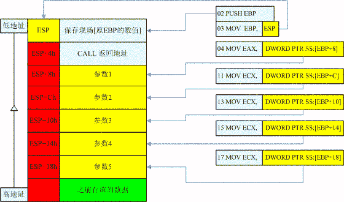
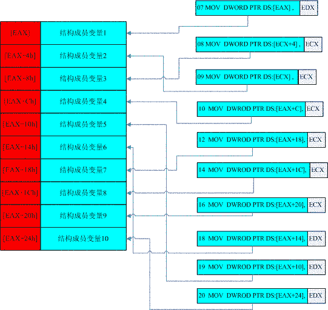

# 教你如何分析未文档化的数据结构

> 原文：[`www.pediy.com/kssd/pediy07/pediy7-365.htm`](https://www.pediy.com/kssd/pediy07/pediy7-365.htm)

\[标题\] 教你如何分析未文档化的数据结构  
  
\[作者\] hsly110 或者 猪头三  
  
\[个人网站\] [`www.x86asm.com`](http://www.x86asm.com) 80x86 汇编小站  
  
\[Email\] pliceman\_110@163.com PS:本文如果有错漏请来信指出  
  
\[范围\] 逆向工程  
  
\[目的\] 分享逆向技术心德  
  
\[目标 API\] 未文档化的 RtlInitializeGenericTable  
  
\[参考文献\] Secrets of Reverse Engineering  
  
\[备注\] 欢迎转载该文章，只要保留完整内容即可  
  
2005-08-20 撰写  
2005-08-21 修正  
2005-08-23 修正  
\------------------------------------------------------  
  
一 前言:  
这 2 天看了 Secrets of Reverse Engineering 一书，对分析未文档化的 API 的技术比较有心得，希望各位看了下面的教程，能抛砖引玉灵活的应用在逆向工程和破解技术上，方法是死的，但是人的思维是活，最重要是灵活应用。  
  
二 实践:  
用 OllyDbg 对 NTDLL.DLL 进行反汇编，前提你要加入 NTDLL.DLL 的符号表，这样你才能更好的对未文档化的 API 进行反汇编，你们到微软官方网站获取相应版本 Windows 系统的系统符号表。  
下面是 RtlInitializeGenericTable 函数的反汇编代码:  
  
01 MOV EDI, EDI ;   
  
//压入堆栈,保存 EBP 的数值   
02 PUSH EBP ;                              
  
03 MOV EBP, ESP ;   
  
// 获取\[ESP+8\]的数值传入 EAX  
// 此处指令我们可以翻译为:  
// MOV EAX, DWORD PTR SS:\[ESP+8\]  
// 含义: 把当前堆栈顶向下偏移 8h 处的值赋给 EAX,也就是该函数的第 1 个参数  
// 声明:我喜欢用 ESP 指针来想象堆栈。但是 CPU 处理的话，是用 EBP 来进行偏移处理   
04 MOV EAX, DWORD PTR SS:\[EBP+8\] ;   
  
05 XOR EDX, EDX ;   
  
// EAX+4 的数值当作指针传入 ECX   
06 LEA ECX, DWORD PTR DS:\[EAX+4\] ;   
  
// EDX 的数值传入\[EAX\],说明 EAX 的值是某个结构的指针  
// 假设 pUnknowStruct 的地址为 EAX 的数值  
// 07 的汇编指令对应的 C 语言: pUnknowStruct->member1 = 0 ;  
07 MOV DWROD PTR DS:\[EAX\], EDX ;   
  
// 此处指令我们可以翻译为:  
// MOV DWORD PTR DS:\[EAX+8\], EAX+4 ;  
// 备注: \[EAX\] 为某结构的第 1 个变量  
// \[EAX+4\]为某结构的第 2 个变量  
// \[EAX+8\]为某结构的第 3 个变量   
// 含义:该结构的第 3 个成员变量被赋于指向该结构的第 2 个成员变量的指针数值  
// 08 的汇编指令对应的 C 语言: pUnknowStruct->member3 = &pUnknowStruct->member2  
08 MOV DWORD PTR DS:\[ECX+4\], ECX ;   
  
// 此处指令我们可以翻译为:  
// MOV DWORD PTR DS:\[EAX+4\], EAX+4 ;  
// 09 的汇编指令对应的 C 语言: pUnknowStruct->member2 = &pUnknowStruct->member2  
09 MOV DWORD PTR DS:\[ECX\], ECX ;  
  
// 此处指令我们可以翻译为:  
// MOV DWORD PTR DS:\[EAX+C\], EAX+4 ;  
// 10 的汇编指令对应的 C 语言: pUnknowStruct->member4 = &pUnknowStruct->member2  
10 MOV DWORD PTR DS:\[EAX+C\], ECX ;   
  
// 此处指令我们可以翻译为:  
// MOV ECX, DWORD PTR SS:\[ESP+C\]  
// 含义: 把当前堆栈顶向下偏移 Ch 处的值赋给 ECX,也就是该函数的第 2 个参数  
11 MOV ECX, DWORD PTR SS:\[EBP+C\] ;   
  
// 含义: 把第 2 个参数传送给某结构的第 7 个成员变量  
// 12 的汇编指令对应的 C 语言为: pUnknowStruct->member7 = Param2  
12 MOV DWORD PTR DS:\[EAX+18\], ECX ;   
  
// 此处指令我们可以翻译为:  
// MOV ECX, DWORD PTR SS:\[ESP+10\]  
// 含义: 把当前堆栈顶向下偏移 10h 处的值赋给 ECX,也就是该函数的第 3 个参数  
13 MOV ECX, DWORD PTR SS:\[EBP+10\] ;   
  
// 含义:把参数 3 传给某结构的第 8 个成员变量  
// 14 的汇编指令对应的 C 语言为: pUnknowStruct->member8 = Param3  
14 MOV DWORD PTR DS:\[EAX+1C\], ECX ;   
  
// 此处指令我们可以翻译为:  
// MOV ECX, DWORD PTR SS:\[ESP+14\]  
// 含义: 把当前堆栈顶向下偏移 14h 处的值赋给 ECX,也就是该函数的第 4 个参数  
15 MOV ECX, DWORD PTR SS:\[EBP+14\] ;   
  
// 含义:把参数 3 传给某结构的第 9 个成员变量  
// 16 的汇编指令对应的 C 语言为: pUnknowStruct->member9 = Param4  
16 MOV DWORD PTR DS:\[EAX+20\], ECX ;   
  
// 此处指令我们可以翻译为:  
// MOV ECX, DWORD PTR SS:\[ESP+18\]  
// 含义: 把当前堆栈顶向下偏移 18h 处的值赋给 ECX,也就是该函数的第 5 个参数  
17 MOV ECX, DWORD PTR SS:\[EBP+18\] ;   
  
// 含义:把 EDX 的数值赋给某结构的第 6 个成员变量  
// 18 的汇编指令对应的 C 语言为: pUnknowStruct->member6 = 0  
18 MOV DWORD PTR DS:\[EAX+14\], EDX ;   
  
// 含义:把 EDX 的数值赋给某结构的第 6 个成员变量  
// 19 的汇编指令对应的 C 语言为: pUnknowStruct->member5 = 0   
19 MOV DWORD PTR DS:\[EAX+10\], EDX ;  
  
// 含义:把参数 5 传给某结构的第 10 个成员变量  
// 29 的汇编指令对应的 C 语言为: pUnknowStruct->member10 = Param5   
20 MOV DWORD PTR DS:\[EAX+24\], ECX ;   
  
  
21 POP EBP  
  
22 RET 14  
  
三 逆出伪代码:  
  
说明: 反汇编分析出如下关键指令  
04 MOV EAX, DWORD PTR SS:\[EBP+8\] ;  
11 MOV ECX, DWORD PTR SS:\[EBP+C\] ;  
13 MOV ECX, DWORD PTR SS:\[EBP+10\] ;  
15 MOV ECX, DWORD PTR SS:\[EBP+14\] ;   
17 MOV ECX, DWORD PTR SS:\[EBP+18\] ;   
可以看得出，该函数使用了 5 个参数，可以假设为: Param1...5 ;  
  
  
struct UnknowStruct  
{  
    UNKNOWN Member1 ;  
   UNKNOWN\_PTR Member2 ;  
   UNKNOWN\_PTR Member3 ;  
   UNKNOWN\_PTR Member4 ;  
   UNKNOWN Member5 ;  
   UNKNOWN Member6 ;  
   UNKNOWN Member7 ;  
   UNKNOWN Member8 ;  
   UNKNOWN Member9 ;  
   UNKNOWN Member10 ;   
} ;  
  
struct UnknowStruct \*pUnknowStruct ;  
  
pUnknowStruct = Param1 ;  
  
pUnknowStruct->Member1 = 0 ;  
pUnknowStruct->Member3 = &pUnknowStruct->Member2 ;  
pUnknowStruct->Member2 = &pUnknowStruct->Member2 ;  
pUnknowStruct->Member4 = &pUnknowStruct->Member2 ;   
pUnknowStrcut->Member7 = Param2 ;  
pUnknowStruct->Member8 = Param3 ;  
pUnknowStruct->Member9 = Param4 ;  
pUnknowStruct->Member6 = 0   
pUnknowStruct->Member5 = 0  
pUnknowStruct->Member10 = Param5 ;  
  
四: 图片分析流程  
  
获取参数流程图  
   
  
结构赋值流程图  
   
  
五:总结  
经过反汇编分析,虽然只有 22 行代码，但是完成了这个结构的初始化工作，该结构的指针存放在 EAX 寄存器，赋值时，就是对 EAX 存放的地址进行偏移处理。大家可以查看流程图来思考一下。  
  
六:遗憾  
由于时间有限，未能写出下一篇: 教你如何分析结构成员变量的类型  
我尽量吧~~~~~~~工作太忙了! 

 4dd466d0e1e0cc123afbe504da2462ca