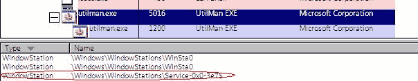
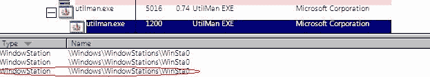
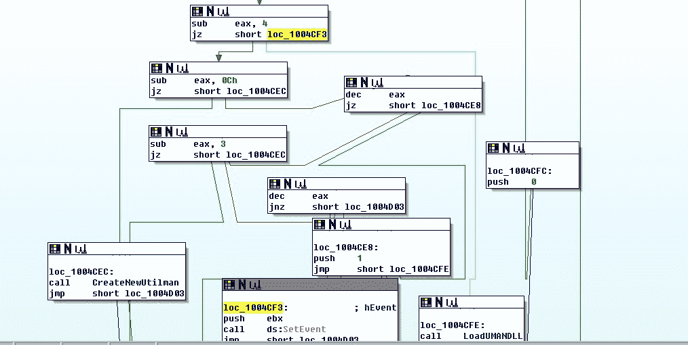

# UTILMAN 浅析

> 原文：[`www.pediy.com/kssd/pediy10/100084.html`](https://www.pediy.com/kssd/pediy10/100084.html)

UTILMAN 是什么？  
UTILMAN 是辅助工具管理器，里面有放大镜，屏幕键盘，据说还有“讲述人”，是 M$方便残疾人用的（放大镜是给近视用的？近视的也算残疾了？。。。。）。  
为什么要弄它？  
说 WIN+U 也是 SYSTEM 权限，传说 WIN+U 能调出 UTILMAN。那把 CMD 命名成 UTILMAN 替换了不就行了。但是似乎没有这么简单。替换过后，WIN+U 似乎没有出现我们想要的界面，但是进程是有的。没有让我们输入的 CMD，怎么加用户？那就看看怎么回事吧！  
黑盒分析：  
正常 WIN+U，会发现有两个 UTILMAN 进程，一个是 ADMINISTRATOR 用户的，一个是 SYSTEM 用户的。用 Process Explorer 查看，发现 ADMINISTRATOR 用户的父进程是 SYSTEM 用户的 UTILMAN,而 SYSTEM 用户的 UTILMAN 的父进程是 WINLOGON.可以 YY 一次啊，WIN+U 让 Winlogon 启动了 UTILMAN，然后这个 UTILMAN 又启动了一个 UTILMAN，最终呈现给用户。  
分析 DEMO：直接把 cmd.exe 覆盖到 system32 目录和 system32\\dllcache 目录下的 utilman.exe，然后 WIN+U。  
结论：CMD 没有向用户呈现出来，只发现一个 UTILMAN 进程。  
那根据以上的现象，似乎可以判定另外一个 UTILMAN 就是 UTILMAN 本身创建的。  
逆向分析：IDA+OD 上。用 IDA 加载,OD 单步，先是检查是否是 PE 文件，  

代码:

```
 .text:01004F02                 mov     eax, ds:100003Ch ; 查看文件是否是 PE

.text:01004F07                 lea     eax, \[eax+1000000h\]

.text:01004F0D                 cmp     dword ptr \[eax\], 4550h

```

复制代码继续走，发现都是一些初始化的东西，一路跳过，来到   
代码:

```
.text:0100504B                 push    ecx

.text:0100504C                 push    eax

.text:0100504D                 push    ebx

.text:0100504E                 push    1000000h

.text:01005053                 call    InitialUtilman

```

终于是真正的东西了。OD 步入，IDA 跟进。来到这个地方，发现问题了   
代码:

```
.text:01001B65 SetCurrentWorkStation proc near         ; CODE XREF: InitialUtilman+7Ep

```

用 Process Explorer 可以看到，SYSTEM 的 UTILMAN 的 WORKSTATION 是  
  
而 ADMINISTRATOR 的 UTILMAN 是   
有一个 STATION 不一样，打开 ADMINISTRATOR 的 STATION，在运行 CMD，那是不是可以显示出来呢？结果是可以的，后面给出 DEMO CODE。  
然后继续往下走，终于发现了检查当前用户桌面   
代码:

```
.text:01001BDD ; int \_\_stdcall CheckDestop(LPWSTR username, int)

```

里面判断是 Default，Winlogon,screen-saver,还是 Display.Cpl Desktop，然后给某个变量赋值。但是能力有限，这个变量还不知道在哪用。。。  
一路往下走，来到了关键的地方。  
代码:

```
 .text:01004CC8 loc\_1004CC8:                            ; CODE XREF: InitialUtilman+CBj

.text:01004CC8                 mov     eax, \[ebp+var\_228\]

.text:01004CCE                 sub     eax, 15h

.text:01004CD1                 jz      short loc\_1004CFC

.text:01004CD3                 sub     eax, 4

.text:01004CD6                 jz      short loc\_1004CF3

.text:01004CD8                 sub     eax, 0Ch

.text:01004CDB                 jz      short loc\_1004CEC

.text:01004CDD                 dec     eax

.text:01004CDE                 jz      short loc\_1004CE8

.text:01004CE0                 sub     eax, 3

.text:01004CE3                 jz      short loc\_1004CEC

.text:01004CE5                 dec     eax

.text:01004CE6                 jnz     short loc\_1004D03

```

这些判断最终有 3 个结果，如图    
一个是创建一个 utilman 的进程，传入参数/start,一个是设置一个事件，然后等待事件的线程唤醒，然后执行某个操作，第三个是加载 UMANDLG.DLL  
看看第三个。居然把界面放到了这个 DLL 里面，我们单独调用看看  
代码如下  
代码:

```
 #include <windows.h>

typedef int (\_\_stdcall \*UMANDLG)(int a,int b,int c);

UMANDLG UManDlg;

int WinMain( IN HINSTANCE hInstance, IN HINSTANCE hPrevInstance, IN LPSTR lpCmdLine, IN int nShowCmd )

{

        HMODULE hMoudule=LoadLibrary("UManDlg.dll");

        if (hMoudule==NULL)

        {

                        MessageBox(NULL,"err","tip",MB\_OK);

                        return 1;

        }

        UManDlg=(UMANDLG)GetProcAddress(hMoudule,"UManDlg");

        if (UManDlg==NULL)

        {

                MessageBox(NULL,"err2","tip",MB\_OK);

                return 1;

        }

        UManDlg(1,1,2);

        MessageBox(NULL,"test","tip",MB\_OK);

        FreeLibrary(hMoudule);

        return 0;

}

```

发现有时候行，有时候不行。。。正当我向 CJWNull 大牛诉苦的时候，突然发现，如果之前正常调用 UTILMAN，也就是 SYSTEM 的 UTILMAN 还在时，调用这个 DLL 成功出现了对话框，但是里面只有资源，调用放大镜等的功能还是空的。如果 SYSTEM 的 UTILMAN 不在时，这个调用无效了。  
  
虽然没有分析完全，但是可以大致猜想整个流程。WIN+U 调出了 SYSTEM 的 UTILMAN，这个进程检查了当前的 STATION 和接收用户输入的 STATION，发现不对，然后设置了某个变量，然后在启动一个 UTILMAN，这个进程检查到了那个变量，然后将 STATION 设置为 WINSTA0，在设置了 DESKTOP，然后顺利将界面呈献给用户。在逆向的过程中还发现了 RPC 系列函数，那么 WINLOGON 进程和别的进程通信可能就是用的 RPC 方式，这个很高级啊很高级。  
  
那我们如何替换才能使 WIN+U 时出现界面呢？很简单，设置 STATION 为 WINSTA0，然后在设置 DESKTOP，然后搞定，代码见附件。  
  
最后的想法，其实可以不用替换 UTILMAN.exe，毕竟里面的东西很复杂。可以把 UMANDLG.DLL 替换掉，它是个空壳子，如果在里面动手脚，效果会怎么样呢？  
  
分析得不是很透彻，意在抛砖引玉。说法不正确的，还望各位高手指出，小弟先谢过了!  
Desktop Test.rar