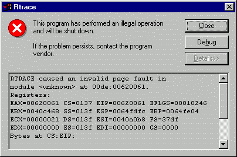
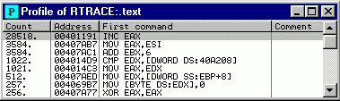
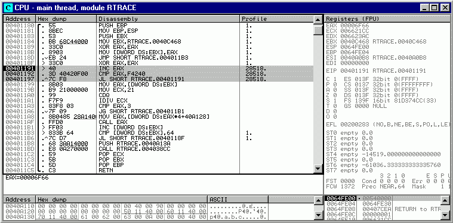
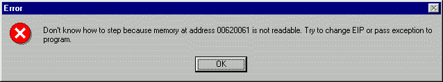
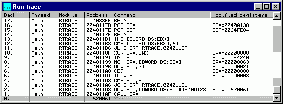
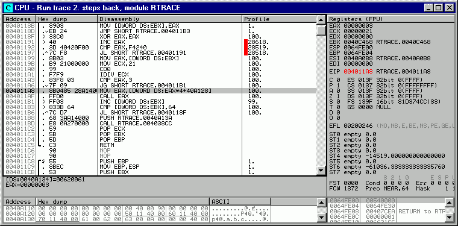
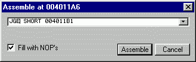
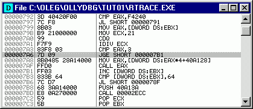

# Run trace

> 原文：[`www.pediy.com/kssd/pediy05/pediy50407.htm`](https://www.pediy.com/kssd/pediy05/pediy50407.htm)

 Run trace 在 OllyDbg 1.04 中被引进。 这种 debug 技术的基础非常简单。代码一步步的执行，调试器把各种命令，寄存器和标志放在一个大的循环缓冲区。当异常发生，就可以回溯到前面几步甚至几百上千步，从而分析导致错误的原因。  
    OllyDbg 1.06 极大的提高了 run trace 的可能性. Run trace 显示被修改的寄存器值和保留重要的消息和已知函数的操作数。你可以设置条件中断 run trace，概括被跟踪代码，把 run trace 写入磁盘避免超过内存上限或者比较两次运行，调试 self-modified 程序，找出上次什么时候命令在某个位置被执行等等。 

   请记住 run trace 是非常慢的.。在一个 500-MHz 的处理器上，OllyDbg 没妙能够跟踪最多 2500 (Windows 95)或者 5000 (NT)命令. 为了加速 run trace，你可以把准线性的代码块（就是不包括调转指令的）标记为一次执行。另一个局限是：OllyDbg 不保存可存取内存的内容。 

    为了让你熟悉 run trace，让我们尝试调试一个简单的控制台应用程序（己编译好的 rtrace.exe 下载）： 

: **`#include <stdio.h>`** : **`void f1(void) { printf("a"); };`** : **`void f2(void) { printf("b"); };`** : **`void f3(void) { printf("c"); };`** : **`void (\*f\[3\])() = { f1,f2,f3 };`** : **`void main(void) {`** : **`  int i,j,k;`** : **`  for (i=0; i<100; i++) {`** : **`    for (j=0; j<1000000; j++) ;  // Long code`** : **`    k=i/33;`** : **`    if (k>3) continue;`** : **`    f\[k\]();                      // Here error (when i==99)!`** : **`  };`** : **`  printf("\\n");`** : **`};`** 

函数 f1, f2 and f3 打印出 a, b and c。主程序 call 每个函数 33 次，然后回车结束...至少理论上是这样。（你已经发现错误了？很好，但这里我们学习如何通过 run trace 得到一样的结果）。试运行*rtrace.exe*，几秒后他崩溃了： 

    哦不！（编者：好恶：）非常明显的错误！如果 OllyDbg 是你的实时调试器，你按"Debug"，但是 Disassembler 窗口是空的！地址 00620061 不指向任何地方，而且你没有模糊的概念哪一条指令跳到这个位置。让我们从头开始按 Ctrl+F2 (Restart)，然后 Ctrl+F11 (Trace into) 等一到两分钟。控制台仍然是空的。可能够某些代码花费太长时间执行，中断 run trace 用 F12 (Pause)或者 Esc。在可执行模块点击 RTRACE 并选择"View run trace profile": 

    一条命令或者说一系列命令在地址 00401191 被执行超过 24000 次。从这里进入 Disassembler： 

    这个 3 条命令的短循环执行了 F4240 (十进制 1000000)次。按没秒 5000 条命令，OllyDbg 将需要 10 分钟通过这个循环。注意到这个命令序列是准线性的，例如没有跳转到外部。从 pop-up 右键菜单，选择"Run trace|Skip selection when tracing"。红线在第四栏包括那几条命令被排除在 run trace 之外。当 OllyDbg 遇到被排出的命令序列，他在被排除命令块的下一条指令设置一个临时断点(在这个例子里是 00401199)然后执行一次命令块。当然，任何返回或者向外部得跳转将导致正确的跟踪失效，因此 OllyDbg 检测你需要排除的代码块并要求你的确认。  
    继续运行 run trace。现在数值显示很迅速，20 秒内 OllyDbg 报告错误： 

    检查这个错误，打开 Run trace(在标题栏前端有'...'的)并把滚动条拉到底部： 

    现在我们看到跳转到 00620061 的命令是 CALL EAX 在 004011AF，并且无效的地址由 call 前的指令计算得到。双击这行在 Disassembler 里可以看到寄存器和信息都变灰色以强调他们不是实际上的值而是跟踪后的值（编者：也就是说它记录下了当时寄存器的情况）： 

    地址常量 0040A128 指向 3 个固定容量的函数地址 f1, f2 and f3。当这条命令最后一次执行 EAX 的值是 3，超过数组边界。前面两条指令应该是执行边界检查的，但 EAX 大于 3 时条件是无效的，跳转依然执行。正确的条件应该是“大于等于“，双击无效的指令修正它。 

    当你汇编了一条指令后，这条指令变红，意味着它是被更改的。再次选择它在右键菜单里选择强大的工具"Copy to executable file"。这样你的更改就会直接应用到程序里（编者：天！以前我居然不知道，汗！）： 

    现在你唯一要做的就是存盘(用不同的名字，of course（为什么？我喜欢覆盖不行呀？！）)然后检查。现在程序运行的乱爽，是不是很简单！ 

 4dd466d0e1e0cc123afbe504da2462ca