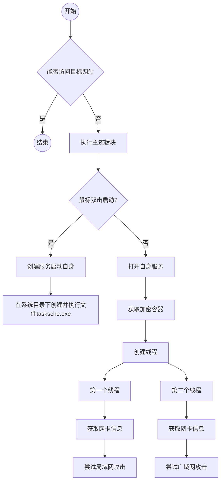
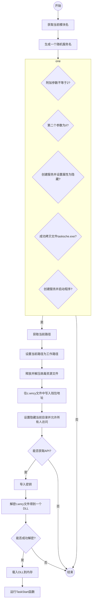
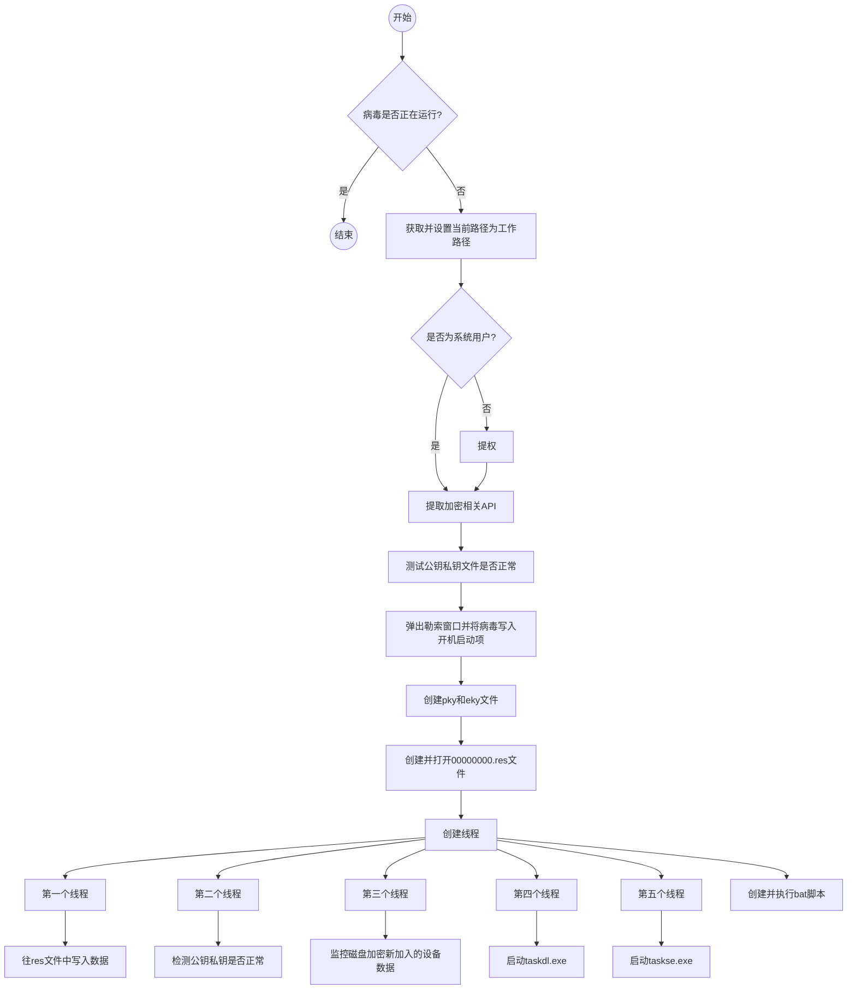

# [讨论][讨论]记录Wannacry病毒的分析

## 0x00 信息收集

- 样本信息：
  - 文件: `D:\Virus\样本\永恒之蓝WannaCry样本`
  - 大小: 3723264 bytes
  - 文件版本: 6.1.7601.17514 (win7sp1\_rtm.101119-1850)
  - 修改时间: 2017年5月13日, 13：55：05
  - MD5: DB349B97C37D22F5EA1D1841E3C89EB4
  - SHA1: E889544AFF85FFAF8B0D0DA705105DEE7C97FE26
  - CRC32: 9FBB1227

- PEID分析：
  
  使用它的插件扫描一下使用了那些加密算法：
  可以发现有一些加密解密、压缩解压缩的操作，用到了AES加密库、微软的加密库、ZIP2、ZLIB等API。
  

- ResourceHacker查看样本资源：
  发现资源中藏着一个PE文件，可能会释放文件，我们可以把它提取出来保存一份，根据微步云沙箱的检测这是一个EXE文件，所以这里我们把它保存为EXE文件：
  
  

- LordPE查看样本输入表，发现有使用网络相关的操作：
  
  将刚刚我们提取出来的exe文件再次拖到Resource Hacker里查看一下其资源，发现了有一个`PK`开头的资源，这是一个ZIP格式的压缩文件，我们可以再次将它提取出来，保存为ZIP文件，当然微步云沙箱也能检测出这个文件的格式：
  
  
  可以看出来这个压缩包里有很多文件，但都是经过加密的，无法直接解压缩和查看：
  

## 0x01 主程序行为分析

- 行为信息：
  

- 释放PE文件到`C:\Windows\taskse.exe`、`C:\ProgramData\znemvazsnwpqy217\taskse.exe`和`C:\ProgramData\znemvazsnwpqy217\@WanaDecryptor@.exe`
- 启动`C:\Windows\taskse.exe`
- 自我复制

- 进程信息：
  
  - 打开网络相关设备`\Device\Afd`、`\Device\Nsi`
  - 打开进程
  - 创建进程`C:\Windows\taskse.exe`
  - 跨进程写入数据
  - 恢复目标进程线程

- 注册表信息：
  
  - 大量打开并获取注册表键值

- 文件信息：
  
  - 打开大量的DLL文件
  - 遍历目录寻找`.pbk`文件->没有找到
  - 在`C:\Windows`下创建了`tasksche.exe`文件并设置文件属性
  - 在`C:\ProgramData\znemvazsnwpqy217`下创建了`tasksche.exe`文件并设置文件属性

- 执行情况：
  
  - 启动进程->样本本体
  - 加载模块->`C:\Windows\winsxs\x86_microsoft.windows.common-controls_6595b64144ccf1df_6.0.7601.17514_none_41e6975e2bd6f2b2\comctl32.dll`
  - 启动进程->`C:\Windows\tasksche.exe`
  - 退出进程->样本本体和`C:\Windows\tasksche.exe`

## 0x02 主代码分析（WinMain）

打开IDA载入样本文件，快速定位到`WinMain`函数并按`F5`进入查看伪代码:


### Sub_408090()

这里的检测参数个数其实就是检测是否由鼠标双击运行，因为双击运行的话程序的执行参数就只有一个了：


#### Sub_408000()

这里就是注册了一个服务然后设置了一下参数就开始执行`Sub_407BD0`这个函数，重点就是这个函数干了什么：


##### Sub_407BD0()


###### Sub_407B90()


- Sub_407A20()


分析到这里其实我们可以用工具去直接找样本中的这两个地址和大小然后把文件提取出来看看这两个文件是干什么的，这里可以使用010 Editor，当然别的十六进制工具也行。

1. 第一个PE文件起始RVA是B020,大小是C8A4,由于不知道是什么格式只知道是个PE文件，这里就暂时保存为EXE文件吧


载入ExeInfo查看该文件信息，发现是一个DLL文件：


然后LordPE查看它的输入输出表，可以看到输出表就一个函数PlayGame，有点奇怪


2. 第二个PE文件的起始RVA是F080，大小是4060：


而这个文件无法通过ExeInfo识别：


但是它确实是一个PE文件呀，那么还有一种情况：这是一个Dos文件


小结一下，`Sub_407B90`函数的功能主要是：


###### 第一个线程Sub_407720()


- sub_409160()

除了获取网卡信息以及IP地址列表、网关列表之外还有大量的数据计算，实在不好分析，这里就使用OD动态调试吧，看看到底有什么结果：


出现了本机的IP连接信息：


- Sub_4076B0()


继续向下分析可见这个线程就是用来收发数据的


<mark>注意：</mark>那么这个收发数据可能就和攻击有关了。

###### 第二个线程Sub_407840()

主要的功能如下，发现其调用的大多都是第一个回调函数里的函数


那么`Sub_407840()`的主要功能就是随机组合一个公网IP并尝试连接445端口，如果连接上了就会攻击这台主机以及这台主机所在的局域网的所有主机，如果没有连接上，就会尝试继续组合IP。

总结一下`Sub_408000()`:


总结一下`Sub_407BD0()`:


#### Sub_407F20()

这个函数调用了两个函数，我们分别进入分析：


##### sub_407C40()

这个函数挺简单的，就是创建并开启了一个服务：

<mark>注意</mark>此时程序就是以附加参数的方式启动，下次检测的时候就会进入参数大于1的分支！


##### sub_407CE0()

这个函数就是创建文件并执行exe的函数


还记得前面从样本提取出来的EXE文件吗?它就是R资源


小结一下`Sub_407F20`函数的功能


### 小结（母）

按照现有的分析可以梳理一下大致的流程：



样本主函数以及分析完了，接下来就要去看看他释放并启动的`C:\WINDOWS\tasksche.exe`这个文件的行为了。

## 0x03 tasksche.exe的分析

首先，由于这个被释放出来的文件是没有加壳的，所以我们可以直接将它载入IDA定位到main查看其代码：


这个判断的条件有点多，我们一个一个去看:

### Sub_401B5F()


所以这个函数就是尝试在`C:\WINDOWS\ProgramData`、`C:\WINDOWS\Intel`、`C:\WINDOWS`或临时目录下创建服务并设置其属性为隐藏。

### Sub_401F5D()


接着就来了三个函数：

#### sub_401CE8()

如果有目标服务就直接开启了，没有的话以`tasksche.exe`所在的完整路径创建一个服务并运行


#### sub_401EFF()


#### sub_401064()

先关注一下这个函数有三个参数，第一个就是路径，后两个都是0


就是创建了一个隐藏的进程去运行程序


小结一下，`sub_401F5D`函数就是创建一个服务或进程来运行`tasksche.exe`

回到主函数，继续往下看：

### Sub_4010FD()

如果参数是1，就设置当前路径为注册表值

如果是0，就获取注册表中病毒路径设置到当前目录中


### Sub_401DAB()


这个Str的字符是这一串，然后我们点进去看看这个函数有什么操作：

一进来就寻找那个ZIP包的资源


猜测这个sub_4075AD就是用来解压的函数，我们可以验证一下，那个Str就是密码：

真的就成功解压缩了，把病毒资源释放出来了


### Sub_401E9E()


### Sub_401437()

注意：该函数调用的时候后三个参数都是0


### Sub_4014A6()

应该是对`t.wnry`文件进行操作


到这里都是读取文件中的数据然后比较


#### sub_4019E1()

进去临界区进行解密操作


#### sub_402A76()

这个函数非常复杂，里面涉及到了很多数据的计算，猜测是加密或者解密的操作，可以进OD调试，看看到了这个函数会发生什么：


第一个参数是Dest，数据窗口跟随查看有什么：


第二个是Src，一样的，查看有什么：


`F8`单步步过之后发现这两个空间的值并没有发生变化，只有`EAX`作为返回值得到了`0xA`

这个函数暂时不知道是干什么的，做个`?`标记一下继续往下看吧

#### sub_403A77()

这个函数点进去看也比较复杂，还是使用OD动态调试吧：

首先这个函数有5个参数，除去this指针，堆栈中有4个


可见Src就是刚刚从文件读取出来的数据，v16是申请出来的空间


`v18`是读文件的实际字节数，这里是`0x10000`，也就是要对这么多个字节进行操作。

这个函数调用过后，在申请的空间中出现了一个PE文件，所以这个函数就是对文件数据的一个解密操作。


我们可以将这段数据保存出来，到一个文件中查看其信息：


ExeInfo查看其是一个无壳的DLL文件：


使用LordPE查看其导出表发现有一个导出函数：


那么回过头我们可以小结一下`sub_4014A6()`函数就是解密`t.wnry`文件

## `Sub_4021BD()`


### `sub_4021E9()`

看到这里可以猜测一下这个函数就是载入刚刚释放的DLL文件，然后获取其函数用的。


下面还有很多函数，就不需要一一去分析了，我们直接跳到最后看一下返回值是什么：


这个`v22`就是保存PE文件和内存信息的结构体呀：


那么我们可以在OD里运行一下这个函数，看看它申请的60个字节的空间里装了什么：


1. 第一个地址装了个DOS头

   

2. 第二个地址是DLL的默认加载基址（`0x10000000`）

3. 第三个地址是导出表信息

   

4. 第四个是导出函数个数（6）

5. 最后5个是函数指针

所以小结一下`sub_4021BD`就是载入了刚刚释放的DLL文件。

继续往下看，发现了一个函数名`TaskStart`：

这个不就是刚才那个DLL文件的导出函数嘛？


为了更方便分析，我们不妨新增一个自定义结构体，将每个字段都标记出来，这样`v7`的曹祖哟我们看起来就不会很陌生了。


### `sub_402924()`

其实看到这里就可以认为这个函数实在找目标函数`TaskStart`了


当然也可以去OD验证一下：


运行过后得到了一个地址：`10005AE0`

我们可以查看刚刚得到的DLL文件的导出函数的地址：


证明这个函数就是找`TaskStart`函数，返回值就是该函数的地址。

那么最后，这个由主题程序释放出来的`tasksche.exe`的各个函数也分析的差不多了，可以大致梳理一下流程了：


## 小结（子）：



# `0x04` `TaskStart`函数分析：

病毒母体费好大劲释放了子程序，子程序又废了好大劲找到了这个函数要把它运行起来，那么我们就来看看这个函数具体做了那些事情：


看来要弄清的函数还不少：

## `Sub_10001000()`

这个函数之前也见到过，就是读取或写入`c.wnry`文件

如果`a2`是1就是读，是0的话就是写入


## `Sub_10012D0()`


### `sub_10011D0()`

通过当前进程获取用户ID


小结一下：`Sub__100012D0`函数就是判断当前用户是否为系统用户

## `Sub_10004500()`


### `sub_1003D10()`

这里的文件名显示是我们调用的时候传入的参数


可是它在数据段，静态分析并不知道是个啥，所以还得用OD查看：


我们跟进查看一下：


找到了目标函数，然后F7跟进查看：


观察堆栈可以发现除了有个`00000000.dky`还有个`00000000.pky`文件。所以回过头来我们可以认定这个`FileName`就是`00000000.pky`。


#### `sub_10003F00()`

应该就是将`pky`文件读取到内存中


回到`Sub_1003D10()`中这有两个函数指针无法识别，而且在OD中也无法定位到这个地址


这显然不是个函数，所以我们只能进入`sub_10003D10`这个函数之后动态调试观察有什么用了。


这个时候出现了测试数据`TESTDATA`:


再次出现测试数据，应该跟拷贝有关了：


开始比较加密解密后的数据和原数据是否一致：


那么分析到这里我们就可以认为函数`sub_10003D10`是用来测试`pky`和`dky`文件是否正常使用。结合之前使用到的加密函数和这个加密解密方式，有理由认为这是一个RSA的加密方式，所谓的`pky`和`dky`就是公钥和私钥文件。

小结：`Sub_10004500`函数创建了互斥体设置其安全属性，然后使用测试数据来检测公钥私钥是否正常。


## `Sub_10004990()`


### `sub_10004890()`

`@WanaDecryptor@.exe`就是勒索的弹窗程序，也是用来解密的：


### `sub_10047F0()`

这个函数就一个功能，向注册表中添加开机启动项：


### 小结一下，`Sub_40004990()`

该函数函数启动了弹窗勒索和`taskse.exe`程序并将其添加至开机启动项

## `Sub_10003AC0()`

注意栈区的参数，新增了一个`eky`文件


### `sub_10003C40()`


#### `sub_10004170()`

分别查看这几个函数的参数地址都指向了什么：


这些函数都和RSA加密有关，猜测这个函数就是用来加密的。


#### 小结一下`sub_10003C40()`

创建了`00000000.eky`文件并加密。

### 小结一下`Sub_10003AC0()`

主要就是创建了`pky`和`eky`文件

## `Sub_100045D0()`

这个函数没有参数，而且里面使用的变量也不知道是什么，老样子，上OD：


这一看就很清晰了，创建并读取了`00000000.res`文件


接下来是创建5个线程：

## 第一个线程`Sub_10004790()`

这个线程的工作很简单就是创建`res`文件并往其中写入数据。

## 第二个线程`Sub_100045C0()`

检测是否有`dky`文件并测试加密函数。

## 第三个线程`Sub_10005730()`


### `sub_10005680()`


#### `sub_10001830()`


##### `sub_100029F0()`


###### `sub_1000D92C()`

这是用来移动文件的，把`C:\Users\15PB\Desktop\说明.txt`移动到系统临时目录下，并改名为`1.WNCRYT`。


接着看这个`do...while...`大循环


发现每次拼接的文件名都不同都是`x.WNCRYT`文件，这个数字在递增。

而且被移动的目标文件也不同，最后还删了，所以这个大循环应该是遍历目录，将文件转移到临时文件夹并删除源文件。


#### `sub_10005340()`


##### 小结一下`sub_10001830()`

这个函数就是将用户文件夹移动到系统临时文件夹并用`f.wnry`文件记录文件夹信息。

#### `sub_10005540()`


##### `sub_10005060()`


所以这个函数是检测如果磁盘为c盘就返回临时目录，如果是别的磁盘就在c盘下创建目录并设置隐藏。

##### `sub_100027F0()`


###### `sub_10002300()`

一进来就看到了熟悉的找文件：


果然往下翻找到了另一个：


那么这个函数就是在遍历文件！！！

- `sub_10002F70()`


这个函数用来测试目标目录能否创建文件。

###### `2300->2940->2220->1960()`

这里就是对文件的加密和数据构成了：


#### 小结一下5680


### 小结一下5730


## 第四个线程`Sub_10005300()`

启动释放资源中的`taskdl.exe`文件

## 第五个线程`Sub_10004990()`


## `Sub_100057C0()`


## 总结一下 `TaskStart` 函数：




# 0x05 总结：

- `wannacry.exe` 程序：
  - 释放 `tasksche.exe` 到系统路径，启动服务
  - 利用漏洞攻击局域网和广域网的主机并传播
- `tasksche.exe` 程序：
  - 释放资源文件 `ZIP` 包 => `WNcry@2ol7`
  - `c.wnry` 保存比特币钱包，下载链接
  - `t.wnry` 隐藏加密的 `DLL` 核心文件，导出 `TaskStart` 函数
  - `u.wnry` 解密程序 `@WanaDecryptor@.exe`
  - `r.wnry` 勒索文档
  - `msg` 语言包
  - `taskdl.exe` 遍历磁盘删除 `.WNCRY` 文件
  - `taskse.exe` 提权程序
- 核心 `DLL` 文件：
  - 创建 `00000000.pky` 和 `00000000.eky` 文件
  - 启动 `@WanaDecryptor@.exe`
  - 创建线程，监控磁盘，加密新加入的磁盘上的文件
  - 启动 `taskdl.exe` 和 `taskse.exe`
  - 将病毒加入开机自启
  - 执行 `bat` 脚本

# 0x00 信息收集

- 样本信息：

  文件：`D:\Virus\样本\永恒之蓝WannaCry样本`

  | 属性 | 值 |
  | --- | --- |
  | 大小 | 3723264 bytes |
  | 文件版本 | 6.1.7601.17514 (win7sp1_rtm.101119-1850) |
  | 修改时间 | 2017年5月13日, 13：55：05 |
  | MD5 | DB349B97C37D22F5EA1D1841E3C89EB4 |
  | SHA1 | E889544AFF85FFAF8B0D0DA705105DEE7C97FE26 |
  | CRC32 | 9FBB1227 |

- PEID 分析：

  

  使用它的插件扫描一下使用了那些加密算法：

  可以发现有一些加密解密、压缩解压缩的操作，用到了AES加密库、微软的加密库、ZIP2、ZLIB等API。

  

- ResourceHacker 查看样本资源：

  发现资源中藏着一个PE文件，可能会释放文件，我们可以把它提取出来保存一份，根据微步云沙箱的检测这是一个EXE文件，所以这里我们把它保存为EXE文件：

  
  

- LordPE 查看样本输入表，发现有使用网络相关的操作：

  


进入`/path/to/xxx`目录，找到`xxx.json`。

在表达式`cvar = avar + bvar`中，加法运算符（`+`）将`avar`与`bvar`相加，得到它们的和`cvar`

在`List.of(arg0, arg1, arg2)`中，`List`接口的工厂方法`of()`接受一系列的元素，返回包含它们的只读列表。

之后我们这样调用`cmd`命令：`cmd arg0 arg1 arg2`。

``` 
if (condVar > someVal) {console.log("xxx")}
```

| 1 | `` 将刚刚我们提取出来的exe文件再次拖到Resource Hacker里查看一下其资源，发现了有一个`PK`开头的资源，这是一个 ```ZIP``格式的压缩文件，我们可以再次将它提取出来，保存为``ZIP``文件，当然微步云沙箱也能检测出这个文件的格式：` |


|  |  |
| --- | --- |
| 1 | `可以看出来这个压缩包里有很多文件，但都是经过加密的，无法直接解压缩和查看：` |


# 0x01 主程序行为分析

- 行为信息：

  

  - 释放PE文件到`C:\Windows\taskse.exe`、
    `C:\ProgramData\znemvazsnwpqy217\taskse.exe`和
    `C:\ProgramData\znemvazsnwpqy217\@WanaDecryptor@.exe`
  - 启动`C:\Windows\taskse.exe`
  - 自我复制
- 进程信息：

  

  - 打开网络相关设备`\Device\Afd`、`\Device\Nsi`
  - 打开进程
  - 创建进程`C:\Windows\taskse.exe`
  - 跨进程写入数据
  - 恢复目标进程线程
- 注册表信息：

  

  - 大量打开并获取注册表键值
- 文件信息：

  

  - 打开大量的DLL文件
  - 遍历目录寻找`.pbk`文件->没有找到
  - 在`C:\Windows`下创建了`tasksche.exe`文件并设置文件属性
  - 在`C:\ProgramData\znemvazsnwpqy217`下创建了`tasksche.exe`文件并设置文件属性
- 执行情况：

  

  - 启动进程->样本本体
  - 加载模块->`C:\Windows\winsxs\x86_microsoft.windows.common-controls_6595b64144ccf1df_6.0.7601.17514_none_41e6975e2bd6f2b2\comctl32.dll`
  - 启动进程->`C:\Windows\tasksche.exe`
  - 退出进程->样本本体和`C:\Windows\tasksche.exe`

# 0x02 主代码分析（WinMain）

|  |  |
| --- | --- |
| 1 | `` 打开IDA载入样本文件，快速定位到`WinMain`函数并按`F5`进入查看伪代码: `` |


## Sub_408090()

|  |  |
| --- | --- |
| 1 | `这里的检测参数个数其实就是检测是否由鼠标双击运行，因为双击运行的话程序的执行参数就只有一个了：` |


### Sub_408000()

|  |  |
| --- | --- |
| 1 | `这里就是注册了一个服务然后设置了一下参数就开始执行Sub_407BD0这个函数，重点就是这个函数干了什么：_` |


#### Sub_407BD0()


##### Sub_407B90()


- Sub_407A20()


|  |  |
| --- | --- |
| 1 | `分析到这里其实我们可以用工具去直接找样本中的这两个地址和大小然后把文件提取出来看看这两个文件是干什么的，这里可以使用``010` `Editor，当然别的十六进制工具也行。` |

1. 第一个PE文件起始RVA是B020,大小是C8A4,由于不知道是什么格式只知道是个PE文件，这里就暂时保存为EXE文件吧


|  |  |
| --- | --- |
| 1 | `载入ExeInfo查看该文件信息，发现是一个DLL文件：` |


然后LordPE查看它的输入输出表，可以看到输出表就一个函数PlayGame，有点奇怪


1. 第二个PE文件的起始RVA是F080，大小是4060：


|  |  |
| --- | --- |
| 1 | `而这个文件无法通过ExeInfo识别：` |


|  |  |
| --- | --- |
| 1 | `但是它确实是一个PE文件呀，那么还有一种情况：这是一个Dos文件` |


|  |  |
| --- | --- |
| 1 | `小结一下，Sub_407B90函数的功能主要是：` |


###### 第一个线程Sub_407720()


- sub_409160()

  除了获取网卡信息以及IP地址列表、网关列表之外还有大量的数据计算，实在不好分析，这里就使用OD动态调试吧，看看到底有什么结果：


|  |  |
| --- | --- |
| 1 | `出现了本机的IP连接信息：` |


- Sub_4076B0()

  

  继续向下分析可见这个线程就是用来收发数据的


|  |  |
| --- | --- |
| 1 | `<mark>注意：<``/``mark>那么这个收发数据可能就和攻击有关了。` |

###### 第二个线程Sub_407840()

|  |  |
| --- | --- |
| 1 | `主要的功能如下，发现其调用的大多都是第一个回调函数里的函数` |


|  |  |
| --- | --- |
| 1 | `那么Sub_407840()的主要功能就是随机组合一个公网IP并尝试连接``445``端口，如果连接上了就会攻击这台主机以及这台主机所在的局域网的所有主机，如果没有连接上，就会尝试继续组合IP。` |

总结一下Sub_408000():


总结一下Sub_407BD0():


#### Sub_407F20()

这个函数调用了两个函数，我们分别进入分析：


##### sub_407C40()

这个函数挺简单的，就是创建并开启了一个服务：

<mark>注意</mark>此时程序就是以附加参数的方式启动，下次检测的时候就会进入参数大于1的分支！


##### sub*407CE0()*

这个函数就是创建文件并执行exe的函数


还记得前面从样本提取出来的EXE文件吗?它就是R资源


小结一下Sub_407F20函数的功能


## 小结（母）：

按照现有的分析可以梳理一下大致的流程：

|  |  |
| --- | --- |
| 1  2  3  4  5  6  7  8  9  10  11  12  13  14 | `graph TB`  `A((开始))``-``-``>Z{能否访问目标网站}`  `Z``-``-``是``-``-``>Y((结束))`  `Z``-``-``否``-``-``>X[执行主逻辑块]`  `X``-``-``>B{鼠标双击启动?}`  `B``-``-``是``-``-``>C[创建服务启动自身]`  `C``-``-``>D[在系统目录下创建并执行文件tasksche.exe]`  `B``-``-``否``-``-``>W[打开自身服务]`  `W``-``-``>V[获取加密容器]`  `V``-``-``>U[创建线程]`  `U``-``-``>T[第一个线程]`  `T``-``-``>E[获取网卡信息]``-``-``>F[尝试局域网攻击]`  `U``-``-``>S[第二个线程]`  `S``-``-``>G[获取网卡信息]``-``-``>H[尝试广域网攻击]` |

|  |  |
| --- | --- |
| 1 | `` 样本主函数以及分析完了，接下来就要去看看他释放并启动的`C:\WINDOWS\tasksche.exe`这个文件的行为了。 `` |

# 0x03 tasksche.exe的分析

首先，由于这个被释放出来的文件是没有加壳的，所以我们可以直接将它载入IDA定位到main查看其代码：


这个判断的条件有点多，我们一个一个去看:

## Sub_401B5F()


所以这个函数就是尝试在`C:\WINDOWS\ProgramData`、`C:\WINDOWS\Intel`、`C:\WINDOWS`或临时目录下创建服务并设置其属性为隐藏。

## Sub_401F5D()


接着就来了三个函数：

### sub_401CE8()

如果有目标服务就直接开启了，没有的话以`tasksche.exe`所在的完整路径创建一个服务并运行


### sub_401EFF()


### sub_401064()

先关注一下这个函数有三个参数，第一个就是路径，后两个都是0


就是创建了一个隐藏的进程去运行程序


小结一下，sub_401F5D函数就是创建一个服务或进程来运行`tasksche.exe`

回到主函数，继续往下看：

## Sub_4010FD()

如果参数是1，就设置当前路径为注册表值
如果是0，就获取注册表中病毒路径设置到当前目录中


## Sub_401DAB()


这个Str的字符是这一串，然后我们点进去看看这个函数有什么操作：

一进来就寻找那个ZIP包的资源


猜测这个sub_4075AD就是用来解压的函数，我们可以验证一下，那个Str就是密码：

真的就成功解压缩了，把病毒资源释放出来了


## Sub_401E9E()


## Sub_401437()

注意：该函数调用的时候后三个参数都是0


## Sub_4014A6()

应该是对t.wnry文件进行操作


到这里都是读取文件中的数据然后比较


### sub_4019E1()

进去临界区进行解密操作


### sub_402A76()

这个函数非常复杂，里面涉及到了很多数据的计算，猜测是加密或者解密的操作，可以进OD调试，看看到了这个函数会发生什么：


第一个参数是Dest，数据窗口跟随查看有什么：


第二个是Src，一样的，查看有什么：


`F8`单步步过之后发现这两个空间的值并没有发生变化，只有`EAX`作为返回值得到了`0xA`

这个函数暂时不知道是干什么的，做个`?`标记一下继续往下看吧

### sub_403A77()

这个函数点进去看也比较复杂，还是使用OD动态调试吧：

首先这个函数有5个参数，除去this指针，堆栈中有4个


可见Src就是刚刚从文件读取出来的数据，v16是申请出来的空间


v18是读文件的实际字节数，这里是0x10000，也就是要对这么多个字节进行操作。

这个函数调用过后，在申请的空间中出现了一个PE文件，所以这个函数就是对文件数据的一个解密操作。


我们可以将这段数据保存出来，到一个文件中查看其信息：


ExeInfo查看其是一个无壳的DLL文件：


使用LordPE查看其导出表发现有一个导出函数：


那么回过头我们可以小结一下sub_4014A6()函数就是解密`t.wnry`文件

## Sub_4021BD()


### sub_4021E9()

看到这里可以猜测一下这个函数就是载入刚刚释放的DLL文件，然后获取其函数用的。


下面还有很多函数，就不需要一一去分析了，我们直接跳到最后看一下返回值是什么：


这个v22就是保存PE文件和内存信息的结构体呀：


那么我们可以在OD里运行一下这个函数，看看它申请的60个字节的空间里装了什么：


1. 第一个地址装了个DOS头

   |  |  |
   | --- | --- |
   | 1 | `` |
2. 第二个地址是DLL的默认加载基址（`0x10000000`）
3. 第三个地址是导出表信息

   |  |  |
   | --- | --- |
   | 1 | `` |
4. 第四个是导出函数个数（6）
5. 最后5个是函数指针

所以小结一下sub_4021BD就是载入了刚刚释放的DLL文件。

继续往下看，发现了一个函数名`TaskStart`：

这个不就是刚才那个DLL文件的导出函数嘛？


为了更方便分析，我们不妨新增一个自定义结构体，将每个字段都标记出来，这样v7的曹祖哟我们看起来就不会很陌生了。


### sub_402924()

其实看到这里就可以认为这个函数实在找目标函数`TaskStart`了


当然也可以去OD验证一下：


运行过后得到了一个地址：`10005AE0`

我们可以查看刚刚得到的DLL文件的导出函数的地址：


证明这个函数就是找`TaskStart`函数，返回值就是该函数的地址。

那么最后，这个由主题程序释放出来的`tasksche.exe`的各个函数也分析的差不多了，可以大致梳理一下流程了：


## 小结（子）：

|  |  |
| --- | --- |
| 1  2  3  4  5  6  7  8  9  10  11  12  13  14  15  16  17  18  19  20  21  22  23  24 | `flowchart TB`  `A((开始))``-``-``>B[获取当前模块名]`  `B``-``-``>C[生成一个随机服务名]`  `subgraph one`  `D{附加参数不等于``2``?}`  `E{第二个参数为``/``i?}`  `F{创建服务并设置属性为隐藏?}`  `G{成功拷贝文件tasksche.exe?}`  `H{创建服务并启动程序?}`  `end`  `C``-``-``>one`  `one``-``-``是``-``-``>I[获取当前路径]`  `I``-``-``>J[设置当前路径为工作路径]`  `J``-``-``>K[释放并解压病毒资源文件]`  `K``-``-``>L[往c.wncy文件中写入钱包地址]`  `L``-``-``>M[设置隐藏当前目录并允许所有人访问]`  `M``-``-``>N{能否获取API?}`  `N``-``-``是``-``-``>O[导入密钥]`  `N``-``-``否``-``-``>Z`  `O``-``-``>P[解密t.wnry文件得到一个DLL]`  `P``-``-``>Q{能否成功解密?}`  `Q``-``-``是``-``-``>R[载入DLL到内存]``-``-``>S[运行TaskStart函数]`  `Q``-``-``否``-``-``>Z`  `one``-``-``否``-``-``>Z((结束))` |

# 0x04 TaskStart函数分析：

病毒母体费好大劲释放了子程序，子程序又废了好大劲找到了这个函数要把它运行起来，那么我们就来看看这个函数具体做了那些事情：


看来要弄清的函数还不少：

## Sub_10001000()

这个函数之前也见到过，就是读取或写入`c.wnry`文件

如果a2是1就是读，是0的话就是写入


## Sub_10012D0()


### sub_10011D0()

通过当前进程获取用户ID


小结一下：Sub__100012D0函数就是判断当前用户是否为系统用户

## Sub_10004500()


### sub_1003D10()

这里的文件名显示是我们调用的时候传入的参数


可是它在数据段，静态分析并不知道是个啥，所以还得用OD查看：


我们跟进查看一下：


找到了目标函数，然后F7跟进查看：


观察堆栈可以发现除了有个`00000000.dky`还有个`00000000.pky`文件。所以回过头来我们可以认定这个`FileName`就是`00000000.pky`。


#### sub_10003F00()

应该就是将pky文件读取到内存中


回到Sub_1003D10()中这有两个函数指针无法识别，而且在OD中也无法定位到这个地址


这显然不是个函数，所以我们只能进入sub_10003D10这个函数之后动态调试观察有什么用了。


这个时候出现了测试数据`TESTDATA`:


再次出现测试数据，应该跟拷贝有关了：


开始比较加密解密后的数据和原数据是否一致：


那么分析到这里我们就可以认为函数sub_10003D10是用来测试`pky`和`dky`文件是否正常使用。结合之前使用到的加密函数和这个加密解密方式，有理由认为这是一个RSA的加密方式，所谓的`pky`和`dky`就是公钥和私钥文件。

小结：Sub_10004500函数创建了互斥体设置其安全属性，然后使用测试数据来检测公钥私钥是否正常。


## Sub_10004990()


### sub_10004890()

`@WanaDecryptor@.exe`就是勒索的弹窗程序，也是用来解密的：


### sub_10047F0()

这个函数就一个功能，向注册表中添加开机启动项：


### 小结一下，Sub_40004990()

该函数函数启动了弹窗勒索和taskse.exe程序并将其添加至开机启动项

## Sub_10003AC0()

注意栈区的参数，新增了一个eky文件


### sub_10003C40()


#### sub_10004170()

分别查看这几个函数的参数地址都指向了什么：


这些函数都和RSA加密有关，猜测这个函数就是用来加密的。


#### 小结一下sub_10003C40()

创建了`00000000.eky`文件并加密。

### 小结一下Sub_10003AC0()

主要就是创建了`pky`和`eky`文件

## Sub_100045D0()

这个函数没有参数，而且里面使用的变量也不知道是什么，老样子，上OD：


这一看就很清晰了，创建并读取了`00000000.res`文件


接下来是创建5个线程：

## 第一个线程Sub_10004790()

这个线程的工作很简单就是创建`res`文件并往其中写入数据。

## 第二个线程Sub_100045C0()

检测是否有dky文件并测试加密函数。

## 第三个线程Sub_10005730()


### sub_10005680()


#### sub_10001830()


##### sub_100029F0()


###### sub_1000D92C()

这是用来移动文件的，把`C:\Users\15PB\Desktop\说明.txt`移动到系统临时目录下，并改名为`1.WNCRYT`。


接着看这个do...while...大循环


发现每次拼接的文件名都不同都是`x.WNCRYT`文件，这个数字在递增。

而且被移动的目标文件也不同，最后还删了，所以这个大循环应该是遍历目录，将文件转移到临时文件夹并删除源文件。


#### sub_10005340()


##### 小结一下sub_10001830()

这个函数就是将用户文件夹移动到系统临时文件夹并用`f.wnry`文件记录文件夹信息。

#### sub_10005540()


##### sub_10005060()


所以这个函数是检测如果磁盘为c盘就返回临时目录，如果是别的磁盘就在c盘下创建目录并设置隐藏。

##### sub_100027F0()


###### sub_10002300()

一进来就看到了熟悉的找文件：


果然往下翻找到了另一个：


那么这个函数就是在遍历文件！！！

- sub_10002F70()


这个函数用来测试目标目录能否创建文件。

###### 2300->2940->2220->1960()

这里就是对文件的加密和数据构成了：


#### 小结一下5680


### 小结一下5730


## 第四个线程Sub_10005300()

启动释放资源中的`taskdl.exe`文件

## 第五个线程Sub_10004990()


## Sub_100057C0()


## 总结一下TaskStart函数：


|  |  |
| --- | --- |
| 1  2  3  4  5  6  7  8  9  10  11  12  13  14  15  16  17  18  19 | `graph TB`  `A((开始))``-``-``>B{病毒是否正在运行?}`  `B``-``-``是``-``-``>C((结束))`  `B``-``-``否``-``-``>D[获取并设置当前路径为工作路径]`  `D``-``-``>E{是否为系统用户?}`  `E``-``-``是``-``-``>F[提取加密相关API]`  `E``-``-``否``-``-``>G[提权]`  `G``-``-``>F`  `F``-``-``>I[测试公钥私钥文件是否正常]`  `I``-``-``>J[弹出勒索窗口并将病毒写入开机启动项]`  `J``-``-``>K[创建pky和eky文件]`  `K``-``-``>L[创建并打开``00000000.res``文件]`  `L``-``-``>M[创建线程]`  `M``-``-``>N[第一个线程]``-``-``>T[往res文件中写入数据]`  `M``-``-``>O[第二个线程]``-``-``>U[检测公钥私钥是否正常]`  `M``-``-``>P[第三个线程]``-``-``>V[监控磁盘加密新加入的设备数据]`  `M``-``-``>Q[第四个线程]``-``-``>W[启动taskdl.exe]`  `M``-``-``>R[第五个线程]``-``-``>X[启动taskse.exe]`  `M``-``-``>S[创建并执行bat脚本]` |

# 0x05 总结：

- wannacry.exe 程序：

  - 释放tasksche.exe 到系统路径，启动服务
  - 利用漏洞攻击局域网和广域网的主机并传播
- tasksche.exe 程序：

  - 释放资源文件ZIP包=>WNcry@2ol7

    - c.wnry 保存比特币钱包，下载链接
    - t.wnry 隐藏加密的DLL核心文件，导出`TaskStart`函数
    - u.wnry 解密程序 `@WanaDecryptor@.exe`
    - r.wnry 勒索文档
    - msg 语言包
    - taskdl.exe 遍历磁盘删除`.WNCRY`文件
    - taskse.exe 提权程序
- 核心DLL文件：

  - 创建`00000000.pky`和`00000000.eky`文件
  - 启动`@WanaDecryptor@.exe`
  - 创建线程，监控磁盘，加密新加入的磁盘上的文件
  - 启动`taskdl.exe`和`taskse.exe`
  - 将病毒加入开机自启
  - 执行bat脚本

[冰与火的战歌：Windows内核攻防实战高级班！从零到实战，融合AI与Windows内核攻防全技术栈，打造具备自动化能力的内核开发高手。](https://www.kanxue.com/book-section_list-227.htm)

[#调试逆向](https://bbs.kanxue.com/forum-4-1-1.htm)
[#系统底层](https://bbs.kanxue.com/forum-4-1-2.htm)
[#软件保护](https://bbs.kanxue.com/forum-4-1-3.htm)
[#病毒木马](https://bbs.kanxue.com/forum-4-1-6.htm)

```
