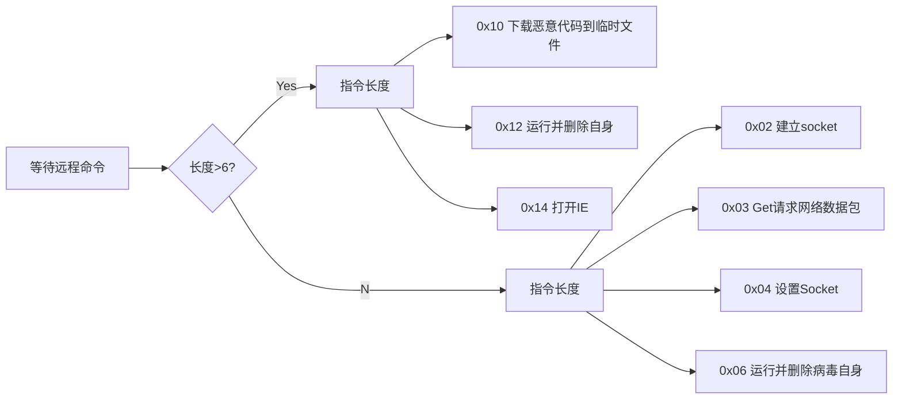

# [分享]记一次lpk劫持病毒分析

## 0x01 信息收集
首先利用哈希工具查看样本的哈希值

将样本上传至Virscan.org分析一下，查看报告


既然如此，我们就可以直接把它先脱壳再分析了：

脱壳之后使用Resource Hacker查看病毒程序，发现再RC数据下有一个PE文件，那么它很有可能会释放文件或者要利用这个文件执行什么操作：

## 0x02 行为分析
将病毒程序拖入火绒剑监控其行为，看看它做了哪些事。
先过滤出行为监控：

然后自我复制，接着把最开始执行的样本文件删除了，所以后面的操作都是最开始样本程序释放出的PE文件执行的。

紧接着就是释放了hra32.dll文件在系统目录下，RCXDB94.tmp文件在根目录下，再就是释放了一堆lpk.dll文件再各个目录下。 而且这些lpk文件都是隐藏的。
与此同时，网络行为主要是TCP连接和发送数据包：

而进程监控到的行为则是不断地创建进程，包括cmd.exe、find.exe、explorer.exe、rar.exe在命令行下完成一些操作，还有打开并写入设备，还有跨进程恢复线程以及退出进程。

再来看看注册表操作：


文件操作则集齐了打开、创建、写入、修改、截断内容、设置属性一系列的操作：


## 0x03 具体分析（恶意代码分析）
### 3.1 主代码分析
首先把样本拖入IDA分析，在它断到了OEP处之后按空格切换到源码界面，再按F5查看伪代码有助于我们分析，这个程序的main函数就映入眼帘了:

剩下几个函数需要点进去分析一波了。
#### 3.1.1 最开始的是sub\_405A52:
这里先是载入了ADVAPI32.dll，这个模块，百度一下说明是跟注册表的操控和事件日志有关，果不其然接着就获得了注册表的句柄，啊然后下面有很多数值，尝试转化成ASCII看能不能解读一下：


将下面的数值全部转化成ASCII码之后发现就是一个注册表的键，将它保存在`Source`中：
`SYSTEM\\CurrentControlSet\\Services\\`


#### 3.1.2 然后我们回到上层函数继续分析Sub\_40561A：

先看看服务回调函数，这个服务有什么功能：
一进来便设置了服务和相关函数


##### sub405394:

这个函数的大致功能就是将文件中的资源读到内存中然后写入进文件：

回到上层函数继续往下看：

##### Sub\_4053A6:


回头总结一下这个函数：

继续往下看：

#### 第一个线程回调 Sub\_402DD5:
一进来就看到一堆用户名和密码的字符串，莫非是弱口令爆破？


##### 关键函数 sub\_402AD0:
我们先确认一下传进来的几个参数
1. int引用型的IP地址
2. int\* 型的用户名
3. LPCSTR型的密码


总结一下，这个函数就是复制文件并执行。
所以第一个线程的作用就是将自己复制并上传到局域网内的主机并执行。
#### 第二个线程回调函数 Sub\_4051E0:

##### sub\_4050DB:
注意这个函数传入参数是一个字符串，所以这个函数就是获取当前本地时间

##### sub\_405128:
接着看这个线程回调函数：

StartAddress:
这是个非常长且复杂的函数


总结一下，这个函数将本机的信息发送除去，并下载文件然后执行cmd命令，然后关闭并删除`Ghijkl Nopqrstu Wxy`服务。这也是第二个线程回调函数的主要功能。
#### 第三个线程回调函数 Sub\_405241:
这个函数的功能和第一个回调差不多，都是将自身代码上传到局域网中并执行。
总结一下这一串函数的功能：

###### tips：字符串解密：
将这里的函数识别出来的代码直接搬运到VS中，再修改一下参数类型微调一下就可以直接使用了：

#### 回到main函数，还有最后一个函数Sub\_405B6E这个函数没有分析：


总结一下：这个函数就是拷贝自身到系统目录，创建并设置服务描述，启动服务最后删除自身。
分析到这里我们可以大致梳理一下逻辑：
首先初始化网络库，然后判断自身服务有没有启动，如果没有就创建并启动自身服务，然后删除自身，启用之后就执行了服务回调函数。那么这个服务干了什么事呢？它先遍历了资源，将hra.dll文件释放到系统目录下，将自身代码当成资源拷贝进hra.dll文件中，然后创建四个线程，一个用于局域网的传播，其它三个用于连接远程服务器，下载命令执行。
那么接下来我们就要看看这个hra.dll又是什么情况了。
### 3.2 dll分析
分析之前，我们可以先利用ResourceHacker工具将资源从文件中提取出来，如图：

然后就可以将它载入IDA开始分析了：

先定位到DllEntryPoint，然后F5查看其伪代码，由于它是一个dll文件，应该是为主程序提供一些函数使用的，这里我们可以从导出表入手，查看其导出表：

这些和系统自带的lpk文件很相似

#### Sub\_100019E6:

##### sub\_100018D3:

###### StartAddress:


回到上册的dllmain中继续往下看，还有一个函数


跟进继续看第一次加载此模块有什么事件：


## 0x04 总结：
该病毒的主运行流程如图所示，当然在这些运行的时候还会创建一些线程去做别的事情，比如通过主机中的共享文件来向局域网传播病毒并远程运行。
```flow
flow
st=>start: 开始
e=>end: 结束
op1=>operation: 运行病毒主代码
op2=>operation: 创建互斥体防多开
op3=>operation: 提取资源中的dll
op4=>operation: 加载dll
op5=>operation: 通过共享文件上传病毒文件并运行
op6=>operation: 远程代码执行
op7=>operation: 远程代码执行
op8=>operation: 远程代码执行
op9=>operation: 遍历文件
op10=>operation: exe目录下释放lpk.dll文件
op11=>operation: rar、zip文件中替换lpk.dll文件
op12=>operation: 生成由6个随机字母组成的exe文件名
op13=>operation: 保存到系统目录
op14=>operation: 创建服务
op15=>operation: 设置有关服务的注册表信息
cond1=>condition: 注册表中是否有病毒服务?
cond2=>condition: 病毒是正在否运行？
cond3=>condition: 病毒文件是否在系统目录下？
st->cond1(yes,left)->op1->op2->op3->op4
op4->cond2(yes)->e
cond2(no)->op9->op10->op11
cond1(no,right)->cond3
cond3(no)->op14->op15
cond3(yes)->op12->op13->op14
```
还有远程接受命令的几个switch…case…也可以总结一下：

## 0x05 扩展：
### 什么是dll劫持
根据Windows资源共享机制，操作系统加载程序首先从应用程序目录中加载模块。这一特性在注册表中也有体现：`HKLM\System\CurrentControlSet\Control\Session Manager\SafeDllSearchMode`，如果为1，搜索的顺序为：应用程序所在目录->系统目录（用GetSystemDirectory获取）->16位系统目录-><a href="elink@bbcK9s2c8@1M7q4)9K6b7g2)9J5c8W2)9J5c8Y4N6%4N6#2)9J5k6i4S2A6j5h3A6U0i4K6u0W2j5$3!0E0i4K6u0r3">Windows</a>目录（用GetWindowsDirectory获取）->运行程序的当前目录->PATH环境变量，如果为0，搜索顺序为：应用程序所在目录->运行程序的当前目录->系统目录（用GetSystemDirectory获取）->16位系统目录-><a href="elink@af3K9s2c8@1M7q4)9K6b7g2)9J5c8W2)9J5c8Y4N6%4N6#2)9J5k6i4S2A6j5h3A6U0i4K6u0W2j5$3!0E0i4K6u0r3">Windows</a>目录（用GetWindowsDirectory获取）->PATH环境变量。<a href="elink@947K9s2c8@1M7q4)9K6b7g2)9J5c8W2)9J5c8Y4N6%4N6#2)9J5k6i4S2A6j5h3A6U0i4K6u0W2j5$3!0E0i4K6u0r3">Windows</a> Server 2003默认值为1，<a href="elink@028K9s2c8@1M7q4)9K6b7g2)9J5c8W2)9J5c8Y4N6%4N6#2)9J5k6i4S2A6j5h3A6U0i4K6u0W2j5$3!0E0i4K6u0r3">Windows</a> XP/2000默认值为0或者没有这个键值。但是不管是哪种情况，第一个搜索的肯定是应用程序的所在目录，这样就有机会让应用程序去加载我们的DLL。如果这个DLL和系统目录下的某个DLL同名，导出表也相同，功能就是加载系统目录下的那个DLL，并且将导出表转发到那个真实的DLL。这时DLL劫持就发生了。可以看出，构造一个符合上面要求的DLL，再将其放在可执行文件的目录即可轻松实现DLL劫持了。
### 如何实现dll劫持
通过编程来实现一个LPK.DLL文件，它与系统目录下的LPK.DLL导出表相同，并能加载系统目录下的LPK.DLL，并且能将导出表转发到真实的LPK.DLL。可以看出我们要实现的这个DLL需求如下：
1. 构造一个与系统目录下LPK.DLL一样的导出表；
2. 加载系统目录下的LPK.DLL；
3. 将导出函数转发到系统目录下的LPK.DLL上；
4. 在初始化函数中加入我们要执行的代码。

## 0x01 信息收集

首先利用哈希工具查看样本的哈希值


将样本上传至Virscan.org分析一下，查看报告


既然如此，我们就可以直接把它先脱壳再分析了：


脱壳之后使用Resource Hacker查看病毒程序，发现再RC数据下有一个PE文件，那么它很有可能会释放文件或者要利用这个文件执行什么操作：


## 0x02 行为分析

将病毒程序拖入火绒剑监控其行为，看看它做了哪些事。

先过滤出行为监控：


然后自我复制，接着把最开始执行的样本文件删除了，所以后面的操作都是最开始样本程序释放出的PE文件执行的。


紧接着就是释放了hra32.dll文件在系统目录下，RCXDB94.tmp文件在根目录下，再就是释放了一堆lpk.dll文件再各个目录下。 而且这些lpk文件都是隐藏的。

与此同时，网络行为主要是TCP连接和发送数据包：


而进程监控到的行为则是不断地创建进程，包括cmd.exe、find.exe、explorer.exe、rar.exe在命令行下完成一些操作，还有打开并写入设备，还有跨进程恢复线程以及退出进程。


再来看看注册表操作：


文件操作则集齐了打开、创建、写入、修改、截断内容、设置属性一系列的操作：


## 0x03 具体分析（恶意代码分析）

### 3.1 主代码分析

首先把样本拖入IDA分析，在它断到了OEP处之后按空格切换到源码界面，再按F5查看伪代码有助于我们分析，这个程序的main函数就映入眼帘了:


剩下几个函数需要点进去分析一波了。

#### 3.1.1 最开始的是sub\_405A52:

这里先是载入了ADVAPI32.dll，这个模块，百度一下说明是跟注册表的操控和事件日志有关，果不其然接着就获得了注册表的句柄，啊然后下面有很多数值，尝试转化成ASCII看能不能解读一下：


将下面的数值全部转化成ASCII码之后发现就是一个注册表的键，将它保存在`Source`中：

`SYSTEM\\CurrentControlSet\\Services\\`


#### 3.1.2 然后我们回到上层函数继续分析Sub\_40561A：


先看看服务回调函数，这个服务有什么功能：

一进来便设置了服务和相关函数


##### sub405394:


这个函数的大致功能就是将文件中的资源读到内存中然后写入进文件：


回到上层函数继续往下看：


##### Sub\_4053A6:


回头总结一下这个函数：


继续往下看：


#### 第一个线程回调 Sub\_402DD5:

一进来就看到一堆用户名和密码的字符串，莫非是弱口令爆破？


##### 关键函数 sub\_402AD0:

我们先确认一下传进来的几个参数

1. int引用型的IP地址
2. int\* 型的用户名
3. LPCSTR型的密码


总结一下，这个函数就是复制文件并执行。

所以第一个线程的作用就是将自己复制并上传到局域网内的主机并执行。

#### 第二个线程回调函数 Sub\_4051E0:


##### sub\_4050DB:

注意这个函数传入参数是一个字符串，所以这个函数就是获取当前本地时间


##### sub\_405128:

接着看这个线程回调函数：


StartAddress:

这是个非常长且复杂的函数


总结一下，这个函数将本机的信息发送除去，并下载文件然后执行cmd命令，然后关闭并删除`Ghijkl Nopqrstu Wxy`服务。这也是第二个线程回调函数的主要功能。

#### 第三个线程回调函数 Sub\_405241:

这个函数的功能和第一个回调差不多，都是将自身代码上传到局域网中并执行。

总结一下这一串函数的功能：


###### tips：字符串解密：

将这里的函数识别出来的代码直接搬运到VS中，再修改一下参数类型微调一下就可以直接使用了：


#### 回到main函数，还有最后一个函数Sub\_405B6E这个函数没有分析：


总结一下：这个函数就是拷贝自身到系统目录，创建并设置服务描述，启动服务最后删除自身。

分析到这里我们可以大致梳理一下逻辑：

首先初始化网络库，然后判断自身服务有没有启动，如果没有就创建并启动自身服务，然后删除自身，启用之后就执行了服务回调函数。那么这个服务干了什么事呢？它先遍历了资源，将hra.dll文件释放到系统目录下，将自身代码当成资源拷贝进hra.dll文件中，然后创建四个线程，一个用于局域网的传播，其它三个用于连接远程服务器，下载命令执行。

那么接下来我们就要看看这个hra.dll又是什么情况了。

### 3.2 dll分析

分析之前，我们可以先利用ResourceHacker工具将资源从文件中提取出来，如图：


然后就可以将它载入IDA开始分析了：


先定位到DllEntryPoint，然后F5查看其伪代码，由于它是一个dll文件，应该是为主程序提供一些函数使用的，这里我们可以从导出表入手，查看其导出表：


这些和系统自带的lpk文件很相似


#### Sub\_100019E6:


##### sub\_100018D3:


###### StartAddress:


回到上册的dllmain中继续往下看，还有一个函数


跟进继续看第一次加载此模块有什么事件：


## 0x04 总结：

该病毒的主运行流程如图所示，当然在这些运行的时候还会创建一些线程去做别的事情，比如通过主机中的共享文件来向局域网传播病毒并远程运行。

|  |  |
| --- | --- |
| 1  2  3  4  5  6  7  8  9  10  11  12  13  14  15  16  17  18  19  20  21  22  23  24  25  26  27  28  29 | `flow`  `st``=``>start: 开始`  `e``=``>end: 结束`  `op1``=``>operation: 运行病毒主代码`  `op2``=``>operation: 创建互斥体防多开`  `op3``=``>operation: 提取资源中的dll`  `op4``=``>operation: 加载dll`  `op5``=``>operation: 通过共享文件上传病毒文件并运行`  `op6``=``>operation: 远程代码执行`  `op7``=``>operation: 远程代码执行`  `op8``=``>operation: 远程代码执行`  `op9``=``>operation: 遍历文件`  `op10``=``>operation: exe目录下释放lpk.dll文件`  `op11``=``>operation: rar、``zip``文件中替换lpk.dll文件`  `op12``=``>operation: 生成由``6``个随机字母组成的exe文件名`  `op13``=``>operation: 保存到系统目录`  `op14``=``>operation: 创建服务`  `op15``=``>operation: 设置有关服务的注册表信息`    `cond1``=``>condition: 注册表中是否有病毒服务?`  `cond2``=``>condition: 病毒是正在否运行？`  `cond3``=``>condition: 病毒文件是否在系统目录下？`    `st``-``>cond1(yes,left)``-``>op1``-``>op2``-``>op3``-``>op4`  `op4``-``>cond2(yes)``-``>e`  `cond2(no)``-``>op9``-``>op10``-``>op11`  `cond1(no,right)``-``>cond3`  `cond3(no)``-``>op14``-``>op15`  `cond3(yes)``-``>op12``-``>op13``-``>op14` |

还有远程接受命令的几个switch…case…也可以总结一下：

|  |  |
| --- | --- |
| 1  2  3  4  5  6  7  8  9  10  11 | `graph LR`  `A[等待远程命令]``-``-``>B{长度>``6``?};`  `B` `-``-``Yes``-``-``>C[指令长度];`  `C` `-``-``>D[``0x10` `下载恶意代码到临时文件];`  `C` `-``-``>E[``0x12` `运行并删除自身];`  `C` `-``-``>F[``0x14` `打开IE];`  `B` `-``-``No``-``-``>G[指令长度];`  `G` `-``-``>H[``0x02` `建立socket];`  `G` `-``-``>I[``0x03` `Get请求网络数据包];`  `G` `-``-``>J[``0x04` `设置Socket];`  `G` `-``-``>K[``0x06` `运行并删除病毒自身];` |

## 0x05 扩展：

### 什么是dll劫持

根据Windows资源共享机制，操作系统加载程序首先从应用程序目录中加载模块。这一特性在注册表中也有体现：`HKLM\System\CurrentControlSet\Control\Session Manager\SafeDllSearchMode`，如果为1，搜索的顺序为：应用程序所在目录->系统目录（用GetSystemDirectory获取）->16位系统目录->[Windows](https://bbs.kanxue.com/elink@2fbK9s2c8@1M7q4)9K6b7g2)9J5c8W2)9J5c8Y4N6%4N6#2)9J5k6i4S2A6j5h3A6U0i4K6u0W2j5$3!0E0i4K6u0r3)目录（用GetWindowsDirectory获取）->运行程序的当前目录->PATH环境变量，如果为0，搜索顺序为：应用程序所在目录->运行程序的当前目录->系统目录（用GetSystemDirectory获取）->16位系统目录->[Windows](https://bbs.kanxue.com/elink@266K9s2c8@1M7q4)9K6b7g2)9J5c8W2)9J5c8Y4N6%4N6#2)9J5k6i4S2A6j5h3A6U0i4K6u0W2j5$3!0E0i4K6u0r3)目录（用GetWindowsDirectory获取）->PATH环境变量。[Windows](https://bbs.kanxue.com/elink@519K9s2c8@1M7q4)9K6b7g2)9J5c8W2)9J5c8Y4N6%4N6#2)9J5k6i4S2A6j5h3A6U0i4K6u0W2j5$3!0E0i4K6u0r3) Server 2003默认值为1，[Windows](https://bbs.kanxue.com/elink@0d6K9s2c8@1M7q4)9K6b7g2)9J5c8W2)9J5c8Y4N6%4N6#2)9J5k6i4S2A6j5h3A6U0i4K6u0W2j5$3!0E0i4K6u0r3) XP/2000默认值为0或者没有这个键值。但是不管是哪种情况，第一个搜索的肯定是应用程序的所在目录，这样就有机会让应用程序去加载我们的DLL。如果这个DLL和系统目录下的某个DLL同名，导出表也相同，功能就是加载系统目录下的那个DLL，并且将导出表转发到那个真实的DLL。这时DLL劫持就发生了。可以看出，构造一个符合上面要求的DLL，再将其放在可执行文件的目录即可轻松实现DLL劫持了。

### 如何实现dll劫持

通过编程来实现一个LPK.DLL文件，它与系统目录下的LPK.DLL导出表相同，并能加载系统目录下的LPK.DLL，并且能将导出表转发到真实的LPK.DLL。可以看出我们要实现的这个DLL需求如下：

1. 构造一个与系统目录下LPK.DLL一样的导出表；
2. 加载系统目录下的LPK.DLL；
3. 将导出函数转发到系统目录下的LPK.DLL上；
4. 在初始化函数中加入我们要执行的代码。


[传递专业知识、拓宽行业人脉——看雪讲师团队等你加入！！](https://bbs.kanxue.com/thread-275828.htm)

最后于  2022-1-4 15:27
被JokerMss编辑
，原因： 增加内容分析

[#调试逆向](https://bbs.kanxue.com/forum-4-1-1.htm)
[#病毒木马](https://bbs.kanxue.com/forum-4-1-6.htm)
