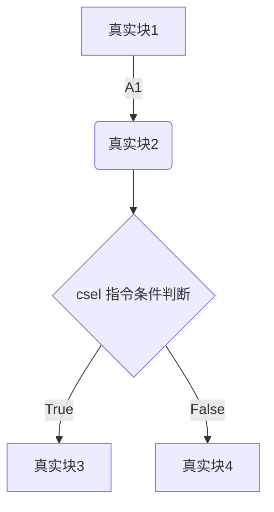

# [原创]ARM64 OLLVM反混淆

# 基于Unicorn 的ARM64 OLLVM反混淆
## 0x0
最近在研究娜迦加固，娜迦加固的SO文件被ollvm混淆，转而研究ollvm反混淆。网上的很多关于ollvm反混淆的资料都基于符号执行。符号执行主要用框架是Miasm和Angr。Miasm和Angr对arm64指令集支持都不是很好，于是采用模拟执行的方式来寻找两个真实块的关系。\*\*本文仅提供大体思路，如果有更好的方法欢迎一起讨论，细节优化还要根据具体情况分析\*\*
我把ollvm混淆后的代码块分为两类：虚假块和真实块。虚假块仅包含ollvm流程控制指令，不含任何真实指令。只要含有真实指令的代码块就是真实块。
反ollvm混淆的关键是找出两个真实块之间的关系。
两个真实块之间的关系有两种：1、顺序；2、分支

使用符号执行、模拟执行找出真实块之间的关系之后，patch相应的跳转即可实现反混淆。
## 0x1 反汇编、代码块、CFG分析
要获得目标函数的代码块和CFG，首先要反汇编。反汇编使用Capstone 反汇编引擎。
```python
offset = 0x70438 #function start
end = 0x7170C #function end
bin1 = open('libvdog.so','rb').read()
md = Cs(CS\_ARCH\_ARM64,CS\_MODE\_ARM)
md.detail = True #enable detail analyise
list\_blocks = {}
block\_item = {}
processors = {}
dead\_loop = []
real\_blocks = []
csel\_list\_cond = {}
isNew = True
insStr = ''
for i in md.disasm(bin1[offset:end],offset):
insStr += "0x%x:\t%s\t%s\n" %(i.address, i.mnemonic, i.op\_str)
if isNew:
isNew = False
block\_item = {}
block\_item["saddress"] = i.address
block\_item['capstone'] = []
block\_item['capstone'].append(i)
block\_item['flag'] = False
if len(i.groups) > 0 or i.mnemonic == 'ret':
isNew = True
block\_item["eaddress"] = i.address
block\_item['ins'] = insStr
insStr = ''
for op in i.operands:
if op.type == ARM64\_OP\_IMM:
block\_item["naddress"] = op.value.imm
if op.value.imm == i.address:
print "dead loop:%x" % i.address
dead\_loop.append(i.address)
if not processors.has\_key(op.value.imm):
processors[op.value.imm] = 1
else:
processors[op.value.imm] += 1
if not block\_item.has\_key("naddress"):
block\_item['naddress'] = None
list\_blocks[block\_item["saddress"]] = block\_item
#delete dead loop
for dead in dead\_loop:
if processors.has\_key(dead):
del(processors[dead])
```
娜迦的样本中存在死循环路径，必须删掉。
## 0x2 识别真实块
真实块结束后会重新跳转入ollvm分发流程的代码块，该代码块一定有很多引用，所以反汇编代码块的时候记录后继节点的引用数目（见前一段代码）
```python
if not processors.has\_key(op.value.imm):
processors[op.value.imm] = 1
else:
processors[op.value.imm] += 1
```
反汇编和代码块识别完成后，如果某个代码块的引用大于1，就可能是分发器，引用该分发器的代码块就可能为真实块,筛选代码如下：
```python
for b in list\_blocks:
if processors.has\_key(list\_blocks[b]['naddress']):
if processors[list\_blocks[b]['naddress']] > 1:
real\_blocks.append(list\_blocks[b]['saddress'])
```
真实情况下，虚假代码块也会引用分发器，所以还要进一步筛选。
```python
ssign = {u'b2',
u'cmp11b.ne2',
u'cmp11mov11b.ne2',
u'movz12movk12b2',
u'movz12movk12cmp11b.ne2',
u'movz12movk12cmp11mov11b.ne2',
'movz12movk12cmp11mov11movz12movk12movz12movk12b.ne2',
u'movz12movk12cmp11movz12movk12b.eq2',
'movz12movk12cmp11movz12movk12b.ne2',
'movz12movk12movz12movk12b2',
'movz12movk12cmp11movz12movk12movz12movk12movz12movk12b.eq2',
'movz12movk12movz12movk12cmp11b.eq2',
'movz12movk12movz12movk12cmp11movz12movk12b.eq2',
'movz12movk12cmp11b.eq2',
'ldr13b2',
'mov11movz12movk12cmp11movz12movk12b.eq2'
}
ssign2 = set()
def is\_real\_blocks(ins):
sign = get\_code\_sign(ins)
if sign in ssign:
return False
if sign.endswith('movk12movz12movk12b.ne2'):
return False
for insn in item['capstone']:
#print insn.mnemonic
if insn.mnemonic not in ['movz','movk','cmp','b.eq','b.ne']:
return True
ssign2.add(sign)
return False
fake\_blocks = []
for i in real\_blocks:
item = list\_blocks[i]
if not is\_real\_blocks(item):
print '## fake block ###'
print item['ins']
fake\_blocks.append(i)
```
采用特征码的方法识别ollvm的虚假块。采用的特征码与寄存器、常量无关，只与指令类型、操作数类型有关。计算一个代码块的特征后进行匹配即可筛掉大量虚假代码块。
如果虚假块没有识别出来，那么可能导致后文的死循环，也是一种筛选思路。
按照定义，含有ret的代码块也属于真实块，但是前文真实块的识别基于引用 大量代码块的共同引用代码块，ret指令显然不会引用任何代码块，故单独处理。
```python
for i in list\_blocks:
if list\_blocks[i]['ins'].find('ret') != -1:
print 'ret block:%x' % i
real\_blocks.append(i)
```
## 使用 Unicorn 模拟执行
### 初始化虚拟机
关于Unicorn的教程请自行Google，这里仅讨论Unicorn在寻找路径方面的应用。
```python
mu = Uc(UC\_ARCH\_ARM64, UC\_MODE\_ARM)
#init stack
mu.mem\_map(0x80000000,0x10000 \* 8)
mu.mem\_map(0, 4 \* 1024 \* 1024)
mu.mem\_write(0,bin1)
mu.reg\_write(UC\_ARM64\_REG\_SP, 0x80000000 + 0x10000 \* 6)
mu.hook\_add(UC\_HOOK\_CODE, hook\_code)
mu.hook\_add(UC\_HOOK\_MEM\_UNMAPPED,hook\_mem\_access)
```
Unicorn 基于qemu的模拟，所以必须给代码提供可运行的环境。最大的问题就是要关心内存处理。
我们只想得到ollvm路径，而不是真实代码块的运行结果，因此要尽可能屏蔽非ollvm的内存操作。具体屏蔽方法稍后介绍。上面这段代码初始化Unicorn的虚拟CPU，并映射程序代码内存以及栈空间，最后调用hook\_add设置UC\_HOOK\_CODE和UC\_HOOK\_MEM\_UNMAPPED的事件回调。UC\_HOOK\_CODE回调会在每条指令执行前被调用，UC\_HOOK\_MEM\_UNMAPPED会在内存异常的时候调用。
### 启动虚拟机
启动虚拟机的函数叫find\_path，顾名思义，用于寻找真实块的下一个代码块。branch为分支控制。
如果branch = 1，则虚拟机在遇到csel指令的时候会走csel条件分支，否则走csel条件相反的分支。至于如何控制虚拟机内部指令的执行，稍后介绍。
```python
def find\_path(start\_addr,branch = None):
global real\_blocks
global bin1
global mu
global list\_trace
global startaddr
global distAddr
global isSucess
global branch\_control
try:
list\_trace = {}
startaddr = start\_addr
isSucess = False
distAddr = 0
branch\_control = branch
mu.emu\_start(start\_addr,0x10000)
print "emu end.."
except UcError as e:
pc = mu.reg\_read(UC\_ARM64\_REG\_PC)
if pc != 0:
#mu.reg\_write(UC\_ARM64\_REG\_PC, pc + 4)
return find\_path(pc + 4,branch)
else:
print("ERROR: %s pc:%x" % (e,pc))
if isSucess:
return distAddr
return None
```
### 控制流集成
使用队列的方式来路径搜索，起始搜索从函数入口开始。函数入口根据offset变量指定。
queue中的元素是一个二元组，第一项为执行地址，第二项为寄存器环境。每次搜索开始的时候从queue中获取一个将要搜索的真实块，设置寄存器，调用find\_path搜索下一个真实块，将搜索到的真实块与新寄存器放入队列（保证上下文完整）使用这样做的好处就是可以搜索任意队列中的代码块，并且寄存器环境一定是和该代码块一致的。
```python
queue = [(offset,None)]
flow = {}
while len(queue) != 0:
env = queue.pop()
pc = env[0]
set\_context(env[1])
item = list\_blocks[pc]
if pc in flow:
#print "???"
continue
flow[pc] = []
if item['ins'].find('csel') != -1:
#raw\_input()
ctx = get\_context()
p1 = find\_path(pc,0)
if p1 != None:
queue.append((p1,get\_context()))
flow[pc].append(p1)
set\_context(ctx)
p2 = find\_path(pc,1)
if p1 == p2:
p2 = None
if p2 != None:
queue.append((p2,get\_context()))
flow[pc].append(p2)
else:
p = find\_path(pc)
if p != None:
queue.append((p,get\_context()))
flow[pc].append(p)
```
### 虚拟机的内部核心 hook\_code
Unicorn在每一条汇编代码执行前会调用UC\_HOOK\_CODE回调，通过该回调可以控制虚拟机的一些行为。
这一节的代码均属于hook\_code
跳过一条指令,直接修改PC寄存器的值为下一条指令的地址：
```python
uc.reg\_write(UC\_ARM64\_REG\_PC, address + size)
```
路径探索，需要禁用掉一切函数调用、非栈空间内存访问，0x80000000为前面代码中提到的栈地址，当虚拟机指令有内存操作需求时，判断目标内存地址范围是否在栈中，如果不在栈中则跳过该指令。
禁用的指令有bl、blx，只要识别bl前缀即可。
```python
flag\_pass = False
ban\_ins = 'bl'
for b in ban\_ins:
if ins.mnemonic.find(b) != -1:
flag\_pass = True
break
if ins.op\_str.find('[') != -1:
if ins.op\_str.find('[sp') == -1:
flag\_pass = True
for op in ins.operands:
if op.type == ARM64\_OP\_MEM:
addr = 0
if op.value.mem.base != 0:
addr += mu.reg\_read(reg\_ctou(ins.reg\_name(op.value.mem.base)))
elif op.value.index != 0:
addr += mu.reg\_read(reg\_ctou(ins.reg\_name(op.value.mem.index)))
elif op.value.disp != 0:
addr += op.value.disp
if addr >= 0x80000000 and addr < 0x80000000 + 0x10000 \* 8:
flag\_pass = False
if flag\_pass:
print("will pass 0x%x:\t%s\t%s" %(ins.address, ins.mnemonic, ins.op\_str))
uc.reg\_write(UC\_ARM64\_REG\_PC, address + size)
return
```
寻找到下一个真实块的处理
```python
if address in real\_blocks and address != startaddr:
isSucess = True
distAddr = address
print 'find:%x' % address
uc.emu\_stop()
return
```
调试机制。
为了方便调试，我设计了一个简单的调试机制 在[ ]添加断点地址即可断点，! + 寄存器即可查看寄存器的值。
```
if address in [ ] or debugflag:
debugflag = True
print("0x%x:\t%s\t%s" % (ins.address, ins.mnemonic, ins.op\_str))
while True:
c = raw\_input('>')
if c == '':
break
if c == 's':
uc.emu\_stop()
return
if c == 'r':
debugflag = False
break
if c[0] == '!':
reg = reg\_ctou(c[1:])
print "%s=%x (%d)" % (c[1:], mu.reg\_read(reg),mu.reg\_read(reg))
continue
```
含有branch的真实块处理。人工交换csel指令的值来实现分支。
```python
if ins.mnemonic == 'csel':#ollvm branch
print("csel 0x%x:\t%s\t%s" %(ins.address, ins.mnemonic, ins.op\_str))
regs = [reg\_ctou(x) for x in ins.op\_str.split(', ')]
assert len(regs) == 4
v1 = uc.reg\_read(regs[1])
v2 = uc.reg\_read(regs[2])
if branch\_control == 1:
uc.reg\_write(regs[0],v1)
else:
uc.reg\_write(regs[0],v2)
uc.reg\_write(UC\_ARM64\_REG\_PC, address + size)
```
```python
def hook\_code(uc, address, size, user\_data):
global real\_blocks
global csel\_addrs
global list\_trace
global startaddr
global debugflag
global isSucess
global distAddr
global branch\_control
global list\_blocks
ban\_ins = ["bl"]
if isSucess:
mu.emu\_stop()
#raw\_input()
return
if address > end:
uc.emu\_stop()
return
for ins in md.disasm(bin1[address:address+size],address):
print(">>> Tracing instruction at 0x%x, instruction size = 0x%x" % (address, size))
print(">>> 0x%x:\t%s\t%s" % (ins.address, ins.mnemonic, ins.op\_str))
print
if address in real\_blocks:
if list\_trace.has\_key(address):
print "sssssss"
ch = raw\_input("This maybe a fake block. codesign:%s " % get\_code\_sign(list\_blocks[address]))
uc.emu\_stop()
else:
list\_trace[address] = 1
if address in real\_blocks and address != startaddr:
isSucess = True
distAddr = address
print 'find:%x' % address
# uc.reg\_write(UC\_ARM64\_REG\_PC,0xffffffff)
uc.emu\_stop()
return
flag\_pass = False
for b in ban\_ins:
if ins.mnemonic.find(b) != -1:
flag\_pass = True
break
if ins.op\_str.find('[') != -1:
if ins.op\_str.find('[sp') == -1:
flag\_pass = True
for op in ins.operands:
if op.type == ARM64\_OP\_MEM:
addr = 0
if op.value.mem.base != 0:
addr += mu.reg\_read(reg\_ctou(ins.reg\_name(op.value.mem.base)))
elif op.value.index != 0:
addr += mu.reg\_read(reg\_ctou(ins.reg\_name(op.value.mem.index)))
elif op.value.disp != 0:
addr += op.value.disp
if addr >= 0x80000000 and addr < 0x80000000 + 0x10000 \* 8:
flag\_pass = False
if flag\_pass:
print("will pass 0x%x:\t%s\t%s" %(ins.address, ins.mnemonic, ins.op\_str))
uc.reg\_write(UC\_ARM64\_REG\_PC, address + size)
return
#breaks 0x31300
if address in [ 0xB72EC ] or debugflag:
debugflag = True
print("0x%x:\t%s\t%s" % (ins.address, ins.mnemonic, ins.op\_str))
while True:
c = raw\_input('>')
if c == '':
break
if c == 's':
uc.emu\_stop()
return
if c == 'r':
debugflag = False
break
if c[0] == '!':
reg = reg\_ctou(c[1:])
print "%s=%x (%d)" % (c[1:], mu.reg\_read(reg),mu.reg\_read(reg))
continue
if ins.mnemonic == 'ret':
uc.reg\_write(UC\_ARM64\_REG\_PC, 0)
isSucess = False
print "ret ins.."
mu.emu\_stop()
if ins.mnemonic == 'csel':#ollvm branch
print("csel 0x%x:\t%s\t%s" %(ins.address, ins.mnemonic, ins.op\_str))
regs = [reg\_ctou(x) for x in ins.op\_str.split(', ')]
assert len(regs) == 4
v1 = uc.reg\_read(regs[1])
v2 = uc.reg\_read(regs[2])
if branch\_control == 1:
uc.reg\_write(regs[0],v1)
else:
uc.reg\_write(regs[0],v2)
uc.reg\_write(UC\_ARM64\_REG\_PC, address + size)
```
## 绘制流程图
使用graphviz库绘制流程图。
```PYTHON
def draw():
queue = []
dot = Digraph(comment='The Round Table')
dot.attr('node', shape='box')
queue.append(offset)
check = {}
while len(queue) > 0:
pc = queue.pop()
if check.has\_key(pc):
continue
check[pc] = 1
dot.node(hex(pc),list\_blocks[pc]['ins'])
for i in flow[pc]:
if i != None:
dot.edge(hex(pc), hex(i), constraint='true')
queue.append(i)
dot.render('test-output/round-table.gv', view=True)
```
比较完整的代码
```python
from capstone import \*
from capstone.arm64 import \*
from graphviz import Digraph
from unicorn import \*
from unicorn.arm64\_const import \*
from keystone import \*
def reg\_ctou(regname):#
# This function covert capstone reg name to unicorn reg const.
type1 = regname[0]
if type1 == 'w' or type1 =='x':
idx = int(regname[1:])
if type1 == 'w':
return idx + UC\_ARM64\_REG\_W0
else:
if idx == 29:
return 1
elif idx == 30:
return 2
else:
return idx + UC\_ARM64\_REG\_X0
elif regname=='sp':
return 4
return None
def asm\_no\_branch(ori,dist):
ks = Ks(KS\_ARCH\_ARM64, KS\_MODE\_LITTLE\_ENDIAN)
print ("b #0x%x" % dist)
ins, count = ks.asm(("b #0x%x" % dist),ori)
return ins
def asm\_has\_branch(ori,dist1,dist2,cond):
ks = Ks(KS\_ARCH\_ARM64, KS\_MODE\_LITTLE\_ENDIAN)
if ori == 0xb73b4:
pass
print "b%s #0x%x;b #0x%x" % (cond,dist1,dist2)
ins, count = ks.asm("b%s #0x%x;b #0x%x" % (cond,dist1,dist2),ori)
return ins
def hook\_code(uc, address, size, user\_data):
global real\_blocks
global csel\_addrs
global list\_trace
global startaddr
global debugflag
global isSucess
global distAddr
global branch\_control
global list\_blocks
ban\_ins = ["bl"]
if isSucess:
mu.emu\_stop()
#raw\_input()
return
if address > end:
uc.emu\_stop()
return
for ins in md.disasm(bin1[address:address+size],address):
print(">>> Tracing instruction at 0x%x, instruction size = 0x%x" % (address, size))
print(">>> 0x%x:\t%s\t%s" % (ins.address, ins.mnemonic, ins.op\_str))
print
if address in real\_blocks:
if list\_trace.has\_key(address):
print "sssssss"
ch = raw\_input("This maybe a fake block. codesign:%s " % get\_code\_sign(list\_blocks[address]))
uc.emu\_stop()
else:
list\_trace[address] = 1
if address in real\_blocks and address != startaddr:
isSucess = True
distAddr = address
print 'find:%x' % address
uc.emu\_stop()
return
flag\_pass = False
for b in ban\_ins:
if ins.mnemonic.find(b) != -1:
flag\_pass = True
break
if ins.op\_str.find('[') != -1:
if ins.op\_str.find('[sp') == -1:
flag\_pass = True
for op in ins.operands:
if op.type == ARM64\_OP\_MEM:
addr = 0
if op.value.mem.base != 0:
addr += mu.reg\_read(reg\_ctou(ins.reg\_name(op.value.mem.base)))
elif op.value.index != 0:
addr += mu.reg\_read(reg\_ctou(ins.reg\_name(op.value.mem.index)))
elif op.value.disp != 0:
addr += op.value.disp
if addr >= 0x80000000 and addr < 0x80000000 + 0x10000 \* 8:
flag\_pass = False
if flag\_pass:
print("will pass 0x%x:\t%s\t%s" %(ins.address, ins.mnemonic, ins.op\_str))
uc.reg\_write(UC\_ARM64\_REG\_PC, address + size)
return
#breaks 0x31300
if address in [ 0xB72EC ] or debugflag:
debugflag = True
print("0x%x:\t%s\t%s" % (ins.address, ins.mnemonic, ins.op\_str))
while True:
c = raw\_input('>')
if c == '':
break
if c == 's':
uc.emu\_stop()
return
if c == 'r':
debugflag = False
break
if c[0] == '!':
reg = reg\_ctou(c[1:])
print "%s=%x (%d)" % (c[1:], mu.reg\_read(reg),mu.reg\_read(reg))
continue
if ins.mnemonic == 'ret':
uc.reg\_write(UC\_ARM64\_REG\_PC, 0)
isSucess = False
print "ret ins.."
mu.emu\_stop()
if ins.mnemonic == 'csel':#ollvm branch
print("csel 0x%x:\t%s\t%s" %(ins.address, ins.mnemonic, ins.op\_str))
regs = [reg\_ctou(x) for x in ins.op\_str.split(', ')]
assert len(regs) == 4
v1 = uc.reg\_read(regs[1])
v2 = uc.reg\_read(regs[2])
if branch\_control == 1:
uc.reg\_write(regs[0],v1)
else:
uc.reg\_write(regs[0],v2)
uc.reg\_write(UC\_ARM64\_REG\_PC, address + size)
def hook\_mem\_access(uc,type,address,size,value,userdata):
pc = uc.reg\_read(UC\_ARM64\_REG\_PC)
print 'pc:%x type:%d addr:%x size:%x' % (pc,type,address,size)
#uc.emu\_stop()
return False
def get\_code\_sign(block):
insn = block['capstone']
sign = ''
for i in insn:
sign += i.mnemonic
for op in i.operands:
sign += str(op.type)
return sign
def get\_context():
global mu
regs = []
for i in range(31):
idx = UC\_ARM64\_REG\_X0 + i
regs.append(mu.reg\_read(idx))
regs.append(mu.reg\_read(UC\_ARM64\_REG\_SP))
return regs
def set\_context(regs):
global mu
if regs == None:
return
for i in range(31):
idx = UC\_ARM64\_REG\_X0 + i
mu.reg\_write(idx,regs[i])
mu.reg\_write(UC\_ARM64\_REG\_SP,regs[31])
def find\_path(start\_addr,branch = None):
global real\_blocks
global bin1
global mu
global list\_trace
global startaddr
global distAddr
global isSucess
global branch\_control
try:
list\_trace = {}
startaddr = start\_addr
isSucess = False
distAddr = 0
branch\_control = branch
mu.emu\_start(start\_addr,0x10000)
print "emu end.."
except UcError as e:
pc = mu.reg\_read(UC\_ARM64\_REG\_PC)
if pc != 0:
#mu.reg\_write(UC\_ARM64\_REG\_PC, pc + 4)
return find\_path(pc + 4,branch)
else:
print("ERROR: %s pc:%x" % (e,pc))
if isSucess:
return distAddr
return None
ssign = {u'b2',
u'cmp11b.ne2',
u'cmp11mov11b.ne2',
u'movz12movk12b2',
u'movz12movk12cmp11b.ne2',
u'movz12movk12cmp11mov11b.ne2',
'movz12movk12cmp11mov11movz12movk12movz12movk12b.ne2',
u'movz12movk12cmp11movz12movk12b.eq2',
'movz12movk12cmp11movz12movk12b.ne2',
'movz12movk12movz12movk12b2',
'movz12movk12cmp11movz12movk12movz12movk12movz12movk12b.eq2',
'movz12movk12movz12movk12cmp11b.eq2',
'movz12movk12movz12movk12cmp11movz12movk12b.eq2',
'movz12movk12cmp11b.eq2',
'ldr13b2',
'mov11movz12movk12cmp11movz12movk12b.eq2'
}
ssign2 = set()
def is\_real\_blocks(ins):
sign = get\_code\_sign(ins)
if sign in ssign:
return False
if sign.endswith('movk12movz12movk12b.ne2'):
return False
for insn in item['capstone']:
#print insn.mnemonic
if insn.mnemonic not in ['movz','movk','cmp','b.eq','b.ne']:
return True
ssign2.add(sign)
return False
def draw():
queue = []
dot = Digraph(comment='The Round Table')
dot.attr('node', shape='box')
queue.append(offset)
check = {}
while len(queue) > 0:
pc = queue.pop()
if check.has\_key(pc):
continue
check[pc] = 1
dot.node(hex(pc),list\_blocks[pc]['ins'])
for i in flow[pc]:
if i != None:
dot.edge(hex(pc), hex(i), constraint='true')
queue.append(i)
dot.render('test-output/round-table.gv', view=True)
def print\_real\_blocks():
print '######################### real blocks ###########################'
cnt = 0
for i in real\_blocks:
item = list\_blocks[i]
print item['ins']
print
if cnt == 50:
c = raw\_input()
if c == 'c':
return
cnt += 1
offset = 0x70438 #function start
end = 0x7170C #function end
bin1 = open('libvdog.so','rb').read()
md = Cs(CS\_ARCH\_ARM64,CS\_MODE\_ARM)
md.detail = True #enable detail analyise
list\_blocks = {}
block\_item = {}
processors = {}
dead\_loop = []
real\_blocks = []
csel\_list\_cond = {}
isNew = True
insStr = ''
for i in md.disasm(bin1[offset:end],offset):
insStr += "0x%x:\t%s\t%s\n" %(i.address, i.mnemonic, i.op\_str)
if isNew:
isNew = False
block\_item = {}
block\_item["saddress"] = i.address
block\_item['capstone'] = []
block\_item['capstone'].append(i)
block\_item['flag'] = False
if len(i.groups) > 0 or i.mnemonic == 'ret':
isNew = True
block\_item["eaddress"] = i.address
block\_item['ins'] = insStr
insStr = ''
for op in i.operands:
if op.type == ARM64\_OP\_IMM:
block\_item["naddress"] = op.value.imm
if op.value.imm == i.address:
print "dead loop:%x" % i.address
dead\_loop.append(i.address)
if not processors.has\_key(op.value.imm):
processors[op.value.imm] = 1
else:
processors[op.value.imm] += 1
if not block\_item.has\_key("naddress"):
block\_item['naddress'] = None
list\_blocks[block\_item["saddress"]] = block\_item
#delete dead loop
for dead in dead\_loop:
if processors.has\_key(dead):
del(processors[dead])
for b in list\_blocks:
if processors.has\_key(list\_blocks[b]['naddress']):
if processors[list\_blocks[b]['naddress']] > 1:
real\_blocks.append(list\_blocks[b]['saddress'])
fake\_blocks = []
for i in real\_blocks:
item = list\_blocks[i]
if not is\_real\_blocks(item):
print '## fake block ###'
print item['ins']
fake\_blocks.append(i)
for x in fake\_blocks:
real\_blocks.remove(x)
for i in list\_blocks:
if list\_blocks[i]['ins'].find('ret') != -1:
print 'ret block:%x' % i
real\_blocks.append(i)
print '######################### real blocks ###########################'
print [hex(x) for x in real\_blocks]
mu = Uc(UC\_ARCH\_ARM64, UC\_MODE\_ARM)
#init stack
mu.mem\_map(0x80000000,0x10000 \* 8)
mu.mem\_map(0, 4 \* 1024 \* 1024)
mu.mem\_write(0,bin1)
mu.reg\_write(UC\_ARM64\_REG\_SP, 0x80000000 + 0x10000 \* 6)
mu.hook\_add(UC\_HOOK\_CODE, hook\_code)
mu.hook\_add(UC\_HOOK\_MEM\_UNMAPPED,hook\_mem\_access)
list\_trace = {}
debugflag = False
if offset in real\_blocks:
real\_blocks.remove(offset)
queue = [(offset,None)]
flow = {}
while len(queue) != 0:
env = queue.pop()
pc = env[0]
set\_context(env[1])
item = list\_blocks[pc]
if pc in flow:
#print "???"
continue
flow[pc] = []
if item['ins'].find('csel') != -1:
#raw\_input()
ctx = get\_context()
p1 = find\_path(pc,0)
if p1 != None:
queue.append((p1,get\_context()))
flow[pc].append(p1)
set\_context(ctx)
p2 = find\_path(pc,1)
if p1 == p2:
p2 = None
if p2 != None:
queue.append((p2,get\_context()))
flow[pc].append(p2)
else:
p = find\_path(pc)
if p != None:
queue.append((p,get\_context()))
flow[pc].append(p)
draw()
```
## 一些效果图


# 修复后

## 最后
还原patch的代码已经被我阉割，因为不是很完善，我仅提供一个非符号执行的思路供大家研究。
完整代码见附件，代码反混淆的目标是JNI\_OnLoad，可以自己修改offset和end来修改目标。输出文件为bin.out。
今年高考没考好，过几天就去复读了，没有太多时间搞这个了。
欢迎讨论 + 提供ARM64的样本。

# 基于Unicorn 的ARM64 OLLVM反混淆

## 0x0

最近在研究娜迦加固，娜迦加固的SO文件被ollvm混淆，转而研究ollvm反混淆。网上的很多关于ollvm反混淆的资料都基于符号执行。符号执行主要用框架是Miasm和Angr。Miasm和Angr对arm64指令集支持都不是很好，于是采用模拟执行的方式来寻找两个真实块的关系。**本文仅提供大体思路，如果有更好的方法欢迎一起讨论，细节优化还要根据具体情况分析**

我把ollvm混淆后的代码块分为两类：虚假块和真实块。虚假块仅包含ollvm流程控制指令，不含任何真实指令。只要含有真实指令的代码块就是真实块。

反ollvm混淆的关键是找出两个真实块之间的关系。

两个真实块之间的关系有两种：1、顺序；2、分支

```
graph TD
A[真实块1] -->|A1| B(真实块2)
B --> C{csel 指令条件判断}
C -->|True| E[真实块3]
C -->|False| F[真实块4]
```

使用符号执行、模拟执行找出真实块之间的关系之后，patch相应的跳转即可实现反混淆。

## 0x1 反汇编、代码块、CFG分析

要获得目标函数的代码块和CFG，首先要反汇编。反汇编使用Capstone 反汇编引擎。

```
offset = 0x70438 #function start
end = 0x7170C    #function end

bin1 = open('libvdog.so','rb').read()
md = Cs(CS_ARCH_ARM64,CS_MODE_ARM)
md.detail = True #enable detail analyise

list_blocks = {}
block_item = {}
processors = {}
dead_loop = []
real_blocks = []
csel_list_cond = {}


isNew = True
insStr = ''
for i in md.disasm(bin1[offset:end],offset):
    insStr += "0x%x:\t%s\t%s\n" %(i.address, i.mnemonic, i.op_str) 
    if isNew:
        isNew = False
        block_item = {}
        block_item["saddress"] = i.address
        block_item['capstone'] = []

    block_item['capstone'].append(i)
    block_item['flag'] = False


    if len(i.groups) > 0 or i.mnemonic == 'ret':
        isNew = True
        block_item["eaddress"] = i.address
        block_item['ins'] = insStr
        insStr = ''
        for op in i.operands:
            if op.type == ARM64_OP_IMM:
                block_item["naddress"] = op.value.imm

                if op.value.imm == i.address:
                    print "dead loop:%x" % i.address
                    dead_loop.append(i.address)

                if not processors.has_key(op.value.imm):
                    processors[op.value.imm] = 1
                else:
                    processors[op.value.imm] += 1
        if not block_item.has_key("naddress"):
            block_item['naddress'] = None
        list_blocks[block_item["saddress"]] = block_item

#delete dead loop
for dead in dead_loop:
    if processors.has_key(dead):
        del(processors[dead])
```

娜迦的样本中存在死循环路径，必须删掉。

## 0x2 识别真实块

真实块结束后会重新跳转入ollvm分发流程的代码块，该代码块一定有很多引用，所以反汇编代码块的时候记录后继节点的引用数目（见前一段代码）

```
                if not processors.has_key(op.value.imm):
                    processors[op.value.imm] = 1
                else:
                    processors[op.value.imm] += 1
```

反汇编和代码块识别完成后，如果某个代码块的引用大于1，就可能是分发器，引用该分发器的代码块就可能为真实块,筛选代码如下：

```
for b in list_blocks:
    if processors.has_key(list_blocks[b]['naddress']):
        if processors[list_blocks[b]['naddress']] > 1:
            real_blocks.append(list_blocks[b]['saddress'])
```

真实情况下，虚假代码块也会引用分发器，所以还要进一步筛选。

```
ssign = {u'b2',
 u'cmp11b.ne2',
 u'cmp11mov11b.ne2',
 u'movz12movk12b2',
 u'movz12movk12cmp11b.ne2',
 u'movz12movk12cmp11mov11b.ne2',
 'movz12movk12cmp11mov11movz12movk12movz12movk12b.ne2',
 u'movz12movk12cmp11movz12movk12b.eq2',
 'movz12movk12cmp11movz12movk12b.ne2',
 'movz12movk12movz12movk12b2',
 'movz12movk12cmp11movz12movk12movz12movk12movz12movk12b.eq2',
 'movz12movk12movz12movk12cmp11b.eq2',
 'movz12movk12movz12movk12cmp11movz12movk12b.eq2',
 'movz12movk12cmp11b.eq2',
         'ldr13b2',
         'mov11movz12movk12cmp11movz12movk12b.eq2'
 }
ssign2 = set()
def  is_real_blocks(ins):
    sign = get_code_sign(ins)
    if sign in ssign:
        return False
    if sign.endswith('movk12movz12movk12b.ne2'):
        return False

    for insn in item['capstone']:
        #print insn.mnemonic
        if insn.mnemonic not in ['movz','movk','cmp','b.eq','b.ne']:
            return True
    ssign2.add(sign)
    return False


fake_blocks = []
for i in real_blocks:
    item = list_blocks[i]
    if not is_real_blocks(item):
        print '## fake block ###'
        print item['ins']
        fake_blocks.append(i)
```

采用特征码的方法识别ollvm的虚假块。采用的特征码与寄存器、常量无关，只与指令类型、操作数类型有关。计算一个代码块的特征后进行匹配即可筛掉大量虚假代码块。

如果虚假块没有识别出来，那么可能导致后文的死循环，也是一种筛选思路。

按照定义，含有ret的代码块也属于真实块，但是前文真实块的识别基于引用 大量代码块的共同引用代码块，ret指令显然不会引用任何代码块，故单独处理。

```
for i in list_blocks:
    if list_blocks[i]['ins'].find('ret') != -1:
        print 'ret block:%x' % i
        real_blocks.append(i)
```

## 使用 Unicorn 模拟执行

### 初始化虚拟机

关于Unicorn的教程请自行Google，这里仅讨论Unicorn在寻找路径方面的应用。

```
mu = Uc(UC_ARCH_ARM64, UC_MODE_ARM)
#init stack
mu.mem_map(0x80000000,0x10000 * 8)

mu.mem_map(0, 4 * 1024 * 1024)
mu.mem_write(0,bin1)
mu.reg_write(UC_ARM64_REG_SP, 0x80000000 + 0x10000 * 6)
mu.hook_add(UC_HOOK_CODE, hook_code)
mu.hook_add(UC_HOOK_MEM_UNMAPPED,hook_mem_access)
```

Unicorn 基于qemu的模拟，所以必须给代码提供可运行的环境。最大的问题就是要关心内存处理。
我们只想得到ollvm路径，而不是真实代码块的运行结果，因此要尽可能屏蔽非ollvm的内存操作。具体屏蔽方法稍后介绍。上面这段代码初始化Unicorn的虚拟CPU，并映射程序代码内存以及栈空间，最后调用hook\_add设置UC\_HOOK\_CODE和UC\_HOOK\_MEM\_UNMAPPED的事件回调。UC\_HOOK\_CODE回调会在每条指令执行前被调用，UC\_HOOK\_MEM\_UNMAPPED会在内存异常的时候调用。

### 启动虚拟机

启动虚拟机的函数叫find\_path，顾名思义，用于寻找真实块的下一个代码块。branch为分支控制。
如果branch = 1，则虚拟机在遇到csel指令的时候会走csel条件分支，否则走csel条件相反的分支。至于如何控制虚拟机内部指令的执行，稍后介绍。

```
def find_path(start_addr,branch = None):
    global real_blocks
    global bin1
    global mu
    global list_trace
    global startaddr
    global distAddr
    global isSucess
    global branch_control
    try:
        list_trace = {}
        startaddr = start_addr
        isSucess = False
        distAddr = 0
        branch_control = branch
        mu.emu_start(start_addr,0x10000)
        print "emu end.."

    except UcError as e:
        pc = mu.reg_read(UC_ARM64_REG_PC)
        if pc != 0:
            #mu.reg_write(UC_ARM64_REG_PC, pc + 4)
            return find_path(pc + 4,branch)
        else:
            print("ERROR: %s  pc:%x" % (e,pc))
    if isSucess:
        return distAddr
    return None
```

### 控制流集成

使用队列的方式来路径搜索，起始搜索从函数入口开始。函数入口根据offset变量指定。
queue中的元素是一个二元组，第一项为执行地址，第二项为寄存器环境。每次搜索开始的时候从queue中获取一个将要搜索的真实块，设置寄存器，调用find\_path搜索下一个真实块，将搜索到的真实块与新寄存器放入队列（保证上下文完整）使用这样做的好处就是可以搜索任意队列中的代码块，并且寄存器环境一定是和该代码块一致的。

```
queue = [(offset,None)]
flow = {}
while len(queue) != 0:
    env = queue.pop()
    pc = env[0]
    set_context(env[1])
    item = list_blocks[pc]
    if pc in flow:
        #print "???"
        continue
    flow[pc] = []
    if item['ins'].find('csel') != -1:
        #raw_input()
        ctx = get_context()
        p1 = find_path(pc,0)
        if p1 != None:
            queue.append((p1,get_context()))
            flow[pc].append(p1)

        set_context(ctx)
        p2 = find_path(pc,1)

        if p1 == p2:
            p2 = None

        if p2 != None:
            queue.append((p2,get_context()))
            flow[pc].append(p2)
    else:
        p = find_path(pc)
        if p != None:
            queue.append((p,get_context()))
        flow[pc].append(p)
```

### 虚拟机的内部核心 hook\_code

Unicorn在每一条汇编代码执行前会调用UC\_HOOK\_CODE回调，通过该回调可以控制虚拟机的一些行为。
这一节的代码均属于hook\_code

跳过一条指令,直接修改PC寄存器的值为下一条指令的地址：

```
 uc.reg_write(UC_ARM64_REG_PC, address + size)
```

路径探索，需要禁用掉一切函数调用、非栈空间内存访问，0x80000000为前面代码中提到的栈地址，当虚拟机指令有内存操作需求时，判断目标内存地址范围是否在栈中，如果不在栈中则跳过该指令。
禁用的指令有bl、blx，只要识别bl前缀即可。

```
        flag_pass = False
        ban_ins = 'bl'
        for b in ban_ins:
            if ins.mnemonic.find(b) != -1:
                flag_pass = True
                break

        if ins.op_str.find('[') != -1:
            if ins.op_str.find('[sp') == -1:
                flag_pass = True
                for op in ins.operands:
                    if op.type == ARM64_OP_MEM:
                        addr = 0
                        if op.value.mem.base != 0:
                            addr += mu.reg_read(reg_ctou(ins.reg_name(op.value.mem.base)))
                        elif op.value.index != 0:
                            addr += mu.reg_read(reg_ctou(ins.reg_name(op.value.mem.index)))
                        elif op.value.disp != 0:
                            addr += op.value.disp
                        if addr >= 0x80000000 and addr < 0x80000000 +  0x10000 * 8:
                            flag_pass = False
        if flag_pass:
            print("will pass 0x%x:\t%s\t%s" %(ins.address, ins.mnemonic, ins.op_str))
            uc.reg_write(UC_ARM64_REG_PC, address + size)
            return
```

寻找到下一个真实块的处理

```
        if address in real_blocks and address != startaddr:
            isSucess = True
            distAddr = address
            print 'find:%x' % address
            uc.emu_stop()
            return
```

调试机制。
为了方便调试，我设计了一个简单的调试机制 在[ ]添加断点地址即可断点，! + 寄存器即可查看寄存器的值。

```
        if address in [  ] or debugflag:
            debugflag = True
            print("0x%x:\t%s\t%s" % (ins.address, ins.mnemonic, ins.op_str))
            while True:
                c = raw_input('>')
                if c == '':
                    break
                if c == 's':
                    uc.emu_stop()
                    return
                if c == 'r':
                    debugflag = False
                    break
                if c[0] == '!':
                    reg = reg_ctou(c[1:])
                    print "%s=%x (%d)" % (c[1:], mu.reg_read(reg),mu.reg_read(reg))
                    continue
```

含有branch的真实块处理。人工交换csel指令的值来实现分支。

```
        if ins.mnemonic == 'csel':#ollvm branch
            print("csel 0x%x:\t%s\t%s" %(ins.address, ins.mnemonic, ins.op_str))
            regs = [reg_ctou(x) for x in ins.op_str.split(', ')]
            assert len(regs) == 4
            v1 = uc.reg_read(regs[1])
            v2 = uc.reg_read(regs[2])
            if branch_control == 1:
                uc.reg_write(regs[0],v1)
            else:
                uc.reg_write(regs[0],v2)
            uc.reg_write(UC_ARM64_REG_PC, address + size)
```

```
def hook_code(uc, address, size, user_data):
    global real_blocks
    global csel_addrs
    global list_trace
    global startaddr
    global debugflag
    global isSucess
    global distAddr
    global branch_control
    global list_blocks
    ban_ins = ["bl"]

    if isSucess:
        mu.emu_stop()
        #raw_input()
        return

    if address > end:
        uc.emu_stop()
        return

    for ins in md.disasm(bin1[address:address+size],address):
        print(">>> Tracing instruction at 0x%x, instruction size = 0x%x" % (address, size))
        print(">>> 0x%x:\t%s\t%s" % (ins.address, ins.mnemonic, ins.op_str))
        print

        if address in real_blocks:
            if list_trace.has_key(address):
                print "sssssss"
                ch = raw_input("This maybe a fake block. codesign:%s " % get_code_sign(list_blocks[address]))

                uc.emu_stop()
            else:
                list_trace[address] = 1

        if address in real_blocks and address != startaddr:
            isSucess = True
            distAddr = address
            print 'find:%x' % address
            # uc.reg_write(UC_ARM64_REG_PC,0xffffffff)
            uc.emu_stop()
            return

        flag_pass = False
        for b in ban_ins:
            if ins.mnemonic.find(b) != -1:
                flag_pass = True
                break

        if ins.op_str.find('[') != -1:
            if ins.op_str.find('[sp') == -1:
                flag_pass = True
                for op in ins.operands:
                    if op.type == ARM64_OP_MEM:
                        addr = 0
                        if op.value.mem.base != 0:
                            addr += mu.reg_read(reg_ctou(ins.reg_name(op.value.mem.base)))
                        elif op.value.index != 0:
                            addr += mu.reg_read(reg_ctou(ins.reg_name(op.value.mem.index)))
                        elif op.value.disp != 0:
                            addr += op.value.disp
                        if addr >= 0x80000000 and addr < 0x80000000 +  0x10000 * 8:
                            flag_pass = False
        if flag_pass:
            print("will pass 0x%x:\t%s\t%s" %(ins.address, ins.mnemonic, ins.op_str))
            uc.reg_write(UC_ARM64_REG_PC, address + size)
            return
        #breaks 0x31300
        if address in [ 0xB72EC ] or debugflag:
            debugflag = True
            print("0x%x:\t%s\t%s" % (ins.address, ins.mnemonic, ins.op_str))
            while True:
                c = raw_input('>')
                if c == '':
                    break
                if c == 's':
                    uc.emu_stop()
                    return
                if c == 'r':
                    debugflag = False
                    break
                if c[0] == '!':
                    reg = reg_ctou(c[1:])
                    print "%s=%x (%d)" % (c[1:], mu.reg_read(reg),mu.reg_read(reg))
                    continue

        if ins.mnemonic == 'ret':
            uc.reg_write(UC_ARM64_REG_PC, 0)
            isSucess = False
            print "ret ins.."
            mu.emu_stop()

        if ins.mnemonic == 'csel':#ollvm branch
            print("csel 0x%x:\t%s\t%s" %(ins.address, ins.mnemonic, ins.op_str))
            regs = [reg_ctou(x) for x in ins.op_str.split(', ')]
            assert len(regs) == 4
            v1 = uc.reg_read(regs[1])
            v2 = uc.reg_read(regs[2])
            if branch_control == 1:
                uc.reg_write(regs[0],v1)
            else:
                uc.reg_write(regs[0],v2)
            uc.reg_write(UC_ARM64_REG_PC, address + size)
```

## 绘制流程图

使用graphviz库绘制流程图。

```
def draw():
    queue = []
    dot = Digraph(comment='The Round Table')
    dot.attr('node', shape='box')
    queue.append(offset)
    check = {}
    while len(queue) > 0:
        pc = queue.pop()
        if check.has_key(pc):
            continue
        check[pc] = 1
        dot.node(hex(pc),list_blocks[pc]['ins'])
        for i in flow[pc]:
            if i != None:
                dot.edge(hex(pc), hex(i), constraint='true')
                queue.append(i)
    dot.render('test-output/round-table.gv', view=True)
```

比较完整的代码

```
from capstone import *
from capstone.arm64 import *
from graphviz import Digraph
from unicorn import *
from unicorn.arm64_const import *
from keystone import *



def reg_ctou(regname):#
    # This function covert capstone reg name to unicorn reg const.
    type1 = regname[0]
    if type1 == 'w' or type1 =='x':
        idx = int(regname[1:])
        if type1 == 'w':
            return idx + UC_ARM64_REG_W0
        else:
            if idx == 29:
                return  1
            elif idx == 30:
                return 2
            else:
                return idx + UC_ARM64_REG_X0
    elif regname=='sp':
        return 4
    return None

def asm_no_branch(ori,dist):
    ks = Ks(KS_ARCH_ARM64, KS_MODE_LITTLE_ENDIAN)
    print ("b #0x%x" % dist)
    ins, count  = ks.asm(("b #0x%x" % dist),ori)
    return  ins

def asm_has_branch(ori,dist1,dist2,cond):
    ks = Ks(KS_ARCH_ARM64, KS_MODE_LITTLE_ENDIAN)
    if ori == 0xb73b4:
        pass
    print "b%s #0x%x;b #0x%x" % (cond,dist1,dist2)
    ins, count = ks.asm("b%s #0x%x;b #0x%x" % (cond,dist1,dist2),ori)
    return ins

def hook_code(uc, address, size, user_data):
    global real_blocks
    global csel_addrs
    global list_trace
    global startaddr
    global debugflag
    global isSucess
    global distAddr
    global branch_control
    global list_blocks
    ban_ins = ["bl"]

    if isSucess:
        mu.emu_stop()
        #raw_input()
        return

    if address > end:
        uc.emu_stop()
        return

    for ins in md.disasm(bin1[address:address+size],address):
        print(">>> Tracing instruction at 0x%x, instruction size = 0x%x" % (address, size))
        print(">>> 0x%x:\t%s\t%s" % (ins.address, ins.mnemonic, ins.op_str))
        print

        if address in real_blocks:
            if list_trace.has_key(address):
                print "sssssss"
                ch = raw_input("This maybe a fake block. codesign:%s " % get_code_sign(list_blocks[address]))

                uc.emu_stop()
            else:
                list_trace[address] = 1

        if address in real_blocks and address != startaddr:
            isSucess = True
            distAddr = address
            print 'find:%x' % address
            uc.emu_stop()
            return

        flag_pass = False
        for b in ban_ins:
            if ins.mnemonic.find(b) != -1:
                flag_pass = True
                break

        if ins.op_str.find('[') != -1:
            if ins.op_str.find('[sp') == -1:
                flag_pass = True
                for op in ins.operands:
                    if op.type == ARM64_OP_MEM:
                        addr = 0
                        if op.value.mem.base != 0:
                            addr += mu.reg_read(reg_ctou(ins.reg_name(op.value.mem.base)))
                        elif op.value.index != 0:
                            addr += mu.reg_read(reg_ctou(ins.reg_name(op.value.mem.index)))
                        elif op.value.disp != 0:
                            addr += op.value.disp
                        if addr >= 0x80000000 and addr < 0x80000000 +  0x10000 * 8:
                            flag_pass = False
        if flag_pass:
            print("will pass 0x%x:\t%s\t%s" %(ins.address, ins.mnemonic, ins.op_str))
            uc.reg_write(UC_ARM64_REG_PC, address + size)
            return
        #breaks 0x31300
        if address in [ 0xB72EC ] or debugflag:
            debugflag = True
            print("0x%x:\t%s\t%s" % (ins.address, ins.mnemonic, ins.op_str))
            while True:
                c = raw_input('>')
                if c == '':
                    break
                if c == 's':
                    uc.emu_stop()
                    return
                if c == 'r':
                    debugflag = False
                    break
                if c[0] == '!':
                    reg = reg_ctou(c[1:])
                    print "%s=%x (%d)" % (c[1:], mu.reg_read(reg),mu.reg_read(reg))
                    continue

        if ins.mnemonic == 'ret':
            uc.reg_write(UC_ARM64_REG_PC, 0)
            isSucess = False
            print "ret ins.."
            mu.emu_stop()


        if ins.mnemonic == 'csel':#ollvm branch
            print("csel 0x%x:\t%s\t%s" %(ins.address, ins.mnemonic, ins.op_str))
            regs = [reg_ctou(x) for x in ins.op_str.split(', ')]
            assert len(regs) == 4
            v1 = uc.reg_read(regs[1])
            v2 = uc.reg_read(regs[2])
            if branch_control == 1:
                uc.reg_write(regs[0],v1)
            else:
                uc.reg_write(regs[0],v2)
            uc.reg_write(UC_ARM64_REG_PC, address + size)

def hook_mem_access(uc,type,address,size,value,userdata):
    pc = uc.reg_read(UC_ARM64_REG_PC)
    print 'pc:%x type:%d addr:%x size:%x' % (pc,type,address,size)
    #uc.emu_stop()
    return False


def get_code_sign(block):
    insn = block['capstone']
    sign = ''
    for i in insn:
        sign += i.mnemonic
        for op in i.operands:
            sign += str(op.type)
    return sign

def get_context():
    global mu
    regs = []
    for i in range(31):
        idx = UC_ARM64_REG_X0 + i
        regs.append(mu.reg_read(idx))
    regs.append(mu.reg_read(UC_ARM64_REG_SP))
    return regs

def set_context(regs):
    global mu
    if regs == None:
        return
    for i in range(31):
        idx = UC_ARM64_REG_X0 + i
        mu.reg_write(idx,regs[i])
    mu.reg_write(UC_ARM64_REG_SP,regs[31])

def find_path(start_addr,branch = None):
    global real_blocks
    global bin1
    global mu
    global list_trace
    global startaddr
    global distAddr
    global isSucess
    global branch_control
    try:
        list_trace = {}
        startaddr = start_addr
        isSucess = False
        distAddr = 0
        branch_control = branch
        mu.emu_start(start_addr,0x10000)
        print "emu end.."

    except UcError as e:
        pc = mu.reg_read(UC_ARM64_REG_PC)
        if pc != 0:
            #mu.reg_write(UC_ARM64_REG_PC, pc + 4)
            return find_path(pc + 4,branch)
        else:
            print("ERROR: %s  pc:%x" % (e,pc))
    if isSucess:
        return distAddr
    return None

ssign = {u'b2',
 u'cmp11b.ne2',
 u'cmp11mov11b.ne2',
 u'movz12movk12b2',
 u'movz12movk12cmp11b.ne2',
 u'movz12movk12cmp11mov11b.ne2',
 'movz12movk12cmp11mov11movz12movk12movz12movk12b.ne2',
 u'movz12movk12cmp11movz12movk12b.eq2',
 'movz12movk12cmp11movz12movk12b.ne2',
 'movz12movk12movz12movk12b2',
 'movz12movk12cmp11movz12movk12movz12movk12movz12movk12b.eq2',
 'movz12movk12movz12movk12cmp11b.eq2',
 'movz12movk12movz12movk12cmp11movz12movk12b.eq2',
 'movz12movk12cmp11b.eq2',
         'ldr13b2',
         'mov11movz12movk12cmp11movz12movk12b.eq2'
 }
ssign2 = set()
def  is_real_blocks(ins):
    sign = get_code_sign(ins)
    if sign in ssign:
        return False
    if sign.endswith('movk12movz12movk12b.ne2'):
        return False

    for insn in item['capstone']:
        #print insn.mnemonic
        if insn.mnemonic not in ['movz','movk','cmp','b.eq','b.ne']:
            return True
    ssign2.add(sign)
    return False

def draw():
    queue = []
    dot = Digraph(comment='The Round Table')
    dot.attr('node', shape='box')
    queue.append(offset)
    check = {}
    while len(queue) > 0:
        pc = queue.pop()
        if check.has_key(pc):
            continue
        check[pc] = 1
        dot.node(hex(pc),list_blocks[pc]['ins'])
        for i in flow[pc]:
            if i != None:
                dot.edge(hex(pc), hex(i), constraint='true')
                queue.append(i)
    dot.render('test-output/round-table.gv', view=True)


def print_real_blocks():
    print '######################### real blocks ###########################'
    cnt = 0
    for i in real_blocks:
        item = list_blocks[i]
        print item['ins']
        print
        if cnt == 50:
            c = raw_input()
            if c == 'c':
                return
        cnt += 1


offset = 0x70438 #function start
end = 0x7170C    #function end

bin1 = open('libvdog.so','rb').read()
md = Cs(CS_ARCH_ARM64,CS_MODE_ARM)
md.detail = True #enable detail analyise

list_blocks = {}
block_item = {}
processors = {}
dead_loop = []
real_blocks = []
csel_list_cond = {}


isNew = True
insStr = ''
for i in md.disasm(bin1[offset:end],offset):
    insStr += "0x%x:\t%s\t%s\n" %(i.address, i.mnemonic, i.op_str) 
    if isNew:
        isNew = False
        block_item = {}
        block_item["saddress"] = i.address
        block_item['capstone'] = []

    block_item['capstone'].append(i)
    block_item['flag'] = False


    if len(i.groups) > 0 or i.mnemonic == 'ret':
        isNew = True
        block_item["eaddress"] = i.address
        block_item['ins'] = insStr
        insStr = ''
        for op in i.operands:
            if op.type == ARM64_OP_IMM:
                block_item["naddress"] = op.value.imm

                if op.value.imm == i.address:
                    print "dead loop:%x" % i.address
                    dead_loop.append(i.address)

                if not processors.has_key(op.value.imm):
                    processors[op.value.imm] = 1
                else:
                    processors[op.value.imm] += 1
        if not block_item.has_key("naddress"):
            block_item['naddress'] = None
        list_blocks[block_item["saddress"]] = block_item

#delete dead loop
for dead in dead_loop:
    if processors.has_key(dead):
        del(processors[dead])

for b in list_blocks:
    if processors.has_key(list_blocks[b]['naddress']):
        if processors[list_blocks[b]['naddress']] > 1:
            real_blocks.append(list_blocks[b]['saddress'])

fake_blocks = []
for i in real_blocks:
    item = list_blocks[i]
    if not is_real_blocks(item):
        print '## fake block ###'
        print item['ins']
        fake_blocks.append(i)

for x in fake_blocks:
    real_blocks.remove(x)

for i in list_blocks:
    if list_blocks[i]['ins'].find('ret') != -1:
        print 'ret block:%x' % i
        real_blocks.append(i)

print '######################### real blocks ###########################'
print [hex(x) for x in real_blocks]

mu = Uc(UC_ARCH_ARM64, UC_MODE_ARM)
#init stack
mu.mem_map(0x80000000,0x10000 * 8)

mu.mem_map(0, 4 * 1024 * 1024)
mu.mem_write(0,bin1)
mu.reg_write(UC_ARM64_REG_SP, 0x80000000 + 0x10000 * 6)
mu.hook_add(UC_HOOK_CODE, hook_code)
mu.hook_add(UC_HOOK_MEM_UNMAPPED,hook_mem_access)

list_trace = {}
debugflag = False



if offset in real_blocks:
    real_blocks.remove(offset)

queue = [(offset,None)]
flow = {}
while len(queue) != 0:
    env = queue.pop()
    pc = env[0]
    set_context(env[1])
    item = list_blocks[pc]
    if pc in flow:
        #print "???"
        continue
    flow[pc] = []
    if item['ins'].find('csel') != -1:
        #raw_input()
        ctx = get_context()
        p1 = find_path(pc,0)
        if p1 != None:
            queue.append((p1,get_context()))
            flow[pc].append(p1)

        set_context(ctx)
        p2 = find_path(pc,1)

        if p1 == p2:
            p2 = None

        if p2 != None:
            queue.append((p2,get_context()))
            flow[pc].append(p2)
    else:
        p = find_path(pc)
        if p != None:
            queue.append((p,get_context()))
        flow[pc].append(p)
draw()
```

## 一些效果图


 

# 修复后


## 最后

还原patch的代码已经被我阉割，因为不是很完善，我仅提供一个非符号执行的思路供大家研究。

完整代码见附件，代码反混淆的目标是JNI\_OnLoad，可以自己修改offset和end来修改目标。输出文件为bin.out。

今年高考没考好，过几天就去复读了，没有太多时间搞这个了。

欢迎讨论 + 提供ARM64的样本。


[[招生]科锐逆向工程师培训(2026年11月13日实地，远程教学同时开班, 第57期)](https://bbs.kanxue.com/thread-51839.htm)

最后于  2019-6-29 16:20
被无名侠编辑
，原因：

上传的附件：

- [MobileFile.zip](javascript:void(0);)
  （632.00kb，996次下载）
