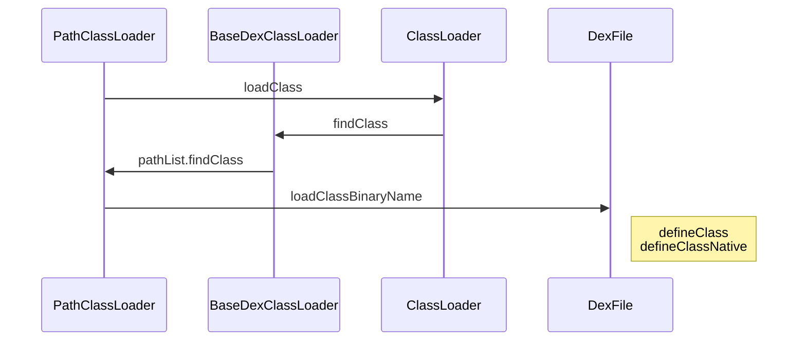

# [原创] ART 在 Android 安全攻防中的应用

# 背景
在日常的 Android 应用安全分析中，经常会遇到一些对抗，比如目标应用加壳、混淆、加固，需要进行脱壳还原；又或者会有针对常用注入工具的检测，比如 frida、Xposed 等，这时候也会想知道这些工具的核心原理以及是否自己可以实现。
其实这些问题的答案就在 Android 的 Java 虚拟机实现中。可以是早期的 Dalvik 虚拟机，也可以是最新的 ART 虚拟机。从时代潮流来看，本文主要专注于 ART。不过，为了铭记历史，也会对 Dalvik 虚拟机做一个简单的介绍。最后会从 ART 的实现出发j对一些实际的应用场景进行讨论。
> 注: 本文分析基于 AOSP android-12.0.0\_r11
# Java VM
我们知道，Java 是一门跨平台的语言，系统实际运行的是 Java 字节码，由 Java 虚拟机去解释执行。如果读者之前看过 [如何破解一个Python虚拟机壳并拿走12300元ETH][py] 一文或者对 Python 虚拟机有所了解的话就会知道，解释执行的过程可以看做是一个循环，对每条指令进行解析，并针对指令的名称通过巨大的 switch-case 分发到不同的分支中处理。其实 Java 虚拟机也是类似的，但 JVM 对于性能做了很多优化，比如 JIT 运行时将字节码优化成对应平台的二进制代码，提高后续运行速度等。
Android 代码既然是用 Java 代码编写的，那么运行时应该也会有一个解析字节码的虚拟机。和标准的 JVM 不同，Android 中实际会将 Java 代码编译为 Dalvik 字节码，运行时解析的也是用自研的虚拟机实现。之所以使用自研实现，也许一方面有商业版权的考虑，另一方面也确实是适应了移动端的的运行场景。Dalvik 指令基于寄存器，占 1-2 字节，Java 虚拟机指令基于栈，每条指令只占 1 字节；因此 Dalvik 虚拟机用空间换时间从而获得比 Oracle JVM 更快的执行速度。
## 启动
其实 Java 代码执行并不慢，但其启动时间却是一大瓶颈。如果每个 APP 运行都要启动并初始化 Java 虚拟机，那延时将是无法接受的。在 [Android 12 应用启动流程分析][app] 一文中我们说到，APP 应用进程实际上是通过 zygote 进程 fork 出来的。这样的好处是子进程继承了父进程的进程空间，对于只读部分可以直接使用，而数据段也可以通过 COW(Copy On Write) 进行延时映射。查看 zygote 与其子进程的 `/proc/self/maps` 可以发现大部分系统库的映射都是相同的，这就是 fork 所带来的好处。
在 [Android 用户态启动流程分析][zy] 中我们分析了 init、zygote 和 system\_server 的启动流程，其中在介绍 zygote 的启动流程时说到这是个 native 程序，在其中 main 函数的结尾有这么一段代码:
```cpp
int main(int argc, char\* const argv[]) {
// ...
if (zygote) {
runtime.start("com.android.internal.os.ZygoteInit", args, zygote);
} else if (className) {
runtime.start("com.android.internal.os.RuntimeInit", args, zygote);
} else {
fprintf(stderr, "Error: no class name or --zygote supplied.\n");
// ....
}
}
```
上述代码在 \*\*frameworks/base/cmds/app\_process/app\_main.cpp\*\* 中，\*\*runtime.start\*\* 的作用就是启动 Java 虚拟机并将执行流转交给对应的 Java 函数。
```cpp
void AndroidRuntime::start(const char\* className, const Vector<String8>& options, bool zygote)
{
/\* start the virtual machine \*/
JniInvocation jni\_invocation;
jni\_invocation.Init(NULL);
JNIEnv\* env;
if (startVm(&mJavaVM, &env, zygote) != 0) {
return;
}
onVmCreated(env);
/\*
\* Register android functions.
\*/
if (startReg(env) < 0) {
ALOGE("Unable to register all android natives\n");
return;
}
/\*
\* Start VM. This thread becomes the main thread of the VM, and will
\* not return until the VM exits.
\*/
jclass startClass = env->FindClass(slashClassName);
jmethodID startMeth = env->GetStaticMethodID(startClass, "main", "([Ljava/lang/String;)V");
env->CallStaticVoidMethod(startClass, startMeth, strArray);
}
```
详细介绍可以会看 [Android 用户态启动流程分析][zy] 一文，这里我们只需要知道 Java 虚拟机是在 Zygote 进程创建的，并由子进程继承，因此 APP 从 zygote 进程中 fork 启动后就无需再次启动 Java 虚拟机，而是复用原有的虚拟机执行轻量的初始化即可。
## 接口
Android Java 虚拟机包括早期的 Dalvik 虚拟机和当前的 ART 虚拟机，我们将其统称为 Java 虚拟机，因为对于应用程序而言应该是透明的，也就是说二者应该提供了统一的对外接口。
这个接口可以分为两部分，一部分是提供给 Java 应用的接口，即我们常见的 JavaVM、JNIEnv 结构体提供的诸如 FindClass、GetMethodID、CallVoidMethod 等接口；另一部分则是提供给系统开发者的接口，系统通过这些接口去初始化并创建虚拟机，从而使自身具备执行 Java 代码的功能。
\*\*JniInvocation.Init\*\* 方法中即进行了第二部分接口的初始化操作，其中主要逻辑是根据系统属性 (persist.sys.dalvik.vm.lib.2) 判断待加载的虚拟机动态库，Dalvik 虚拟机对应的是 libdvm.so，ART 虚拟机对应的是 libart.so；然后通过 \*\*dlopen\*\* 进行加载，并通过 \*\*dlsym\*\* 获取其中三个函数符号，作为抽象 Java 虚拟机的接口:
- \*\*JNI\_GetDefaultJavaVMInitArgs\*\*: 获取默认的 JVM 初始化参数；
- \*\*JNI\_CreateJavaVM\*\*: 创建 Java 虚拟机；
- \*\*JNI\_GetCreatedJavaVMs\*\*: 获取已经创建的 Java 虚拟机实例；
例如，在上述 zygote 的 `AndroidRuntime::startVm` 方法实现中，就是通过指定参数最终调用 JNI\_CreateJavaVM 来完成 Java 虚拟机的创建工作。
通过这三个接口实现了对于不同 Java 虚拟机细节的隐藏，既可以用 ART 无缝替换 Dalvik 虚拟机，也可以在未来用某个新的虚拟机无缝替换掉 ART 虚拟机。
总的来说，Java 虚拟机只在 Zygote 进程中创建一次，子进程通过 fork 获得虚拟机的一个副本，因此 zygote 才被称为所有 Java 进程的父进程；同时，也因为每个子进程拥有独立的虚拟机副本，所以某个进程的虚拟机崩溃后不影响其他进程，从而实现安全的运行时隔离。
# Dalvik
Dalvik 是早期 Android 的 Java 虚拟机，伴随着 Android 5.0 的更新，正式宣告其历史使命的结束:
```git
commit 870b4f2d70d67d6dbb7d0881d101c61bed8caad2
Author: Brian Carlstrom <bdc@google.com>
Date: Tue Aug 5 12:46:17 2014 -0700
Dalvik is dead, long live Dalvik!
```
虽然现在 Dalvik 已经被 ART 虚拟机所取代，但其简洁的实现有助于我们理解 Java 代码的运行流程，因此还是先对其进行简单的介绍。
上节中我们知道 zygote 进程创建并初始化 Java 虚拟机后执行的第一个 Java 函数是 \*\*com.android.internal.os.ZygoteInit\*\* 的 main 方法，这是个静态方法，因此在 Native 层调用的是 JNI 接口函数 \*\*CallStaticVoidMethod\*\*。其调用流程可以简化如下所示:
| method | file |
|---|---|
| \*\*JNIEnv\*\*.CallStaticVoidMethod | dalvik/libnativehelper/include/nativehelper/jni.h |
| \*\*JNINativeInterface\*\*.CallStaticVoidMethodV | dalvik/vm/Jni.c |
| \*\*Jni\*\*.dvmCallMethodV | dalvik/vm/interp/Stack.c |
| \*\*Stack\*\*.dvmInterpret | dalvik/vm/interp/Interp.c |
| dvmInterpretStd | dalvik/vm/mterp/out/InterpC-portstd.c (动态生成) |
Dalvik 虚拟机支持三种执行模式，分别是:
- kExecutionModeInterpPortable: 可移植模式，能运行在不同的平台中，对应的运行方法是 dvmInterpretStd；
- kExecutionModeInterpFast: 快速模式，针对特定平台优化，对应的运行方法是 dvmMterpStd；
- kExecutionModeJit: JIT 模式，运行时编译为特定平台的 native 代码，对应运行方法也是 dvmMterpStd；
以上述调用流程中的 portable 模式为例，对应 dvmInterpretStd 实现的核心代码如下所示:
```c
#define INTERP\_FUNC\_NAME dvmInterpretStd
bool INTERP\_FUNC\_NAME(Thread\* self, InterpState\* interpState) {
// ...
/\* core state \*/
const Method\* curMethod; // method we're interpreting
const u2\* pc; // program counter
u4\* fp; // frame pointer
u2 inst; // current instruction
/\* copy state in \*/
curMethod = interpState->method;
pc = interpState->pc;
fp = interpState->fp;
retval = interpState->retval; /\* only need for kInterpEntryReturn? \*/
methodClassDex = curMethod->clazz->pDvmDex;
while (1) {
/\* fetch the next 16 bits from the instruction stream \*/
inst = FETCH(0);
switch (INST\_INST(inst)) {
HANDLE\_OPCODE(OP\_INVOKE\_DIRECT /\*vB, {vD, vE, vF, vG, vA}, meth@CCCC\*/)
GOTO\_invoke(invokeDirect, false);
OP\_END
HANDLE\_OPCODE(OP\_RETURN /\*vAA\*/)
HANDLE\_OPCODE(...)
}
}
/\* export state changes \*/
interpState->method = curMethod;
interpState->pc = pc;
interpState->fp = fp;
/\* debugTrackedRefStart doesn't change \*/
interpState->retval = retval; /\* need for \_entryPoint=ret \*/
interpState->nextMode =
(INTERP\_TYPE == INTERP\_STD) ? INTERP\_DBG : INTERP\_STD;
return true;
}
```
可以看到其核心在于一个巨大的 switch/case，以 PC 为起点不断读取字节码(4字节对齐)，并根据 op\_code 去分发解释执行不同的指令直到 Java 方法运行结束返回或者抛出异常。之所以称为可移植模式(portable)正是因为该代码纯粹是解释执行，既没有提前优化也没有运行时的 JIT 优化，也因此具有平台无关性，只要 C 编译器支持对应平台即可运行。
虽然 Dalvik 已经被 ART 取代，但其中的 Dalvik 字节码格式还是被保留了下来。即便在最新版本的 Android 中，编译 Java 生成的依旧是 DEX 文件，其格式可以参考 [Dalvik Executable format][dex]，Dalvik 字节码的介绍可以参考官方文档 [Dalvik bytecode][bc]。
# ART
ART 全称为 Android Runtime，是继 Dalvik 之后推出的高性能 Android Java 虚拟机。在本文中我们重点关注 ART 虚拟机执行 Java 代码的流程。在介绍 ART 的代码执行流程之前，我们需要先了解在 ART 中针对 DEX 的一系列提前优化方案，以及由此产生的各类中间文件。
## 提前优化
在我们使用 Android-Studio 编译应用时，实际上是通过 Java 编译器先将 `.java` 代码编译为对应的 Java 字节码，即 `.class` 类文件；然后用 `dx`(在新版本中是`d8`) 将 Java 字节码转换为 Dalvik 字节码，并将所有生成的类打包到统一的 DEX 文件中，最终和资源文件一起 zip 压缩为 `.apk` 文件。
在安装用户的 APK 时，Android 系统主要通过 PacketManager 对应用进行解包和安装。其中在处理 DEX 文件时候，会通过 \*\*installd\*\* 进程调用对应的二进制程序对字节码进行优化，这对于 Dalvik 虚拟机而言使用的是 \*\*dexopt\*\* 程序，而 ART 中使用的是 \*\*dex2oat\*\* 程序。
dexopt 将 dex 文件优化为 odex 文件，即 optimized-dex 的缩写，其中包含的是优化后的 Dalvik 字节码，称为 quickend dex；dex2oat 基于 LLVM，优化后生成的是对应平台的二进制代码，以 oat 格式保存，oat 的全称为 Ahead-Of-Time。oat 文件实际上是以 ELF 格式进行存储的，并在其中 oatdata 段(section) 包含了原始的 DEX 内容。
在 Android 8 之后，将 OAT 文件一分为二，原 oat 仍然是 ELF 格式，但原始 DEX 文件内容被保存到了 VDEX 中，VDEX 有其独立的文件格式。整体流程如下图所示:
![Java 代码处理流程][img-oat]
值得一提的是，在 Andorid 系统中 dex2oat 会将优化后的代码保存在 `/data/app` 对应的应用路径下，系统应用会保存在 `/data/dalvik-cache/` 下，对于后者，产生的实际有三个文件，比如:
```sh
$ ls -l | grep Settings.apk
-rw-r----- 1 system system 77824 2021-12-10 10:33 system\_ext@priv-app@Settings@Settings.apk@classes.art
-rw-r----- 1 system system 192280 2021-11-19 12:50 system\_ext@priv-app@Settings@Settings.apk@classes.dex
-rw-r----- 1 system system 59646 2021-12-10 10:33 system\_ext@priv-app@Settings@Settings.apk@classes.vdex
```
`system\_ext@priv-app@Settings@Settings.apk@classes.dex` 实际上是 ELF 格式的 OAT 文件，所以我们不能以貌(后缀)取人；`.art` 也是一个特殊的文件格式，如前文所言，Android 实现了自己的 Java 虚拟机，这个虚拟机本身是用 C/C++ 实现的，其中的一些 Java 原语有对应的 C++ 类，比如:
- java.lang.Class 对应 art::mirror::Class
- java.lang.String 对应 art::mirror::String
- java.lang.reflect.Method 对应 art::mirror::Method
- ……
当创建一个 Java 对象时，内存中会创建对应的 C++ 对象并调用其构造函数，JVM 管理者这些 C++ 对象的引用。为了加速启动过程，避免对这些常见类的初始化，Android 使用了 `.art` 格式来保存这些 C++ 对象的实例，简单来说，art 文件可以看做是一系列常用 C++ 对象的内存 dump。
不论是 oat、vdex 还是 art，都是 Android 定义的内部文件格式，官方并不保证其兼容性，事实上在 Android 各个版本中这些文件格式都有不同程度的变化，这些变化是不反映在文档中的，只能通过代码去一窥究竟。因此对于这些文件格式我们现在只需要知道其大致作用，无需关心其实现细节。
## 文件加载
在前一篇文章 ([Android 12 应用启动流程分析][app]) 中我们知道 APP 最终在 ActivityThread 中完成 Application 的创建和初始化，最终调用 Activity.onCreate 进入视图组件的生命周期。但这里其实忽略了一个问题: APP 的代码(DEX/OAT 文件) 是如何加载到进程中的？
在 Java 中负责加载指定类的对象是 [ClassLoader][cl]，Android 中也是类似，BaseDexClassLoader 继承自 ClassLoader 类，实现了许多 DEX 相关的加载操作，其子类包括:
- DexClassLoader: 负责从 `.jar` 或者 `.apk` 中加载类；
- PathClassLoader: 负责从本地文件中初始化类加载器；
- InMemoryDexClassLoader: 从内存中初始化类加载器；
### ClassLoader
以常见的 `PathClassLoader` 为例，其构造函数会调用父类的构造函数，整体调用链路简化如下表:
| method | file |
| - | - |
| new PathClassLoader | ... |
| new BaseDexClassLoader | libcore/dalvik/src/main/java/dalvik/system/BaseDexClassLoader.java |
| new DexPathList | libcore/dalvik/src/main/java/dalvik/system/DexPathList.java |
| DexPathList.makeDexElements | ... |
| DexPathList.loadDexFile | ... |
| new DexFile | libcore/dalvik/src/main/java/dalvik/system/DexFile.java |
| DexFile.openDexFile | ... |
| DexFile.openDexFileNative | ... |
| \*\*DexFile\_openDexFileNative\*\* | art/runtime/native/dalvik\_system\_DexFile.cc |
| OatFileManager::OpenDexFilesFromOat | art/runtime/oat\_file\_manager.cc |
在 \*\*OpenDexFilesFromOat\*\* 中执行了真正的代码加载工作，伪代码如下:
```cpp
std::vector<std::unique\_ptr<const DexFile>> OatFileManager::OpenDexFilesFromOat() {
std::vector<std::unique\_ptr<const DexFile>> dex\_files = OpenDexFilesFromOat\_Impl(...);
for (std::unique\_ptr<const DexFile>& dex\_file : dex\_files) {
if (!dex\_file->DisableWrite()) {
error\_msgs->push\_back("Failed to make dex file " + dex\_file->GetLocation() + " read-only");
}
}
return dex\_files;
}
```
通过 OpenDexFilesFromOat\_Impl 加载获取 DexFile 结构体数组，值得注意的是加载完 DEX 之后会将内存中的 dex\_file 设置为不可写，当然目前还没有强制，但可见这是未来的趋势。
继续看实现部分是如何加载 Dex 文件的:
```cpp
std::vector<std::unique\_ptr<const DexFile>> OatFileManager::OpenDexFilesFromOat\_Impl() {
// Extract dex file headers from `dex\_mem\_maps`.
const std::vector<const DexFile::Header\*> dex\_headers = GetDexFileHeaders(dex\_mem\_maps);
// Determine dex/vdex locations and the combined location checksum.
std::string dex\_location;
std::string vdex\_path;
bool has\_vdex = OatFileAssistant::AnonymousDexVdexLocation(dex\_headers,
kRuntimeISA,
&dex\_location,
&vdex\_path);
if (has\_vdex && OS::FileExists(vdex\_path.c\_str())) {
vdex\_file = VdexFile::Open(vdex\_path,
/\* writable= \*/ false,
/\* low\_4gb= \*/ false,
/\* unquicken= \*/ false,
&error\_msg);
}
// Load dex files. Skip structural dex file verification if vdex was found
// and dex checksums matched.
std::vector<std::unique\_ptr<const DexFile>> dex\_files;
for (size\_t i = 0; i < dex\_mem\_maps.size(); ++i) {
static constexpr bool kVerifyChecksum = true;
const ArtDexFileLoader dex\_file\_loader;
std::unique\_ptr<const DexFile> dex\_file(dex\_file\_loader.Open(
DexFileLoader::GetMultiDexLocation(i, dex\_location.c\_str()),
dex\_headers[i]->checksum\_,
std::move(dex\_mem\_maps[i]),
/\* verify= \*/ (vdex\_file == nullptr) && Runtime::Current()->IsVerificationEnabled(),
kVerifyChecksum,
&error\_msg));
if (dex\_file != nullptr) {
dex::tracking::RegisterDexFile(dex\_file.get()); // Register for tracking.
dex\_files.push\_back(std::move(dex\_file));
}
}
// Initialize an OatFile instance backed by the loaded vdex.
std::unique\_ptr<OatFile> oat\_file(OatFile::OpenFromVdex(
MakeNonOwningPointerVector(dex\_files),
std::move(vdex\_file),
dex\_location));
if (oat\_file != nullptr) {
VLOG(class\_linker) << "Registering " << oat\_file->GetLocation();
\*out\_oat\_file = RegisterOatFile(std::move(oat\_file));
}
return dex\_files;
}
```
加载过程首先将 vdex 映射到内存中，然后将已经映射到内存中的 dex 或者在磁盘中的 dex 转换为 DexFile 结构体，最后再将 vdex 和 oat 文件关联起来。
### VdexFile
vdex 是 Android 8.0 加入的新文件格式，主要用于保存优化代码的原始 DEX 信息，而 OAT 中则主要保存 dex2oat 编译后的 Native 代码。
VdexFile 的结构大致如下所示，其中 `D` 代表 VDEX 中包含的 DEX 文件个数:
```
VdexFileHeader fixed-length header
VdexSectionHeader[kNumberOfSections]
Checksum section
VdexChecksum[D]
Optionally:
DexSection
DEX[0] array of the input DEX files
DEX[1]
...
DEX[D-1]
VerifierDeps
4-byte alignment
uint32[D] DexFileDeps offsets for each dex file
DexFileDeps[D][] verification dependencies
4-byte alignment
uint32[class\_def\_size] TypeAssignability offsets (kNotVerifiedMarker for a class that isn't verified)
uint32 Offset of end of AssignabilityType sets
uint8[] AssignabilityType sets
4-byte alignment
uint32 Number of strings
uint32[] String data offsets for each string
uint8[] String data
```
> VdexFile 结构详见: <a href="elink@d5bK9s2c8@1M7s2y4Q4x3@1q4Q4x3V1k6Q4x3V1k6U0M7#2)9J5k6h3q4F1k6s2u0G2K9h3c8Q4x3X3g2U0L8$3#2Q4x3V1k6S2L8X3c8J5L8$3W2V1i4K6u0r3M7r3I4S2N6r3k6G2M7X3#2Q4x3V1k6K6N6i4m8W2M7Y4m8J5L8$3A6W2j5%4c8Q4x3V1k6Q4x3V1u0Q4x3V1k6E0j5i4y4@1k6i4u0Q4x3@1q4S2M7Y4c8Q4x3V1k6J5N6h3&6@1K9h3#2W2i4K6u0r3N6X3c8W2P5q4)9#2k6X3k6A6L8r3g2Q4x3X3g2Z5">\*art/runtime/vdex\_file.h\*</a>
### DexFile
\*\*dex\_file\_loader.Open\*\* 的调用路径如下:
- ArtDexFileLoader::Open
- ArtDexFileLoader::OpenCommon
- DexFileLoader::OpenCommon
- magic == "dex\n" -> new StandardDexFile()
- magic == "cdex" -> new CompactDexFile()
实际根据起始 4 字节判断是标准 DEX 还是紧凑型 DEX (cdex, compat dex)，并使用对应的结构体进行初始化。cdex 是当前 ART 内部使用的 DEX 文件格式，主要是为了减少磁盘和内存的使用。但不论是 StandardDexFile 还是 CompactDexFile 都继承于 DexFile，二者的构造函数最终还是会调用 DexFile 的构造函数。
> DexFile 结构详见 <a href="elink@8adK9s2c8@1M7s2y4Q4x3@1q4Q4x3V1k6Q4x3V1k6U0M7#2)9J5k6h3q4F1k6s2u0G2K9h3c8Q4x3X3g2U0L8$3#2Q4x3V1k6S2L8X3c8J5L8$3W2V1i4K6u0r3M7r3I4S2N6r3k6G2M7X3#2Q4x3V1k6K6N6i4m8W2M7Y4m8J5L8$3A6W2j5%4c8Q4x3V1k6Q4x3V1u0Q4x3V1k6E0j5i4y4@1k6i4u0Q4x3@1q4S2M7Y4c8Q4x3V1k6D9K9h3u0V1k6i4S2X3K9h3I4W2i4K6u0r3k6r3g2^5i4K6u0r3k6r3g2^5i4K6g2X3k6X3W2D9k6g2)9J5k6h3R3`.">\*art/libdexfile/dex/dex\_file.h\*</a>
### OatFile
在完成所有 DexFile 的初始化之后，会继续使用 `OatFile::OpenFromVdex` 创建 oat\_file 并进行注册。该函数的调用链路如下:
- OatFile::OpenFromVdex
- OatFileBackedByVdex::Open
- new OatFileBackedByVdex
- OatFileBase::OatFileBase
- OatFile::OatFile
与早期使用 odex 的区别是现在在创建完 OatFile 之后，会调用 `oat\_file->SetVdex` 获取 vdex 对象的所有权，用以实现 OAT 的部分接口，比如获取内存中对应 DEX 文件的起始地址:
```cpp
const uint8\_t\* OatFile::DexBegin() const {
return vdex\_->Begin();
}
```
> 详见: art/runtime/oat\_file.h
## 方法调用
本来按照时间线来看的话，这里应该先介绍 ART 运行时类和方法的加载过程，但我从实践出发，先看 Java 方法的调用过程，并针对其中涉及到的概念在下一节继续介绍。
在 Web 安全中，Java 服务端通常带有一个称为 RASP (Runtime Application Self-Protection) 的动态防护方案，比如监控某些执行命令的敏感函数调用并进行告警，其实际 hook 点是在 JVM 中，不论是方法直接调用还是反射调用都可以检测到。因此我们有理由猜测在 Android 中也有类似的调用链路，为了方便观察，这里先看反射调用的场景，一般反射调用的示例如下:
```java
import java.lang.reflect.\*;
public class Test {
public static void main(String args[]) throws Exception {
Class c = Class.forName("com.evilpan.DemoClass");
Method m = c.getMethod("foo", null);
m.invoke();
}
}
```
因此一个方法的调用会进入到 `Method.invoke` 方法，这是一个 \*\*native 方法\*\*，实际实现在 \*art/runtime/native/java\_lang\_reflect\_Method.cc\*:
```cpp
static jobject Method\_invoke(JNIEnv\* env, jobject javaMethod, jobject javaReceiver,
jobjectArray javaArgs) {
ScopedFastNativeObjectAccess soa(env);
return InvokeMethod<kRuntimePointerSize>(soa, javaMethod, javaReceiver, javaArgs);
}
```
InvokeMethod 定义在 \*art/runtime/reflection.cc\*，其实现的核心代码如下:
```cpp
template <PointerSize kPointerSize>
jobject InvokeMethod(const ScopedObjectAccessAlreadyRunnable& soa, jobject javaMethod,
jobject javaReceiver, jobject javaArgs, size\_t num\_frames) {
ObjPtr<mirror::Executable> executable = soa.Decode<mirror::Executable>(javaMethod);
const bool accessible = executable->IsAccessible();
ArtMethod\* m = executable->GetArtMethod();
if (UNLIKELY(!declaring\_class->IsVisiblyInitialized())) {
Thread\* self = soa.Self();
Runtime::Current()->GetClassLinker()->EnsureInitialized(
self, h\_class,
/\*can\_init\_fields=\*/ true,
/\*can\_init\_parents=\*/ true)
}
if (!m->IsStatic()) {
if (declaring\_class->IsStringClass() && m->IsConstructor()) {
m = WellKnownClasses::StringInitToStringFactory(m);
} else {
m = receiver->GetClass()->FindVirtualMethodForVirtualOrInterface(m, kPointerSize);
}
}
if (!accessible && !VerifyAccess(/\*...\*/)) {
ThrowIllegalAccessException(
StringPrintf("Class %s cannot access %s method %s of class %s", ...));
}
InvokeMethodImpl(soa, m, np\_method, receiver, objects, &shorty, &result);
}
```
上面省略了许多细节，主要是做了一些调用前的检查和预处理工作，流程可以概况为:
1. 判断方法所属的类是否已经初始化过，如果没有则进行初始化；
2. 将 `String.<init>` 构造函数调用替换为对应的工厂 `StringFactory` 方法调用；
3. 如果是虚函数调用，替换为运行时实际的函数；
4. 判断方法是否可以访问，如果不能访问则抛出异常；
5. 调用函数；
值得注意的是，jobject 类型的 javaMethod 可以转换为 `ArtMethod` 指针，该结构体是 ART 虚拟机中对于具体方法的描述。之后经过一系列调用:
- InvokeMethodImpl
- InvokeWithArgArray
- `method->Invoke()`
最终进入 `ArtMethod::Invoke` 函数，还是只看核心代码:
```cpp
void ArtMethod::Invoke(Thread\* self, uint32\_t\* args, uint32\_t args\_size, JValue\* result,
const char\* shorty) {
Runtime\* runtime = Runtime::Current();
if (UNLIKELY(!runtime->IsStarted() ||
(self->IsForceInterpreter() && !IsNative() && !IsProxyMethod() && IsInvokable()))) {
art::interpreter::EnterInterpreterFromInvoke(...);
} else {
bool have\_quick\_code = GetEntryPointFromQuickCompiledCode() != nullptr;
if (LIKELY(have\_quick\_code)) {
if (!IsStatic()) {
(\*art\_quick\_invoke\_stub)(this, args, args\_size, self, result, shorty);
} else {
(\*art\_quick\_invoke\_static\_stub)(this, args, args\_size, self, result, shorty);
}
} else {
LOG(INFO) << "Not invoking '" << PrettyMethod() << "' code=null";
}
}
self->PopManagedStackFragment(fragment);
}
```
ART 对于 Java 方法实现了两种执行模式，一种是像 Dalvik 虚拟机一样解释执行字节码，姑且称为解释模式；另一种是快速模式，即直接调用通过 OAT 编译后的本地代码。
> 在 ART 早期指定本地代码还细分为 Portable 和 Quick 两种模式，但由于对极致速度的追求以及随着 Quick 模式的不断优化，Portable 也逐渐退出了历史舞台。
阅读上述代码可以得知，当 ART 运行时尚未启动或者指定强制使用解释执行时，虚拟机执行函数使用的是解释模式，ART 可以在启动时指定 `-Xint` 参数强制使用解释执行，但即便指定了使用解释执行模式，还是有一些情况无法使用解释执行，比如:
1. 当所执行的方法是 Native 方法时，这时只有二进制代码，不存在字节码，自然无法解释执行；
2. 当所执行的方法无法调用，比如 access\_flag 判定无法访问或者当前方法是抽象方法时；
3. 当所执行的方式是代理方法时，ART 对于代理方法有单独的本地调用方式；
### 解释执行
解释执行的入口是 `art::interpreter::EnterInterpreterFromInvoke`，该函数定义在 \*art/runtime/interpreter/interpreter.cc\*，关键代码如下:
```cpp
void EnterInterpreterFromInvoke(Thread\* self,
ArtMethod\* method,
ObjPtr<mirror::Object> receiver,
uint32\_t\* args,
JValue\* result,
bool stay\_in\_interpreter) {
CodeItemDataAccessor accessor(method->DexInstructionData());
if (accessor.HasCodeItem()) {
num\_regs = accessor.RegistersSize();
num\_ins = accessor.InsSize();
}
// 初始化栈帧 ......
if (LIKELY(!method->IsNative())) {
JValue r = Execute(self, accessor, \*shadow\_frame, JValue(), stay\_in\_interpreter);
if (result != nullptr) {
\*result = r;
}
}
}
```
其中的 `CodeItem` 就是 DEX 文件中对应方法的字节码，还是老样子，直接看简化的调用链路:
| method | file |
| - | - |
| Execute | art/runtime/interpreter/interpreter.cc |
| ExecuteSwitch | ... |
| ExecuteSwitchImpl | art/runtime/interpreter/interpreter\_switch\_impl.h |
| ExecuteSwitchImplAsm | ... |
| ExecuteSwitchImplAsm | art/runtime/arch/arm64/quick\_entrypoints\_arm64.S |
| ExecuteSwitchImplCpp | art/runtime/interpreter/interpreter\_switch\_impl-inl.h |
`ExecuteSwitchImplAsm` 为了速度直接使用汇编实现，在 ARM64 平台中的定义如下:
```c
// Wrap ExecuteSwitchImpl in assembly method which specifies DEX PC for unwinding.
// Argument 0: x0: The context pointer for ExecuteSwitchImpl.
// Argument 1: x1: Pointer to the templated ExecuteSwitchImpl to call.
// Argument 2: x2: The value of DEX PC (memory address of the methods bytecode).
ENTRY ExecuteSwitchImplAsm
SAVE\_TWO\_REGS\_INCREASE\_FRAME x19, xLR, 16
mov x19, x2 // x19 = DEX PC
CFI\_DEFINE\_DEX\_PC\_WITH\_OFFSET(0 /\* x0 \*/, 19 /\* x19 \*/, 0)
blr x1 // Call the wrapped method.
RESTORE\_TWO\_REGS\_DECREASE\_FRAME x19, xLR, 16
ret
END ExecuteSwitchImplAsm
```
本质上是调用保存在 x1 寄存器的第二个参数，调用处的代码片段如下:
```cpp
template<bool do\_access\_check, bool transaction\_active>
ALWAYS\_INLINE JValue ExecuteSwitchImpl() {
//...
void\* impl = reinterpret\_cast<void\*>(&ExecuteSwitchImplCpp<do\_access\_check, transaction\_active>);
const uint16\_t\* dex\_pc = ctx.accessor.Insns();
ExecuteSwitchImplAsm(&ctx, impl, dex\_pc);
}
```
即调用了 `ExecuteSwitchImplCpp`，在该函数中，可以看见典型的解释执行代码:
```cpp
template<bool do\_access\_check, bool transaction\_active>
void ExecuteSwitchImplCpp(SwitchImplContext\* ctx) {
Thread\* self = ctx->self;
const CodeItemDataAccessor& accessor = ctx->accessor;
ShadowFrame& shadow\_frame = ctx->shadow\_frame;
self->VerifyStack();
uint32\_t dex\_pc = shadow\_frame.GetDexPC();
const auto\* const instrumentation = Runtime::Current()->GetInstrumentation();
const uint16\_t\* const insns = accessor.Insns();
const Instruction\* next = Instruction::At(insns + dex\_pc);
while (true) {
const Instruction\* const inst = next;
dex\_pc = inst->GetDexPc(insns);
shadow\_frame.SetDexPC(dex\_pc);
TraceExecution(shadow\_frame, inst, dex\_pc);
uint16\_t inst\_data = inst->Fetch16(0); // 一条指令 4 字节
if (InstructionHandler(...).Preamble()) {
switch (inst->Opcode(inst\_data)) {
case xxx: ...;
case yyy: ...;
...
}
}
}
}
```
在当前版本中 (Android 12)，实际上是通过宏展开去定义了所有 op\_code 的处理分支，不同版本实现都略有不同，但解释执行的核心思路从 Android 2.x 版本到现在都是一致的，因为字节码的定义并没有太多改变。
### 快速执行
再回到 ArtMethod 真正调用之前，如果不使用解释模式执行，则通过 `art\_quick\_invoke\_stub` 去调用。stub 是一小段中间代码，用于跳转到实际的 native 执行，该符号使用汇编实现，在 ARM64 中的定义在 \*art/runtime/arch/arm64/quick\_entrypoints\_arm64.S\*，核心代码如下:
```cpp
.macro INVOKE\_STUB\_CALL\_AND\_RETURN
REFRESH\_MARKING\_REGISTER
REFRESH\_SUSPEND\_CHECK\_REGISTER
// load method-> METHOD\_QUICK\_CODE\_OFFSET
ldr x9, [x0, #ART\_METHOD\_QUICK\_CODE\_OFFSET\_64]
// Branch to method.
blr x9
.endm
/\*
\* extern"C" void art\_quick\_invoke\_stub(ArtMethod \*method, x0
\* uint32\_t \*args, x1
\* uint32\_t argsize, w2
\* Thread \*self, x3
\* JValue \*result, x4
\* char \*shorty); x5
\*/
ENTRY art\_quick\_invoke\_stub
// ...
INVOKE\_STUB\_CALL\_AND\_RETURN
END art\_quick\_invoke\_static\_stub
```
中间省略了一些保存上下文以及调用后恢复寄存器的代码，其核心是调用了 `ArtMethod` 结构体偏移 `ART\_METHOD\_QUICK\_CODE\_OFFSET\_64` 处的指针，该值对应的代码为:
```cpp
ASM\_DEFINE(ART\_METHOD\_QUICK\_CODE\_OFFSET\_64,
art::ArtMethod::EntryPointFromQuickCompiledCodeOffset(art::PointerSize::k64).Int32Value())
```
即 `entry\_point\_from\_quick\_compiled\_code\_` 属性所指向的地址。
```cpp
// art/runtime/art\_method.h
static constexpr MemberOffset EntryPointFromQuickCompiledCodeOffset(PointerSize pointer\_size) {
return MemberOffset(PtrSizedFieldsOffset(pointer\_size) + OFFSETOF\_MEMBER(
PtrSizedFields, entry\_point\_from\_quick\_compiled\_code\_) / sizeof(void\*)
\* static\_cast<size\_t>(pointer\_size));
}
```
可以认为这就是所有快速模式执行代码的入口，至于该指针指向什么地方，又是什么时候初始化的，可以参考下一节代码加载部分。实际在方法调用时，快速模式执行的方法可能在其中执行到了需要以解释模式执行的方法，同样以解释模式执行的方法也可能在其中调用到 JNI 方法或者其他以快速模式执行的方法，所以在单个函数执行的过程中运行状态并不是一成不变的，但由于每次切换调用前后都保存和恢复了当前上下文，使得不同调用之间可以保持透明，这也是模块化设计的一大优势所在。
## 代码加载
在上节我们知道在 ART 虚拟机中，Java 方法的调用主要通过 `ArtMethod::Invoke` 去实现，那么 ArtMethod 结构是什么时候创建的呢？为什么 jmethod/jobject 可以转换为 `ArtMethod` 指针呢？
在 Java 这门语言中，方法是需要依赖类而存在的，因此要分析方法的初始化需要先分析类的初始化。虽然我们前面知道如何从 OAT/VDEX/DEX 文件中构造对应的 ClassLoader 来进行类查找，但那个时候类并没有初始化，可以编写一个简单的类进行验证:
```java
public class Demo {
static {
Log.i("Demo", "static block called");
}
{
Log.i("Demo", "IIB called");
}
}
```
如果 Demo 类在代码中没有使用，那么上述两个打印都不会触发；如果使用 `Class.forName("Demo")` 进行反射引用，则 static block 中的代码会被调用。跟踪 Class.forName 调用:
```java
@CallerSensitive
public static Class<?> forName(String className)
throws ClassNotFoundException {
Class<?> caller = Reflection.getCallerClass();
// 笔者注: initialize = true
return forName(className, true, ClassLoader.getClassLoader(caller));
}
```
最终调用到名为 `classForName` 的 native 方法，其定义在 \*art/runtime/native/java\_lang\_Class.cc\*:
```cpp
// "name" is in "binary name" format, e.g. "dalvik.system.Debug$1".
static jclass Class\_classForName(JNIEnv\* env, jclass, jstring javaName, jboolean initialize,
jobject javaLoader) {
ScopedFastNativeObjectAccess soa(env);
ScopedUtfChars name(env, javaName);
std::string descriptor(DotToDescriptor(name.c\_str()));
Handle<mirror::ClassLoader> class\_loader(
hs.NewHandle(soa.Decode<mirror::ClassLoader>(javaLoader)));
ClassLinker\* class\_linker = Runtime::Current()->GetClassLinker();
Handle<mirror::Class> c(
hs.NewHandle(class\_linker->FindClass(soa.Self(), descriptor.c\_str(), class\_loader)));
if (initialize) {
class\_linker->EnsureInitialized(soa.Self(), c, true, true);
}
return soa.AddLocalReference<jclass>(c.Get());
}
```
首先将 Java 格式的类表示转换为 smali 格式，然后通过指定的 class\_loader 去查找类，查找过程主要通过 `class\_linker` 实现。由于 forName 函数中指定了 `initialize` 为 `true`，因此在找到对应类后还会额外执行一步 `EnsureInitialized`，在后文会进行详细介绍。
### FindClass
FindClass 实现了根据类名查找类的过程，定义在 \*art/runtime/class\_linker.cc\* 中，关键流程如下:
```cpp
ObjPtr<mirror::Class> ClassLinker::FindClass(Thread\* self,
const char\* descriptor,
Handle<mirror::ClassLoader> class\_loader)
if (descriptor[1] == '\0')
return FindPrimitiveClass(descriptor[0]);
const size\_t hash = ComputeModifiedUtf8Hash(descriptor);
// 在已经加载的类中查找
ObjPtr<mirror::Class> klass = LookupClass(self, descriptor, hash, class\_loader.Get());
if (klass != nullptr) {
return EnsureResolved(self, descriptor, klass);
}
// 尚未加载
if (descriptor[0] != '[' && class\_loader == nullptr) {
// 类加载器为空，且不是数组类型，在启动类中进行查找
ClassPathEntry pair = FindInClassPath(descriptor, hash, boot\_class\_path\_);
return DefineClass(self, descriptor, hash,
ScopedNullHandle<mirror::ClassLoader>(),
\*pair.first, \*pair.second);
}
ObjPtr<mirror::Class> result\_ptr;
bool descriptor\_equals;
ScopedObjectAccessUnchecked soa(self);
// 先通过 classLoader 的父类查找
bool known\_hierarchy =
FindClassInBaseDexClassLoader(soa, self, descriptor, hash, class\_loader, &result\_ptr);
if (result\_ptr != nullptr) {
descriptor\_equals = true;
} else if (!self->IsExceptionPending()) {
// 如果没找到，再通过 classLoader 查找
std::string class\_name\_string(descriptor + 1, descriptor\_length - 2);
std::replace(class\_name\_string.begin(), class\_name\_string.end(), '/', '.');
ScopedLocalRef<jobject> class\_loader\_object(
soa.Env(), soa.AddLocalReference<jobject>(class\_loader.Get()));
ScopedLocalRef<jobject> result(soa.Env(), nullptr);
result.reset(soa.Env()->CallObjectMethod(class\_loader\_object.get(),
WellKnownClasses::java\_lang\_ClassLoader\_loadClass,
class\_name\_object.get()));
}
// 将找到的类插入到缓存表中
ClassTable\* const class\_table = InsertClassTableForClassLoader(class\_loader.Get());
class\_table->InsertWithHash(result\_ptr, hash);
return result\_ptr;
}
```
首先会通过 `LookupClass` 在已经加载的类中查找，已经加载的类会保存在 ClassTable 中，以 hash 表的方式存储，该表的键就是类对应的 hash，通过 descriptor 计算得出。如果之前已经加载过，那么这时候就可以直接返回，如果没有就需要执行真正的加载了。从这里我们也可以看出，类的加载过程属于懒加载 (lazy loading)，如果一个类不曾被使用，那么是不会有任何加载开销的。
然后会判断指定的类加载器是否为空，为空表示要查找的类实际上是一个系统类。系统类不存在于 APP 的 DEX 文件中，而是 Android 系统的一部分。由于每个 Android (Java) 应用都会用到系统类，为了提高启动速度，实际通过 zygote 去加载，并由所有子进程一起共享。上述 `boot\_class\_path\_` 数组在 `Runtime::Init` 中通过 ART 启动的参数进行初始化，感兴趣的可以自行研究细节。
我们关心的应用类查找过程可以分为两步，首先在父类的 ClassLoader 进行查找，如果没找到才会通过指定的 classLoader 进行查找，这也是很多类似 Java 文章中提到的 “双亲委派” 机制。保证关键类的查找过程优先通过系统类加载器，可以防止关键类实现被应用篡改。
`FindClassInBaseDexClassLoader` 的实现使用伪代码描述如下所示:
```cpp
Class ClassLinker::FindClassInBaseDexClassLoader(ClassLoader class\_loader, size\_t hash) {
if (class\_loader == java\_lang\_BootClassLoader) {
return FindClassInBootClassLoaderClassPath(class\_loader, hash);
}
if (class\_loader == dalvik\_system\_PathClassLoader ||
class\_loader == dalvik\_system\_DexClassLoader ||
class\_loader == dalvik\_system\_InMemoryDexClassLoader) {
// For regular path or dex class loader the search order is:
// - parent
// - shared libraries
// - class loader dex files
FindClassInBaseDexClassLoader(class\_loader->GetParent, hash) && return result;
FindClassInSharedLibraries(...) && return result;
FindClassInBaseDexClassLoaderClassPath(...) && return result;
FindClassInSharedLibrariesAfter(...) && return result;
}
if (class\_loader == dalvik\_system\_DelegateLastClassLoader) {
// For delegate last, the search order is:
// - boot class path
// - shared libraries
// - class loader dex files
// - parent
FindClassInBootClassLoaderClassPath(...) && return result;
FindClassInBaseDexClassLoaderClassPath(...) && return result;
FindClassInSharedLibrariesAfter(...) && return result;
FindClassInBaseDexClassLoader(class\_loader->GetParent, hash) && return result;
}
return null;
}
````
根据不同的 class\_loader 类型使用不同的搜索顺序，如果涉及到父 ClassLoader 的搜索，则使用递归查找，递归的停止条件是当前 class\_loader 为`java.lang.BootClassLoader`。
`FindClassInBootClassLoaderClassPath` 的关键代码如下:
```cpp
using ClassPathEntry = std::pair<const DexFile\*, const dex::ClassDef\*>;
bool ClassLinker::FindClassInBootClassLoaderClassPath(Thread\* self,
const char\* descriptor,
size\_t hash,
/\*out\*/ ObjPtr<mirror::Class>\* result) {
ClassPathEntry pair = FindInClassPath(descriptor, hash, boot\_class\_path\_);
if (pair.second != nullptr) {
ObjPtr<mirror::Class> klass = LookupClass(self, descriptor, hash, nullptr);
if (klass != nullptr) {
\*result = EnsureResolved(self, descriptor, klass);
} else {
\*result = DefineClass(self, ...);
}
}
return true;
```
如果在 BaseClassLoader 中没有找到对应的类，那么最终会通过传入的 classLoader 查找，即调用指定类加载器的 loadClass 方法。在这个场景中(Class.forName)，实际指定的是 caller 的 classLoader，编写一个 APK 进行动态分析，打印出当前的 classLoader 如下:
```
dalvik.system.PathClassLoader[
DexPathList[[
zip file "/data/app/~~0FBqwacokhdG5rhF1RDZGg==/com.evilpan.test-fCJvsE74xP\_SdvTlAfJDcA==/base.apk"
],
nativeLibraryDirectories=[/data/app/~~0FBqwacokhdG5rhF1RDZGg==/com.evilpan.test-fCJvsE74xP\_SdvTlAfJDcA==/lib/arm64, /system/lib64, /system\_ext/lib64]]]
```
所以这是一个 `PathClassLoader` 对象，该类没有定义 loadClass，因此是调用了父类的 loadClass 方法，整体调用路径如下所示:

![img-load][img-load]
最终调用了 DexFile 的 native 方法 defineClassNative，实现在 \*art/runtime/native/dalvik\_system\_DexFile.cc\*，关键代码如下:
```cpp
static jclass DexFile\_defineClassNative(JNIEnv\* env,
jclass,
jstring javaName,
jobject javaLoader,
jobject cookie,
jobject dexFile) {
std::vector<const DexFile\*> dex\_files;
ConvertJavaArrayToDexFiles(env, cookie, /\*out\*/ dex\_files, /\*out\*/ oat\_file);
ScopedUtfChars class\_name(env, javaName);
const std::string descriptor(DotToDescriptor(class\_name.c\_str()));
const size\_t hash(ComputeModifiedUtf8Hash(descriptor.c\_str()));
for (auto& dex\_file : dex\_files) {
const dex::ClassDef\* dex\_class\_def = OatDexFile::FindClassDef(\*dex\_file, descriptor.c\_str(), hash);
// dex\_class\_def != nullptr
ClassLinker\* class\_linker = Runtime::Current()->GetClassLinker();
Handle<mirror::ClassLoader> class\_loader(
hs.NewHandle(soa.Decode<mirror::ClassLoader>(javaLoader)));
ObjPtr<mirror::DexCache> dex\_cache =
class\_linker->RegisterDexFile(\*dex\_file, class\_loader.Get());
// dex\_cache != nullptr
ObjPtr<mirror::Class> result = class\_linker->DefineClass(soa.Self(),
descriptor.c\_str(),
hash,
class\_loader,
\*dex\_file,
\*dex\_class\_def);
class\_linker->InsertDexFileInToClassLoader(soa.Decode<mirror::Object>(dexFile),
class\_loader.Get());
}
}
```
也就是说，不论是通过 `FindClassInBaseDexClassLoader` 查找还是通过指定 classLoader 的 `loadClass` 加载，最终执行的流程都是类似的，即在对应的 DexFile(OatDexFile) 中根据类名搜索对应类的 ClassDef 字段，了解 Dex 文件结构的对这个字段应该不会陌生，后面可能会单独写一篇 DexFile 文件格式的介绍，这里限于篇幅先不展开，只需要知道这个字段包含类的定义即可。
在找到类在对应 Dex 文件中的 ClassDef 内容后，会通过 ClassLinker 完成该类的后续注册流程，包括:
- 对于当前 DexFile，如果是第一次遇到，会创建一个 DexCache 缓存，保存到 ClassLinker 的 `dex\_caches\_` 哈希表中；
- 通过 `ClassLinker::DefineClass` 完成目标类的定义，详见后文；
- 将对应 DexFile 添加到类加载器对应的 ClassTable 中；
其中 DefineClass 是我们比较关心的，因此下面单独进行介绍。
### DefineClass
先看代码:
```cpp
ObjPtr<mirror::Class> ClassLinker::DefineClass(Thread\* self,
const char\* descriptor,
size\_t hash,
Handle<mirror::ClassLoader> class\_loader,
const DexFile& dex\_file,
const dex::ClassDef& dex\_class\_def) {
ScopedDefiningClass sdc(self);
StackHandleScope<3> hs(self);
auto klass = hs.NewHandle<mirror::Class>(nullptr);
// Load the class from the dex file.
if (UNLIKELY(!init\_done\_)) {
// [1] finish up init of hand crafted class\_roots\_
}
ObjPtr<mirror::DexCache> dex\_cache = RegisterDexFile(\*new\_dex\_file, class\_loader.Get());
klass->SetDexCache(dex\_cache);
ObjPtr<mirror::Class> existing = InsertClass(descriptor, klass.Get(), hash);
if (existing != nullptr) {
// 其他线程正在链接该类，阻塞等待其完成
return sdc.Finish(EnsureResolved(self, descriptor, existing));
}
LoadClass(self, \*new\_dex\_file, \*new\_class\_def, klass);
// klass->IsLoaded
LoadSuperAndInterfaces(klass, \*new\_dex\_file))
Runtime::Current()->GetRuntimeCallbacks()->ClassLoad(klass);
// klass->IsResolved
LinkClass(self, descriptor, klass, interfaces, &h\_new\_class)
Runtime::Current()->GetRuntimeCallbacks()->ClassPrepare(klass, h\_new\_class);
jit::Jit::NewTypeLoadedIfUsingJit(h\_new\_class.Get());
return sdc.Finish(h\_new\_class);
}
```
这里只列出一些关键代码，`init\_done\_` 用于表示当前 ClassLinker 的初始化状态，初始化过程用于从 Image 空间或者手动创建内部类，手动创建的内部类包括:
- Ljava/lang/Object;
- Ljava/lang/Class;
- Ljava/lang/String;
- Ljava/lang/ref/Reference;
- Ljava/lang/DexCache;
- Ldalvik/system/ClassExt;
它们都直接定义在了 `art::runtime::mirror` 命名空间中，比如 Object 定义为 `mirror::Object`，所属文件为 \*art/runtime/mirror/object.h\* ；
### LoadClass
`ClassLinker::LoadClass` 用于从指定 DEX 文件中加载目标类的属性和方法等内容，注意这里其实是在对应类添加到 ClassTable 之后才加载的，这是出于 ART 的内部优化考虑，另外一个原因是类的属性根只能通过 ClassTable 访问，因此需要在访问前先在 ClassTable 中占好位置。其实现如下:
```cpp
void ClassLinker::LoadClass(Thread\* self,
const DexFile& dex\_file,
const dex::ClassDef& dex\_class\_def,
Handle<mirror::Class> klass) {
ClassAccessor accessor(dex\_file,
dex\_class\_def,
/\* parse\_hiddenapi\_class\_data= \*/ klass->IsBootStrapClassLoaded());
Runtime\* const runtime = Runtime::Current();
accessor.VisitFieldsAndMethods(
[&](const ClassAccessor::Field& field) {
LoadField(field, klass, &sfields->At(num\_sfields));
++num\_sfields;
},
[&](const ClassAccessor::Field& field) {
LoadField(field, klass, &ifields->At(num\_ifields));
++num\_ifields;
},
[&](const ClassAccessor::Method& method) {
ArtMethod\* art\_method = klass->GetDirectMethodUnchecked(
class\_def\_method\_index,
image\_pointer\_size\_);
LoadMethod(dex\_file, method, klass, art\_method);
LinkCode(this, art\_method, oat\_class\_ptr, class\_def\_method\_index);
++class\_def\_method\_index;
},
[&](const ClassAccessor::Method& method) {
ArtMethod\* art\_method = klass->GetVirtualMethodUnchecked(
class\_def\_method\_index - accessor.NumDirectMethods(),
image\_pointer\_size\_);
LoadMethod(dex\_file, method, klass, art\_method);
LinkCode(this, art\_method, oat\_class\_ptr, class\_def\_method\_index);
++class\_def\_method\_index;
}
);
klass->SetSFieldsPtr(sfields);
klass->SetIFieldsPtr(ifields);
}
```
上面用到了 `C++11` 的 lambda 函数来通过迭代器访问类中的关联元素，分别是:
1. sfields: static fields，静态属性
2. ifields: instance fields，对象属性
3. direct method: 对象方法
4. virtual method: 抽象方法
对于属性的加载通过 `LoadField` 实现，主要作用是初始化 ArtField 并与目标类关联起来；`LoadMethod` 的实现亦是类似，主要是使用 dex 文件中对应方法的 CodeItem 对 ArtMethod 进行初始化，并与 klass 关联。但是对于方法而言，还好进行额外的一步，即 `LinkCode`。
### LinkCode
LinkCode 顾名思义是对代码进行链接，关键代码如下:
```cpp
static void LinkCode(ClassLinker\* class\_linker,
ArtMethod\* method,
const OatFile::OatClass\* oat\_class,
uint32\_t class\_def\_method\_index) {
Runtime\* const runtime = Runtime::Current();
const void\* quick\_code = nullptr;
if (oat\_class != nullptr) {
// Every kind of method should at least get an invoke stub from the oat\_method.
// non-abstract methods also get their code pointers.
const OatFile::OatMethod oat\_method = oat\_class->GetOatMethod(class\_def\_method\_index);
quick\_code = oat\_method.GetQuickCode();
}
runtime->GetInstrumentation()->InitializeMethodsCode(method, quick\_code);
if (method->IsNative()) {
// Set up the dlsym lookup stub. Do not go through `UnregisterNative()`
// as the extra processing for @CriticalNative is not needed yet.
method->SetEntryPointFromJni(
method->IsCriticalNative() ? GetJniDlsymLookupCriticalStub() : GetJniDlsymLookupStub());
}
}
```
其中 quick\_code 指针指向的是 OatMethod 中的 `code\_offset\_` 偏移处的值，该值指向的是 OAT 优化后的本地代码位置。`InitializeMethodsCode` 是 `Instrumentation` 类的方法，实现在 \*art/runtime/instrumentation.cc\*，如果看过之前分析应用启动流程的文章应该对这个类不会陌生，尽管不是同一个类，但它们的功能却是类似的，即作为某些关键调用的收口，并在其中实现可插拔的追踪行为。其内部实现如下:
```cpp
void Instrumentation::InitializeMethodsCode(ArtMethod\* method, const void\* aot\_code) {
// Use instrumentation entrypoints if instrumentation is installed.
if (UNLIKELY(EntryExitStubsInstalled())) {
if (!method->IsNative() && InterpretOnly()) {
UpdateEntryPoints(method, GetQuickToInterpreterBridge());
} else {
UpdateEntryPoints(method, GetQuickInstrumentationEntryPoint());
}
return;
}
if (UNLIKELY(IsForcedInterpretOnly())) {
UpdateEntryPoints(
method, method->IsNative() ? GetQuickGenericJniStub() : GetQuickToInterpreterBridge());
return;
}
// Use the provided AOT code if possible.
if (CanUseAotCode(method, aot\_code)) {
UpdateEntryPoints(method, aot\_code);
return;
}
// Use default entrypoints.
UpdateEntryPoints(
method, method->IsNative() ? GetQuickGenericJniStub() : GetQuickToInterpreterBridge());
}
```
第一部分正是用于追踪的判断，如果当前已经安装了追踪监控，那么会根据当前方法的类别分别设置对应的入口点；否则就以常规方式设置方法的调用入口:
- 对于强制解释执行的运行时环境:
- 如果是 Native 方法则将入口点设置为 `art\_quick\_generic\_jni\_trampoline`，用于跳转执行 JNI 本地代码；
- 对于 Java 方法则将入口点设置为 `art\_quick\_to\_interpreter\_bridge`，使方法调用过程会跳转到解释器继续；
- 如果 AOT 编译的本地代码可用，则直接将方法入口点设置为 AOT 代码；
- 如果 AOT 代码不可用，那么就回到解释执行场景进行处理；
设置 ArtMethod 入口地址的方法是 UpdateEntryPoints，其内部实现非常简单:
```cpp
static void UpdateEntryPoints(ArtMethod\* method, const void\* quick\_code)
REQUIRES\_SHARED(Locks::mutator\_lock\_) {
if (kIsDebugBuild) {
...
}
// If the method is from a boot image, don't dirty it if the entrypoint
// doesn't change.
if (method->GetEntryPointFromQuickCompiledCode() != quick\_code) {
method->SetEntryPointFromQuickCompiledCode(quick\_code);
}
}
```
内部实质上是调用了 `ArtMethod::SetEntryPointFromQuickCompiledCode`:
```cpp
void SetEntryPointFromQuickCompiledCode(const void\* entry\_point\_from\_quick\_compiled\_code)
REQUIRES\_SHARED(Locks::mutator\_lock\_) {
SetEntryPointFromQuickCompiledCodePtrSize(entry\_point\_from\_quick\_compiled\_code,
kRuntimePointerSize);
}
```
回顾我们前面分析方法调用的章节，对于快速执行的场景，`ArtMethod::Invoke` 最终是跳转到 `entry\_point\_from\_quick\_compiled\_code` 进行执行，而这个字段就是在这里进行设置的。
至此，我们完成了 ART 方法调用流程分析的最后一块拼图。
### 类初始化
此时我们已经完成了类的加载，包括类中的所有方法、属性的初始化。在前文 `classForName` 的实现中，完成类加载后还调用了一次 EnsureInitialized，在其中调用了 `ClassLinker::InitializeClass` 对类进行初始化，主要包括静态属性的初始化以及调用类中的 `<clinit>` 代码，这也是为什么本节开头 Demo 类的 static block 中代码会被调用的原因。
> 初始化流程严格按照 Java 语言标准实现，详见 [Java Language Specification 12.4.2 "Detailed Initialization Procedure"][jls]
# 应用场景
通过上面的分析，我们大致了解了 ART 虚拟机的文件、代码加载流程，以及对应 Java 方法和指令的运行过程。正所谓无利不起早，之所以花费这么多时间精力去学习 ART，是因为其在 Android 运行过程中起着举足轻重的作用，下面就列举一些常见的应用场景。
## 热修复 & Hook
所谓热修复，就是在不修改原有代码的基础上修改应用功能，比如替换某些类方法的实现，达到热更新的目的。犹记得在几年前，热修复的概念在 Android 生态中甚嚣尘上，随着 ART 替换 Dalvik，以及碎片化引入的一系列问题导致这种方案逐渐销声匿迹。但是热修复的使用场景并没有完全消失，比如在 Android 应用安全研究中 Hook 的概念也是热修复的一种延续。
那么根据前面总结的知识可以考虑一个问题，如何在运行时劫持某个 Java 方法的执行流程？最好是可以在指定方法调用前以及返回前分别触发我们自己定义的回调，从而实现调用参数和返回值的观察和修改。
根据前文对方法调用和代码加载的分析，Android 中的 Java 方法在 ART 中执行都会通过 `ArtMethod::Invoke` 进行调用，在其内部要么通过解释器直接解释执行(配合 JIT)；要么通过 `GetEntryPointFromQuickCompiledCode` 获取本地代码进行执行，当然后者在某些场景下依然会回退到解释器，但入口都是固定的，即
`entry\_point\_from\_quick\_compiled\_code` 所指向的 quick 代码。因此，要想实现 Java 方法调用的劫持，可以有几种思路:
1. 修改 `ArtMethod::Invoke` 这个 C++ 函数为我们自己的实现，在其中增加劫持逻辑；
2. 修改目标 Java 方法属性，令所有调用都走 quick 分支，然后将 `entry\_point\_from\_quick\_compiled\_code` 修改为指向我们自己的实现，从而实现劫持；
3. 类似于上述方法，不过不修改指针的值，而是修改 stub code；
4. ……
当然，前途是光明的，道路是曲折的，这些方法看起来都很直观，但实现起来有很多工程化的难点。比如需要仔细处理调用前后的堆栈令其保持平衡，这涉及到 inline-hook 框架本身的鲁棒性；有比如在新版本中对于系统类方法的调用，ART 会直接优化成汇编跳转而绕过 ArtMethod 方法的查找过程，因此方法 1、2 无法覆盖到这些场景，……不一而足。
以大家常用的 frida 为例，其对 Java 方法 Hook 的实现在 `frida-java-bridge`，关键代码在 `lib/android.js` 文件中:
```js
class ArtMethodMangler {
replace (impl, isInstanceMethod, argTypes, vm, api) {
this.originalMethod = fetchArtMethod(this.methodId, vm);
const originalFlags = this.originalMethod.accessFlags;
if ((originalFlags & kAccXposedHookedMethod) !== 0 && xposedIsSupported()) {
// 检测 Xposed，如果已经被 Xposed hook 了会从新获取源函数 ...
}
const replacementMethodId = cloneArtMethod(hookedMethodId, vm);
patchArtMethod(replacementMethodId, {
jniCode: impl,
accessFlags: ((originalFlags & ~(kAccCriticalNative | kAccFastNative | kAccNterpEntryPointFastPathFlag)) | kAccNative) >>> 0,
quickCode: api.artClassLinker.quickGenericJniTrampoline,
interpreterCode: api.artInterpreterToCompiledCodeBridge
}, vm);
// 修改 flags 使解释器执行到我们想要的分支
let hookedMethodRemovedFlags = kAccFastInterpreterToInterpreterInvoke | kAccSingleImplementation | kAccNterpEntryPointFastPathFlag;
if ((originalFlags & kAccNative) === 0) {
hookedMethodRemovedFlags |= kAccSkipAccessChecks;
}
patchArtMethod(hookedMethodId, {
accessFlags: (originalFlags & ~(hookedMethodRemovedFlags)) >>> 0
}, vm);
// 将 Nterp 解释器的入口替换为 art\_quick\_to\_interpreter\_bridge 从而令代码跳转到 quick 入口
const quickCode = this.originalMethod.quickCode;
const { artNterpEntryPoint } = api;
if (artNterpEntryPoint !== undefined && quickCode.equals(artNterpEntryPoint)) {
patchArtMethod(hookedMethodId, {
quickCode: api.artQuickToInterpreterBridge
}, vm);
}
// 开启劫持
if (!isArtQuickEntrypoint(quickCode)) {
const interceptor = new ArtQuickCodeInterceptor(quickCode);
interceptor.activate(vm);
this.interceptor = interceptor;
}
// 使用 hash 表记录已经替换的方法，方便后续恢复
artController.replacedMethods.set(hookedMethodId, replacementMethodId);
notifyArtMethodHooked(hookedMethodId, vm);
}
}
```
其中 Nterp 是 ART 中一个改良过的解释器，用于替代早期 Dalvik 的 mterp 解释器，这里先不展开实现的细节，只需关注实际执行劫持的地方，即 `interceptor.activate(vm)`。interceptor 在实例化时指定的 quickCode 即为对应 ArtMethod 的快速执行入口，activate 代码如下:
```js
activate (vm) {
this.\_createTrampoline();
const { trampoline, quickCode, redirectSize } = this;
const writeTrampoline = artQuickCodeReplacementTrampolineWriters[Process.arch];
const prologueLength = writeTrampoline(trampoline, quickCode, redirectSize, vm);
this.overwrittenPrologueLength = prologueLength;
this.overwrittenPrologue = Memory.dup(this.quickCodeAddress, prologueLength);
const writePrologue = artQuickCodePrologueWriters[Process.arch];
writePrologue(quickCode, trampoline, redirectSize);
}
```
可以看到 frida 实际上是使用了我们上述的第 3 种 Hook 思路，即修改 stub code 为我们的劫持代码，这种方式一般称之为 \*\*dynamic callee-side rewriting\*\*，优点是即便对于 OAT 极致优化的系统类方法也同样有效。当然，我们这里只是管中规豹，实际的实现上还有很多细节值得学习，感兴趣的可以自行阅读代码。
## 安全加固
了解过 Android 逆向工程的人应该都知道，基于 Java 编译出来的 Dalvik 字节码其实很好理解，加上一些开源或者商业的反编译工具，甚至可以将字节码还原为和源代码非常接近的 Java 代码表示。这对于很多想在代码中隐藏秘密的公司而言是很不愿意看到的。
因此，安全工程师们就想出了一些保护代码防止静态逆向分析的方案，业内常称为 \*\*加壳\*\*，国外叫做 \*\*Packer\*\*，即在原始字节码上套上一层保护壳，并在运行时进行执行解密还原。
回顾我们学习的知识可以脑暴出几种安全加固方案(其实是业内已有方案):
1. 把整个 DEX 文件加密，然后在壳程序启动时还原解密文件并加载；
2. 优化上述方案，不落地文件，直接在内存中解密加载；
3. 提取出 DEX 文件中的字节码，并在运行时还原；
4. 替换掉 DEX 文件中每个方法的字节码为解密代码，运行时解密执行；
5. ……
这些加固方案根据解密粒度不同也常称为整体壳、抽取壳。对于整体加密的方案不必多说，在 PC 时代也有很多类似的混淆方法；而对于抽取壳，实现就百花齐放了，比如有的加固方案是在类初始化期间进行还原，有的是在方法执行前进行还原。
回顾上面介绍热修复的内容，壳代码其实也可以看做是一个热修复框架，只不过是对于每个函数都进行了劫持，在目标函数运行前对实际的字节码进行还原；
有些类级别的加固则是基于上文中代码加载流程，在类的初始化函数(`<clinit>`)中执行解密操作，因为 Java 标准保证了这是一个类最先执行的代码。
由于抽取壳本身对字节码进行了加密，因此在应用安装期间 dex2oat 就无法优化这些代码，以至于在运行时只能通过解释执行，虽然有一部分 JIT 的加持，但还是让 ART 的大部分优化心血付诸东流；另外，加壳本身会使用到 ART 中的一些内部符号和偏移，因此需要针对不同版本进行适配，一个不小心就是用户端的持续崩溃。
也因为这些原因，很多头部厂商的 Android 应用其实是不加壳的，对于真正需要保护的代码，可以选择 JNI 用 C/C++ 实现，并配上 LLVM 成熟的混淆方案进行加固。
## 脱壳
由于很多安全公司把加固做成了商业服务，因此除了正常应用，大部分恶意软件和非法应用也都用上了商业的加固方案，这对于正义的安全研究员而言是一个确实的阻碍，因此脱壳也就成了常见需求。
一开始我们在遇到加固的应用时候会先尝试进行手动进行分析、调试、还原，但是后来大家发现其实基于 ART 的运行模式有更通用的解决方式。
这里以目前相对较新的抽取壳为例，回顾上文代码方法调用和代码加载的章节，不论加固的抽取和还原方法如何，最终还是要回到解释执行的(至少在 JIT 之前)，因为加密的代码在安装时并没有被 AOT 优化。而且为了保证原始代码逻辑不变，对应加密方法在实际运行之前肯定需要被正确解密还原。
基于这点事实，我们可以在 ArtMethod 调用前进行断点，然后通过 `method->GetDexFile()` 获得对应 dex 文件在内存中的地址并进行转储保存。如果当前内存中的 dex 部分偏移被恶意修改，那么还可以通过 `method->GetCodeItem()` 获取对应方法解密后的字节码地址进行手动转储恢复。
如果要恢复完整的 dex 文件，则需要令目标程序在运行时调用所有类的所有方法，这显然不太现实；不过网上已经有了一些开源的方案基于主动调用的思路去批量伪造方法调用，触发壳的解密逻辑从而实现全量还原，比如 <a href="elink@396K9s2c8@1M7s2y4Q4x3@1q4Q4x3V1k6Q4x3V1k6Y4K9i4c8Z5N6h3u0Q4x3X3g2U0L8$3#2Q4x3V1k6\*7P5i4p5^5y4K6l9&6i4K6u0r3c8r3g2^5d9s2g2F1N6r3g2J5">DexHunter</a> 和 <a href="elink@fbeK9s2c8@1M7s2y4Q4x3@1q4Q4x3V1k6Q4x3V1k6Y4K9i4c8Z5N6h3u0Q4x3X3g2U0L8$3#2Q4x3V1k6Z5j5h3&6T1K9h3&6Y4L8r3g2F1k6%4W2#2k6g2)9J5c8V1k6m8f1W2b7`.">FART</a>，都是通过修改 Android 源码实现的脱壳方案。
正如上节所说，安全加固方案五花八门，很难有一种绝对通用的方法去还原所有加固，往往还需要针对不同的壳做一些微小的适配工作。但总的来说，脱壳一方比写壳一方还是占优势的，前者只需要针对一种环境实现，不用考虑性能成本；后者则需要对 ART 有更深的理解来保证加固程序的稳定性，同时还要针对不同环境都进行覆盖，这也是攻防不对等的一个典型案例吧。
## 方法跟踪
对于上述 Android 应用加壳的方案，在数次攻防角斗下已经被证明了只能作为辅助防护，因此移动安全厂商又提出了一些新的加固方案，比如直接对字节码本身下手，套用 LLVM 控制流和数据流混淆的那一套方案，将字节码的执行顺序打乱，插入各种无效指令来阻碍逆向工程；又或者将字节码的实现抽批量自动取到 JNI 层，并辅以二进制级别的安全加固，这种方案通常称为 Java2C，即将 Java 代码转译成 C 代码编译来防止逆向分析。……
这时，传统的脱壳方法就不见得有效了，因为即便还原出字节码或者 Java 代码，其流程也是混乱的，对于 Java2C 则更不用说，只能在二进制中想办法将 JNI 调用还原。
不过我们可以思考一下，逆向工程的目的是什么？如果是为了分析还原程序的执行流程，对其行为进行画像和取证，那么完全可以通过动态跟踪的方式实现。上文中已经介绍了如果对某个指定方法进行热修复或者说 hook，那么这里的思路就是对应用中的所有 Java 方法都进行 hook，从而实现我们的运行时方法跟踪行为。
例如针对每个 Java 方法在进入和退出前都插入我们的 hook 代码，作用就是发送函数进出事件及其相关信息，如进程、线程 ID、方法名、参数等，接收端处理数据后实现一个树状的调用流图。
一个简单的调用流图示例如下所示:
```
com.evilpan.Foo.onCreate
├── com.evilpan.Foo.getContacts
│   ├── Context.getContentResolver
│   ├── ContentResolver.query
│   ├── Cursor.getColumnIndex
│   ├── Cursor.getString
│   ├── ...
│   └── Cursor.close
└── com.evilpan.Foo.upload
   ├── URL.<init>
   ├── URL.openConnection
   ├── HttpURLConnection.getOutputStream
   ├── BufferWriter.write
   └── ...
```
前端通过处理和过滤这些数据，可以在很大程度上还原程序行为。那么要如何实现所有 Java 方法的追踪呢？`entry\_point\_from\_quick\_compiled\_code\_` 是一个重点关注的点，但如果我们想要像 frida 一样劫持，就需要对每个方法做许多额外的工作，比如修改函数的 access\_flag，修改解释器执行流程等。因此关键点还是在于如何同时处理解释执行和快速执行的代码，并将潜在的 JIT 运行时优化考虑进去，自己造一个轮子无可厚非，但其实 ART 中已经提供了这么一个“后门”，那就是在上文 `LinkCode` 代码中的那句:
```cpp
runtime->GetInstrumentation()->InitializeMethodsCode(method, quick\_code);
```
在 `Instrumentation::InitializeMethodsCode` 的实现中，会先判断当前是否已经注册了追踪的 stub，如果有的话会直接替换对应方法的入口点:
```cpp
// art/runtime/instrumentation.cc
void Instrumentation::InitializeMethodsCode(ArtMethod\* method, const void\* aot\_code)
REQUIRES\_SHARED(Locks::mutator\_lock\_) {
// Use instrumentation entrypoints if instrumentation is installed.
if (UNLIKELY(EntryExitStubsInstalled())) {
if (!method->IsNative() && InterpretOnly()) {
UpdateEntryPoints(method, GetQuickToInterpreterBridge());
} else {
UpdateEntryPoints(method, GetQuickInstrumentationEntryPoint());
}
return;
}
// ...
```
对于已经初始化过的 ArtMethod，还可以用 `Instrumentation::InstallStubsForMethod` 去为指定方法安装跟踪代码。关于 Instrumentation 网上还没有太多公开资料，需要通过源码去进一步研究。
当然还是那句老话，想法是简单的，实现是复杂的，这其中目前可预计到的问题就有:
1. 运行时开销；
5. 开启和停止方式，可以通过中断去控制；
2. 发送事件的方式，使用单独的线程进行队列发送，多进程通信方式；
3. 动态跟踪的过滤，比如进入到系统方法中就不再进行跟踪；
4. 循环调用的识别，接收端只能看到一系列循环事件；
5. ……
因此再展开就说来话长了，目前也只是在探索阶段，后续有机会再单独分享这部分内容吧。
# 总结
本文主要目的是分析 Android 12 中 ART 的实现，包括 Java 方法初始化和执行的过程。基于对 ART 的深入理解，我们也列举了几种实践中经常遇到的场景，比如热修复、动态注入、安全加固、脱壳等。也许在工作中信奉拿来主义，只需要工具能用就行，但了解工具背后的原理，才能更好适应当前不断激化的攻防对抗环境，从而更好地迎接未来的挑战。
# 参考资料
- [罗升阳: Dalvik 系列][dvm]
- [罗升阳: ART 系列][art]
- <a href="elink@718K9s2c8@1M7s2y4Q4x3@1q4Q4x3V1k6Q4x3V1k6%4N6%4N6Q4x3X3g2$3K9i4u0#2M7$3u0#2L8r3I4W2N6r3W2F1i4K6u0W2j5$3!0E0i4K6u0r3N6i4m8D9L8$3q4V1M7#2)9J5c8Y4m8V1k6W2)9J5c8X3y4G2L8X3k6W2M7X3g2F1j5$3g2Q4y4h3k6K6L8r3W2V1k6i4y4Q4x3V1j5J5x3o6p5@1i4K6u0r3h3i4g2Q4x3X3c8h3b7U0t1H3x3e0c8Q4x3X3g2H3k6r3j5`.">Android Packer - facing the challenges, building solutions(slides)</a>
- <a href="elink@3f3K9s2c8@1M7s2y4Q4x3@1q4Q4x3V1k6Q4x3V1k6J5k6i4y4Q4x3X3c8%4N6%4N6Q4x3X3g2\*7N6r3g2Q4x3X3g2U0L8$3#2Q4x3X3g2U0L8W2)9J5c8X3#2W2k6r3W2S2M7X3g2K6i4K6u0r3L8h3q4Y4j5i4A6A6L8X3g2Q4x3V1k6H3N6h3u0D9K9h3y4S2N6r3W2G2L8W2)9J5c8X3y4G2L8g2)9#2k6X3g2F1i4K6u0r3j5i4u0@1K9h3y4D9k6g2)9J5c8U0t1H3x3e0R3H3x3#2)9J5c8W2u0a6e0V1N6k6N6g2)9J5k6i4m8V1k6R3`.`.">DexDefender: A DEX Protection Scheme to Withstand MemoryDump Attack Based on Android Platform</a>
- <a href="elink@de4K9s2c8@1M7q4)9K6b7g2)9J5c8W2)9J5c8Y4m8#2j5X3I4A6j5$3q4@1K9h3!0F1M7#2)9J5k6h3y4A6M7%4m8S2i4K6u0W2M7$3q4S2M7X3I4S2L8X3c8Q4x3V1j5I4y4o6y4Q4x3V1j5`.">ArtHook: Callee-side Method Hook Injection on the New Android Runtime ART</a>
- <a href="elink@dffK9s2c8@1M7s2y4Q4x3@1q4Q4x3V1k6Q4x3V1k6%4k6h3W2K6K9s2g2Q4x3X3g2E0k6g2)9J5c8U0t1H3x3e0N6Q4x3V1j5I4x3g2)9J5c8U0t1K6i4K6u0r3k6r3g2^5M7r3!0K6k6h3c8Q4x3X3c8G2L8W2)9J5k6r3q4J5N6q4)9J5c8R3`.`.">我为 Dexposed +1s: 论ART上运行时 Method AOP 实现</a>
- <a href="elink@7f9K9s2c8@1M7s2y4Q4x3@1q4Q4x3V1k6Q4x3V1k6Y4K9i4c8Z5N6h3u0Q4x3X3g2U0L8$3#2Q4x3V1k6@1K9h3q4F1L8W2)9J5c8X3g2H3K9h3x3`.">epic - Dynamic java method AOP hook for Android</a>
- <a href="elink@6e0K9s2c8@1M7s2y4Q4x3@1q4Q4x3V1k6Q4x3V1k6Y4K9i4c8Z5N6h3u0Q4x3X3g2U0L8$3#2Q4x3V1k6X3M7X3W2V1j5g2)9J5c8X3k6J5K9h3c8S2i4K6u0V1K9X3q4$3j5g2)9J5k6r3u0J5K9h3c8Y4k6b7`.`.">frida-java-bridge</a>
[dex]: <mark class="encrypted">339K9s2c8@1M7s2y4Q4x3@1q4Q4x3V1k6Q4x3V1k6K6L8%4g2J5j5$3g2Q4x3X3g2S2L8X3c8J5L8$3W2V1i4K6u0W2j5$3!0E0i4K6u0r3k6r3g2$3K9h3y4W2M7#2)9J5c8Y4c8W2j5$3S2Q4x3V1k6V1j5h3I4$3K9h3E0Q4x3V1k6V1k6i4S2Q4x3X3c8X3L8%4u0E0j5i4b7`.</mark>
[dvm]: <mark class="encrypted">da5K9s2c8@1M7s2y4Q4x3@1q4Q4x3V1k6Q4x3V1k6T1L8r3!0Y4i4K6u0W2j5%4y4V1L8W2)9J5k6h3&6W2N6q4)9J5c8V1I4#2L8%4y4Z5k6h3&6Y4P5h3q4F1k6#2)9J5c8X3q4J5N6r3W2U0L8r3g2Q4x3V1k6V1k6i4c8S2K9h3I4K6i4K6u0r3z5o6R3#2x3U0b7K6x3R3`.`.</mark>
[art]: <mark class="encrypted">0e0K9s2c8@1M7s2y4Q4x3@1q4Q4x3V1k6Q4x3V1k6T1L8r3!0Y4i4K6u0W2j5%4y4V1L8W2)9J5k6h3&6W2N6q4)9J5c8V1I4#2L8%4y4Z5k6h3&6Y4P5h3q4F1k6#2)9J5c8X3q4J5N6r3W2U0L8r3g2Q4x3V1k6V1k6i4c8S2K9h3I4K6i4K6u0r3x3K6V1J5y4e0j5^5x3e0x3`.</mark>
[dex]: <mark class="encrypted">3efK9s2c8@1M7s2y4Q4x3@1q4Q4x3V1k6Q4x3V1k6K6L8%4g2J5j5$3g2Q4x3X3g2S2L8X3c8J5L8$3W2V1i4K6u0W2j5$3!0E0i4K6u0r3k6r3g2$3K9h3y4W2M7#2)9J5c8Y4c8W2j5$3S2Q4x3V1k6V1j5h3I4$3K9h3E0Q4x3V1k6V1k6i4S2Q4x3X3c8X3L8%4u0E0j5i4c8Q4x3X3g2Z5N6r3#2D9</mark>
[lief]: <mark class="encrypted">8b4K9s2c8@1M7s2y4Q4x3@1q4Q4x3V1k6Q4x3V1k6D9K9h3g2X3i4K6u0V1M7s2u0G2K9X3g2U0N6q4)9J5k6h3N6A6N6r3S2#2j5W2)9J5k6h3W2G2i4K6u0r3k6r3!0U0i4K6u0r3L8r3q4@1k6i4y4@1i4K6u0r3N6s2g2@1L8%4u0A6j5h3I4K6i4K6u0r3x3e0m8Q4y4h3k6S2L8X3c8J5L8$3W2V1i4K6g2X3k6X3!0J5L8h3q4@1M7#2)9J5k6h3S2@1L8h3H3`.</mark>
[bc]: <mark class="encrypted">bf4K9s2c8@1M7s2y4Q4x3@1q4Q4x3V1k6Q4x3V1k6K6L8%4g2J5j5$3g2Q4x3X3g2S2L8X3c8J5L8$3W2V1i4K6u0W2j5$3!0E0i4K6u0r3k6r3g2$3K9h3y4W2M7#2)9J5c8Y4c8W2j5$3S2Q4x3V1k6V1j5h3I4$3K9h3E0Q4x3V1k6V1j5h3I4$3K9h3E0Q4x3X3c8T1P5i4c8W2j5$3!0V1k6b7`.`.</mark>
[cl]: <mark class="encrypted">f03K9s2c8@1M7s2y4Q4x3@1q4Q4x3V1k6Q4x3V1k6V1L8$3y4K6i4K6u0W2L8%4u0S2j5$3I4W2i4K6u0W2j5$3!0E0i4K6u0r3K9X3q4$3j5i4y4W2i4K6u0r3y4#2)9J5c8X3c8G2j5%4y4Q4x3V1k6S2M7r3W2Q4x3V1k6B7j5i4k6S2i4K6u0r3L8r3q4F1k6#2)9J5c8V1y4D9j5i4y4K6e0r3!0S2k6r3g2J5i4K6u0W2K9s2c8E0L8l9`.`.</mark>
[jls]: <mark class="encrypted">db3K9s2c8@1M7s2y4Q4x3@1q4Q4x3V1k6Q4x3V1k6V1L8$3y4K6i4K6u0W2L8%4u0S2j5$3I4W2i4K6u0W2j5$3!0E0i4K6u0r3K9X3q4$3j5i4y4W2i4K6u0r3M7%4m8W2j5%4y4Q4x3V1k6B7L8s2y4Q4x3V1k6K6k6e0N6Q4x3V1k6Z5N6r3#2D9i4K6u0r3K9X3I4K6i4K6u0V1x3e0u0Q4x3X3g2Z5N6r3#2D9i4K6t1K6K9X3I4K6i4K6u0V1x3e0u0Q4x3X3f1@1</mark>
[py]: <mark class="encrypted">c38K9s2c8@1M7s2y4Q4x3@1q4Q4x3V1k6Q4x3V1k6W2N6X3W2D9M7r3q4F1i4K6u0W2j5$3!0E0i4K6u0r3x3U0l9J5x3q4)9J5c8U0p5H3i4K6u0r3x3e0q4Q4x3V1k6H3M7X3!0@1k6h3y4@1k6h3c8Q4x3X3c8H3P5i4c8Z5L8$3&6Q4x3V1j5`.</mark>
[zy]: <mark class="encrypted">27bK9s2c8@1M7s2y4Q4x3@1q4Q4x3V1k6Q4x3V1k6W2N6X3W2D9M7r3q4F1i4K6u0W2j5$3!0E0i4K6u0r3x3U0l9J5x3q4)9J5c8U0p5I4i4K6u0r3x3o6S2Q4x3V1k6S2L8X3c8J5L8$3W2V1i4K6u0V1K9h3&6A6N6q4)9J5c8W2)9J5x3$3&6S2N6r3W2$3k6g2)9J5k6q4)9J5y4f1f1#2i4K6t1#2b7U0q4Q4x3U0f1^5x3R3`.`.</mark>
[app]: <mark class="encrypted">732K9s2c8@1M7s2y4Q4x3@1q4Q4x3V1k6Q4x3V1k6W2N6X3W2D9M7r3q4F1i4K6u0W2j5$3!0E0i4K6u0r3x3U0l9J5x3g2)9J5c8U0p5J5i4K6u0r3x3o6g2Q4x3V1k6S2M7r3E0Q4x3X3c8K6N6r3q4J5N6s2g2H3i4K6u0r3</mark>
[img-oat]: upload/attach/202112/844554\_7M7PMADTV63Z3XS.jpg "LIEF Documentation - Android formats"
[img-load]: upload/attach/202112/844554\_S2CHSXDBFZX4UF9.jpg "loadClass"

# 背景

在日常的 Android 应用安全分析中，经常会遇到一些对抗，比如目标应用加壳、混淆、加固，需要进行脱壳还原；又或者会有针对常用注入工具的检测，比如 frida、Xposed 等，这时候也会想知道这些工具的核心原理以及是否自己可以实现。

其实这些问题的答案就在 Android 的 Java 虚拟机实现中。可以是早期的 Dalvik 虚拟机，也可以是最新的 ART 虚拟机。从时代潮流来看，本文主要专注于 ART。不过，为了铭记历史，也会对 Dalvik 虚拟机做一个简单的介绍。最后会从 ART 的实现出发j对一些实际的应用场景进行讨论。

> 注: 本文分析基于 AOSP android-12.0.0\_r11

# Java VM

我们知道，Java 是一门跨平台的语言，系统实际运行的是 Java 字节码，由 Java 虚拟机去解释执行。如果读者之前看过 [如何破解一个Python虚拟机壳并拿走12300元ETH](https://bbs.kanxue.com/elink@e59K9s2c8@1M7s2y4Q4x3@1q4Q4x3V1k6Q4x3V1k6W2N6X3W2D9M7r3q4F1i4K6u0W2j5$3!0E0i4K6u0r3x3U0l9J5x3q4)9J5c8U0p5H3i4K6u0r3x3e0q4Q4x3V1k6H3M7X3!0@1k6h3y4@1k6h3c8Q4x3X3c8H3P5i4c8Z5L8$3&6Q4x3V1j5`.) 一文或者对 Python 虚拟机有所了解的话就会知道，解释执行的过程可以看做是一个循环，对每条指令进行解析，并针对指令的名称通过巨大的 switch-case 分发到不同的分支中处理。其实 Java 虚拟机也是类似的，但 JVM 对于性能做了很多优化，比如 JIT 运行时将字节码优化成对应平台的二进制代码，提高后续运行速度等。

Android 代码既然是用 Java 代码编写的，那么运行时应该也会有一个解析字节码的虚拟机。和标准的 JVM 不同，Android 中实际会将 Java 代码编译为 Dalvik 字节码，运行时解析的也是用自研的虚拟机实现。之所以使用自研实现，也许一方面有商业版权的考虑，另一方面也确实是适应了移动端的的运行场景。Dalvik 指令基于寄存器，占 1-2 字节，Java 虚拟机指令基于栈，每条指令只占 1 字节；因此 Dalvik 虚拟机用空间换时间从而获得比 Oracle JVM 更快的执行速度。

## 启动

其实 Java 代码执行并不慢，但其启动时间却是一大瓶颈。如果每个 APP 运行都要启动并初始化 Java 虚拟机，那延时将是无法接受的。在 [Android 12 应用启动流程分析](https://bbs.kanxue.com/elink@1a4K9s2c8@1M7s2y4Q4x3@1q4Q4x3V1k6Q4x3V1k6W2N6X3W2D9M7r3q4F1i4K6u0W2j5$3!0E0i4K6u0r3x3U0l9J5x3g2)9J5c8U0p5J5i4K6u0r3x3o6g2Q4x3V1k6S2M7r3E0Q4x3X3c8K6N6r3q4J5N6s2g2H3i4K6u0r3) 一文中我们说到，APP 应用进程实际上是通过 zygote 进程 fork 出来的。这样的好处是子进程继承了父进程的进程空间，对于只读部分可以直接使用，而数据段也可以通过 COW(Copy On Write) 进行延时映射。查看 zygote 与其子进程的 `/proc/self/maps` 可以发现大部分系统库的映射都是相同的，这就是 fork 所带来的好处。

在 [Android 用户态启动流程分析](https://bbs.kanxue.com/elink@10bK9s2c8@1M7s2y4Q4x3@1q4Q4x3V1k6Q4x3V1k6W2N6X3W2D9M7r3q4F1i4K6u0W2j5$3!0E0i4K6u0r3x3U0l9J5x3q4)9J5c8U0p5I4i4K6u0r3x3o6S2Q4x3V1k6S2L8X3c8J5L8$3W2V1i4K6u0V1K9h3&6A6N6q4)9J5c8W2)9J5x3$3&6S2N6r3W2$3k6g2)9J5k6q4)9J5y4f1f1#2i4K6t1#2b7U0q4Q4x3U0f1^5x3R3`.`.) 中我们分析了 init、zygote 和 system\_server 的启动流程，其中在介绍 zygote 的启动流程时说到这是个 native 程序，在其中 main 函数的结尾有这么一段代码:

|  |  |
| --- | --- |
| 1  2  3  4  5  6  7  8  9  10  11 | `int` `main(``int` `argc, char``*` `const argv[]) {`  `/``/` `...`  `if` `(zygote) {`  `runtime.start(``"com.android.internal.os.ZygoteInit"``, args, zygote);`  `}` `else` `if` `(className) {`  `runtime.start(``"com.android.internal.os.RuntimeInit"``, args, zygote);`  `}` `else` `{`  `fprintf(stderr,` `"Error: no class name or --zygote supplied.\n"``);`  `/``/` `....`  `}`  `}` |

上述代码在 **frameworks/base/cmds/app\_process/app\_main.cpp** 中，**runtime.start** 的作用就是启动 Java 虚拟机并将执行流转交给对应的 Java 函数。

|  |  |
| --- | --- |
| 1  2  3  4  5  6  7  8  9  10  11  12  13  14  15  16  17  18  19  20  21  22  23  24  25  26 | `void AndroidRuntime::start(const char``*` `className, const Vector<String8>& options,` `bool` `zygote)`  `{`  `/``*` `start the virtual machine` `*``/`  `JniInvocation jni_invocation;`  `jni_invocation.Init(NULL);`  `JNIEnv``*` `env;`  `if` `(startVm(&mJavaVM, &env, zygote) !``=` `0``) {`  `return``;`  `}`  `onVmCreated(env);`  `/``*`  `*` `Register android functions.`  `*``/`  `if` `(startReg(env) <` `0``) {`  `ALOGE(``"Unable to register all android natives\n"``);`  `return``;`  `}`    `/``*`  `*` `Start VM.  This thread becomes the main thread of the VM,` `and` `will`  `*` `not` `return` `until the VM exits.`  `*``/`  `jclass startClass` `=` `env``-``>FindClass(slashClassName);`  `jmethodID startMeth` `=` `env``-``>GetStaticMethodID(startClass,` `"main"``,` `"([Ljava/lang/String;)V"``);`  `env``-``>CallStaticVoidMethod(startClass, startMeth, strArray);`  `}` |

详细介绍可以会看 [Android 用户态启动流程分析](https://bbs.kanxue.com/elink@c7fK9s2c8@1M7s2y4Q4x3@1q4Q4x3V1k6Q4x3V1k6W2N6X3W2D9M7r3q4F1i4K6u0W2j5$3!0E0i4K6u0r3x3U0l9J5x3q4)9J5c8U0p5I4i4K6u0r3x3o6S2Q4x3V1k6S2L8X3c8J5L8$3W2V1i4K6u0V1K9h3&6A6N6q4)9J5c8W2)9J5x3$3&6S2N6r3W2$3k6g2)9J5k6q4)9J5y4f1f1#2i4K6t1#2b7U0q4Q4x3U0f1^5x3R3`.`.) 一文，这里我们只需要知道 Java 虚拟机是在 Zygote 进程创建的，并由子进程继承，因此 APP 从 zygote 进程中 fork 启动后就无需再次启动 Java 虚拟机，而是复用原有的虚拟机执行轻量的初始化即可。

## 接口

Android Java 虚拟机包括早期的 Dalvik 虚拟机和当前的 ART 虚拟机，我们将其统称为 Java 虚拟机，因为对于应用程序而言应该是透明的，也就是说二者应该提供了统一的对外接口。

这个接口可以分为两部分，一部分是提供给 Java 应用的接口，即我们常见的 JavaVM、JNIEnv 结构体提供的诸如 FindClass、GetMethodID、CallVoidMethod 等接口；另一部分则是提供给系统开发者的接口，系统通过这些接口去初始化并创建虚拟机，从而使自身具备执行 Java 代码的功能。

**JniInvocation.Init** 方法中即进行了第二部分接口的初始化操作，其中主要逻辑是根据系统属性 (persist.sys.dalvik.vm.lib.2) 判断待加载的虚拟机动态库，Dalvik 虚拟机对应的是 libdvm.so，ART 虚拟机对应的是 libart.so；然后通过 **dlopen** 进行加载，并通过 **dlsym** 获取其中三个函数符号，作为抽象 Java 虚拟机的接口:

- **JNI\_GetDefaultJavaVMInitArgs**: 获取默认的 JVM 初始化参数；
- **JNI\_CreateJavaVM**: 创建 Java 虚拟机；
- **JNI\_GetCreatedJavaVMs**: 获取已经创建的 Java 虚拟机实例；

例如，在上述 zygote 的 `AndroidRuntime::startVm` 方法实现中，就是通过指定参数最终调用 JNI\_CreateJavaVM 来完成 Java 虚拟机的创建工作。

通过这三个接口实现了对于不同 Java 虚拟机细节的隐藏，既可以用 ART 无缝替换 Dalvik 虚拟机，也可以在未来用某个新的虚拟机无缝替换掉 ART 虚拟机。

总的来说，Java 虚拟机只在 Zygote 进程中创建一次，子进程通过 fork 获得虚拟机的一个副本，因此 zygote 才被称为所有 Java 进程的父进程；同时，也因为每个子进程拥有独立的虚拟机副本，所以某个进程的虚拟机崩溃后不影响其他进程，从而实现安全的运行时隔离。

# Dalvik

Dalvik 是早期 Android 的 Java 虚拟机，伴随着 Android 5.0 的更新，正式宣告其历史使命的结束:

|  |  |
| --- | --- |
| 1  2  3  4  5 | `commit` `870b4f2d70d67d6dbb7d0881d101c61bed8caad2`  `Author: Brian Carlstrom <bdc@google.com>`  `Date:   Tue Aug` `5` `12``:``46``:``17` `2014` `-``0700`    `Dalvik` `is` `dead,` `long` `live Dalvik!` |

虽然现在 Dalvik 已经被 ART 虚拟机所取代，但其简洁的实现有助于我们理解 Java 代码的运行流程，因此还是先对其进行简单的介绍。

上节中我们知道 zygote 进程创建并初始化 Java 虚拟机后执行的第一个 Java 函数是 **com.android.internal.os.ZygoteInit** 的 main 方法，这是个静态方法，因此在 Native 层调用的是 JNI 接口函数 **CallStaticVoidMethod**。其调用流程可以简化如下所示:

| method | file |
| --- | --- |
| **JNIEnv**.CallStaticVoidMethod | dalvik/libnativehelper/include/nativehelper/jni.h |
| **JNINativeInterface**.CallStaticVoidMethodV | dalvik/vm/Jni.c |
| **Jni**.dvmCallMethodV | dalvik/vm/interp/Stack.c |
| **Stack**.dvmInterpret | dalvik/vm/interp/Interp.c |
| dvmInterpretStd | dalvik/vm/mterp/out/InterpC-portstd.c (动态生成) |

Dalvik 虚拟机支持三种执行模式，分别是:

- kExecutionModeInterpPortable: 可移植模式，能运行在不同的平台中，对应的运行方法是 dvmInterpretStd；
- kExecutionModeInterpFast: 快速模式，针对特定平台优化，对应的运行方法是 dvmMterpStd；
- kExecutionModeJit: JIT 模式，运行时编译为特定平台的 native 代码，对应运行方法也是 dvmMterpStd；

以上述调用流程中的 portable 模式为例，对应 dvmInterpretStd 实现的核心代码如下所示:

|  |  |
| --- | --- |
| 1  2  3  4  5  6  7  8  9  10  11  12  13  14  15  16  17  18  19  20  21  22  23  24  25  26  27  28  29  30  31  32  33  34  35  36  37  38  39  40  41 | `#define INTERP_FUNC_NAME dvmInterpretStd`  `bool` `INTERP_FUNC_NAME(Thread``*` `self``, InterpState``*` `interpState) {`  `/``/` `...`    `/``*` `core state` `*``/`  `const Method``*` `curMethod;` `/``/` `method we're interpreting`  `const u2``*` `pc;` `/``/` `program counter`  `u4``*` `fp;` `/``/` `frame pointer`  `u2 inst;` `/``/` `current instruction`    `/``*` `copy state` `in` `*``/`  `curMethod` `=` `interpState``-``>method;`  `pc` `=` `interpState``-``>pc;`  `fp` `=` `interpState``-``>fp;`  `retval` `=` `interpState``-``>retval;` `/``*` `only need` `for` `kInterpEntryReturn?` `*``/`    `methodClassDex` `=` `curMethod``-``>clazz``-``>pDvmDex;`    `while` `(``1``) {`  `/``*` `fetch the` `next` `16` `bits` `from` `the instruction stream` `*``/`  `inst` `=` `FETCH(``0``);`  `switch (INST_INST(inst)) {`  `HANDLE_OPCODE(OP_INVOKE_DIRECT` `/``*``vB, {vD, vE, vF, vG, vA}, meth@CCCC``*``/``)`  `GOTO_invoke(invokeDirect, false);`  `OP_END`  `HANDLE_OPCODE(OP_RETURN` `/``*``vAA``*``/``)`  `HANDLE_OPCODE(...)`  `}`  `}`    `/``*` `export state changes` `*``/`  `interpState``-``>method` `=` `curMethod;`  `interpState``-``>pc` `=` `pc;`  `interpState``-``>fp` `=` `fp;`    `/``*` `debugTrackedRefStart doesn't change` `*``/`  `interpState``-``>retval` `=` `retval;` `/``*` `need` `for` `_entryPoint``=``ret` `*``/`  `interpState``-``>nextMode` `=`  `(INTERP_TYPE` `=``=` `INTERP_STD) ? INTERP_DBG : INTERP_STD;`  `return` `true;`  `}` |

可以看到其核心在于一个巨大的 switch/case，以 PC 为起点不断读取字节码(4字节对齐)，并根据 op\_code 去分发解释执行不同的指令直到 Java 方法运行结束返回或者抛出异常。之所以称为可移植模式(portable)正是因为该代码纯粹是解释执行，既没有提前优化也没有运行时的 JIT 优化，也因此具有平台无关性，只要 C 编译器支持对应平台即可运行。

虽然 Dalvik 已经被 ART 取代，但其中的 Dalvik 字节码格式还是被保留了下来。即便在最新版本的 Android 中，编译 Java 生成的依旧是 DEX 文件，其格式可以参考 [Dalvik Executable format](https://bbs.kanxue.com/elink@f9aK9s2c8@1M7s2y4Q4x3@1q4Q4x3V1k6Q4x3V1k6K6L8%4g2J5j5$3g2Q4x3X3g2S2L8X3c8J5L8$3W2V1i4K6u0W2j5$3!0E0i4K6u0r3k6r3g2$3K9h3y4W2M7#2)9J5c8Y4c8W2j5$3S2Q4x3V1k6V1j5h3I4$3K9h3E0Q4x3V1k6V1k6i4S2Q4x3X3c8X3L8%4u0E0j5i4c8Q4x3X3g2Z5N6r3#2D9)，Dalvik 字节码的介绍可以参考官方文档 [Dalvik bytecode](https://bbs.kanxue.com/elink@c80K9s2c8@1M7s2y4Q4x3@1q4Q4x3V1k6Q4x3V1k6K6L8%4g2J5j5$3g2Q4x3X3g2S2L8X3c8J5L8$3W2V1i4K6u0W2j5$3!0E0i4K6u0r3k6r3g2$3K9h3y4W2M7#2)9J5c8Y4c8W2j5$3S2Q4x3V1k6V1j5h3I4$3K9h3E0Q4x3V1k6V1j5h3I4$3K9h3E0Q4x3X3c8T1P5i4c8W2j5$3!0V1k6b7`.`.)。

# ART

ART 全称为 Android Runtime，是继 Dalvik 之后推出的高性能 Android Java 虚拟机。在本文中我们重点关注 ART 虚拟机执行 Java 代码的流程。在介绍 ART 的代码执行流程之前，我们需要先了解在 ART 中针对 DEX 的一系列提前优化方案，以及由此产生的各类中间文件。

## 提前优化

在我们使用 Android-Studio 编译应用时，实际上是通过 Java 编译器先将 `.java` 代码编译为对应的 Java 字节码，即 `.class` 类文件；然后用 `dx`(在新版本中是`d8`) 将 Java 字节码转换为 Dalvik 字节码，并将所有生成的类打包到统一的 DEX 文件中，最终和资源文件一起 zip 压缩为 `.apk` 文件。

在安装用户的 APK 时，Android 系统主要通过 PacketManager 对应用进行解包和安装。其中在处理 DEX 文件时候，会通过 **installd** 进程调用对应的二进制程序对字节码进行优化，这对于 Dalvik 虚拟机而言使用的是 **dexopt** 程序，而 ART 中使用的是 **dex2oat** 程序。

dexopt 将 dex 文件优化为 odex 文件，即 optimized-dex 的缩写，其中包含的是优化后的 Dalvik 字节码，称为 quickend dex；dex2oat 基于 LLVM，优化后生成的是对应平台的二进制代码，以 oat 格式保存，oat 的全称为 Ahead-Of-Time。oat 文件实际上是以 ELF 格式进行存储的，并在其中 oatdata 段(section) 包含了原始的 DEX 内容。

在 Android 8 之后，将 OAT 文件一分为二，原 oat 仍然是 ELF 格式，但原始 DEX 文件内容被保存到了 VDEX 中，VDEX 有其独立的文件格式。整体流程如下图所示:


值得一提的是，在 Andorid 系统中 dex2oat 会将优化后的代码保存在 `/data/app` 对应的应用路径下，系统应用会保存在 `/data/dalvik-cache/` 下，对于后者，产生的实际有三个文件，比如:

|  |  |
| --- | --- |
| 1  2  3  4 | `$ ls` `-``l | grep Settings.apk`  `-``rw``-``r``-``-``-``-``-` `1` `system system` `77824` `2021``-``12``-``10` `10``:``33` `system_ext@priv``-``app@Settings@Settings.apk@classes.art`  `-``rw``-``r``-``-``-``-``-` `1` `system system` `192280` `2021``-``11``-``19` `12``:``50` `system_ext@priv``-``app@Settings@Settings.apk@classes.dex`  `-``rw``-``r``-``-``-``-``-` `1` `system system` `59646` `2021``-``12``-``10` `10``:``33` `system_ext@priv``-``app@Settings@Settings.apk@classes.vdex` |

`system_ext@priv-app@Settings@Settings.apk@classes.dex` 实际上是 ELF 格式的 OAT 文件，所以我们不能以貌(后缀)取人；`.art` 也是一个特殊的文件格式，如前文所言，Android 实现了自己的 Java 虚拟机，这个虚拟机本身是用 C/C++ 实现的，其中的一些 Java 原语有对应的 C++ 类，比如:

- java.lang.Class 对应 art::mirror::Class
- java.lang.String 对应 art::mirror::String
- java.lang.reflect.Method 对应 art::mirror::Method
- ……

当创建一个 Java 对象时，内存中会创建对应的 C++ 对象并调用其构造函数，JVM 管理者这些 C++ 对象的引用。为了加速启动过程，避免对这些常见类的初始化，Android 使用了 `.art` 格式来保存这些 C++ 对象的实例，简单来说，art 文件可以看做是一系列常用 C++ 对象的内存 dump。

不论是 oat、vdex 还是 art，都是 Android 定义的内部文件格式，官方并不保证其兼容性，事实上在 Android 各个版本中这些文件格式都有不同程度的变化，这些变化是不反映在文档中的，只能通过代码去一窥究竟。因此对于这些文件格式我们现在只需要知道其大致作用，无需关心其实现细节。

## 文件加载

在前一篇文章 ([Android 12 应用启动流程分析](https://bbs.kanxue.com/elink@0b8K9s2c8@1M7s2y4Q4x3@1q4Q4x3V1k6Q4x3V1k6W2N6X3W2D9M7r3q4F1i4K6u0W2j5$3!0E0i4K6u0r3x3U0l9J5x3g2)9J5c8U0p5J5i4K6u0r3x3o6g2Q4x3V1k6S2M7r3E0Q4x3X3c8K6N6r3q4J5N6s2g2H3i4K6u0r3)) 中我们知道 APP 最终在 ActivityThread 中完成 Application 的创建和初始化，最终调用 Activity.onCreate 进入视图组件的生命周期。但这里其实忽略了一个问题: APP 的代码(DEX/OAT 文件) 是如何加载到进程中的？

在 Java 中负责加载指定类的对象是 [ClassLoader](https://bbs.kanxue.com/elink@addK9s2c8@1M7s2y4Q4x3@1q4Q4x3V1k6Q4x3V1k6V1L8$3y4K6i4K6u0W2L8%4u0S2j5$3I4W2i4K6u0W2j5$3!0E0i4K6u0r3K9X3q4$3j5i4y4W2i4K6u0r3y4#2)9J5c8X3c8G2j5%4y4Q4x3V1k6S2M7r3W2Q4x3V1k6B7j5i4k6S2i4K6u0r3L8r3q4F1k6#2)9J5c8V1y4D9j5i4y4K6e0r3!0S2k6r3g2J5i4K6u0W2K9s2c8E0L8l9`.`.)，Android 中也是类似，BaseDexClassLoader 继承自 ClassLoader 类，实现了许多 DEX 相关的加载操作，其子类包括:

- DexClassLoader: 负责从 `.jar` 或者 `.apk` 中加载类；
- PathClassLoader: 负责从本地文件中初始化类加载器；
- InMemoryDexClassLoader: 从内存中初始化类加载器；

### ClassLoader

以常见的 `PathClassLoader` 为例，其构造函数会调用父类的构造函数，整体调用链路简化如下表:

| method | file |
| --- | --- |
| new PathClassLoader | ... |
| new BaseDexClassLoader | libcore/dalvik/src/main/java/dalvik/system/BaseDexClassLoader.java |
| new DexPathList | libcore/dalvik/src/main/java/dalvik/system/DexPathList.java |
| DexPathList.makeDexElements | ... |
| DexPathList.loadDexFile | ... |
| new DexFile | libcore/dalvik/src/main/java/dalvik/system/DexFile.java |
| DexFile.openDexFile | ... |
| DexFile.openDexFileNative | ... |
| **DexFile\_openDexFileNative** | art/runtime/native/dalvik\_system\_DexFile.cc |
| OatFileManager::OpenDexFilesFromOat | art/runtime/oat\_file\_manager.cc |

在 **OpenDexFilesFromOat** 中执行了真正的代码加载工作，伪代码如下:

|  |  |
| --- | --- |
| 1  2  3  4  5  6  7  8  9 | `std::vector<std::unique_ptr<const DexFile>> OatFileManager::OpenDexFilesFromOat() {`  `std::vector<std::unique_ptr<const DexFile>> dex_files` `=` `OpenDexFilesFromOat_Impl(...);`  `for` `(std::unique_ptr<const DexFile>& dex_file : dex_files) {`  `if` `(!dex_file``-``>DisableWrite()) {`  `error_msgs``-``>push_back(``"Failed to make dex file "` `+` `dex_file``-``>GetLocation()` `+` `" read-only"``);`  `}`  `}`  `return` `dex_files;`  `}` |

通过 OpenDexFilesFromOat\_Impl 加载获取 DexFile 结构体数组，值得注意的是加载完 DEX 之后会将内存中的 dex\_file 设置为不可写，当然目前还没有强制，但可见这是未来的趋势。

继续看实现部分是如何加载 Dex 文件的:

|  |  |
| --- | --- |
| 1  2  3  4  5  6  7  8  9  10  11  12  13  14  15  16  17  18  19  20  21  22  23  24  25  26  27  28  29  30  31  32  33  34  35  36  37  38  39  40  41  42  43  44  45  46  47  48  49  50 | `std::vector<std::unique_ptr<const DexFile>> OatFileManager::OpenDexFilesFromOat_Impl() {`  `/``/` `Extract dex` `file` `headers` `from` `` `dex_mem_maps`. ``  `const std::vector<const DexFile::Header``*``> dex_headers` `=` `GetDexFileHeaders(dex_mem_maps);`    `/``/` `Determine dex``/``vdex locations` `and` `the combined location checksum.`  `std::string dex_location;`  `std::string vdex_path;`  `bool` `has_vdex` `=` `OatFileAssistant::AnonymousDexVdexLocation(dex_headers,`  `kRuntimeISA,`  `&dex_location,`  `&vdex_path);`    `if` `(has_vdex && OS::FileExists(vdex_path.c_str())) {`  `vdex_file` `=` `VdexFile::``Open``(vdex_path,`  `/``*` `writable``=` `*``/` `false,`  `/``*` `low_4gb``=` `*``/` `false,`  `/``*` `unquicken``=` `*``/` `false,`  `&error_msg);`  `}`    `/``/` `Load dex files. Skip structural dex` `file` `verification` `if` `vdex was found`  `/``/` `and` `dex checksums matched.`  `std::vector<std::unique_ptr<const DexFile>> dex_files;`  `for` `(size_t i` `=` `0``; i < dex_mem_maps.size();` `+``+``i) {`  `static constexpr` `bool` `kVerifyChecksum` `=` `true;`  `const ArtDexFileLoader dex_file_loader;`  `std::unique_ptr<const DexFile> dex_file(dex_file_loader.``Open``(`  `DexFileLoader::GetMultiDexLocation(i, dex_location.c_str()),`  `dex_headers[i]``-``>checksum_,`  `std::move(dex_mem_maps[i]),`  `/``*` `verify``=` `*``/` `(vdex_file` `=``=` `nullptr) && Runtime::Current()``-``>IsVerificationEnabled(),`  `kVerifyChecksum,`  `&error_msg));`  `if` `(dex_file !``=` `nullptr) {`  `dex::tracking::RegisterDexFile(dex_file.get());` `/``/` `Register` `for` `tracking.`  `dex_files.push_back(std::move(dex_file));`  `}`  `}`    `/``/` `Initialize an OatFile instance backed by the loaded vdex.`  `std::unique_ptr<OatFile> oat_file(OatFile::OpenFromVdex(`  `MakeNonOwningPointerVector(dex_files),`  `std::move(vdex_file),`  `dex_location));`  `if` `(oat_file !``=` `nullptr) {`  `VLOG(class_linker) <<` `"Registering "` `<< oat_file``-``>GetLocation();`  `*``out_oat_file` `=` `RegisterOatFile(std::move(oat_file));`  `}`  `return` `dex_files;`  `}` |

加载过程首先将 vdex 映射到内存中，然后将已经映射到内存中的 dex 或者在磁盘中的 dex 转换为 DexFile 结构体，最后再将 vdex 和 oat 文件关联起来。

### VdexFile

vdex 是 Android 8.0 加入的新文件格式，主要用于保存优化代码的原始 DEX 信息，而 OAT 中则主要保存 dex2oat 编译后的 Native 代码。

VdexFile 的结构大致如下所示，其中 `D` 代表 VDEX 中包含的 DEX 文件个数:

|  |  |
| --- | --- |
| 1  2  3  4  5  6  7  8  9  10  11  12  13  14  15  16  17  18  19  20  21  22  23  24  25 | `VdexFileHeader    fixed``-``length header`  `VdexSectionHeader[kNumberOfSections]`    `Checksum section`  `VdexChecksum[D]`    `Optionally:`  `DexSection`  `DEX[``0``]                array of the` `input` `DEX files`  `DEX[``1``]`  `...`  `DEX[D``-``1``]`    `VerifierDeps`  `4``-``byte alignment`  `uint32[D]                  DexFileDeps offsets` `for` `each dex` `file`  `DexFileDeps[D][]           verification dependencies`  `4``-``byte alignment`  `uint32[class_def_size]     TypeAssignability offsets (kNotVerifiedMarker` `for` `a` `class` `that isn't verified)`  `uint32                     Offset of end of AssignabilityType sets`  `uint8[]                    AssignabilityType sets`  `4``-``byte alignment`  `uint32                     Number of strings`  `uint32[]                   String data offsets` `for` `each string`  `uint8[]                    String data` |

> VdexFile 结构详见: *art/runtime/vdex\_file.h*

### DexFile

**dex\_file\_loader.Open** 的调用路径如下:

- ArtDexFileLoader::Open
- ArtDexFileLoader::OpenCommon
- DexFileLoader::OpenCommon
  - magic == "dex\n" -> new StandardDexFile()
  - magic == "cdex" -> new CompactDexFile()

实际根据起始 4 字节判断是标准 DEX 还是紧凑型 DEX (cdex, compat dex)，并使用对应的结构体进行初始化。cdex 是当前 ART 内部使用的 DEX 文件格式，主要是为了减少磁盘和内存的使用。但不论是 StandardDexFile 还是 CompactDexFile 都继承于 DexFile，二者的构造函数最终还是会调用 DexFile 的构造函数。

> DexFile 结构详见 *art/libdexfile/dex/dex\_file.h*

### OatFile

在完成所有 DexFile 的初始化之后，会继续使用 `OatFile::OpenFromVdex` 创建 oat\_file 并进行注册。该函数的调用链路如下:

- OatFile::OpenFromVdex
- OatFileBackedByVdex::Open
- new OatFileBackedByVdex
- OatFileBase::OatFileBase
- OatFile::OatFile

与早期使用 odex 的区别是现在在创建完 OatFile 之后，会调用 `oat_file->SetVdex` 获取 vdex 对象的所有权，用以实现 OAT 的部分接口，比如获取内存中对应 DEX 文件的起始地址:

|  |  |
| --- | --- |
| 1  2  3 | `const uint8_t``*` `OatFile::DexBegin() const {`  `return` `vdex_``-``>Begin();`  `}` |

> 详见: art/runtime/oat\_file.h

## 方法调用

本来按照时间线来看的话，这里应该先介绍 ART 运行时类和方法的加载过程，但我从实践出发，先看 Java 方法的调用过程，并针对其中涉及到的概念在下一节继续介绍。

在 Web 安全中，Java 服务端通常带有一个称为 RASP (Runtime Application Self-Protection) 的动态防护方案，比如监控某些执行命令的敏感函数调用并进行告警，其实际 hook 点是在 JVM 中，不论是方法直接调用还是反射调用都可以检测到。因此我们有理由猜测在 Android 中也有类似的调用链路，为了方便观察，这里先看反射调用的场景，一般反射调用的示例如下:

|  |  |
| --- | --- |
| 1  2  3  4  5  6  7  8 | `import` `java.lang.reflect.``*``;`  `public` `class` `Test {`  `public static void main(String args[]) throws Exception {`  `Class c` `=` `Class.forName(``"com.evilpan.DemoClass"``);`  `Method m` `=` `c.getMethod(``"foo"``, null);`  `m.invoke();`  `}`  `}` |

因此一个方法的调用会进入到 `Method.invoke` 方法，这是一个 **native 方法**，实际实现在 *art/runtime/native/java\_lang\_reflect\_Method.cc*:

|  |  |
| --- | --- |
| 1  2  3  4  5 | `static jobject Method_invoke(JNIEnv``*` `env, jobject javaMethod, jobject javaReceiver,`  `jobjectArray javaArgs) {`  `ScopedFastNativeObjectAccess soa(env);`  `return` `InvokeMethod<kRuntimePointerSize>(soa, javaMethod, javaReceiver, javaArgs);`  `}` |

InvokeMethod 定义在 *art/runtime/reflection.cc*，其实现的核心代码如下:

|  |  |
| --- | --- |
| 1  2  3  4  5  6  7  8  9  10  11  12  13  14  15  16  17  18  19  20  21  22  23  24  25  26  27  28  29  30 | `template <PointerSize kPointerSize>`  `jobject InvokeMethod(const ScopedObjectAccessAlreadyRunnable& soa, jobject javaMethod,`  `jobject javaReceiver, jobject javaArgs, size_t num_frames) {`  `ObjPtr<mirror::Executable> executable` `=` `soa.Decode<mirror::Executable>(javaMethod);`  `const` `bool` `accessible` `=` `executable``-``>IsAccessible();`  `ArtMethod``*` `m` `=` `executable``-``>GetArtMethod();`    `if` `(UNLIKELY(!declaring_class``-``>IsVisiblyInitialized())) {`  `Thread``*` `self` `=` `soa.Self();`  `Runtime::Current()``-``>GetClassLinker()``-``>EnsureInitialized(`  `self``, h_class,`  `/``*``can_init_fields``=``*``/` `true,`  `/``*``can_init_parents``=``*``/` `true)`  `}`    `if` `(!m``-``>IsStatic()) {`  `if` `(declaring_class``-``>IsStringClass() && m``-``>IsConstructor()) {`  `m` `=` `WellKnownClasses::StringInitToStringFactory(m);`  `}` `else` `{`  `m` `=` `receiver``-``>GetClass()``-``>FindVirtualMethodForVirtualOrInterface(m, kPointerSize);`  `}`  `}`    `if` `(!accessible && !VerifyAccess(``/``*``...``*``/``)) {`  `ThrowIllegalAccessException(`  `StringPrintf(``"Class %s cannot access %s method %s of class %s"``, ...));`  `}`    `InvokeMethodImpl(soa, m, np_method, receiver, objects, &shorty, &result);`  `}` |

上面省略了许多细节，主要是做了一些调用前的检查和预处理工作，流程可以概况为:

1. 判断方法所属的类是否已经初始化过，如果没有则进行初始化；
2. 将 `String.<init>` 构造函数调用替换为对应的工厂 `StringFactory` 方法调用；
3. 如果是虚函数调用，替换为运行时实际的函数；
4. 判断方法是否可以访问，如果不能访问则抛出异常；
5. 调用函数；

值得注意的是，jobject 类型的 javaMethod 可以转换为 `ArtMethod` 指针，该结构体是 ART 虚拟机中对于具体方法的描述。之后经过一系列调用:

- InvokeMethodImpl
- InvokeWithArgArray
- `method->Invoke()`

最终进入 `ArtMethod::Invoke` 函数，还是只看核心代码:

|  |  |
| --- | --- |
| 1  2  3  4  5  6  7  8  9  10  11  12  13  14  15  16  17  18  19  20 | `void ArtMethod::Invoke(Thread``*` `self``, uint32_t``*` `args, uint32_t args_size, JValue``*` `result,`  `const char``*` `shorty) {`  `Runtime``*` `runtime` `=` `Runtime::Current();`  `if` `(UNLIKELY(!runtime``-``>IsStarted() ||`  `(``self``-``>IsForceInterpreter() && !IsNative() && !IsProxyMethod() && IsInvokable()))) {`  `art::interpreter::EnterInterpreterFromInvoke(...);`  `}` `else` `{`  `bool` `have_quick_code` `=` `GetEntryPointFromQuickCompiledCode() !``=` `nullptr;`  `if` `(LIKELY(have_quick_code)) {`  `if` `(!IsStatic()) {`  `(``*``art_quick_invoke_stub)(this, args, args_size,` `self``, result, shorty);`  `}` `else` `{`  `(``*``art_quick_invoke_static_stub)(this, args, args_size,` `self``, result, shorty);`  `}`  `}` `else` `{`  `LOG(INFO) <<` `"Not invoking '"` `<< PrettyMethod() <<` `"' code=null"``;`  `}`  `}`  `self``-``>PopManagedStackFragment(fragment);`  `}` |

ART 对于 Java 方法实现了两种执行模式，一种是像 Dalvik 虚拟机一样解释执行字节码，姑且称为解释模式；另一种是快速模式，即直接调用通过 OAT 编译后的本地代码。

> 在 ART 早期指定本地代码还细分为 Portable 和 Quick 两种模式，但由于对极致速度的追求以及随着 Quick 模式的不断优化，Portable 也逐渐退出了历史舞台。

阅读上述代码可以得知，当 ART 运行时尚未启动或者指定强制使用解释执行时，虚拟机执行函数使用的是解释模式，ART 可以在启动时指定 `-Xint` 参数强制使用解释执行，但即便指定了使用解释执行模式，还是有一些情况无法使用解释执行，比如:

1. 当所执行的方法是 Native 方法时，这时只有二进制代码，不存在字节码，自然无法解释执行；
2. 当所执行的方法无法调用，比如 access\_flag 判定无法访问或者当前方法是抽象方法时；
3. 当所执行的方式是代理方法时，ART 对于代理方法有单独的本地调用方式；

### 解释执行

解释执行的入口是 `art::interpreter::EnterInterpreterFromInvoke`，该函数定义在 *art/runtime/interpreter/interpreter.cc*，关键代码如下:

|  |  |
| --- | --- |
| 1  2  3  4  5  6  7  8  9  10  11  12  13  14  15  16  17  18  19 | `void EnterInterpreterFromInvoke(Thread``*` `self``,`  `ArtMethod``*` `method,`  `ObjPtr<mirror::``Object``> receiver,`  `uint32_t``*` `args,`  `JValue``*` `result,`  `bool` `stay_in_interpreter) {`  `CodeItemDataAccessor accessor(method``-``>DexInstructionData());`  `if` `(accessor.HasCodeItem()) {`  `num_regs` `=`  `accessor.RegistersSize();`  `num_ins` `=` `accessor.InsSize();`  `}`  `/``/` `初始化栈帧 ......`  `if` `(LIKELY(!method``-``>IsNative())) {`  `JValue r` `=` `Execute(``self``, accessor,` `*``shadow_frame, JValue(), stay_in_interpreter);`  `if` `(result !``=` `nullptr) {`  `*``result` `=` `r;`  `}`  `}`  `}` |

其中的 `CodeItem` 就是 DEX 文件中对应方法的字节码，还是老样子，直接看简化的调用链路:

| method | file |
| --- | --- |
| Execute | art/runtime/interpreter/interpreter.cc |
| ExecuteSwitch | ... |
| ExecuteSwitchImpl | art/runtime/interpreter/interpreter\_switch\_impl.h |
| ExecuteSwitchImplAsm | ... |
| ExecuteSwitchImplAsm | art/runtime/arch/arm64/quick\_entrypoints\_arm64.S |
| ExecuteSwitchImplCpp | art/runtime/interpreter/interpreter\_switch\_impl-inl.h |

`ExecuteSwitchImplAsm` 为了速度直接使用汇编实现，在 ARM64 平台中的定义如下:

|  |  |
| --- | --- |
| 1  2  3  4  5  6  7  8  9  10  11  12 | `/``/`  `Wrap ExecuteSwitchImpl` `in` `assembly method which specifies DEX PC` `for` `unwinding.`  `/``/`  `Argument` `0``: x0: The context pointer` `for` `ExecuteSwitchImpl.`  `/``/`  `Argument` `1``: x1: Pointer to the templated ExecuteSwitchImpl to call.`  `/``/`  `Argument` `2``: x2: The value of DEX PC (memory address of the methods bytecode).`  `ENTRY ExecuteSwitchImplAsm`  `SAVE_TWO_REGS_INCREASE_FRAME x19, xLR,` `16`  `mov x19, x2` `/``/` `x19` `=` `DEX PC`  `CFI_DEFINE_DEX_PC_WITH_OFFSET(``0` `/``*` `x0` `*``/``,` `19` `/``*` `x19` `*``/``,` `0``)`  `blr x1` `/``/` `Call the wrapped method.`  `RESTORE_TWO_REGS_DECREASE_FRAME x19, xLR,` `16`  `ret`  `END ExecuteSwitchImplAsm` |

本质上是调用保存在 x1 寄存器的第二个参数，调用处的代码片段如下:

|  |  |
| --- | --- |
| 1  2  3  4  5  6  7 | `template<``bool` `do_access_check,` `bool` `transaction_active>`  `ALWAYS_INLINE JValue ExecuteSwitchImpl() {`  `/``/``...`  `void``*` `impl` `=` `reinterpret_cast<void``*``>(&ExecuteSwitchImplCpp<do_access_check, transaction_active>);`  `const uint16_t``*` `dex_pc` `=` `ctx.accessor.Insns();`  `ExecuteSwitchImplAsm(&ctx, impl, dex_pc);`  `}` |

即调用了 `ExecuteSwitchImplCpp`，在该函数中，可以看见典型的解释执行代码:

|  |  |
| --- | --- |
| 1  2  3  4  5  6  7  8  9  10  11  12  13  14  15  16  17  18  19  20  21  22  23  24  25  26  27  28 | `template<``bool` `do_access_check,` `bool` `transaction_active>`  `void ExecuteSwitchImplCpp(SwitchImplContext``*` `ctx) {`  `Thread``*` `self` `=` `ctx``-``>``self``;`  `const CodeItemDataAccessor& accessor` `=` `ctx``-``>accessor;`  `ShadowFrame& shadow_frame` `=` `ctx``-``>shadow_frame;`  `self``-``>VerifyStack();`    `uint32_t dex_pc` `=` `shadow_frame.GetDexPC();`  `const auto``*` `const instrumentation` `=` `Runtime::Current()``-``>GetInstrumentation();`  `const uint16_t``*` `const insns` `=` `accessor.Insns();`  `const Instruction``*` `next` `=` `Instruction::At(insns` `+` `dex_pc);`    `while` `(true) {`  `const Instruction``*` `const inst` `=` `next``;`  `dex_pc` `=` `inst``-``>GetDexPc(insns);`  `shadow_frame.SetDexPC(dex_pc);`  `TraceExecution(shadow_frame, inst, dex_pc);`  `uint16_t inst_data` `=` `inst``-``>Fetch16(``0``);` `/``/` `一条指令` `4` `字节`    `if` `(InstructionHandler(...).Preamble()) {`  `switch (inst``-``>Opcode(inst_data)) {`  `case xxx: ...;`  `case yyy: ...;`  `...`  `}`  `}`  `}`  `}` |

在当前版本中 (Android 12)，实际上是通过宏展开去定义了所有 op\_code 的处理分支，不同版本实现都略有不同，但解释执行的核心思路从 Android 2.x 版本到现在都是一致的，因为字节码的定义并没有太多改变。

### 快速执行

再回到 ArtMethod 真正调用之前，如果不使用解释模式执行，则通过 `art_quick_invoke_stub` 去调用。stub 是一小段中间代码，用于跳转到实际的 native 执行，该符号使用汇编实现，在 ARM64 中的定义在 *art/runtime/arch/arm64/quick\_entrypoints\_arm64.S*，核心代码如下:

|  |  |
| --- | --- |
| 1  2  3  4  5  6  7  8  9  10  11  12  13  14  15  16  17  18  19  20  21  22 | `.macro INVOKE_STUB_CALL_AND_RETURN`  `REFRESH_MARKING_REGISTER`  `REFRESH_SUSPEND_CHECK_REGISTER`    `/``/` `load method``-``> METHOD_QUICK_CODE_OFFSET`  `ldr x9, [x0,` `#ART_METHOD_QUICK_CODE_OFFSET_64]`  `/``/` `Branch to method.`  `blr x9`  `.endm`    `/``*`  `*`  `extern``"C"` `void art_quick_invoke_stub(ArtMethod` `*``method,   x0`  `*`                                       `uint32_t` `*``args,     x1`  `*`                                       `uint32_t argsize,    w2`  `*`                                       `Thread` `*``self``,        x3`  `*`                                       `JValue` `*``result,      x4`  `*`                                       `char` `*``shorty);     x5`  `*``/`  `ENTRY art_quick_invoke_stub`  `/``/` `...`  `INVOKE_STUB_CALL_AND_RETURN`  `END art_quick_invoke_static_stub` |

中间省略了一些保存上下文以及调用后恢复寄存器的代码，其核心是调用了 `ArtMethod` 结构体偏移 `ART_METHOD_QUICK_CODE_OFFSET_64` 处的指针，该值对应的代码为:

|  |  |
| --- | --- |
| 1  2 | `ASM_DEFINE(ART_METHOD_QUICK_CODE_OFFSET_64,`  `art::ArtMethod::EntryPointFromQuickCompiledCodeOffset(art::PointerSize::k64).Int32Value())` |

即 `entry_point_from_quick_compiled_code_` 属性所指向的地址。

|  |  |
| --- | --- |
| 1  2  3  4  5  6 | `/``/` `art``/``runtime``/``art_method.h`  `static constexpr MemberOffset EntryPointFromQuickCompiledCodeOffset(PointerSize pointer_size) {`  `return` `MemberOffset(PtrSizedFieldsOffset(pointer_size)` `+` `OFFSETOF_MEMBER(`  `PtrSizedFields, entry_point_from_quick_compiled_code_)` `/` `sizeof(void``*``)`  `*` `static_cast<size_t>(pointer_size));`  `}` |

可以认为这就是所有快速模式执行代码的入口，至于该指针指向什么地方，又是什么时候初始化的，可以参考下一节代码加载部分。实际在方法调用时，快速模式执行的方法可能在其中执行到了需要以解释模式执行的方法，同样以解释模式执行的方法也可能在其中调用到 JNI 方法或者其他以快速模式执行的方法，所以在单个函数执行的过程中运行状态并不是一成不变的，但由于每次切换调用前后都保存和恢复了当前上下文，使得不同调用之间可以保持透明，这也是模块化设计的一大优势所在。

## 代码加载

在上节我们知道在 ART 虚拟机中，Java 方法的调用主要通过 `ArtMethod::Invoke` 去实现，那么 ArtMethod 结构是什么时候创建的呢？为什么 jmethod/jobject 可以转换为 `ArtMethod` 指针呢？

在 Java 这门语言中，方法是需要依赖类而存在的，因此要分析方法的初始化需要先分析类的初始化。虽然我们前面知道如何从 OAT/VDEX/DEX 文件中构造对应的 ClassLoader 来进行类查找，但那个时候类并没有初始化，可以编写一个简单的类进行验证:

|  |  |
| --- | --- |
| 1  2  3  4  5  6  7  8 | `public` `class` `Demo {`  `static {`  `Log.i(``"Demo"``,` `"static block called"``);`  `}`  `{`  `Log.i(``"Demo"``,` `"IIB called"``);`  `}`  `}` |

如果 Demo 类在代码中没有使用，那么上述两个打印都不会触发；如果使用 `Class.forName("Demo")` 进行反射引用，则 static block 中的代码会被调用。跟踪 Class.forName 调用:

|  |  |
| --- | --- |
| 1  2  3  4  5  6  7 | `@CallerSensitive`  `public static Class<?> forName(String className)`  `throws ClassNotFoundException {`  `Class<?> caller` `=` `Reflection.getCallerClass();`  `/``/` `笔者注: initialize` `=` `true`  `return` `forName(className, true, ClassLoader.getClassLoader(caller));`  `}` |

最终调用到名为 `classForName` 的 native 方法，其定义在 *art/runtime/native/java\_lang\_Class.cc*:

|  |  |
| --- | --- |
| 1  2  3  4  5  6  7  8  9  10  11  12  13  14  15  16  17  18 | `/``/` `"name"` `is` `in` `"binary name"` `format``, e.g.` `"dalvik.system.Debug$1"``.`  `static jclass Class_classForName(JNIEnv``*` `env, jclass, jstring javaName, jboolean initialize,`  `jobject javaLoader) {`  `ScopedFastNativeObjectAccess soa(env);`  `ScopedUtfChars name(env, javaName);`    `std::string descriptor(DotToDescriptor(name.c_str()));`  `Handle<mirror::ClassLoader> class_loader(`  `hs.NewHandle(soa.Decode<mirror::ClassLoader>(javaLoader)));`  `ClassLinker``*` `class_linker` `=` `Runtime::Current()``-``>GetClassLinker();`  `Handle<mirror::Class> c(`  `hs.NewHandle(class_linker``-``>FindClass(soa.Self(), descriptor.c_str(), class_loader)));`    `if` `(initialize) {`  `class_linker``-``>EnsureInitialized(soa.Self(), c, true, true);`  `}`  `return` `soa.AddLocalReference<jclass>(c.Get());`  `}` |

首先将 Java 格式的类表示转换为 smali 格式，然后通过指定的 class\_loader 去查找类，查找过程主要通过 `class_linker` 实现。由于 forName 函数中指定了 `initialize` 为 `true`，因此在找到对应类后还会额外执行一步 `EnsureInitialized`，在后文会进行详细介绍。

### FindClass

FindClass 实现了根据类名查找类的过程，定义在 *art/runtime/class\_linker.cc* 中，关键流程如下:

|  |  |
| --- | --- |
| 1  2  3  4  5  6  7  8  9  10  11  12  13  14  15  16  17  18  19  20  21  22  23  24  25  26  27  28  29  30  31  32  33  34  35  36  37  38  39  40  41  42  43  44  45  46  47 | `ObjPtr<mirror::Class> ClassLinker::FindClass(Thread``*` `self``,`  `const char``*` `descriptor,`  `Handle<mirror::ClassLoader> class_loader)`  `if` `(descriptor[``1``]` `=``=` `'\0'``)`  `return` `FindPrimitiveClass(descriptor[``0``]);`    `const size_t` `hash` `=` `ComputeModifiedUtf8Hash(descriptor);`  `/``/` `在已经加载的类中查找`  `ObjPtr<mirror::Class> klass` `=` `LookupClass(``self``, descriptor,` `hash``, class_loader.Get());`  `if` `(klass !``=` `nullptr) {`  `return` `EnsureResolved(``self``, descriptor, klass);`  `}`  `/``/` `尚未加载`  `if` `(descriptor[``0``] !``=` `'['` `&& class_loader` `=``=` `nullptr) {`  `/``/` `类加载器为空，且不是数组类型，在启动类中进行查找`  `ClassPathEntry pair` `=` `FindInClassPath(descriptor,` `hash``, boot_class_path_);`  `return` `DefineClass(``self``, descriptor,` `hash``,`  `ScopedNullHandle<mirror::ClassLoader>(),`  `*``pair.first,` `*``pair.second);`  `}`    `ObjPtr<mirror::Class> result_ptr;`  `bool` `descriptor_equals;`  `ScopedObjectAccessUnchecked soa(``self``);`  `/``/` `先通过 classLoader 的父类查找`  `bool` `known_hierarchy` `=`  `FindClassInBaseDexClassLoader(soa,` `self``, descriptor,` `hash``, class_loader, &result_ptr);`  `if` `(result_ptr !``=` `nullptr) {`  `descriptor_equals` `=` `true;`  `}` `else` `if` `(!``self``-``>IsExceptionPending()) {`  `/``/` `如果没找到，再通过 classLoader 查找`  `std::string class_name_string(descriptor` `+` `1``, descriptor_length` `-` `2``);`  `std::replace(class_name_string.begin(), class_name_string.end(),` `'/'``,` `'.'``);`  `ScopedLocalRef<jobject> class_loader_object(`  `soa.Env(), soa.AddLocalReference<jobject>(class_loader.Get()));`  `ScopedLocalRef<jobject> result(soa.Env(), nullptr);`  `result.reset(soa.Env()``-``>CallObjectMethod(class_loader_object.get(),`  `WellKnownClasses::java_lang_ClassLoader_loadClass,`  `class_name_object.get()));`  `}`    `/``/` `将找到的类插入到缓存表中`  `ClassTable``*` `const class_table` `=` `InsertClassTableForClassLoader(class_loader.Get());`  `class_table``-``>InsertWithHash(result_ptr,` `hash``);`    `return` `result_ptr;`  `}` |

首先会通过 `LookupClass` 在已经加载的类中查找，已经加载的类会保存在 ClassTable 中，以 hash 表的方式存储，该表的键就是类对应的 hash，通过 descriptor 计算得出。如果之前已经加载过，那么这时候就可以直接返回，如果没有就需要执行真正的加载了。从这里我们也可以看出，类的加载过程属于懒加载 (lazy loading)，如果一个类不曾被使用，那么是不会有任何加载开销的。

然后会判断指定的类加载器是否为空，为空表示要查找的类实际上是一个系统类。系统类不存在于 APP 的 DEX 文件中，而是 Android 系统的一部分。由于每个 Android (Java) 应用都会用到系统类，为了提高启动速度，实际通过 zygote 去加载，并由所有子进程一起共享。上述 `boot_class_path_` 数组在 `Runtime::Init` 中通过 ART 启动的参数进行初始化，感兴趣的可以自行研究细节。

我们关心的应用类查找过程可以分为两步，首先在父类的 ClassLoader 进行查找，如果没找到才会通过指定的 classLoader 进行查找，这也是很多类似 Java 文章中提到的 “双亲委派” 机制。保证关键类的查找过程优先通过系统类加载器，可以防止关键类实现被应用篡改。

`FindClassInBaseDexClassLoader` 的实现使用伪代码描述如下所示:

|  |  |
| --- | --- |
| 1  2  3  4  5  6  7  8  9  10  11  12  13  14  15  16  17  18  19  20  21  22  23  24  25  26  27  28  29  30 | `Class ClassLinker::FindClassInBaseDexClassLoader(ClassLoader class_loader, size_t` `hash``) {`  `if` `(class_loader` `=``=` `java_lang_BootClassLoader) {`  `return` `FindClassInBootClassLoaderClassPath(class_loader,` `hash``);`  `}`  `if` `(class_loader` `=``=` `dalvik_system_PathClassLoader ||`  `class_loader` `=``=` `dalvik_system_DexClassLoader ||`  `class_loader` `=``=` `dalvik_system_InMemoryDexClassLoader) {`  `/``/` `For regular path` `or` `dex` `class` `loader the search order` `is``:`  `/``/`    `-` `parent`  `/``/`    `-` `shared libraries`  `/``/`    `-` `class` `loader dex files`  `FindClassInBaseDexClassLoader(class_loader``-``>GetParent,` `hash``) &&` `return` `result;`  `FindClassInSharedLibraries(...) &&` `return` `result;`  `FindClassInBaseDexClassLoaderClassPath(...) &&` `return` `result;`  `FindClassInSharedLibrariesAfter(...) &&` `return` `result;`  `}`  `if` `(class_loader` `=``=` `dalvik_system_DelegateLastClassLoader) {`  `/``/` `For delegate last, the search order` `is``:`  `/``/`    `-` `boot` `class` `path`  `/``/`    `-` `shared libraries`  `/``/`    `-` `class` `loader dex files`  `/``/`    `-` `parent`  `FindClassInBootClassLoaderClassPath(...) &&` `return` `result;`  `FindClassInBaseDexClassLoaderClassPath(...) &&` `return` `result;`  `FindClassInSharedLibrariesAfter(...) &&` `return` `result;`  `FindClassInBaseDexClassLoader(class_loader``-``>GetParent,` `hash``) &&` `return` `result;`  `}`  `return` `null;`  `}`  `` ` `` |

根据不同的 class\_loader 类型使用不同的搜索顺序，如果涉及到父 ClassLoader 的搜索，则使用递归查找，递归的停止条件是当前 class\_loader 为`java.lang.BootClassLoader`。

`FindClassInBootClassLoaderClassPath` 的关键代码如下:

|  |  |
| --- | --- |
| 1  2  3  4  5  6  7  8  9  10  11  12  13  14  15 | `using ClassPathEntry` `=` `std::pair<const DexFile``*``, const dex::ClassDef``*``>;`  `bool` `ClassLinker::FindClassInBootClassLoaderClassPath(Thread``*` `self``,`  `const char``*` `descriptor,`  `size_t` `hash``,`  `/``*``out``*``/` `ObjPtr<mirror::Class>``*` `result) {`  `ClassPathEntry pair` `=` `FindInClassPath(descriptor,` `hash``, boot_class_path_);`  `if` `(pair.second !``=` `nullptr) {`  `ObjPtr<mirror::Class> klass` `=` `LookupClass(``self``, descriptor,` `hash``, nullptr);`  `if` `(klass !``=` `nullptr) {`  `*``result` `=` `EnsureResolved(``self``, descriptor, klass);`  `}` `else` `{`  `*``result` `=` `DefineClass(``self``, ...);`  `}`  `}`  `return` `true;` |

如果在 BaseClassLoader 中没有找到对应的类，那么最终会通过传入的 classLoader 查找，即调用指定类加载器的 loadClass 方法。在这个场景中(Class.forName)，实际指定的是 caller 的 classLoader，编写一个 APK 进行动态分析，打印出当前的 classLoader 如下:

|  |  |
| --- | --- |
| 1  2  3  4  5 | `dalvik.system.PathClassLoader[`  `DexPathList[[`  `zip` `file` `"/data/app/~~0FBqwacokhdG5rhF1RDZGg==/com.evilpan.test-fCJvsE74xP_SdvTlAfJDcA==/base.apk"`  `],`  `nativeLibraryDirectories``=``[``/``data``/``app``/``~~``0FBqwacokhdG5rhF1RDZGg``=``=``/``com.evilpan.test``-``fCJvsE74xP_SdvTlAfJDcA``=``=``/``lib``/``arm64,` `/``system``/``lib64,` `/``system_ext``/``lib64]]]` |

所以这是一个 `PathClassLoader` 对象，该类没有定义 loadClass，因此是调用了父类的 loadClass 方法，整体调用路径如下所示:

|  |  |
| --- | --- |
| 1  2  3  4  5  6  7  8  9  10  11 | `sequenceDiagram`  `%``%` `loadClass`  `participant P as PathClassLoader`  `participant B as BaseDexClassLoader`  `participant C as ClassLoader`  `participant D as DexFile`  `P` `-``>> C: loadClass`  `C` `-``>> B: findClass`  `B` `-``>> P: pathList.findClass`  `P` `-``>> D: loadClassBinaryName`  `Note right of D: defineClass <br> defineClassNative` |


最终调用了 DexFile 的 native 方法 defineClassNative，实现在 *art/runtime/native/dalvik\_system\_DexFile.cc*，关键代码如下:

|  |  |
| --- | --- |
| 1  2  3  4  5  6  7  8  9  10  11  12  13  14  15  16  17  18  19  20  21  22  23  24  25  26  27  28  29  30  31 | `static jclass DexFile_defineClassNative(JNIEnv``*` `env,`  `jclass,`  `jstring javaName,`  `jobject javaLoader,`  `jobject cookie,`  `jobject dexFile) {`  `std::vector<const DexFile``*``> dex_files;`  `ConvertJavaArrayToDexFiles(env, cookie,` `/``*``out``*``/` `dex_files,` `/``*``out``*``/` `oat_file);`    `ScopedUtfChars class_name(env, javaName);`  `const std::string descriptor(DotToDescriptor(class_name.c_str()));`  `const size_t` `hash``(ComputeModifiedUtf8Hash(descriptor.c_str()));`  `for` `(auto& dex_file : dex_files) {`  `const dex::ClassDef``*` `dex_class_def` `=` `OatDexFile::FindClassDef(``*``dex_file, descriptor.c_str(),` `hash``);`  `/``/` `dex_class_def !``=` `nullptr`  `ClassLinker``*` `class_linker` `=` `Runtime::Current()``-``>GetClassLinker();`  `Handle<mirror::ClassLoader> class_loader(`  `hs.NewHandle(soa.Decode<mirror::ClassLoader>(javaLoader)));`  `ObjPtr<mirror::DexCache> dex_cache` `=`  `class_linker``-``>RegisterDexFile(``*``dex_file, class_loader.Get());`  `/``/` `dex_cache !``=` `nullptr`  `ObjPtr<mirror::Class> result` `=` `class_linker``-``>DefineClass(soa.Self(),`  `descriptor.c_str(),`  `hash``,`  `class_loader,`  `*``dex_file,`  `*``dex_class_def);`  `class_linker``-``>InsertDexFileInToClassLoader(soa.Decode<mirror::``Object``>(dexFile),`  `class_loader.Get());`  `}`  `}` |

也就是说，不论是通过 `FindClassInBaseDexClassLoader` 查找还是通过指定 classLoader 的 `loadClass` 加载，最终执行的流程都是类似的，即在对应的 DexFile(OatDexFile) 中根据类名搜索对应类的 ClassDef 字段，了解 Dex 文件结构的对这个字段应该不会陌生，后面可能会单独写一篇 DexFile 文件格式的介绍，这里限于篇幅先不展开，只需要知道这个字段包含类的定义即可。

在找到类在对应 Dex 文件中的 ClassDef 内容后，会通过 ClassLinker 完成该类的后续注册流程，包括:

- 对于当前 DexFile，如果是第一次遇到，会创建一个 DexCache 缓存，保存到 ClassLinker 的 `dex_caches_` 哈希表中；
- 通过 `ClassLinker::DefineClass` 完成目标类的定义，详见后文；
- 将对应 DexFile 添加到类加载器对应的 ClassTable 中；

其中 DefineClass 是我们比较关心的，因此下面单独进行介绍。

### DefineClass

先看代码:

|  |  |
| --- | --- |
| 1  2  3  4  5  6  7  8  9  10  11  12  13  14  15  16  17  18  19  20  21  22  23  24  25  26  27  28  29  30  31  32  33 | `ObjPtr<mirror::Class> ClassLinker::DefineClass(Thread``*` `self``,`  `const char``*` `descriptor,`  `size_t` `hash``,`  `Handle<mirror::ClassLoader> class_loader,`  `const DexFile& dex_file,`  `const dex::ClassDef& dex_class_def) {`  `ScopedDefiningClass sdc(``self``);`  `StackHandleScope<``3``> hs(``self``);`  `auto klass` `=` `hs.NewHandle<mirror::Class>(nullptr);`    `/``/` `Load the` `class` `from` `the dex` `file``.`  `if` `(UNLIKELY(!init_done_)) {`  `/``/` `[``1``] finish up init of hand crafted class_roots_`  `}`    `ObjPtr<mirror::DexCache> dex_cache` `=` `RegisterDexFile(``*``new_dex_file, class_loader.Get());`  `klass``-``>SetDexCache(dex_cache);`  `ObjPtr<mirror::Class> existing` `=` `InsertClass(descriptor, klass.Get(),` `hash``);`  `if` `(existing !``=` `nullptr) {`  `/``/` `其他线程正在链接该类，阻塞等待其完成`  `return` `sdc.Finish(EnsureResolved(``self``, descriptor, existing));`  `}`  `LoadClass(``self``,` `*``new_dex_file,` `*``new_class_def, klass);`  `/``/` `klass``-``>IsLoaded`  `LoadSuperAndInterfaces(klass,` `*``new_dex_file))`  `Runtime::Current()``-``>GetRuntimeCallbacks()``-``>ClassLoad(klass);`  `/``/` `klass``-``>IsResolved`  `LinkClass(``self``, descriptor, klass, interfaces, &h_new_class)`  `Runtime::Current()``-``>GetRuntimeCallbacks()``-``>ClassPrepare(klass, h_new_class);`    `jit::Jit::NewTypeLoadedIfUsingJit(h_new_class.Get());`  `return` `sdc.Finish(h_new_class);`  `}` |

这里只列出一些关键代码，`init_done_` 用于表示当前 ClassLinker 的初始化状态，初始化过程用于从 Image 空间或者手动创建内部类，手动创建的内部类包括:

- Ljava/lang/Object;
- Ljava/lang/Class;
- Ljava/lang/String;
- Ljava/lang/ref/Reference;
- Ljava/lang/DexCache;
- Ldalvik/system/ClassExt;

它们都直接定义在了 `art::runtime::mirror` 命名空间中，比如 Object 定义为 `mirror::Object`，所属文件为 *art/runtime/mirror/object.h* ；

### LoadClass

`ClassLinker::LoadClass` 用于从指定 DEX 文件中加载目标类的属性和方法等内容，注意这里其实是在对应类添加到 ClassTable 之后才加载的，这是出于 ART 的内部优化考虑，另外一个原因是类的属性根只能通过 ClassTable 访问，因此需要在访问前先在 ClassTable 中占好位置。其实现如下:

|  |  |
| --- | --- |
| 1  2  3  4  5  6  7  8  9  10  11  12  13  14  15  16  17  18  19  20  21  22  23  24  25  26  27  28  29  30  31  32  33  34  35  36  37 | `void ClassLinker::LoadClass(Thread``*` `self``,`  `const DexFile& dex_file,`  `const dex::ClassDef& dex_class_def,`  `Handle<mirror::Class> klass) {`  `ClassAccessor accessor(dex_file,`  `dex_class_def,`  `/``*` `parse_hiddenapi_class_data``=` `*``/` `klass``-``>IsBootStrapClassLoaded());`  `Runtime``*` `const runtime` `=` `Runtime::Current();`  `accessor.VisitFieldsAndMethods(`  `[&](const ClassAccessor::Field& field) {`  `LoadField(field, klass, &sfields``-``>At(num_sfields));`  `+``+``num_sfields;`  `},`  `[&](const ClassAccessor::Field& field) {`  `LoadField(field, klass, &ifields``-``>At(num_ifields));`  `+``+``num_ifields;`  `},`  `[&](const ClassAccessor::Method& method) {`  `ArtMethod``*` `art_method` `=` `klass``-``>GetDirectMethodUnchecked(`  `class_def_method_index,`  `image_pointer_size_);`  `LoadMethod(dex_file, method, klass, art_method);`  `LinkCode(this, art_method, oat_class_ptr, class_def_method_index);`  `+``+``class_def_method_index;`  `},`  `[&](const ClassAccessor::Method& method) {`  `ArtMethod``*` `art_method` `=` `klass``-``>GetVirtualMethodUnchecked(`  `class_def_method_index` `-` `accessor.NumDirectMethods(),`  `image_pointer_size_);`  `LoadMethod(dex_file, method, klass, art_method);`  `LinkCode(this, art_method, oat_class_ptr, class_def_method_index);`  `+``+``class_def_method_index;`  `}`  `);`  `klass``-``>SetSFieldsPtr(sfields);`  `klass``-``>SetIFieldsPtr(ifields);`  `}` |

上面用到了 `C++11` 的 lambda 函数来通过迭代器访问类中的关联元素，分别是:

1. sfields: static fields，静态属性
2. ifields: instance fields，对象属性
3. direct method: 对象方法
4. virtual method: 抽象方法

对于属性的加载通过 `LoadField` 实现，主要作用是初始化 ArtField 并与目标类关联起来；`LoadMethod` 的实现亦是类似，主要是使用 dex 文件中对应方法的 CodeItem 对 ArtMethod 进行初始化，并与 klass 关联。但是对于方法而言，还好进行额外的一步，即 `LinkCode`。

### LinkCode

LinkCode 顾名思义是对代码进行链接，关键代码如下:

|  |  |
| --- | --- |
| 1  2  3  4  5  6  7  8  9  10  11  12  13  14  15  16  17  18  19  20  21 | `static void LinkCode(ClassLinker``*` `class_linker,`  `ArtMethod``*` `method,`  `const OatFile::OatClass``*` `oat_class,`  `uint32_t class_def_method_index) {`  `Runtime``*` `const runtime` `=` `Runtime::Current();`  `const void``*` `quick_code` `=` `nullptr;`  `if` `(oat_class !``=` `nullptr) {`  `/``/` `Every kind of method should at least get an invoke stub` `from` `the oat_method.`  `/``/` `non``-``abstract methods also get their code pointers.`  `const OatFile::OatMethod oat_method` `=` `oat_class``-``>GetOatMethod(class_def_method_index);`  `quick_code` `=` `oat_method.GetQuickCode();`  `}`  `runtime``-``>GetInstrumentation()``-``>InitializeMethodsCode(method, quick_code);`    `if` `(method``-``>IsNative()) {`  `/``/` `Set` `up the dlsym lookup stub. Do` `not` `` go through `UnregisterNative()` ``  `/``/` `as the extra processing` `for` `@CriticalNative` `is` `not` `needed yet.`  `method``-``>SetEntryPointFromJni(`  `method``-``>IsCriticalNative() ? GetJniDlsymLookupCriticalStub() : GetJniDlsymLookupStub());`  `}`  `}` |

其中 quick\_code 指针指向的是 OatMethod 中的 `code_offset_` 偏移处的值，该值指向的是 OAT 优化后的本地代码位置。`InitializeMethodsCode` 是 `Instrumentation` 类的方法，实现在 *art/runtime/instrumentation.cc*，如果看过之前分析应用启动流程的文章应该对这个类不会陌生，尽管不是同一个类，但它们的功能却是类似的，即作为某些关键调用的收口，并在其中实现可插拔的追踪行为。其内部实现如下:

|  |  |
| --- | --- |
| 1  2  3  4  5  6  7  8  9  10  11  12  13  14  15  16  17  18  19  20  21  22  23  24 | `void Instrumentation::InitializeMethodsCode(ArtMethod``*` `method, const void``*` `aot_code) {`  `/``/` `Use instrumentation entrypoints` `if` `instrumentation` `is` `installed.`  `if` `(UNLIKELY(EntryExitStubsInstalled())) {`  `if` `(!method``-``>IsNative() && InterpretOnly()) {`  `UpdateEntryPoints(method, GetQuickToInterpreterBridge());`  `}` `else` `{`  `UpdateEntryPoints(method, GetQuickInstrumentationEntryPoint());`  `}`  `return``;`  `}`  `if` `(UNLIKELY(IsForcedInterpretOnly())) {`  `UpdateEntryPoints(`  `method, method``-``>IsNative() ? GetQuickGenericJniStub() : GetQuickToInterpreterBridge());`  `return``;`  `}`  `/``/` `Use the provided AOT code` `if` `possible.`  `if` `(CanUseAotCode(method, aot_code)) {`  `UpdateEntryPoints(method, aot_code);`  `return``;`  `}`  `/``/` `Use default entrypoints.`  `UpdateEntryPoints(`  `method, method``-``>IsNative() ? GetQuickGenericJniStub() : GetQuickToInterpreterBridge());`  `}` |

第一部分正是用于追踪的判断，如果当前已经安装了追踪监控，那么会根据当前方法的类别分别设置对应的入口点；否则就以常规方式设置方法的调用入口:

- 对于强制解释执行的运行时环境:
  - 如果是 Native 方法则将入口点设置为 `art_quick_generic_jni_trampoline`，用于跳转执行 JNI 本地代码；
  - 对于 Java 方法则将入口点设置为 `art_quick_to_interpreter_bridge`，使方法调用过程会跳转到解释器继续；
- 如果 AOT 编译的本地代码可用，则直接将方法入口点设置为 AOT 代码；
- 如果 AOT 代码不可用，那么就回到解释执行场景进行处理；

设置 ArtMethod 入口地址的方法是 UpdateEntryPoints，其内部实现非常简单:

|  |  |
| --- | --- |
| 1  2  3  4  5  6  7  8  9  10  11 | `static void UpdateEntryPoints(ArtMethod``*` `method, const void``*` `quick_code)`  `REQUIRES_SHARED(Locks::mutator_lock_) {`  `if` `(kIsDebugBuild) {`  `...`  `}`  `/``/` `If the method` `is` `from` `a boot image, don't dirty it` `if` `the entrypoint`  `/``/` `doesn't change.`  `if` `(method``-``>GetEntryPointFromQuickCompiledCode() !``=` `quick_code) {`  `method``-``>SetEntryPointFromQuickCompiledCode(quick_code);`  `}`  `}` |

内部实质上是调用了 `ArtMethod::SetEntryPointFromQuickCompiledCode`:

|  |  |
| --- | --- |
| 1  2  3  4  5 | `void SetEntryPointFromQuickCompiledCode(const void``*` `entry_point_from_quick_compiled_code)`  `REQUIRES_SHARED(Locks::mutator_lock_) {`  `SetEntryPointFromQuickCompiledCodePtrSize(entry_point_from_quick_compiled_code,`  `kRuntimePointerSize);`  `}` |

回顾我们前面分析方法调用的章节，对于快速执行的场景，`ArtMethod::Invoke` 最终是跳转到 `entry_point_from_quick_compiled_code` 进行执行，而这个字段就是在这里进行设置的。

至此，我们完成了 ART 方法调用流程分析的最后一块拼图。

### 类初始化

此时我们已经完成了类的加载，包括类中的所有方法、属性的初始化。在前文 `classForName` 的实现中，完成类加载后还调用了一次 EnsureInitialized，在其中调用了 `ClassLinker::InitializeClass` 对类进行初始化，主要包括静态属性的初始化以及调用类中的 `<clinit>` 代码，这也是为什么本节开头 Demo 类的 static block 中代码会被调用的原因。

> 初始化流程严格按照 Java 语言标准实现，详见 [Java Language Specification 12.4.2 "Detailed Initialization Procedure"](https://bbs.kanxue.com/elink@2e0K9s2c8@1M7s2y4Q4x3@1q4Q4x3V1k6Q4x3V1k6V1L8$3y4K6i4K6u0W2L8%4u0S2j5$3I4W2i4K6u0W2j5$3!0E0i4K6u0r3K9X3q4$3j5i4y4W2i4K6u0r3M7%4m8W2j5%4y4Q4x3V1k6B7L8s2y4Q4x3V1k6K6k6e0N6Q4x3V1k6Z5N6r3#2D9i4K6u0r3K9X3I4K6i4K6u0V1x3e0u0Q4x3X3g2Z5N6r3#2D9i4K6t1K6K9X3I4K6i4K6u0V1x3e0u0Q4x3X3f1@1)

# 应用场景

通过上面的分析，我们大致了解了 ART 虚拟机的文件、代码加载流程，以及对应 Java 方法和指令的运行过程。正所谓无利不起早，之所以花费这么多时间精力去学习 ART，是因为其在 Android 运行过程中起着举足轻重的作用，下面就列举一些常见的应用场景。

## 热修复 & Hook

所谓热修复，就是在不修改原有代码的基础上修改应用功能，比如替换某些类方法的实现，达到热更新的目的。犹记得在几年前，热修复的概念在 Android 生态中甚嚣尘上，随着 ART 替换 Dalvik，以及碎片化引入的一系列问题导致这种方案逐渐销声匿迹。但是热修复的使用场景并没有完全消失，比如在 Android 应用安全研究中 Hook 的概念也是热修复的一种延续。

那么根据前面总结的知识可以考虑一个问题，如何在运行时劫持某个 Java 方法的执行流程？最好是可以在指定方法调用前以及返回前分别触发我们自己定义的回调，从而实现调用参数和返回值的观察和修改。

根据前文对方法调用和代码加载的分析，Android 中的 Java 方法在 ART 中执行都会通过 `ArtMethod::Invoke` 进行调用，在其内部要么通过解释器直接解释执行(配合 JIT)；要么通过 `GetEntryPointFromQuickCompiledCode` 获取本地代码进行执行，当然后者在某些场景下依然会回退到解释器，但入口都是固定的，即
`entry_point_from_quick_compiled_code` 所指向的 quick 代码。因此，要想实现 Java 方法调用的劫持，可以有几种思路:

1. 修改 `ArtMethod::Invoke` 这个 C++ 函数为我们自己的实现，在其中增加劫持逻辑；
2. 修改目标 Java 方法属性，令所有调用都走 quick 分支，然后将 `entry_point_from_quick_compiled_code` 修改为指向我们自己的实现，从而实现劫持；
3. 类似于上述方法，不过不修改指针的值，而是修改 stub code；
4. ……

当然，前途是光明的，道路是曲折的，这些方法看起来都很直观，但实现起来有很多工程化的难点。比如需要仔细处理调用前后的堆栈令其保持平衡，这涉及到 inline-hook 框架本身的鲁棒性；有比如在新版本中对于系统类方法的调用，ART 会直接优化成汇编跳转而绕过 ArtMethod 方法的查找过程，因此方法 1、2 无法覆盖到这些场景，……不一而足。

以大家常用的 frida 为例，其对 Java 方法 Hook 的实现在 `frida-java-bridge`，关键代码在 `lib/android.js` 文件中:

|  |  |
| --- | --- |
| 1  2  3  4  5  6  7  8  9  10  11  12  13  14  15  16  17  18  19  20  21  22  23  24  25  26  27  28  29  30  31  32  33  34  35  36  37  38  39  40  41  42  43  44  45  46  47 | `class` `ArtMethodMangler {`  `replace (impl, isInstanceMethod, argTypes, vm, api) {`  `this.originalMethod` `=` `fetchArtMethod(this.methodId, vm);`  `const originalFlags` `=` `this.originalMethod.accessFlags;`  `if` `((originalFlags & kAccXposedHookedMethod) !``=``=` `0` `&& xposedIsSupported()) {`  `/``/` `检测 Xposed，如果已经被 Xposed hook 了会从新获取源函数 ...`  `}`  `const replacementMethodId` `=` `cloneArtMethod(hookedMethodId, vm);`  `patchArtMethod(replacementMethodId, {`  `jniCode: impl,`  `accessFlags: ((originalFlags & ~(kAccCriticalNative | kAccFastNative | kAccNterpEntryPointFastPathFlag)) | kAccNative) >>>` `0``,`  `quickCode: api.artClassLinker.quickGenericJniTrampoline,`  `interpreterCode: api.artInterpreterToCompiledCodeBridge`  `}, vm);`    `/``/` `修改 flags 使解释器执行到我们想要的分支`  `let hookedMethodRemovedFlags` `=` `kAccFastInterpreterToInterpreterInvoke | kAccSingleImplementation | kAccNterpEntryPointFastPathFlag;`  `if` `((originalFlags & kAccNative)` `=``=``=` `0``) {`  `hookedMethodRemovedFlags |``=` `kAccSkipAccessChecks;`  `}`    `patchArtMethod(hookedMethodId, {`  `accessFlags: (originalFlags & ~(hookedMethodRemovedFlags)) >>>` `0`  `}, vm);`    `/``/` `将 Nterp 解释器的入口替换为 art_quick_to_interpreter_bridge 从而令代码跳转到 quick 入口`  `const quickCode` `=` `this.originalMethod.quickCode;`  `const { artNterpEntryPoint }` `=` `api;`  `if` `(artNterpEntryPoint !``=``=` `undefined && quickCode.equals(artNterpEntryPoint)) {`  `patchArtMethod(hookedMethodId, {`  `quickCode: api.artQuickToInterpreterBridge`  `}, vm);`  `}`    `/``/` `开启劫持`  `if` `(!isArtQuickEntrypoint(quickCode)) {`  `const interceptor` `=` `new ArtQuickCodeInterceptor(quickCode);`  `interceptor.activate(vm);`    `this.interceptor` `=` `interceptor;`  `}`    `/``/` `使用` `hash` `表记录已经替换的方法，方便后续恢复`  `artController.replacedMethods.``set``(hookedMethodId, replacementMethodId);`  `notifyArtMethodHooked(hookedMethodId, vm);`  `}`  `}` |

其中 Nterp 是 ART 中一个改良过的解释器，用于替代早期 Dalvik 的 mterp 解释器，这里先不展开实现的细节，只需关注实际执行劫持的地方，即 `interceptor.activate(vm)`。interceptor 在实例化时指定的 quickCode 即为对应 ArtMethod 的快速执行入口，activate 代码如下:

|  |  |
| --- | --- |
| 1  2  3  4  5  6  7  8  9  10  11  12  13  14 | `activate (vm) {`  `this._createTrampoline();`    `const { trampoline, quickCode, redirectSize }` `=` `this;`    `const writeTrampoline` `=` `artQuickCodeReplacementTrampolineWriters[Process.arch];`  `const prologueLength` `=` `writeTrampoline(trampoline, quickCode, redirectSize, vm);`  `this.overwrittenPrologueLength` `=` `prologueLength;`    `this.overwrittenPrologue` `=` `Memory.dup(this.quickCodeAddress, prologueLength);`    `const writePrologue` `=` `artQuickCodePrologueWriters[Process.arch];`  `writePrologue(quickCode, trampoline, redirectSize);`  `}` |

可以看到 frida 实际上是使用了我们上述的第 3 种 Hook 思路，即修改 stub code 为我们的劫持代码，这种方式一般称之为 **dynamic callee-side rewriting**，优点是即便对于 OAT 极致优化的系统类方法也同样有效。当然，我们这里只是管中规豹，实际的实现上还有很多细节值得学习，感兴趣的可以自行阅读代码。

## 安全加固

了解过 Android 逆向工程的人应该都知道，基于 Java 编译出来的 Dalvik 字节码其实很好理解，加上一些开源或者商业的反编译工具，甚至可以将字节码还原为和源代码非常接近的 Java 代码表示。这对于很多想在代码中隐藏秘密的公司而言是很不愿意看到的。

因此，安全工程师们就想出了一些保护代码防止静态逆向分析的方案，业内常称为 **加壳**，国外叫做 **Packer**，即在原始字节码上套上一层保护壳，并在运行时进行执行解密还原。

回顾我们学习的知识可以脑暴出几种安全加固方案(其实是业内已有方案):

1. 把整个 DEX 文件加密，然后在壳程序启动时还原解密文件并加载；
2. 优化上述方案，不落地文件，直接在内存中解密加载；
3. 提取出 DEX 文件中的字节码，并在运行时还原；
4. 替换掉 DEX 文件中每个方法的字节码为解密代码，运行时解密执行；
5. ……

这些加固方案根据解密粒度不同也常称为整体壳、抽取壳。对于整体加密的方案不必多说，在 PC 时代也有很多类似的混淆方法；而对于抽取壳，实现就百花齐放了，比如有的加固方案是在类初始化期间进行还原，有的是在方法执行前进行还原。

回顾上面介绍热修复的内容，壳代码其实也可以看做是一个热修复框架，只不过是对于每个函数都进行了劫持，在目标函数运行前对实际的字节码进行还原；

有些类级别的加固则是基于上文中代码加载流程，在类的初始化函数(`<clinit>`)中执行解密操作，因为 Java 标准保证了这是一个类最先执行的代码。

由于抽取壳本身对字节码进行了加密，因此在应用安装期间 dex2oat 就无法优化这些代码，以至于在运行时只能通过解释执行，虽然有一部分 JIT 的加持，但还是让 ART 的大部分优化心血付诸东流；另外，加壳本身会使用到 ART 中的一些内部符号和偏移，因此需要针对不同版本进行适配，一个不小心就是用户端的持续崩溃。

也因为这些原因，很多头部厂商的 Android 应用其实是不加壳的，对于真正需要保护的代码，可以选择 JNI 用 C/C++ 实现，并配上 LLVM 成熟的混淆方案进行加固。

## 脱壳

由于很多安全公司把加固做成了商业服务，因此除了正常应用，大部分恶意软件和非法应用也都用上了商业的加固方案，这对于正义的安全研究员而言是一个确实的阻碍，因此脱壳也就成了常见需求。

一开始我们在遇到加固的应用时候会先尝试进行手动进行分析、调试、还原，但是后来大家发现其实基于 ART 的运行模式有更通用的解决方式。

这里以目前相对较新的抽取壳为例，回顾上文代码方法调用和代码加载的章节，不论加固的抽取和还原方法如何，最终还是要回到解释执行的(至少在 JIT 之前)，因为加密的代码在安装时并没有被 AOT 优化。而且为了保证原始代码逻辑不变，对应加密方法在实际运行之前肯定需要被正确解密还原。

基于这点事实，我们可以在 ArtMethod 调用前进行断点，然后通过 `method->GetDexFile()` 获得对应 dex 文件在内存中的地址并进行转储保存。如果当前内存中的 dex 部分偏移被恶意修改，那么还可以通过 `method->GetCodeItem()` 获取对应方法解密后的字节码地址进行手动转储恢复。

如果要恢复完整的 dex 文件，则需要令目标程序在运行时调用所有类的所有方法，这显然不太现实；不过网上已经有了一些开源的方案基于主动调用的思路去批量伪造方法调用，触发壳的解密逻辑从而实现全量还原，比如 [DexHunter](https://bbs.kanxue.com/elink@ef7K9s2c8@1M7s2y4Q4x3@1q4Q4x3V1k6Q4x3V1k6Y4K9i4c8Z5N6h3u0Q4x3X3g2U0L8$3#2Q4x3V1k6*7P5i4p5^5y4K6l9&6i4K6u0r3c8r3g2^5d9s2g2F1N6r3g2J5) 和 [FART](https://bbs.kanxue.com/elink@05dK9s2c8@1M7s2y4Q4x3@1q4Q4x3V1k6Q4x3V1k6Y4K9i4c8Z5N6h3u0Q4x3X3g2U0L8$3#2Q4x3V1k6Z5j5h3&6T1K9h3&6Y4L8r3g2F1k6%4W2#2k6g2)9J5c8V1k6m8f1W2b7`.)，都是通过修改 Android 源码实现的脱壳方案。

正如上节所说，安全加固方案五花八门，很难有一种绝对通用的方法去还原所有加固，往往还需要针对不同的壳做一些微小的适配工作。但总的来说，脱壳一方比写壳一方还是占优势的，前者只需要针对一种环境实现，不用考虑性能成本；后者则需要对 ART 有更深的理解来保证加固程序的稳定性，同时还要针对不同环境都进行覆盖，这也是攻防不对等的一个典型案例吧。

## 方法跟踪

对于上述 Android 应用加壳的方案，在数次攻防角斗下已经被证明了只能作为辅助防护，因此移动安全厂商又提出了一些新的加固方案，比如直接对字节码本身下手，套用 LLVM 控制流和数据流混淆的那一套方案，将字节码的执行顺序打乱，插入各种无效指令来阻碍逆向工程；又或者将字节码的实现抽批量自动取到 JNI 层，并辅以二进制级别的安全加固，这种方案通常称为 Java2C，即将 Java 代码转译成 C 代码编译来防止逆向分析。……

这时，传统的脱壳方法就不见得有效了，因为即便还原出字节码或者 Java 代码，其流程也是混乱的，对于 Java2C 则更不用说，只能在二进制中想办法将 JNI 调用还原。

不过我们可以思考一下，逆向工程的目的是什么？如果是为了分析还原程序的执行流程，对其行为进行画像和取证，那么完全可以通过动态跟踪的方式实现。上文中已经介绍了如果对某个指定方法进行热修复或者说 hook，那么这里的思路就是对应用中的所有 Java 方法都进行 hook，从而实现我们的运行时方法跟踪行为。

例如针对每个 Java 方法在进入和退出前都插入我们的 hook 代码，作用就是发送函数进出事件及其相关信息，如进程、线程 ID、方法名、参数等，接收端处理数据后实现一个树状的调用流图。

一个简单的调用流图示例如下所示:

|  |  |
| --- | --- |
| 1  2  3  4  5  6  7  8  9  10  11  12  13  14 | `com.evilpan.Foo.onCreate`  `├── com.evilpan.Foo.getContacts`  `│   ├── Context.getContentResolver`  `│   ├── ContentResolver.query`  `│   ├── Cursor.getColumnIndex`  `│   ├── Cursor.getString`  `│   ├── ...`  `│   └── Cursor.close`  `└── com.evilpan.Foo.upload`  `├── URL.<init>`  `├── URL.openConnection`  `├── HttpURLConnection.getOutputStream`  `├── BufferWriter.write`  `└── ...` |

前端通过处理和过滤这些数据，可以在很大程度上还原程序行为。那么要如何实现所有 Java 方法的追踪呢？`entry_point_from_quick_compiled_code_` 是一个重点关注的点，但如果我们想要像 frida 一样劫持，就需要对每个方法做许多额外的工作，比如修改函数的 access\_flag，修改解释器执行流程等。因此关键点还是在于如何同时处理解释执行和快速执行的代码，并将潜在的 JIT 运行时优化考虑进去，自己造一个轮子无可厚非，但其实 ART 中已经提供了这么一个“后门”，那就是在上文 `LinkCode` 代码中的那句:

|  |  |
| --- | --- |
| 1 | `runtime``-``>GetInstrumentation()``-``>InitializeMethodsCode(method, quick_code);` |

在 `Instrumentation::InitializeMethodsCode` 的实现中，会先判断当前是否已经注册了追踪的 stub，如果有的话会直接替换对应方法的入口点:

|  |  |
| --- | --- |
| 1  2  3  4  5  6  7  8  9  10  11  12  13 | `/``/` `art``/``runtime``/``instrumentation.cc`  `void Instrumentation::InitializeMethodsCode(ArtMethod``*` `method, const void``*` `aot_code)`  `REQUIRES_SHARED(Locks::mutator_lock_) {`  `/``/` `Use instrumentation entrypoints` `if` `instrumentation` `is` `installed.`  `if` `(UNLIKELY(EntryExitStubsInstalled())) {`  `if` `(!method``-``>IsNative() && InterpretOnly()) {`  `UpdateEntryPoints(method, GetQuickToInterpreterBridge());`  `}` `else` `{`  `UpdateEntryPoints(method, GetQuickInstrumentationEntryPoint());`  `}`  `return``;`  `}`  `/``/` `...` |

对于已经初始化过的 ArtMethod，还可以用 `Instrumentation::InstallStubsForMethod` 去为指定方法安装跟踪代码。关于 Instrumentation 网上还没有太多公开资料，需要通过源码去进一步研究。

当然还是那句老话，想法是简单的，实现是复杂的，这其中目前可预计到的问题就有:

1. 运行时开销；
2. 开启和停止方式，可以通过中断去控制；
3. 发送事件的方式，使用单独的线程进行队列发送，多进程通信方式；
4. 动态跟踪的过滤，比如进入到系统方法中就不再进行跟踪；
5. 循环调用的识别，接收端只能看到一系列循环事件；
6. ……

因此再展开就说来话长了，目前也只是在探索阶段，后续有机会再单独分享这部分内容吧。

# 总结

本文主要目的是分析 Android 12 中 ART 的实现，包括 Java 方法初始化和执行的过程。基于对 ART 的深入理解，我们也列举了几种实践中经常遇到的场景，比如热修复、动态注入、安全加固、脱壳等。也许在工作中信奉拿来主义，只需要工具能用就行，但了解工具背后的原理，才能更好适应当前不断激化的攻防对抗环境，从而更好地迎接未来的挑战。

# 参考资料

- [罗升阳: Dalvik 系列](https://bbs.kanxue.com/elink@522K9s2c8@1M7s2y4Q4x3@1q4Q4x3V1k6Q4x3V1k6T1L8r3!0Y4i4K6u0W2j5%4y4V1L8W2)9J5k6h3&6W2N6q4)9J5c8V1I4#2L8%4y4Z5k6h3&6Y4P5h3q4F1k6#2)9J5c8X3q4J5N6r3W2U0L8r3g2Q4x3V1k6V1k6i4c8S2K9h3I4K6i4K6u0r3z5o6R3#2x3U0b7K6x3R3`.`.)
- [罗升阳: ART 系列](https://bbs.kanxue.com/elink@dfeK9s2c8@1M7s2y4Q4x3@1q4Q4x3V1k6Q4x3V1k6T1L8r3!0Y4i4K6u0W2j5%4y4V1L8W2)9J5k6h3&6W2N6q4)9J5c8V1I4#2L8%4y4Z5k6h3&6Y4P5h3q4F1k6#2)9J5c8X3q4J5N6r3W2U0L8r3g2Q4x3V1k6V1k6i4c8S2K9h3I4K6i4K6u0r3x3K6V1J5y4e0j5^5x3e0x3`.)
- [Android Packer - facing the challenges, building solutions(slides)](https://bbs.kanxue.com/elink@004K9s2c8@1M7s2y4Q4x3@1q4Q4x3V1k6Q4x3V1k6%4N6%4N6Q4x3X3g2$3K9i4u0#2M7$3u0#2L8r3I4W2N6r3W2F1i4K6u0W2j5$3!0E0i4K6u0r3N6i4m8D9L8$3q4V1M7#2)9J5c8Y4m8V1k6W2)9J5c8X3y4G2L8X3k6W2M7X3g2F1j5$3g2Q4y4h3k6K6L8r3W2V1k6i4y4Q4x3V1j5J5x3o6p5@1i4K6u0r3h3i4g2Q4x3X3c8h3b7U0t1H3x3e0c8Q4x3X3g2H3k6r3j5`.)
- [DexDefender: A DEX Protection Scheme to Withstand MemoryDump Attack Based on Android Platform](https://bbs.kanxue.com/elink@a3aK9s2c8@1M7s2y4Q4x3@1q4Q4x3V1k6Q4x3V1k6J5k6i4y4Q4x3X3c8%4N6%4N6Q4x3X3g2*7N6r3g2Q4x3X3g2U0L8$3#2Q4x3X3g2U0L8W2)9J5c8X3#2W2k6r3W2S2M7X3g2K6i4K6u0r3L8h3q4Y4j5i4A6A6L8X3g2Q4x3V1k6H3N6h3u0D9K9h3y4S2N6r3W2G2L8W2)9J5c8X3y4G2L8g2)9#2k6X3g2F1i4K6u0r3j5i4u0@1K9h3y4D9k6g2)9J5c8U0t1H3x3e0R3H3x3#2)9J5c8W2u0a6e0V1N6k6N6g2)9J5k6i4m8V1k6R3`.`.)
- [ArtHook: Callee-side Method Hook Injection on the New Android Runtime ART](https://bbs.kanxue.com/elink@810K9s2c8@1M7q4)9K6b7g2)9J5c8W2)9J5c8Y4m8#2j5X3I4A6j5$3q4@1K9h3!0F1M7#2)9J5k6h3y4A6M7%4m8S2i4K6u0W2M7$3q4S2M7X3I4S2L8X3c8Q4x3V1j5I4y4o6y4Q4x3V1j5`.)
- [我为 Dexposed +1s: 论ART上运行时 Method AOP 实现](https://bbs.kanxue.com/elink@021K9s2c8@1M7s2y4Q4x3@1q4Q4x3V1k6Q4x3V1k6%4k6h3W2K6K9s2g2Q4x3X3g2E0k6g2)9J5c8U0t1H3x3e0N6Q4x3V1j5I4x3g2)9J5c8U0t1K6i4K6u0r3k6r3g2^5M7r3!0K6k6h3c8Q4x3X3c8G2L8W2)9J5k6r3q4J5N6q4)9J5c8R3`.`.)
- [epic - Dynamic java method AOP hook for Android](https://bbs.kanxue.com/elink@f32K9s2c8@1M7s2y4Q4x3@1q4Q4x3V1k6Q4x3V1k6Y4K9i4c8Z5N6h3u0Q4x3X3g2U0L8$3#2Q4x3V1k6@1K9h3q4F1L8W2)9J5c8X3g2H3K9h3x3`.)
- [frida-java-bridge](https://bbs.kanxue.com/elink@b7bK9s2c8@1M7s2y4Q4x3@1q4Q4x3V1k6Q4x3V1k6Y4K9i4c8Z5N6h3u0Q4x3X3g2U0L8$3#2Q4x3V1k6X3M7X3W2V1j5g2)9J5c8X3k6J5K9h3c8S2i4K6u0V1K9X3q4$3j5g2)9J5k6r3u0J5K9h3c8Y4k6b7`.`.)


[冰与火的战歌：Windows内核攻防实战高级班！从零到实战，融合AI与Windows内核攻防全技术栈，打造具备自动化能力的内核开发高手。](https://www.kanxue.com/book-section_list-227.htm)

[#混淆加固](https://bbs.kanxue.com/forum-161-1-121.htm)
[#HOOK注入](https://bbs.kanxue.com/forum-161-1-125.htm)
[#源码框架](https://bbs.kanxue.com/forum-161-1-127.htm)
