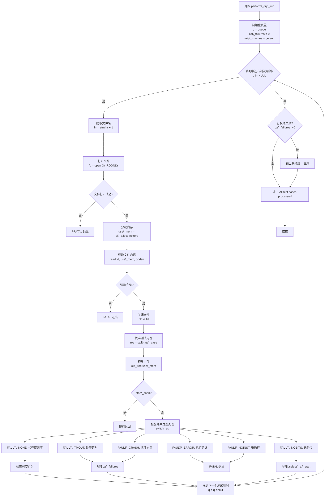

# [原创]AFL源码分析(3)

# AFL源码阅读
## perform\_dry\_run(use\_argv);
```cpp
static void perform\_dry\_run(char\*\* argv) {
struct queue\_entry\* q = queue;
u32 cal\_failures = 0;
u8\* skip\_crashes = getenv("AFL\_SKIP\_CRASHES");
while (q) {
u8\* use\_mem;
u8 res;
s32 fd;
u8\* fn = strrchr(q->fname, '/') + 1;
ACTF("Attempting dry run with '%s'...", fn);
fd = open(q->fname, O\_RDONLY);
if (fd < 0) PFATAL("Unable to open '%s'", q->fname);
use\_mem = ck\_alloc\_nozero(q->len);
if (read(fd, use\_mem, q->len) != q->len)
FATAL("Short read from '%s'", q->fname);
close(fd);
res = calibrate\_case(argv, q, use\_mem, 0, 1);
ck\_free(use\_mem);
if (stop\_soon) return;
if (res == crash\_mode || res == FAULT\_NOBITS)
SAYF(cGRA " len = %u, map size = %u, exec speed = %llu us\n" cRST,
q->len, q->bitmap\_size, q->exec\_us);
.....
}
.........
}
```
首先从queue获取测试样例`(fn == "id:000000,orig:case")`，然后读取之后调用`calibrate\_case`函数
```cpp
static u8 calibrate\_case(char\*\* argv, struct queue\_entry\* q, u8\* use\_mem,
u32 handicap, u8 from\_queue) {
static u8 first\_trace[MAP\_SIZE];
u8 fault = 0, new\_bits = 0, var\_detected = 0, hnb = 0,
first\_run = (q->exec\_cksum == 0);
u64 start\_us, stop\_us;
s32 old\_sc = stage\_cur, old\_sm = stage\_max;
u32 use\_tmout = exec\_tmout;
u8\* old\_sn = stage\_name;
/\* Be a bit more generous about timeouts when resuming sessions, or when
trying to calibrate already-added finds. This helps avoid trouble due
to intermittent latency. \*/
if (!from\_queue || resuming\_fuzz)
use\_tmout = MAX(exec\_tmout + CAL\_TMOUT\_ADD,
exec\_tmout \* CAL\_TMOUT\_PERC / 100);
q->cal\_failed++;
stage\_name = "calibration";
stage\_max = fast\_cal ? 3 : CAL\_CYCLES;
/\* Make sure the forkserver is up before we do anything, and let's not
count its spin-up time toward binary calibration. \*/
if (dumb\_mode != 1 && !no\_forkserver && !forksrv\_pid)
init\_forkserver(argv);
if (q->exec\_cksum) {
memcpy(first\_trace, trace\_bits, MAP\_SIZE);
hnb = has\_new\_bits(virgin\_bits);
if (hnb > new\_bits) new\_bits = hnb;
}
start\_us = get\_cur\_time\_us();
for (stage\_cur = 0; stage\_cur < stage\_max; stage\_cur++) {
u32 cksum;
if (!first\_run && !(stage\_cur % stats\_update\_freq)) show\_stats();
write\_to\_testcase(use\_mem, q->len);
fault = run\_target(argv, use\_tmout);
/\* stop\_soon is set by the handler for Ctrl+C. When it's pressed,
we want to bail out quickly. \*/
if (stop\_soon || fault != crash\_mode) goto abort\_calibration;
if (!dumb\_mode && !stage\_cur && !count\_bytes(trace\_bits)) {
fault = FAULT\_NOINST;
goto abort\_calibration;
}
cksum = hash32(trace\_bits, MAP\_SIZE, HASH\_CONST);
if (q->exec\_cksum != cksum) {
hnb = has\_new\_bits(virgin\_bits);
if (hnb > new\_bits) new\_bits = hnb;
if (q->exec\_cksum) {
u32 i;
for (i = 0; i < MAP\_SIZE; i++) {
if (!var\_bytes[i] && first\_trace[i] != trace\_bits[i]) {
var\_bytes[i] = 1;
stage\_max = CAL\_CYCLES\_LONG;
}
}
var\_detected = 1;
} else {
q->exec\_cksum = cksum;
memcpy(first\_trace, trace\_bits, MAP\_SIZE);
}
}
}
stop\_us = get\_cur\_time\_us();
total\_cal\_us += stop\_us - start\_us;
total\_cal\_cycles += stage\_max;
/\* OK, let's collect some stats about the performance of this test case.
This is used for fuzzing air time calculations in calculate\_score(). \*/
q->exec\_us = (stop\_us - start\_us) / stage\_max;
q->bitmap\_size = count\_bytes(trace\_bits);
q->handicap = handicap;
q->cal\_failed = 0;
total\_bitmap\_size += q->bitmap\_size;
total\_bitmap\_entries++;
update\_bitmap\_score(q);
/\* If this case didn't result in new output from the instrumentation, tell
parent. This is a non-critical problem, but something to warn the user
about. \*/
if (!dumb\_mode && first\_run && !fault && !new\_bits) fault = FAULT\_NOBITS;
abort\_calibration:
if (new\_bits == 2 && !q->has\_new\_cov) {
q->has\_new\_cov = 1;
queued\_with\_cov++;
}
/\* Mark variable paths. \*/
if (var\_detected) {
var\_byte\_count = count\_bytes(var\_bytes);
if (!q->var\_behavior) {
mark\_as\_variable(q);
queued\_variable++;
}
}
stage\_name = old\_sn;
stage\_cur = old\_sc;
stage\_max = old\_sm;
if (!first\_run) show\_stats();
return fault;
}
```
> \*\*参数说明：\*\*
>
> - argv: 传递给目标程序的命令行参数数组
>
> - q: 指向当前测试用例的队列条目
>
> - use\_mem: 测试用例的内容（内存中）
>
> - handicap: 测试用例的性能惩罚值
>
> - from\_queue: 标志位，表示是否从队列中调用（而非初始处理）
>
> \*\*返回值：\*\*
>
> - FAULT\_NONE: 正常执行
>
> - FAULT\_TMOUT: 执行超时
>
> - FAULT\_CRASH: 程序崩溃
>
> - FAULT\_ERROR: 执行错误
>
> - FAULT\_NOINST: 未检测到插桩
>
> - FAULT\_NOBITS: 未产生新的覆盖位
>
> \*\*一些变量：\*\*
>
> - first\_trace: 存储第一次运行时的覆盖率信息
>
> - fault: 执行结果状态
>
> - new\_bits: 是否发现新的覆盖位
>
> - var\_detected: 是否检测到变异行为
>
> - hnb: 临时存储 has\_new\_bits 的结果
>
> - first\_run: 是否是第一次运行此测试用例
>
> - start\_us, stop\_us: 记录执行时间
>
> - 保存当前阶段信息，以便后续恢复
```cpp
if (dumb\_mode != 1 && !no\_forkserver && !forksrv\_pid)
init\_forkserver(argv);
```
这里初始化forkserver
```cpp
if (q->exec\_cksum) {
memcpy(first\_trace, trace\_bits, MAP\_SIZE);
hnb = has\_new\_bits(virgin\_bits);
if (hnb > new\_bits) new\_bits = hnb;
}
```
如果测试用例已有校验和，那么直接覆盖然后检查是否有新的覆盖位
```cpp
start\_us = get\_cur\_time\_us();
for (stage\_cur = 0; stage\_cur < stage\_max; stage\_cur++) {
// 执行测试用例并分析结果
}
stop\_us = get\_cur\_time\_us();
```
记录开始和结束的时间
```cpp
u32 cksum;
if (!first\_run && !(stage\_cur % stats\_update\_freq)) show\_stats();
write\_to\_testcase(use\_mem, q->len);
fault = run\_target(argv, use\_tmout);
```
- 如果不是首次运行，定期更新统计信息
- 将测试用例写入文件
- 运行目标程序并获取执行结果
```cpp
if (stop\_soon || fault != crash\_mode) goto abort\_calibration;
if (!dumb\_mode && !stage\_cur && !count\_bytes(trace\_bits)) {
fault = FAULT\_NOINST;
goto abort\_calibration;
}
```
> 如果收到停止信号或执行结果与崩溃模式不符，中止校准
>
> 如果是第一次循环且未检测到覆盖位，设置 FAULT\_NOINST 并中止校准
```cpp
cksum = hash32(trace\_bits, MAP\_SIZE, HASH\_CONST);
if (q->exec\_cksum != cksum) {
hnb = has\_new\_bits(virgin\_bits);
if (hnb > new\_bits) new\_bits = hnb;
if (q->exec\_cksum) {
// 已有校验和，检测变异行为
u32 i;
for (i = 0; i < MAP\_SIZE; i++) {
if (!var\_bytes[i] && first\_trace[i] != trace\_bits[i]) {
var\_bytes[i] = 1;
stage\_max = CAL\_CYCLES\_LONG;
}
}
var\_detected = 1;
} else {
// 首次执行，记录校验和和覆盖位图
q->exec\_cksum = cksum;
memcpy(first\_trace, trace\_bits, MAP\_SIZE);
}
}
```
如果已有校验和但当前校验和不同，则逐位比较覆盖位图，标记变异位置，并延长校准循环
```cpp
total\_cal\_us += stop\_us - start\_us;
total\_cal\_cycles += stage\_max;
q->exec\_us = (stop\_us - start\_us) / stage\_max;
q->bitmap\_size = count\_bytes(trace\_bits);
q->handicap = handicap;
q->cal\_failed = 0;
total\_bitmap\_size += q->bitmap\_size;
total\_bitmap\_entries++;
update\_bitmap\_score(q);
```
之后会计算统计的数据
```cpp
if (!dumb\_mode && first\_run && !fault && !new\_bits) fault = FAULT\_NOBITS;
```
如果是首次运行，且未产生新的覆盖位，就会标记为`FAULT\_NOBITS`
```cpp
abort\_calibration:
if (new\_bits == 2 && !q->has\_new\_cov) {
q->has\_new\_cov = 1;
queued\_with\_cov++;
}
```
如果产生了新的路径覆盖，则mark
```cpp
if (var\_detected) {
var\_byte\_count = count\_bytes(var\_bytes);
if (!q->var\_behavior) {
mark\_as\_variable(q);
queued\_variable++;
}
}
```
如果有变异行为，计算变异字节数，并mark测试用例为变异行为
总的来说就是：
- 运行目标程序多次（通常是8次，由 CAL\_CYCLES 定义）
- 收集执行信息，如执行时间、代码覆盖率等
- 检测程序行为是否稳定（每次运行是否产生相同的覆盖率）
- 返回执行结果状态（如正常、超时、崩溃等）

### update\_bitmap\_score
```cpp
static void update\_bitmap\_score(struct queue\_entry\* q) {
u32 i;
u64 fav\_factor = q->exec\_us \* q->len;
/\* For every byte set in trace\_bits[], see if there is a previous winner,
and how it compares to us. \*/
for (i = 0; i < MAP\_SIZE; i++)
if (trace\_bits[i]) {
if (top\_rated[i]) {
/\* Faster-executing or smaller test cases are favored. \*/
if (fav\_factor > top\_rated[i]->exec\_us \* top\_rated[i]->len) continue;
/\* Looks like we're going to win. Decrease ref count for the
previous winner, discard its trace\_bits[] if necessary. \*/
if (!--top\_rated[i]->tc\_ref) {
ck\_free(top\_rated[i]->trace\_mini);
top\_rated[i]->trace\_mini = 0;
}
}
/\* Insert ourselves as the new winner. \*/
top\_rated[i] = q;
q->tc\_ref++;
if (!q->trace\_mini) {
q->trace\_mini = ck\_alloc(MAP\_SIZE >> 3);
minimize\_bits(q->trace\_mini, trace\_bits);
}
score\_changed = 1;
}
}
```
该函数是AFL优化算法的第一阶段，负责为每个覆盖率位置维护一个"最优"测试用例
```cpp
u64 fav\_factor = q->exec\_us \* q->len;
```
`评分因子=执行时间\*测试用例文件的大小`
评分改变只在以下情况发生：
\*\*新的覆盖率位置：\*\*
- 当 trace\_bits[i] != 0 且 top\_rated[i] == NULL
- 即发现了全新的代码覆盖路径
\*\*更优的测试用例：\*\*
- 现有位置有竞争者，但新测试用例表现更好
- \*\*new\_fav\_factor < old\_fav\_factor\*\*
```c
if (fav\_factor > top\_rated[i]->exec\_us \* top\_rated[i]->len) continue; //要求严格优于
```
```cpp
top\_rated[i] = q; // 设置新的最优测试用例
q->tc\_ref++; // 增加引用计数
```
```cpp
if (!--top\_rated[i]->tc\_ref) {
ck\_free(top\_rated[i]->trace\_mini);
top\_rated[i]->trace\_mini = 0;
}
```
减少旧的用例的引用次数，如果为0（就是bitmap上每一个路径都不是这个旧的用例的最佳用例），就会释放`trace\_mini`，然后标记`trace\_mini=0`，然后
```cpp
if (!q->trace\_mini) {
q->trace\_mini = ck\_alloc(MAP\_SIZE >> 3); // 分配8KB
minimize\_bits(q->trace\_mini, trace\_bits); // 压缩64KB到8KB
}
```
如果新的最佳没有trace\_mini就会分配一个，然后将64KB的覆盖率信息压缩为8KB的位向量
## init\_forkserver
参数是`char \*\*argv`指向目标程序的完整路径以及一些参数
```cpp
static s32 forksrv\_pid; // Fork server进程ID
static s32 fsrv\_ctl\_fd; // 控制管道文件描述符(写端)
static s32 fsrv\_st\_fd; // 状态管道文件描述符(读端)
#define FORKSRV\_FD 198 // Fork server通信基础文件描述符
#define FORK\_WAIT\_MULT 10 // 握手等待时间倍数
```
```cpp
static struct itimerval it;
int st\_pipe[2], ctl\_pipe[2];
int status;
s32 rlen;
ACTF("Spinning up the fork server...");
if (pipe(st\_pipe) || pipe(ctl\_pipe)) PFATAL("pipe() failed");
```
创建两个管道用户进程间的通信
- st\_pipe: 状态管道，fork server → AFL主进程
- ctl\_pipe: 控制管道，AFL主进程 → fork server
```CPP
forksrv\_pid = fork();
if (forksrv\_pid < 0) PFATAL("fork() failed");
if (!forksrv\_pid) {
// 子进程代码 - 将成为fork server
} else {
// 父进程代码 - AFL主进程
}
```
### 子进程
```cpp
struct rlimit r;
if (!getrlimit(RLIMIT\_NOFILE, &r) && r.rlim\_cur < FORKSRV\_FD + 2) {
r.rlim\_cur = FORKSRV\_FD + 2;
setrlimit(RLIMIT\_NOFILE, &r);
}
```
确保有足够的文件描述符
```cpp
if (mem\_limit) {
r.rlim\_max = r.rlim\_cur = ((rlim\_t)mem\_limit) << 20;
#ifdef RLIMIT\_AS
setrlimit(RLIMIT\_AS, &r);
#else
setrlimit(RLIMIT\_DATA, &r); // OpenBSD
#endif
}
```
不同系统使用不同的内存限制类型
```cpp
r.rlim\_max = r.rlim\_cur = 0;
setrlimit(RLIMIT\_CORE, &r);
```
核心转储影响性能，且在模糊测试中不需要，因此禁用了
```cpp
setsid(); // 创建新会话，脱离控制终端
dup2(dev\_null\_fd, 1); // stdout → /dev/null
dup2(dev\_null\_fd, 2); // stderr → /dev/null
if (out\_file) {
dup2(dev\_null\_fd, 0); // stdin → /dev/null
} else {
dup2(out\_fd, 0); // stdin → 测试数据
close(out\_fd);
}
```
```cpp
if (dup2(ctl\_pipe[0], FORKSRV\_FD) < 0) PFATAL("dup2() failed"); // 198
if (dup2(st\_pipe[1], FORKSRV\_FD + 1) < 0) PFATAL("dup2() failed"); // 199
close(ctl\_pipe[0]);
close(ctl\_pipe[1]);
close(st\_pipe[0]);
close(st\_pipe[1]);
```
将管道映射到固定的文件描述符198和199上
```cpp
if (!getenv("LD\_BIND\_LAZY")) setenv("LD\_BIND\_NOW", "1", 0);
```
在程序启动时解析所有符号，避免fork后的链接工作
```cpp
setenv("ASAN\_OPTIONS", "abort\_on\_error=1:"
"detect\_leaks=0:"
"symbolize=0:"
"allocator\_may\_return\_null=1", 0);
setenv("MSAN\_OPTIONS", "exit\_code=" STRINGIFY(MSAN\_ERROR) ":"
"symbolize=0:"
"abort\_on\_error=1:"
"allocator\_may\_return\_null=1:"
"msan\_track\_origins=0", 0);
```
```cpp
execv(target\_path, argv);
// 如果execv失败
\*(u32\*)trace\_bits = EXEC\_FAIL\_SIG;
exit(0);
```
然后就直接执行execv函数
执行完之后这个新的进程就会替换掉这个子进程，但是文件描述符、PID以及相应的资源限制都会继承
如果当时是对test程序进行fuzz的话，此时target\_path和argv都会指向该程序的绝对路径
因此这个子进程就会变成一个test进程
> execv参数设置：
>
> 1. path：指向要执行程序的绝对路径，例如："/bin/ls";
> 2. argv：要执行的命令，例如：{"ls", "-l", "/tmp", NULL};
> 3. env：执行环境变量的C语言字符串
### 父进程（AFL主进程）
```cpp
close(ctl\_pipe[0]); // 关闭控制管道读端
close(st\_pipe[1]); // 关闭状态管道写端
fsrv\_ctl\_fd = ctl\_pipe[1]; // 保存控制管道写端
fsrv\_st\_fd = st\_pipe[0]; // 保存状态管道读端
```
设置管道的端点
```cpp
// 设置超时定时器
it.it\_value.tv\_sec = ((exec\_tmout \* FORK\_WAIT\_MULT) / 1000);
it.it\_value.tv\_usec = ((exec\_tmout \* FORK\_WAIT\_MULT) % 1000) \* 1000;
setitimer(ITIMER\_REAL, &it, NULL);
// 等待4字节hello消息
rlen = read(fsrv\_st\_fd, &status, 4);
// 清除定时器
it.it\_value.tv\_sec = 0;
it.it\_value.tv\_usec = 0;
setitimer(ITIMER\_REAL, &it, NULL);
```
握手等待
```cpp
if (rlen == 4) {
OKF("All right - fork server is up.");
return;
}
```
成功会这样
```cpp
if (child\_timed\_out)
FATAL("Timeout while initializing fork server (adjusting -t may help)");
```
超时
### 执行插桩代码分析
```cpp
\_afl\_maybe\_log(argc, argv, envp, 43576LL);
```
a4是这个函数的唯一标识符，也可以说是一个时间戳的随机数
```cpp
char \_\_fastcall \_afl\_maybe\_log(\_\_int64 a1, \_\_int64 a2, \_\_int64 a3, \_\_int64 a4)
{
char v4; // of
char v5; // al
\_\_int64 v6; // rdx
\_\_int64 v7; // rcx
char \*v9; // rax
int v10; // eax
void \*v11; // rax
int v12; // edi
\_\_int64 v13; // rax
\_\_int64 v14; // rax
\_\_int64 v15; // [rsp-10h] [rbp-180h]
char v16; // [rsp+10h] [rbp-160h]
\_\_int64 v17; // [rsp+18h] [rbp-158h]
v5 = v4;
v6 = \_afl\_area\_ptr;
if ( !\_afl\_area\_ptr )
{
if ( \_afl\_setup\_failure )
return v5 + 127;
v6 = \_afl\_global\_area\_ptr;
if ( \_afl\_global\_area\_ptr )
{
\_afl\_area\_ptr = \_afl\_global\_area\_ptr;
}
else
{
v16 = v4;
v17 = a4;
v9 = getenv("\_\_AFL\_SHM\_ID");
if ( !v9 || (v10 = atoi(v9), v11 = shmat(v10, 0LL, 0), v11 == (void \*)-1LL) )
{
++\_afl\_setup\_failure;
v5 = v16;
return v5 + 127;
}
\_afl\_area\_ptr = (\_\_int64)v11;
\_afl\_global\_area\_ptr = v11;
v15 = (\_\_int64)v11;
if ( write(199, &\_afl\_temp, 4uLL) == 4 )
{
while ( 1 )
{
v12 = 198;
if ( read(198, &\_afl\_temp, 4uLL) != 4 )
break;
LODWORD(v13) = fork();
if ( v13 < 0 )
break;
if ( !v13 )
goto \_\_afl\_fork\_resume;
\_afl\_fork\_pid = v13;
write(199, &\_afl\_fork\_pid, 4uLL);
v12 = \_afl\_fork\_pid;
LODWORD(v14) = waitpid(\_afl\_fork\_pid, &\_afl\_temp, 0);
if ( v14 <= 0 )
break;
write(199, &\_afl\_temp, 4uLL);
}
\_exit(v12);
}
\_\_afl\_fork\_resume:
close(198);
close(199);
v6 = v15;
v5 = v16;
a4 = v17;
}
}
v7 = \_afl\_prev\_loc ^ a4;
\_afl\_prev\_loc ^= v7;
\_afl\_prev\_loc = (unsigned \_\_int64)\_afl\_prev\_loc >> 1;
++\*(\_BYTE \*)(v6 + v7);
return v5 + 127;
}
```
```cpp
v9 = getenv("\_\_AFL\_SHM\_ID"); // 获取共享内存ID
v10 = atoi(v9); // 转换为整数
v11 = shmat(v10, 0LL, 0); // 连接共享内存
```
连接共享内存
#### Forkserver
```cpp
while (1) {
// 1. 等待AFL的fork请求
if (read(198, &\_afl\_temp, 4uLL) != 4) break;
// 2. 创建子进程
LODWORD(v13) = fork();
if (!v13) {
// 子进程：跳转到正常程序执行
goto \_\_afl\_fork\_resume;
}
// 3. 父进程：发送子进程PID给AFL
\_afl\_fork\_pid = v13;
write(199, &\_afl\_fork\_pid, 4uLL);
// 4. 等待子进程结束并发送退出状态
waitpid(\_afl\_fork\_pid, &\_afl\_temp, 0);
write(199, &\_afl\_temp, 4uLL);
}
```
基于边的覆盖位图跟踪：
```cpp
v7 = \_afl\_prev\_loc ^ a4; // 计算边的哈希值
\_afl\_prev\_loc ^= v7; // 等效于：\_afl\_prev\_loc = a4
\_afl\_prev\_loc = \_afl\_prev\_loc >> 1; // 右移1位，作为下次的prev\_loc
++\*(\_BYTE \*)(v6 + v7); // 在位图中增加计数
```
## cull\_queue
```cpp
static void cull\_queue(void) {
struct queue\_entry\* q;
static u8 temp\_v[MAP\_SIZE >> 3];
u32 i;
if (dumb\_mode || !score\_changed) return;
score\_changed = 0;
memset(temp\_v, 255, MAP\_SIZE >> 3);
queued\_favored = 0;
pending\_favored = 0;
q = queue;
while (q) {
q->favored = 0;
q = q->next;
}
/\* Let's see if anything in the bitmap isn't captured in temp\_v.
If yes, and if it has a top\_rated[] contender, let's use it. \*/
for (i = 0; i < MAP\_SIZE; i++)
if (top\_rated[i] && (temp\_v[i >> 3] & (1 << (i & 7)))) {
u32 j = MAP\_SIZE >> 3;
/\* Remove all bits belonging to the current entry from temp\_v. \*/
while (j--)
if (top\_rated[i]->trace\_mini[j])
temp\_v[j] &= ~top\_rated[i]->trace\_mini[j];
top\_rated[i]->favored = 1;
queued\_favored++;
if (!top\_rated[i]->was\_fuzzed) pending\_favored++;
}
q = queue;
while (q) {
mark\_as\_redundant(q, !q->favored);
q = q->next;
}
}
```
```cpp
if (dumb\_mode || !score\_changed) return;
score\_changed = 0;
memset(temp\_v, 255, MAP\_SIZE >> 3); // 将所有位设为1
queued\_favored = 0;
pending\_favored = 0;
```
如果是盲fuzz模式或者评分没有改变（改变就是出现了新的路径或者有一个更好的抵达某个路径的测试用例的出现）就会直接return
将 temp\_v 初始化为全1，表示所有覆盖率位置都需要被覆盖，重置所有测试用例的 favored 标记
```cpp
for (i = 0; i < MAP\_SIZE; i++)
if (top\_rated[i] && (temp\_v[i >> 3] & (1 << (i & 7)))) {
// 选择这个测试用例
top\_rated[i]->favored = 1;
// 从temp\_v中移除这个测试用例覆盖的所有位
while (j--)
if (top\_rated[i]->trace\_mini[j])
temp\_v[j] &= ~top\_rated[i]->trace\_mini[j];
}
```
贪心选择算法，如果bitmap上的某一个位置有最佳的测试用例而且该位置也未被覆盖，将该测试用例标记位优选，然后从temp\_v中移除该测试用例能覆盖到的所有位置
```cpp
q = queue;
while (q) {
mark\_as\_redundant(q, !q->favored);
q = q->next;
}
```
将未被标记为优选的测试用例标记为冗余
> 被标记为优选的测试样例会被优先变异
## show\_init\_stats
```cpp
static void show\_init\_stats(void) {
struct queue\_entry\* q = queue;
u32 min\_bits = 0, max\_bits = 0;
u64 min\_us = 0, max\_us = 0;
u64 avg\_us = 0;
u32 max\_len = 0;
if (total\_cal\_cycles) avg\_us = total\_cal\_us / total\_cal\_cycles;
while (q) {
if (!min\_us || q->exec\_us < min\_us) min\_us = q->exec\_us;
if (q->exec\_us > max\_us) max\_us = q->exec\_us;
if (!min\_bits || q->bitmap\_size < min\_bits) min\_bits = q->bitmap\_size;
if (q->bitmap\_size > max\_bits) max\_bits = q->bitmap\_size;
if (q->len > max\_len) max\_len = q->len;
q = q->next;
}
SAYF("\n");
if (avg\_us > (qemu\_mode ? 50000 : 10000))
WARNF(cLRD "The target binary is pretty slow! See %s/perf\_tips.txt.",
doc\_path);
/\* Let's keep things moving with slow binaries. \*/
if (avg\_us > 50000) havoc\_div = 10; /\* 0-19 execs/sec \*/
else if (avg\_us > 20000) havoc\_div = 5; /\* 20-49 execs/sec \*/
else if (avg\_us > 10000) havoc\_div = 2; /\* 50-100 execs/sec \*/
if (!resuming\_fuzz) {
if (max\_len > 50 \* 1024)
WARNF(cLRD "Some test cases are huge (%s) - see %s/perf\_tips.txt!",
DMS(max\_len), doc\_path);
else if (max\_len > 10 \* 1024)
WARNF("Some test cases are big (%s) - see %s/perf\_tips.txt.",
DMS(max\_len), doc\_path);
if (useless\_at\_start && !in\_bitmap)
WARNF(cLRD "Some test cases look useless. Consider using a smaller set.");
if (queued\_paths > 100)
WARNF(cLRD "You probably have far too many input files! Consider trimming down.");
else if (queued\_paths > 20)
WARNF("You have lots of input files; try starting small.");
}
OKF("Here are some useful stats:\n\n"
cGRA " Test case count : " cRST "%u favored, %u variable, %u total\n"
cGRA " Bitmap range : " cRST "%u to %u bits (average: %0.02f bits)\n"
cGRA " Exec timing : " cRST "%s to %s us (average: %s us)\n",
queued\_favored, queued\_variable, queued\_paths, min\_bits, max\_bits,
((double)total\_bitmap\_size) / (total\_bitmap\_entries ? total\_bitmap\_entries : 1),
DI(min\_us), DI(max\_us), DI(avg\_us));
if (!timeout\_given) {
/\* Figure out the appropriate timeout. The basic idea is: 5x average or
1x max, rounded up to EXEC\_TM\_ROUND ms and capped at 1 second.
If the program is slow, the multiplier is lowered to 2x or 3x, because
random scheduler jitter is less likely to have any impact, and because
our patience is wearing thin =) \*/
if (avg\_us > 50000) exec\_tmout = avg\_us \* 2 / 1000;
else if (avg\_us > 10000) exec\_tmout = avg\_us \* 3 / 1000;
else exec\_tmout = avg\_us \* 5 / 1000;
exec\_tmout = MAX(exec\_tmout, max\_us / 1000);
exec\_tmout = (exec\_tmout + EXEC\_TM\_ROUND) / EXEC\_TM\_ROUND \* EXEC\_TM\_ROUND;
if (exec\_tmout > EXEC\_TIMEOUT) exec\_tmout = EXEC\_TIMEOUT;
ACTF("No -t option specified, so I'll use exec timeout of %u ms.",
exec\_tmout);
timeout\_given = 1;
} else if (timeout\_given == 3) {
ACTF("Applying timeout settings from resumed session (%u ms).", exec\_tmout);
}
/\* In dumb mode, re-running every timing out test case with a generous time
limit is very expensive, so let's select a more conservative default. \*/
if (dumb\_mode && !getenv("AFL\_HANG\_TMOUT"))
hang\_tmout = MIN(EXEC\_TIMEOUT, exec\_tmout \* 2 + 100);
OKF("All set and ready to roll!");
}
```
```cpp
if (total\_cal\_cycles) avg\_us = total\_cal\_us / total\_cal\_cycles;
while (q) {
if (!min\_us || q->exec\_us < min\_us) min\_us = q->exec\_us;
if (q->exec\_us > max\_us) max\_us = q->exec\_us;
if (!min\_bits || q->bitmap\_size < min\_bits) min\_bits = q->bitmap\_size;
if (q->bitmap\_size > max\_bits) max\_bits = q->bitmap\_size;
if (q->len > max\_len) max\_len = q->len;
q = q->next;
}
```
- 最小/最大执行时间 min\_us/max\_us
- 最小/最大位图大小 min\_bits/max\_bits
- 最大输入长度 max\_len
- 平均执行时间 avg\_us = total\_cal\_us / total\_cal\_cycles
```cpp
if (avg\_us > (qemu\_mode ? 50000 : 10000))
WARNF(cLRD "The target binary is pretty slow! See %s/perf\_tips.txt.",
doc\_path);
```
qemu模式下的平均执行时间给的更加宽松，也能看出qemu模式下的fuzz效率更低
```cpp
if (avg\_us > 50000) havoc\_div = 10; /\* 0-19 execs/sec \*/
else if (avg\_us > 20000) havoc\_div = 5; /\* 20-49 execs/sec \*/
else if (avg\_us > 10000) havoc\_div = 2; /\* 50-100 execs/sec \*/
```
平均执行时间更慢则降低变异强度（增大 havoc\_div）
```cpp
if (!resuming\_fuzz) {
if (max\_len > 50 \* 1024)
WARNF(cLRD "Some test cases are huge (%s) - see %s/perf\_tips.txt!",
DMS(max\_len), doc\_path);
else if (max\_len > 10 \* 1024)
WARNF("Some test cases are big (%s) - see %s/perf\_tips.txt.",
DMS(max\_len), doc\_path);
if (useless\_at\_start && !in\_bitmap)
WARNF(cLRD "Some test cases look useless. Consider using a smaller set.");
if (queued\_paths > 100)
WARNF(cLRD "You probably have far too many input files! Consider trimming down.");
else if (queued\_paths > 20)
WARNF("You have lots of input files; try starting small.");
}
```
在非恢复对话下，给出一些样本的可读性建议
```cpp
if (avg\_us > 50000) exec\_tmout = avg\_us \* 2 / 1000;
else if (avg\_us > 10000) exec\_tmout = avg\_us \* 3 / 1000;
else exec\_tmout = avg\_us \* 5 / 1000;
exec\_tmout = MAX(exec\_tmout, max\_us / 1000);
exec\_tmout = (exec\_tmout + EXEC\_TM\_ROUND) / EXEC\_TM\_ROUND \* EXEC\_TM\_ROUND;
if (exec\_tmout > EXEC\_TIMEOUT) exec\_tmout = EXEC\_TIMEOUT;
```
根据平均执行时间/最大执行时间推导出较佳的`exec\_tmout`
```cpp
if (dumb\_mode && !getenv("AFL\_HANG\_TMOUT"))
hang\_tmout = MIN(EXEC\_TIMEOUT, exec\_tmout \* 2 + 100);
```
如果是盲fuzz且未设环境变量则设定更保守的挂起时间
## find\_start\_position
```cpp
static u32 find\_start\_position(void) {
static u8 tmp[4096]; /\* Ought to be enough for anybody. \*/
u8 \*fn, \*off;
s32 fd, i;
u32 ret;
if (!resuming\_fuzz) return 0;
if (in\_place\_resume) fn = alloc\_printf("%s/fuzzer\_stats", out\_dir);
else fn = alloc\_printf("%s/../fuzzer\_stats", in\_dir);
fd = open(fn, O\_RDONLY);
ck\_free(fn);
if (fd < 0) return 0;
i = read(fd, tmp, sizeof(tmp) - 1); (void)i; /\* Ignore errors \*/
close(fd);
off = strstr(tmp, "cur\_path : ");
if (!off) return 0;
ret = atoi(off + 20);
if (ret >= queued\_paths) ret = 0;
return ret;
}
```
恢复会话模式下用于寻找从队列中的哪个位置开始继续测试
读取fuzzer\_stats文件下的最多4095字节到缓冲区，然后解析`cur\_path : `字符串（strstr返回cur\_path出现的第一个字符的指针），提取冒号后的数值（源码上是通过偏移20来获取的，但是该字符串就是20，就是提取紧接着的数值）
## write\_stats\_file
在程序main函数的参数是`(0,0,0)`
```cpp
static void write\_stats\_file(double bitmap\_cvg, double stability, double eps) {
static double last\_bcvg, last\_stab, last\_eps;
static struct rusage usage;
u8\* fn = alloc\_printf("%s/fuzzer\_stats", out\_dir);
s32 fd;
FILE\* f;
fd = open(fn, O\_WRONLY | O\_CREAT | O\_TRUNC, 0600);
if (fd < 0) PFATAL("Unable to create '%s'", fn);
ck\_free(fn);
f = fdopen(fd, "w");
if (!f) PFATAL("fdopen() failed");
/\* Keep last values in case we're called from another context
where exec/sec stats and such are not readily available. \*/
if (!bitmap\_cvg && !stability && !eps) {
bitmap\_cvg = last\_bcvg;
stability = last\_stab;
eps = last\_eps;
} else {
last\_bcvg = bitmap\_cvg;
last\_stab = stability;
last\_eps = eps;
}
fprintf(f, "start\_time : %llu\n"
"last\_update : %llu\n"
"fuzzer\_pid : %u\n"
"cycles\_done : %llu\n"
"execs\_done : %llu\n"
"execs\_per\_sec : %0.02f\n"
"paths\_total : %u\n"
"paths\_favored : %u\n"
"paths\_found : %u\n"
"paths\_imported : %u\n"
"max\_depth : %u\n"
"cur\_path : %u\n" /\* Must match find\_start\_position() \*/
"pending\_favs : %u\n"
"pending\_total : %u\n"
"variable\_paths : %u\n"
"stability : %0.02f%%\n"
"bitmap\_cvg : %0.02f%%\n"
"unique\_crashes : %llu\n"
"unique\_hangs : %llu\n"
"last\_path : %llu\n"
"last\_crash : %llu\n"
"last\_hang : %llu\n"
"execs\_since\_crash : %llu\n"
"exec\_timeout : %u\n" /\* Must match find\_timeout() \*/
"afl\_banner : %s\n"
"afl\_version : " VERSION "\n"
"target\_mode : %s%s%s%s%s%s%s\n"
"command\_line : %s\n"
"slowest\_exec\_ms : %llu\n",
start\_time / 1000, get\_cur\_time() / 1000, getpid(),
queue\_cycle ? (queue\_cycle - 1) : 0, total\_execs, eps,
queued\_paths, queued\_favored, queued\_discovered, queued\_imported,
max\_depth, current\_entry, pending\_favored, pending\_not\_fuzzed,
queued\_variable, stability, bitmap\_cvg, unique\_crashes,
unique\_hangs, last\_path\_time / 1000, last\_crash\_time / 1000,
last\_hang\_time / 1000, total\_execs - last\_crash\_execs,
exec\_tmout, use\_banner,
qemu\_mode ? "qemu " : "", dumb\_mode ? " dumb " : "",
no\_forkserver ? "no\_forksrv " : "", crash\_mode ? "crash " : "",
persistent\_mode ? "persistent " : "", deferred\_mode ? "deferred " : "",
(qemu\_mode || dumb\_mode || no\_forkserver || crash\_mode ||
persistent\_mode || deferred\_mode) ? "" : "default",
orig\_cmdline, slowest\_exec\_ms);
/\* ignore errors \*/
/\* Get rss value from the children
We must have killed the forkserver process and called waitpid
before calling getrusage \*/
if (getrusage(RUSAGE\_CHILDREN, &usage)) {
WARNF("getrusage failed");
} else if (usage.ru\_maxrss == 0) {
fprintf(f, "peak\_rss\_mb : not available while afl is running\n");
} else {
#ifdef \_\_APPLE\_\_
fprintf(f, "peak\_rss\_mb : %zu\n", usage.ru\_maxrss >> 20);
#else
fprintf(f, "peak\_rss\_mb : %zu\n", usage.ru\_maxrss >> 10);
#endif /\* ^\_\_APPLE\_\_ \*/
}
fclose(f);
}
```
\*\*统计的信息：\*\*
时间相关：
- `start\_time`: 开始时间（Unix时间戳）
- `last\_update`: 最后更新时间
- `exec\_timeout`: 执行超时设置
执行统计：
- `execs\_done`: 总执行次数
- `execs\_per\_sec`: 每秒执行数
- `cycles\_done`: 完成的队列循环数
路径发现：
- `paths\_total`: 队列中总路径数
- `paths\_favored`: 优选路径数
- `paths\_found`: 本地发现的路径
- `paths\_imported`: 从其他实例导入的路径
覆盖率与稳定性：
- `bitmap\_cvg`: 位图覆盖率
- `stability`: 执行稳定性
- `variable\_paths`: 表现不稳定的测试案例数
崩溃与挂起：
- `unique\_crashes`: 唯一崩溃数
- `unique\_hangs`: 唯一挂起数
- `last\_crash`/`last\_hang`: 最后崩溃/挂起时间
## save\_auto
```cpp
static void save\_auto(void) {
u32 i;
if (!auto\_changed) return;
auto\_changed = 0;
for (i = 0; i < MIN(USE\_AUTO\_EXTRAS, a\_extras\_cnt); i++) {
u8\* fn = alloc\_printf("%s/queue/.state/auto\_extras/auto\_%06u", out\_dir, i);
s32 fd;
fd = open(fn, O\_WRONLY | O\_CREAT | O\_TRUNC, 0600);
if (fd < 0) PFATAL("Unable to create '%s'", fn);
ck\_write(fd, a\_extras[i].data, a\_extras[i].len, fn);
close(fd);
ck\_free(fn);
}
}
```
只保存前`MIN(USE\_AUTO\_EXTRAS, a\_extras\_cnt)`个`auto extras`
Auto extras 是 AFL 在模糊测试过程中自动发现的有价值的字节序列，这些序列：
- 在测试用例中频繁出现
- 可能触发程序的不同执行路径
- 用于后续的变异操作中，提高发现新路径的效率
## 部分main函数
```cpp
if (stop\_soon) goto stop\_fuzzing;
/\* Woop woop woop \*/
if (!not\_on\_tty) {
sleep(4);
start\_time += 4000;
if (stop\_soon) goto stop\_fuzzing;
}
while (1) {
u8 skipped\_fuzz;
cull\_queue();
if (!queue\_cur) {
queue\_cycle++;
current\_entry = 0;
cur\_skipped\_paths = 0;
queue\_cur = queue;
while (seek\_to) {
current\_entry++;
seek\_to--;
queue\_cur = queue\_cur->next;
}
show\_stats();
if (not\_on\_tty) {
ACTF("Entering queue cycle %llu.", queue\_cycle);
fflush(stdout);
}
/\* If we had a full queue cycle with no new finds, try
recombination strategies next. \*/
if (queued\_paths == prev\_queued) {
if (use\_splicing) cycles\_wo\_finds++; else use\_splicing = 1;
} else cycles\_wo\_finds = 0;
prev\_queued = queued\_paths;
if (sync\_id && queue\_cycle == 1 && getenv("AFL\_IMPORT\_FIRST"))
sync\_fuzzers(use\_argv);
}
skipped\_fuzz = fuzz\_one(use\_argv);
if (!stop\_soon && sync\_id && !skipped\_fuzz) {
if (!(sync\_interval\_cnt++ % SYNC\_INTERVAL))
sync\_fuzzers(use\_argv);
}
if (!stop\_soon && exit\_1) stop\_soon = 2;
if (stop\_soon) break;
queue\_cur = queue\_cur->next;
current\_entry++;
}
if (queue\_cur) show\_stats();
/\* If we stopped programmatically, we kill the forkserver and the current runner.
If we stopped manually, this is done by the signal handler. \*/
if (stop\_soon == 2) {
if (child\_pid > 0) kill(child\_pid, SIGKILL);
if (forksrv\_pid > 0) kill(forksrv\_pid, SIGKILL);
}
/\* Now that we've killed the forkserver, we wait for it to be able to get rusage stats. \*/
if (waitpid(forksrv\_pid, NULL, 0) <= 0) {
WARNF("error waitpid\n");
}
write\_bitmap();
write\_stats\_file(0, 0, 0);
save\_auto();
stop\_fuzzing:
SAYF(CURSOR\_SHOW cLRD "\n\n+++ Testing aborted %s +++\n" cRST,
stop\_soon == 2 ? "programmatically" : "by user");
/\* Running for more than 30 minutes but still doing first cycle? \*/
if (queue\_cycle == 1 && get\_cur\_time() - start\_time > 30 \* 60 \* 1000) {
SAYF("\n" cYEL "[!] " cRST
"Stopped during the first cycle, results may be incomplete.\n"
" (For info on resuming, see %s/README.)\n", doc\_path);
}
```
```cpp
cull\_queue();
if (!queue\_cur) {
queue\_cycle++;
current\_entry = 0;
cur\_skipped\_paths = 0;
queue\_cur = queue;
while (seek\_to) {
current\_entry++;
seek\_to--;
queue\_cur = queue\_cur->next;
}
```
首先调用`cull\_queue`函数找出最优样例集合，当queue\_cur为空时，表示完成了一轮队列遍历
```cpp
if (queued\_paths == prev\_queued) {
if (use\_splicing) cycles\_wo\_finds++; else use\_splicing = 1;
} else cycles\_wo\_finds = 0;
prev\_queued = queued\_paths;
```
如果完整一轮队列循环后没有发现新路径（queued\_paths == prev\_queued）：
- 启用拼接（splicing）策略：将不同测试用例的片段组合
- 增加无发现循环计数器
如果有新发现，重置无发现计数器
```cpp
if (sync\_id && queue\_cycle == 1 && getenv("AFL\_IMPORT\_FIRST"))
sync\_fuzzers(use\_argv);
```
如果设置了`AFL\_IMPORT\_FIRST`且是首次循环，则与其他fuzzer实例同步
```cpp
skipped\_fuzz = fuzz\_one(use\_argv);
```
fuzz\_one函数是AFL的核心，对当前队列条目执行各种变异策略：
- 位翻转（bit flips）
- 字节翻转（byte flips）
- 算术运算（arithmetic）
- 已知有趣值（known integers）
- 字典攻击（dictionary）
- 随机破坏（havoc）
- 拼接（splicing）
这是核心函数，之后分析
```cpp
if (!stop\_soon && sync\_id && !skipped\_fuzz) {
if (!(sync\_interval\_cnt++ % SYNC\_INTERVAL))
sync\_fuzzers(use\_argv);
}
```
在多实例模式下，才会进行同步
```cpp
queue\_cur = queue\_cur->next;
current\_entry++;
```
移动到下一个队列
```cpp
if (stop\_soon == 2) {
if (child\_pid > 0) kill(child\_pid, SIGKILL);
if (forksrv\_pid > 0) kill(forksrv\_pid, SIGKILL);
}
if (waitpid(forksrv\_pid, NULL, 0) <= 0) {
WARNF("error waitpid\n");
}
```
- stop\_soon == 2：程序化停止（非用户手动停止）
- 终止子进程和fork服务器进程
- 等待fork服务器进程结束以获取资源使用统计
```cpp
write\_bitmap();
write\_stats\_file(0, 0, 0);
save\_auto();
```
记录位图，状态文件和自动提取的字典
## fuzz\_one
### 初始化
```cpp
// 优先处理favored条目
if (pending\_favored) {
if ((queue\_cur->was\_fuzzed || !queue\_cur->favored) &&
UR(100) < SKIP\_TO\_NEW\_PROB) return 1;
}
// 概率性跳过非favored条目
else if (!dumb\_mode && !queue\_cur->favored && queued\_paths > 10) {
if (queue\_cycle > 1 && !queue\_cur->was\_fuzzed) {
if (UR(100) < SKIP\_NFAV\_NEW\_PROB) return 1;
} else {
if (UR(100) < SKIP\_NFAV\_OLD\_PROB) return 1;
}
}
```
```cpp
// 将测试用例映射到内存
fd = open(queue\_cur->fname, O\_RDONLY);
orig\_in = in\_buf = mmap(0, len, PROT\_READ | PROT\_WRITE, MAP\_PRIVATE, fd, 0);
out\_buf = ck\_alloc\_nozero(len);
```
将测试用例映射到内存
```cpp
if (queue\_cur->cal\_failed) {
u8 res = FAULT\_TMOUT;
if (queue\_cur->cal\_failed < CAL\_CHANCES) {
queue\_cur->exec\_cksum = 0;
res = calibrate\_case(argv, queue\_cur, in\_buf, queue\_cycle - 1, 0);
if (res == FAULT\_ERROR)
FATAL("Unable to execute target application");
}
if (stop\_soon || res != crash\_mode) {
cur\_skipped\_paths++;
goto abandon\_entry;
}
}
```
重新校准之前失败的测试用例，确保测试用例能正常运行，超过重试次数就直接放弃
```cpp
if (!dumb\_mode && !queue\_cur->trim\_done) {
u8 res = trim\_case(argv, queue\_cur, in\_buf);
if (res == FAULT\_ERROR)
FATAL("Unable to execute target application");
if (stop\_soon) {
cur\_skipped\_paths++;
goto abandon\_entry;
}
queue\_cur->trim\_done = 1;
if (len != queue\_cur->len) len = queue\_cur->len;
}
```
修剪测试用例，移除不影响执行路径的冗余字节，减少文件大小，提高变异效率，每个测试用例只修剪一次
> trim\_case函数之后分析
```cpp
orig\_perf = perf\_score = calculate\_score(queue\_cur);
// 跳过确定性变异的条件
if (skip\_deterministic || queue\_cur->was\_fuzzed || queue\_cur->passed\_det)
goto havoc\_stage;
// 分布式模糊测试中的分工
if (master\_max && (queue\_cur->exec\_cksum % master\_max) != master\_id - 1)
goto havoc\_stage;
```
计算修剪之后的性能，直接到havoc变异的条件判断
### 确定性变异
#### 位翻转
```cpp
#define FLIP\_BIT(\_ar, \_b) do { \
u8\* \_arf = (u8\*)(\_ar); \
u32 \_bf = (\_b); \
\_arf[(\_bf) >> 3] ^= (128 >> ((\_bf) & 7)); \
} while (0)
```
精确翻转任意位置的单个位（`\_ar`是字符串指针，`\_b`是要翻转的位）
```cpp
stage\_name = "bitflip 1/1";
stage\_max = len << 3; // 总位数
for (stage\_cur = 0; stage\_cur < stage\_max; stage\_cur++) {
FLIP\_BIT(out\_buf, stage\_cur);
if (common\_fuzz\_stuff(argv, out\_buf, len)) goto abandon\_entry;
FLIP\_BIT(out\_buf, stage\_cur); // 恢复
// 自动字典构建逻辑
if (!dumb\_mode && (stage\_cur & 7) == 7) {
u32 cksum = hash32(trace\_bits, MAP\_SIZE, HASH\_CONST);
// ... 检测魔术字符串
}
}
```
会对该测试用例的每一个位都进行翻转，然后调用`common\_fuzz\_stuff`函数
```cpp
EXP\_ST u8 common\_fuzz\_stuff(char\*\* argv, u8\* out\_buf, u32 len) {
u8 fault;
if (post\_handler) {
out\_buf = post\_handler(out\_buf, &len);
if (!out\_buf || !len) return 0;
}
write\_to\_testcase(out\_buf, len);
fault = run\_target(argv, exec\_tmout);
if (stop\_soon) return 1;
if (fault == FAULT\_TMOUT) {
if (subseq\_tmouts++ > TMOUT\_LIMIT) {
cur\_skipped\_paths++;
return 1;
}
} else subseq\_tmouts = 0;
/\* Users can hit us with SIGUSR1 to request the current input
to be abandoned. \*/
if (skip\_requested) {
skip\_requested = 0;
cur\_skipped\_paths++;
return 1;
}
/\* This handles FAULT\_ERROR for us: \*/
queued\_discovered += save\_if\_interesting(argv, out\_buf, len, fault);
if (!(stage\_cur % stats\_update\_freq) || stage\_cur + 1 == stage\_max)
show\_stats();
return 0;
}
```
运行，然后保存有趣的测试用例
```cpp
queued\_discovered += save\_if\_interesting(argv, out\_buf, len, fault);
```
- 检查执行结果是否发现了新的代码路径或崩溃
- 如果有价值，将测试用例保存到队列中供后续分析
- 更新发现的队列项目计数
运行完这个函数如果超时多次或者跳过就会直接放弃这次fuzz
之后就是一样的多次翻转
#### 自动字典构建逻辑
```cpp
if (!dumb\_mode && (stage\_cur & 7) == 7) {
u32 cksum = hash32(trace\_bits, MAP\_SIZE, HASH\_CONST);
if (stage\_cur == stage\_max - 1 && cksum == prev\_cksum) {
/\* If at end of file and we are still collecting a string, grab the
final character and force output. \*/
if (a\_len < MAX\_AUTO\_EXTRA) a\_collect[a\_len] = out\_buf[stage\_cur >> 3];
a\_len++;
if (a\_len >= MIN\_AUTO\_EXTRA && a\_len <= MAX\_AUTO\_EXTRA)
maybe\_add\_auto(a\_collect, a\_len);
} else if (cksum != prev\_cksum) {
/\* Otherwise, if the checksum has changed, see if we have something
worthwhile queued up, and collect that if the answer is yes. \*/
if (a\_len >= MIN\_AUTO\_EXTRA && a\_len <= MAX\_AUTO\_EXTRA)
maybe\_add\_auto(a\_collect, a\_len);
a\_len = 0;
prev\_cksum = cksum;
}
}
```
不在dumb模式下且只在每个字节的\*\*最低位\*\*翻转时检查（stage\_cur & 7 == 7）
```cpp
u32 cksum = hash32(trace\_bits, MAP\_SIZE, HASH\_CONST);
```
计算当前程序执行路径的哈希值
```CPP
if (stage\_cur == stage\_max - 1 && cksum == prev\_cksum) {
if (a\_len < MAX\_AUTO\_EXTRA) a\_collect[a\_len] = out\_buf[stage\_cur >> 3];
a\_len++;
if (a\_len >= MIN\_AUTO\_EXTRA && a\_len <= MAX\_AUTO\_EXTRA)
maybe\_add\_auto(a\_collect, a\_len);
}
```
当到达文件末尾且仍在收集字符串，且长度在3个字节到32个字节之间，直接添加进字典
```cpp
else if (cksum != prev\_cksum) {
if (a\_len >= MIN\_AUTO\_EXTRA && a\_len <= MAX\_AUTO\_EXTRA)
maybe\_add\_auto(a\_collect, a\_len);
a\_len = 0;
prev\_cksum = cksum;
}
```
路径哈希发生变化，说明找到了一个完整的语法标识，加入字典
```cpp
if (cksum != queue\_cur->exec\_cksum) {
if (a\_len < MAX\_AUTO\_EXTRA) a\_collect[a\_len] = out\_buf[stage\_cur >> 3];
a\_len++;
}
```
当位翻转真正产生差异时才收集字符
#### 多位翻转
- bitflip 2/1: 连续翻转2位
- bitflip 4/1: 连续翻转4位
- bitflip 8/8: 整字节翻转（构建效应器映射）
- bitflip 16/8: 连续2字节翻转
- bitflip 32/8: 连续4字节翻转
其中在8/8的整字节翻转中有 AFL 中 重要的 Effective Map
```cpp
if (!eff\_map[EFF\_APOS(stage\_cur)]) {
u32 cksum;
/\* If in dumb mode or if the file is very short, just flag everything
without wasting time on checksums. \*/
if (!dumb\_mode && len >= EFF\_MIN\_LEN)
cksum = hash32(trace\_bits, MAP\_SIZE, HASH\_CONST);
else
cksum = ~queue\_cur->exec\_cksum;
if (cksum != queue\_cur->exec\_cksum) {
eff\_map[EFF\_APOS(stage\_cur)] = 1;
eff\_cnt++;
}
}
out\_buf[stage\_cur] ^= 0xFF;
}
```
在个eff\_map中，如果该字节整个翻转不会造成程序的执行路径的改变，则将其标记，在之后的确定性变异中直接跳过该字节
```cpp
#define EFF\_APOS(\_p) ((\_p) >> EFF\_MAP\_SCALE2)
#define EFF\_REM(\_x) ((\_x) & ((1 << EFF\_MAP\_SCALE2) - 1))
#define EFF\_ALEN(\_l) (EFF\_APOS(\_l) + !!EFF\_REM(\_l))
#define EFF\_SPAN\_ALEN(\_p, \_l) (EFF\_APOS((\_p) + (\_l) - 1) - EFF\_APOS(\_p) + 1)
```
为了节省内存，每8个连续字节共享一个映射位，这意味着如果8字节块中任何一个字节有效，整个块都被标记为有效
```cpp
if (eff\_cnt != EFF\_ALEN(len) &&
eff\_cnt \* 100 / EFF\_ALEN(len) > EFF\_MAX\_PERC) {
memset(eff\_map, 1, EFF\_ALEN(len));
}
```
如果有效字节密度超过90%，则标记全部都是有效的
#### 算数运算
```cpp
for (i = 0; i < len; i++) {
u8 orig = out\_buf[i];
if (!eff\_map[EFF\_APOS(i)]) { // 跳过无效字节
stage\_max -= 2 \* ARITH\_MAX;
continue;
}
for (j = 1; j <= ARITH\_MAX; j++) {
// 加法变异
u8 r = orig ^ (orig + j);
if (!could\_be\_bitflip(r)) { // 避免重复
out\_buf[i] = orig + j;
if (common\_fuzz\_stuff(argv, out\_buf, len)) goto abandon\_entry;
}
// 减法变异
r = orig ^ (orig - j);
if (!could\_be\_bitflip(r)) {
out\_buf[i] = orig - j;
if (common\_fuzz\_stuff(argv, out\_buf, len)) goto abandon\_entry;
}
}
out\_buf[i] = orig; // 恢复原值
}
```
```cpp
static u8 could\_be\_bitflip(u32 xor\_val) {
u32 sh = 0;
if (!xor\_val) return 1;
/\* Shift left until first bit set. \*/
while (!(xor\_val & 1)) { sh++; xor\_val >>= 1; }
/\* 1-, 2-, and 4-bit patterns are OK anywhere. \*/
if (xor\_val == 1 || xor\_val == 3 || xor\_val == 15) return 1;
/\* 8-, 16-, and 32-bit patterns are OK only if shift factor is
divisible by 8, since that's the stepover for these ops. \*/
if (sh & 7) return 0;
if (xor\_val == 0xff || xor\_val == 0xffff || xor\_val == 0xffffffff)
return 1;
return 0;
}
```
判断是否是位翻转后的结果，避免重复fuzz
就是对每一个位进行加减法的变异
之后就是16和32位的加减法变异
#### 有趣值变异
```cpp
// 8位有趣值
for (i = 0; i < len; i++) {
u8 orig = out\_buf[i];
if (!eff\_map[EFF\_APOS(i)]) {
stage\_max -= sizeof(interesting\_8);
continue;
}
for (j = 0; j < sizeof(interesting\_8); j++) {
// 避免与之前变异重复
if (could\_be\_bitflip(orig ^ (u8)interesting\_8[j]) ||
could\_be\_arith(orig, (u8)interesting\_8[j], 1)) {
stage\_max--;
continue;
}
out\_buf[i] = interesting\_8[j];
if (common\_fuzz\_stuff(argv, out\_buf, len)) goto abandon\_entry;
out\_buf[i] = orig;
}
}
```
有趣值包括：
- 8位：-128, -1, 0, 1, 16, 32, 64, 100, 127
- 16位：-32768, -129, 128, 255, 256, 512, 1000, 1024, 4096, 32767
- 32位：边界值和常用的大整数
#### 字典变异
```cpp
struct extra\_data {
u8\* data; /\* 字典token数据 \*/
u32 len; /\* 字典token长度 \*/
u32 hit\_cnt; /\* 在语料库中的使用计数 \*/
};
```
字典条目结构体
相关变量和常量：
- `extras[]`: 用户提供的字典条目数组
- `extras\_cnt`: 用户字典条目总数
- `a\_extras[]`: 自动提取的字典条目数组
- `a\_extras\_cnt`: 自动字典条目总数
- `MAX\_DICT\_FILE = 128`: 单个字典token最大长度
- `MAX\_DET\_EXTRAS = 200`: 确定性步骤中使用的用户字典token最大数量
- `USE\_AUTO\_EXTRAS = 50`: 实际用于模糊测试的自动字典token数量
- `MAX\_AUTO\_EXTRAS = 500`: 内存中保存的自动字典token候选数量
##### 覆盖变异
```cpp
stage\_max = extras\_cnt \* len; // 总变异次数
for (i = 0; i < len; i++) { // 遍历输入文件每个位置
for (j = 0; j < extras\_cnt; j++) { // 遍历每个字典token
// 跳过条件检查
if ((extras\_cnt > MAX\_DET\_EXTRAS && UR(extras\_cnt) >= MAX\_DET\_EXTRAS) ||
extras[j].len > len - i || // token长度超出剩余空间
!memcmp(extras[j].data, out\_buf + i, extras[j].len) || // token已存在
!memchr(eff\_map + EFF\_APOS(i), 1, EFF\_SPAN\_ALEN(i, extras[j].len))) {
stage\_max--;
continue;
}
// 执行覆盖变异
memcpy(out\_buf + i, extras[j].data, extras[j].len);
// 执行模糊测试
if (common\_fuzz\_stuff(argv, out\_buf, len)) goto abandon\_entry;
stage\_cur++;
}
// 恢复被覆盖的内存
memcpy(out\_buf + i, in\_buf + i, last\_len);
}
```
对输入文件的每个字节位置都尝试字典token覆盖，当字典条目过多时，随机跳过一些条目，跳过长度不合适、已存在的条目
##### 插入变异
```cpp
/\* Insertion of user-supplied extras. \*/
stage\_name = "user extras (insert)";
stage\_short = "ext\_UI";
stage\_cur = 0;
stage\_max = extras\_cnt \* (len + 1);
orig\_hit\_cnt = new\_hit\_cnt;
ex\_tmp = ck\_alloc(len + MAX\_DICT\_FILE);
for (i = 0; i <= len; i++) {
stage\_cur\_byte = i;
for (j = 0; j < extras\_cnt; j++) {
if (len + extras[j].len > MAX\_FILE) {
stage\_max--;
continue;
}
/\* Insert token \*/
memcpy(ex\_tmp + i, extras[j].data, extras[j].len);
/\* Copy tail \*/
memcpy(ex\_tmp + i + extras[j].len, out\_buf + i, len - i);
if (common\_fuzz\_stuff(argv, ex\_tmp, len + extras[j].len)) {
ck\_free(ex\_tmp);
goto abandon\_entry;
}
stage\_cur++;
}
/\* Copy head \*/
ex\_tmp[i] = out\_buf[i];
}
```
在每个可能位置插入字典token，不覆盖原有数据
##### 自动字典处理
```cpp
stage\_name = "auto extras (over)";
stage\_max = MIN(a\_extras\_cnt, USE\_AUTO\_EXTRAS) \* len;
for (i = 0; i < len; i++) {
for (j = 0; j < MIN(a\_extras\_cnt, USE\_AUTO\_EXTRAS); j++) {
// 三重过滤条件
if (a\_extras[j].len > len - i || // 长度检查
!memcmp(a\_extras[j].data, out\_buf + i, a\_extras[j].len) || // 重复检查
!memchr(eff\_map + EFF\_APOS(i), 1, EFF\_SPAN\_ALEN(i, a\_extras[j].len))) { // 效果检查
stage\_max--;
continue;
}
// 执行覆盖
last\_len = a\_extras[j].len;
memcpy(out\_buf + i, a\_extras[j].data, last\_len);
// 测试变异结果
if (common\_fuzz\_stuff(argv, out\_buf, len)) goto abandon\_entry;
stage\_cur++;
}
// 恢复被覆盖的内存
memcpy(out\_buf + i, in\_buf + i, last\_len);
}
```
处理在位翻转阶段自动发现的字典条目，同时只在有效字节位才会覆盖处理
### HAVOC随机变异阶段
`UR`宏定义是一个取随机数的操作
```cpp
switch (UR(15 + ((extras\_cnt + a\_extras\_cnt) ? 2 : 0))) {
```
如果有字典，则取`0-16`的选项，没字典，取`0-14`的选项
#### 位级变异操作 (Cases 0-3)
\*\*Case 0: 单比特翻转\*\*
```cpp
FLIP\_BIT(out\_buf, UR(temp\_len << 3));
```
- 随机选择文件中的任意一个比特位进行翻转
- 这是最细粒度的变异，能够触发微小的语法变化
\*\*Case 1: 有趣字节值替换\*\*
```cpp
out\_buf[UR(temp\_len)] = interesting\_8[UR(sizeof(interesting\_8))];
```
- 将随机位置的字节替换为预定义的"有趣值"
- 有趣值包括：0, 1, -1, 127, -128等边界值
\*\*Case 2: 有趣16位值替换\*\*
```cpp
\*(u16\*)(out\_buf + UR(temp\_len - 1)) =
interesting\_16[UR(sizeof(interesting\_16) >> 1)];
```
- 随机选择大端或小端字节序
- 替换为16位有趣值：0, 1, -1, 32767, -32768等
\*\*Case 3: 有趣32位值替换\*\*
```cpp
\*(u32\*)(out\_buf + UR(temp\_len - 3)) =
interesting\_32[UR(sizeof(interesting\_32) >> 2)];
```
- 同样支持大端/小端随机选择
- 替换为32位有趣值
#### 算术变异操作 (Cases 4-9)
\*\*Cases 4-5: 字节级算术运算\*\*
```cpp
out\_buf[UR(temp\_len)] -= 1 + UR(ARITH\_MAX); // 减法
out\_buf[UR(temp\_len)] += 1 + UR(ARITH\_MAX); // 加法
```
\*\*Cases 6-7: 16位算术运算\*\*
\*\*Cases 8-9: 32位算术运算\*\*
#### 随机变异操作 (Case 10)
\*\*Case 10: 随机字节异或\*\*
```cpp
out\_buf[UR(temp\_len)] ^= 1 + UR(255);
```
#### 结构变异操作 (Cases 11-14)
\*\*Cases 11-12: 删除操作\*\*
```cpp
del\_len = choose\_block\_len(temp\_len - 1);
del\_from = UR(temp\_len - del\_len + 1);
memmove(out\_buf + del\_from, out\_buf + del\_from + del\_len,
temp\_len - del\_from - del\_len);
```
- 随机删除一个数据块
- 删除长度由choose\_block\_len智能选择
```cpp
static u32 choose\_block\_len(u32 limit) {
u32 min\_value, max\_value;
u32 rlim = MIN(queue\_cycle, 3);
if (!run\_over10m) rlim = 1;
switch (UR(rlim)) {
case 0: min\_value = 1;
max\_value = HAVOC\_BLK\_SMALL;
break;
case 1: min\_value = HAVOC\_BLK\_SMALL;
max\_value = HAVOC\_BLK\_MEDIUM;
break;
default:
if (UR(10)) {
min\_value = HAVOC\_BLK\_MEDIUM;
max\_value = HAVOC\_BLK\_LARGE;
} else {
min\_value = HAVOC\_BLK\_LARGE;
max\_value = HAVOC\_BLK\_XL;
}
}
if (min\_value >= limit) min\_value = 1;
return min\_value + UR(MIN(max\_value, limit) - min\_value + 1);
}
```
> 根据当前的循环数，随机选择一个策略
>
> 第一层（case 0）：小块
>
> - 范围：1 到 HAVOC\_BLK\_SMALL (32字节)
>
> - 适用于精细变异
>
> 第二层（case 1）：中等块
>
> - 范围：HAVOC\_BLK\_SMALL (32) 到 HAVOC\_BLK\_MEDIUM (128字节)
>
> - 平衡效率和覆盖面
>
> 第三层（default）：大块策略
>
> - 90%概率：HAVOC\_BLK\_MEDIUM (128) 到 HAVOC\_BLK\_LARGE (1500字节)
>
> - 10%概率：HAVOC\_BLK\_LARGE (1500) 到 HAVOC\_BLK\_XL (32768字节)
\*\*Case 13: 克隆/插入操作\*\*
```cpp
u8 actually\_clone = UR(4);
if (actually\_clone) {
// 75%概率：克隆现有数据块
memcpy(new\_buf + clone\_to, out\_buf + clone\_from, clone\_len);
} else {
// 25%概率：插入常量字节块
memset(new\_buf + clone\_to, UR(2) ? UR(256) : out\_buf[UR(temp\_len)], clone\_len);
}
```
\*\*Case 14: 覆写操作\*\*
```cpp
if (UR(4)) {
// 75%概率：用现有数据块覆写
memmove(out\_buf + copy\_to, out\_buf + copy\_from, copy\_len);
} else {
// 25%概率：用常量值覆写
memset(out\_buf + copy\_to, UR(2) ? UR(256) : out\_buf[UR(temp\_len)], copy\_len);
}
```
#### 字典变异操作 (Cases 15-16)
\*\*Case 15: 字典覆写\*\*
```cpp
if (!extras\_cnt || (a\_extras\_cnt && UR(2))) {
// 使用自动检测的extras
memcpy(out\_buf + insert\_at, a\_extras[use\_extra].data, extra\_len);
} else {
// 使用用户提供的字典
memcpy(out\_buf + insert\_at, extras[use\_extra].data, extra\_len);
}
```
\*\*Case 16: 字典插入\*\*
类似Case 15，但是插入而非覆写需要重新分配内存并调整文件大小
#### 变异迭代后处理
```cpp
if (common\_fuzz\_stuff(argv, out\_buf, temp\_len))
goto abandon\_entry;
/\* out\_buf might have been mangled a bit, so let's restore it to its
original size and shape. \*/
if (temp\_len < len) out\_buf = ck\_realloc(out\_buf, len);
temp\_len = len;
memcpy(out\_buf, in\_buf, len);
/\* If we're finding new stuff, let's run for a bit longer, limits
permitting. \*/
if (queued\_paths != havoc\_queued) {
if (perf\_score <= HAVOC\_MAX\_MULT \* 100) {
stage\_max \*= 2;
perf\_score \*= 2;
}
havoc\_queued = queued\_paths;
}
```
如果找到新的执行路径，就会对剩余执行次数以及性能评分进行一个翻倍，对有效输入投入更多计算资源
### SPLICING变异
```cpp
if (use\_splicing && splice\_cycle++ < SPLICE\_CYCLES &&
queued\_paths > 1 && queue\_cur->len > 1) {
```
splicing功能开启且次数限制15次，队列中至少两个输入
```cpp
/\* Pick a random queue entry and seek to it. Don't splice with yourself. \*/
do { tid = UR(queued\_paths); } while (tid == current\_entry);
splicing\_with = tid;
target = queue;
while (tid >= 100) { target = target->next\_100; tid -= 100; }
while (tid--) target = target->next;
```
随机选择一个队列，但不能是两个相同的队列，每100个队列设置一个快速访问点
```cpp
while (target && (target->len < 2 || target == queue\_cur)) {
target = target->next;
splicing\_with++;
}
```
确保目标文件长度合适且不是自己
```cpp
locate\_diffs(in\_buf, new\_buf, MIN(len, target->len), &f\_diff, &l\_diff);
```
```cpp
static void locate\_diffs(u8\* ptr1, u8\* ptr2, u32 len, s32\* first, s32\* last) {
s32 f\_loc = -1;
s32 l\_loc = -1;
u32 pos;
for (pos = 0; pos < len; pos++) {
if (\*(ptr1++) != \*(ptr2++)) {
if (f\_loc == -1) f\_loc = pos;
l\_loc = pos;
}
}
\*first = f\_loc;
\*last = l\_loc;
return;
}
```
逐字节比较两个缓冲区，`f\_loc`记录第一个不同字节的位置，`l\_loc`记录最后一个不同字节的位置
```cpp
if (f\_diff < 0 || l\_diff < 2 || f\_diff == l\_diff) {
ck\_free(new\_buf);
goto retry\_splicing;
}
/\* Split somewhere between the first and last differing byte. \*/
split\_at = f\_diff + UR(l\_diff - f\_diff);
```
拼接点的选择：
- 如果文件完全相同(f\_diff < 0)，重新选择目标
- 如果差异太小(l\_diff < 2或f\_diff == l\_diff)，重新选择
- 在首尾差异之间随机选择拼接点，确保拼接有意义
```cpp
/\* Do the thing. \*/
len = target->len;
memcpy(new\_buf, in\_buf, split\_at);
in\_buf = new\_buf;
ck\_free(out\_buf);
out\_buf = ck\_alloc\_nozero(len);
memcpy(out\_buf, in\_buf, len);
goto havoc\_stage;
```
拼接操作开始：
- \*\*前半部分\*\*: 复制当前输入的前split\_at字节到新缓冲区
- \*\*后半部分\*\*: 目标文件的后半部分已经在new\_buf中
- \*\*缓冲区切换\*\*: 将in\_buf指向新的拼接结果
- \*\*重新进入havoc\*\*: 对拼接结果进行随机变异
```cpp
abandon\_entry:
splicing\_with = -1;
/\* Update pending\_not\_fuzzed count if we made it through the calibration
cycle and have not seen this entry before. \*/
if (!stop\_soon && !queue\_cur->cal\_failed && !queue\_cur->was\_fuzzed) {
queue\_cur->was\_fuzzed = 1;
pending\_not\_fuzzed--;
if (queue\_cur->favored) pending\_favored--;
}
munmap(orig\_in, queue\_cur->len);
if (in\_buf != orig\_in) ck\_free(in\_buf);
ck\_free(out\_buf);
ck\_free(eff\_map);
return ret\_val;
```
最后清理资源就能退出函数了
## main函数剩余部分
```cpp
if (!stop\_soon && sync\_id && !skipped\_fuzz) {
if (!(sync\_interval\_cnt++ % SYNC\_INTERVAL))
sync\_fuzzers(use\_argv);
}
```
同步实例
```cpp
if (!stop\_soon && exit\_1) stop\_soon = 2;
if (stop\_soon) break;
queue\_cur = queue\_cur->next;
current\_entry++;
```
```cpp
/\* If we stopped programmatically, we kill the forkserver and the current runner.
If we stopped manually, this is done by the signal handler. \*/
if (stop\_soon == 2) {
if (child\_pid > 0) kill(child\_pid, SIGKILL);
if (forksrv\_pid > 0) kill(forksrv\_pid, SIGKILL);
}
/\* Now that we've killed the forkserver, we wait for it to be able to get rusage stats. \*/
if (waitpid(forksrv\_pid, NULL, 0) <= 0) {
WARNF("error waitpid\n");
}
```
进程清理
```cpp
write\_bitmap();
write\_stats\_file(0, 0, 0);
save\_auto();
```
最后统计信息以及数据的保存
```cpp
SAYF(CURSOR\_SHOW cLRD "\n\n+++ Testing aborted %s +++\n" cRST,
stop\_soon == 2 ? "programmatically" : "by user");
/\* Running for more than 30 minutes but still doing first cycle? \*/
if (queue\_cycle == 1 && get\_cur\_time() - start\_time > 30 \* 60 \* 1000) {
SAYF("\n" cYEL "[!] " cRST
"Stopped during the first cycle, results may be incomplete.\n"
" (For info on resuming, see %s/README.)\n", doc\_path);
}
```
如果运行了30min还在第一轮，则提示结果不完整
```cpp
fclose(plot\_file);
destroy\_queue();
destroy\_extras();
ck\_free(target\_path);
ck\_free(sync\_id);
alloc\_report();
```
资源销毁和内存清理
```cpp
OKF("We're done here. Have a nice day!\n");
exit(0);
```
最后优雅的退出

# AFL源码阅读

## perform\_dry\_run(use\_argv);

|  |  |
| --- | --- |
| 1  2  3  4  5  6  7  8  9  10  11  12  13  14  15  16  17  18  19  20  21  22  23  24  25  26  27  28  29  30  31  32  33  34  35  36  37  38 | `static` `void` `perform_dry_run(``char``** argv) {`    `struct` `queue_entry* q = queue;`  `u32 cal_failures = 0;`  `u8* skip_crashes =` `getenv``(``"AFL_SKIP_CRASHES"``);`    `while` `(q) {`    `u8* use_mem;`  `u8  res;`  `s32 fd;`    `u8* fn =` `strrchr``(q->fname,` `'/'``) + 1;`    `ACTF(``"Attempting dry run with '%s'..."``, fn);`    `fd = open(q->fname, O_RDONLY);`  `if` `(fd < 0) PFATAL(``"Unable to open '%s'"``, q->fname);`    `use_mem = ck_alloc_nozero(q->len);`    `if` `(read(fd, use_mem, q->len) != q->len)`  `FATAL(``"Short read from '%s'"``, q->fname);`    `close(fd);`    `res = calibrate_case(argv, q, use_mem, 0, 1);`  `ck_free(use_mem);`    `if` `(stop_soon)` `return``;`    `if` `(res == crash_mode || res == FAULT_NOBITS)`  `SAYF(cGRA` `"    len = %u, map size = %u, exec speed = %llu us\n"` `cRST,`  `q->len, q->bitmap_size, q->exec_us);`  `.....`  `}`  `.........`  `}` |

首先从queue获取测试样例`(fn == "id:000000,orig:case")`，然后读取之后调用`calibrate_case`函数

|  |  |
| --- | --- |
| 1  2  3  4  5  6  7  8  9  10  11  12  13  14  15  16  17  18  19  20  21  22  23  24  25  26  27  28  29  30  31  32  33  34  35  36  37  38  39  40  41  42  43  44  45  46  47  48  49  50  51  52  53  54  55  56  57  58  59  60  61  62  63  64  65  66  67  68  69  70  71  72  73  74  75  76  77  78  79  80  81  82  83  84  85  86  87  88  89  90  91  92  93  94  95  96  97  98  99  100  101  102  103  104  105  106  107  108  109  110  111  112  113  114  115  116  117  118  119  120  121  122  123  124  125  126  127  128  129  130  131  132  133  134  135  136  137  138  139  140  141  142  143  144  145  146  147  148  149  150  151 | `static` `u8 calibrate_case(``char``** argv,` `struct` `queue_entry* q, u8* use_mem,`  `u32 handicap, u8 from_queue) {`    `static` `u8 first_trace[MAP_SIZE];`    `u8  fault = 0, new_bits = 0, var_detected = 0, hnb = 0,`  `first_run = (q->exec_cksum == 0);`    `u64 start_us, stop_us;`    `s32 old_sc = stage_cur, old_sm = stage_max;`  `u32 use_tmout = exec_tmout;`  `u8* old_sn = stage_name;`    `/* Be a bit more generous about timeouts when resuming sessions, or when`  `trying to calibrate already-added finds. This helps avoid trouble due`  `to intermittent latency. */`    `if` `(!from_queue || resuming_fuzz)`  `use_tmout = MAX(exec_tmout + CAL_TMOUT_ADD,`  `exec_tmout * CAL_TMOUT_PERC / 100);`    `q->cal_failed++;`    `stage_name =` `"calibration"``;`  `stage_max  = fast_cal ? 3 : CAL_CYCLES;`    `/* Make sure the forkserver is up before we do anything, and let's not`  `count its spin-up time toward binary calibration. */`    `if` `(dumb_mode != 1 && !no_forkserver && !forksrv_pid)`  `init_forkserver(argv);`    `if` `(q->exec_cksum) {`    `memcpy``(first_trace, trace_bits, MAP_SIZE);`  `hnb = has_new_bits(virgin_bits);`  `if` `(hnb > new_bits) new_bits = hnb;`    `}`    `start_us = get_cur_time_us();`    `for` `(stage_cur = 0; stage_cur < stage_max; stage_cur++) {`    `u32 cksum;`    `if` `(!first_run && !(stage_cur % stats_update_freq)) show_stats();`    `write_to_testcase(use_mem, q->len);`    `fault = run_target(argv, use_tmout);`    `/* stop_soon is set by the handler for Ctrl+C. When it's pressed,`  `we want to bail out quickly. */`    `if` `(stop_soon || fault != crash_mode)` `goto` `abort_calibration;`    `if` `(!dumb_mode && !stage_cur && !count_bytes(trace_bits)) {`  `fault = FAULT_NOINST;`  `goto` `abort_calibration;`  `}`    `cksum = hash32(trace_bits, MAP_SIZE, HASH_CONST);`    `if` `(q->exec_cksum != cksum) {`    `hnb = has_new_bits(virgin_bits);`  `if` `(hnb > new_bits) new_bits = hnb;`    `if` `(q->exec_cksum) {`    `u32 i;`    `for` `(i = 0; i < MAP_SIZE; i++) {`    `if` `(!var_bytes[i] && first_trace[i] != trace_bits[i]) {`    `var_bytes[i] = 1;`  `stage_max    = CAL_CYCLES_LONG;`    `}`    `}`    `var_detected = 1;`    `}` `else` `{`    `q->exec_cksum = cksum;`  `memcpy``(first_trace, trace_bits, MAP_SIZE);`    `}`    `}`    `}`    `stop_us = get_cur_time_us();`    `total_cal_us     += stop_us - start_us;`  `total_cal_cycles += stage_max;`    `/* OK, let's collect some stats about the performance of this test case.`  `This is used for fuzzing air time calculations in calculate_score(). */`    `q->exec_us     = (stop_us - start_us) / stage_max;`  `q->bitmap_size = count_bytes(trace_bits);`  `q->handicap    = handicap;`  `q->cal_failed  = 0;`    `total_bitmap_size += q->bitmap_size;`  `total_bitmap_entries++;`    `update_bitmap_score(q);`    `/* If this case didn't result in new output from the instrumentation, tell`  `parent. This is a non-critical problem, but something to warn the user`  `about. */`    `if` `(!dumb_mode && first_run && !fault && !new_bits) fault = FAULT_NOBITS;`    `abort_calibration:`    `if` `(new_bits == 2 && !q->has_new_cov) {`  `q->has_new_cov = 1;`  `queued_with_cov++;`  `}`    `/* Mark variable paths. */`    `if` `(var_detected) {`    `var_byte_count = count_bytes(var_bytes);`    `if` `(!q->var_behavior) {`  `mark_as_variable(q);`  `queued_variable++;`  `}`    `}`    `stage_name = old_sn;`  `stage_cur  = old_sc;`  `stage_max  = old_sm;`    `if` `(!first_run) show_stats();`    `return` `fault;`    `}` |

> **参数说明：**
>
> - argv: 传递给目标程序的命令行参数数组
> - q: 指向当前测试用例的队列条目
> - use\_mem: 测试用例的内容（内存中）
> - handicap: 测试用例的性能惩罚值
> - from\_queue: 标志位，表示是否从队列中调用（而非初始处理）
>
> **返回值：**
>
> - FAULT\_NONE: 正常执行
> - FAULT\_TMOUT: 执行超时
> - FAULT\_CRASH: 程序崩溃
> - FAULT\_ERROR: 执行错误
> - FAULT\_NOINST: 未检测到插桩
> - FAULT\_NOBITS: 未产生新的覆盖位
>
> **一些变量：**
>
> - first\_trace: 存储第一次运行时的覆盖率信息
> - fault: 执行结果状态
> - new\_bits: 是否发现新的覆盖位
> - var\_detected: 是否检测到变异行为
> - hnb: 临时存储 has\_new\_bits 的结果
> - first\_run: 是否是第一次运行此测试用例
> - start\_us, stop\_us: 记录执行时间
> - 保存当前阶段信息，以便后续恢复

|  |  |
| --- | --- |
| 1  2 | `if` `(dumb_mode != 1 && !no_forkserver && !forksrv_pid)`  `init_forkserver(argv);` |

这里初始化forkserver

|  |  |
| --- | --- |
| 1  2  3  4  5 | `if` `(q->exec_cksum) {`  `memcpy``(first_trace, trace_bits, MAP_SIZE);`  `hnb = has_new_bits(virgin_bits);`  `if` `(hnb > new_bits) new_bits = hnb;`  `}` |

如果测试用例已有校验和，那么直接覆盖然后检查是否有新的覆盖位

|  |  |
| --- | --- |
| 1  2  3  4  5  6  7 | `start_us = get_cur_time_us();`    `for` `(stage_cur = 0; stage_cur < stage_max; stage_cur++) {`  `// 执行测试用例并分析结果`  `}`    `stop_us = get_cur_time_us();` |

记录开始和结束的时间

|  |  |
| --- | --- |
| 1  2  3  4  5  6  7 | `u32 cksum;`    `if` `(!first_run && !(stage_cur % stats_update_freq)) show_stats();`    `write_to_testcase(use_mem, q->len);`    `fault = run_target(argv, use_tmout);` |

- 如果不是首次运行，定期更新统计信息
- 将测试用例写入文件
- 运行目标程序并获取执行结果

|  |  |
| --- | --- |
| 1  2  3  4  5  6 | `if` `(stop_soon || fault != crash_mode)` `goto` `abort_calibration;`    `if` `(!dumb_mode && !stage_cur && !count_bytes(trace_bits)) {`  `fault = FAULT_NOINST;`  `goto` `abort_calibration;`  `}` |

> 如果收到停止信号或执行结果与崩溃模式不符，中止校准
>
> 如果是第一次循环且未检测到覆盖位，设置 FAULT\_NOINST 并中止校准

|  |  |
| --- | --- |
| 1  2  3  4  5  6  7  8  9  10  11  12  13  14  15  16  17  18  19  20  21  22  23  24 | `cksum = hash32(trace_bits, MAP_SIZE, HASH_CONST);`    `if` `(q->exec_cksum != cksum) {`  `hnb = has_new_bits(virgin_bits);`  `if` `(hnb > new_bits) new_bits = hnb;`    `if` `(q->exec_cksum) {`  `// 已有校验和，检测变异行为`  `u32 i;`    `for` `(i = 0; i < MAP_SIZE; i++) {`  `if` `(!var_bytes[i] && first_trace[i] != trace_bits[i]) {`  `var_bytes[i] = 1;`  `stage_max    = CAL_CYCLES_LONG;`  `}`  `}`    `var_detected = 1;`  `}` `else` `{`  `// 首次执行，记录校验和和覆盖位图`  `q->exec_cksum = cksum;`  `memcpy``(first_trace, trace_bits, MAP_SIZE);`  `}`  `}` |

如果已有校验和但当前校验和不同，则逐位比较覆盖位图，标记变异位置，并延长校准循环

|  |  |
| --- | --- |
| 1  2  3  4  5  6  7  8  9  10  11  12 | `total_cal_us     += stop_us - start_us;`  `total_cal_cycles += stage_max;`    `q->exec_us     = (stop_us - start_us) / stage_max;`  `q->bitmap_size = count_bytes(trace_bits);`  `q->handicap    = handicap;`  `q->cal_failed  = 0;`    `total_bitmap_size += q->bitmap_size;`  `total_bitmap_entries++;`    `update_bitmap_score(q);` |

之后会计算统计的数据

|  |  |
| --- | --- |
| 1 | `if` `(!dumb_mode && first_run && !fault && !new_bits) fault = FAULT_NOBITS;` |

如果是首次运行，且未产生新的覆盖位，就会标记为`FAULT_NOBITS`

|  |  |
| --- | --- |
| 1  2  3  4  5  6 | `abort_calibration:`    `if` `(new_bits == 2 && !q->has_new_cov) {`  `q->has_new_cov = 1;`  `queued_with_cov++;`  `}` |

如果产生了新的路径覆盖，则mark

|  |  |
| --- | --- |
| 1  2  3  4  5  6  7  8 | `if` `(var_detected) {`  `var_byte_count = count_bytes(var_bytes);`    `if` `(!q->var_behavior) {`  `mark_as_variable(q);`  `queued_variable++;`  `}`  `}` |

如果有变异行为，计算变异字节数，并mark测试用例为变异行为

总的来说就是：

- 运行目标程序多次（通常是8次，由 CAL\_CYCLES 定义）
- 收集执行信息，如执行时间、代码覆盖率等
- 检测程序行为是否稳定（每次运行是否产生相同的覆盖率）
- 返回执行结果状态（如正常、超时、崩溃等）

```
flowchart TD
    A[开始 perform_dry_run] --> B["初始化变量<br/>q = queue<br/>cal_failures = 0<br/>skip_crashes = getenv"]
    B --> C{"队列中还有测试用例?<br/>q != NULL"}
    C -->|是| D["提取文件名<br/>fn = strrchr + 1"]
    D --> E["打开文件<br/>fd = open O_RDONLY"]
    E --> F{文件打开成功?}
    F -->|否| G[PFATAL 退出]
    F -->|是| H["分配内存<br/>use_mem = ck_alloc_nozero"]
    H --> I["读取文件内容<br/>read fd, use_mem, q->len"]
    I --> J{读取完整?}
    J -->|否| K[FATAL 退出]
    J -->|是| L["关闭文件<br/>close fd"]
    L --> M["校准测试用例<br/>res = calibrate_case"]
    M --> N["释放内存<br/>ck_free use_mem"]
    N --> O{stop_soon?}
    O -->|是| P[提前返回]
    O -->|否| Q["根据结果类型处理<br/>switch res"]
    Q --> R["FAULT_NONE: 检查覆盖率"]
    Q --> S["FAULT_TMOUT: 处理超时"]
    Q --> T["FAULT_CRASH: 处理崩溃"]
    Q --> U["FAULT_ERROR: 执行错误"]
    Q --> V["FAULT_NOINST: 无插桩"]
    Q --> W["FAULT_NOBITS: 无新位"]
    R --> X[检查可变行为]
    S --> Y[增加cal_failures]
    T --> Y
    U --> Z[FATAL 退出]
    V --> Z
    W --> AA[增加useless_at_start]
    X --> BB["移到下一个测试用例<br/>q = q->next"]
    Y --> BB
    AA --> BB
    BB --> C
    C -->|否| CC{"有校准失败?<br/>cal_failures > 0"}
    CC -->|是| DD[输出失败统计信息]
    CC -->|否| EE["输出 All test cases processed"]
    DD --> EE
    EE --> FF[结束]
```

### update\_bitmap\_score

|  |  |
| --- | --- |
| 1  2  3  4  5  6  7  8  9  10  11  12  13  14  15  16  17  18  19  20  21  22  23  24  25  26  27  28  29  30  31  32  33  34  35  36  37  38  39  40  41  42  43 | `static` `void` `update_bitmap_score(``struct` `queue_entry* q) {`    `u32 i;`  `u64 fav_factor = q->exec_us * q->len;`    `/* For every byte set in trace_bits[], see if there is a previous winner,`  `and how it compares to us. */`    `for` `(i = 0; i < MAP_SIZE; i++)`    `if` `(trace_bits[i]) {`    `if` `(top_rated[i]) {`    `/* Faster-executing or smaller test cases are favored. */`    `if` `(fav_factor > top_rated[i]->exec_us * top_rated[i]->len)` `continue``;`    `/* Looks like we're going to win. Decrease ref count for the`  `previous winner, discard its trace_bits[] if necessary. */`    `if` `(!--top_rated[i]->tc_ref) {`  `ck_free(top_rated[i]->trace_mini);`  `top_rated[i]->trace_mini = 0;`  `}`    `}`    `/* Insert ourselves as the new winner. */`    `top_rated[i] = q;`  `q->tc_ref++;`    `if` `(!q->trace_mini) {`  `q->trace_mini = ck_alloc(MAP_SIZE >> 3);`  `minimize_bits(q->trace_mini, trace_bits);`  `}`    `score_changed = 1;`    `}`    `}` |

该函数是AFL优化算法的第一阶段，负责为每个覆盖率位置维护一个"最优"测试用例

|  |  |
| --- | --- |
| 1 | `u64 fav_factor = q->exec_us * q->len;` |

`评分因子=执行时间*测试用例文件的大小`

评分改变只在以下情况发生：

**新的覆盖率位置：**

- 当 trace\_bits[i] != 0 且 top\_rated[i] == NULL
- 即发现了全新的代码覆盖路径

**更优的测试用例：**

- 现有位置有竞争者，但新测试用例表现更好
- **new\_fav\_factor < old\_fav\_factor**

  |  |  |
  | --- | --- |
  | 1 | `if` `(fav_factor > top_rated[i]->exec_us * top_rated[i]->len)` `continue``;` `//要求严格优于` |

|  |  |
| --- | --- |
| 1  2 | `top_rated[i] = q;` `// 设置新的最优测试用例`  `q->tc_ref++;` `// 增加引用计数` |

|  |  |
| --- | --- |
| 1  2  3  4 | `if` `(!--top_rated[i]->tc_ref) {`  `ck_free(top_rated[i]->trace_mini);`  `top_rated[i]->trace_mini = 0;`  `}` |

减少旧的用例的引用次数，如果为0（就是bitmap上每一个路径都不是这个旧的用例的最佳用例），就会释放`trace_mini`，然后标记`trace_mini=0`，然后

|  |  |
| --- | --- |
| 1  2  3  4 | `if` `(!q->trace_mini) {`  `q->trace_mini = ck_alloc(MAP_SIZE >> 3);` `// 分配8KB`  `minimize_bits(q->trace_mini, trace_bits);` `// 压缩64KB到8KB`  `}` |

如果新的最佳没有trace\_mini就会分配一个，然后将64KB的覆盖率信息压缩为8KB的位向量

## init\_forkserver

参数是`char **argv`指向目标程序的完整路径以及一些参数

|  |  |
| --- | --- |
| 1  2  3  4  5 | `static` `s32 forksrv_pid;` `// Fork server进程ID`  `static` `s32 fsrv_ctl_fd;` `// 控制管道文件描述符(写端)`  `static` `s32 fsrv_st_fd;` `// 状态管道文件描述符(读端)`  `#define FORKSRV_FD          198    // Fork server通信基础文件描述符`  `#define FORK_WAIT_MULT      10     // 握手等待时间倍数` |

|  |  |
| --- | --- |
| 1  2  3  4  5  6  7  8 | `static` `struct` `itimerval it;`  `int` `st_pipe[2], ctl_pipe[2];`  `int` `status;`  `s32 rlen;`    `ACTF(``"Spinning up the fork server..."``);`    `if` `(pipe(st_pipe) || pipe(ctl_pipe)) PFATAL(``"pipe() failed"``);` |

创建两个管道用户进程间的通信

- st\_pipe: 状态管道，fork server → AFL主进程
- ctl\_pipe: 控制管道，AFL主进程 → fork server

```
forksrv_pid = fork();

if (forksrv_pid < 0) PFATAL("fork() failed");

if (!forksrv_pid) {
    // 子进程代码 - 将成为fork server
} else {
    // 父进程代码 - AFL主进程
}
```

### 子进程

|  |  |
| --- | --- |
| 1  2  3  4  5  6 | `struct` `rlimit r;`    `if` `(!getrlimit(RLIMIT_NOFILE, &r) && r.rlim_cur < FORKSRV_FD + 2) {`  `r.rlim_cur = FORKSRV_FD + 2;`  `setrlimit(RLIMIT_NOFILE, &r);`  `}` |

确保有足够的文件描述符

|  |  |
| --- | --- |
| 1  2  3  4  5  6  7  8  9 | `if` `(mem_limit) {`  `r.rlim_max = r.rlim_cur = ((rlim_t)mem_limit) << 20;`    `#ifdef RLIMIT_AS`  `setrlimit(RLIMIT_AS, &r);`  `#else`  `setrlimit(RLIMIT_DATA, &r);` `// OpenBSD`  `#endif`  `}` |

不同系统使用不同的内存限制类型

|  |  |
| --- | --- |
| 1  2 | `r.rlim_max = r.rlim_cur = 0;`  `setrlimit(RLIMIT_CORE, &r);` |

核心转储影响性能，且在模糊测试中不需要，因此禁用了

|  |  |
| --- | --- |
| 1  2  3  4  5  6  7  8  9  10  11 | `setsid();` `// 创建新会话，脱离控制终端`    `dup2(dev_null_fd, 1);` `// stdout → /dev/null`  `dup2(dev_null_fd, 2);` `// stderr → /dev/null`    `if` `(out_file) {`  `dup2(dev_null_fd, 0);` `// stdin → /dev/null`  `}` `else` `{`  `dup2(out_fd, 0);` `// stdin → 测试数据`  `close(out_fd);`  `}` |

|  |  |
| --- | --- |
| 1  2  3  4  5  6  7 | `if` `(dup2(ctl_pipe[0], FORKSRV_FD) < 0) PFATAL(``"dup2() failed"``);` `// 198`  `if` `(dup2(st_pipe[1], FORKSRV_FD + 1) < 0) PFATAL(``"dup2() failed"``);` `// 199`    `close(ctl_pipe[0]);`  `close(ctl_pipe[1]);`  `close(st_pipe[0]);`  `close(st_pipe[1]);` |

将管道映射到固定的文件描述符198和199上

|  |  |
| --- | --- |
| 1 | `if` `(!``getenv``(``"LD_BIND_LAZY"``)) setenv(``"LD_BIND_NOW"``,` `"1"``, 0);` |

在程序启动时解析所有符号，避免fork后的链接工作

|  |  |
| --- | --- |
| 1  2  3  4  5  6  7  8  9 | `setenv(``"ASAN_OPTIONS"``,` `"abort_on_error=1:"`  `"detect_leaks=0:"`  `"symbolize=0:"`  `"allocator_may_return_null=1"``, 0);`  `setenv(``"MSAN_OPTIONS"``,` `"exit_code="` `STRINGIFY(MSAN_ERROR)` `":"`  `"symbolize=0:"`  `"abort_on_error=1:"`  `"allocator_may_return_null=1:"`  `"msan_track_origins=0"``, 0);` |

|  |  |
| --- | --- |
| 1  2  3  4  5 | `execv(target_path, argv);`    `// 如果execv失败`  `*(u32*)trace_bits = EXEC_FAIL_SIG;`  `exit``(0);` |

然后就直接执行execv函数

执行完之后这个新的进程就会替换掉这个子进程，但是文件描述符、PID以及相应的资源限制都会继承

如果当时是对test程序进行fuzz的话，此时target\_path和argv都会指向该程序的绝对路径

因此这个子进程就会变成一个test进程

> execv参数设置：
>
> 1. path：指向要执行程序的绝对路径，例如："/bin/ls";
> 2. argv：要执行的命令，例如：{"ls", "-l", "/tmp", NULL};
> 3. env：执行环境变量的C语言字符串

### 父进程（AFL主进程）

|  |  |
| --- | --- |
| 1  2  3  4  5 | `close(ctl_pipe[0]);` `// 关闭控制管道读端`  `close(st_pipe[1]);` `// 关闭状态管道写端`    `fsrv_ctl_fd = ctl_pipe[1];` `// 保存控制管道写端`  `fsrv_st_fd  = st_pipe[0];` `// 保存状态管道读端` |

设置管道的端点

|  |  |
| --- | --- |
| 1  2  3  4  5  6  7  8  9  10  11  12 | `// 设置超时定时器`  `it.it_value.tv_sec = ((exec_tmout * FORK_WAIT_MULT) / 1000);`  `it.it_value.tv_usec = ((exec_tmout * FORK_WAIT_MULT) % 1000) * 1000;`  `setitimer(ITIMER_REAL, &it, NULL);`    `// 等待4字节hello消息`  `rlen = read(fsrv_st_fd, &status, 4);`    `// 清除定时器`  `it.it_value.tv_sec = 0;`  `it.it_value.tv_usec = 0;`  `setitimer(ITIMER_REAL, &it, NULL);` |

握手等待

|  |  |
| --- | --- |
| 1  2  3  4 | `if` `(rlen == 4) {`  `OKF(``"All right - fork server is up."``);`  `return``;`  `}` |

成功会这样

|  |  |
| --- | --- |
| 1  2 | `if` `(child_timed_out)`  `FATAL(``"Timeout while initializing fork server (adjusting -t may help)"``);` |

超时

### 执行插桩代码分析

|  |  |
| --- | --- |
| 1 | `_afl_maybe_log(argc, argv, envp, 43576LL);` |

a4是这个函数的唯一标识符，也可以说是一个时间戳的随机数

|  |  |
| --- | --- |
| 1  2  3  4  5  6  7  8  9  10  11  12  13  14  15  16  17  18  19  20  21  22  23  24  25  26  27  28  29  30  31  32  33  34  35  36  37  38  39  40  41  42  43  44  45  46  47  48  49  50  51  52  53  54  55  56  57  58  59  60  61  62  63  64  65  66  67  68  69  70  71  72  73  74  75  76  77 | `char` `__fastcall _afl_maybe_log(``__int64` `a1,` `__int64` `a2,` `__int64` `a3,` `__int64` `a4)`  `{`  `char` `v4;` `// of`  `char` `v5;` `// al`  `__int64` `v6;` `// rdx`  `__int64` `v7;` `// rcx`  `char` `*v9;` `// rax`  `int` `v10;` `// eax`  `void` `*v11;` `// rax`  `int` `v12;` `// edi`  `__int64` `v13;` `// rax`  `__int64` `v14;` `// rax`  `__int64` `v15;` `// [rsp-10h] [rbp-180h]`  `char` `v16;` `// [rsp+10h] [rbp-160h]`  `__int64` `v17;` `// [rsp+18h] [rbp-158h]`    `v5 = v4;`  `v6 = _afl_area_ptr;`  `if` `( !_afl_area_ptr )`  `{`  `if` `( _afl_setup_failure )`  `return` `v5 + 127;`  `v6 = _afl_global_area_ptr;`  `if` `( _afl_global_area_ptr )`  `{`  `_afl_area_ptr = _afl_global_area_ptr;`  `}`  `else`  `{`  `v16 = v4;`  `v17 = a4;`  `v9 =` `getenv``(``"__AFL_SHM_ID"``);`  `if` `( !v9 || (v10 =` `atoi``(v9), v11 = shmat(v10, 0LL, 0), v11 == (``void` `*)-1LL) )`  `{`  `++_afl_setup_failure;`  `v5 = v16;`  `return` `v5 + 127;`  `}`  `_afl_area_ptr = (``__int64``)v11;`  `_afl_global_area_ptr = v11;`  `v15 = (``__int64``)v11;`  `if` `( write(199, &_afl_temp, 4uLL) == 4 )`  `{`  `while` `( 1 )`  `{`  `v12 = 198;`  `if` `( read(198, &_afl_temp, 4uLL) != 4 )`  `break``;`  `LODWORD(v13) = fork();`  `if` `( v13 < 0 )`  `break``;`  `if` `( !v13 )`  `goto` `__afl_fork_resume;`  `_afl_fork_pid = v13;`  `write(199, &_afl_fork_pid, 4uLL);`  `v12 = _afl_fork_pid;`  `LODWORD(v14) = waitpid(_afl_fork_pid, &_afl_temp, 0);`  `if` `( v14 <= 0 )`  `break``;`  `write(199, &_afl_temp, 4uLL);`  `}`  `_exit(v12);`  `}`  `__afl_fork_resume:`  `close(198);`  `close(199);`  `v6 = v15;`  `v5 = v16;`  `a4 = v17;`  `}`  `}`  `v7 = _afl_prev_loc ^ a4;`  `_afl_prev_loc ^= v7;`  `_afl_prev_loc = (unsigned` `__int64``)_afl_prev_loc >> 1;`  `++*(_BYTE *)(v6 + v7);`  `return` `v5 + 127;`  `}` |

|  |  |
| --- | --- |
| 1  2  3 | `v9 =` `getenv``(``"__AFL_SHM_ID"``);` `// 获取共享内存ID`  `v10 =` `atoi``(v9);` `// 转换为整数`  `v11 = shmat(v10, 0LL, 0);` `// 连接共享内存` |

连接共享内存

#### Forkserver

|  |  |
| --- | --- |
| 1  2  3  4  5  6  7  8  9  10  11  12  13  14  15  16  17  18  19  20 | `while` `(1) {`  `// 1. 等待AFL的fork请求`  `if` `(read(198, &_afl_temp, 4uLL) != 4)` `break``;`    `// 2. 创建子进程`  `LODWORD(v13) = fork();`    `if` `(!v13) {`  `// 子进程：跳转到正常程序执行`  `goto` `__afl_fork_resume;`  `}`    `// 3. 父进程：发送子进程PID给AFL`  `_afl_fork_pid = v13;`  `write(199, &_afl_fork_pid, 4uLL);`    `// 4. 等待子进程结束并发送退出状态`  `waitpid(_afl_fork_pid, &_afl_temp, 0);`  `write(199, &_afl_temp, 4uLL);`  `}` |

基于边的覆盖位图跟踪：

|  |  |
| --- | --- |
| 1  2  3  4 | `v7 = _afl_prev_loc ^ a4;` `// 计算边的哈希值`  `_afl_prev_loc ^= v7;` `// 等效于：_afl_prev_loc = a4`  `_afl_prev_loc = _afl_prev_loc >> 1;` `// 右移1位，作为下次的prev_loc`  `++*(_BYTE *)(v6 + v7);` `// 在位图中增加计数` |

## cull\_queue

|  |  |
| --- | --- |
| 1  2  3  4  5  6  7  8  9  10  11  12  13  14  15  16  17  18  19  20  21  22  23  24  25  26  27  28  29  30  31  32  33  34  35  36  37  38  39  40  41  42  43  44  45  46  47  48  49  50  51 | `static` `void` `cull_queue(``void``) {`    `struct` `queue_entry* q;`  `static` `u8 temp_v[MAP_SIZE >> 3];`  `u32 i;`    `if` `(dumb_mode || !score_changed)` `return``;`    `score_changed = 0;`    `memset``(temp_v, 255, MAP_SIZE >> 3);`    `queued_favored  = 0;`  `pending_favored = 0;`    `q = queue;`    `while` `(q) {`  `q->favored = 0;`  `q = q->next;`  `}`    `/* Let's see if anything in the bitmap isn't captured in temp_v.`  `If yes, and if it has a top_rated[] contender, let's use it. */`    `for` `(i = 0; i < MAP_SIZE; i++)`  `if` `(top_rated[i] && (temp_v[i >> 3] & (1 << (i & 7)))) {`    `u32 j = MAP_SIZE >> 3;`    `/* Remove all bits belonging to the current entry from temp_v. */`    `while` `(j--)`  `if` `(top_rated[i]->trace_mini[j])`  `temp_v[j] &= ~top_rated[i]->trace_mini[j];`    `top_rated[i]->favored = 1;`  `queued_favored++;`    `if` `(!top_rated[i]->was_fuzzed) pending_favored++;`    `}`    `q = queue;`    `while` `(q) {`  `mark_as_redundant(q, !q->favored);`  `q = q->next;`  `}`    `}` |

|  |  |
| --- | --- |
| 1  2  3  4  5 | `if` `(dumb_mode || !score_changed)` `return``;`  `score_changed = 0;`  `memset``(temp_v, 255, MAP_SIZE >> 3);` `// 将所有位设为1`  `queued_favored = 0;`  `pending_favored = 0;` |

如果是盲fuzz模式或者评分没有改变（改变就是出现了新的路径或者有一个更好的抵达某个路径的测试用例的出现）就会直接return

将 temp\_v 初始化为全1，表示所有覆盖率位置都需要被覆盖，重置所有测试用例的 favored 标记

|  |  |
| --- | --- |
| 1  2  3  4  5  6  7  8  9 | `for` `(i = 0; i < MAP_SIZE; i++)`  `if` `(top_rated[i] && (temp_v[i >> 3] & (1 << (i & 7)))) {`  `// 选择这个测试用例`  `top_rated[i]->favored = 1;`  `// 从temp_v中移除这个测试用例覆盖的所有位`  `while` `(j--)`  `if` `(top_rated[i]->trace_mini[j])`  `temp_v[j] &= ~top_rated[i]->trace_mini[j];`  `}` |

贪心选择算法，如果bitmap上的某一个位置有最佳的测试用例而且该位置也未被覆盖，将该测试用例标记位优选，然后从temp\_v中移除该测试用例能覆盖到的所有位置

|  |  |
| --- | --- |
| 1  2  3  4  5 | `q = queue;`  `while` `(q) {`  `mark_as_redundant(q, !q->favored);`  `q = q->next;`  `}` |

将未被标记为优选的测试用例标记为冗余

> 被标记为优选的测试样例会被优先变异

## show\_init\_stats

|  |  |
| --- | --- |
| 1  2  3  4  5  6  7  8  9  10  11  12  13  14  15  16  17  18  19  20  21  22  23  24  25  26  27  28  29  30  31  32  33  34  35  36  37  38  39  40  41  42  43  44  45  46  47  48  49  50  51  52  53  54  55  56  57  58  59  60  61  62  63  64  65  66  67  68  69  70  71  72  73  74  75  76  77  78  79  80  81  82  83  84  85  86  87  88  89  90  91  92  93  94  95  96  97  98  99  100  101  102 | `static` `void` `show_init_stats(``void``) {`    `struct` `queue_entry* q = queue;`  `u32 min_bits = 0, max_bits = 0;`  `u64 min_us = 0, max_us = 0;`  `u64 avg_us = 0;`  `u32 max_len = 0;`    `if` `(total_cal_cycles) avg_us = total_cal_us / total_cal_cycles;`    `while` `(q) {`    `if` `(!min_us || q->exec_us < min_us) min_us = q->exec_us;`  `if` `(q->exec_us > max_us) max_us = q->exec_us;`    `if` `(!min_bits || q->bitmap_size < min_bits) min_bits = q->bitmap_size;`  `if` `(q->bitmap_size > max_bits) max_bits = q->bitmap_size;`    `if` `(q->len > max_len) max_len = q->len;`    `q = q->next;`    `}`    `SAYF(``"\n"``);`    `if` `(avg_us > (qemu_mode ? 50000 : 10000))`  `WARNF(cLRD` `"The target binary is pretty slow! See %s/perf_tips.txt."``,`  `doc_path);`    `/* Let's keep things moving with slow binaries. */`    `if` `(avg_us > 50000) havoc_div = 10;` `/* 0-19 execs/sec   */`  `else` `if` `(avg_us > 20000) havoc_div = 5;` `/* 20-49 execs/sec  */`  `else` `if` `(avg_us > 10000) havoc_div = 2;` `/* 50-100 execs/sec */`    `if` `(!resuming_fuzz) {`    `if` `(max_len > 50 * 1024)`  `WARNF(cLRD` `"Some test cases are huge (%s) - see %s/perf_tips.txt!"``,`  `DMS(max_len), doc_path);`  `else` `if` `(max_len > 10 * 1024)`  `WARNF(``"Some test cases are big (%s) - see %s/perf_tips.txt."``,`  `DMS(max_len), doc_path);`    `if` `(useless_at_start && !in_bitmap)`  `WARNF(cLRD` `"Some test cases look useless. Consider using a smaller set."``);`    `if` `(queued_paths > 100)`  `WARNF(cLRD` `"You probably have far too many input files! Consider trimming down."``);`  `else` `if` `(queued_paths > 20)`  `WARNF(``"You have lots of input files; try starting small."``);`    `}`    `OKF(``"Here are some useful stats:\n\n"`    `cGRA` `"    Test case count : "` `cRST` `"%u favored, %u variable, %u total\n"`  `cGRA` `"       Bitmap range : "` `cRST` `"%u to %u bits (average: %0.02f bits)\n"`  `cGRA` `"        Exec timing : "` `cRST` `"%s to %s us (average: %s us)\n"``,`  `queued_favored, queued_variable, queued_paths, min_bits, max_bits,`  `((``double``)total_bitmap_size) / (total_bitmap_entries ? total_bitmap_entries : 1),`  `DI(min_us), DI(max_us), DI(avg_us));`    `if` `(!timeout_given) {`    `/* Figure out the appropriate timeout. The basic idea is: 5x average or`  `1x max, rounded up to EXEC_TM_ROUND ms and capped at 1 second.`    `If the program is slow, the multiplier is lowered to 2x or 3x, because`  `random scheduler jitter is less likely to have any impact, and because`  `our patience is wearing thin =) */`    `if` `(avg_us > 50000) exec_tmout = avg_us * 2 / 1000;`  `else` `if` `(avg_us > 10000) exec_tmout = avg_us * 3 / 1000;`  `else` `exec_tmout = avg_us * 5 / 1000;`    `exec_tmout = MAX(exec_tmout, max_us / 1000);`  `exec_tmout = (exec_tmout + EXEC_TM_ROUND) / EXEC_TM_ROUND * EXEC_TM_ROUND;`    `if` `(exec_tmout > EXEC_TIMEOUT) exec_tmout = EXEC_TIMEOUT;`    `ACTF(``"No -t option specified, so I'll use exec timeout of %u ms."``,`  `exec_tmout);`    `timeout_given = 1;`    `}` `else` `if` `(timeout_given == 3) {`    `ACTF(``"Applying timeout settings from resumed session (%u ms)."``, exec_tmout);`    `}`    `/* In dumb mode, re-running every timing out test case with a generous time`  `limit is very expensive, so let's select a more conservative default. */`    `if` `(dumb_mode && !``getenv``(``"AFL_HANG_TMOUT"``))`  `hang_tmout = MIN(EXEC_TIMEOUT, exec_tmout * 2 + 100);`    `OKF(``"All set and ready to roll!"``);`    `}` |

|  |  |
| --- | --- |
| 1  2  3  4  5  6  7  8  9  10  11  12  13  14  15 | `if` `(total_cal_cycles) avg_us = total_cal_us / total_cal_cycles;`    `while` `(q) {`    `if` `(!min_us || q->exec_us < min_us) min_us = q->exec_us;`  `if` `(q->exec_us > max_us) max_us = q->exec_us;`    `if` `(!min_bits || q->bitmap_size < min_bits) min_bits = q->bitmap_size;`  `if` `(q->bitmap_size > max_bits) max_bits = q->bitmap_size;`    `if` `(q->len > max_len) max_len = q->len;`    `q = q->next;`    `}` |

- 最小/最大执行时间 min\_us/max\_us
- 最小/最大位图大小 min\_bits/max\_bits
- 最大输入长度 max\_len
- 平均执行时间 avg\_us = total\_cal\_us / total\_cal\_cycles

|  |  |
| --- | --- |
| 1  2  3 | `if` `(avg_us > (qemu_mode ? 50000 : 10000))`  `WARNF(cLRD` `"The target binary is pretty slow! See %s/perf_tips.txt."``,`  `doc_path);` |

qemu模式下的平均执行时间给的更加宽松，也能看出qemu模式下的fuzz效率更低

|  |  |
| --- | --- |
| 1  2  3 | `if` `(avg_us > 50000) havoc_div = 10;` `/* 0-19 execs/sec   */`  `else` `if` `(avg_us > 20000) havoc_div = 5;` `/* 20-49 execs/sec  */`  `else` `if` `(avg_us > 10000) havoc_div = 2;` `/* 50-100 execs/sec */` |

平均执行时间更慢则降低变异强度（增大 havoc\_div）

|  |  |
| --- | --- |
| 1  2  3  4  5  6  7  8  9  10  11  12  13  14  15  16  17  18 | `if` `(!resuming_fuzz) {`    `if` `(max_len > 50 * 1024)`  `WARNF(cLRD` `"Some test cases are huge (%s) - see %s/perf_tips.txt!"``,`  `DMS(max_len), doc_path);`  `else` `if` `(max_len > 10 * 1024)`  `WARNF(``"Some test cases are big (%s) - see %s/perf_tips.txt."``,`  `DMS(max_len), doc_path);`    `if` `(useless_at_start && !in_bitmap)`  `WARNF(cLRD` `"Some test cases look useless. Consider using a smaller set."``);`    `if` `(queued_paths > 100)`  `WARNF(cLRD` `"You probably have far too many input files! Consider trimming down."``);`  `else` `if` `(queued_paths > 20)`  `WARNF(``"You have lots of input files; try starting small."``);`    `}` |

在非恢复对话下，给出一些样本的可读性建议

|  |  |
| --- | --- |
| 1  2  3  4  5  6  7  8 | `if` `(avg_us > 50000) exec_tmout = avg_us * 2 / 1000;`  `else` `if` `(avg_us > 10000) exec_tmout = avg_us * 3 / 1000;`  `else` `exec_tmout = avg_us * 5 / 1000;`    `exec_tmout = MAX(exec_tmout, max_us / 1000);`  `exec_tmout = (exec_tmout + EXEC_TM_ROUND) / EXEC_TM_ROUND * EXEC_TM_ROUND;`    `if` `(exec_tmout > EXEC_TIMEOUT) exec_tmout = EXEC_TIMEOUT;` |

根据平均执行时间/最大执行时间推导出较佳的`exec_tmout`

|  |  |
| --- | --- |
| 1  2 | `if` `(dumb_mode && !``getenv``(``"AFL_HANG_TMOUT"``))`  `hang_tmout = MIN(EXEC_TIMEOUT, exec_tmout * 2 + 100);` |

如果是盲fuzz且未设环境变量则设定更保守的挂起时间

## find\_start\_position

|  |  |
| --- | --- |
| 1  2  3  4  5  6  7  8  9  10  11  12  13  14  15  16  17  18  19  20  21  22  23  24  25  26  27  28  29 | `static` `u32 find_start_position(``void``) {`    `static` `u8 tmp[4096];` `/* Ought to be enough for anybody. */`    `u8  *fn, *off;`  `s32 fd, i;`  `u32 ret;`    `if` `(!resuming_fuzz)` `return` `0;`    `if` `(in_place_resume) fn = alloc_printf(``"%s/fuzzer_stats"``, out_dir);`  `else` `fn = alloc_printf(``"%s/../fuzzer_stats"``, in_dir);`    `fd = open(fn, O_RDONLY);`  `ck_free(fn);`    `if` `(fd < 0)` `return` `0;`    `i = read(fd, tmp,` `sizeof``(tmp) - 1); (``void``)i;` `/* Ignore errors */`  `close(fd);`    `off =` `strstr``(tmp,` `"cur_path          : "``);`  `if` `(!off)` `return` `0;`    `ret =` `atoi``(off + 20);`  `if` `(ret >= queued_paths) ret = 0;`  `return` `ret;`    `}` |

恢复会话模式下用于寻找从队列中的哪个位置开始继续测试

读取fuzzer\_stats文件下的最多4095字节到缓冲区，然后解析`cur_path :` 字符串（strstr返回cur\_path出现的第一个字符的指针），提取冒号后的数值（源码上是通过偏移20来获取的，但是该字符串就是20，就是提取紧接着的数值）

## write\_stats\_file

在程序main函数的参数是`(0,0,0)`

|  |  |
| --- | --- |
| 1  2  3  4  5  6  7  8  9  10  11  12  13  14  15  16  17  18  19  20  21  22  23  24  25  26  27  28  29  30  31  32  33  34  35  36  37  38  39  40  41  42  43  44  45  46  47  48  49  50  51  52  53  54  55  56  57  58  59  60  61  62  63  64  65  66  67  68  69  70  71  72  73  74  75  76  77  78  79  80  81  82  83  84  85  86  87  88  89  90  91  92  93  94  95 | `static` `void` `write_stats_file(``double` `bitmap_cvg,` `double` `stability,` `double` `eps) {`    `static` `double` `last_bcvg, last_stab, last_eps;`  `static` `struct` `rusage usage;`    `u8* fn = alloc_printf(``"%s/fuzzer_stats"``, out_dir);`  `s32 fd;`  `FILE``* f;`    `fd = open(fn, O_WRONLY | O_CREAT | O_TRUNC, 0600);`    `if` `(fd < 0) PFATAL(``"Unable to create '%s'"``, fn);`    `ck_free(fn);`    `f = fdopen(fd,` `"w"``);`    `if` `(!f) PFATAL(``"fdopen() failed"``);`    `/* Keep last values in case we're called from another context`  `where exec/sec stats and such are not readily available. */`    `if` `(!bitmap_cvg && !stability && !eps) {`  `bitmap_cvg = last_bcvg;`  `stability  = last_stab;`  `eps        = last_eps;`  `}` `else` `{`  `last_bcvg = bitmap_cvg;`  `last_stab = stability;`  `last_eps  = eps;`  `}`    `fprintf``(f,` `"start_time        : %llu\n"`  `"last_update       : %llu\n"`  `"fuzzer_pid        : %u\n"`  `"cycles_done       : %llu\n"`  `"execs_done        : %llu\n"`  `"execs_per_sec     : %0.02f\n"`  `"paths_total       : %u\n"`  `"paths_favored     : %u\n"`  `"paths_found       : %u\n"`  `"paths_imported    : %u\n"`  `"max_depth         : %u\n"`  `"cur_path          : %u\n"` `/* Must match find_start_position() */`  `"pending_favs      : %u\n"`  `"pending_total     : %u\n"`  `"variable_paths    : %u\n"`  `"stability         : %0.02f%%\n"`  `"bitmap_cvg        : %0.02f%%\n"`  `"unique_crashes    : %llu\n"`  `"unique_hangs      : %llu\n"`  `"last_path         : %llu\n"`  `"last_crash        : %llu\n"`  `"last_hang         : %llu\n"`  `"execs_since_crash : %llu\n"`  `"exec_timeout      : %u\n"` `/* Must match find_timeout() */`  `"afl_banner        : %s\n"`  `"afl_version       : "` `VERSION` `"\n"`  `"target_mode       : %s%s%s%s%s%s%s\n"`  `"command_line      : %s\n"`  `"slowest_exec_ms   : %llu\n"``,`  `start_time / 1000, get_cur_time() / 1000, getpid(),`  `queue_cycle ? (queue_cycle - 1) : 0, total_execs, eps,`  `queued_paths, queued_favored, queued_discovered, queued_imported,`  `max_depth, current_entry, pending_favored, pending_not_fuzzed,`  `queued_variable, stability, bitmap_cvg, unique_crashes,`  `unique_hangs, last_path_time / 1000, last_crash_time / 1000,`  `last_hang_time / 1000, total_execs - last_crash_execs,`  `exec_tmout, use_banner,`  `qemu_mode ?` `"qemu "` `:` `""``, dumb_mode ?` `" dumb "` `:` `""``,`  `no_forkserver ?` `"no_forksrv "` `:` `""``, crash_mode ?` `"crash "` `:` `""``,`  `persistent_mode ?` `"persistent "` `:` `""``, deferred_mode ?` `"deferred "` `:` `""``,`  `(qemu_mode || dumb_mode || no_forkserver || crash_mode ||`  `persistent_mode || deferred_mode) ?` `""` `:` `"default"``,`  `orig_cmdline, slowest_exec_ms);`  `/* ignore errors */`    `/* Get rss value from the children`  `We must have killed the forkserver process and called waitpid`  `before calling getrusage */`  `if` `(getrusage(RUSAGE_CHILDREN, &usage)) {`  `WARNF(``"getrusage failed"``);`  `}` `else` `if` `(usage.ru_maxrss == 0) {`  `fprintf``(f,` `"peak_rss_mb       : not available while afl is running\n"``);`  `}` `else` `{`  `#ifdef __APPLE__`  `fprintf``(f,` `"peak_rss_mb       : %zu\n"``, usage.ru_maxrss >> 20);`  `#else`  `fprintf``(f,` `"peak_rss_mb       : %zu\n"``, usage.ru_maxrss >> 10);`  `#endif /* ^__APPLE__ */`  `}`    `fclose``(f);`    `}` |

**统计的信息：**

时间相关：

- `start_time`: 开始时间（Unix时间戳）
- `last_update`: 最后更新时间
- `exec_timeout`: 执行超时设置

执行统计：

- `execs_done`: 总执行次数
- `execs_per_sec`: 每秒执行数
- `cycles_done`: 完成的队列循环数

路径发现：

- `paths_total`: 队列中总路径数
- `paths_favored`: 优选路径数
- `paths_found`: 本地发现的路径
- `paths_imported`: 从其他实例导入的路径

覆盖率与稳定性：

- `bitmap_cvg`: 位图覆盖率
- `stability`: 执行稳定性
- `variable_paths`: 表现不稳定的测试案例数

崩溃与挂起：

- `unique_crashes`: 唯一崩溃数
- `unique_hangs`: 唯一挂起数
- `last_crash`/`last_hang`: 最后崩溃/挂起时间

## save\_auto

|  |  |
| --- | --- |
| 1  2  3  4  5  6  7  8  9  10  11  12  13  14  15  16  17  18  19  20  21  22  23  24 | `static` `void` `save_auto(``void``) {`    `u32 i;`    `if` `(!auto_changed)` `return``;`  `auto_changed = 0;`    `for` `(i = 0; i < MIN(USE_AUTO_EXTRAS, a_extras_cnt); i++) {`    `u8* fn = alloc_printf(``"%s/queue/.state/auto_extras/auto_%06u"``, out_dir, i);`  `s32 fd;`    `fd = open(fn, O_WRONLY | O_CREAT | O_TRUNC, 0600);`    `if` `(fd < 0) PFATAL(``"Unable to create '%s'"``, fn);`    `ck_write(fd, a_extras[i].data, a_extras[i].len, fn);`    `close(fd);`  `ck_free(fn);`    `}`    `}` |

只保存前`MIN(USE_AUTO_EXTRAS, a_extras_cnt)`个`auto extras`

Auto extras 是 AFL 在模糊测试过程中自动发现的有价值的字节序列，这些序列：

- 在测试用例中频繁出现
- 可能触发程序的不同执行路径
- 用于后续的变异操作中，提高发现新路径的效率

## 部分main函数

|  |  |
| --- | --- |
| 1  2  3  4  5  6  7  8  9  10  11  12  13  14  15  16  17  18  19  20  21  22  23  24  25  26  27  28  29  30  31  32  33  34  35  36  37  38  39  40  41  42  43  44  45  46  47  48  49  50  51  52  53  54  55  56  57  58  59  60  61  62  63  64  65  66  67  68  69  70  71  72  73  74  75  76  77  78  79  80  81  82  83  84  85  86  87  88  89  90  91  92  93  94  95  96  97  98  99  100  101 | `if` `(stop_soon)` `goto` `stop_fuzzing;`    `/* Woop woop woop */`    `if` `(!not_on_tty) {`  `sleep(4);`  `start_time += 4000;`  `if` `(stop_soon)` `goto` `stop_fuzzing;`  `}`    `while` `(1) {`    `u8 skipped_fuzz;`    `cull_queue();`    `if` `(!queue_cur) {`    `queue_cycle++;`  `current_entry     = 0;`  `cur_skipped_paths = 0;`  `queue_cur         = queue;`    `while` `(seek_to) {`  `current_entry++;`  `seek_to--;`  `queue_cur = queue_cur->next;`  `}`    `show_stats();`    `if` `(not_on_tty) {`  `ACTF(``"Entering queue cycle %llu."``, queue_cycle);`  `fflush``(stdout);`  `}`    `/* If we had a full queue cycle with no new finds, try`  `recombination strategies next. */`    `if` `(queued_paths == prev_queued) {`    `if` `(use_splicing) cycles_wo_finds++;` `else` `use_splicing = 1;`    `}` `else` `cycles_wo_finds = 0;`    `prev_queued = queued_paths;`    `if` `(sync_id && queue_cycle == 1 &&` `getenv``(``"AFL_IMPORT_FIRST"``))`  `sync_fuzzers(use_argv);`    `}`    `skipped_fuzz = fuzz_one(use_argv);`    `if` `(!stop_soon && sync_id && !skipped_fuzz) {`    `if` `(!(sync_interval_cnt++ % SYNC_INTERVAL))`  `sync_fuzzers(use_argv);`    `}`    `if` `(!stop_soon && exit_1) stop_soon = 2;`    `if` `(stop_soon)` `break``;`    `queue_cur = queue_cur->next;`  `current_entry++;`    `}`    `if` `(queue_cur) show_stats();`    `/* If we stopped programmatically, we kill the forkserver and the current runner.`  `If we stopped manually, this is done by the signal handler. */`  `if` `(stop_soon == 2) {`  `if` `(child_pid > 0) kill(child_pid, SIGKILL);`  `if` `(forksrv_pid > 0) kill(forksrv_pid, SIGKILL);`  `}`  `/* Now that we've killed the forkserver, we wait for it to be able to get rusage stats. */`  `if` `(waitpid(forksrv_pid, NULL, 0) <= 0) {`  `WARNF(``"error waitpid\n"``);`  `}`    `write_bitmap();`  `write_stats_file(0, 0, 0);`  `save_auto();`    `stop_fuzzing:`    `SAYF(CURSOR_SHOW cLRD` `"\n\n+++ Testing aborted %s +++\n"` `cRST,`  `stop_soon == 2 ?` `"programmatically"` `:` `"by user"``);`    `/* Running for more than 30 minutes but still doing first cycle? */`    `if` `(queue_cycle == 1 && get_cur_time() - start_time > 30 * 60 * 1000) {`    `SAYF(``"\n"` `cYEL` `"[!] "` `cRST`  `"Stopped during the first cycle, results may be incomplete.\n"`  `"    (For info on resuming, see %s/README.)\n"``, doc_path);`    `}` |

|  |  |
| --- | --- |
| 1  2  3  4  5  6  7  8  9  10  11  12  13 | `cull_queue();`    `if` `(!queue_cur) {`  `queue_cycle++;`  `current_entry = 0;`  `cur_skipped_paths = 0;`  `queue_cur = queue;`    `while` `(seek_to) {`  `current_entry++;`  `seek_to--;`  `queue_cur = queue_cur->next;`  `}` |

首先调用`cull_queue`函数找出最优样例集合，当queue\_cur为空时，表示完成了一轮队列遍历

|  |  |
| --- | --- |
| 1  2  3  4  5 | `if` `(queued_paths == prev_queued) {`  `if` `(use_splicing) cycles_wo_finds++;` `else` `use_splicing = 1;`  `}` `else` `cycles_wo_finds = 0;`    `prev_queued = queued_paths;` |

如果完整一轮队列循环后没有发现新路径（queued\_paths == prev\_queued）：

- 启用拼接（splicing）策略：将不同测试用例的片段组合
- 增加无发现循环计数器

如果有新发现，重置无发现计数器

|  |  |
| --- | --- |
| 1  2 | `if` `(sync_id && queue_cycle == 1 &&` `getenv``(``"AFL_IMPORT_FIRST"``))`  `sync_fuzzers(use_argv);` |

如果设置了`AFL_IMPORT_FIRST`且是首次循环，则与其他fuzzer实例同步

|  |  |
| --- | --- |
| 1 | `skipped_fuzz = fuzz_one(use_argv);` |

fuzz\_one函数是AFL的核心，对当前队列条目执行各种变异策略：

- 位翻转（bit flips）
- 字节翻转（byte flips）
- 算术运算（arithmetic）
- 已知有趣值（known integers）
- 字典攻击（dictionary）
- 随机破坏（havoc）
- 拼接（splicing）

这是核心函数，之后分析

|  |  |
| --- | --- |
| 1  2  3  4 | `if` `(!stop_soon && sync_id && !skipped_fuzz) {`  `if` `(!(sync_interval_cnt++ % SYNC_INTERVAL))`  `sync_fuzzers(use_argv);`  `}` |

在多实例模式下，才会进行同步

|  |  |
| --- | --- |
| 1  2 | `queue_cur = queue_cur->next;`  `current_entry++;` |

移动到下一个队列

|  |  |
| --- | --- |
| 1  2  3  4  5  6  7 | `if` `(stop_soon == 2) {`  `if` `(child_pid > 0) kill(child_pid, SIGKILL);`  `if` `(forksrv_pid > 0) kill(forksrv_pid, SIGKILL);`  `}`  `if` `(waitpid(forksrv_pid, NULL, 0) <= 0) {`  `WARNF(``"error waitpid\n"``);`  `}` |

- stop\_soon == 2：程序化停止（非用户手动停止）
- 终止子进程和fork服务器进程
- 等待fork服务器进程结束以获取资源使用统计

|  |  |
| --- | --- |
| 1  2  3 | `write_bitmap();`  `write_stats_file(0, 0, 0);`  `save_auto();` |

记录位图，状态文件和自动提取的字典

## fuzz\_one

### 初始化

|  |  |
| --- | --- |
| 1  2  3  4  5  6  7  8  9  10  11  12  13  14 | `// 优先处理favored条目`  `if` `(pending_favored) {`  `if` `((queue_cur->was_fuzzed || !queue_cur->favored) &&`  `UR(100) < SKIP_TO_NEW_PROB)` `return` `1;`  `}`    `// 概率性跳过非favored条目`  `else` `if` `(!dumb_mode && !queue_cur->favored && queued_paths > 10) {`  `if` `(queue_cycle > 1 && !queue_cur->was_fuzzed) {`  `if` `(UR(100) < SKIP_NFAV_NEW_PROB)` `return` `1;`  `}` `else` `{`  `if` `(UR(100) < SKIP_NFAV_OLD_PROB)` `return` `1;`  `}`  `}` |

|  |  |
| --- | --- |
| 1  2  3  4 | `// 将测试用例映射到内存`  `fd = open(queue_cur->fname, O_RDONLY);`  `orig_in = in_buf = mmap(0, len, PROT_READ | PROT_WRITE, MAP_PRIVATE, fd, 0);`  `out_buf = ck_alloc_nozero(len);` |

将测试用例映射到内存

|  |  |
| --- | --- |
| 1  2  3  4  5  6  7  8  9  10  11  12  13 | `if` `(queue_cur->cal_failed) {`  `u8 res = FAULT_TMOUT;`  `if` `(queue_cur->cal_failed < CAL_CHANCES) {`  `queue_cur->exec_cksum = 0;`  `res = calibrate_case(argv, queue_cur, in_buf, queue_cycle - 1, 0);`  `if` `(res == FAULT_ERROR)`  `FATAL(``"Unable to execute target application"``);`  `}`  `if` `(stop_soon || res != crash_mode) {`  `cur_skipped_paths++;`  `goto` `abandon_entry;`  `}`  `}` |

重新校准之前失败的测试用例，确保测试用例能正常运行，超过重试次数就直接放弃

|  |  |
| --- | --- |
| 1  2  3  4  5  6  7  8  9  10  11 | `if` `(!dumb_mode && !queue_cur->trim_done) {`  `u8 res = trim_case(argv, queue_cur, in_buf);`  `if` `(res == FAULT_ERROR)`  `FATAL(``"Unable to execute target application"``);`  `if` `(stop_soon) {`  `cur_skipped_paths++;`  `goto` `abandon_entry;`  `}`  `queue_cur->trim_done = 1;`  `if` `(len != queue_cur->len) len = queue_cur->len;`  `}` |

修剪测试用例，移除不影响执行路径的冗余字节，减少文件大小，提高变异效率，每个测试用例只修剪一次

> trim\_case函数之后分析

|  |  |
| --- | --- |
| 1  2  3  4  5  6  7  8  9 | `orig_perf = perf_score = calculate_score(queue_cur);`    `// 跳过确定性变异的条件`  `if` `(skip_deterministic || queue_cur->was_fuzzed || queue_cur->passed_det)`  `goto` `havoc_stage;`    `// 分布式模糊测试中的分工`  `if` `(master_max && (queue_cur->exec_cksum % master_max) != master_id - 1)`  `goto` `havoc_stage;` |

计算修剪之后的性能，直接到havoc变异的条件判断

### 确定性变异

#### 位翻转

|  |  |
| --- | --- |
| 1  2  3  4  5 | `#define FLIP_BIT(_ar, _b) do { \`  `u8* _arf = (u8*)(_ar); \`  `u32 _bf = (_b); \`  `_arf[(_bf) >> 3] ^= (128 >> ((_bf) & 7)); \`  `}` `while` `(0)` |

精确翻转任意位置的单个位（`_ar`是字符串指针，`_b`是要翻转的位）

|  |  |
| --- | --- |
| 1  2  3  4  5  6  7  8  9  10  11  12  13  14 | `stage_name =` `"bitflip 1/1"``;`  `stage_max = len << 3;` `// 总位数`    `for` `(stage_cur = 0; stage_cur < stage_max; stage_cur++) {`  `FLIP_BIT(out_buf, stage_cur);`  `if` `(common_fuzz_stuff(argv, out_buf, len))` `goto` `abandon_entry;`  `FLIP_BIT(out_buf, stage_cur);` `// 恢复`    `// 自动字典构建逻辑`  `if` `(!dumb_mode && (stage_cur & 7) == 7) {`  `u32 cksum = hash32(trace_bits, MAP_SIZE, HASH_CONST);`  `// ... 检测魔术字符串`  `}`  `}` |

会对该测试用例的每一个位都进行翻转，然后调用`common_fuzz_stuff`函数

|  |  |
| --- | --- |
| 1  2  3  4  5  6  7  8  9  10  11  12  13  14  15  16  17  18  19  20  21  22  23  24  25  26  27  28  29  30  31  32  33  34  35  36  37  38  39  40  41  42  43  44  45  46  47 | `EXP_ST u8 common_fuzz_stuff(``char``** argv, u8* out_buf, u32 len) {`    `u8 fault;`    `if` `(post_handler) {`    `out_buf = post_handler(out_buf, &len);`  `if` `(!out_buf || !len)` `return` `0;`    `}`    `write_to_testcase(out_buf, len);`    `fault = run_target(argv, exec_tmout);`    `if` `(stop_soon)` `return` `1;`    `if` `(fault == FAULT_TMOUT) {`    `if` `(subseq_tmouts++ > TMOUT_LIMIT) {`  `cur_skipped_paths++;`  `return` `1;`  `}`    `}` `else` `subseq_tmouts = 0;`    `/* Users can hit us with SIGUSR1 to request the current input`  `to be abandoned. */`    `if` `(skip_requested) {`    `skip_requested = 0;`  `cur_skipped_paths++;`  `return` `1;`    `}`    `/* This handles FAULT_ERROR for us: */`    `queued_discovered += save_if_interesting(argv, out_buf, len, fault);`    `if` `(!(stage_cur % stats_update_freq) || stage_cur + 1 == stage_max)`  `show_stats();`    `return` `0;`    `}` |

运行，然后保存有趣的测试用例

|  |  |
| --- | --- |
| 1 | `queued_discovered += save_if_interesting(argv, out_buf, len, fault);` |

- 检查执行结果是否发现了新的代码路径或崩溃
- 如果有价值，将测试用例保存到队列中供后续分析
- 更新发现的队列项目计数

运行完这个函数如果超时多次或者跳过就会直接放弃这次fuzz

之后就是一样的多次翻转

#### 自动字典构建逻辑

|  |  |
| --- | --- |
| 1  2  3  4  5  6  7  8  9  10  11  12  13  14  15  16  17  18  19  20  21  22  23  24  25  26  27  28 | `if` `(!dumb_mode && (stage_cur & 7) == 7) {`    `u32 cksum = hash32(trace_bits, MAP_SIZE, HASH_CONST);`    `if` `(stage_cur == stage_max - 1 && cksum == prev_cksum) {`    `/* If at end of file and we are still collecting a string, grab the`  `final character and force output. */`    `if` `(a_len < MAX_AUTO_EXTRA) a_collect[a_len] = out_buf[stage_cur >> 3];`  `a_len++;`    `if` `(a_len >= MIN_AUTO_EXTRA && a_len <= MAX_AUTO_EXTRA)`  `maybe_add_auto(a_collect, a_len);`    `}` `else` `if` `(cksum != prev_cksum) {`    `/* Otherwise, if the checksum has changed, see if we have something`  `worthwhile queued up, and collect that if the answer is yes. */`    `if` `(a_len >= MIN_AUTO_EXTRA && a_len <= MAX_AUTO_EXTRA)`  `maybe_add_auto(a_collect, a_len);`    `a_len = 0;`  `prev_cksum = cksum;`    `}`  `}` |

不在dumb模式下且只在每个字节的**最低位**翻转时检查（stage\_cur & 7 == 7）

|  |  |
| --- | --- |
| 1 | `u32 cksum = hash32(trace_bits, MAP_SIZE, HASH_CONST);` |

计算当前程序执行路径的哈希值

```
if (stage_cur == stage_max - 1 && cksum == prev_cksum) {
    if (a_len < MAX_AUTO_EXTRA) a_collect[a_len] = out_buf[stage_cur >> 3];
    a_len++;
    if (a_len >= MIN_AUTO_EXTRA && a_len <= MAX_AUTO_EXTRA)
        maybe_add_auto(a_collect, a_len);
}
```

当到达文件末尾且仍在收集字符串，且长度在3个字节到32个字节之间，直接添加进字典

|  |  |
| --- | --- |
| 1  2  3  4  5  6 | `else` `if` `(cksum != prev_cksum) {`  `if` `(a_len >= MIN_AUTO_EXTRA && a_len <= MAX_AUTO_EXTRA)`  `maybe_add_auto(a_collect, a_len);`  `a_len = 0;`  `prev_cksum = cksum;`  `}` |

路径哈希发生变化，说明找到了一个完整的语法标识，加入字典

|  |  |
| --- | --- |
| 1  2  3  4 | `if` `(cksum != queue_cur->exec_cksum) {`  `if` `(a_len < MAX_AUTO_EXTRA) a_collect[a_len] = out_buf[stage_cur >> 3];`  `a_len++;`  `}` |

当位翻转真正产生差异时才收集字符

#### 多位翻转

- bitflip 2/1: 连续翻转2位
- bitflip 4/1: 连续翻转4位
- bitflip 8/8: 整字节翻转（构建效应器映射）
- bitflip 16/8: 连续2字节翻转
- bitflip 32/8: 连续4字节翻转

其中在8/8的整字节翻转中有 AFL 中 重要的 Effective Map

|  |  |
| --- | --- |
| 1  2  3  4  5  6  7  8  9  10  11  12  13  14  15  16  17  18  19  20  21  22 | `if` `(!eff_map[EFF_APOS(stage_cur)]) {`    `u32 cksum;`    `/* If in dumb mode or if the file is very short, just flag everything`  `without wasting time on checksums. */`    `if` `(!dumb_mode && len >= EFF_MIN_LEN)`  `cksum = hash32(trace_bits, MAP_SIZE, HASH_CONST);`  `else`  `cksum = ~queue_cur->exec_cksum;`    `if` `(cksum != queue_cur->exec_cksum) {`  `eff_map[EFF_APOS(stage_cur)] = 1;`  `eff_cnt++;`  `}`    `}`    `out_buf[stage_cur] ^= 0xFF;`    `}` |

在个eff\_map中，如果该字节整个翻转不会造成程序的执行路径的改变，则将其标记，在之后的确定性变异中直接跳过该字节

|  |  |
| --- | --- |
| 1  2  3  4 | `#define EFF_APOS(_p)          ((_p) >> EFF_MAP_SCALE2)`  `#define EFF_REM(_x)           ((_x) & ((1 << EFF_MAP_SCALE2) - 1))`  `#define EFF_ALEN(_l)          (EFF_APOS(_l) + !!EFF_REM(_l))`  `#define EFF_SPAN_ALEN(_p, _l) (EFF_APOS((_p) + (_l) - 1) - EFF_APOS(_p) + 1)` |

为了节省内存，每8个连续字节共享一个映射位，这意味着如果8字节块中任何一个字节有效，整个块都被标记为有效

|  |  |
| --- | --- |
| 1  2  3  4 | `if` `(eff_cnt != EFF_ALEN(len) &&`  `eff_cnt * 100 / EFF_ALEN(len) > EFF_MAX_PERC) {`  `memset``(eff_map, 1, EFF_ALEN(len));`  `}` |

如果有效字节密度超过90%，则标记全部都是有效的

#### 算数运算

|  |  |
| --- | --- |
| 1  2  3  4  5  6  7  8  9  10  11  12  13  14  15  16  17  18  19  20  21  22  23  24 | `for` `(i = 0; i < len; i++) {`  `u8 orig = out_buf[i];`  `if` `(!eff_map[EFF_APOS(i)]) {` `// 跳过无效字节`  `stage_max -= 2 * ARITH_MAX;`  `continue``;`  `}`    `for` `(j = 1; j <= ARITH_MAX; j++) {`  `// 加法变异`  `u8 r = orig ^ (orig + j);`  `if` `(!could_be_bitflip(r)) {` `// 避免重复`  `out_buf[i] = orig + j;`  `if` `(common_fuzz_stuff(argv, out_buf, len))` `goto` `abandon_entry;`  `}`    `// 减法变异`  `r = orig ^ (orig - j);`  `if` `(!could_be_bitflip(r)) {`  `out_buf[i] = orig - j;`  `if` `(common_fuzz_stuff(argv, out_buf, len))` `goto` `abandon_entry;`  `}`  `}`  `out_buf[i] = orig;` `// 恢复原值`  `}` |

|  |  |
| --- | --- |
| 1  2  3  4  5  6  7  8  9  10  11  12  13  14  15  16  17  18  19  20  21  22  23  24  25 | `static` `u8 could_be_bitflip(u32 xor_val) {`    `u32 sh = 0;`    `if` `(!xor_val)` `return` `1;`    `/* Shift left until first bit set. */`    `while` `(!(xor_val & 1)) { sh++; xor_val >>= 1; }`    `/* 1-, 2-, and 4-bit patterns are OK anywhere. */`    `if` `(xor_val == 1 || xor_val == 3 || xor_val == 15)` `return` `1;`    `/* 8-, 16-, and 32-bit patterns are OK only if shift factor is`  `divisible by 8, since that's the stepover for these ops. */`    `if` `(sh & 7)` `return` `0;`    `if` `(xor_val == 0xff || xor_val == 0xffff || xor_val == 0xffffffff)`  `return` `1;`    `return` `0;`    `}` |

判断是否是位翻转后的结果，避免重复fuzz

就是对每一个位进行加减法的变异

之后就是16和32位的加减法变异

#### 有趣值变异

|  |  |
| --- | --- |
| 1  2  3  4  5  6  7  8  9  10  11  12  13  14  15  16  17  18  19  20  21 | `// 8位有趣值`  `for` `(i = 0; i < len; i++) {`  `u8 orig = out_buf[i];`  `if` `(!eff_map[EFF_APOS(i)]) {`  `stage_max -=` `sizeof``(interesting_8);`  `continue``;`  `}`    `for` `(j = 0; j <` `sizeof``(interesting_8); j++) {`  `// 避免与之前变异重复`  `if` `(could_be_bitflip(orig ^ (u8)interesting_8[j]) ||`  `could_be_arith(orig, (u8)interesting_8[j], 1)) {`  `stage_max--;`  `continue``;`  `}`    `out_buf[i] = interesting_8[j];`  `if` `(common_fuzz_stuff(argv, out_buf, len))` `goto` `abandon_entry;`  `out_buf[i] = orig;`  `}`  `}` |

有趣值包括：

- 8位：-128, -1, 0, 1, 16, 32, 64, 100, 127
- 16位：-32768, -129, 128, 255, 256, 512, 1000, 1024, 4096, 32767
- 32位：边界值和常用的大整数

#### 字典变异

|  |  |
| --- | --- |
| 1  2  3  4  5 | `struct` `extra_data {`  `u8* data;` `/* 字典token数据 */`  `u32 len;` `/* 字典token长度 */`  `u32 hit_cnt;` `/* 在语料库中的使用计数 */`  `};` |

字典条目结构体

相关变量和常量：

- `extras[]`: 用户提供的字典条目数组
- `extras_cnt`: 用户字典条目总数
- `a_extras[]`: 自动提取的字典条目数组
- `a_extras_cnt`: 自动字典条目总数
- `MAX_DICT_FILE = 128`: 单个字典token最大长度
- `MAX_DET_EXTRAS = 200`: 确定性步骤中使用的用户字典token最大数量
- `USE_AUTO_EXTRAS = 50`: 实际用于模糊测试的自动字典token数量
- `MAX_AUTO_EXTRAS = 500`: 内存中保存的自动字典token候选数量

##### 覆盖变异

|  |  |
| --- | --- |
| 1  2  3  4  5  6  7  8  9  10  11  12  13  14  15  16  17  18  19  20  21  22  23  24  25 | `stage_max = extras_cnt * len;` `// 总变异次数`    `for` `(i = 0; i < len; i++) {` `// 遍历输入文件每个位置`  `for` `(j = 0; j < extras_cnt; j++) {` `// 遍历每个字典token`  `// 跳过条件检查`  `if` `((extras_cnt > MAX_DET_EXTRAS && UR(extras_cnt) >= MAX_DET_EXTRAS) ||`  `extras[j].len > len - i ||` `// token长度超出剩余空间`  `!``memcmp``(extras[j].data, out_buf + i, extras[j].len) ||` `// token已存在`  `!``memchr``(eff_map + EFF_APOS(i), 1, EFF_SPAN_ALEN(i, extras[j].len))) {`  `stage_max--;`  `continue``;`  `}`    `// 执行覆盖变异`  `memcpy``(out_buf + i, extras[j].data, extras[j].len);`    `// 执行模糊测试`  `if` `(common_fuzz_stuff(argv, out_buf, len))` `goto` `abandon_entry;`    `stage_cur++;`  `}`    `// 恢复被覆盖的内存`  `memcpy``(out_buf + i, in_buf + i, last_len);`  `}` |

对输入文件的每个字节位置都尝试字典token覆盖，当字典条目过多时，随机跳过一些条目，跳过长度不合适、已存在的条目

##### 插入变异

|  |  |
| --- | --- |
| 1  2  3  4  5  6  7  8  9  10  11  12  13  14  15  16  17  18  19  20  21  22  23  24  25  26  27  28 | `/* Insertion of user-supplied extras. */`  `stage_name  =` `"user extras (insert)"``;`  `stage_short =` `"ext_UI"``;`  `stage_cur   = 0;`  `stage_max   = extras_cnt * (len + 1);`  `orig_hit_cnt = new_hit_cnt;`  `ex_tmp = ck_alloc(len + MAX_DICT_FILE);`  `for` `(i = 0; i <= len; i++) {`  `stage_cur_byte = i;`  `for` `(j = 0; j < extras_cnt; j++) {`  `if` `(len + extras[j].len > MAX_FILE) {`  `stage_max--;`  `continue``;`  `}`  `/* Insert token */`  `memcpy``(ex_tmp + i, extras[j].data, extras[j].len);`  `/* Copy tail */`  `memcpy``(ex_tmp + i + extras[j].len, out_buf + i, len - i);`  `if` `(common_fuzz_stuff(argv, ex_tmp, len + extras[j].len)) {`  `ck_free(ex_tmp);`  `goto` `abandon_entry;`  `}`  `stage_cur++;`  `}`  `/* Copy head */`  `ex_tmp[i] = out_buf[i];`    `}` |

在每个可能位置插入字典token，不覆盖原有数据

##### 自动字典处理

|  |  |
| --- | --- |
| 1  2  3  4  5  6  7  8  9  10  11  12  13  14  15  16  17  18  19  20  21  22  23  24  25  26 | `stage_name  =` `"auto extras (over)"``;`  `stage_max   = MIN(a_extras_cnt, USE_AUTO_EXTRAS) * len;`    `for` `(i = 0; i < len; i++) {`  `for` `(j = 0; j < MIN(a_extras_cnt, USE_AUTO_EXTRAS); j++) {`  `// 三重过滤条件`  `if` `(a_extras[j].len > len - i ||` `// 长度检查`  `!``memcmp``(a_extras[j].data, out_buf + i, a_extras[j].len) ||` `// 重复检查`  `!``memchr``(eff_map + EFF_APOS(i), 1, EFF_SPAN_ALEN(i, a_extras[j].len))) {` `// 效果检查`  `stage_max--;`  `continue``;`  `}`    `// 执行覆盖`  `last_len = a_extras[j].len;`  `memcpy``(out_buf + i, a_extras[j].data, last_len);`    `// 测试变异结果`  `if` `(common_fuzz_stuff(argv, out_buf, len))` `goto` `abandon_entry;`    `stage_cur++;`  `}`    `// 恢复被覆盖的内存`  `memcpy``(out_buf + i, in_buf + i, last_len);`  `}` |

处理在位翻转阶段自动发现的字典条目，同时只在有效字节位才会覆盖处理

### HAVOC随机变异阶段

`UR`宏定义是一个取随机数的操作

|  |  |
| --- | --- |
| 1 | `switch` `(UR(15 + ((extras_cnt + a_extras_cnt) ? 2 : 0))) {` |

如果有字典，则取`0-16`的选项，没字典，取`0-14`的选项

#### 位级变异操作 (Cases 0-3)

**Case 0: 单比特翻转**

|  |  |
| --- | --- |
| 1 | `FLIP_BIT(out_buf, UR(temp_len << 3));` |

- 随机选择文件中的任意一个比特位进行翻转
- 这是最细粒度的变异，能够触发微小的语法变化

**Case 1: 有趣字节值替换**

|  |  |
| --- | --- |
| 1 | `out_buf[UR(temp_len)] = interesting_8[UR(``sizeof``(interesting_8))];` |

- 将随机位置的字节替换为预定义的"有趣值"
- 有趣值包括：0, 1, -1, 127, -128等边界值

**Case 2: 有趣16位值替换**

|  |  |
| --- | --- |
| 1  2 | `*(u16*)(out_buf + UR(temp_len - 1)) =`  `interesting_16[UR(``sizeof``(interesting_16) >> 1)];` |

- 随机选择大端或小端字节序
- 替换为16位有趣值：0, 1, -1, 32767, -32768等

**Case 3: 有趣32位值替换**

|  |  |
| --- | --- |
| 1  2 | `*(u32*)(out_buf + UR(temp_len - 3)) =`  `interesting_32[UR(``sizeof``(interesting_32) >> 2)];` |

- 同样支持大端/小端随机选择
- 替换为32位有趣值

#### 算术变异操作 (Cases 4-9)

**Cases 4-5: 字节级算术运算**

|  |  |
| --- | --- |
| 1  2 | `out_buf[UR(temp_len)] -= 1 + UR(ARITH_MAX);` `// 减法`  `out_buf[UR(temp_len)] += 1 + UR(ARITH_MAX);` `// 加法` |

**Cases 6-7: 16位算术运算**

**Cases 8-9: 32位算术运算**

#### 随机变异操作 (Case 10)

**Case 10: 随机字节异或**

|  |  |
| --- | --- |
| 1 | `out_buf[UR(temp_len)] ^= 1 + UR(255);` |

#### 结构变异操作 (Cases 11-14)

**Cases 11-12: 删除操作**

|  |  |
| --- | --- |
| 1  2  3  4 | `del_len = choose_block_len(temp_len - 1);`  `del_from = UR(temp_len - del_len + 1);`  `memmove``(out_buf + del_from, out_buf + del_from + del_len,`  `temp_len - del_from - del_len);` |

- 随机删除一个数据块
- 删除长度由choose\_block\_len智能选择

  |  |  |
  | --- | --- |
  | 1  2  3  4  5  6  7  8  9  10  11  12  13  14  15  16  17  18  19  20  21  22  23 | `static` `u32 choose_block_len(u32 limit) {`  `u32 min_value, max_value;`  `u32 rlim = MIN(queue_cycle, 3);`  `if` `(!run_over10m) rlim = 1;`  `switch` `(UR(rlim)) {`  `case` `0:  min_value = 1;`  `max_value = HAVOC_BLK_SMALL;`  `break``;`  `case` `1:  min_value = HAVOC_BLK_SMALL;`  `max_value = HAVOC_BLK_MEDIUM;`  `break``;`  `default``:`  `if` `(UR(10)) {`  `min_value = HAVOC_BLK_MEDIUM;`  `max_value = HAVOC_BLK_LARGE;`  `}` `else` `{`  `min_value = HAVOC_BLK_LARGE;`  `max_value = HAVOC_BLK_XL;`  `}`  `}`  `if` `(min_value >= limit) min_value = 1;`  `return` `min_value + UR(MIN(max_value, limit) - min_value + 1);`  `}` |

  > 根据当前的循环数，随机选择一个策略
  >
  > 第一层（case 0）：小块
  >
  > - 范围：1 到 HAVOC\_BLK\_SMALL (32字节)
  > - 适用于精细变异
  >
  > 第二层（case 1）：中等块
  >
  > - 范围：HAVOC\_BLK\_SMALL (32) 到 HAVOC\_BLK\_MEDIUM (128字节)
  > - 平衡效率和覆盖面
  >
  > 第三层（default）：大块策略
  >
  > - 90%概率：HAVOC\_BLK\_MEDIUM (128) 到 HAVOC\_BLK\_LARGE (1500字节)
  > - 10%概率：HAVOC\_BLK\_LARGE (1500) 到 HAVOC\_BLK\_XL (32768字节)

**Case 13: 克隆/插入操作**

|  |  |
| --- | --- |
| 1  2  3  4  5  6  7  8 | `u8  actually_clone = UR(4);`  `if` `(actually_clone) {`  `// 75%概率：克隆现有数据块`  `memcpy``(new_buf + clone_to, out_buf + clone_from, clone_len);`  `}` `else` `{`  `// 25%概率：插入常量字节块`  `memset``(new_buf + clone_to, UR(2) ? UR(256) : out_buf[UR(temp_len)], clone_len);`  `}` |

**Case 14: 覆写操作**

|  |  |
| --- | --- |
| 1  2  3  4  5  6  7 | `if` `(UR(4)) {`  `// 75%概率：用现有数据块覆写`  `memmove``(out_buf + copy_to, out_buf + copy_from, copy_len);`  `}` `else` `{`  `// 25%概率：用常量值覆写`  `memset``(out_buf + copy_to, UR(2) ? UR(256) : out_buf[UR(temp_len)], copy_len);`  `}` |

#### 字典变异操作 (Cases 15-16)

**Case 15: 字典覆写**

|  |  |
| --- | --- |
| 1  2  3  4  5  6  7 | `if` `(!extras_cnt || (a_extras_cnt && UR(2))) {`  `// 使用自动检测的extras`  `memcpy``(out_buf + insert_at, a_extras[use_extra].data, extra_len);`  `}` `else` `{`  `// 使用用户提供的字典`  `memcpy``(out_buf + insert_at, extras[use_extra].data, extra_len);`  `}` |

**Case 16: 字典插入**

类似Case 15，但是插入而非覆写需要重新分配内存并调整文件大小

#### 变异迭代后处理

|  |  |
| --- | --- |
| 1  2  3  4  5  6  7  8  9  10  11  12  13  14  15  16  17  18  19  20  21  22  23 | `if` `(common_fuzz_stuff(argv, out_buf, temp_len))`  `goto` `abandon_entry;`    `/* out_buf might have been mangled a bit, so let's restore it to its`  `original size and shape. */`    `if` `(temp_len < len) out_buf = ck_realloc(out_buf, len);`  `temp_len = len;`  `memcpy``(out_buf, in_buf, len);`    `/* If we're finding new stuff, let's run for a bit longer, limits`  `permitting. */`    `if` `(queued_paths != havoc_queued) {`    `if` `(perf_score <= HAVOC_MAX_MULT * 100) {`  `stage_max  *= 2;`  `perf_score *= 2;`  `}`    `havoc_queued = queued_paths;`    `}` |

如果找到新的执行路径，就会对剩余执行次数以及性能评分进行一个翻倍，对有效输入投入更多计算资源

### SPLICING变异

|  |  |
| --- | --- |
| 1  2 | `if` `(use_splicing && splice_cycle++ < SPLICE_CYCLES &&`  `queued_paths > 1 && queue_cur->len > 1) {` |

splicing功能开启且次数限制15次，队列中至少两个输入

|  |  |
| --- | --- |
| 1  2  3  4  5  6  7  8 | `/* Pick a random queue entry and seek to it. Don't splice with yourself. */`  `do` `{ tid = UR(queued_paths); }` `while` `(tid == current_entry);`    `splicing_with = tid;`  `target = queue;`    `while` `(tid >= 100) { target = target->next_100; tid -= 100; }`  `while` `(tid--) target = target->next;` |

随机选择一个队列，但不能是两个相同的队列，每100个队列设置一个快速访问点

|  |  |
| --- | --- |
| 1  2  3  4 | `while` `(target && (target->len < 2 || target == queue_cur)) {`  `target = target->next;`  `splicing_with++;`  `}` |

确保目标文件长度合适且不是自己

|  |  |
| --- | --- |
| 1 | `locate_diffs(in_buf, new_buf, MIN(len, target->len), &f_diff, &l_diff);` |

|  |  |
| --- | --- |
| 1  2  3  4  5  6  7  8  9  10  11  12  13  14  15  16 | `static` `void` `locate_diffs(u8* ptr1, u8* ptr2, u32 len, s32* first, s32* last) {`  `s32 f_loc = -1;`  `s32 l_loc = -1;`  `u32 pos;`    `for` `(pos = 0; pos < len; pos++) {`  `if` `(*(ptr1++) != *(ptr2++)) {`  `if` `(f_loc == -1) f_loc = pos;`  `l_loc = pos;`  `}`  `}`    `*first = f_loc;`  `*last = l_loc;`  `return``;`  `}` |

逐字节比较两个缓冲区，`f_loc`记录第一个不同字节的位置，`l_loc`记录最后一个不同字节的位置

|  |  |
| --- | --- |
| 1  2  3  4  5  6  7 | `if` `(f_diff < 0 || l_diff < 2 || f_diff == l_diff) {`  `ck_free(new_buf);`  `goto` `retry_splicing;`  `}`    `/* Split somewhere between the first and last differing byte. */`  `split_at = f_diff + UR(l_diff - f_diff);` |

拼接点的选择：

- 如果文件完全相同(f\_diff < 0)，重新选择目标
- 如果差异太小(l\_diff < 2或f\_diff == l\_diff)，重新选择
- 在首尾差异之间随机选择拼接点，确保拼接有意义

|  |  |
| --- | --- |
| 1  2  3  4  5  6  7  8  9  10 | `/* Do the thing. */`  `len = target->len;`  `memcpy``(new_buf, in_buf, split_at);`  `in_buf = new_buf;`    `ck_free(out_buf);`  `out_buf = ck_alloc_nozero(len);`  `memcpy``(out_buf, in_buf, len);`    `goto` `havoc_stage;` |

拼接操作开始：

- **前半部分**: 复制当前输入的前split\_at字节到新缓冲区
- **后半部分**: 目标文件的后半部分已经在new\_buf中
- **缓冲区切换**: 将in\_buf指向新的拼接结果
- **重新进入havoc**: 对拼接结果进行随机变异

|  |  |
| --- | --- |
| 1  2  3  4  5  6  7  8  9  10  11  12  13  14  15  16  17  18  19  20 | `abandon_entry:`    `splicing_with = -1;`    `/* Update pending_not_fuzzed count if we made it through the calibration`  `cycle and have not seen this entry before. */`    `if` `(!stop_soon && !queue_cur->cal_failed && !queue_cur->was_fuzzed) {`  `queue_cur->was_fuzzed = 1;`  `pending_not_fuzzed--;`  `if` `(queue_cur->favored) pending_favored--;`  `}`    `munmap(orig_in, queue_cur->len);`    `if` `(in_buf != orig_in) ck_free(in_buf);`  `ck_free(out_buf);`  `ck_free(eff_map);`    `return` `ret_val;` |

最后清理资源就能退出函数了

## main函数剩余部分

|  |  |
| --- | --- |
| 1  2  3  4 | `if` `(!stop_soon && sync_id && !skipped_fuzz) {`  `if` `(!(sync_interval_cnt++ % SYNC_INTERVAL))`  `sync_fuzzers(use_argv);`  `}` |

同步实例

|  |  |
| --- | --- |
| 1  2  3  4  5  6 | `if` `(!stop_soon && exit_1) stop_soon = 2;`    `if` `(stop_soon)` `break``;`    `queue_cur = queue_cur->next;`  `current_entry++;` |

|  |  |
| --- | --- |
| 1  2  3  4  5  6  7  8  9  10 | `/* If we stopped programmatically, we kill the forkserver and the current runner.`  `If we stopped manually, this is done by the signal handler. */`  `if` `(stop_soon == 2) {`  `if` `(child_pid > 0) kill(child_pid, SIGKILL);`  `if` `(forksrv_pid > 0) kill(forksrv_pid, SIGKILL);`  `}`  `/* Now that we've killed the forkserver, we wait for it to be able to get rusage stats. */`  `if` `(waitpid(forksrv_pid, NULL, 0) <= 0) {`  `WARNF(``"error waitpid\n"``);`  `}` |

进程清理

|  |  |
| --- | --- |
| 1  2  3 | `write_bitmap();`  `write_stats_file(0, 0, 0);`  `save_auto();` |

最后统计信息以及数据的保存

|  |  |
| --- | --- |
| 1  2  3  4  5  6  7  8  9 | `SAYF(CURSOR_SHOW cLRD` `"\n\n+++ Testing aborted %s +++\n"` `cRST,`  `stop_soon == 2 ?` `"programmatically"` `:` `"by user"``);`    `/* Running for more than 30 minutes but still doing first cycle? */`  `if` `(queue_cycle == 1 && get_cur_time() - start_time > 30 * 60 * 1000) {`  `SAYF(``"\n"` `cYEL` `"[!] "` `cRST`  `"Stopped during the first cycle, results may be incomplete.\n"`  `"    (For info on resuming, see %s/README.)\n"``, doc_path);`  `}` |

如果运行了30min还在第一轮，则提示结果不完整

|  |  |
| --- | --- |
| 1  2  3  4  5  6  7 | `fclose``(plot_file);`  `destroy_queue();`  `destroy_extras();`  `ck_free(target_path);`  `ck_free(sync_id);`    `alloc_report();` |

资源销毁和内存清理

|  |  |
| --- | --- |
| 1  2 | `OKF(``"We're done here. Have a nice day!\n"``);`  `exit``(0);` |

最后优雅的退出


[[招生]科锐逆向工程师培训(2026年11月13日实地，远程教学同时开班, 第57期)](https://bbs.kanxue.com/thread-51839.htm)

[#Fuzz](https://bbs.kanxue.com/forum-150-1-157.htm)
[#Linux](https://bbs.kanxue.com/forum-150-1-161.htm)
