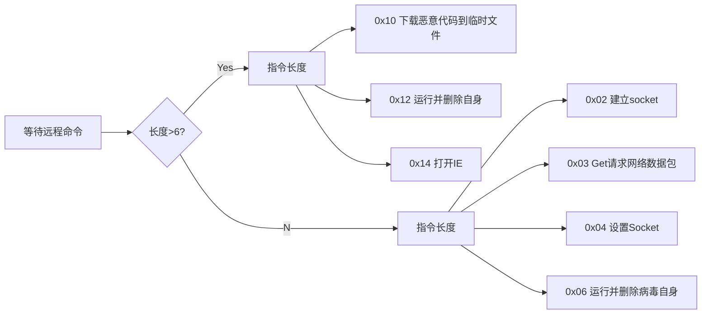

## 0x05 扩展：

### 什么是dll劫持

根据Windows资源共享机制，操作系统加载程序首先从应用程序目录中加载模块。这一特性在注册表中也有体现：`HKLM\System\CurrentControlSet\Control\Session Manager\SafeDllSearchMode`，如果为1，搜索的顺序为：应用程序所在目录->系统目录（用`GetSystemDirectory`获取）->16位系统目录-><a href="elink@bbcK9s2c8@1M7q4)9K6b7g2)9J5c8W2)9J5c8Y4N6%4N6#2)9J5k6i4S2A6j5h3A6U0i4K6u0W2j5$3!0E0i4K6u0r3">Windows</a>目录（用`GetWindowsDirectory`获取）->运行程序的当前目录->PATH环境变量，如果为0，搜索顺序为：应用程序所在目录->运行程序的当前目录->系统目录（用`GetSystemDirectory`获取）->16位系统目录-><a href="elink@af3K9s2c8@1M7q4)9K6b7g2)9J5c8W2)9J5c8Y4N6%4N6#2)9J5k6i4S2A6j5h3A6U0i4K6u0W2j5$3!0E0i4K6u0r3">Windows</a>目录（用`GetWindowsDirectory`获取）->PATH环境变量。<a href="elink@947K9s2c8@1M7q4)9K6b7g2)9J5c8W2)9J5c8Y4N6%4N6#2)9J5k6i4S2A6j5h3A6U0i4K6u0W2j5$3!0E0i4K6u0r3">Windows</a> Server 2003默认值为1，<a href="elink@028K9s2c8@1M7q4)9K6b7g2)9J5c8W2)9J5c8Y4N6%4N6#2)9J5k6i4S2A6j5h3A6U0i4K6u0W2j5$3!0E0i4K6u0r3">Windows</a> XP/2000默认值为0或者没有这个键值。但是不管是哪种情况，第一个搜索的肯定是应用程序的所在目录，这样就有机会让应用程序去加载我们的DLL。如果这个DLL和系统目录下的某个DLL同名，导出表也相同，功能就是加载系统目录下的那个DLL，并且将导出表转发到那个真实的DLL。这时DLL劫持就发生了。可以看出，构造一个符合上面要求的DLL，再将其放在可执行文件的目录即可轻松实现DLL劫持了。

### 如何实现dll劫持

通过编程来实现一个`LPK.DLL`文件，它与系统目录下的`LPK.DLL`导出表相同，并能加载系统目录下的`LPK.DLL`，并且能将导出表转发到真实的`LPK.DLL`。可以看出我们要实现的这个DLL需求如下：

1. 构造一个与系统目录下`LPK.DLL`一样的导出表；

2. 加载系统目录下的`LPK.DLL`；

3. 将导出函数转发到系统目录下的`LPK.DLL`上；

4. 在初始化函数中加入我们要执行的代码。

## 0x01 信息收集

首先利用哈希工具查看样本的哈希值

将样本上传至Virscan.org分析一下，查看报告

既然如此，我们就可以直接把它先脱壳再分析了：

脱壳之后使用Resource Hacker查看病毒程序，发现再RC数据下有一个PE文件，那么它很有可能会释放文件或者要利用这个文件执行什么操作：

## 0x02 行为分析

将病毒程序拖入火绒剑监控其行为，看看它做了哪些事。

先过滤出行为监控：

然后自我复制，接着把最开始执行的样本文件删除了，所以后面的操作都是最开始样本程序释放出的PE文件执行的。

紧接着就是释放了`hra32.dll`文件在系统目录下，`RCXDB94.tmp`文件在根目录下，再就是释放了一堆`lpk.dll`文件再各个目录下。 而且这些lpk文件都是隐藏的。

与此同时，网络行为主要是TCP连接和发送数据包：

而进程监控到的行为则是不断地创建进程，包括`cmd.exe`、`find.exe`、`explorer.exe`、`rar.exe`在命令行下完成一些操作，还有打开并写入设备，还有跨进程恢复线程以及退出进程。

再来看看注册表操作：

文件操作则集齐了打开、创建、写入、修改、截断内容、设置属性一系列的操作：

## 0x03 具体分析（恶意代码分析）

### 3.1 主代码分析

首先把样本拖入IDA分析，在它断到了OEP处之后按空格切换到源码界面，再按F5查看伪代码有助于我们分析，这个程序的main函数就映入眼帘了:

剩下几个函数需要点进去分析一波了。

#### 3.1.1 最开始的是 `sub_405A52`:

这里先是载入了`ADVAPI32.dll`，这个模块，百度一下说明是跟注册表的操控和事件日志有关，果不其然接着就获得了注册表的句柄，啊然后下面有很多数值，尝试转化成ASCII看能不能解读一下：

将下面的数值全部转化成ASCII码之后发现就是一个注册表的键，将它保存在`Source`中：

`SYSTEM\CurrentControlSet\Services\`

#### 3.1.2 然后我们回到上层函数继续分析 `Sub_40561A`：

先看看服务回调函数，这个服务有什么功能：

一进来便设置了服务和相关函数

##### `sub405394`:

这个函数的大致功能就是将文件中的资源读到内存中然后写入进文件：

回到上层函数继续往下看：

##### `Sub_4053A6`:

回头总结一下这个函数：

继续往下看：

#### 第一个线程回调 `Sub_402DD5`:

一进来就看到一堆用户名和密码的字符串，莫非是弱口令爆破？

##### 关键函数 `sub_402AD0`:

我们先确认一下传进来的几个参数

1. `int`引用型的IP地址

2. `int*` 型的用户名

3. `LPCSTR`型的密码

总结一下，这个函数就是复制文件并执行。

所以第一个线程的作用就是将自己复制并上传到局域网内的主机并执行。

#### 第二个线程回调函数 `Sub_4051E0`:

##### `sub_4050DB`:

注意这个函数传入参数是一个字符串，所以这个函数就是获取当前本地时间

##### `sub_405128`:

接着看这个线程回调函数：

`StartAddress`:

这是个非常长且复杂的函数

总结一下，这个函数将本机的信息发送除去，并下载文件然后执行`cmd`命令，然后关闭并删除`Ghijkl Nopqrstu Wxy`服务。这也是第二个线程回调函数的主要功能。

#### 第三个线程回调函数 `Sub_405241`:

这个函数的功能和第一个回调差不多，都是将自身代码上传到局域网中并执行。

总结一下这一串函数的功能：

###### tips：字符串解密：

将这里的函数识别出来的代码直接搬运到VS中，再修改一下参数类型微调一下就可以直接使用了：

#### 回到main函数，还有最后一个函数`Sub_405B6E`这个函数没有分析：

