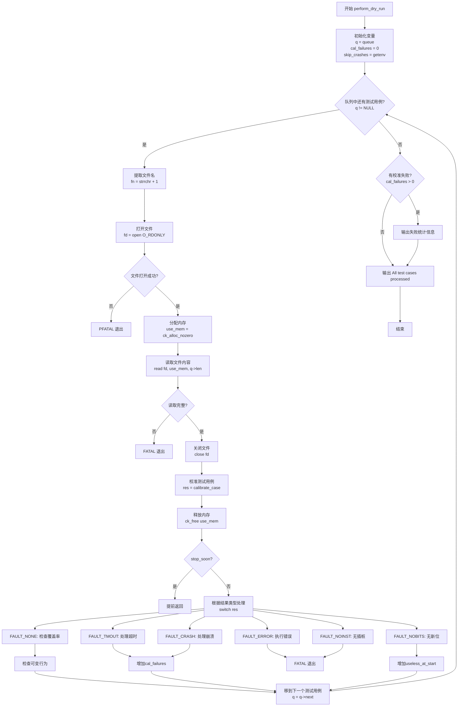

## `perform_dry_run`



## `update_bitmap_score`

```cpp
static void update_bitmap_score(struct queue_entry* q) {
    u32 i;
    u64 fav_factor = q->exec_us * q->len;
    /* For every byte set in trace_bits[], see if there is a previous winner,
       and how it compares to us. */
    for (i = 0; i < MAP_SIZE; i++)
        if (trace_bits[i]) {
            if (top_rated[i]) {
                /* Faster-executing or smaller test cases are favored. */
                if (fav_factor > top_rated[i]->exec_us * top_rated[i]->len) continue;
                /* Looks like we're going to win. Decrease ref count for the
                   previous winner, discard its trace_bits[] if necessary. */
                if (!--top_rated[i]->tc_ref) {
                    ck_free(top_rated[i]->trace_mini);
                    top_rated[i]->trace_mini = 0;
                }
            }
            /* Insert ourselves as the new winner. */
            top_rated[i] = q;
            q->tc_ref++;
            if (!q->trace_mini) {
                q->trace_mini = ck_alloc(MAP_SIZE >> 3);
                minimize_bits(q->trace_mini, trace_bits);
            }
            score_changed = 1;
        }
}
```

该函数是AFL优化算法的第一阶段，负责为每个覆盖率位置维护一个"最优"测试用例

```cpp
u64 fav_factor = q->exec_us * q->len;
```

`评分因子=执行时间*测试用例文件的大小`

评分改变只在以下情况发生：

**新的覆盖率位置：**

- 当 `trace_bits[i] != 0` 且 `top_rated[i] == NULL`
- 即发现了全新的代码覆盖路径

**更优的测试用例：**

- 现有位置有竞争者，但新测试用例表现更好
- `new_fav_factor < old_fav_factor`

```c
if (fav_factor > top_rated[i]->exec_us * top_rated[i]->len) continue; //要求严格优于
```

```cpp
top_rated[i] = q; // 设置新的最优测试用例
q->tc_ref++; // 增加引用计数
```

```cpp
if (!--top_rated[i]->tc_ref) {
    ck_free(top_rated[i]->trace_mini);
    top_rated[i]->trace_mini = 0;
}
```

减少旧的用例的引用次数，如果为0（就是bitmap上每一个路径都不是这个旧的用例的最佳用例），就会释放`trace_mini`，然后标记`trace_mini=0`，然后

```cpp
if (!q->trace_mini) {
    q->trace_mini = ck_alloc(MAP_SIZE >> 3); // 分配8KB
    minimize_bits(q->trace_mini, trace_bits); // 压缩64KB到8KB
}
```

如果新的最佳没有`trace_mini`就会分配一个，然后将64KB的覆盖率信息压缩为8KB的位向量

## `init_forkserver`

参数是`char **argv`指向目标程序的完整路径以及一些参数

```cpp
static s32 forksrv_pid; // Fork server进程ID
static s32 fsrv_ctl_fd; // 控制管道文件描述符(写端)
static s32 fsrv_st_fd; // 状态管道文件描述符(读端)
#define FORKSRV_FD 198 // Fork server通信基础文件描述符
#define FORK_WAIT_MULT 10 // 握手等待时间倍数
```

```cpp
static struct itimerval it;
int st_pipe[2], ctl_pipe[2];
int status;
s32 rlen;
ACTF("Spinning up the fork server...");
if (pipe(st_pipe) || pipe(ctl_pipe)) PFATAL("pipe() failed");
```

创建两个管道用户进程间的通信

- `st_pipe`: 状态管道，fork server → AFL主进程
- `ctl_pipe`: 控制管道，AFL主进程 → fork server

```cpp
forksrv_pid = fork();
if (forksrv_pid < 0) PFATAL("fork() failed");
if (!forksrv_pid) {
    // 子进程代码 - 将成为fork server
} else {
    // 父进程代码 - AFL主进程
}
```

### 子进程

```cpp
struct rlimit r;
if (!getrlimit(RLIMIT_NOFILE, &r) && r.rlim_cur < FORKSRV_FD + 2) {
    r.rlim_cur = FORKSRV_FD + 2;
    setrlimit(RLIMIT_NOFILE, &r);
}
```

确保有足够的文件描述符

```cpp
if (mem_limit) {
    r.rlim_max = r.rlim_cur = ((rlim_t)mem_limit) << 20;
#ifdef RLIMIT_AS
    setrlimit(RLIMIT_AS, &r);
#else
    setrlimit(RLIMIT_DATA, &r); // OpenBSD
#endif
}
```

不同系统使用不同的内存限制类型

```cpp
r.rlim_max = r.rlim_cur = 0;
setrlimit(RLIMIT_CORE, &r);
```

核心转储影响性能，且在模糊测试中不需要，因此禁用了

```cpp
setsid(); // 创建新会话，脱离控制终端
dup2(dev_null_fd, 1); // stdout → /dev/null
dup2(dev_null_fd, 2); // stderr → /dev/null
if (out_file) {
    dup2(dev_null_fd, 0); // stdin → /dev/null
} else {
    dup2(out_fd, 0); // stdin → 测试数据
    close(out_fd);
}
```

```cpp
if (dup2(ctl_pipe[0], FORKSRV_FD) < 0) PFATAL("dup2() failed"); // 198
if (dup2(st_pipe[1], FORKSRV_FD + 1) < 0) PFATAL("dup2() failed"); // 199
close(ctl_pipe[0]);
close(ctl_pipe[1]);
close(st_pipe[0]);
close(st_pipe[1]);
```

将管道映射到固定的文件描述符198和199上

```cpp
if (!getenv("LD_BIND_LAZY")) setenv("LD_BIND_NOW", "1", 0);
```

在程序启动时解析所有符号，避免fork后的链接工作

```cpp
setenv("ASAN_OPTIONS", "abort_on_error=1:"
       "detect_leaks=0:"
       "symbolize=0:"
       "allocator_may_return_null=1", 0);
setenv("MSAN_OPTIONS", "exit_code=" STRINGIFY(MSAN_ERROR) ":"
       "symbolize=0:"
       "abort_on_error=1:"
       "allocator_may_return_null=1:"
       "msan_track_origins=0", 0);
```

```cpp
execv(target_path, argv);
// 如果execv失败
*(u32*)trace_bits = EXEC_FAIL_SIG;
exit(0);
```

然后就直接执行`execv`函数

执行完之后这个新的进程就会替换掉这个子进程，但是文件描述符、PID以及相应的资源限制都会继承

如果当时是对test程序进行fuzz的话，此时`target_path`和`argv`都会指向该程序的绝对路径

因此这个子进程就会变成一个`test`进程

> execv参数设置：
>
> 1. `path`：指向要执行程序的绝对路径，例如：`/bin/ls`;
> 2. `argv`：要执行的命令，例如：`{"ls", "-l", "/tmp", NULL}`;
> 3. `env`：执行环境变量的C语言字符串

### 父进程（AFL主进程）

```cpp
close(ctl_pipe[0]); // 关闭控制管道读端
close(st_pipe[1]); // 关闭状态管道写端
fsrv_ctl_fd = ctl_pipe[1]; // 保存控制管道写端
fsrv_st_fd = st_pipe[0]; // 保存状态管道读端
```

设置管道的端点

```cpp
// 设置超时定时器
it.it_value.tv_sec = ((exec_tmout * FORK_WAIT_MULT) / 1000);
it.it_value.tv_usec = ((exec_tmout * FORK_WAIT_MULT) % 1000) * 1000;
setitimer(ITIMER_REAL, &it, NULL);
// 等待4字节hello消息
rlen = read(fsrv_st_fd, &status, 4);
// 清除定时器
it.it_value.tv_sec = 0;
it.it_value.tv_usec = 0;
setitimer(ITIMER_REAL, &it, NULL);
```

握手等待

```cpp
if (rlen == 4) {
    OKF("All right - fork server is up.");
    return;
}
```

成功会这样

```cpp
if (child_timed_out)
    FATAL("Timeout while initializing fork server (adjusting -t may help)");
```

超时

## 执行插桩代码分析

```cpp
_afl_maybe_log(argc, argv, envp, 43576LL);
```

`a4`是这个函数的唯一标识符，也可以说是一个时间戳的随机数

```cpp
char __fastcall _afl_maybe_log(__int64 a1, __int64 a2, __int64 a3, __int64 a4)
{
    char v4; // of
    char v5; // al
    __int64 v6; // rdx
    __int64 v7; // rcx
    char *v9; // rax
    int v10; // eax
    void *v11; // rax
    int v12; // edi
    __int64 v13; // rax
    __int64 v14; // rax
    __int64 v15; // [rsp-10h] [rbp-180h]
    char v16; // [rsp+10h] [rbp-160h]
    __int64 v17; // [rsp+18h] [rbp-158h]
    v5 = v4;
    v6 = _afl_area_ptr;
    if (!_afl_area_ptr) {
        if (_afl_setup_failure)
            return v5 + 127;
        v6 = _afl_global_area_ptr;
        if (_afl_global_area_ptr) {
            _afl_area_ptr = _afl_global_area_ptr;
        } else {
            v16 = v4;
            v17 = a4;
            v9 = getenv("__AFL_SHM_ID");
            if (!v9 || (v10 = atoi(v9), v11 = shmat(v10, 0LL, 0), v11 == (void *)-1LL)) {
                ++_afl_setup_failure;
                v5 = v16;
                return v5 + 127;
            }
            _afl_area_ptr = (__int64)v11;
            _afl_global_area_ptr = v11;
            v15 = (__int64)v11;
            if (write(199, &_afl_temp, 4uLL) == 4) {
                while (1) {
                    v12 = 198;
                    if (read(198, &_afl_temp, 4uLL) != 4)
                        break;
                    LODWORD(v13) = fork();
                    if (v13 < 0)
                        break;
                    if (!v13)
                        goto __afl_fork_resume;
                    _afl_fork_pid = v13;
                    write(199, &_afl_fork_pid, 4uLL);
                    v12 = _afl_fork_pid;
                    LODWORD(v14) = waitpid(_afl_fork_pid, &_afl_temp, 0);
                    if (v14 <= 0)
                        break;
                    write(199, &_afl_temp, 4uLL);
                }
                _exit(v12);
            }
        __afl_fork_resume:
            close(198);
            close(199);
            v6 = v15;
            v5 = v16;
            a4 = v17;
        }
    }
    v7 = _afl_prev_loc ^ a4;
    _afl_prev_loc ^= v7;
    _afl_prev_loc = (unsigned __int64)_afl_prev_loc >> 1;
    ++*(_BYTE *)(v6 + v7);
    return v5 + 127;
}
```

```cpp
v9 = getenv("__AFL_SHM_ID"); // 获取共享内存ID
v10 = atoi(v9); // 转换为整数
v11 = shmat(v10, 0LL, 0); // 连接共享内存
```

连接共享内存

#### Forkserver
