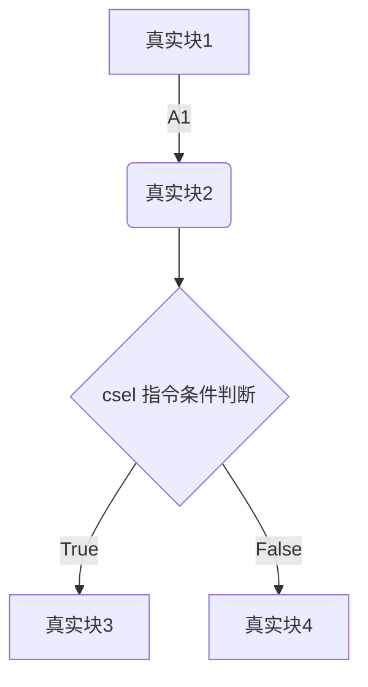

## 一些效果图


# 修复后


## 最后

还原 patch 的代码已经被我阉割，因为不是很完善，我仅提供一个非符号执行的思路供大家研究。

完整代码见附件，代码反混淆的目标是`JNI_OnLoad`，可以自己修改`offset`和`end`来修改目标。输出文件为`bin.out`。

今年高考没考好，过几天就去复读了，没有太多时间搞这个了。

欢迎讨论 + 提供 ARM64 的样本。

# 基于 Unicorn 的 ARM64 OLLVM 反混淆

## 0x0

最近在研究娜迦加固，娜迦加固的 SO 文件被 OLLVM 混淆，转而研究 OLLVM 反混淆。网上的很多关于 OLLVM 反混淆的资料都基于符号执行。符号执行主要用框架是 Miasm 和 Angr。Miasm 和 Angr 对 ARM64 指令集支持都不是很好，于是采用模拟执行的方式来寻找两个真实块的关系。本文仅提供大体思路，如果有更好的方法欢迎一起讨论，细节优化还要根据具体情况分析。

我把 OLLVM 混淆后的代码块分为两类：虚假块和真实块。虚假块仅包含 OLLVM 流程控制指令，不含任何真实指令。只要含有真实指令的代码块就是真实块。

反 OLLVM 混淆的关键是找出两个真实块之间的关系。

两个真实块之间的关系有两种：1、顺序；2、分支。



使用符号执行、模拟执行找出真实块之间的关系之后，patch 相应的跳转即可实现反混淆。

## 0x1 反汇编、代码块、CFG 分析

要获得目标函数的代码块和 CFG，首先要反汇编。反汇编使用 Capstone 反汇编引擎。

```python
offset = 0x70438 #function start

end = 0x7170C    #function end

bin1 = open('libvdog.so','rb').read()

md = Cs(CS_ARCH_ARM64,CS_MODE_ARM)

md.detail = True #enable detail analyise

list_blocks = {}

block_item = {}

processors = {}

dead_loop = []

real_blocks = []

csel_list_cond = {}

isNew = True

insStr = ''

for i in md.disasm(bin1[offset:end],offset):

    insStr += "0x%x:\t%s\t%s\n" %(i.address, i.mnemonic, i.op_str) 

    if isNew:

        isNew = False

        block_item = {}

        block_item["saddress"] = i.address

        block_item['capstone'] = []

    block_item['capstone'].append(i)

    block_item['flag'] = False

    if len(i.groups) > 0 or i.mnemonic == 'ret':

        isNew = True

        block_item["eaddress"] = i.address

        block_item['ins'] = insStr

        insStr = ''

        for op in i.operands:

            if op.type == ARM64_OP_IMM:

                block_item["naddress"] = op.value.imm

                if op.value.imm == i.address:

                    print "dead loop:%x" % i.address

                    dead_loop.append(i.address)

                if not processors.has_key(op.value.imm):

                    processors[op.value.imm] = 1

                else:

                    processors[op.value.imm] += 1

        if not block_item.has_key("naddress"):

            block_item['naddress'] = None

        list_blocks[block_item["saddress"]] = block_item

#delete dead loop

for dead in dead_loop:

    if processors.has_key(dead):

        del(processors[dead])
```

娜迦的样本中存在死循环路径，必须删掉。

## 0x2 识别真实块

真实块结束后会重新跳转入 OLLVM 分发流程的代码块，该代码块一定有很多引用，所以反汇编代码块的时候记录后继节点的引用数目（见前一段代码）。

```python
if not processors.has_key(op.value.imm):

    processors[op.value.imm] = 1

else:

    processors[op.value.imm] += 1
```

反汇编和代码块识别完成后，如果某个代码块的引用大于 1，就可能是分发器，引用该分发器的代码块就可能为真实块，筛选代码如下：

```python
for b in list_blocks:

    if processors.has_key(list_blocks[b]['naddress']):

        if processors[list_blocks[b]['naddress']] > 1:

            real_blocks.append(list_blocks[b]['saddress'])
```

真实情况下，虚假代码块也会引用分发器，所以还要进一步筛选。

```python
ssign = {u'b2',

 u'cmp11b.ne2',

 u'cmp11mov11b.ne2',

 u'movz12movk12b2',

 u'movz12movk12cmp11b.ne2',

 u'movz12movk12cmp11mov11b.ne2',

 'movz12movk12cmp11mov11movz12movk12movz12movk12b.ne2',

 u'movz12movk12cmp11movz12movk12b.eq2',

 'movz12movk12cmp11movz12movk12b.ne2',

 'movz12movk12movz12movk12b2',

 'movz12movk12cmp11movz12movk12movz12movk12movz12movk12b.eq2',

 'movz12movk12movz12movk12cmp11b.eq2',

 'movz12movk12movz12movk12cmp11movz12movk12b.eq2',

 'movz12movk12cmp11b.eq2',

         'ldr13b2',

         'mov11movz12movk12cmp11movz12movk12b.eq2'

 }

ssign2 = set()

def is_real_blocks(ins):

    sign = get_code_sign(ins)

    if sign in ssign:

        return False

    if sign.endswith('movk12movz12movk12b.ne2'):

        return False

    for insn in item['capstone']:

        #print insn.mnemonic

        if insn.mnemonic not in ['movz','movk','cmp','b.eq','b.ne']:

            return True

    ssign2.add(sign)

    return False

fake_blocks = []

for i in real_blocks:

    item = list_blocks[i]

    if not is_real_blocks(item):

        print '## fake block ###'

        print item['ins']

        fake_blocks.append(i)
```

采用特征码的方法识别 OLLVM 的虚假块。采用的特征码与寄存器、常量无关，只与指令类型、操作数类型有关。计算一个代码块的特征后进行匹配即可筛掉大量虚假代码块。

如果虚假块没有识别出来，那么可能导致后文的死循环，也是一种筛选思路。

按照定义，含有`ret`的代码块也属于真实块，但是前文真实块的识别基于引用大量代码块的共同引用代码块，`ret`指令显然不会引用任何代码块，故单独处理。

```python
for i in list_blocks:

    if list_blocks[i]['ins'].find('ret') != -1:

        print 'ret block:%x' % i

        real_blocks.append(i)
```

## 使用 Unicorn 模拟执行

### 初始化虚拟机

关于 Unicorn 的教程请自行 Google，这里只讨论 Unicorn 在寻找路径方面的应用。

```python
mu = Uc(UC_ARCH_ARM64, UC_MODE_ARM)

#init stack

mu.mem_map(0x80000000,0x10000 * 8)

mu.mem_map(0, 4 * 1024 * 1024)

mu.mem_write(0,bin1)

mu.reg_write(UC_ARM64_REG_SP, 0x80000000 + 0x10000 * 6)

mu.hook_add(UC_HOOK_CODE, hook_code)

mu.hook_add(UC_HOOK_MEM_UNMAPPED,hook_mem_access)
```

Unicorn 基于 QEMU 的模拟，所以必须给代码提供可运行的环境。最大的问题就是要关心内存处理。

我们只想得到 OLLVM 路径，而不是真实代码块的运行结果，因此要尽可能屏蔽非 OLLVM 的内存操作。具体屏蔽方法稍后介绍。上面这段代码初始化 Unicorn 的虚拟 CPU，并映射程序代码内存以及栈空间，最后调用`hook_add`设置`UC_HOOK_CODE`和`UC_HOOK_MEM_UNMAPPED`的事件回调。`UC_HOOK_CODE`回调会在每条指令执行前被调用，`UC_HOOK_MEM_UNMAPPED`会在内存异常的时候调用。

### 启动虚拟机

启动虚拟机的函数叫`find_path`，顾名思义，用于寻找真实块的下一个代码块。`branch`为分支控制。

如果`branch = 1`，则虚拟机在遇到`csel`指令的时候会走`csel`条件分支，否则走`csel`条件相反的分支。至于如何控制虚拟机内部指令的执行，稍后介绍。

```python
def find_path(start_addr,branch = None):

    global real_blocks

    global bin1

    global mu

    global list_trace

    global startaddr

    global distAddr

    global isSucess

    global branch_control

    try:

        list_trace = {}

        startaddr = start_addr

        isSucess = False

        distAddr = 0

        branch_control = branch

        mu.emu_start(start_addr,0x10000)

        print "emu end.."

    except UcError as e:

        pc = mu.reg_read(UC_ARM64_REG_PC)

        if pc != 0:

            #mu.reg_write(UC_ARM64_REG_PC, pc + 4)

            return find_path(pc + 4,branch)

        else:

            print("ERROR: %s  pc:%x" % (e,pc))

    if isSucess:

        return distAddr

    return None
```

### 控制流集成

使用队列的方式来路径搜索，起始搜索从函数入口开始。函数入口根据`offset`变量指定。

`queue`中的元素是一个二元组，第一项为执行地址，第二项为寄存器环境。每次搜索开始的时候从`queue`中获取一个将要搜索的真实块，设置寄存器，调用`find_path`搜索下一个真实块，将搜索到的真实块与新寄存器放入队列（保证上下文完整）。使用这样做的好处就是可以搜索任意队列中的代码块，并且寄存器环境一定是和该代码块一致的。

```python
queue = [(offset,None)]

flow = {}

while len(queue) != 0:

    env = queue.pop()

    pc = env[0]

    set_context(env[1])

    item = list_blocks[pc]

    if pc in flow:

        #print "???"

        continue

    flow[pc] = []

    if item['ins'].find('csel') != -1:

        #raw_input()

        ctx = get_context()

        p1 = find_path(pc,0)

        if p1 != None:

            queue.append((p1,get_context()))

            flow[pc].append(p1)

        set_context(ctx)

        p2 = find_path(pc,1)

        if p1 == p2:

            p2 = None

        if p2 != None:

            queue.append((p2,get_context()))

            flow[pc].append(p2)

    else:

        p = find_path(pc)

        if p != None:

            queue.append((p,get_context()))

        flow[pc].append(p)
```

### 虚拟机的内部核心 `hook_code`

Unicorn 在每一条汇编代码执行前会调用`UC_HOOK_CODE`回调，通过该回调可以控制虚拟机的一些行为。

这一节的代码均属于`hook_code`。

跳过一条指令，直接修改 PC 寄存器的值为下一条指令的地址：

```python
uc.reg_write(UC_ARM64_REG_PC, address + size)
```

路径探索，需要禁用掉一切函数调用、非栈空间内存访问，`0x80000000`为前面代码中提到的栈地址。当虚拟机指令有内存操作需求时，判断目标内存地址范围是否在栈中，如果不在栈中则跳过该指令。

禁用的指令有`bl`、`blx`，只要识别`bl`前缀即可。
