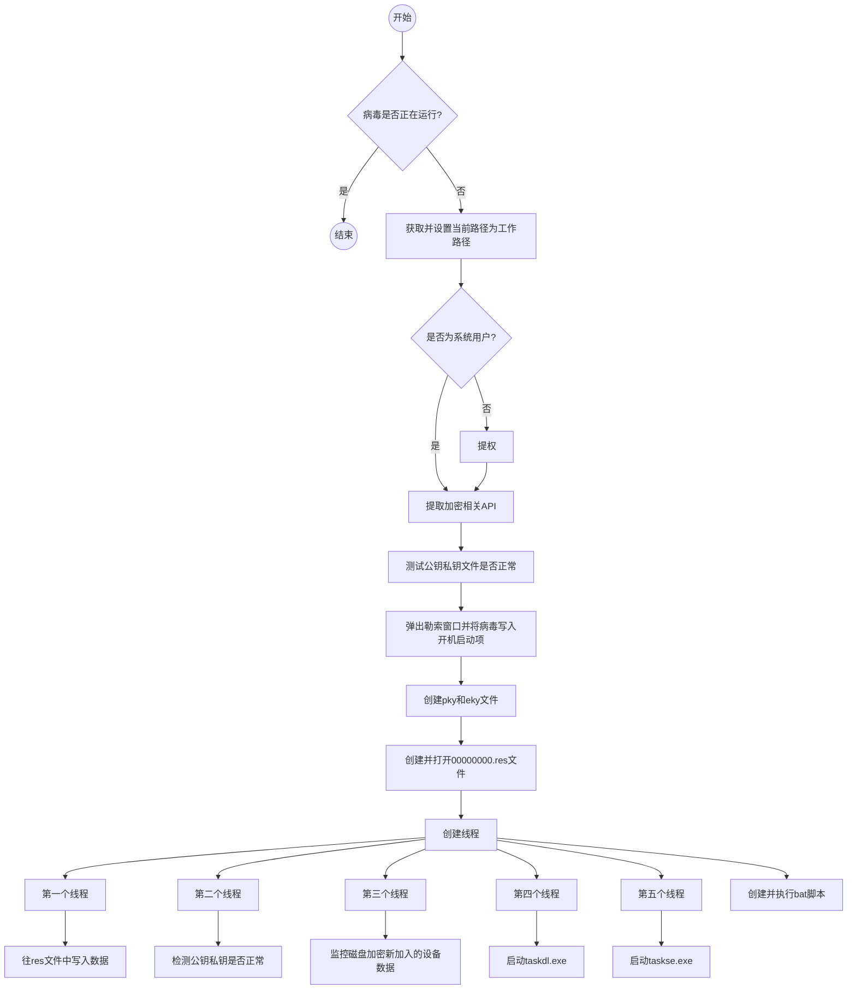

## `Sub_100057C0()`

## 总结一下 `TaskStart` 函数：

# 0x05 总结：

- `wannacry.exe` 程序：
  - 释放 `tasksche.exe` 到系统路径，启动服务
  - 利用漏洞攻击局域网和广域网的主机并传播
- `tasksche.exe` 程序：
  - 释放资源文件 `ZIP` 包 => `WNcry@2ol7`
  - `c.wnry` 保存比特币钱包，下载链接
  - `t.wnry` 隐藏加密的 `DLL` 核心文件，导出 `TaskStart` 函数
  - `u.wnry` 解密程序 `@WanaDecryptor@.exe`
  - `r.wnry` 勒索文档
  - `msg` 语言包
  - `taskdl.exe` 遍历磁盘删除 `.WNCRY` 文件
  - `taskse.exe` 提权程序
- 核心 `DLL` 文件：
  - 创建 `00000000.pky` 和 `00000000.eky` 文件
  - 启动 `@WanaDecryptor@.exe`
  - 创建线程，监控磁盘，加密新加入的磁盘上的文件
  - 启动 `taskdl.exe` 和 `taskse.exe`
  - 将病毒加入开机自启
  - 执行 `bat` 脚本

# 0x00 信息收集

- 样本信息：

  文件：`D:\Virus\样本\永恒之蓝WannaCry样本`

  | 属性 | 值 |
  | --- | --- |
  | 大小 | 3723264 bytes |
  | 文件版本 | 6.1.7601.17514 (win7sp1_rtm.101119-1850) |
  | 修改时间 | 2017年5月13日, 13：55：05 |
  | MD5 | DB349B97C37D22F5EA1D1841E3C89EB4 |
  | SHA1 | E889544AFF85FFAF8B0D0DA705105DEE7C97FE26 |
  | CRC32 | 9FBB1227 |

- PEID 分析：

  

  使用它的插件扫描一下使用了那些加密算法：

  可以发现有一些加密解密、压缩解压缩的操作，用到了AES加密库、微软的加密库、ZIP2、ZLIB等API。

  

- ResourceHacker 查看样本资源：

  发现资源中藏着一个PE文件，可能会释放文件，我们可以把它提取出来保存一份，根据微步云沙箱的检测这是一个EXE文件，所以这里我们把它保存为EXE文件：

  
  

- LordPE 查看样本输入表，发现有使用网络相关的操作：

  
