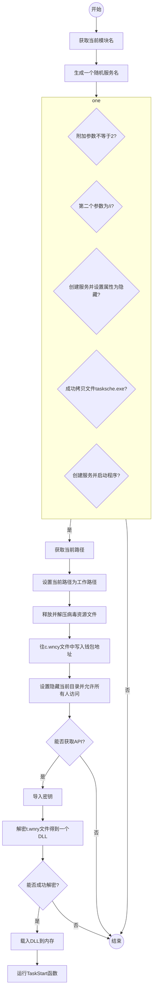

`v18`是读文件的实际字节数，这里是`0x10000`，也就是要对这么多个字节进行操作。

这个函数调用过后，在申请的空间中出现了一个PE文件，所以这个函数就是对文件数据的一个解密操作。

我们可以将这段数据保存出来，到一个文件中查看其信息：

ExeInfo查看其是一个无壳的DLL文件：

使用LordPE查看其导出表发现有一个导出函数：

那么回过头我们可以小结一下`sub_4014A6()`函数就是解密`t.wnry`文件

## `Sub_4021BD()`

### `sub_4021E9()`

看到这里可以猜测一下这个函数就是载入刚刚释放的DLL文件，然后获取其函数用的。

下面还有很多函数，就不需要一一去分析了，我们直接跳到最后看一下返回值是什么：

这个`v22`就是保存PE文件和内存信息的结构体呀：

那么我们可以在OD里运行一下这个函数，看看它申请的60个字节的空间里装了什么：

1. 第一个地址装了个DOS头

   

2. 第二个地址是DLL的默认加载基址（`0x10000000`）

3. 第三个地址是导出表信息

   

4. 第四个是导出函数个数（6）

5. 最后5个是函数指针

所以小结一下`sub_4021BD`就是载入了刚刚释放的DLL文件。

继续往下看，发现了一个函数名`TaskStart`：

这个不就是刚才那个DLL文件的导出函数嘛？

为了更方便分析，我们不妨新增一个自定义结构体，将每个字段都标记出来，这样`v7`的曹祖哟我们看起来就不会很陌生了。

### `sub_402924()`

其实看到这里就可以认为这个函数实在找目标函数`TaskStart`了

当然也可以去OD验证一下：

运行过后得到了一个地址：`10005AE0`

我们可以查看刚刚得到的DLL文件的导出函数的地址：

证明这个函数就是找`TaskStart`函数，返回值就是该函数的地址。

那么最后，这个由主题程序释放出来的`tasksche.exe`的各个函数也分析的差不多了，可以大致梳理一下流程了：

## 小结（子）：

# `0x04` `TaskStart`函数分析：

病毒母体费好大劲释放了子程序，子程序又废了好大劲找到了这个函数要把它运行起来，那么我们就来看看这个函数具体做了那些事情：

看来要弄清的函数还不少：

## `Sub_10001000()`

这个函数之前也见到过，就是读取或写入`c.wnry`文件

如果`a2`是1就是读，是0的话就是写入

## `Sub_10012D0()`

### `sub_10011D0()`

通过当前进程获取用户ID

小结一下：`Sub__100012D0`函数就是判断当前用户是否为系统用户

## `Sub_10004500()`

### `sub_1003D10()`

这里的文件名显示是我们调用的时候传入的参数

可是它在数据段，静态分析并不知道是个啥，所以还得用OD查看：

我们跟进查看一下：

找到了目标函数，然后F7跟进查看：

观察堆栈可以发现除了有个`00000000.dky`还有个`00000000.pky`文件。所以回过头来我们可以认定这个`FileName`就是`00000000.pky`。

#### `sub_10003F00()`

应该就是将`pky`文件读取到内存中

回到`Sub_1003D10()`中这有两个函数指针无法识别，而且在OD中也无法定位到这个地址

这显然不是个函数，所以我们只能进入`sub_10003D10`这个函数之后动态调试观察有什么用了。

这个时候出现了测试数据`TESTDATA`:

再次出现测试数据，应该跟拷贝有关了：

开始比较加密解密后的数据和原数据是否一致：

那么分析到这里我们就可以认为函数`sub_10003D10`是用来测试`pky`和`dky`文件是否正常使用。结合之前使用到的加密函数和这个加密解密方式，有理由认为这是一个RSA的加密方式，所谓的`pky`和`dky`就是公钥和私钥文件。

小结：`Sub_10004500`函数创建了互斥体设置其安全属性，然后使用测试数据来检测公钥私钥是否正常。

## `Sub_10004990()`

### `sub_10004890()`

`@WanaDecryptor@.exe`就是勒索的弹窗程序，也是用来解密的：

### `sub_10047F0()`

这个函数就一个功能，向注册表中添加开机启动项：

### 小结一下，`Sub_40004990()`

该函数函数启动了弹窗勒索和`taskse.exe`程序并将其添加至开机启动项

## `Sub_10003AC0()`

注意栈区的参数，新增了一个`eky`文件

### `sub_10003C40()`

#### `sub_10004170()`

分别查看这几个函数的参数地址都指向了什么：

这些函数都和RSA加密有关，猜测这个函数就是用来加密的。

#### 小结一下`sub_10003C40()`

创建了`00000000.eky`文件并加密。

### 小结一下`Sub_10003AC0()`

主要就是创建了`pky`和`eky`文件

## `Sub_100045D0()`

这个函数没有参数，而且里面使用的变量也不知道是什么，老样子，上OD：

这一看就很清晰了，创建并读取了`00000000.res`文件

接下来是创建5个线程：

## 第一个线程`Sub_10004790()`

这个线程的工作很简单就是创建`res`文件并往其中写入数据。

## 第二个线程`Sub_100045C0()`

检测是否有`dky`文件并测试加密函数。

## 第三个线程`Sub_10005730()`

### `sub_10005680()`

#### `sub_10001830()`

##### `sub_100029F0()`

###### `sub_1000D92C()`

这是用来移动文件的，把`C:\Users\15PB\Desktop\说明.txt`移动到系统临时目录下，并改名为`1.WNCRYT`。

接着看这个`do...while...`大循环

发现每次拼接的文件名都不同都是`x.WNCRYT`文件，这个数字在递增。

而且被移动的目标文件也不同，最后还删了，所以这个大循环应该是遍历目录，将文件转移到临时文件夹并删除源文件。

#### `sub_10005340()`

##### 小结一下`sub_10001830()`

这个函数就是将用户文件夹移动到系统临时文件夹并用`f.wnry`文件记录文件夹信息。

#### `sub_10005540()`

##### `sub_10005060()`

所以这个函数是检测如果磁盘为c盘就返回临时目录，如果是别的磁盘就在c盘下创建目录并设置隐藏。

##### `sub_100027F0()`

###### `sub_10002300()`

一进来就看到了熟悉的找文件：

果然往下翻找到了另一个：

那么这个函数就是在遍历文件！！！

- `sub_10002F70()`

这个函数用来测试目标目录能否创建文件。

###### `2300->2940->2220->1960()`

这里就是对文件的加密和数据构成了：

#### 小结一下5680

### 小结一下5730

## 第四个线程`Sub_10005300()`

启动释放资源中的`taskdl.exe`文件

## 第五个线程`Sub_10004990()`

