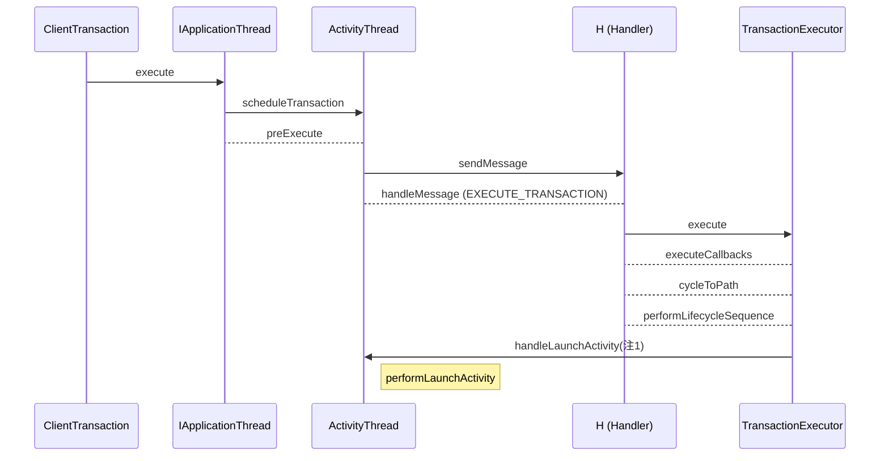
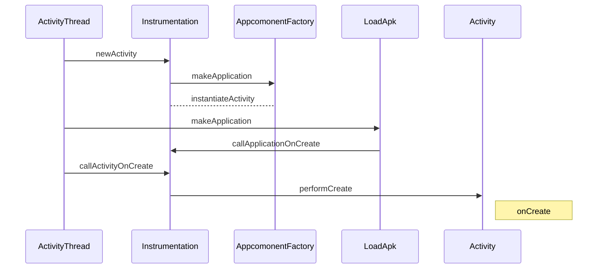
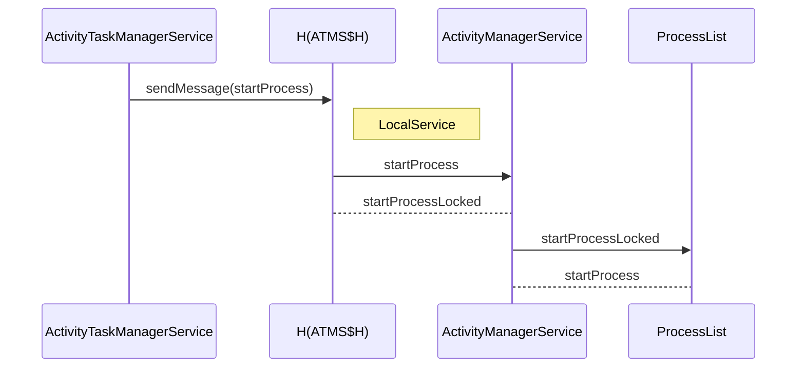

`resumeFocusedTasksTopActivities` 方法正如其名字一样，将所有聚焦的 Task 的所有 Activity 恢复运行，因为有些刚加入的 Activity 是处于暂停状态的。

## Task

`Task` 从宏观来说是一系列 `Activity` 界面的集合，根据先进后出的栈结构进行组织。注意 `task` 和 进程/线程是不同的概念，大多数 `task` 可以认为是从桌面点击某个应用开始启动，随着不断点击深入打开其他界面，使对应的 `Activity` 入栈，在点击返回时将当前 `Activity` 出栈并销毁，如下所示:

![task][img-task]

同时，整个 `Task` 本身也可以被移动当后台，比如当用户点击 `HOME` 键时，此时 `Task` 中的所有 `Activity` 都会停止。`Task` 中的 `Activity` 可以同属于一个 `APP`，也可能属于不同的 `APP` 和进程。在 `Android R (11)` 以及 `Android S(12)` beta 的代码中(甚至更早的代码之前)，`Task` 类实际上是 `ActivityStack`，可以认为 `Task` 就是 `ActivityStack`，`ActivityStack` 就是 `Task`。关于 `Task` 的更多介绍，可以阅读官方的文档: [Tasks and the back stack][task]。

`resumeFocusedTasksTopActivities` 中主要是判断传入的 `targetRootTask` 是否等于当前栈顶的 `Task`，不管是否相等，后续都是调用栈顶 `Task` 的 `resumeTopActivityUncheckedLocked` 方法。

其中对 `Task` 进行了一次判断，如果是非叶子结点，则对所有子结点递归调用本方法，递归结束(即到达叶子结点)后才继续实际流程。再次执行了一系列的判断，比如查找当前栈帧中最接近栈顶且可显示和可聚焦的 `Activity` (`next`)，判断其暂停状态以及所属用户的权限等，然后进入到 `resumeTopActivityInnerLocked`。

该方法中主要是寻找合适的 `ActivityRecord`、设置 `resume` 条件、准备启动目标 `Activity`。最后，来到了我们的关键逻辑:

```java
@GuardedBy("mService")
private boolean resumeTopActivityInnerLocked(ActivityRecord prev, ActivityOptions options) {
ActivityRecord next = topRunningActivity(true /* focusableOnly */);
// ...
if (next.attachedToProcess()) {
// Activity 已经附加到进程，恢复页面并更新栈
} else {
// Whoops, need to restart this activity!
mTaskSupervisor.startSpecificActivity(next, true, true);
}
}
```

在函数末尾处判断当前(栈顶) `Activity` 是否与已有的进程关联，如果已经关联，就在该进程中恢复页面。否则就需要 (重新) 启动目标 `Activity`。启动新进程是在 `startSpecificActivity` 中，属于 `TaskSupervisor`。这是个垃圾类，里面有各种不同功能的代码(Google 原话)，因此我们不需要对其过多关注。

```java
void startSpecificActivity(ActivityRecord r, boolean andResume, boolean checkConfig) {
// Is this activity's application already running?
final WindowProcessController wpc =
mService.getProcessController(r.processName, r.info.applicationInfo.uid);
boolean knownToBeDead = false;
if (wpc != null && wpc.hasThread()) {
try {
realStartActivityLocked(r, wpc, andResume, checkConfig);
return;
} catch (RemoteException e) {
Slog.w(TAG, "Exception when starting activity "
+ r.intent.getComponent().flattenToShortString(), e);
}
// If a dead object exception was thrown -- fall through to
// restart the application.
knownToBeDead = true;
}
r.notifyUnknownVisibilityLaunchedForKeyguardTransition();
final boolean isTop = andResume && r.isTopRunningActivity();
mService.startProcessAsync(r, knownToBeDead, isTop, isTop ? "top-activity" : "activity");
}
```

`startSpecificActivity` 主要是判断目标 `Activity` 所在的应用是否正在运行。如果已经在运行就直接启动，否则就启动新进程。下面我们分别对这两种情况进行分析。

# 进程已存在

如果待启动的 `Activity` 所属的 `Application` 已经在运行中，那么只需要在其对应进程启动 `Activity`，此时所走的分支是 `realStartActivityLocked`。该函数的核心是创建事务并分发给生命周期管理器进行处理。

```java
// Create activity launch transaction.
final ClientTransaction clientTransaction = ClientTransaction.obtain(
proc.getThread(), r.appToken);
final ActivityLifecycleItem lifecycleItem;
if (andResume) {
lifecycleItem = ResumeActivityItem.obtain(mService.isNextTransitionForward());
} else {
lifecycleItem = PauseActivityItem.obtain();
}
clientTransaction.setLifecycleStateRequest(lifecycleItem);
// Schedule transaction.
mService.getLifecycleManager().scheduleTransaction(clientTransaction);
```

## Transaction

事务(`Transaction`)是包含一系列消息的容器，这些消息最终可能会传送到客户端中。其中包含一组回调以及最终的生命周期状态。`setLifecycleStateRequest` 用于指定客户端的终态，即事务执行完毕后客户端应当处于的最终状态，其参数类型是 `ActivityLifecycleItem`，可以理解为发送给客户端的请求。

这里的 `mService` 是 `ActivityTaskManagerService`，是一个主要用于管理 `activity` 及其容器(`task`、`display` 等)的系统服务；`getLifecycleManager` 返回 `ClientLifecycleManager`。但这都不重要，因为最终也只是执行了 `transaction.schedule()` 开始调度事务，主要按照以下顺序执行:

1. 客户端调用 `preExecute`，触发所有需要在真正调度事务前执行完毕的工作；
2. 发送事务的 `message` 信息到客户端；
3. 客户端调用 `TransactionExecutor.execute`，执行所有回调以及必要的生命周期事务；

```java
public void schedule() throws RemoteException {
mClient.scheduleTransaction(this);
}
```

`mClient` 为 `IApplicationThread` 类型，这是个抽象接口，同时也是远程调用接口，其 `AIDL` 定义在: `frameworks/base/core/java/android/app/IApplicationThread.aidl` 文件中。因此，最终的调用又会回到 RPC 的实现端，即应用程序所在的客户端，实现类为 `ActivityThread`。其中通过异步的 `Handler` 分发和调度事件，最终在 执行线程(主线程)的 `handleMessage` 回调中执行服务端传过来的 `Transaction`。流程大致如下图所示:



![realStartActivityLocked][img1]

值得一提的是，`TransactionExecutor` 中执行了 `mTransactionHandler.handleLaunchActivity`，而 `mTransactionHandler` 是在 `TransactionExecutor` 的构造函数中传入的，构造正是在 `ActivityThread` 中:

```java
class ActivityThread {
// ...
private final TransactionExecutor mTransactionExecutor = new TransactionExecutor(this);
}
```

因此，注 1 中实际调用的是 `ActivityThread` 的 `handleLaunchActivity`。

## Launch Activity

`ActivityThread` 中的 `performLaunchActivity` 是启动 `Activity` 的核心实现。其主要伪代码为:

```java
private Activity performLaunchActivity(ActivityClientRecord r, Intent customIntent) {
ContextImpl appContext = createBaseContextForActivity(r);
java.lang.ClassLoader cl = appContext.getClassLoader();
activity = mInstrumentation.newActivity(cl, component.getClassName(), r.intent);
Application app = r.packageInfo.makeApplication(false, mInstrumentation);
// loadLabel
// initialize Activity resources
// activity.attach(appContext, ...)
mInstrumentation.callActivityOnCreate(activity, ...);
}
```

长话短说，主要流程为:

1. 创建应用上下文(`Context`)，获取 `ClassLoader`；
2. 创建 `Activity` 对象，实质上是 `classLoader.loadClass(name).newInstance()`，这里会对 `Activity` 类进行初始化，调用对象的 `<cinit>` 方法，从而执行目标类里 `static block` 中的代码；
3. 根据应用的 `AndroidManifest.xml` 创建 `Application`对象，并调用其 `onCreate` 回调；
4. 调用对应 `Activity` 的 `onCreate` 回调；

调用时序如下图所示:



![performLaunchActivity][img2]

最终，调用到开发者熟知的生命周期函数 `Activity.onCreate`，开始执行 `APP` 本身的代码。

值得一提的是上面的代码都在 `APP` 的主线程中执行，`Application.onCreate` 仅在应用初次启动时调用一次，并且早于任意 `Activity/Service/Receiver` 执行，不过 `ContentProvider` 是个例外。

关于 `Android` 应用的生命周期，可以参考: [The Activity Lifecycle][life]，一个简略的流程如下图所示:

![life][img-life]

# 启动新进程

分析完了进程已经存在的情况下启动应用 `Activity` 的流程，现在再翻回头看看进程不存在的情况。此时需要通过 `mService.startProcessAsync` 去启动进程。

## AMS

`mService` 也就是前面提到的 `ActivityTaskManagerService`(`ATMS`)，启动进程通过异步发送消息的方式发送给 `AMS`，再由其执行启动进程的操作。



![startProcessAsync][img3]

`startProcessLocked` 中关键的伪代码如下:

```java
ProcessRecord startProcessLocked(String processName, ...) {
ProcessRecord app = getProcessRecordLocked(processName, info.uid);
final String entryPoint = "android.app.ActivityThread";
// ...
startProcess(hostingRecord, entryPoint, app, ...)
}
```

记住这里的 `entryPoint` 字符串，值为 `android.app.ActivityThread`，后面会用到。

`ProcessRecord` 中包含特定运行中进程的所有信息，在进程启动完成后，再通过 `handleProcessStartedLocked` 来填充动态的进程 ID 等内容。

`startProcess` 根据入参确定实际的启动进程方式:
