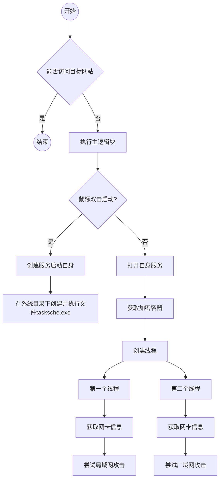

# [讨论][讨论]记录Wannacry病毒的分析

## 0x00 信息收集

- 样本信息：
  - 文件: `D:\Virus\样本\永恒之蓝WannaCry样本`
  - 大小: 3723264 bytes
  - 文件版本: 6.1.7601.17514 (win7sp1\_rtm.101119-1850)
  - 修改时间: 2017年5月13日, 13：55：05
  - MD5: DB349B97C37D22F5EA1D1841E3C89EB4
  - SHA1: E889544AFF85FFAF8B0D0DA705105DEE7C97FE26
  - CRC32: 9FBB1227

- PEID分析：
  
  使用它的插件扫描一下使用了那些加密算法：
  可以发现有一些加密解密、压缩解压缩的操作，用到了AES加密库、微软的加密库、ZIP2、ZLIB等API。
  

- ResourceHacker查看样本资源：
  发现资源中藏着一个PE文件，可能会释放文件，我们可以把它提取出来保存一份，根据微步云沙箱的检测这是一个EXE文件，所以这里我们把它保存为EXE文件：
  
  

- LordPE查看样本输入表，发现有使用网络相关的操作：
  
  将刚刚我们提取出来的exe文件再次拖到Resource Hacker里查看一下其资源，发现了有一个`PK`开头的资源，这是一个ZIP格式的压缩文件，我们可以再次将它提取出来，保存为ZIP文件，当然微步云沙箱也能检测出这个文件的格式：
  
  
  可以看出来这个压缩包里有很多文件，但都是经过加密的，无法直接解压缩和查看：
  

## 0x01 主程序行为分析

- 行为信息：
  

- 释放PE文件到`C:\Windows\taskse.exe`、`C:\ProgramData\znemvazsnwpqy217\taskse.exe`和`C:\ProgramData\znemvazsnwpqy217\@WanaDecryptor@.exe`
- 启动`C:\Windows\taskse.exe`
- 自我复制

- 进程信息：
  
  - 打开网络相关设备`\Device\Afd`、`\Device\Nsi`
  - 打开进程
  - 创建进程`C:\Windows\taskse.exe`
  - 跨进程写入数据
  - 恢复目标进程线程

- 注册表信息：
  
  - 大量打开并获取注册表键值

- 文件信息：
  
  - 打开大量的DLL文件
  - 遍历目录寻找`.pbk`文件->没有找到
  - 在`C:\Windows`下创建了`tasksche.exe`文件并设置文件属性
  - 在`C:\ProgramData\znemvazsnwpqy217`下创建了`tasksche.exe`文件并设置文件属性

- 执行情况：
  
  - 启动进程->样本本体
  - 加载模块->`C:\Windows\winsxs\x86_microsoft.windows.common-controls_6595b64144ccf1df_6.0.7601.17514_none_41e6975e2bd6f2b2\comctl32.dll`
  - 启动进程->`C:\Windows\tasksche.exe`
  - 退出进程->样本本体和`C:\Windows\tasksche.exe`

## 0x02 主代码分析（WinMain）

打开IDA载入样本文件，快速定位到`WinMain`函数并按`F5`进入查看伪代码:

### Sub_408090()

这里的检测参数个数其实就是检测是否由鼠标双击运行，因为双击运行的话程序的执行参数就只有一个了：

#### Sub_408000()

这里就是注册了一个服务然后设置了一下参数就开始执行`Sub_407BD0`这个函数，重点就是这个函数干了什么：

##### Sub_407BD0()

###### Sub_407B90()

- Sub_407A20()

分析到这里其实我们可以用工具去直接找样本中的这两个地址和大小然后把文件提取出来看看这两个文件是干什么的，这里可以使用010 Editor，当然别的十六进制工具也行。

1. 第一个PE文件起始RVA是B020,大小是C8A4,由于不知道是什么格式只知道是个PE文件，这里就暂时保存为EXE文件吧

载入ExeInfo查看该文件信息，发现是一个DLL文件：

然后LordPE查看它的输入输出表，可以看到输出表就一个函数PlayGame，有点奇怪

2. 第二个PE文件的起始RVA是F080，大小是4060：

而这个文件无法通过ExeInfo识别：

但是它确实是一个PE文件呀，那么还有一种情况：这是一个Dos文件

小结一下，`Sub_407B90`函数的功能主要是：

###### 第一个线程Sub_407720()

- sub_409160()

除了获取网卡信息以及IP地址列表、网关列表之外还有大量的数据计算，实在不好分析，这里就使用OD动态调试吧，看看到底有什么结果：

出现了本机的IP连接信息：

- Sub_4076B0()

继续向下分析可见这个线程就是用来收发数据的

<mark>注意：</mark>那么这个收发数据可能就和攻击有关了。

###### 第二个线程Sub_407840()

主要的功能如下，发现其调用的大多都是第一个回调函数里的函数

那么`Sub_407840()`的主要功能就是随机组合一个公网IP并尝试连接445端口，如果连接上了就会攻击这台主机以及这台主机所在的局域网的所有主机，如果没有连接上，就会尝试继续组合IP。

总结一下`Sub_408000()`:

总结一下`Sub_407BD0()`:

#### Sub_407F20()

这个函数调用了两个函数，我们分别进入分析：

##### sub_407C40()

这个函数挺简单的，就是创建并开启了一个服务：

<mark>注意</mark>此时程序就是以附加参数的方式启动，下次检测的时候就会进入参数大于1的分支！

##### sub_407CE0()

这个函数就是创建文件并执行exe的函数

还记得前面从样本提取出来的EXE文件吗?它就是R资源

小结一下`Sub_407F20`函数的功能

### 小结（母）

按照现有的分析可以梳理一下大致的流程：

样本主函数以及分析完了，接下来就要去看看他释放并启动的`C:\WINDOWS\tasksche.exe`这个文件的行为了。

## 0x03 tasksche.exe的分析

首先，由于这个被释放出来的文件是没有加壳的，所以我们可以直接将它载入IDA定位到main查看其代码：

这个判断的条件有点多，我们一个一个去看:

### Sub_401B5F()

所以这个函数就是尝试在`C:\WINDOWS\ProgramData`、`C:\WINDOWS\Intel`、`C:\WINDOWS`或临时目录下创建服务并设置其属性为隐藏。

### Sub_401F5D()

接着就来了三个函数：

#### sub_401CE8()

如果有目标服务就直接开启了，没有的话以`tasksche.exe`所在的完整路径创建一个服务并运行

#### sub_401EFF()

#### sub_401064()

先关注一下这个函数有三个参数，第一个就是路径，后两个都是0

就是创建了一个隐藏的进程去运行程序

小结一下，`sub_401F5D`函数就是创建一个服务或进程来运行`tasksche.exe`

回到主函数，继续往下看：

### Sub_4010FD()

如果参数是1，就设置当前路径为注册表值

如果是0，就获取注册表中病毒路径设置到当前目录中

### Sub_401DAB()

这个Str的字符是这一串，然后我们点进去看看这个函数有什么操作：

一进来就寻找那个ZIP包的资源

猜测这个sub_4075AD就是用来解压的函数，我们可以验证一下，那个Str就是密码：

真的就成功解压缩了，把病毒资源释放出来了

### Sub_401E9E()

### Sub_401437()

注意：该函数调用的时候后三个参数都是0

### Sub_4014A6()

应该是对`t.wnry`文件进行操作

到这里都是读取文件中的数据然后比较

#### sub_4019E1()

进去临界区进行解密操作

#### sub_402A76()

这个函数非常复杂，里面涉及到了很多数据的计算，猜测是加密或者解密的操作，可以进OD调试，看看到了这个函数会发生什么：

第一个参数是Dest，数据窗口跟随查看有什么：

第二个是Src，一样的，查看有什么：

`F8`单步步过之后发现这两个空间的值并没有发生变化，只有`EAX`作为返回值得到了`0xA`

这个函数暂时不知道是干什么的，做个`?`标记一下继续往下看吧

#### sub_403A77()

这个函数点进去看也比较复杂，还是使用OD动态调试吧：

首先这个函数有5个参数，除去this指针，堆栈中有4个

可见Src就是刚刚从文件读取出来的数据，v16是申请出来的空间

