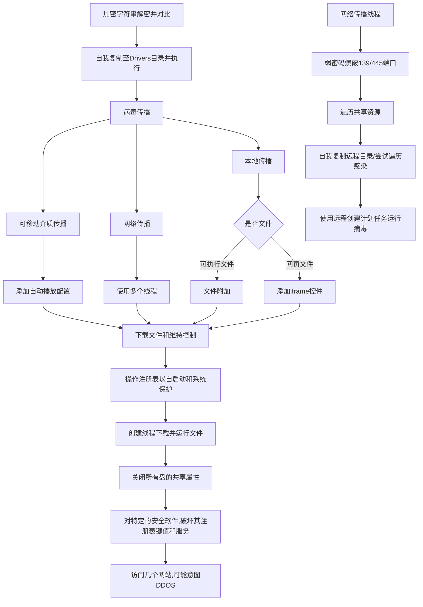

# [原创]熊猫烧香 病毒流程分析 附 感染文件修复源码

[TOC]

# 病毒行为流程图




# 加密字符串解密并对比

- 在`40D5D6`处对特定字符进行了解密，并将解密结果和`**武汉男生感染下载者**`进行对比，如果不同则直接退出

- 认为可以将两特殊字符串作为特征码进行杀毒

- 将`whboy`与`0x71747d64`的解密结果和`01001A0`进行比较

- 同样相同则继续运行，不同则退出

# 自我复制至drivers并执行

- 首先判断自己是不是被感染文件`病毒感染文件时会将文件结尾的1作为标记`

- 如果是，将直接执行恢复的操作

- 但是不会影响感染病毒自我传播动作

- 先判断自己的执行路径是否位于`%SYSTEMROOT%\\System32\\drivers`中

- 如果不在，将结束其他相同进程并自我复制到`drivers`中

- 然后使用`WinExec`运行`drviers`中的副本

- 之后结束当前进程

- 如果在当前运行路径为`%SYSTEMROOT%\\System32\\drivers`则继续运行

# 判断是否是被感染文件启动的

- 在之前已经将自己的PE文件整个读取到内存中，病毒通过文件结尾的标志判断是否是被感染文件

- 如果是被感染文件的结尾标记为`Whboy|原文件名|原文件尾缀名|2|源文件大小|1`

- 如果是被感染文件

- 病毒会根据文件结尾的信息创建一个类似以`010editor.exe.exe`的文件，并将源文件内容填充文件

- 然后通过`批处理脚本`对被感染文件替换，然后运行原文件。

- 创建批处理文件源码

- 创建的批处理文件内容为：

- 之后判断是否有运行中的相同病毒

- 如果有的话会删除`drivers`中的病毒副本，然后将正常的放入

- 应该是为了之后的传播和避免自我感染，保证了`drivers`中是最原本的病毒

# 病毒传播

- 总共分为三个步骤，先创建了一个线程对本地进行传播

- 而后创建了一个6秒的定时器在每个驱动器下创建了`setup.exe`并添加了自动播放配置`应该是为了移动介质传播`

- 之后创建了10个进程在端口139和445尝试通过弱密码进行传播

## 本地传播

- 首先通过一个函数遍历所有存在的驱动器，并且将盘符拼接成一个字符串

- 之后跳过了，A/B盘然后对文件进行遍历和感染

- 在遍历文件感染中，会先判断路径是否是一些关键的目录，如果是的话或跳过

- 之后判断``Desktop\_.ini`在目录下是否存在，应该是标记已经感染过的目录

- 不存在将在目录下创建，并将内容设置为当前的日期

- 如果存在会更新当前目录下的`Desktop\_.ini`中的日期

## 如果是文件

- 会对特定的文件类型进行特定的感染

- 区分可执行文件和网页文件

- 并且会跳过文件名为`setup.exe`的文件`应该是病毒的默认命名`

## 可执行文件的感染

- 先判断这个文件的路径是不是当前运行的路径

- 然后在文件内查找`WhBoy`的关键字，以判断是不是已经感染，已经被感染将直接跳过

- 感染步骤中先会将自己的文件拷贝覆盖原来的文件

- 然后将源文件的内容附加到文件末尾

- 之后将源文件的部分信息也存至文件末尾，包括`Whboy|包括尾缀的文件名|文件尾缀名|2|自我大小|1`这是OD中写入文件尾部时的传参

## 网页文件

- 会先解密一段内容，内容为`<iframe src=<mark class="encrypted">ac4K9s2c8@1M7q4)9K6b7g2)9J5c8W2)9J5c8Y4N6%4N6#2)9J5k6h3q4U0z5o6k6Q4x3X3g2U0L8W2)9J5c8U0j5$3i4K6u0r3K9h3&6V1k6i4S2Q4x3X3g2Z5N6r3@1`.</mark> width="0" height="0"></iframe>`是个`iframe`控件

- 然后会将这个控件写入到找到的网页文件内

- 网页文件的感染比较简单，只是简单的增加了一些东西

## 可移动介质传播

- 同样，首先获取所有的有效盘符，然后跳过AB盘

- 之后判断目录下是否存在`setup.exe`如果存在的话，拿自己替换他。

- 如果不存在`setup.exe`，将自己命名`setup.exe`后拷贝过去

- 之后判断是不是存在`autorun.inf`

- 如果不存在就创建一个并且写入`[AutoRun]\r\nOPEN=setup.exe\r\nshellexecute=setup.exe\r\nshell\\Auto\\command=setup.exe\r\n`

- 如果存在判断是不是这个语句，如果不是的话会跳过，之后处理

- 之后将`setup.exe`设置为`只读，隐藏，系统文件`

- 之后对已经存在的`autorun.inf`进行处理

- 先更改存在的`autorun.inf`的文件属性，并且删除掉

- zhi后再创建一个`autorun.inf`跟之前的一样

- ==`autorun.inf` 猜测应该是U盘等插入的自动运行配置文件，保证被感染U盘插入后自动运行的是病毒文件==

## 网络传播(开了 10 个线程)

- 首先是一个函数，<u>猜测是通过当前IP地址和掩码来构造一个IP迭代器</u>

- ~~这个函数因为内部太恐怖了，所以只是大概的瞟了一眼~~

## 接下去尝试链接`139端口`如果失败则链接`445端口`


- 连上了以后会构造一个带`\\`的IP地址传参进一个函数

- 函数开头先构造了一个结构体

- 之后对IP使用``预制的用户名列表``和`预制的密码列表`尝试爆破登录

- 如果登录成功会调用另一个函数

- 用户名列表也比较简单，密码列表也只有100个……这里就截图一部分了……IDA没法直接识别还是有点难受的可能跟`delphi`的字符串结构有关

## 遍历共享资源

- 进函数后，先使用`NetShareEnum`来检索服务器上所有的共享资源信息`如果没有或者连接失败直接退出`

- 如果有共享资源，则尝试能否访问指定目录

- 指定目录是个列表，通过指针访问目录列表是这些

- 未找到则则再获取一个共享资源信息

## 将自己复制到远程目录

- 找到的话将`drivers`中的病毒源文件复制到远程目录下命名为`GameSetup.exe`

- 如果复制失败，会尝试遍历远程文件并使用之前本地感染的函数进行感染

- 如果成功，会获取`远程文件路径`和`远程主机时间`

## 使用远程创建计划任务运行病毒

- 之后会使用路径和获取的时间增加一个`远程任务`以运行复制过去的病毒文件。

# 下载文件和维持控制

​ 这个函数内设置了5个计时器……分别有不同的作用，但是其中又有很多相同的。

## 在注册表内 将自己设置为 自启动 和 受保护的系统文件


## 创建线程去下载文件

- 首先会解码url之后使用一个函数下载文件

- 其中会冒充QQ访问解码出来的URL后读取内容并进行了一个拼接

- 根据代码猜测文件格式应该是一个类似链表的东西，可以通过更改文件来更改下载的次数``/r/n后应该是剩余的文件个数``

- 如果没找到就只有一个，如果找到了就再次循环

- ~~因为URL已经无法访问，所以这部分分析的比较错乱~~

## 关闭所有盘的共享属性

感觉可能是用于避免重复感染


## 对特定的安全软件进行破坏

- 通过注册表和服务进行对安全软件进行破坏

## 解密并访问了几个网站但是意义不明，可能是为了DDOS？


- 访问的几个URL为

```url
http://www.tom.com
http://www.163.com
http://www.sohu.com
http://www.yahoo.com
http://www.google.com
```

## 再次下载文件，可能换了个URL，但是代码相同

# 修复工具源码

进程结束用的`taskkill`

杀毒用的MD5
