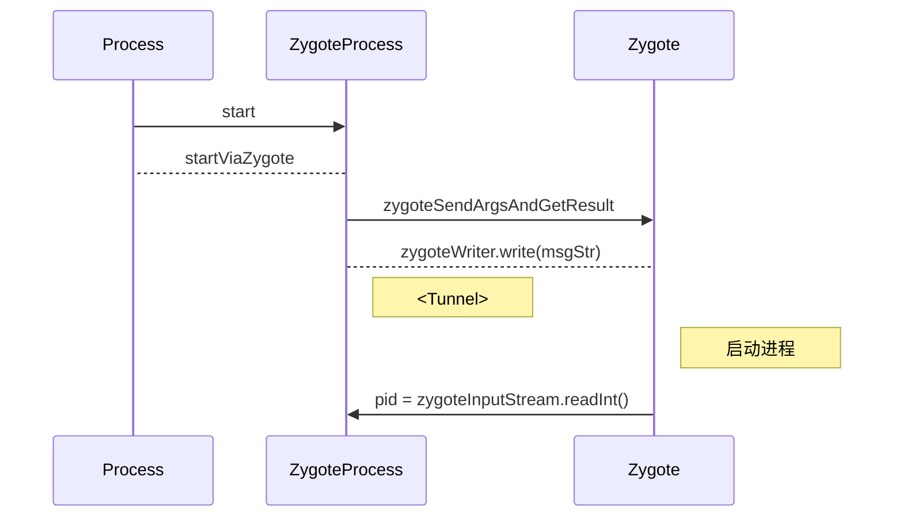
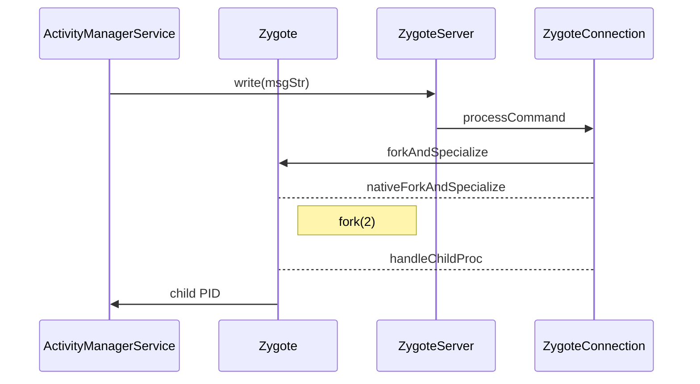
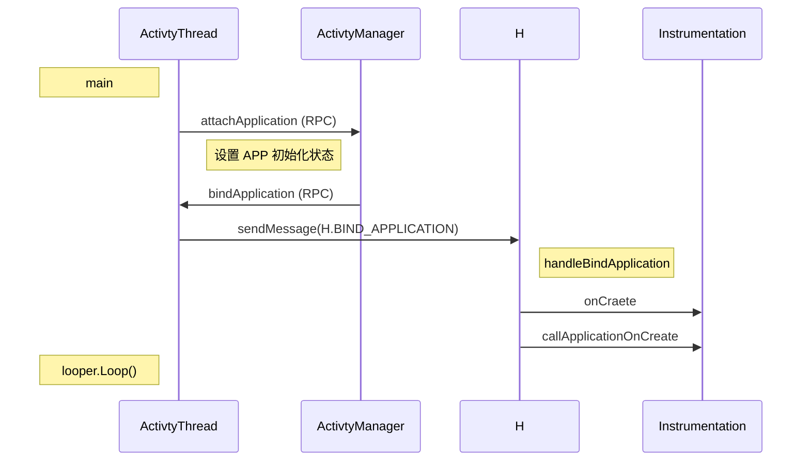

```java
private Process.ProcessStartResult startProcess(...) {
// mount App data ...
// data isolation ...
if (hostingRecord.usesWebviewZygote()) {
startResult = startWebView(entryPoint, app.processName, uid, ...);
} else if (hostingRecord.usesAppZygote()) {
final AppZygote appZygote = createAppZygoteForProcessIfNeeded(app);
startResult = appZygote.getProcess().start(entryPoint, app.processName, uid, ...);
} else {
regularZygote = true;
Process.start(entryPoint, app.processName, uid, ...);
}
}
```

可以看到新进程都是从 zygote 衍生的，但实际上有三种不同类型的 zygote:

1. <a href="elink@61dK9s2c8@1M7s2y4Q4x3@1q4Q4x3V1k6Q4x3V1k6S2L8X3c8J5L8$3W2V1i4K6u0W2k6$3!0G2k6$3I4W2M7$3!0#2M7X3y4W2i4K6u0W2j5$3!0E0i4K6u0r3M7r3I4S2N6r3k6G2M7X3#2Q4x3V1k6K6P5i4y4@1k6h3#2Q4x3V1k6K6k6i4m8G2L8r3W2U0P5g2)9J5c8W2)9J5b7W2)9J5c8X3#2S2M7%4c8W2M7W2)9J5c8Y4m8J5K9i4k6S2N6r3g2Q4x3V1k6\*7P5h3N6G2N6r3g2Q4x3X3g2@1k6b7`.`.">regular zygote</a>: 即常规的 zygote32/zygote64 进程，是所有 Android Java 应用的父进程；

2. <a href="elink@0adK9s2c8@1M7s2y4Q4x3@1q4Q4x3V1k6Q4x3V1k6S2L8X3c8J5L8$3W2V1i4K6u0W2k6$3!0G2k6$3I4W2M7$3!0#2M7X3y4W2i4K6u0W2j5$3!0E0i4K6u0r3M7r3I4S2N6r3k6G2M7X3#2Q4x3V1k6K6P5i4y4@1k6h3#2Q4x3V1k6K6k6i4m8G2L8r3W2U0P5g2)9J5c8W2)9J5b7W2)9J5c8X3#2S2M7%4c8W2M7W2)9J5c8Y4m8J5K9i4k6S2N6r3g2Q4x3V1k6S2M7s2m8Q4y4h3k6\*7P5h3N6G2N6r3g2Q4x3X3g2@1k6b7`.`.">app zygote</a>: 应用 zygote 进程，与常规 zygote 创建的应用相比受到更多限制；

3. <a href="elink@a76K9s2c8@1M7s2y4Q4x3@1q4Q4x3V1k6Q4x3V1k6S2L8X3c8J5L8$3W2V1i4K6u0W2k6$3!0G2k6$3I4W2M7$3!0#2M7X3y4W2i4K6u0W2j5$3!0E0i4K6u0r3M7r3I4S2N6r3k6G2M7X3#2Q4x3V1k6K6P5i4y4@1k6h3#2Q4x3V1k6K6k6i4m8G2L8r3W2U0P5g2)9J5c8W2)9J5b7W2)9J5c8X3#2S2M7%4c8W2M7W2)9J5c8Y4m8J5K9i4k6S2N6r3g2Q4x3V1k6%4k6h3u0$3K9h3g2%4i4K6g2X3P5Y4W2Y4L8%4c8W2i4K6u0W2N6r3f1`.">webview zygote</a>: 辅助 zygote 进程，用于创建 isolated\_app 进程来渲染不可信的 web 内容，具有最为严格的安全限制；

## Zygote

对于我们的分析场景，只需要关注常规 zygote 创建进程的情况，其他模式也是大同小异。根据上述代码，创建进程的请求最终会进入到 `Process.start`，这是个静态函数，主要工作是封装新进程的启动参数(进程名、`UID`、`GID`、`appDataDir` 等信息)为字符串，并通过 `zygoteWriter` 发送给 zygote 进程，通知 zygote 启动新的进程并返回对应的新进程 ID，图示如下:



![Process.start][img4]

上图中的 Tunnel 是 AMS 进程与 zygote 进程的通信桥梁，二者实质上通过 UNIX socket 进行通信:

```java
// android/internal/os/Zygote.java
/**
 * Creates a managed LocalServerSocket object using a file descriptor
 * created by an init.rc script. The init scripts that specify the
 * sockets name can be found in system/core/rootdir. The socket is bound
 * to the file system in the /dev/sockets/ directory, and the file
 * descriptor is shared via the ANDROID_SOCKET_<socketName> environment
 * variable.
 */
static LocalServerSocket createManagedSocketFromInitSocket(String socketName) {
int fileDesc;
final String fullSocketName = ANDROID_SOCKET_PREFIX + socketName;
try {
String env = System.getenv(fullSocketName);
fileDesc = Integer.parseInt(env);
} catch (RuntimeException ex) {
throw new RuntimeException("Socket unset or invalid: " + fullSocketName, ex);
}
try {
FileDescriptor fd = new FileDescriptor();
fd.setInt$(fileDesc);
return new LocalServerSocket(fd);
} catch (IOException ex) {
throw new RuntimeException(
"Error building socket from file descriptor: " + fileDesc, ex);
}
}
```

socket 名称通过环境变量传递，key 为 `"ANDROID_SOCKET_" + "zygote"`。

## `ZygoteServer`

前面说了 Zygote 进程收到 AMS 发送的数据后会启动进程并将新进程的 PID 返回，而这些流程正是在 `ZygoteServer` 中实现的:

```java
// frameworks/base/core/java/com/android/internal/os/ZygoteServer.java
class ZygoteServer {
/**
 * Runs the zygote process's select loop. Accepts new connections as
 * they happen, and reads commands from connections one spawn-request's
 * worth at a time.
 * @param abiList list of ABIs supported by this zygote.
 */
Runnable runSelectLoop(String abiList) {
ArrayList<FileDescriptor> socketFDs = new ArrayList<>();
socketFDs.add(mZygoteSocket.getFileDescriptor());
while (true) {
pollFDs = new StructPollfd[socketFDs.size()];
pollReturnValue = Os.poll(pollFDs, pollTimeoutMs);
// ...
while (--pollIndex >= 0) {
if ((pollFDs[pollIndex].revents & POLLIN) == 0) continue;
ZygoteConnection connection = peers.get(pollIndex);
// 处理收到的命令，并且根据需要执行 fork，注意该系统调用会返回两次
Runnable command = connection.processCommand(this, multipleForksOK);
if (mIsForkChild) {
// We're in the child
} else {
// We're in the server
}
// ...
}
}
}
}
```

处理和执行 Socket 信息的流程如下图所示:



![ZygoteServer][img5]

在 `fork` 完成后，父进程根据传入的参数设置好子进程的名称、`UID` 等属性，再将子进程 PID 返回给 AMS，完成新进程的启动流程。当然，其中存在一些细节的优化，比如用 pre-fork (同时`fork` N个进程，监听同一个socket fd，当收到消息的时候，只有一个进程会被唤醒，来处理这个消息) 机制加快应用启动速度，感兴趣的可以自行探索。

在 `ZygoteConnection` `fork` 完成后，父进程中的返回会执行 `handleParentProc`，子进程的返回会执行 `handleChildProc`。该函数返回的是一个 `Runnable` 对象，包含子进程待执行的代码。

## 子进程初始化

对于子进程，调用链路为:

- `handleChildProc`

- `ZygoteInit.zygoteInit`

- `RuntimeInit.applicationInit`

- `RuntimeInit.findStaticMain`

```java
protected static Runnable applicationInit(int targetSdkVersion, long[] disabledCompatChanges,
String[] argv, ClassLoader classLoader) {
VMRuntime.getRuntime().setTargetSdkVersion(targetSdkVersion);
VMRuntime.getRuntime().setDisabledCompatChanges(disabledCompatChanges);
final Arguments args = new Arguments(argv);
// The end of of the RuntimeInit event (see #zygoteInit).
Trace.traceEnd(Trace.TRACE_TAG_ACTIVITY_MANAGER);
// Remaining arguments are passed to the start class's static main
return findStaticMain(args.startClass, args.startArgs, classLoader);
}
```

最终调用的实际上是 `startClass` 的 `static main(argv[])` 方法。还记得前文中提到的 `entryPoint` 吗？传到此处的 `startClass` 正是 `entryPoint` 的值，即 `android.app.ActivityThread`。因此，子进程的入口是 `ActivityThread` 的 `main` 方法，该方法的调用链路如下图所示:



![ActivtyThread.main][img6]

首先通过 RPC 进程间通信调用到 AMS 服务端，设置一些初始化状态(如调试状态、启动状态、OOM 优先级等)后，又通过 RPC 回调到客户端，虽然兜了一圈，但这也是为了实现权限分离，让 AMS 专职负责管理系统应用状态。

回到客户端后，将应用信息封装发送给主线程去执行启动流程，这些都在 `handleBindApplication` 方法中实现，摘取一些关键的代码片段如下:
